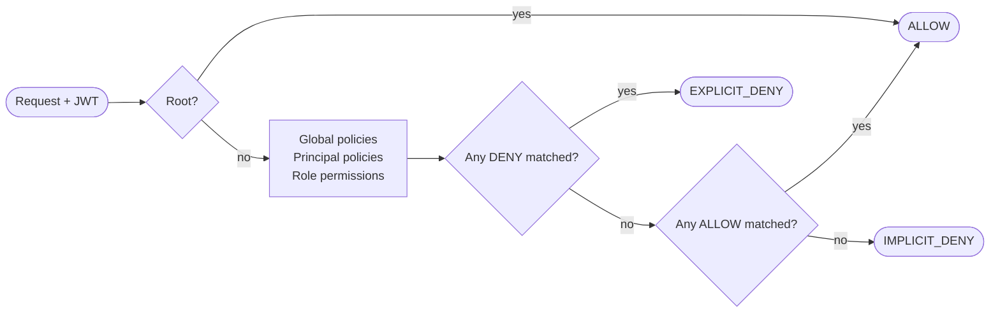

# CoSec

Multi-tenant, reactive security for Spring: IAM-style policies and role-based permissions, evaluated
deny-first for every request.

[](https://www.apache.org/licenses/LICENSE-2.0.html)
[](https://github.com/Ahoo-Wang/CoSec/releases)
[](https://central.sonatype.com/artifact/me.ahoo.cosec/cosec-core)
[](https://www.codacy.com/gh/Ahoo-Wang/CoSec/dashboard?utm_source=github.com&amp;utm_medium=referral&amp;utm_content=Ahoo-Wang/CoSec&amp;utm_campaign=Badge_Grade)
[](https://codecov.io/gh/Ahoo-Wang/CoSec)
[](https://github.com/Ahoo-Wang/CoSec)
[](https://github.com/Ahoo-Wang/CoSec/actions/workflows/codeql.yml)
[](https://github.com/KotlinBy/awesome-kotlin)
[](https://deepwiki.com/Ahoo-Wang/CoSec)

> [Documentation](https://cosec.ahoo.me/) | [中文文档](https://cosec.ahoo.me/zh/)

## Why CoSec

- **Policies as data.** JSON policies with path actions, composable conditions (roles, tenants, headers,
  IP, expressions) and rate limits. Change them at runtime; every instance sees the change immediately.
- **Deny wins, everywhere.** Global policies, the principal's own policies and role permissions are combined
  deny-first, unmatched requests are denied, and errors deny.
- **Multi-tenant and role-based.** Tenant-aware principals, plus per-application permission catalogs
  granted to roles per space.
- **One pipeline, three stacks.** Spring WebFlux, Spring MVC and Spring Cloud Gateway share the same
  security pipeline and respond identically.
- **Fast and reactive.** Built on Project Reactor. About 2 µs per decision, with no event-loop blocking.
- **Auditable.** An audit event (log or Kafka) and an OpenTelemetry span for every decision, naming the
  policy or permission that decided it.

## How a decision is made



Denied anonymous callers get `401`, authenticated callers `403`, and rate-limited requests `429`.

## Quick start

```kotlin
dependencies {
    implementation(platform("me.ahoo.cosec:cosec-bom:<version>"))
    implementation("me.ahoo.cosec:cosec-spring-boot-starter") {
        capabilities { requireCapability("me.ahoo.cosec:webflux-support") } // or webmvc-support / gateway-support
    }
    implementation("me.ahoo.cosec:cosec-spring-boot-starter") {
        capabilities { requireCapability("me.ahoo.cosec:cache-support") }   // Redis-backed policy storage
    }
}
```

```yaml
cosec:
  jwt:
    secret: ${COSEC_JWT_SECRET}
  authorization:
    local-policy:
      enabled: true          # classpath:cosec-policy/*-policy.json
      init-repository: true
```

```json
{
  "id": "app", "name": "App", "category": "app", "description": "", "type": "global", "tenantId": "(platform)",
  "statements": [
    { "name": "public", "action": ["/auth/login", "/actuator/health"] },
    { "name": "authenticated", "action": "/api/**", "condition": { "authenticated": {} } },
    { "name": "admins-only", "effect": "deny", "action": "/api/admin/**",
      "condition": { "inRole": { "value": "admin", "negate": true } } }
  ]
}
```

Continue with the [Quick Start](https://cosec.ahoo.me/guide/quick-start) to issue tokens, then the
[policy reference](https://cosec.ahoo.me/guide/policies).

## Modules

| Module | Purpose |
|---|---|
| `cosec-api` | Public interfaces: principal, policy, authorization, request, tenant |
| `cosec-core` | Policy engine, matchers, authorization, security pipeline, auditing |
| `cosec-jwt` | JWT issuing and verification |
| `cosec-webflux` · `cosec-webmvc` · `cosec-gateway` | Spring WebFlux, Spring MVC and Spring Cloud Gateway adapters |
| `cosec-cocache` | Redis-backed policies, permissions and token revocation; Redis rate limiters |
| `cosec-social` | OAuth social login via JustAuth |
| `cosec-opentelemetry` · `cosec-openapi` · `cosec-ip2region` · `cosec-kafka` | Tracing, policy generation from OpenAPI, IP geolocation, Kafka audit sink |
| `cosec-spring-boot-starter` | Auto-configuration; integrations are opt-in Gradle capabilities |
| `cosec-gateway-server` | Ready-to-run gateway image (`ahoowang/cosec-gateway`) |

## Documentation

- **Guide**: [Introduction](https://cosec.ahoo.me/guide/introduction) ·
  [Quick Start](https://cosec.ahoo.me/guide/quick-start) · [Policies](https://cosec.ahoo.me/guide/policies) ·
  [Configuration](https://cosec.ahoo.me/guide/configuration) · [Authentication](https://cosec.ahoo.me/guide/authentication) ·
  [Web Integration](https://cosec.ahoo.me/guide/web-integration) · [Operations](https://cosec.ahoo.me/guide/operations)
- **Architecture**: [Overview](https://cosec.ahoo.me/architecture/overview) · [Extending](https://cosec.ahoo.me/architecture/extending)
- **Releases**: [GitHub Releases](https://github.com/Ahoo-Wang/CoSec/releases)

## Contributing

Contributions are welcome. Read [CONTRIBUTING.md](CONTRIBUTING.md) for the workflow, quality gates and
release process. This project follows a [Code of Conduct](CODE_OF_CONDUCT.md).

## Security

Report vulnerabilities privately as described in [SECURITY.md](SECURITY.md); do not open public issues for them.

## License

CoSec is released under the [Apache License 2.0](LICENSE). Its policy model is inspired by
[AWS IAM](https://docs.aws.amazon.com/IAM/latest/UserGuide/introduction.html).
