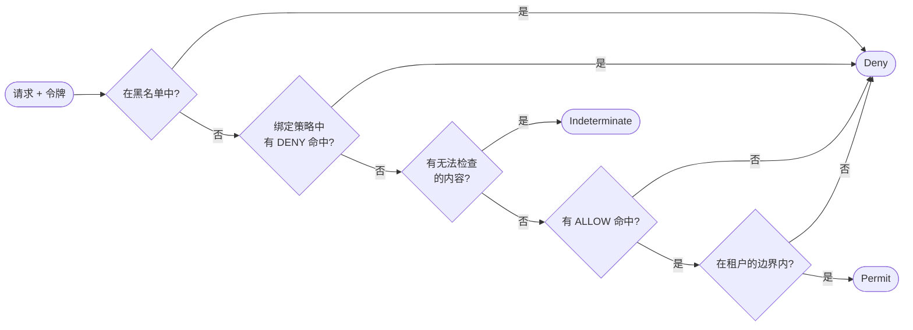

# CoSec

面向 Spring 的多租户、非阻塞授权框架：IAM 风格的策略文档与基于角色的权限，每个请求都按“拒绝优先”求值。


[](https://www.apache.org/licenses/LICENSE-2.0.html)
[](https://github.com/Ahoo-Wang/CoSec/releases)
[](https://central.sonatype.com/artifact/me.ahoo.cosec/cosec-api)
[](https://www.codacy.com/gh/Ahoo-Wang/CoSec/dashboard?utm_source=github.com&amp;utm_medium=referral&amp;utm_content=Ahoo-Wang/CoSec&amp;utm_campaign=Badge_Grade)
[](https://codecov.io/gh/Ahoo-Wang/CoSec)
[](https://github.com/Ahoo-Wang/CoSec/actions/workflows/ci.yml)
[](https://github.com/Ahoo-Wang/CoSec/actions/workflows/codeql.yml)
[](https://github.com/KotlinBy/awesome-kotlin)
[](https://deepwiki.com/Ahoo-Wang/CoSec)

> [中文文档](https://cosec.ahoo.me/zh/) | [Documentation](https://cosec.ahoo.me/)

## 为什么选择 CoSec

- **策略即数据。** 平台、应用和租户文档都是 JSON：语句作用于动作和资源，条件带类型（角色、租户、应用和空间、IP 段、时间窗口、
  外部属性），绑定说明每条策略适用于谁。每个实例把文档编译成从 Redis 读取的快照，发布的变更无需重启即可生效。
- **拒绝处处优先。** 任何文档中命中的 DENY 都压过所有 ALLOW；未匹配的请求一律拒绝；无法做出决策的请求失败即拒绝，返回 `503`。
- **多租户与角色权限。** 租户拥有自己的文档，每个应用发布自己的权限目录并按空间把权限授予角色，平台边界限定任何租户能放行的范围。
- **可审查的变更。** 控制面在发布前校验、模拟变更，并用线上流量做影子验证；保留修订记录，可以回滚。
- **限流。** 按 IP、按用户或共享的配额写成文档中的规则，只由被放行的请求消耗，由 Redis 全集群计数，并返回 `RateLimit-*` 和
  `Retry-After` 响应头。
- **一条流程，三种技术栈。** Spring WebFlux、Spring MVC 和 Spring Cloud Gateway 共用同一条处理流程，响应完全一致，错误统一为
  `application/problem+json`。
- **高性能且不阻塞。** 每个请求的流程开销约 2 µs，不阻塞事件循环。
- **可审计。** 每个请求都有一个决策事件（审计日志、Kafka、Micrometer、OpenTelemetry），并记录做出决定的语句和绑定。

## 如何做出决策



被拒绝时，匿名调用方返回 `401`，已认证调用方返回 `403`；无法决策的请求返回 `503`；被放行但超出限流的请求返回 `429`。

## 快速开始

```kotlin
dependencies {
    implementation(platform("me.ahoo.cosec:cosec-bom:<version>"))
    implementation("me.ahoo.cosec:cosec-spring-boot")
    implementation("me.ahoo.cosec:cosec-webflux")                      // 或 cosec-webmvc / cosec-gateway
    implementation("me.ahoo.cosec:cosec-cocache")                      // Redis：快照、吊销、限流
    implementation("org.springframework.boot:spring-boot-data-redis")
    implementation("me.ahoo.cocache:cocache-spring-boot-starter")
}
```

```yaml
cosec:
  jwt:
    secret: ${COSEC_JWT_SECRET}
  authorization:
    routes:
      location: ""   # 暂不使用路由映射：请求按 http:<METHOD> 和 http:path:<path> 授权
```

Redis 必须使用 `maxmemory-policy noeviction`。发布一份平台文档（这里用 `cosec-migrate publish`）；在它存在之前，所有请求都返回 `503`：

```json
{
  "schema": 2, "revision": 1, "publishedAt": "2026-10-28T00:00:00Z",
  "policies": [
    { "id": "public", "statements": [
      { "effect": "allow", "action": "http:POST", "resource": "http:path:/auth/login" },
      { "effect": "allow", "action": "http:GET", "resource": "http:path:/actuator/health" } ] },
    { "id": "members", "statements": [
      { "effect": "allow", "action": "http:*", "resource": "http:path:/api/**",
        "condition": { "eq": ["subject.authenticated", true] } } ] },
    { "id": "admins-only", "statements": [
      { "effect": "deny", "action": "http:*", "resource": "http:path:/api/admin/**",
        "condition": { "not": { "in": ["admin", "scope.roles"] } } } ] }
  ],
  "bindings": [
    { "id": "public", "subject": "*", "app": "*", "space": "*", "policy": "public" },
    { "id": "members", "subject": "*", "app": "*", "space": "*", "policy": "members" },
    { "id": "admins-only", "subject": "*", "app": "*", "space": "*", "policy": "admins-only" }
  ]
}
```

接下来阅读[快速开始](https://cosec.ahoo.me/zh/guide/quick-start)了解如何签发令牌，再阅读[策略语言](https://cosec.ahoo.me/zh/policies/language)。

## 模块

`cosec-spring-boot` 自带请求处理流程、登录、JWT 支持和自动配置；各项集成（WebFlux、MVC、Gateway、Redis、控制面、OAuth、
OpenTelemetry、Micrometer、OpenAPI、ip2region、Kafka）都是在它旁边按需添加的模块，starter 装配它在类路径上找到的模块。`cosec-migrate` 用于转换 7.x 数据并发布文档。
完整列表见[模块](https://cosec.ahoo.me/zh/guide/introduction#modules)。开箱即用的网关以容器镜像 `ahoowang/cosec-gateway` 发布。

## 文档

- **入门**：[简介](https://cosec.ahoo.me/zh/guide/introduction) · [快速开始](https://cosec.ahoo.me/zh/guide/quick-start) ·
  [核心概念](https://cosec.ahoo.me/zh/guide/concepts) · [安全模型](https://cosec.ahoo.me/zh/guide/security-model)
- **集成**：[Web 集成](https://cosec.ahoo.me/zh/integration/web) · [认证](https://cosec.ahoo.me/zh/integration/authentication) ·
  [代码中的权限检查](https://cosec.ahoo.me/zh/integration/checks)
- **策略**：[策略语言](https://cosec.ahoo.me/zh/policies/language) · [角色权限](https://cosec.ahoo.me/zh/policies/role-permissions) ·
  [限流](https://cosec.ahoo.me/zh/policies/rate-limiting) · [测试策略](https://cosec.ahoo.me/zh/policies/testing)
- **运维**：[配置](https://cosec.ahoo.me/zh/operations/configuration) · [存储与缓存](https://cosec.ahoo.me/zh/operations/storage) ·
  [升级](https://cosec.ahoo.me/zh/operations/upgrading) · [可观测性](https://cosec.ahoo.me/zh/operations/observability) ·
  [故障排查](https://cosec.ahoo.me/zh/operations/troubleshooting)
- **架构**：[概览](https://cosec.ahoo.me/zh/architecture/overview) · [扩展](https://cosec.ahoo.me/zh/architecture/extending)
- **发布记录**：[GitHub Releases](https://github.com/Ahoo-Wang/CoSec/releases)

## 参与贡献

欢迎贡献。工作流程、质量门禁与发布流程见 [CONTRIBUTING.md](CONTRIBUTING.md)。本项目遵循[行为准则](CODE_OF_CONDUCT.md)。

## 安全

请按照 [SECURITY.md](SECURITY.md) 私下报告安全漏洞，不要通过公开 issue 报告。

## 许可证

CoSec 基于 [Apache License 2.0](LICENSE) 发布，其策略模型参考了 [AWS IAM](https://docs.aws.amazon.com/IAM/latest/UserGuide/introduction.html)。
