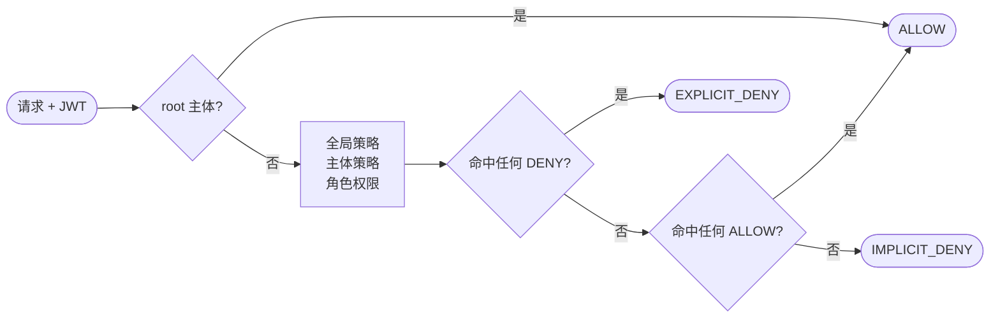

# CoSec

面向 Spring 的多租户响应式安全框架：IAM 风格的策略与基于角色的权限，每个请求都按“拒绝优先”求值。


[](https://www.apache.org/licenses/LICENSE-2.0.html)
[](https://github.com/Ahoo-Wang/CoSec/releases)
[](https://central.sonatype.com/artifact/me.ahoo.cosec/cosec-core)
[](https://www.codacy.com/gh/Ahoo-Wang/CoSec/dashboard?utm_source=github.com&amp;utm_medium=referral&amp;utm_content=Ahoo-Wang/CoSec&amp;utm_campaign=Badge_Grade)
[](https://codecov.io/gh/Ahoo-Wang/CoSec)
[](https://github.com/Ahoo-Wang/CoSec)
[](https://github.com/Ahoo-Wang/CoSec/actions/workflows/codeql.yml)
[](https://github.com/KotlinBy/awesome-kotlin)
[](https://deepwiki.com/Ahoo-Wang/CoSec)

> [中文文档](https://cosec.ahoo.me/zh/) | [Documentation](https://cosec.ahoo.me/)

## 为什么选择 CoSec

- **策略即数据。** 用 JSON 编写策略，支持路径动作、可组合的条件（角色、租户、请求头、IP、表达式）以及限流；
  可在运行时修改，所有实例立即生效。
- **拒绝处处优先。** 全局策略、主体自身的策略和角色权限按“拒绝优先”合并；未匹配的请求一律拒绝，出错也拒绝。
- **多租户与角色权限。** 主体可感知租户；按应用定义权限目录，并按空间授予角色。
- **一条流程，三种技术栈。** Spring WebFlux、Spring MVC 和 Spring Cloud Gateway 共用同一条安全处理流程，响应行为完全一致。
- **响应式且高性能。** 基于 Project Reactor，单次授权约 2 µs，不阻塞事件循环。
- **可审计。** 每次决策都会产生审计事件（日志或 Kafka）和 OpenTelemetry Span，并记录做出决定的策略或权限。

## 如何做出决策



被拒绝时，匿名调用方返回 `401`，已认证调用方返回 `403`，触发限流返回 `429`。

## 快速开始

```kotlin
dependencies {
    implementation(platform("me.ahoo.cosec:cosec-bom:<version>"))
    implementation("me.ahoo.cosec:cosec-spring-boot-starter") {
        capabilities { requireCapability("me.ahoo.cosec:webflux-support") } // 或 webmvc-support / gateway-support
    }
    implementation("me.ahoo.cosec:cosec-spring-boot-starter") {
        capabilities { requireCapability("me.ahoo.cosec:cache-support") }   // 基于 Redis 的策略存储
    }
}
```

```yaml
cosec:
  jwt:
    secret: ${COSEC_JWT_SECRET}
  authorization:
    local-policy:
      enabled: true          # classpath:cosec-policy/*-policy.json
      init-repository: true
```

```json
{
  "id": "app", "name": "App", "category": "app", "description": "", "type": "global", "tenantId": "(platform)",
  "statements": [
    { "name": "public", "action": ["/auth/login", "/actuator/health"] },
    { "name": "authenticated", "action": "/api/**", "condition": { "authenticated": {} } },
    { "name": "admins-only", "effect": "deny", "action": "/api/admin/**",
      "condition": { "inRole": { "value": "admin", "negate": true } } }
  ]
}
```

接下来阅读[快速开始](https://cosec.ahoo.me/zh/guide/quick-start)了解如何签发令牌，再阅读[策略参考](https://cosec.ahoo.me/zh/guide/policies)。

## 模块

starter 自带核心、JWT 支持和自动配置；各项集成（WebFlux、MVC、Gateway、Redis、OAuth、OpenTelemetry、OpenAPI、
ip2region、Kafka）都是按需启用的 Gradle 能力。完整列表见[模块](https://cosec.ahoo.me/zh/guide/introduction#modules)。
开箱即用的网关以容器镜像 `ahoowang/cosec-gateway` 发布。

## 文档

- **指南**：[简介](https://cosec.ahoo.me/zh/guide/introduction) · [快速开始](https://cosec.ahoo.me/zh/guide/quick-start) ·
  [策略](https://cosec.ahoo.me/zh/guide/policies) · [配置](https://cosec.ahoo.me/zh/guide/configuration) ·
  [认证](https://cosec.ahoo.me/zh/guide/authentication) · [Web 集成](https://cosec.ahoo.me/zh/guide/web-integration) ·
  [运维](https://cosec.ahoo.me/zh/guide/operations) · [故障排查](https://cosec.ahoo.me/zh/guide/troubleshooting)
- **架构**：[概览](https://cosec.ahoo.me/zh/architecture/overview) · [扩展](https://cosec.ahoo.me/zh/architecture/extending)
- **发布记录**：[GitHub Releases](https://github.com/Ahoo-Wang/CoSec/releases)

## 参与贡献

欢迎贡献。工作流程、质量门禁与发布流程见 [CONTRIBUTING.md](CONTRIBUTING.md)。本项目遵循[行为准则](CODE_OF_CONDUCT.md)。

## 安全

请按照 [SECURITY.md](SECURITY.md) 私下报告安全漏洞，不要通过公开 issue 报告。

## 许可证

CoSec 基于 [Apache License 2.0](LICENSE) 发布，其策略模型参考了 [AWS IAM](https://docs.aws.amazon.com/IAM/latest/UserGuide/introduction.html)。
