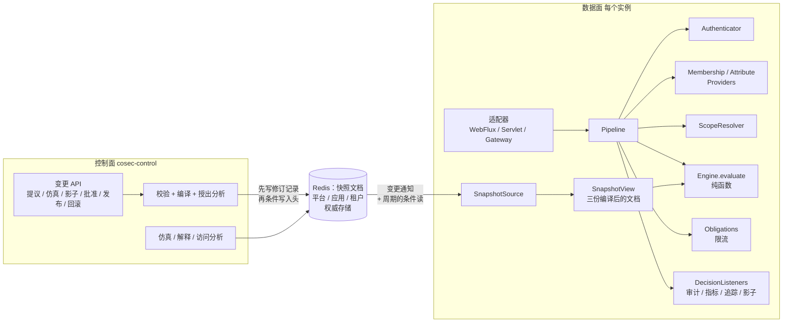
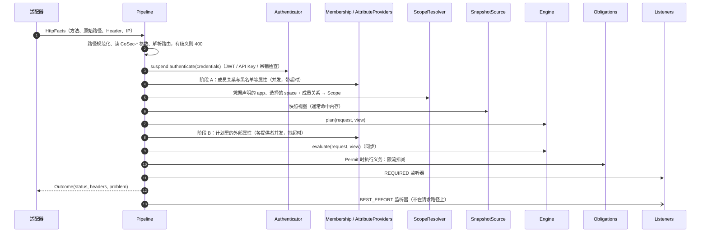

# RFC 0001：CoSec 目标架构（不考虑兼容性的重构设计）

> 状态：已确认（第 5 版）；第 1 阶段随 7.0 发布，第 2–6 阶段已在 8.0 实现（最新的预览版是 `8.0.0-beta.7`），RC1 之前做两轮深度审查 ·
> 细化：各部分的设计见 [RFC 0002](0002-pure-engine.md) 至 [RFC 0013](0013-target-architecture.md)，各节指明 · 范围：全部模块
>
> **2026-11-23 合订**：此前的修订说明（状态行、§3.9、§3.11、§6 的引用块与删除线，§7.1、§7.2 中带日期的就地标注，2026-10-21 至 2026-11-14）
> 已并入正文，被取代的说法已删去。本文写成最早，它描述的目标后来由 RFC 0002 至 RFC 0013 细化或改变：RFC 0003 §2、RFC 0004 §3、
> RFC 0005 §2、RFC 0006 §3、RFC 0007 §3 逐条列出了与本文的不一致及其处理，并都经维护者确认（§7.1）。正文现在陈述今天的决定，并指向细化它的章节。
> 章节号、章节标题与 D1–D7、P1–P12、第 1–6 阶段的编号不变；§3.9、§3.11 的标题沿用原文，内容以正文为准。其他 RFC 里以"RFC 0001 原文"引用的句子，
> 指合订前的全文：`git show b164f273:docs/rfc/0001-target-architecture.md`。修订沿革见文末。

## 0. 结论先行

CoSec 的本质只有一个函数：

```
decide(Subject, Action, Resource, Environment, SnapshotView) -> Decision
```

其余一切要么是**为这个函数准备可信输入**（认证、请求规范化、租户/应用/空间解析、属性获取），
要么是**为它提供策略数据**（存储、分发、版本），要么是**执行与观察它的结果**（适配器、限流、审计、
解释、影子评估）。

7.x 的实现把这三类关注点缠在了一起：评估函数返回 `Mono`、在评估中途读 Redis、在共享可变的
`SecurityContext` 上写中间状态、同一个决策算法写了三遍（§1）。目标架构的核心动作是：

1. **把决策引擎变成纯函数**：同步、无 I/O、无共享可变状态、输入不可变、输出带可选 trace。
2. **把策略从"解释执行"改为"编译执行"**：JSON 文档 → 有类型的 AST → 编译、索引后的不可变文档。
3. **把策略数据从"每请求查缓存"改为"快照"**：只有低基数数据进快照文档，常驻内存，由变更通知与周期的条件读保持新鲜；成员关系、黑名单这类
   高基数数据在评估前预取（P11）。热路径上没有 Reactor、调度器切换或 `BlockingAware`。
4. **统一策略模型**：RBAC 的角色权限只是"绑定到角色的策略"，不再是独立的评估层。
5. **显式化信任边界**：应用由凭据声明、空间由成员关系确认，客户端的 Header 只能*声明*，不能*决定*作用域。
6. **分离控制面与数据面**：策略写入、修订、校验、仿真属于控制面；数据面只读快照。控制面自身的写操作也要授权，并且不能越权授权（P12）。

六个动作都已在 8.0 落地：

| 动作 | 细化 |
|---|---|
| 1 纯函数引擎 | [RFC 0002](0002-pure-engine.md)；扁平算法见 [RFC 0004](0004-unified-model.md) §6 |
| 2 编译执行 | [RFC 0005](0005-condition-ast.md)（条件 AST、动作词汇、索引） |
| 3 快照 | [RFC 0003](0003-policy-snapshot.md)；三份文档的视图见 RFC 0004 §7 |
| 4 统一模型 | [RFC 0004](0004-unified-model.md)；角色与空间见 [RFC 0012](0012-roles-and-spaces.md) |
| 5 信任边界 | RFC 0004 §4.6（`ScopeResolver`）；凭据与主体见 [RFC 0009](0009-identity-and-credentials.md) |
| 6 控制面 | [RFC 0007](0007-control-plane.md) |

协程 Pipeline 与外部属性见 [RFC 0006](0006-coroutine-pipeline.md)，规范一致性套件见 [RFC 0008](0008-conformance-and-direct-build.md)，
模块与依赖方向见 [RFC 0011](0011-module-architecture.md) 与 [RFC 0013](0013-target-architecture.md) §3。

---

## 1. 审查发现

本节记录对 7.x 之前代码（`main` @ 6.1.0，`153e2b0c`）的审查发现，是本 RFC 的动机；所说的代码在 8.0 中已删除。D1–D7 已在 7.0 中修复（§7.1），
8.0 的结构从根本上消除它们。按"会不会导致错误放行"排序。

### 1.1 具体缺陷 / 风险

| # | 问题 | 后果 | 7.0 | 8.0 中消除它的结构 |
|---|---|---|---|---|
| D1 | **限流 key 读到别的规则写入的路径变量**：所有规则先匹配、再取桶，路径变量写在共享的 context 里 | 按用户限流可能变成全局限流 | [#945](https://github.com/Ahoo-Wang/CoSec/pull/945) | 匹配不写状态（P6）；限流规则的桶由引擎在 Permit 之后按该规则自己的匹配算出（§3.3，RFC 0006 §8.2） |
| D2 | **被引用但缺失的策略被静默丢弃** | 数据缺失会扩大访问范围 | [#946](https://github.com/Ahoo-Wang/CoSec/pull/946)（破坏性变更） | 悬空引用不编译（`DOC-1`）；运行时缺失为 `Indeterminate`（`ALG-3`） |
| D3 | **角色权限的作用域与应用脱钩，且作用域来自客户端**：key 是 `(roleId, spaceId)`，`appId`、`spaceId` 取自请求 Header | 跨应用、跨空间越权 | key 加上 `appId`，空间只认 token 里显式写的 `role@space`（§7.1） | 绑定的作用域显式写出（`BND-5`）；应用由凭据声明（`SCP-11`）；空间由成员关系确认（`SCP-1`）；`Scope` 只能由 `ScopeResolver` 构造（`SCP-5`） |
| D4 | **快照不一致**：全局策略索引与策略内容分属不同的 key，读写都分两步 | 发布期间出现混合版本的决策 | 写入顺序改为失败时停在安全一侧（#946） | 一份文档一个 key、一次读取一个修订；一次评估只读每份文档的一个修订（P7、`SNP-1`） |
| D5 | **root 是一个魔法字符串**：任何 id 为 `cosec` 的主体都是 root，并跳过黑名单 | 能签发该 id 的身份源就拿到全部权限 | `root-enabled` 默认关，只对平台租户生效，受黑名单约束（§7.1） | root 是显式的 break-glass 绑定（§3.2、§3.7）；以 `(` 开头的 id 归 CoSec（`IDN-12`） |
| D6 | **OGNL / SpEL 条件匹配器**：图灵完备，靠沙箱约束，成本无法静态限定 | 策略作者（或被攻破的控制面）可以执行任意逻辑 | 设计风险，未单独验证 | 条件 AST：运算符固定、有类型、成本有界（P10、`CND-2`、`CND-4`）；OGNL、SpEL 删除（RFC 0005 §2 J3） |
| D7 | **路径变量在匹配器之间串用**：只在匹配成功时覆盖、从不清空，条件读到别的语句写下的变量 | 加一条 DENY 反而可能放宽访问 | 每条语句匹配前清空，越界引用加载失败（§7.1） | 捕获的变量只在该语句的条件里可见（P6、`ALG-10`） |

### 1.2 结构性问题

7.x 的这些结构问题是第 2 节各原则的来由：

- **同一算法有三份实现**（`Policy.verify`、`SimpleAuthorization.verifyPolicies`、`AuthorizationExplainer.firstDecisive`），靠一致性测试维持（P3）。
- **评估与 I/O 交织**：引擎因此只能是响应式的，又为不阻塞事件循环引入 `BlockingAware`、`LocalCacheLookup`、按层切换 `boundedElastic`（P1）。
- **`SecurityContext` 是共享可变袋子**：路径变量、已解析路径、中间标记都写在 `attributes: MutableMap` 里，D1、D7 由此而来（P6）。
- **结果类型过多，语义混在一起**：四种结果类型，认证结果与配额结果混在一起；没有 **Indeterminate**，"出错"只能靠异常表达（P5）。
- **两套并行的策略模型**：`Policy/Statement` 与 `AppPermission/PermissionGroup/RolePermission`，评估层面本是同一个东西（§3.2）。
- **限流、影子、审计、度量、追踪都实现为 `Authorization` 装饰器**：装饰器链的顺序本身成了语义（P8）。
- **读接口里有写方法**：`PolicyRepository.setPolicy` 把控制面操作放进了数据面 SPI（P9）。
- **传输层词汇就是授权词汇**：Action 等于 HTTP 路径匹配，服务内部授权只能伪装成路径（§7.1 "Action 词汇"）。
- **认证同步阻塞**：API Key 查询、Token 吊销检查都在同步的解析里，Pipeline 因此要再切一次线程（§3.5、§3.8）。

---

## 2. 设计原则

| 原则 | 含义 | 对应问题 |
|---|---|---|
| **P1 纯决策** | 引擎是 `(Input, Snapshot) -> Decision` 的同步纯函数，不依赖 Reactor、Spring、Redis 或协程，不读时钟 | 评估与 I/O 交织、`BlockingAware` |
| **P2 编译后执行** | 策略文档先校验、编译、建索引成为不可变的编译结果，请求期只做查表和匹配 | 线性扫描、热路径分配 |
| **P3 一份算法** | 执法、解释、影子、仿真、代码内检查都调用同一个 `Engine.evaluate`，区别只在 trace 级别和快照 | 三份实现 |
| **P4 显式信任边界** | 输入分为"已验证"（来自凭证）和"声明"（来自客户端）；作用域必须由 `ScopeResolver` 校验 | D3 |
| **P5 构造上失败即拒绝** | 决策类型含 `Indeterminate`；引用缺失、出错的 DENY、读不到的文档或外部属性都不能产生 Permit：没有命中的 DENY 时结果是 `Indeterminate`，映射为拒绝。出错的 ALLOW 按未命中处理；本来就可能不存在的属性按"不存在"参与比较，不是错误（§3.3） | D2、异常驱动 |
| **P6 不可变输入** | 匹配器返回 `MatchResult(bindings)`，不写共享状态 | D1、D7、context 隔离 |
| **P7 快照一致性** | 每次评估只读一个版本确定的视图：视图里的每份文档都是一个确定的修订；安装是原子换引用 | D4 |
| **P8 判断与执行分离** | 授权只给 Permit/Deny/Indeterminate + 义务（obligations）；限流、审计等是 Pipeline 阶段或监听器 | 装饰器链 |
| **P9 控制面 / 数据面分离** | 写、修订、校验、仿真在控制面；数据面只读快照 | `setPolicy` 在读 SPI 中 |
| **P10 受限表达式** | 一种非图灵完备、有类型、成本有界、可以抽取索引键并做包含分析的条件 AST（见 7.1） | D6 |
| **P11 数据按基数分层** | 低基数、变化慢的数据（策略、角色定义、限流规则）进快照；高基数、变化快的数据（主体的角色和成员关系、黑名单）不进快照，在评估前预取 | 快照无法容纳用户级数据 |
| **P12 控制面同样受授权** | 写策略、写绑定本身就是需要授权的操作，并且不能授出超过授权者自身的权限 | 控制面是权限最高的入口 |

---

## 3. 目标架构

### 3.1 总览



已发布的快照文档就是权威数据，没有另一份"策略库"（RFC 0007 §3 M10）；修订记录与变更请求是控制面的辅助数据。

### 3.2 领域模型（`cosec-model`，纯 Kotlin，无依赖）

`cosec-model` 只依赖 Kotlin 标准库与 `cosec-annotations` 的稳定性标记（`EnginePurityTest`、`DependencyRulesTest`）。今天的类型（节选，
`core/model/`、`core/engine/`）：

```kotlin
/** 评估输入：全部不可变，全部已验证或已标注来源。 */
class AuthzRequest(
    val subject: Subject,          // 来自凭证，已验证
    val action: Action,            // service:verb，例如 http:GET 或 order:cancel
    val resource: Resource,        // 类型 + id；HTTP 场景下是规范化后的路径
    val environment: Environment,  // 来源 IP、请求 id、设备 id、是否被拉黑
)

class Subject(
    val id: String,
    val authenticated: Boolean,
    val attributes: Map<String, Any>,
    val principalBindings: Boolean,  // 凭据带角色上限时为 false：不取按名字绑定给它的 ALLOW（RFC 0009 §4.2）
    val breakGlass: Boolean,         // 只有 CoSec 自己验证的令牌可以为 true（BRK-8）
)

class EngineRequest(                  // 引擎的入口参数
    val request: AuthzRequest,
    val scope: Scope,                 // 只能由 ScopeResolver 构造：tenant、app、space 与该空间里的角色
    val memberships: Memberships,     // 按空间区分的角色与附加的策略，来源见下文"数据分层"
    val time: Long,                   // 请求时间；引擎不读时钟
    /* 宿主属性与外部属性 */
)

sealed interface Decision {
    class Permit(val by: StatementRef.Policy, val obligations: List<Obligation>) : Decision
    class Deny(val by: StatementRef?) : Decision          // by == null 即隐式拒绝
    class Indeterminate(val cause: Cause) : Decision      // 引用缺失、DENY 出错、文档或属性不可用……
}
```

租户、主体、策略等 id 是值类型（`TenantId`、`PrincipalId`、`PolicyId`……，RFC 0004 §4.1）。应用读到的值（`Decision` 及其 `Cause`、
`Obligation`）是写出 `equals`、`hashCode`、`toString` 的普通类，不是数据类，以便增加字段（RFC 0010 C4）。

**统一的策略模型**——只有三种数据：

| 概念 | 说明 | 取代 |
|---|---|---|
| `Policy` | 一组 `Statement(effect, actions, resources, condition)`，可带策略级条件 | `Policy` + `AppPermission` + `PermissionGroup` |
| `Binding` | `(Principal \| Role \| Anyone) → policy`，带作用域 `(app, space)`，每个维度显式写出、`*` 表示任意；租户是文档所属的租户 | `principal.policies`（快照里只留少量低基数的主体绑定）、`RolePermission`、`PolicyType.GLOBAL` |
| `Catalog` | 某个应用暴露的 action/resource 类型及其描述 | `AppPermission` 的"权限目录"用途（供 UI、生成器、校验使用，不参与评估） |

"全局策略"就是绑定到 `Anyone` 的策略；"角色权限"就是绑定到角色、作用域为 `(app, space)` 的策略。没有"组"：身份源的组以角色的形式到达 CoSec
（RFC 0004 §3 I1）。作用域没有隐含的默认值（RFC 0004 §4.2），所以一个绑定只在它写明的应用与空间里生效，D3 在模型层面消失。
文档可以用短格式写角色与权限，存储保持短格式；凡是读"文档授予了什么"的地方都读 `RoleExpansion.effective` 写出的绑定与策略（RFC 0012 §6）。

**数据分层（P11）**：`Binding` 描述的是"角色 → 策略"，属于低基数数据，放进快照。"主体 → 角色 / 空间"与主体直接附加的策略（附加，attachment，
RFC 0004 §4.4）属于**成员关系**，是用户级的高基数数据，**不进快照**，有两个来源，默认用 token 声明（见 7.1）：

| 来源 | 适用场景 | 撤销延迟 |
|---|---|---|
| 签名 token 中的声明：`roles`（`role` 只在默认空间生效，`role@space` 只在该空间生效，`MEM-3`）与 `policies`（附加） | 成员关系变化少，追求零 I/O | 最长等到 token 过期（`cosec.jwt.token-validity.access`，默认 10 分钟）；紧急时吊销该主体的全部 token（`MEM-4`） |
| `MembershipProvider`（带缓存，评估前预取；API Key 与带 `cosec.membership: provider` 标记的 token 用它） | 成员关系变化频繁，或需要即时撤销 | 等于缓存 TTL（`MembershipCache`，默认 1 分钟），变更时立即失效 |

撤销延迟的上限是部署时的显式配置项，写在运维文档里（`wiki/operations/configuration.md`），不是实现细节。成员关系来源失败、超时或答非所问时，
决策是 `Indeterminate`，从不退回 token 声明或"没有成员关系"（`MEM-1`、`MEM-2`）。

**平台层、应用层与租户层**：一次评估读三份文档：`Platform`（跨所有租户生效的策略与绑定：平台的 `Anyone` 绑定、平台边界、break-glass，以及控制面与数据面共用的
成本上限与外部属性声明，RFC 0007 §3.1 N3）、`App(appId)`（应用的权限策略、目录与角色绑定）与 `Tenant(tenantId)`（租户自己的策略与绑定）；
每份文档都可以有自己的限流规则（`OBL-2`）。三份各自编译、各自安装；
一次评估持有三者的不可变组合（`SnapshotView`），版本是三元组 `ViewVersion(platform, app, tenant)`（RFC 0004 §7.2、§7.3）。平台层的更新不需要
重新编译任何租户，P7 仍然成立：组合里的每一份都是一个确定的修订。

**root** 不是魔法 id，而是一条显式的 break-glass `Binding`：只能存在于平台文档、只能绑定平台租户的主体、必须带过期时间（`BRK-2`、`BRK-4`），
只能经控制面由两个人创建，并写入 `REQUIRED` 审计（`BRK-3`，§3.7）；它受**全部** DENY 约束（`BRK-1`），只对 CoSec 自己验证的令牌生效（`BRK-8`）。

**黑名单**拆成两部分：判断规则（"已拉黑就拒绝"）是引擎内置的一条 DENY（`cosec:blacklist`，每次评估的第一个候选，读 `environment.blocked`）；
名单本身（IP、设备、主体）变化频繁、条目多，放在专门的快速集合里，由阶段 A 的 `AttributeProvider` 在作用域之前与成员关系并发取得（RFC 0006 §5.4.4）。
被拉黑的请求只需要平台文档（`BLK-1`）；读不到名单从不等于"没被拉黑"（`BLK-2`）。封禁一个 IP 不需要改任何文档。root 同样受这条 DENY 约束，
没有豁免。

### 3.3 引擎（`cosec-engine`，同步、纯函数）

```kotlin
interface Engine {                      // 唯一实现 CoSecEngine
    fun evaluate(request: EngineRequest, snapshot: SnapshotView, trace: TraceLevel = TraceLevel.OFF): Evaluation
    fun plan(request: EngineRequest, snapshot: SnapshotView): AttributePlan   // 这次评估可能读到的外部属性
}
class Evaluation(val decision: Decision, val trace: EvaluationTrace?)   // trace 为 OFF 时为 null，不产生 trace 相关的分配
```

**编译**：`PolicyDocument (JSON) → 解码 → RoleExpansion.effective → 类型检查 → 编译后的文档`。文档的编解码、格式描述与编译入口在
`cosec-document`，编译器与索引在 `cosec-engine`（RFC 0013 §3）。

- 动作 / 资源模式按命名空间建索引：`service:verb` 按键哈希查找，`http` 命名空间的路径按段建前缀树，路径模板与无法从动作和资源推出适用性的语句
  放进"总是候选"桶（RFC 0005 §2 J7）。不对全部全局策略做线性扫描。
- 条件编译为有类型的条件 AST，运算符集合固定（§7.1），编译时检查类型、限定成本，并抽取等值约束供索引使用（RFC 0005 §3，`CND-2`、`CND-4`）。
  没有匹配器插件。
- 引用完整性在编译期检查：`Binding` 指向不存在的策略、引用别的租户的策略，编译就失败，文档不会发布（`DOC-1`、`TNT-2`）；运行时仍然缺失则
  返回 `Indeterminate`（`ALG-3`）。
- **索引不得漏掉任何语句**：索引给出的候选集必须包含暴力匹配会命中的全部语句，否则一条被漏掉的 DENY 就会悄悄破坏 deny-first。
  这一条由性质测试守护：随机策略集加随机请求，比较索引结果与暴力扫描结果（`IDX-1`）。

**组合算法**（唯一实现，`Evaluator`；规则见 RFC 0004 §6.1）：

```
candidates = 按 CandidateOrder 枚举的候选策略：黑名单规则、平台与租户的 Anyone 绑定、附加与主体绑定、
             应用与租户的角色绑定、break-glass（最后）；每个绑定只在它的应用、空间内且未过期时是候选
for s in candidates 的全部 DENY 语句:            // 先扫完全部 DENY
    MATCH -> return Deny(s)                      // 任何一条命中即拒绝，无论别处有什么错误
    ERROR -> 记下
if 有出错的 DENY，或有未解决的输入（缺失或歧义的策略、读不到的文档、DENY 读不到的外部属性）:
    return Indeterminate(cause)                  // 无法确认 DENY 都不适用
for s in candidates 的全部 ALLOW 语句:           // 此时所有 DENY 都已确认不适用
    MATCH -> return withinBoundary(Permit(s, obligations))  // 第一条命中的 ALLOW 即可，顺序只影响报告哪条语句
    ERROR -> continue                            // 按未命中处理，结果只可能更严
return 有 ALLOW 因外部属性不可用而跳过 ? Indeterminate(AttributeUnavailable) : Deny(null)
```

决策只取决于候选的集合，不取决于顺序；顺序只决定多条命中时报告哪一条（`ALG-1` 至 `ALG-6`）。

`withinBoundary`：租户有平台边界时（见 3.7），Permit 还必须同时落在边界之内，否则返回 `Deny(boundary)`；边界无法判定时返回 `Indeterminate`
（`BDY-1`）。

`obligations`：引擎得到 Permit 之后匹配文档里的限流规则，算出每条规则的桶 key，作为 `Permit.obligations` 返回；执行在 Pipeline（RFC 0006 §8.2，
`OBL-1`）。

DENY 出错必须返回 `Indeterminate`（没有别的 DENY 命中时），因为跳过它可能放行；ALLOW 出错按未命中处理就已经 fail closed，没有必要让整个请求失败。

**属性缺失**分两种（RFC 0004 §3 I7、RFC 0005 §3.4）：

- 本来就可能没有的属性（请求头、路径变量、token 里没写的属性）按"不存在"参与比较：比较为假，`exists` 为假，`not` 照常取反（`CND-1`、`CND-3`）。
  这不是错误。
- 外部属性（`AttributeProvider` 提供）取不到时，按语句声明的 `onMissing` 处理：`indeterminate`（默认）或 `nomatch`。DENY 上的 `indeterminate`
  使结果是 `Indeterminate`（没有别的 DENY 命中时，503）；ALLOW 上的 `indeterminate` 在最终没有 Permit 时把隐式拒绝改为 `Indeterminate`（`ATR-2`）。
  DENY 选择 `nomatch` 意味着依赖故障时这条 DENY 失效，所以只有控制面记下显式确认的这类 DENY 才能编译（`ATR-6`）。这样，外部依赖的可用性
  对决策的影响是由策略作者显式决定的，而不是隐含的。外部属性取不到从不把 Deny 或 `Indeterminate` 变成 Permit（`ATR-1`）。

deny-first 不依赖"层"的顺序，而是对整个候选集直接成立，由性质测试守护：对任意策略集合，加入一条匹配的 DENY 后，结果绝不会是 Permit
（`EnginePropertyTest` 的 P1′）。

**匹配不写状态**：`match(statement, request) : MatchResult`，路径变量作为 `bindings` 返回并只在该语句的条件里可见（D1、D7 消失；`ALG-10`）。

**trace 即解释**：`TraceLevel.FULL` 与 `EXHAUSTIVE` 记录候选语句的匹配结果；带 trace 的求值器是单独的类，热路径不带 trace 代码，决策与 trace
级别无关（`ALG-8`）。解释一次历史决策时，必须针对该决策读过的文档修订重新评估，否则解释的是另一份策略（RFC 0007 §10.3，`CTL-3`）。

### 3.4 快照与分发

```kotlin
interface SnapshotDocumentStore    // cosec-spi（@ExperimentalCoSecApi）：读写文档、条件读、变更通知；不编译
class SnapshotSource               // cosec-runtime：编译、持有、单飞加载、按序安装、周期确认；peek 不做 I/O
```

存储与编译分成两层（RFC 0003 §2 I8）：存储的实现只读写文档、通知变更；编译、版本比较、单飞与失效处理只有一份实现，在 `SnapshotSource` 里。

- 每份文档（平台、每个应用、每个租户）是**一个**带修订号的完整 JSON 文档（`schema: 2`），存放在 Redis 中，Redis 是权威存储
  （`cosec-cocache`，CoCache 8 的 `Store`：永不过期，读失败抛出，`SNP-3`）。控制面发布时先写修订记录，再用一次条件写入移动文档的头
  （`CTL-2`）；读者看到的是旧头或新头，不会出现 D4 那种跨两个 key 的部分写入。
- 数据面按需读取文档、编译一次，原子替换引用。`peek` 是内存中的同步查找，没有 future、没有 I/O，可以在事件循环上调用；只有未命中才去加载。
  同一份文档的并发加载合并为一次，安装按加载开始的顺序进行（`SNP-2`）。引擎只接收已经加载好的视图，自身不做 I/O。
- **编译失败不回退到旧修订**：控制面用数据面的编译器检查，编译失败的候选不发布，头不变（`CTL-1`）；数据面读到的文档无法解码或编译时，
  安装为"失败"，它在视图里是未解决的输入，决策是 `Indeterminate`，除非有 DENY 命中（`DOC-1`、RFC 0007 §3 M2）。
- **按需加载与有界内存**：平台文档启动时加载、从不淘汰；应用与租户文档按需加载，超出各自的上界时按 LRU 淘汰。上界由堆的四分之一和驻留文档的
  重量算出，不是配置项（`SNP-24`）；存储里没有文档的 id 另有固定份额，只淘汰彼此（`SNP-7`）。可以配置一组预热文档，在启动时加载。
- **失效事件会丢，陈旧时间必须有上界**：存储的变更通知（CoCache 的失效通道）触发重新加载；此外每份已安装的文档每隔
  `cosec.authorization.snapshot.revalidate-interval`（默认 10 秒，至少 1 秒、至多 5 分钟）向 Redis 做一次条件读，摘要不变时不传输内容。
  这是丢失通知的唯一上界，所以不能关闭（`SNP-6`）。落后时长有指标；超过 6 个间隔记 WARN，超过 30 个间隔记 ERROR（`SNP-23`）。超过上限时的行为
  是显式配置：默认继续按已安装的文档决策并告警；列在 `cosec.authorization.snapshot.fail-closed.tenants` 中的租户（`*` 表示全部）在落后超过
  `fail-closed.max-lag`（默认 30 分钟）时返回 503，除非有 DENY 命中（`SNP-5`）。
- 启动时预热的文档未就绪 → 就绪探针不就绪；冷加载失败或超时 → `Indeterminate` → 503。
- 热路径上没有 `Mono`、调度器切换、`LocalCacheLookup`、`BlockingAware`。"缓存不能过期丢策略"这条不变量由 `CacheTtlPolicyTest`、
  `StrictCacheFailureTest` 守护：已安装的文档只会被更新的修订替换，或在上界内被淘汰后重新读取。

存储、Redis key 与 Redis 不可用时的行为见 `wiki/operations/storage.md`。

**规模假设**：快照只包含低基数数据（P11）。8.0 的边界是文档 8 MB（RFC 0003 Q14）、每份文档的主体绑定 1,000（RFC 0004 Q2）、RFC 0012 §6.3 的派生绑定 50,000 与
`CTL-40` 的条目预算；它们是产品承诺，用按上限生成的合成语料验证（RFC 0008 §6 Q6）。超大租户按空间或应用拆分文档留到 8.1。

### 3.5 数据面 Pipeline（`cosec-runtime`，挂起函数，见 3.8）



一次评估需要哪些文档取决于作用域与是否被拉黑，所以作用域在快照视图之前确定（RFC 0006 §3 K3）。整个评估有一个期限
（`cosec.pipeline.timeout`），每个阶段的超时是它的份额，不另设属性（`PIP-33`）。

- **路径规范化**只在 Pipeline 中定义一次（`PathNormalizer`）：出现二次编码、编码后的 `/`、`\`、`;` 或控制字符、点段、空段、超长路径等
  无法无歧义解释的路径，一律 400，不去猜测（`PIP-5`、`PIP-14`、`PIP-30`）。授权判断用的路径必须与后端路由用的路径一致，否则就是一个绕过漏洞，
  所以规范化规则也写进适配器的文档（`wiki/integration/web.md`）。三类适配器对同一组路径的处理结果必须完全一致（`WebAdapterParityTest`）。
- **Authenticator** 是挂起函数，把 token 或 API Key 变成主体。无效、过期或已吊销的凭据按匿名主体评估：允许匿名访问的路径照常放行，
  拒绝时是 401，并带指明原因的 `token-*` 问题类型（RFC 0006 §3 K2，`PIP-6`）。Token 过期属于认证结果，不进决策。
- **ScopeResolver** 是信任边界：客户端只能*声明*想访问哪个空间，必须由成员关系确认；应用是凭据声明的应用，绑定了应用的宿主只服务声明该应用的
  凭据（`SCP-1`、`SCP-2`、`SCP-11`）。它是 `cosec-model` 中无 I/O 的同步纯函数，`Scope` 只能由它构造，所以不作为 SPI 开放（RFC 0006 §3 K4，
  `SCP-5`）。需要扩展的是成员关系的*来源*（`MembershipProvider`），而不是判断逻辑。
- **AttributeProvider（PIP）** 取代"阻塞的自定义条件匹配器"：平台文档声明外部属性，引擎的 `plan` 指出这次请求可能读到哪些，Pipeline 在评估前
  一次性并发取齐。取消与失败的粒度是提供者：一个提供者失败只让它自己的属性"取不到"，其余照常，结果由引擎按 `onMissing` 逐条决定
  （RFC 0006 §3 K19，`ATR-5`）。引擎永远不做 I/O。
- **Obligations**：限流是 Permit 附带的义务（来自限流规则，规则本身是快照文档的一节）。只在 Permit 之后执行，被拒绝的请求不消耗配额
  （`OBL-1`）。限流后端执行失败时，按规则的 `strictFailure` 决定：严格的规则返回 503，不严格的规则跳过——这是文档化的降级例外之一
  （RFC 0006 §3 K14）。
- **状态映射**只在 `StatusMapping` 中定义一次，适配器看不到 `Decision`（`PIP-1`，`OneDecisionPathTest`）：

| 情况 | 状态 |
|---|---|
| 请求无法无歧义地读取（路径、方法、有歧义的 `CoSec-*` 参数、文档读到的请求头取值不一） | 400 |
| `Deny` 且匿名（包括凭据被拒后按匿名评估） | 401 |
| `Deny` 且已认证 | 403 |
| 义务：配额耗尽 | 429 |
| `Indeterminate`：快照未就绪、依赖不可用或超时、外部属性取不到、DENY 出错、限流后端不可用（严格的规则） | 503 |
| 逃出 Pipeline 的未建模异常（CoSec 的缺陷，不经过 `Decision`） | 500 |
| `Permit` | 继续 |

每个 `Indeterminate` 都是 503，500 只留给未建模的异常（RFC 0006 §3 K1，`PIP-2`）。各结果的问题类型、响应头与 `CoSec-*` 参数见
`wiki/integration/web.md`，客户端可以依赖的部分在 `contract/`（`PIP-25`）。

### 3.6 观察：监听器，而不是装饰器

```kotlin
interface DecisionListener {
    val name: String
    val delivery: Delivery get() = Delivery.BEST_EFFORT     // REQUIRED 或 BEST_EFFORT，见下表
    suspend fun onDecision(event: DecisionEvent)             // 不能改变决策；REQUIRED 失败只会让 Permit 变成 503
}
```

审计（日志 / Kafka）、Micrometer、OpenTelemetry 都只是监听器，各自模块各一个实现。span 由监听器事后按事件里的开始与结束时间生成，父 trace
上下文随事件传入（RFC 0006 §3 K6）。
**影子评估**也是监听器：采样后在暂存的候选文档上再调用一次 `Engine.evaluate`，比较两个结果，按窗口上报差异。候选只为这次比较编译，
从不影响实例执法所用的限制与属性声明（`SNP-10`）。

**`DecisionEvent` 必须包含**：视图版本 `ViewVersion(platform, app, tenant)`、做出决策的 `StatementRef`（以及经由的绑定）、`Scope`、请求 id。
这样才能事后回答"是哪个版本的哪条语句做出的这个决策"，explain 也才能针对同一个版本重新评估。每个 `Outcome`（包括 400、认证不可用、取消）
都产生事件（RFC 0006 §9.2）。

**投递语义**按监听器分为两类，注册时声明：

| 类别 | 投递方式 | 失败时 | 用于 |
|---|---|---|---|
| `REQUIRED` | 同步，在返回结果之前 | 只把 Permit 改为 `Indeterminate`（503）；Deny 保持原状态码 | 合规要求不能丢失的审计；break-glass 的每一次使用 |
| `BEST_EFFORT`（默认） | 异步，有界队列 | 丢弃并计数，绝不阻塞或影响决策 | 指标、追踪、普通审计、影子评估 |

义务先于 `REQUIRED` 监听器执行，审计记录最终结果（包括 429）；审计失败时已扣的配额不退（RFC 0006 §3 K5，`OBS-1`）。经 break-glass 绑定得到的
Permit 只有在 `REQUIRED` 监听器记下之后才放行，没有注册时是 503（`OBS-2`）。

影子评估还要满足：采样，在有界队列中异步执行，不占用请求延迟，队列满时直接丢弃。

### 3.7 控制面（`cosec-control`）

控制面是快照文档唯一的写入者（RFC 0007）：

- **修订**：修订按**文档**记录，先于头写入、按摘要寻址，头带 `parent` 指针；发布是一次条件写入，两个并发的发布不会都成功（RFC 0007 §5.3，
  `CTL-2`）。历史、差异与回滚读修订链；修订保留按数量与最短时间（RFC 0007 §3 M13）。
- **发布前强制**：格式校验 → 编译（数据面的编译器）→ 引用完整性检查 → 授出分析 → 影子窗口。影子窗口默认强制，跳过需要 `cosec:skip-shadow`
  并写明原因；break-glass 的创建与撤销按种类免除；样本不足的窗口到最长时长后关闭，发布者必须确认"证据不足"（RFC 0007 §6.4，§3 M1）。
- 提供 `simulate`、`explain`（带要解释的修订）、`analyze`（"谁能访问"以绑定的主体表达）。它们都调用同一个 `Engine.evaluate`（`CTL-3`、
  RFC 0007 §10.3）。
- `schema/<line>/*.schema.json` 由 `cosec-document` 里声明式的文档格式描述生成，一致性测试把描述与编解码器绑在一起（RFC 0007 §3 M11；
  `generateSchemas`、`verifySchemas`、`SchemaConformanceTest`）。
- 自举：存储为空时，第一个平台管理员绑定由 `cosec-migrate bootstrap` 离线写入（RFC 0007 §3 M15）。

**控制面自身的授权（P12）**：控制面是权限最高的入口，所以它的每个写操作也要经过 CoSec 授权，即用同一个引擎来保护自己：

- 控制面的动作有自己的命名空间（`cosec:write`、`cosec:grant`、`cosec:publish`、`cosec:approve`……），资源是文档与作用域
  （`doc/tenant/<t>/…`、`scope/<t>/<a>/<s>`）。"谁能改哪个租户的策略"就是普通的策略和绑定。Pipeline 负责认证与路径级的授权，细粒度的授权
  在控制面内部逐个目标检查，记录任何东西之前完成（RFC 0007 §7.2，`CTL-8`）。租户的主体只能写自己租户的文档，这是硬性规则（`TNT-3`）。
- **不能越权授权**：创建或修改一个绑定（或修改一条已被绑定的策略）时，被授出的动作和资源必须是授权者本人在同一作用域内拥有的权限的子集。
  这样就不会出现租户管理员把自己绑到更宽的策略上、或者创建 `Anyone` 绑定来提权的情况。判断按语义定义：被授权者能做的每个请求，换成授权者本人
  发出时必须在当前快照下被允许（RFC 0007 §7.4.2，`GRT-1`）。检查在控制面的发布流程中进行，不在快照编译器里；范围按 §7.1 的决定。
  判断不了的（例如带不可分析条件的语句）一律不放行，进入审批：由在目标文档上持有 `cosec:approve` 的另一个人批准，默认只有平台管理员持有它
  （RFC 0007 §7.5、Q10；`GRT-2`、`APR-1`）。
- 谁可以不经逐次审批写入，各有界定：操作员端口上持有 `cosec:approve` 的平台主体是信任根，自己的变更不做授出分析（`APR-3`）；只写或删除角色、
  作者持有 `cosec:manage-roles` 的租户文档变更不需要第二人，控制面自己应用的角色与没有应用的角色除外（`CTL-79`）；经服务端口或门面的变更
  一律分析，那里没有信任根（`CTL-81`）。
- **平台边界**（permission boundary）：平台文档给出默认边界，租户文档的 `boundary`（只有平台主体能设置）覆盖它；租户主体的任何 Permit，
  包括平台层授出的，都必须同时落在边界之内（即 3.3 组合算法中的 `withinBoundary`；RFC 0007 §7.6，`BDY-1`、`BDY-2`）。
- break-glass root 绑定只能由平台主体经控制面申请，由另一个人批准，必须设置过期时间，创建和每一次使用都写入 `REQUIRED` 类审计
  （`BRK-3`、`APR-4`、`OBS-2`）。

### 3.8 编程模型：同步引擎 + 协程运行时，Reactor 只留在适配器里

**决定**：引擎同步；`cosec-runtime` 及其全部数据面 SPI 使用 Kotlin 协程（`suspend`）；Reactor 只出现在 WebFlux / Gateway 适配器与
宿主中，每个请求在边界桥接一次（`mono { pipeline.evaluate(facts) }`）。不使用虚拟线程作为主模型。

**为什么不用 Reactor 作为通用模型**：Reactor 的价值在于组合非阻塞 I/O 流。在目标架构中，热路径上没有策略 I/O（快照在内存里），剩下的是
"认证 → 预取成员关系 → 作用域 → 取视图 → 预取属性 → 决策 → 义务"这样的**顺序编排**加少量并发。
对顺序编排，`flatMap`/`switchIfEmpty`/`onErrorResume` 是负担：错误路径分散，fail-closed 很难靠审查确认。

**为什么选协程**：

| 关注点 | 协程带来的好处 |
|---|---|
| fail closed 可审查 | 用 `try/catch` 加对 sealed `Decision` 的穷举 `when`，所有拒绝路径都在一个函数里，编译器能检查遗漏 |
| 有界的外部调用 | `withTimeout` 加结构化并发；每个 SPI 调用经同一个包装：施加超时、把任何失败变成值、只让外部取消通过 |
| 上下文传播 | 主体、请求 id、trace 放进有类型的 `CoroutineContext.Element`，不用 Reactor `Context` 的字符串 key，也不用 `SecurityContext` 里的 `attributes` map |
| 流 | 快照变更是存储的变更通知（`SnapshotChangeListener`），`BEST_EFFORT` 监听器的异步投递用有界队列，满时丢弃并计数，背压语义明确 |
| 统一两类宿主 | 响应式宿主用 `mono {}` 桥接，可以在事件循环上运行，挂起时不阻塞；Servlet 宿主直接在请求线程（或虚拟线程）上 `runBlocking` |

**为什么不选虚拟线程作为主模型**：虚拟线程让阻塞代码变得便宜，但 Netty 事件循环本身不能阻塞。在 WebFlux / Gateway 里使用虚拟线程，意味着每个
请求都要切到另一个执行器，这正是 7.x `boundedElastic` 的代价。协程可以在事件循环线程上运行，遇到 I/O 时挂起，适用的宿主更多。Servlet 宿主
可以自行开启虚拟线程（见 3.9），适配器的 `runBlocking` 跑在虚拟线程上，两者并不冲突。

**约束（不变量）**：
- 不阻塞事件循环：内存里已有所需数据的请求在接收它的线程上完成，没有调度、没有定时器；真正挂起之后在 `Dispatchers.Default` 上恢复，从不在客户端
  库的 I/O 线程上继续（RFC 0006 §3 K8、§7.2）。
- 数据面 SPI 的契约是"不得阻塞调用线程"：实现用非阻塞客户端；只有阻塞客户端可用的实现，在实现内部切到自己的有界执行器（Kafka 监听器就是这样
  做的）。CoSec 自己从不按"是否阻塞"自动切换线程，没有 `BlockingAware`，也没有 `Dispatchers.IO` 兜底（RFC 0006 §3 K15）。控制面同样不用
  `Dispatchers.IO`、`runBlocking` 或 `GlobalScope`（`ControlBoundaryTest`）。测试用 BlockHound 检测事件循环上的阻塞调用
  （`PipelineBlockHoundTest`、`SnapshotStoreBlockHoundTest`）。
- 引擎不得依赖 `kotlinx.coroutines`：决策始终是同步纯函数，可以在任何线程模型下复用（`EnginePurityTest`、`DependencyRulesTest`）。
- Reactor 只在 `edge` 与 `host` 中，以及 `cosec-cocache` 内部的响应式 Redis 客户端，从不出现在公开签名里；`runtime`、`document`、`engine`、
  `model` 的类不引用 `reactor.*`，数据面 SPI 的签名中没有 Reactor 类型（RFC 0011 §5；`SourceRulesTest`、`RuntimeBoundaryTest`）。
- 上下文桥接只允许出现在适配器里，并且只有一处：WebFlux / Gateway 适配器把 Reactor `Context` 和 OTel 上下文转换为 `CoroutineContext`，
  经 `BridgeContextContributor`（由 `cosec-opentelemetry` 与 starter 的 MDC 实现，RFC 0006 §3 K16）。`WebAdapterParityTest` 断言三类适配器的
  结果一致。
- 取消与超时区分处理：Pipeline 自己的超时是 `Indeterminate`（503）；外部取消（客户端离开）重新抛出，不产生 `Outcome`，下游不被调用
  （RFC 0006 §3 K13，`PIP-3`）。两者都不会产生 Permit。

**代价**：SPI 是 `suspend` 函数，等于确定 CoSec 面向 Kotlin。这是产品定位上的选择，不是兼容性问题；8.0 是 Kotlin API，Java 调用方不是目标。
每个请求在桥接时多一次协程的创建和分配，与网络 I/O 相比可以忽略，由 JMH 与端到端压测确认（`docs/perf/`）。


### 3.9 JDK：基线保持 17，部署在 25 上

**决定**（维护者 2026-10-29："CoSec 基线升级到 JAVA 21 吧。"，#1169）：8.0 的编译基线是 **JDK 21**；网关镜像 `cosec-gateway-server` 与控制面
宿主镜像 `cosec-control-server` 运行在 **JDK 25** 上并使用 JDK 25 的 AOT cache。7.x 的基线仍是 17。

**原则**：*基线*是 CoSec 编译时的目标版本，也是它要求的最低运行版本；*运行时*是应用实际使用的 JDK。基于 21 编译的库可以在 25 上运行，
并得到 25 的全部 JIT、GC 和内存改进。只有当代码需要*调用*新 API、*依赖*某个运行时行为，或者一个必需的依赖要求时，才值得提高基线。
基线从 17 提高到 21 的理由是最后一种：CosId 5 只支持 Java 21，以 17 为基线，`cosec-cosid` 就只能是唯一按 21 编译、绕开 starter 的模块
（RFC 0011 D2 的例外）。

**目标架构是否需要 21 以后的 API**：

| 候选收益 | 是否需要提高基线 | 理由 |
|---|---|---|
| 虚拟线程 | 不需要 | CoSec 自己不创建线程。Servlet 宿主是否用虚拟线程处理请求，由应用决定（`spring.threads.virtual.enabled`）；适配器的 `runBlocking` 在哪种线程上都能工作 |
| `synchronized` 不钉住载体线程（JEP 491） | 不需要 | 这是运行时行为。部署在 24 及以上版本就能得到；CoSec 本身不依赖它 |
| `ScopedValue` | 不需要 | 3.8 已经把请求上下文放进 `CoroutineContext`；Servlet 路径上给应用代码用的 `CoSecSecurityContextHolder` 用 `ThreadLocal` 就够了，在虚拟线程上也正确 |
| 控制面的阻塞 I/O | 不需要 | 与数据面一样使用挂起函数和非阻塞客户端（3.8） |
| 紧凑对象头、分代 ZGC、JIT、AOT cache | 不需要 | 都由运行时提供 |
| Java 语言特性 | 不需要 | 对 Kotlin 代码没有意义 |

结论：目标架构在代码层面没有任何地方需要 21 以后的 API。

**"部署在 25 上"的具体含义**（CoSec 是库，控制不了应用的部署，只能控制下面这些）：
- 两个镜像使用 JDK 25 基础镜像（Alibaba Dragonwell 25），并在构建时训练 AOT cache（`wiki/operations/deployment.md`）。
- JMH 的版本对比在 CI 上运行时，基准 JVM 跑在 25 上（`jmh-ab.yml`、`jmh-v7-v8.yml`）；本地运行可以用 `-PjmhJavaVersion` 指定。
- CI 的构建与测试用基线 JDK 21。
- 运维文档说明两个镜像在 25 上运行；在 Servlet 宿主上开启虚拟线程时，运行时至少要 24（JEP 491）。

**何时提高基线**：出现一个具体的代码需求或依赖要求，而且没有合理的替代办法时。到那时直接升到当时最新的 LTS。JDK 25 作为大版本依赖留到 8.1
考虑。

### 3.10 AOT 与 native image

**决定**（已确认，2026-10-21，见 7.1）：AOT 就绪是 8.0 的设计约束。三种"AOT"含义不同，落点也不同：

| 含义 | 是什么 | 落点 |
|---|---|---|
| **JDK 25 AOT cache**（Leyden，`-XX:AOTCacheOutput` / `-XX:AOTCache`） | 训练运行时记录类加载、链接和方法 profile，下次启动直接使用 | 部署问题，不需要改代码。两个镜像都自带 AOT cache，CI 的 AOT 冒烟每次推送到 `main` 都运行（`wiki/operations/deployment.md`） |
| **Spring AOT**（构建期生成 bean 定义，加上 `RuntimeHints`） | 把反射、资源、代理的需求在构建期声明出来 | 8.0 对所有库模块的约束，见下文 |
| **GraalVM native image** | 封闭世界的提前编译 | 可选，只针对 `cosec-gateway-server` 这个应用，在 8.0 之后做。库不把 native 作为受支持的目标，任何地方都不把它设为默认 |

**为什么 native 不是默认**：授权在每个请求上都要执行，稳态下 JIT 的吞吐比启动时间重要得多；native image 没有运行时 profile 引导的优化，
峰值吞吐通常更低。所以 native 只是网关应用的一个可选构建方式。**任何改动都不能为了 native 拖慢 JIT 路径**；有冲突时以 JIT 路径为准，
用 JMH 前后对比证明（不变量"热路径有基准"）。

**8.0 对代码的约束**：
- `cosec-model` / `cosec-engine` 不使用反射，也不使用动态代理。`EnginePurityTest` 禁止它们依赖 `java.lang.reflect..`（以及线程、时钟、
  `java.util.concurrent..` 等），这条约束由它守护。
- 没有类路径扫描或按类名反射实例化：条件是固定运算符的 AST，没有匹配器插件；扩展点是显式声明的 Spring bean（`AttributeProvider`、
  `MembershipProvider` 等，`wiki/architecture/extending.md`）。
- 需要反射、资源或代理的每个库模块都自带一个 `RuntimeHintsRegistrar`（经 `META-INF/spring/aot.factories` 注册），并配一个用 Spring 的
  `RuntimeHintsPredicates` 断言这些 hint 已注册的测试。今天只有 `cosec-cocache` 需要：`SnapshotRuntimeHints` 与 `SnapshotRuntimeHintsTest`。

**已知障碍的处理**：
- OGNL、SpEL 条件匹配器（重度依赖反射，求值的根对象及其可达类型都需要 hint）已由条件 AST 取代并删除，这也同时解决了 D6（RFC 0005 §2 J3）。
- CoCache 的 Spring Boot starter 自带 `CoCacheAotProcessor` 与 `CoCacheRuntimeHints`（在它的 `META-INF/spring/aot.factories` 中注册）；
  CoSec 的缓存经 CoCache 的工厂创建，不需要为此另写 hint。
- Jackson 模块通过 `META-INF/services/tools.jackson.databind.JacksonModule` 注册：`cosec-document` 用它注册 `CoSecModule`，`CoSecJson.mapper`
  靠 `findAndAddModules()` 发现它；`SnapshotRuntimeHints` 把这个服务文件声明为资源。

**失败即拒绝**：缺少 hint 必须表现为文档加载失败和请求被拒绝，绝不能表现为某条语句被悄悄跳过。8.0 的编解码器严格读取文档：未知的字段、
第二个运算符、类型不对的值都使文档解码失败，需要它的请求失败即拒绝（`DOC-3`）；编译时，未知的类型是编译错误，不是被忽略的语句。

**8.0 之后**：增加一个 CI 任务，把 `cosec-gateway-server` 构建为 native image 并跑冒烟测试。冒烟测试包括一个反向用例：去掉一条 hint 后重新构建，
断言对应请求被拒绝（而不是被放行，或者对应语句被跳过）。

### 3.11 关键依赖：CoCache 6.4、CosId 4.0

**决定**：8.0 的存储层基于 **CoCache 8**（维护者 2026-11-07：CoCache 8.0.0 正式版发布后、CoSec RC 之前采用，#1203；8.x 的兼容承诺从 8.0.0
开始；今天是 8.2.0）。CoSec 不依赖 CosId（#1170）：id 由 CoSec 自己的端口 `IdGenerator`（`cosec-spi`）生成，默认 `RandomIdGenerator`；CosId
只出现在可选扩展 `cosec-cosid` 中（`CosIdIdGenerator`，基于 CosId 5，由 starter 按类路径装配），只有它与 starter 可以引用 CosId
（`DependencyRules.COSID_OWNERS`）。CoCache 6.x 与 CosId 4.0 只适用于 7.x。

**CoCache 8 对目标架构的作用**

| 用到的能力 | 在目标架构中的用途 |
|---|---|
| `Store`：永不过期、读失败抛出、失败的删除抛出 | Redis 是权威存储，读失败不能被当成"没有数据"（`CacheTtlPolicyTest`、`StrictCacheFailureTest`，`SNP-3`）；快照文档、控制面记录、影子窗口的存储都用它 |
| 条件写入（`putIfMatch`）与条件读（`getIfChanged`） | 发布只移动仍是变更基线的头（3.7）；周期确认在摘要不变时不传输内容（3.4） |
| 失效通道 | 快照文档的变更通知（3.4） |
| 本地副本的最长寿命（`local-max-age`） | 只约束冷加载读到的本地副本；条件读绕过一切本地副本 |
| 内存后端 | 测试用真实的一致性引擎，而不是 mock（AGENTS.md 对缓存测试的要求） |

快照缓存的寿命、读失败模式与锁定字段由 `CoSecCacheSpecs` 声明，任何 CoCache 定制器或属性都不能放宽（AGENTS.md 的不变量）。

**CoSec 的标识**：请求 id、审计事件 id、token id（`jti`）、社交登录的 `state`、修订 id 都经 `IdGenerator` 生成；`cosec-model` 和
`cosec-engine` 不依赖它。生成失败从不决定结果：请求 id 与事件 id 在 `StatusMapping` 作答处生成，失败时用随机 id 代替（`PIP-23`）。

**升级注意事项**：CoCache 8 不读 6.x 写的值，每个读到的 6.x 值都 fail closed。alpha 部署用 `8.0.0-alpha.4` 的 `cosec-migrate cocache8` 完成
这次升级；GA 的工具里该命令已删除（#1351），GA 的 `publish` 遇到未完成升级留下的 `<prefix>:meta:cocache8` 标记时拒绝写入。7.x 的数据由
`cosec-migrate` 转换一次（`wiki/operations/upgrading.md`）。

---

## 4. 模块布局

模块布局与依赖方向由 [RFC 0011](0011-module-architecture.md) §2、§3、§5 规定，`cosec-document` 的拆分见 [RFC 0013](0013-target-architecture.md) §3。
概括：

| 组 | 模块 | 内容 |
|---|---|---|
| `api/` | `annotations`、`api` | 稳定性标记；7.x 留下的薄契约（主体、令牌、`SecurityContext`、审计事件） |
| `core/` | `model`、`engine` | 值类型、条件 AST、`ScopeResolver`、`Decision`；编译器、索引、求值器。只依赖 Kotlin 标准库与标记 |
| `core/` | `spi` | 端口：快照存储、成员关系、令牌、API Key、限流、属性、认证、身份、审计、`IdGenerator`、影子窗口 |
| `core/` | `document` | 策略文档的编解码、格式描述、编译入口、`RoleExpansion`、路由映射、`CoSec-Identity`、唯一的 Jackson mapper |
| `core/` | `runtime` | 协程 `Pipeline`、`SnapshotSource`、认证器、适配器契约（`RequestGate`、`HttpFacts`、`Outcome`、`StatusMapping`）、监听器分发 |
| `core/` | `control`、`control-sdk` | 控制面；应用调用控制面的门面 |
| `backends/` | `cocache` | Redis：快照文档、控制面存储、影子报告、令牌、成员关系、API Key、限流 |
| `edge/` | `webflux`、`webmvc`、`gateway`、`openapi` | 只做 `HttpFacts` ↔ `Outcome` 转换；OpenAPI → 路由映射与目录 |
| `extensions/` | `jwt`、`login`、`social`、`ip2region`、`micrometer`、`opentelemetry`、`kafka`、`cosid`、`control-http` | 认证与登录、`AttributeProvider`、监听器、`IdGenerator`、经 HTTP 调用控制面 |
| `host/` | `spring-boot` | starter：每个模块对应一个自动配置 |
| `test/` | `testkit` 等 | 应用用的策略测试工具；规范一致性套件、架构规则、端到端与系统测试 |

依赖规则：`model ← engine ← document ← runtime ← {edge, extensions, host}`，`spi` 在 `model` 与 `document` 之间，`backends` 实现 `spi` 的存储端口、
从不依赖 `runtime`，`control` 在 `runtime` 之上。`engine` 不得依赖协程或 Reactor；Reactor 的边界见 3.8。这些规则由 `test/architecture` 的
`DependencyRulesTest`、`SourceRulesTest`、`EnginePurityTest`、`RuntimeBoundaryTest`、`ControlBoundaryTest` 强制。

---

## 5. 不变量（新版）

| 不变量 | 如何保证 |
|---|---|
| Deny-first | 单一组合算法 + 性质测试（随机策略集合）：`EnginePropertyTest`（P1′），`ALG-1` 的场景 |
| 索引完整 | 索引候选集 ⊇ 暴力匹配命中集；随机策略加随机请求的性质测试（`IDX-1`） |
| 失败即拒绝 | `Indeterminate` 是一等结果；Pipeline 的 `when` 穷举 sealed 类型，编译器强制；任何 SPI 的失败或超时都不产生 Permit（`PIP-4`）。文档化的例外：不严格的限流规则、吊销存储读不了时验证请求的令牌、重新加载失败时按已安装的文档决策（AGENTS.md） |
| 一条决策路径 | 只有 `StatusMapping` 产生状态码；`OneDecisionPathTest`、`WebAdapterParityTest`（`PIP-1`） |
| 路径一致 | 规范化只在 Pipeline 定义一次；歧义路径返回 400（`PIP-5`、`PIP-14`、`PIP-30`）；三类适配器的处理结果一致（`WebAdapterParityTest`） |
| 不阻塞事件循环 | 引擎同步且无 I/O（`EnginePurityTest`）；数据面的 I/O 都在挂起的 SPI 中，不得阻塞调用线程；`SnapshotSource.peek` 不做 I/O（3.8；`PipelineBlockHoundTest`、`SnapshotStoreBlockHoundTest`、`RuntimeBoundaryTest`） |
| 纯决策 | 匹配函数签名中没有可变参数；义务在评估之后执行，被拒绝的请求不消耗配额（`EnginePurityTest`、`RateLimitObligationTest`，`OBL-1`） |
| 快照一致 | 一次评估只持有一个视图，视图里每份文档一个修订；同一份文档按加载顺序安装（`SNP-1`、`SNP-2`） |
| 快照新鲜度有界 | 周期的条件读不能关闭、间隔有上限（`SNP-6`）；落后时长有指标；超过上限时的行为（告警或按租户 503）是显式配置（`SNP-5`） |
| 决策可追溯 | 每个 `DecisionEvent` 都带有视图版本 `ViewVersion` 与 `StatementRef` |
| 不能越权授权 | 控制面的每个写操作都经过授权（`CTL-8`）；被授出的权限必须是授权者在同一作用域内权限的子集；无法判定的不放行，等另一个人批准（`GRT-1`、`GRT-2`、`APR-1`） |
| 作用域可信 | `Scope` 只能由 `ScopeResolver` 构造（`internal` 构造器，`SCP-5`，`ScopeConstructionTest`） |
| 热路径有基准 | 热路径的改动附 JMH 前后对比（`EngineAuthorizationBenchmark`、`PipelineBenchmark`）；目标是 trace 关闭时，每个请求的分配量不随策略数量增长 |

每条规范性规则在 `test/conformance/src/test/resources/rules/` 中有 id 与守卫测试（RFC 0008 §3.2）；AGENTS.md 维护同一份不变量表。

---

## 6. 迁移路线

各阶段都已完成；进度与 RC1 之前的工作见 [路线图](../roadmap.md)。

**版本划分**：7.0 = 第 1 阶段，只包含安全修复与依赖升级（D1–D7 修复、两轮审查、CoCache 6.6、CosId 4.0）。8.0 = 第 2–6 阶段，每个阶段开工前
单独写一份细化 RFC（RFC 0002 至 RFC 0007），实现后做两轮审查。`main` 是 8.0 线；`7.x` 是从 `v7.0.0` 切出的维护分支，只接收安全和关键修复
（先进 `main`，再回移，见 `CONTRIBUTING.md`），直到 8.0.0 GA 之后 6 个月。

**发布**（维护者 2026-10-21 与 2026-10-29）：RC 与 GA 只在目标架构达成之后发布；8.0.0 GA 包含第 2–6 阶段，每个阶段都实现完毕并做完两轮审查。
在此之前可以发布**预览版**（`8.0.0-alpha.N`、`8.0.0-beta.N`），在 GitHub 上标为 prerelease，不承诺兼容性，不受 RC 前提约束（维护者：
"完成后，保守一点，发布 -alpha.1，不承诺兼容性"）；预览版之间的升级步骤写在 `wiki/operations/upgrading-previews.md`。RC 的门槛见路线图 §4，
包括 RFC 0008 §3.9 的标准；GA 前冻结 ABI（RFC 0011 D4）。目标达成后，由维护者决定发布 RC 还是直接发布 GA；发布 RC 时，可以先在预发环境验证。

**门槛与切换**（维护者 2026-10-26，[RFC 0008](0008-conformance-and-direct-build.md)）：8.0 没有兼容目标，正确性来自 8.0 的规范本身，
而不是与 7.x 或与上一阶段等价。各阶段的门槛是一套**规范一致性套件**：规则登记表给每条规范性规则一个 id，每条规则有手写的正例和反例场景，
期望值从 RFC 的规则推出，不从 7.x 的行为推出；oracle 与不变量性质（P1′、P2、P8–P12、A1–A4 等）一并登记；安全不变量都有可执行的性质，
并经手写变异体检查。目标路径的各部分先以加法合入 `main`，再由一个切换（RFC 0008 §4.4 的 S1–S5）装配目标路径、删除 7.x 路径和全部脚手架。
性能要求是以 7.0 实测数字设定的绝对预算（例如编译执行的吞吐不低于 7.0 的 100 %，RFC 0008 §3.8），是产品目标，不是兼容门槛。
线程、缓存时序等运行时行为由各自的测试覆盖，并在目标达成后由维护者决定是否在预发环境验证。

虽然不考虑兼容，仍分阶段交付，每一阶段都单独合入 `main` 并通过 `check`：

1. **先修缺陷（7.x 架构内）**：为 D1–D5、D7 写失败的测试再修复（§1.1、§7.1）。
2. **抽出纯引擎**：新建 `cosec-model` / `cosec-engine`，删除 `Policy.verify` 默认方法和 `AuthorizationExplainer` 的叙述逻辑（RFC 0002）。
3. **快照分发**：`SnapshotSource` 与 `SnapshotDocumentStore`，按需加载，陈旧时间有上界；热路径上的策略读取都命中内存（RFC 0003）。
4. **统一模型**：`Binding` 取代 `principal.policies` / `RolePermission` / `GLOBAL`；成员关系改为 token 声明或 `MembershipProvider`；平台层、
   应用层与租户层分开；黑名单拆成规则加名单两部分；提供一次性的数据转换工具（`cosec-migrate`）；用条件 AST 取代 OGNL/SpEL 和各个 part 匹配器
   （RFC 0004、RFC 0005）。
5. **Pipeline 重组**：协程化，挂起的 `Authenticator`、`MembershipProvider`、`AttributeProvider`、义务、监听器；删除装饰器链与 `BlockingAware`
   （RFC 0006）。
6. **控制面**：`cosec-control`，发布流程强制校验 + 编译 + 影子窗口；控制面的写操作经过授权，加上不能越权授权检查和平台边界；从格式描述生成 schema
   （RFC 0007）。

依赖升级（CoCache 6、CosId 4.0）放在阶段 1，进入 7.0。CoCache 5.x 到 6.0 不支持滚动升级，7.0 的升级说明写明"所有实例同时切换"。
8.0 改用 CoCache 8（3.11）。

每个阶段都更新 `wiki/`（中英文）和 `skills/`，阶段 2 起附 JMH 前后对比。

---

## 7. 决定与待决问题

### 7.1 已确认的决定（2026-10-20，AOT、发布与第 3 阶段三项为 2026-10-21，第 4 阶段为 2026-10-22，第 5 阶段为 2026-10-25，第 6 阶段、规范一致性与直接构建为 2026-10-26）

各行写的是今天的决定；后来由细化 RFC 定下的部分注明出处。表末的几行是之后的维护者决定，日期写在行内。

| 问题 | 决定 | 理由 |
|---|---|---|
| **成员关系的默认来源** | 默认用签名 token 里按作用域写的声明，access token 寿命不超过 15 分钟（默认 10 分钟）；紧急撤销靠吊销该主体的全部 token（`revokeSubject`，`MEM-4`），迫使它重新登录或刷新。声明过大时改用 `MembershipProvider`：4 KB 是建议的阈值（`JwtTokenConverter.DEFAULT_MEMBERSHIP_CLAIM_LIMIT`），应用设置阈值并提供 `MembershipProvider` 后，超过阈值的 token 带 `cosec.membership: provider` 标记、不带声明（RFC 0004 §4.5.1） | 常规路径零额外 I/O；撤销延迟有明确上限，紧急情况可以立即生效；选择依据是 token 体积，而不是偏好 |
| **快照落后的默认行为** | 默认只告警（默认间隔下 60 秒告警，5 分钟升级为 ERROR；阈值是重新确认间隔的 6 倍与 30 倍）；fail-closed 按租户可选开启（`fail-closed.tenants`，`*` 表示全部），上限设得宽一些（`fail-closed.max-lag`，默认 30 分钟）（RFC 0003 §4.5，`SNP-5`） | 旧快照仍然一致，不属于"无法确定"；默认 503 会把 Redis 或控制面故障放大成全面停服；紧急拒绝走 token 吊销和黑名单名单，都不依赖快照 |
| **不能越权授权的判断范围** | 被授出的动作和资源模式包含于授权者的权限时允许；条件是"授权者的条件 AND 额外条件"时允许（只收窄，按语法判定）；收窄（删除绑定、删除或收窄 ALLOW、新增 DENY）在授权者有写权限的作用域内一律允许；删除或放宽 DENY 在有写权限的作用域内允许，除非该条目标为 `protected`（RFC 0007 §7.4.4）；其余不放行，进入审批：由持有 `cosec:approve` 的另一个人批准，默认只有平台管理员持有（RFC 0007 §7.5、Q10） | 可判定，而且不会误放行 |
| **条件表达式** | 自研有类型、可分析的条件 AST，运算符集合固定：`eq`、`in`、`prefix`、`cidr`、`time`、`exists`、`and`、`or`、`not`（`time` 读请求开始时取一次的 `environment.time`，不读时钟；域名后缀写成 `*.host.labels` 上的 `prefix`；RFC 0005 §2 J5、J6）。不引入 CEL；将来确实需要时，CEL 只作为可选条件类型，一律视为"不可分析"（只能由平台管理员发布，放进索引的"总是候选"桶） | 只有固定运算符的 AST 才能同时做到成本有界、抽取索引键、做包含分析 |
| **Action 词汇** | 规范模型是 `service:verb` 加带类型的资源；HTTP 是一层映射。内置 `http` 命名空间（`http:GET` + 规范化路径）供 Gateway 使用；服务内部的路由到 action 映射由 `cosec-openapi` 根据 OpenAPI 生成（路由映射，RFC 0005） | URL 重构不影响授权语义；`service:verb` 按键精确查找，索引快且不会漏；越权检查和代码内检查都更容易 |
| **7.x 代码中的 D3、D5、D7** | 在 7.x 架构内立即修复，与 D2 一起放进 7.0 的破坏性变更，每项都经过影子比对并写入 `wiki/operations/upgrading.md` 的 6.1 → 7.0 一节。<br>D5：`root-enabled` 默认 `false`；开启时只对平台租户生效，并且仍受黑名单约束。<br>D7：每条语句匹配动作前清空路径变量，条件只能读本语句动作捕获的变量；策略级 condition 或动作不是 `path` 的语句引用 `request.path.var.*` 时加载失败。<br>D3：角色授权的 key 加上 `appId`（`app:role@space`），并提供数据迁移；请求带 `CoSec-Space-Id` 时，只有 token 里显式写成 `role@space` 的角色在该空间生效，不带后缀的角色只在默认空间生效 | 新架构要分阶段落地，安全缺陷不应等待 |
| **AOT 与 native image**（2026-10-21，维护者确认） | AOT 就绪是 8.0 的设计约束（3.10）：JDK 25 AOT cache 用于两个镜像的部署；8.0 的库模块支持 Spring AOT，需要时自带 `RuntimeHintsRegistrar` 和测试；GraalVM native image 只作为 `cosec-gateway-server` 在 8.0 之后的可选构建，库不支持、也不默认。缺少 hint 必须导致加载失败和拒绝，不能跳过语句 | 授权在每个请求上执行，稳态 JIT 吞吐比启动时间重要；AOT cache 不改代码就能缩短启动；提前声明 hint 的成本低，事后补很难 |
| **8.0 的发布与第 2 阶段的门槛**（2026-10-21，维护者确认） | RC 与 GA 只在目标架构达成之后发布；8.0.0 GA 包含第 2–6 阶段，每个阶段实现完毕并做完两轮审查；之后由维护者决定 RC 或 GA，RC 可以在预发环境验证。`7.x` 维护到 8.0.0 GA 之后 6 个月。预览版见本表"8.0 的预览版"一行；第 2 阶段及以后的门槛见本表"以规范一致性套件取代等价门槛"一行 | 只发布达成目标的版本 |
| **第 3 阶段（快照分发）的设计**（2026-10-21，维护者确认） | 按 [RFC 0003](0003-policy-snapshot.md) 实现，§12 的 20 项决定全部按其推荐确认；RFC 0003 §2 列出了本文与第 3 阶段有关的不一致（I1–I10）及其处理：存储与编译分层（`SnapshotDocumentStore` 取代 `PolicyRepository`/`AppRolePermissionRepository`），编译后的文档由 `SnapshotSource` 持有、由对存储的条件读确认，条件写入与条件读由 CoCache 提供（今天是 CoCache 8，3.11） | 加载、失效、陈旧度这套机制在第 4 阶段原样复用 |
| **第 4 阶段（统一模型）的设计**（2026-10-22，维护者确认） | 按 [RFC 0004](0004-unified-model.md)（绑定、平台层与租户层、成员关系与作用域、扁平算法、转换工具）和 [RFC 0005](0005-condition-ast.md)（条件 AST、`service:verb` 与 `http` 命名空间、编译执行与索引）实现，两篇的决定（RFC 0004 §15 Q1–Q21、RFC 0005 §11 Q1–Q12）全部按推荐确认；编译执行的吞吐不低于 7.0 的 100 %（以 7.0 实测数字设定的绝对预算，RFC 0008 §3.8）。两篇的 §3 / §2 列出了本文与第 4 阶段有关的不一致及其处理 | 每条决策差异都是有意的，并且已经列出 |
| **第 5 阶段（Pipeline 重组）的设计**（2026-10-25，维护者确认） | 按 [RFC 0006](0006-coroutine-pipeline.md) 实现，§16 的 26 项决定（Q1–Q26）全部按推荐确认，包括新依赖（`kotlinx-coroutines`、`opentelemetry-extension-kotlin`，Q7）以及 SPI 与 `cosec-api` 的变更（Q11、Q22）：`Indeterminate` 一律 503，500 只留给未建模的异常；限流成为引擎在 Permit 时算出的义务；审计、指标、追踪、影子成为监听器，`REQUIRED` 失败只把 Permit 改为 503；装饰器链、`BlockingAware`、`legacy` 节点删除。RFC 0006 §3 列出了本文与第 5 阶段有关的不一致（K1–K19）及其处理。性能要求不低于 7.0 的 100 % | 不改变 Permit / Deny 的划分 |
| **第 6 阶段（控制面）的设计**（2026-10-26，维护者确认） | 按 [RFC 0007](0007-control-plane.md) 实现，§17 的 29 项决定（Q1–Q29）全部按推荐确认，包括 SPI 变更（Q25：新增 `ControlStore`、`ChangeListener`、`ShadowReportSink`，删除 `SnapshotPublisher`、`ShadowPolicyProvider`、`PolicyRevisionStore`）：已发布的快照文档是唯一的权威，修订记录按摘要寻址、先于头写入，发布只用条件写入；发布前用数据面的编译器严格编译，失败即不发布，数据面 F5 不变；影子窗口默认强制；控制面写操作逐个目标授权，不能越权授权按语义定义逐片段判断，判断不了的进入审批；平台边界、双人且有期限的 break-glass、租户自助、schema 从格式描述生成。RFC 0007 §3 列出了本文与第 6 阶段有关的不一致（M1–M15）及其处理 | 写入只剩一条经授权、有修订、经影子比较的路径 |
| **以规范一致性套件取代等价门槛，直接构建**（2026-10-26，维护者决定） | 按 [RFC 0008](0008-conformance-and-direct-build.md)：8.0 不考虑兼容性，按最终目标架构设计。第 2、3 阶段的离线回放与门槛 A–D 全部取消，由规范一致性套件（规则登记表、正反例场景、可追溯检查、不变量性质、变异检查）取代；只为等价存在的 PR（RFC 0002 PR-6、RFC 0003 PR-5、RFC 0004 PR-6、RFC 0005 PR-7、RFC 0006 PR-8、RFC 0007 PR-10）取消，各阶段的切换与删除合并成一个 `refactor!:` 切换；性能改为以 7.0 实测数字设定的绝对预算；真实数据导出不再需要 | 与 7.x 等价只能证明"与 7.x 相同"，而 7.x 自身有授权缺陷（GHSA-2293-jx8h-56m8、D3、D5、D7）；中间形态每个都要实现、审查再删除；回放依赖的导出一直没有发生 |
| **8.0 的预览版**（2026-10-29，维护者："完成后，保守一点，发布 -alpha.1，不承诺兼容性"） | RC 之前可以发布预览版（`8.0.0-alpha.N`，之后是 `8.0.0-beta.N`），在 GitHub 上标为 prerelease，不承诺兼容性，不受 RC 前提约束（RFC 0008 §3.9）；beta 由协调者在门禁通过后发布，RC 与 GA 要维护者决定（路线图 §5） | 让真实项目尽早试用，而不放松 RC 与 GA 的门槛 |
| **8.0 的 JDK 基线**（2026-10-29，维护者："CoSec 基线升级到 JAVA 21 吧。"） | 8.0 的编译基线是 JDK 21（#1169），7.x 不变；两个镜像运行在 JDK 25 上并使用 AOT cache（3.9） | CosId 5 只支持 Java 21；以 17 为基线，`cosec-cosid` 只能绕开 starter 单独按 21 编译 |
| **标识生成不依赖 CosId**（2026-10-29，#1170） | id 由 `cosec-spi` 的 `IdGenerator` 生成；CosId 只在可选扩展 `cosec-cosid` 中（3.11） | 每个使用者都被迫依赖 `cosid-core`，而 CoSec 只用它生成标识 |
| **8.0 的存储层用 CoCache 8**（2026-11-07，维护者决定，#1203） | CoCache 8.0.0 正式版发布后、CoSec RC 之前采用；8.x 的兼容承诺从 8.0.0 开始；6.x 写的值由 alpha 部署升级一次，GA 拒绝未完成的升级（3.11） | 在 RC 之前换上有兼容承诺的存储层 |

### 7.2 仍待确认

- **D3 的真实影响**：上游（token 签发方 / 网关）是否已经约束了 `appId`/`spaceId`？这决定 7.x 的 D3 修复是否需要发安全公告。8.0 中应用由凭据声明、
  空间由成员关系确认，不再依赖上游的约束。
- **快照规模上限**：不再等真实数据，RFC 0003 的上限作为规格，用合成语料在上限处验证（RFC 0008 §6 Q6，§3.4"规模假设"）；按空间或应用拆分文档
  留到 8.1。
- **快照文档放进 CoCache 是否合适**：按目标场景做的规模实测见 `docs/reviews/2026-11/`；编译后的文档由 `SnapshotSource` 持有，CoCache 只存文档，
  按修订编译一次。
- **各项默认值的最终数字**（token 寿命、声明大小阈值、快照落后上限）：7.1 给的是今天的默认值，按真实部署的数据校准。

---

## 修订沿革

只列日期与出处，内容都在正文里。

- 2026-10-20：提出（#947）；第 1 轮审查的修复（#955）；文档改写（#970）。
- 2026-10-21：第 2 阶段直接在 8.0 交付（#976）；AOT 就绪（#977）；发布与第 2 阶段的门槛（#981）；第 3 阶段的设计（#986）；路线图（#1004）；
  第 4 阶段的设计（#987）。
- 2026-10-25：第 5 阶段的设计（#1014）。
- 2026-10-26：第 6 阶段的设计（#1028）；以规范一致性套件取代等价门槛（#1039）。
- 2026-10-28：模块目录去掉 `cosec-` 前缀（#1132）。
- 2026-10-29：JDK 21 基线、标识生成不依赖 CosId（#1175）；预览版（#1177）。
- 2026-10-30：`cosec-cosid` 基于 CosId 5.0.0（#1183）。
- 2026-11-08：CoCache 8（#1203、#1272）。
- 2026-11-14：`cosec-migrate cocache8` 在 GA 的工具里删除（#1352）。
