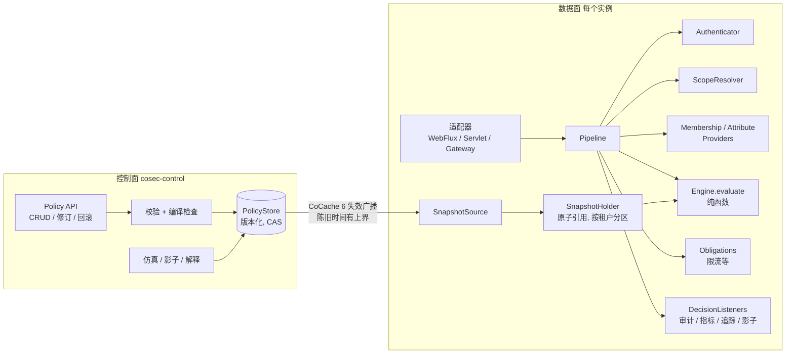
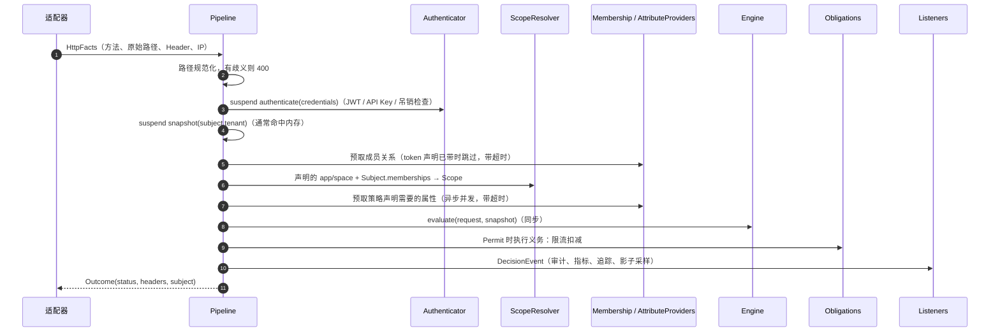

# RFC 0001：CoSec 目标架构（不考虑兼容性的重构设计）

> 状态：已确认，分阶段实施中（第 5 版）：第 1 阶段已合入 `main`，随 7.0 发布；第 2–6 阶段属于 8.0，全部达成之前不发布 8.0 的任何版本（2026-10-21），第 2 阶段的细化见 [RFC 0002](0002-pure-engine.md)；2026-10-26 起各阶段的等价门槛由 [RFC 0008](0008-conformance-and-direct-build.md) 的规范一致性套件取代，剩余工作直接构建目标路径、一次切换 · 基线：`main` @ 6.1.0（`153e2b0c`）· 范围：全部模块

## 0. 结论先行

CoSec 的本质只有一个函数：

```
decide(Subject, Action, Resource, Environment, PolicySnapshot) -> Decision
```

其余一切要么是**为这个函数准备可信输入**（认证、请求规范化、租户/应用/空间解析、属性获取），
要么是**为它提供策略数据**（存储、分发、版本），要么是**执行与观察它的结果**（适配器、限流、审计、
解释、影子评估）。

当前实现把这三类关注点缠在了一起：评估函数返回 `Mono`、在评估中途读 Redis、在共享可变的
`SecurityContext` 上写中间状态、同一个决策算法写了三遍。目标架构的核心动作是：

1. **把决策引擎变成纯函数**：同步、无 I/O、无共享可变状态、输入不可变、输出带可选 trace。
2. **把策略从"解释执行"改为"编译执行"**：JSON → AST → 编译、索引后的不可变 `PolicySnapshot`。
3. **把策略数据从"每请求查缓存"改为"快照推送"**：只有低基数数据进快照；成员关系、黑名单这类高基数数据在评估前预取（P11）。热路径上不再有 Reactor、调度器切换或 `BlockingAware`。
4. **统一策略模型**：RBAC 的角色权限只是"绑定到角色的策略"，不再是独立的评估层。
5. **显式化信任边界**：`appId`/`spaceId` 不再直接取自客户端 Header，必须经过成员关系校验。
6. **分离控制面与数据面**：策略写入、修订、校验、仿真属于控制面；数据面只读快照。控制面自身的写操作也要授权，并且不能越权授权（P12）。

---

## 1. 审查发现

按"会不会导致错误放行"排序。D1–D5 都已有复现测试证实；D6 和 1.2 节是结构性问题。

### 1.1 具体缺陷 / 风险

| # | 问题 | 位置 | 后果 | 状态 |
|---|---|---|---|---|
| D1 | **限流 key 读到别的规则写入的路径变量。** `RateLimitingAuthorization` 先对所有规则调用 `matches`（每次路径匹配成功都会覆盖 context 里的 `PATH_VARIABLES`），然后才逐条调用 `bucketOf`。规则 A 的 key 是 `request.path.var.id`，若之后的规则 B 也匹配并写入了不含 `id` 的变量，A 的桶就变成 `g:`，所有用户共享同一个桶 | `limiter/RateLimitingAuthorization.kt`、`policy/action/PathActionMatcher.kt` | 限流口径错误：按用户限流可能变成全局限流 | 已证实；修复见 [#945](https://github.com/Ahoo-Wang/CoSec/pull/945) |
| D2 | **被引用但缺失的策略被静默丢弃。** `getPolicies(ids).mapNotNull { policyCache[it] }`，本地命中 `null` 同样跳过。主体引用的 DENY 策略只要没加载到，它的拒绝就消失了 | `cocache/.../RedisPolicyRepository.kt` | 违反 deny-first 的精神：数据缺失会扩大访问范围 | 已证实；修复见 [#946](https://github.com/Ahoo-Wang/CoSec/pull/946)（破坏性变更） |
| D3 | **角色权限的作用域与应用脱钩，且作用域来自客户端。** `RolePermissionCache` 的 key 是 `(roleId, spaceId)`，不含 `appId`；评估时用请求 Header/Query 里的 `appId`、`spaceId` 去查。同名角色、同名权限 ID 会跨应用生效，`spaceId` 是否属于该主体也没在模型里体现 | `RedisAppRolePermissionRepository.kt`、`api/context/request/Request.kt` | 可能跨应用 / 跨空间越权 | 已证实是模型缺陷（同一条 `*` 授权可以跨应用生效，改 Header 就能跨空间）；实际影响取决于上游有没有成员校验，修复语义待定 |
| D4 | **快照不一致。** 全局策略索引和策略内容分属不同的 key，读时分别取、写时分两步（先 `policyCache` 后索引），本地缓存还可能"部分命中"。一次评估可能看到混合版本 | `RedisPolicyRepository.kt` | 策略发布期间出现不可解释的决策 | 已证实；写入失败的情况在 [#946](https://github.com/Ahoo-Wang/CoSec/pull/946) 中通过调整写入顺序做到失败时停在安全一侧；读侧的混合版本要靠 3.4 节的快照解决 |
| D5 | **root 是一个魔法字符串。** `ROOT_ID = System.getProperty("cosec.root", "cosec")`，任何 `id == "cosec"` 的主体都是 root，而且 root 跳过黑名单 | `api/principal/CoSecPrincipal.kt`、`SimpleAuthorization.kt` | 只要某个身份源能签发 id 为 `cosec` 的主体，就拿到全部权限 | 已证实（默认配置下，root 跳过黑名单；用户租户里 id 为 `cosec` 的主体也被当成平台 root）；`configuration.md` 有警告，修复语义待定 |
| D6 | **OGNL / SpEL 条件匹配器。** 图灵完备的表达式靠沙箱约束，攻击面大，成本也无法静态限定 | `policy/condition/Ognl*`、`Spel*` | 策略作者（或被攻破的控制面）可以执行任意逻辑 | 设计风险，未单独验证 |
| D7 | **路径变量在匹配器之间串用（D1 的同类问题）。** 所有匹配器共用 `PATH_VARIABLES`，只在路径匹配成功时覆盖，从不清空：① `all` 动作语句的条件，会读到一条未命中的 DENY 语句写下的变量，等于加一条 deny 反而放宽了访问；② 策略级 condition 会读到 global 层留下的变量；③ 动作不是 `path` 的限流规则，会读到策略语句写下的变量 | `policy/action/PathActionMatcher.kt`、`policy/condition/part/PartExtractor.kt` | 条件判断的依据来自别的语句 | 已有探测测试证实（未提交）；修复要改授权语义，待定。目标架构里由 P6 从根本上消除 |

### 1.2 结构性问题

- **同一算法有三份实现**：`Policy.verify`（`cosec-api` 的默认方法）、`SimpleAuthorization.verifyPolicies`、
  `AuthorizationExplainer.firstDecisive`，靠 `ExplainerConsistencyTest` 维持一致。正确的做法是只有一份实现，
  解释只是它的副产物。
- **评估与 I/O 交织**：`SimpleAuthorization` 在三层之间依次 `flatMap` 仓库调用，所以引擎只能是响应式的；
  为了不阻塞事件循环又引入了 `BlockingAware`、`LocalCacheLookup`、按层切换 `boundedElastic`。
  这些都是"在评估中途取数据"带来的补丁。
- **`SecurityContext` 是共享可变袋子**：路径变量、已解析路径的缓存、`VerifyContext`、
  `PolicyEvaluation` 标记、Token 异常都写在 `attributes: MutableMap` 里。`AuthorizationChecker` 和
  `ShadowAuthorization` 都要先"隔离"一个新 context，说明这个共享状态已经在制造问题（D1 就是其中之一）。
- **结果类型过多，语义也混在一起**：`VerifyResult`、`AuthorizeResult`、`AuthorizationDecision`、
  `SecurityDecision` 四种类型；`AuthorizeResult` 里同时有认证（`TOKEN_EXPIRED`）和配额（`TOO_MANY_REQUESTS`）。
  更关键的是没有 **Indeterminate**（无法判定）这个状态，所以"出错"只能靠异常 + `onErrorResume` 来表达。
- **两套并行的策略模型**：`Policy/Statement` 与 `AppPermission/PermissionGroup/RolePermission`。
  `Permission : Statement`，说明它们在评估层面本来就是同一个东西，只是挂载方式不同。
- **限流、影子、审计、度量、追踪都实现为 `Authorization` 装饰器**：限流是执行层义务，不是授权判断；
  影子评估要为候选集重新 new 一个 `SimpleAuthorization` 和两个 Overlay 仓库。装饰器链的顺序本身也成了需要文档化的语义。
- **读接口里有写方法**：`PolicyRepository.setPolicy` 把控制面操作放进了数据面 SPI。
- **传输层词汇就是授权词汇**：Action 等于 HTTP 路径匹配。网关场景下合理，但服务内部（方法级、领域资源）
  授权只能把一切先伪装成 path（`AuthorizationChecker.CheckRequest`）。
- **认证同步阻塞**：`SecurityContextParser.parse` 是同步的，API Key 查询、Token 吊销检查都在里面，
  所以 Pipeline 需要 `securityContextParseScheduler` 再切一次线程。

---

## 2. 设计原则

| 原则 | 含义 | 对应问题 |
|---|---|---|
| **P1 纯决策** | 引擎是 `(Input, Snapshot) -> Decision` 的同步纯函数，不依赖 Reactor、Spring、Redis | 评估与 I/O 交织、`BlockingAware` |
| **P2 编译后执行** | 策略文档先校验、编译、建索引成为不可变快照，请求期只做查表和匹配 | 线性扫描、热路径分配 |
| **P3 一份算法** | 解释、影子、审计、检查 API 都调用同一个 `evaluate`，区别只在 trace 级别和快照 | 三份实现 |
| **P4 显式信任边界** | 输入分为"已验证"（来自凭证）和"声明"（来自客户端）；作用域必须由 `ScopeResolver` 校验 | D3 |
| **P5 构造上失败即拒绝** | 决策类型含 `Indeterminate`；引用缺失、匹配器出错、属性缺失都是 `Indeterminate`，映射为拒绝 | D2、异常驱动 |
| **P6 不可变输入** | 匹配器返回 `MatchResult(bindings)`，不写共享状态 | D1、D7、context 隔离 |
| **P7 快照一致性** | 每次评估只读一个版本号确定的快照；发布是原子换引用 | D4 |
| **P8 判断与执行分离** | 授权只给 Permit/Deny + 义务（obligations）；限流、审计等是 Pipeline 阶段或监听器 | 装饰器链 |
| **P9 控制面 / 数据面分离** | 写、修订、校验、仿真在控制面；数据面只订阅快照 | `setPolicy` 在读 SPI 中 |
| **P10 受限表达式** | 一种非图灵完备、有类型、成本有界、可以抽取索引键并做包含分析的条件 AST（见 7.1） | D6 |
| **P11 数据按基数分层** | 低基数、变化慢的数据（策略、角色定义、限流规则）进快照；高基数、变化快的数据（主体的角色和成员关系、黑名单）不进快照，在评估前预取 | 快照无法容纳用户级数据 |
| **P12 控制面同样受授权** | 写策略、写绑定本身就是需要授权的操作，并且不能授出超过授权者自身的权限 | 控制面是权限最高的入口 |

---

## 3. 目标架构

### 3.1 总览



### 3.2 领域模型（`cosec-model`，纯 Kotlin，无依赖）

```kotlin
@JvmInline value class TenantId(val value: String)
@JvmInline value class PrincipalId(val value: String)
@JvmInline value class PolicyId(val value: String)

/** 评估输入：全部不可变，全部已验证或已标注来源。 */
data class AuthzRequest(
    val subject: Subject,          // 来自凭证，已验证
    val scope: Scope,              // 经 ScopeResolver 校验后的 tenant/app/space
    val action: Action,            // 例如 http:GET 或 order:cancel
    val resource: Resource,        // 类型 + id + 属性；HTTP 场景下是规范化后的路径
    val environment: Environment,  // 时间、来源 IP、设备、请求 id
)

data class Subject(
    val id: PrincipalId,
    val tenant: TenantId,
    val authenticated: Boolean,
    val attributes: Map<String, Value>,
    val memberships: Memberships,  // 按作用域区分的角色与空间成员关系，来源见下文"数据分层"
)

sealed interface Decision {
    data class Permit(val by: StatementRef, val obligations: List<Obligation>) : Decision
    data class Deny(val by: StatementRef?) : Decision          // by == null 即隐式拒绝
    data class Indeterminate(val cause: Cause) : Decision      // 引用缺失、匹配出错、属性缺失
}
```

**统一的策略模型**——只有三种数据：

| 概念 | 说明 | 取代 |
|---|---|---|
| `Policy` | 一组 `Statement(effect, actions, resources, condition)` | `Policy` + `AppPermission` + `PermissionGroup` |
| `Binding` | `(principal \| role \| group \| *) → policy`，带作用域 `(tenant, app?, space?)` | `principal.policies`、`RolePermission`、`PolicyType.GLOBAL` |
| `Catalog` | 某个应用暴露的 action/resource 类型及其描述 | `AppPermission` 的"权限目录"用途（供 UI、生成器、校验使用，不参与评估） |

"全局策略"就是绑定到 `*` 的策略；"角色权限"就是绑定到角色、作用域为 `(tenant, app, space)` 的策略。
D3 在模型层面消失：一个绑定不写 `app` 就不会匹配到别的应用。

**数据分层（P11）**：`Binding` 描述的是"角色 → 策略"，属于低基数数据，放进快照。"主体 → 角色 / 空间"属于
**成员关系**，是用户级的高基数数据，**不进快照**，有两个来源可选，默认用 token 声明（见 7.1）：

| 来源 | 适用场景 | 撤销延迟 |
|---|---|---|
| 签名 token 中按作用域写的声明（如 `roles: {"blog/team-a": ["editor"]}`） | 成员关系变化少，追求零 I/O | 最长等到 token 过期，因此 token 寿命要短 |
| `MembershipProvider`（带缓存，评估前预取） | 成员关系变化频繁，或需要即时撤销 | 等于缓存 TTL，变更事件到达时立即失效 |

撤销延迟的上限是部署时的显式配置项，必须写进运维文档，不能是实现细节。

**平台层与租户层**：跨所有租户生效的策略（平台黑名单规则、平台边界策略）属于**平台快照**。加载租户快照时，
把平台层一起合并、编译成一份 `PolicySnapshot`，版本号是 `(platformVersion, tenantVersion)` 这一对。
平台层更新会触发所有已加载租户的重新编译，这样一次评估始终只读一份快照（P7）。

**root** 不再是魔法 id，而是一条显式的 break-glass `Binding`（只能由控制面创建，强制审计，可以设置过期时间）。

**黑名单**拆成两部分：判断规则（"已拉黑就拒绝"）是平台层的一条 DENY 策略，留在快照里；名单本身（IP、设备、主体）
变化频繁、条目多，放在专门的快速集合里，由 `AttributeProvider` 以 `environment.blocked` 之类的属性提供。封禁一个 IP
不需要重新编译快照。root 同样受这条 DENY 约束，除非显式豁免。

### 3.3 引擎（`cosec-engine`，同步、纯函数）

```kotlin
interface Engine {
    fun evaluate(request: AuthzRequest, snapshot: PolicySnapshot, trace: TraceLevel = TraceLevel.OFF): Evaluation
}
data class Evaluation(val decision: Decision, val trace: Trace?)   // trace 关闭时为 null，不产生 trace 相关的分配
```

**编译**：`PolicyDocument (JSON) → AST → 类型检查 → CompiledPolicy`。

- 动作 / 资源模式编译进按 `(tenant, action namespace)` 分区的**路由前缀树**，一次查找得到候选语句集，
  不再对全部全局策略做线性扫描。
- 条件编译为有类型的条件 AST，运算符集合固定（`eq`、`in`、`prefix`、`cidr`、`time`、`exists`、`and`、`or`、`not`），
  编译时检查类型、限定成本，并抽取等值约束供索引使用。不再为每种匹配器写一个 `ConditionMatcherFactory`。
- 引用完整性在编译期检查：`Binding` 指向不存在的策略，编译就失败，快照不会发布（D2 在发布前被拦住；
  运行时仍然缺失则返回 `Indeterminate`）。
- **索引不得漏掉任何语句**：索引给出的候选集必须包含暴力匹配会命中的全部语句，否则一条被漏掉的 DENY 就会悄悄
  破坏 deny-first。运行时才能确定的模式（模板路径）以及无法从动作和资源推出适用性的语句，一律放进"总是候选"桶。
  这一条由性质测试守护：随机策略集加随机请求，比较索引结果与暴力扫描结果。

**组合算法**（唯一实现）：

```
applicable = snapshot.bindingsFor(subject, scope)            // 主体 ∪ 其角色 ∪ "*"，按作用域过滤
candidates = snapshot.index.lookup(action, resource) ∩ applicable
for s in candidates where s.effect == DENY:
    when match(s):
        MATCH   -> return Deny(s)
        ERROR   -> return Indeterminate(MatchError(s))   // 无法确认这条 DENY 不适用
        NO_MATCH -> continue
for s in candidates where s.effect == ALLOW:      // 此时所有 DENY 都已确认不适用
    when match(s):
        MATCH   -> return withinBoundary(Permit(s)) // 第一条命中的 ALLOW 即可，顺序只影响 trace
        ERROR   -> continue                       // 记入 trace；按未命中处理，结果只可能更严
        NO_MATCH -> continue
return Deny(null)
```

`withinBoundary`：租户有平台边界策略时（见 3.7），Permit 还必须同时落在边界之内，否则返回 `Deny(boundary)`；
边界匹配出错时返回 `Indeterminate`。

DENY 出错必须返回 `Indeterminate`，因为跳过它可能放行；ALLOW 出错按未命中处理就已经 fail closed，没有必要让
整个请求失败。

**属性缺失**：语句引用的属性没有取到时，按策略声明的 `onMissing` 处理：`indeterminate`（默认，请求返回 503）或
`nomatch`（只允许用于 ALLOW 语句，或者用于缺失时应当放过的 DENY 语句，例如"命中某名单才拒绝"）。选择 `nomatch`
意味着依赖故障时这条 DENY 失效，所以控制面在发布这类 DENY 时要求显式确认并记入审计。这样，外部依赖的可用性
对决策的影响是由策略作者显式决定的，而不是隐含的。

deny-first 不再依赖"层"的顺序和 `thenVerify` 的组合技巧，而是对整个候选集直接成立，`SimpleAuthorizationTest`
可以改写成性质测试：对任意策略集合，加入一条匹配的 DENY 后，结果绝不会是 Permit。

**匹配不写状态**：`match(statement, request) : MatchResult`，路径变量作为 `bindings` 返回并只在该语句的条件里可见（D1 消失）。

**trace 即解释**：`TraceLevel.FULL` 时记录每个候选语句的匹配结果。`AuthorizationExplainer`、
`ExplainerConsistencyTest` 和 `Policy.verify` 默认方法全部删除。解释一次历史决策时，必须针对该决策记录的快照版本
重新评估（见 3.6），否则解释的是另一份策略。

### 3.4 快照与分发

```kotlin
data class SnapshotVersion(val platform: Long, val tenant: Long)
class PolicySnapshot(val tenant: TenantId, val version: SnapshotVersion, /* 平台层与租户层合并后的编译结果、索引、绑定表、边界策略 */)

interface SnapshotSource {                              // 数据面唯一的策略存储 SPI
    suspend fun snapshot(tenant: TenantId): PolicySnapshot   // 已加载时直接返回；未加载时异步加载并编译
    fun updates(): Flow<SnapshotChange>                      // 版本变更通知
}
```

- 控制面每次发布写入一个新版本：每个租户（以及平台层）是**一个**带版本号的完整文档，存放在一个 CoCache 6 的
  `Cache<TenantId, SnapshotDocument>` 中（`ttl = FOREVER`，严格读失败模式）。一次发布只写一个 key，由 CoCache
  完成原子删除和广播，不再出现 D4 那种跨两个缓存的部分写入。
- 数据面通过 CoCache 读取文档，按 `(tenant, version)` 缓存编译结果，并原子替换引用；编译失败就保留旧版本并告警
  （不会出现"半个新版本"，D4 消失）。
- **按需加载**：租户很多时，每个实例只保留活跃租户的快照（LRU）。冷租户的第一个请求在 Pipeline 中异步加载，
  同一租户的并发加载合并为一次。引擎仍然只接收已经加载好的快照，自身不做 I/O。可以配置一组预热租户，在启动时加载。
- **失效事件会丢，陈旧时间必须有上界**：这一点直接由 CoCache 6 的一致性协议保证，不再自己实现 Pub/Sub 和对账。
  按 CoCache RFC 0003 的 G1，事件送达时本地副本的陈旧时间不超过事件延迟；事件丢失时不超过
  `min(localMaxAge, 心跳超时 + 重连时长)`。CoSec 把 `localMaxAge` 设为快照最大落后时长，并在此之上暴露快照落后时长的
  指标；超过上限时的行为必须显式配置：`alert`（默认，只告警）或 `fail-closed`（该租户的请求返回 503）。
- 启动时预热租户未就绪 → `/readiness` 不就绪；加载失败 → `Indeterminate` → 503。
- 热路径上不再有 `Mono`、调度器切换、`LocalCacheLookup`、`BlockingAware`。
  `CacheTtlPolicyTest` 要守的不变量（"缓存不能过期丢策略"）也自然成立：快照只会被更新的版本替换。

**规模假设**：快照只包含低基数数据（P11），单租户在万级语句以内时可以全量驻留内存。超大租户可以按应用分片快照，接口不变。

### 3.5 数据面 Pipeline（`cosec-runtime`，挂起函数，见 3.8）



- **路径规范化**只在 Pipeline 中定义一次：解码一次、合并重复斜杠、处理 `.`/`..`、剥离或拒绝 `;` 矩阵参数，并明确
  大小写与尾斜杠的处理规则。出现二次编码、编码后的 `/` 或 `..` 等无法无歧义解释的路径，一律 400，不去猜测。
  授权判断用的路径必须与后端路由用的路径一致，否则就是一个绕过漏洞，所以规范化规则也要写进各适配器的文档。
  三类适配器对同一组恶意路径语料的处理结果必须完全一致（并入 `WebAdapterParityTest`）。
- **Authenticator** 是挂起函数 `suspend (Credentials) -> AuthnResult`，结果为 `Authenticated | Anonymous | Rejected(reason)`。
  Token 过期属于认证结果，不再塞进 `AuthorizeResult`。
- **ScopeResolver** 是新增的信任边界：客户端只能*声明*想访问哪个 app/space，必须由 `Subject.memberships` 确认
  （来源见 3.2 的数据分层）。它是内置实现，规则来自快照；`Scope` 只能由它构造，所以不作为 SPI 开放。
  需要扩展的是成员关系的*来源*（`MembershipProvider`），而不是判断逻辑。
- **AttributeProvider（PIP）** 取代"阻塞的自定义条件匹配器"：策略编译时就能知道需要哪些外部属性，
  Pipeline 在评估前一次性并发取齐；取不到时按语句的 `onMissing` 处理（见 3.3）。引擎永远不做 I/O。
- **Obligations**：限流是 Permit 附带的义务（来自限流规则，规则本身也是快照的一部分）。
  执行失败时按规则的 `strictFailure` 决定拒绝还是放行——这仍然是唯一被文档化的降级例外。
- **状态映射**只在 Pipeline 中定义一次：

| 情况 | 状态 |
|---|---|
| 请求路径非法 | 400 |
| `Rejected`（凭证无效 / 过期 / 吊销） | 401 |
| `Deny` 且匿名 | 401 |
| `Deny` 且已认证 | 403 |
| 义务失败：配额耗尽 | 429 |
| `Indeterminate`：快照未就绪、依赖不可用、属性缺失（可重试） | 503 |
| `Indeterminate`：内部错误、DENY 匹配出错 | 500 |
| `Permit` | 继续 |

### 3.6 观察：监听器，而不是装饰器

```kotlin
interface DecisionListener {
    val delivery: Delivery                                  // REQUIRED 或 BEST_EFFORT，见下表
    suspend fun onDecision(event: DecisionEvent)            // 不能改变决策；REQUIRED 失败只会让请求变成拒绝
}
```

审计（日志 / Kafka）、Micrometer、OpenTelemetry 都只是监听器，各自模块各一个实现。
**影子评估**也是监听器：采样后用 `candidateSnapshot = base.overlay(candidates)` 再调用一次 `Engine.evaluate`，
比较两个 `Decision`。候选快照在候选集变化时编译一次，`OverlayPolicyRepository` 等类全部删除。

**`DecisionEvent` 必须包含**：快照版本 `SnapshotVersion(platform, tenant)`、做出决策的 `StatementRef`、
`Scope`、请求 id。这样才能事后回答"是哪个版本的哪条语句做出的这个决策"，explain 也才能针对同一个版本重新评估。

**投递语义**按监听器分为两类，注册时声明：

| 类别 | 投递方式 | 失败时 | 用于 |
|---|---|---|---|
| `REQUIRED` | 同步，写入成功后才放行 | 拒绝请求（`Indeterminate`，503） | 合规要求不能丢失的审计 |
| `BEST_EFFORT`（默认） | 异步，有界队列 | 丢弃并计数，绝不阻塞或影响决策 | 指标、追踪、普通审计、影子评估 |

影子评估还要满足：采样，在有界队列中异步执行，不占用请求延迟，队列满时直接丢弃。

### 3.7 控制面（`cosec-control`）

- `PolicyStore`：版本化写入、乐观并发（CAS on version）、修订历史、回滚——现有 `policy/history` 搬过来。
- 发布前强制：Schema 校验 → 编译 → 引用完整性检查 → 可选的影子窗口。
- 提供 `simulate(request, candidateDocument)`、`explain(request)`、`analyze()`（现有 `AccessAnalyzer`）。
  它们都调用同一个 `Engine`。
- `schema/*.schema.json` 由模型代码生成，不再手写（AGENTS.md 里"没有测试检查它"的问题随之消失）。

**控制面自身的授权（P12）**：控制面是权限最高的入口，所以它的每个写操作也要经过 CoSec 授权，即用同一个引擎来保护自己：

- 控制面的动作有自己的命名空间，例如 `cosec:policy:write`、`cosec:binding:create`，资源是 `(tenant, app?, space?)`。
  "谁能改哪个租户的策略"就是普通的策略和绑定。
- **不能越权授权**：创建或修改一个绑定时，被授出的动作和资源必须是授权者本人在同一作用域内拥有的权限的子集。
  这样就不会出现租户管理员把自己绑到更宽的策略上、或者创建 `*` 绑定来提权的情况。这个子集检查在编译期对策略做
  静态包含判断；判断不了的（例如带条件的语句）一律拒绝，由平台管理员处理。
- **平台边界**（permission boundary）：平台层可以给每个租户设一条边界策略，租户内的任何 Permit 都必须同时落在边界
  之内（即 3.3 组合算法中的 `withinBoundary`）。
- break-glass root 绑定只能由平台管理员创建，必须设置过期时间，创建和每一次使用都写入 `REQUIRED` 类审计。


### 3.8 编程模型：同步引擎 + 协程运行时，Reactor 只留在适配器里

**决定**：引擎同步；`cosec-runtime` 及其全部 SPI 使用 Kotlin 协程（`suspend` + `Flow`）；Reactor 只出现在
WebFlux / Gateway 适配器中，每个请求在边界桥接一次（`mono { pipeline.evaluate(facts) }`）。不使用虚拟线程作为主模型。

**为什么不用 Reactor 作为通用模型**：Reactor 的价值在于组合非阻塞 I/O 流。在目标架构中，热路径上不再有策略 I/O
（快照在内存里），剩下的是"认证 → 取快照 → 预取成员关系和属性 → 作用域 → 决策 → 义务"这样的**顺序编排**加少量并发。
对顺序编排，`flatMap`/`switchIfEmpty`/`onErrorResume` 是负担：错误路径分散，fail-closed 很难靠审查确认
（`SecurityPipeline` 里那个"同步抛出也要映射成决策"的 `defer` 注释就是例证）。

**为什么选协程**：

| 关注点 | 协程带来的好处 |
|---|---|
| fail closed 可审查 | 用 `try/catch` 加对 sealed `Decision` 的穷举 `when`，所有拒绝路径都在一个函数里，编译器能检查遗漏 |
| 有界的外部调用 | `withTimeout` 加结构化并发：属性预取用 `coroutineScope { async {...} }`，任何一个失败或超时都会取消其余调用，并返回 `Indeterminate` |
| 上下文传播 | 主体、请求 id、trace 放进有类型的 `CoroutineContext.Element`，不再用 Reactor `Context` 的字符串 key，也不再用 `SecurityContext` 里的 `attributes` map。OTel 用 `opentelemetry-extension-kotlin` 的 `asContextElement()` 传播 |
| 流 | 快照变更用 `Flow`，DecisionListener 的异步投递（Kafka 审计）用 `Channel`，背压语义明确 |
| 缓存 | CoCache 6.4 的 `cache.suspending()` 直接提供 `SuspendingCache`：L2 命中不分配协程状态，调用方被取消不会取消共享的加载，不阻塞任何线程。快照文档、成员关系、API Key、吊销表都用它，不需要自己桥接 |
| 统一两类宿主 | 响应式宿主用 `mono {}` 桥接，可以在事件循环上运行，挂起时不阻塞；Servlet 宿主直接在请求线程（或虚拟线程）上 `runBlocking` |

**为什么不选虚拟线程作为主模型**：虚拟线程让阻塞代码变得便宜，但 Netty 事件循环本身不能阻塞。在 WebFlux / Gateway
里使用虚拟线程，意味着每个请求都要切到另一个执行器，这正是当前 `boundedElastic` 的代价。协程可以在事件循环线程上
运行，遇到 I/O 时挂起，适用的宿主更多。Servlet 宿主可以自行开启虚拟线程（见 3.9），适配器的 `runBlocking` 跑在虚拟线程上，两者并不冲突。

**约束（新增不变量）**：
- 数据面 runtime 的 SPI 实现**只能用非阻塞客户端**（CoCache 6.4 的 `cocache-coroutines`、Lettuce 协程 API、R2DBC 等）。不再有 `BlockingAware`，也不再有 `Dispatchers.IO` 兜底
  （控制面不在请求路径上，允许用 `Dispatchers.IO` 包装 JDBC，见 3.9）；
  用 `BlockHound` 在测试中检测事件循环上的阻塞调用。
- 引擎不得依赖 `kotlinx.coroutines`：决策始终是同步纯函数，可以在任何线程模型下复用。
- 上下文桥接只允许出现在适配器里，并且只有一处：WebFlux / Gateway 适配器把 Reactor `Context` 和 OTel 上下文转换为
  `CoroutineContext`。`WebAdapterParityTest` 扩展为断言三类适配器的 trace id 和审计主体一致。
- 取消即拒绝：请求被取消或超时属于 `Indeterminate`，不会产生 Permit。

**代价**：SPI 是 `suspend` 函数，等于确定 CoSec 面向 Kotlin。这是产品定位上的选择，不是兼容性问题；Java 应用仍然可以使用内置实现和 Spring 配置。
每个请求在桥接时多一次协程的创建和分配，与网络 I/O 相比可以忽略，落地时用 JMH 加端到端压测确认。


### 3.9 JDK：基线保持 17，部署在 25 上

> **2026-10-29 修订（维护者："CoSec 基线升级到 JAVA 21 吧。"）**：8.0 的编译基线改为 **JDK 21**（#1169），7.x 不变；
> `cosec-gateway-server` 的镜像仍运行在 **JDK 25** 上并使用 AOT cache。起因是 CosId 5 只支持 Java 21：以 17 为基线，`cosec-cosid`
> 就只能是唯一按 21 编译、绕开 starter 的模块（RFC 0011 D2 的例外）。下文"保持 17"的决定与 RFC 0004、0006、0007 中"没有用到 17 以后的 API"
> 的说明，按此修订理解。

**决定**（已确认，2026-10-19）：编译基线保持 **JDK 17**；推荐的运行时，也是 CI 主要验证的运行时，是 **JDK 25**。等代码真正需要 17 以后的
API 时再提高基线。

**原则**：*基线*是 CoSec 编译时的目标版本，也是它要求的最低运行版本；*运行时*是应用实际使用的 JDK。基于 17
编译的库可以在 25 上运行，并得到 25 的全部 JIT、GC 和内存改进。只有当代码需要*调用*新 API，或者必须*依赖*某个运行时
行为时，才值得提高基线。

**逐项检查目标架构是否真的需要 17 以后的 API**：

| 候选收益 | 是否需要提高基线 | 理由 |
|---|---|---|
| 虚拟线程 | 不需要 | CoSec 自己不创建线程。Servlet 宿主是否用虚拟线程处理请求，由应用决定（`spring.threads.virtual.enabled`）；适配器的 `runBlocking` 在哪种线程上都能工作 |
| `synchronized` 不钉住载体线程（JEP 491） | 不需要 | 这是运行时行为。部署在 24 及以上版本就能得到；CoSec 本身不依赖它 |
| `ScopedValue` | 不需要 | 3.8 已经把请求上下文放进 `CoroutineContext`；Servlet 路径上给应用代码用的 `SecurityContextHolder` 用 `ThreadLocal` 就够了，在虚拟线程上也正确 |
| 控制面的阻塞 I/O | 不需要 | 与数据面一样使用挂起函数和非阻塞客户端；必须用 JDBC 时，切到 `Dispatchers.IO` |
| 紧凑对象头、分代 ZGC、JIT | 不需要 | 都由运行时提供 |
| Java 语言特性 | 不需要 | 对 Kotlin 代码没有意义 |

结论：目标架构在代码层面没有任何地方需要 17 以后的 API，所以保持 17。顺带的好处是能覆盖更多运行环境，
但这不是这么做的理由。

**"部署在 25 上"的具体含义**（CoSec 是库，控制不了应用的部署，只能控制下面这些）：
- CI 用两个 JDK 测试：17 验证最低版本可用，25 作为主运行时，全部测试都跑。
- 所有 JMH 基准统一跑在 25 上，文档里公布的性能数字也都以 25 为准。目前 `RateLimitingAuthorizationBenchmark` 跑在 21 上，
  `SimpleAuthorizationBenchmark` 跑在 17 上，两者的结果不可比。
- `cosec-gateway-server` 镜像使用 JDK 25 基础镜像。
- 运维文档推荐 25 作为运行时。如果在 Servlet 宿主上开启虚拟线程，要求运行时至少是 24（JEP 491）；同时给出
  `-XX:+UseCompactObjectHeaders` 等参数的实测数据。

**何时提高基线**：出现一个具体的代码需求，而且没有合理的替代办法时（例如 CoSec 必须自己创建虚拟线程执行器）。到那时
直接升到当时最新的 LTS。

### 3.10 AOT 与 native image

**决定**（已确认，2026-10-21，见 7.1）：AOT 就绪是 8.0 的设计约束。三种"AOT"含义不同，落点也不同：

| 含义 | 是什么 | 落点 |
|---|---|---|
| **JDK 25 AOT cache**（Leyden，`-XX:AOTCacheOutput` / `-XX:AOTCache`） | 训练运行时记录类加载、链接和方法 profile，下次启动直接使用 | 部署问题，不需要改代码。`cosec-gateway-server` 的用法由单独的 PR 写进文档 |
| **Spring AOT**（构建期生成 bean 定义，加上 `RuntimeHints`） | 把反射、资源、代理的需求在构建期声明出来 | 8.0 对所有库模块的约束，见下文 |
| **GraalVM native image** | 封闭世界的提前编译 | 可选，只针对 `cosec-gateway-server` 这个应用，在 8.0 之后做。库不把 native 作为受支持的目标，任何地方都不把它设为默认 |

**为什么 native 不是默认**：授权在每个请求上都要执行，稳态下 JIT 的吞吐比启动时间重要得多；native image 没有运行时
profile 引导的优化，峰值吞吐通常更低。所以 native 只是网关应用的一个可选构建方式。**任何改动都不能为了 native 拖慢 JIT 路径**；
有冲突时以 JIT 路径为准，用 JMH 前后对比证明（不变量"热路径有基准"）。

**8.0 对新代码的约束**：
- `cosec-model` / `cosec-engine` 不使用反射，也不使用动态代理。`EnginePurityTest` 已经禁止依赖 `java.lang.reflect..`
  （以及线程、时钟、`java.util.concurrent..` 等），这条约束由它守护。
- 匹配器工厂继续显式注册：要么写进 `META-INF/services`，由 `MatcherFactoryRegistry` 通过 `ServiceLoader` 加载；要么声明为
  Spring bean，由 starter 的 `MatcherFactoryRegister` 注册。不引入类路径扫描或按类名反射实例化。
- 需要反射、资源或代理的每个库模块都自带一个 `RuntimeHintsRegistrar`（经 `META-INF/spring/aot.factories` 注册），并配一个
  用 Spring 的 `RuntimeHintsPredicates` 断言这些 hint 已注册的测试。目前 CoSec 的模块都还没有 `RuntimeHintsRegistrar`。

**现有代码中的已知障碍**：
- `OgnlConditionMatcher` 重度依赖反射（OGNL 在运行时按名字解析属性和方法）；`SpelConditionMatcher` 对表达式求值时，根对象
  `SpelConditionMatcher.Root` 及其可达的每个类型都需要逐类型的 hint。两者都由条件 AST（7.1"条件表达式"）取代：AST 落地时
  将两者标记为 deprecated，之后删除。这也同时解决了 D6。
- CoCache 的缓存代理（`@CoCache` / `@EnableCoCache`）已经有覆盖：CoCache 6.6 在 `cocache-spring-boot-starter` 里自带
  `CoCacheAotProcessor`（`BeanFactoryInitializationAotProcessor`，为缓存接口、key 类型和表达式根注册 hint）和
  `CoCacheRuntimeHints`，两者都在它的 `META-INF/spring/aot.factories` 中注册。CoSec 不需要为此另写 hint。
- Jackson 模块通过 `META-INF/services/tools.jackson.databind.JacksonModule` 注册：`cosec-core` 用它注册 `CoSecModule`，
  `CoSecJsonSerializer` 靠 `findAndAddModules()` 发现它。native image 里这个服务文件必须作为资源保留；更稳妥的做法是在
  `CoSecJsonSerializer` 中显式注册 `CoSecModule`，`ServiceLoader` 只用于发现第三方模块。

**失败即拒绝**：缺少 hint 必须表现为策略加载失败和请求被拒绝，绝不能表现为某条语句或某个匹配器被悄悄跳过。现状（`main`）：
- `MatcherFactoryRegistry.getRequired` 遇到未知 `type` 时抛异常。两处反序列化入口都只用它：`JsonActionMatcherDeserializer`
  用 `ActionMatcherFactoryProvider.getRequired`，`JsonConditionMatcherDeserializer` 用 `ConditionMatcherFactoryProvider.getRequired`。
  所以一个工厂因为缺少服务文件或 hint 没有注册时，整条策略反序列化失败。`LocalPolicyLoader` 把它包装成
  `IllegalStateException` 抛出，应用启动失败；从 Redis 读取时，策略缓存是 `ReadFailureMode.THROW`，错误传到 Pipeline，请求被拒绝。
- 可空的 `MatcherFactoryRegistry.get` 只通过 `ActionMatcherFactoryProvider.get` 和 `ConditionMatcherFactoryProvider.get` 暴露，
  `main` 上没有任何产品代码调用这两个方法，因此不存在"拿到 `null` 就跳过"的路径。新代码一律用 `getRequired`；8.0 的引擎编译
  策略时，未知类型是编译错误，不是被忽略的语句。

**8.0 之后**：增加一个夜间 CI 任务，把 `cosec-gateway-server` 构建为 native image 并跑冒烟测试。冒烟测试包括一个反向用例：
去掉一条 hint 后重新构建，断言对应请求被拒绝（而不是被放行，或者对应语句被跳过）。

### 3.11 关键依赖：CoCache 6.4、CosId 4.0

> **2026-10-29 修订**：CoSec 不再依赖 CosId（#1170）。id 由 CoSec 自己的端口 `IdGenerator`（`cosec-spi`）生成；CosId 只出现在可选扩展
> `cosec-cosid` 中，基于 CosId 5.0.0-alpha.2，由 starter 按类路径装配。下文关于 CosId 4.0 的内容只适用于 7.x。

**决定**：目标架构以 **CoCache 6.4** 和 **CosId 4.0** 为准，并随它们的后续版本更新。main 已升级到 CoCache 6.6.0 和 CosId 4.0.2（7.0）。
两者的基线都是 JDK 17 与 Spring Boot 4，与 3.9 一致。

**CoCache 6.x 对目标架构的影响**

| CoCache 6.x 能力 | 版本 | 在目标架构中的用途 |
|---|---|---|
| 一致性协议：带 lease 的填充、失效戳、原子删除加广播 | 6.0 | 快照分发不再自己实现 Pub/Sub 和对账（3.4）；单 key 发布消除 D4 那种跨缓存的部分写入 |
| 有上界的陈旧时间（`localMaxAge`，事件丢失时同样成立） | 6.0 | 直接成为"快照新鲜度有界"这条不变量的实现手段 |
| 严格读失败模式 | 6.0 | 延续 `CacheTtlPolicyTest` 守护的不变量：Redis 是权威存储，读失败不能被当成"没有数据" |
| `cocache.backend: memory` | 6.0 | 测试用真实的一致性引擎，而不是 mock（AGENTS.md 对缓存测试的要求） |
| 原生异步 API、`putAll` | 6.3 | 控制面批量发布；成员关系缓存批量预热 |
| `cocache-coroutines`：`SuspendingCache` | 6.4 | runtime 的挂起 SPI（3.8）直接基于它实现，L2 命中不分配协程状态 |
| per-key actuator、健康检查、Micrometer 指标 | 6.0 | 运维可以查看和失效某个租户的快照，不需要 CoSec 自己做 endpoint |

**CosId 4.0 对目标架构的影响**

CoSec 只用 CosId 生成标识：请求 id、审计事件 id、token id（`jti`）、社交登录的 `state`、策略修订 id。目标架构里：
- 标识生成是 runtime 的一个端口（`StringIdGenerator`），默认由 CosId 4.0 实现。4.0 的 UUID 生成器和 `CosIdGenerator` 都只实现
  `StringIdGenerator`，正好对应这个端口。
- 需要可排序的标识（审计事件、策略修订）时用 `CosIdGenerator`；只需要唯一的（`jti`、`state`）时用 UUID。
- `cosec-model` 和 `cosec-engine` 不依赖 CosId。目前 `cosec-core` 以 `api` 方式暴露 `cosid-core`，所有使用者都被迫依赖它，
  新架构中不再这样做。

**升级到现有代码时的注意事项**（可以放进 7.0 这一批破坏性变更）：
- CoCache 5.x 到 6.0 **不支持滚动升级**：Redis 值的布局和失效通道都变了，所有实例必须同时切换。最小化的 Redis ACL 需要加上
  `+hkeys +hget`。缓存声明和 `KeyConverter` 要按 6.0 的接口风格重写，`LocalCacheLookup` 这类依赖 5.x 内部结构的代码要删除（7.0 已完成：缓存由 `CoSecCacheSpecs` 声明，`LocalCacheLookup` 已删除，本地命中改用 CoCache 的异步 API）。
- CosId 4.0 要求重新编译：`UuidGenerator` 不再实现 `IdGenerator`，CoSec 中注入 `IdGenerator` 的地方要改成 `StringIdGenerator`。
  CoSec 只用 UUID 生成器，不涉及机器号租约，所以 CosId 自身的迁移步骤（JDBC 加列、代理 token）对 CoSec 用户没有影响，
  除非应用自己也在用 CosId 的其他后端。

---

## 4. 模块布局

| 新模块 | 依赖 | 内容 | 来自 |
|---|---|---|---|
| `cosec-model` | 仅 `kotlinx-serialization-core`（注解与接口） | 值类型、策略 AST、`Decision`、JSON 编解码 | `cosec-api` 大部分 + `serialization` |
| `cosec-engine` | model | 编译器、索引、评估、trace | `SimpleAuthorization`、matchers、`explain`、`analysis` |
| `cosec-runtime` | engine, kotlinx-coroutines, `cosid-core`（标识端口的默认实现） | Pipeline、路径规范化、内置 `ScopeResolver`、SPI（`SnapshotSource`、`Authenticator`、`MembershipProvider`、`AttributeProvider`、`RateLimiter`、`DecisionListener`） | `pipeline`、`limiter`、`audit`、`shadow` |
| `cosec-authn-jwt` / `cosec-authn-apikey` / `cosec-authn-social` | runtime | 认证器 | `cosec-jwt`、`apikey`、`cosec-social` |
| `cosec-store-redis` | runtime, CoCache 6.4（含 `cocache-coroutines`） | 快照文档缓存 + 限流计数 + 吊销表 + 黑名单集合 + 成员关系缓存 + API Key | `cosec-cocache` |
| `cosec-http-webflux` / `cosec-http-servlet` / `cosec-gateway` | runtime | 只做 `HttpFacts` ↔ `Outcome` 转换 | 现有三个适配器 |
| `cosec-observability-{otel,micrometer,kafka}` | runtime | 监听器 | 现有对应模块 |
| `cosec-ip2region`、`cosec-openapi` | runtime | `AttributeProvider`；OpenAPI → `Catalog` + 路由映射 | 现有对应模块 |
| `cosec-control` | engine, runtime | 控制面库（可以嵌入到管理服务中），自身的写操作经 Pipeline 授权 | `policy/history`、生成器 endpoint |
| `cosec-spring-boot-starter` | 以上全部（feature variants） | 每个模块对应一个自动配置 | 现有 starter |
| `cosec-testkit` | engine | `PolicyTestKit`、性质测试生成器 | `testkit` |

依赖规则：`model ← engine ← runtime ← {adapters, stores, authn, observability}`。
`engine` 不得依赖协程或 Reactor；除 WebFlux/Gateway 适配器外，任何模块都不得依赖 Reactor。两条都用 ArchUnit 测试强制。

---

## 5. 不变量（新版）

| 不变量 | 如何保证 |
|---|---|
| Deny-first | 单一组合算法 + 性质测试（随机策略集合） |
| 索引完整 | 索引候选集 ⊇ 暴力匹配命中集；随机策略加随机请求的性质测试 |
| 失败即拒绝 | `Indeterminate` 是一等结果；Pipeline 的 `when` 穷举 sealed 类型，编译器强制 |
| 一条决策路径 | 只有 Pipeline 映射状态码；`WebAdapterParityTest` 保留 |
| 路径一致 | 规范化只在 Pipeline 定义一次；歧义路径返回 400；三类适配器对恶意路径语料的处理结果一致（`WebAdapterParityTest`） |
| 不阻塞事件循环 | 引擎同步且无 I/O（ArchUnit：`engine` 不得引用 I/O、协程与 Reactor 包）；数据面的 I/O 都在 runtime 的挂起 SPI 中，只能用非阻塞客户端实现；控制面不在请求路径上，可以用 `Dispatchers.IO`（见 3.8、3.9） |
| 纯决策 | 匹配函数签名中没有可变参数；义务在评估之后执行 |
| 快照一致 | 一次评估只持有一个 `PolicySnapshot` 引用（平台层已合并进去） |
| 快照新鲜度有界 | 由 CoCache 6 的 `localMaxAge` 保证（事件丢失时同样成立）；落后时长有指标；超过上限时的行为（告警或 503）是显式配置 |
| 决策可追溯 | 每个 `DecisionEvent` 都带有快照版本号对与 `StatementRef` |
| 不能越权授权 | 控制面的每个写操作都经过授权；被授出的权限必须是授权者在同一作用域内权限的子集；无法静态判断的一律拒绝 |
| 作用域可信 | `Scope` 只能由 `ScopeResolver` 构造（`internal` 构造器） |
| 热路径有基准 | JMH 继续保留；目标是 trace 关闭时，每个请求的分配量不随策略数量增长 |

---

## 6. 迁移路线

各阶段的实际进度见 [路线图](../roadmap.md)。

**版本划分**：7.0 = 第 1 阶段（已完成：D1–D7 修复、两轮审查、CoCache 6.6、CosId 4.0，均已合入 `main`），只包含安全修复与依赖升级。
8.0 = 第 2–6 阶段，分阶段实现；每个阶段开工前单独写一份细化 RFC（第 2 阶段见 [RFC 0002](0002-pure-engine.md)），实现后做两轮审查。
`main` 是 8.0 线；`7.x` 是从 `v7.0.0` 切出的维护分支，只接收安全和关键修复（先进 `main`，再 cherry-pick 回移，见 `CONTRIBUTING.md`），
直到 8.0.0 GA 之后 6 个月。

> **2026-10-29 修订（维护者："完成后，保守一点，发布 -alpha.1，不承诺兼容性"）**：在 RC 之前可以发布 **alpha 预览版**（`8.0.0-alpha.N`），
> 在 GitHub 上标为 prerelease，不承诺兼容性，不受 RC 前提约束（RFC 0008 §3.9 修订）。已发布 `8.0.0-alpha.1`、`8.0.0-alpha.2`（2026-10-29）；发布后 `main`
> 保持该 alpha 版本号，不回到 SNAPSHOT。下面"不发布任何版本"的决定只对 RC 与 GA 继续有效：RC 仍须满足 RFC 0008 §3.9 的全部前提，GA 前冻结 ABI。

**发布（2026-10-21，维护者决定）**：目标架构达成之前，8.0 不发布任何版本，没有里程碑版，也没有 RC。8.0.0 GA 包含第 2–6 阶段，
每个阶段都实现完毕并做完两轮审查。目标达成后，由维护者决定发布 RC 还是直接发布 GA；发布 RC 时，可以先在预发环境验证。
~~各阶段的门槛因此都不能依赖发布版本：第 2 阶段用离线回放真实数据取代原来设想的生产采样（RFC 0002 §8），第 2 阶段在 RFC 0002 的
PR-6 合入时结束，不触发发布。~~（2026-10-26 由下一段取代。）

**门槛与切换（2026-10-26 修订，维护者决定，见 [RFC 0008](0008-conformance-and-direct-build.md)）**：8.0 没有兼容目标，正确性来自 8.0 的规范本身，
而不是与 7.x 或与上一阶段等价。各阶段的等价门槛（第 2、3 阶段的离线回放，第 4–6 阶段的门槛 A–D）全部取消，由一套**规范一致性套件**取代：
规则登记表给每条规范性规则一个 id，每条规则有手写的正例和反例场景，期望值从 RFC 的规则推出，不从 7.x 的行为推出；已有的 oracle 与不变量性质
（P1′、P2、P8–P12、A1–A4 等）一并登记；安全不变量都有可执行的性质，并经手写变异体检查。只为等价存在的 PR 取消，各阶段的切换与删除 PR 合并成
**一个切换 PR**：目标路径的各部分先以加法合入 `main`，最后一次装配目标路径、删除 7.x 路径和全部等价脚手架。性能要求改为以 7.0 实测数字设定的绝对预算
（例如编译执行的吞吐不低于 7.0 的 100 %），作为产品目标，不是兼容门槛。真实部署的数据导出不再需要。

虽然不考虑兼容，仍建议分阶段交付，每一阶段都单独合入 `main` 并通过 `check`（但不单独发布）：

1. **先修缺陷（当前架构内）**：为 D1–D5 写失败的测试再修复。D1、D2、D4 已有修复 PR（#945、#946）；D3（角色权限 key 加上 `appId`，并补空间成员校验）、
   D5（root 改为显式配置）、D7（路径变量按匹配器隔离）改变授权语义，需要先确定语义。
2. **抽出纯引擎**：新建 `cosec-model` / `cosec-engine`，`SimpleAuthorization` 改为
   "取数据 → 调用 `Engine.evaluate`"，删除 `Policy.verify` 默认方法和 `AuthorizationExplainer` 的叙述逻辑。
   ~~**切换门槛**（2026-10-21 修订，原为"先在离线请求语料上、再在生产流量采样上"）：删除旧实现之前，让旧实现和新实现
   在离线请求语料上，以及在从真实部署导出的策略、角色权限和请求样本上（离线回放，不需要发布版本）逐条比对决策。
   差异为零（或者每一条差异都已被确认为旧实现的缺陷并登记在案）才能切换。回放覆盖不到线程、缓存时序等运行时行为，
   它们留到目标达成后的 RC 或预发验证。之后每个改变语义的阶段都沿用这道门槛。~~
   **切换**（2026-10-26 修订，取代上面的切换门槛，见 [RFC 0008](0008-conformance-and-direct-build.md)）：不再单独切换第 2 阶段，也不与 7.x 比对决策。
   引擎、快照、统一模型、Pipeline 与控制面以加法合入，由规范一致性套件检查；全部完成后由一个切换 PR 删除旧实现（RFC 0008 §3.9、§4.4）。
   回放从来覆盖不到的运行时行为（线程、缓存时序），仍由各自的测试覆盖，并在目标达成后由维护者决定是否在预发环境验证。
3. **快照分发**：`SnapshotSource` 基于 CoCache 6.4 实现（按需加载，陈旧时间有上界），删除 `BlockingAware`（`LocalCacheLookup` 已在 7.0 删除）；热路径上的策略读取都命中内存。
4. **统一模型**：`Binding` 取代 `principal.policies` / `RolePermission` / `GLOBAL`；成员关系改为按作用域写的
   token 声明或 `MembershipProvider`；平台层与租户层分开；黑名单拆成规则加名单两部分；
   提供一次性的数据转换工具；用条件 AST 取代 OGNL/SpEL 和各个 part 匹配器。
5. **Pipeline 重组**：协程化，挂起的 `Authenticator`、`ScopeResolver`、`AttributeProvider`、义务、监听器；删除装饰器链。
6. **控制面**：`cosec-control`，发布流程强制校验 + 编译 + 影子窗口；控制面的写操作经过授权，加上不能越权授权检查和平台边界；从模型生成 schema。

依赖升级（CoCache 6.4、CosId 4.0）放在阶段 1，与 D2–D7 的修复一起进入 7.0：阶段 3 的快照分发和阶段 5 的协程化都以
CoCache 6.4 为前提。由于 CoCache 6 不支持从 5.x 滚动升级，7.0 的升级说明必须写明"所有实例同时切换"。

每个阶段都要更新 `wiki/`（中英文）和 `skills/`，阶段 2 起附 JMH 前后对比。

---

## 7. 决定与待决问题

### 7.1 已确认的决定（2026-10-20，AOT、发布与第 3 阶段三项为 2026-10-21，第 4 阶段为 2026-10-22，第 5 阶段为 2026-10-25，第 6 阶段、规范一致性与直接构建为 2026-10-26）

| 问题 | 决定 | 理由 |
|---|---|---|
| **成员关系的默认来源** | 默认用签名 token 里按作用域写的声明，access token 寿命不超过 15 分钟；紧急撤销靠吊销该主体的全部 token，迫使它刷新时重新读取成员关系。声明超过阈值（例如 4 KB）时改用 `MembershipProvider` | 常规路径零额外 I/O；撤销延迟有明确上限，紧急情况可以立即生效；选择依据是 token 体积，而不是偏好 |
| **快照落后的默认行为** | 默认只告警（60 秒告警，5 分钟升级）；`fail-closed` 按租户可选开启，上限设得宽一些（例如 30 分钟） | 旧快照仍然一致，不属于"无法确定"；默认 503 会把 Redis 或控制面故障放大成全面停服；紧急拒绝走 token 吊销和黑名单名单，都不依赖快照 |
| **不能越权授权的判断范围** | 被授出的动作和资源模式包含于授权者的权限时允许；条件是"授权者的条件 AND 额外条件"时允许（只收窄，按语法判定）；DENY 在授权者有写权限的作用域内一律允许；其余拒绝并进入平台管理员审批 | 可判定，而且不会误放行 |
| **条件表达式** | 自研有类型、可分析的条件 AST，运算符集合固定：`eq`、`in`、`prefix`、`cidr`、`time`、`exists`、`and`、`or`、`not`。不引入 CEL；将来确实需要时，CEL 只作为可选条件类型，一律视为"不可分析"（只能由平台管理员发布，放进索引的"总是候选"桶） | 只有固定运算符的 AST 才能同时做到成本有界、抽取索引键、做包含分析 |
| **Action 词汇** | 规范模型是 `service:verb` 加带类型的资源；HTTP 是一层映射。内置 `http` 命名空间（`http:GET` + 规范化路径）供 Gateway 使用；服务内部的路由到 action 映射由 `cosec-openapi` 根据 OpenAPI 生成 | URL 重构不影响授权语义；按 action 键精确查找，索引快且不会漏；越权检查和代码内检查都更容易 |
| **当前代码中的 D3、D5、D7** | 在现有架构内立即修复，与 D2 一起放进 7.0 的破坏性变更，每项都经过影子比对并写入 `wiki/operations/upgrading.md` 的 6.1 → 7.0 一节。<br>D5：`root-enabled` 默认 `false`；开启时只对平台租户生效，并且仍受黑名单约束。<br>D7：每条语句匹配动作前清空路径变量，条件只能读本语句动作捕获的变量；策略级 condition 或动作不是 `path` 的语句引用 `request.path.var.*` 时加载失败。<br>D3：角色授权的 key 加上 `appId`（`app:role@space`），并提供数据迁移；请求带 `CoSec-Space-Id` 时，只有 token 里显式写成 `role@space` 的角色在该空间生效，不带后缀的角色只在默认空间生效 | 新架构要分阶段落地，安全缺陷不应等待 |
| **AOT 与 native image**（2026-10-21，维护者确认） | AOT 就绪是 8.0 的设计约束（3.10）：JDK 25 AOT cache 现在就用于部署；8.0 的库模块支持 Spring AOT，需要时自带 `RuntimeHintsRegistrar` 和测试；GraalVM native image 只作为 `cosec-gateway-server` 在 8.0 之后的可选构建，库不支持、也不默认。缺少 hint 必须导致加载失败和拒绝，不能跳过语句 | 授权在每个请求上执行，稳态 JIT 吞吐比启动时间重要；AOT cache 不改代码就能缩短启动；提前声明 hint 的成本低，事后补很难 |
| **8.0 的发布与第 2 阶段的门槛**（2026-10-21，维护者确认） | 目标架构达成之前不发布 8.0 的任何版本（没有里程碑版和 RC）；8.0.0 GA 包含第 2–6 阶段，每个阶段实现完毕并做完两轮审查；之后由维护者决定 RC 或 GA，RC 可以在预发环境验证。`7.x` 维护到 8.0.0 GA 之后 6 个月。第 2 阶段的门槛用离线回放：从维护者指定的真实部署导出策略、角色权限和至少 7 天的请求样本，每个部署至少 100 万条决策零差异；导出数据只留在维护者本地（RFC 0002 §8.2.1）<br>**2026-10-26**：发布部分不变；门槛部分（离线回放、导出数据）由 [RFC 0008](0008-conformance-and-direct-build.md) 取代，见本表最后一行 | 只发布达成目标的版本；没有发布版本可用于生产采样，离线回放仍用真实数据检验决策等价 |
| **第 3 阶段（快照分发）的设计**（2026-10-21，维护者确认） | 按 [RFC 0003](0003-policy-snapshot.md) 实现，§12 的 20 项决定全部按其推荐确认：快照按现有数据的形状分为共享的 `Policies` 文档和每个应用一份 `App` 文档（不按租户，按租户分区属于第 4 阶段）；引擎不改；`SnapshotDocumentStore` 取代 `PolicyRepository`/`AppRolePermissionRepository`；CoCache 6.7 增加条件写入和必需的条件读（6.7 的发布仍待维护者确认）；`BlockingAware` 留到第 5 阶段；RFC 0002 PR-6 保留比较器和回放工具。RFC 0003 §2 列出了本文与第 3 阶段有关的不一致及其处理<br>**2026-10-26**：门槛、PR-5 与比较器的保留由 [RFC 0008](0008-conformance-and-direct-build.md) 取代 | 不改变任何决策，门槛沿用第 2 阶段的离线回放；加载、失效、陈旧度这套机制在第 4 阶段原样复用 |
| **第 4 阶段（统一模型）的设计**（2026-10-22，维护者确认） | 按 [RFC 0004](0004-unified-model.md)（绑定、平台层与租户层、成员关系与作用域、扁平算法、转换工具、门槛方法）和 [RFC 0005](0005-condition-ast.md)（条件 AST、`service:verb` 与 `http` 命名空间、编译执行与索引）实现，两篇的决定（RFC 0004 §15 Q1–Q21、RFC 0005 §11 Q1–Q12）全部按推荐确认；RFC 0005 另加编译执行的吞吐要求（不低于 7.0 的 100 %，RFC 0002 §7.2 第 8 步）。两篇的 §3 / §2 列出了本文与第 4 阶段有关的不一致及其处理<br>**2026-10-26**：门槛 A、B 与两次切换由 [RFC 0008](0008-conformance-and-direct-build.md) 取代；吞吐要求保留为以 7.0 实测数字设定的绝对预算 | 模型与语言分两次切换，每次的差异只来自一类改动；门槛改为"未归类差异为零"，每条差异都有 trace 证据 |
| **第 5 阶段（Pipeline 重组）的设计**（2026-10-25，维护者确认） | 按 [RFC 0006](0006-coroutine-pipeline.md) 实现，§16 的 26 项决定（Q1–Q26）全部按推荐确认，包括新依赖（`kotlinx-coroutines`、`opentelemetry-extension-kotlin`，Q7）以及 SPI 与 `cosec-api` 的变更（Q11、Q22）：`Indeterminate` 一律 503，500 只留给未建模的异常；限流成为引擎在 Permit 时算出的义务；审计、指标、追踪、影子成为监听器，`REQUIRED` 失败只把 Permit 改为 503；装饰器链、`BlockingAware`、`legacy` 节点删除。RFC 0006 §3 列出了本文与第 5 阶段有关的不一致（K1–K19）及其处理<br>**2026-10-26**：门槛 C 由 [RFC 0008](0008-conformance-and-direct-build.md) 取代；性能要求改为不低于 7.0 的 100 % | 不改变 Permit / Deny 的划分，门槛 C 的改动目录只有三类状态码改动，没有放宽类；性能要求不低于第 4 阶段结束时的 100 % |
| **第 6 阶段（控制面）的设计**（2026-10-26，维护者确认） | 按 [RFC 0007](0007-control-plane.md) 实现，§17 的 29 项决定（Q1–Q29）全部按推荐确认，包括 SPI 变更（Q25：新增 `ControlStore`、`ChangeListener`、`ShadowReportSink`，删除 `SnapshotPublisher`、`ShadowPolicyProvider`、`PolicyRevisionStore`）：已发布的快照文档是唯一的权威，修订记录按摘要寻址、先于头写入，发布只用 CoCache 6.7 的 `putIfMatch`；发布前用数据面的编译器严格编译，失败即不发布，数据面 F5 不变；影子窗口默认强制；控制面写操作经 `AuthorizationChecker` 授权，不能越权授权按语义定义逐片段判断，判断不了的进入平台管理员审批；平台边界、双人且有期限的 break-glass、租户自助、schema 从格式描述生成。RFC 0007 §3 列出了本文与第 6 阶段有关的不一致（M1–M15）及其处理 <br>**2026-10-26**：门槛 D、PR-10 与 PR-11 的单独切换由 [RFC 0008](0008-conformance-and-direct-build.md) 取代 | 不改变任何数据面决策，门槛 D 要求与第 5 阶段零差异；写入只剩一条经授权、有修订、经影子比较的路径 |
| **以规范一致性套件取代等价门槛，直接构建**（2026-10-26，维护者决定） | 按 [RFC 0008](0008-conformance-and-direct-build.md)：8.0 不考虑兼容性，按最终目标架构设计。第 2、3 阶段的离线回放与门槛 A–D 全部取消，由规范一致性套件（规则登记表、正反例场景、可追溯检查、不变量性质、变异检查）取代；只为等价存在的 PR（RFC 0002 PR-6、RFC 0003 PR-5、RFC 0004 PR-6、RFC 0005 PR-7、RFC 0006 PR-8、RFC 0007 PR-10）取消，各阶段的切换与删除合并成一个 `refactor!:` 切换 PR；性能改为以 7.0 实测数字设定的绝对预算；真实数据导出不再需要 | 与 7.x 等价只能证明"与 7.x 相同"，而 7.x 自身有授权缺陷（GHSA-2293-jx8h-56m8、D3、D5、D7）；中间形态每个都要实现、审查再删除；回放依赖的导出一直没有发生 |

### 7.2 仍待确认

- **D3 的真实影响**：上游（token 签发方 / 网关）是否已经约束了 `appId`/`spaceId`？这决定 D3 的修复是否需要发安全公告。
- **快照规模上限**：需要用真实租户数据测编译耗时和内存，决定是否需要按应用分片，以及每个实例能常驻多少个活跃租户。
  （2026-10-26：不再等真实数据，RFC 0003 的上限作为规格，用合成语料在上限处验证，见 [RFC 0008](0008-conformance-and-direct-build.md) §6 Q6。）
- **快照文档放进 CoCache 是否合适**：需要用最大的租户文档实测 CoCache 6 的读写和失效开销，并确认 L2 缓存的是文档而
  不是编译结果时，按 `(tenant, version)` 缓存编译结果的做法没有问题。
- **各项默认值的最终数字**（token 寿命、声明大小阈值、快照落后上限）：上表给的是建议值，落地时用真实部署数据校准。
