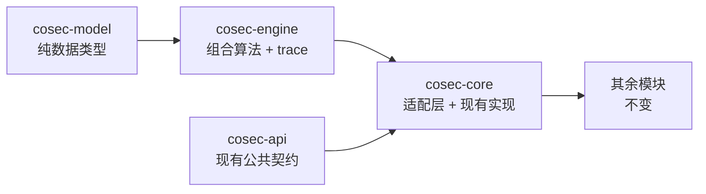

# RFC 0002：纯函数决策引擎（8.0 第一步 / RFC 0001 迁移第 2 阶段）

> 状态：草案（第 1 版，待确认 §10 的决定）· 上位文档：[RFC 0001](0001-target-architecture.md) §3.3、§6 第 2 阶段 ·
> 基线：`main` @ 7.0 候选（`0436acb4`）· 集成分支：`next/8.0` · 范围：新增 `cosec-model`、`cosec-engine`，改动 `cosec-core`、`cosec-spring-boot-starter`

## 0. 结论先行

本阶段只做一件事：**把决策算法抽成一个同步、无 I/O 的函数，并让它成为唯一的实现**。

```
Engine.evaluate(AuthzRequest, PolicySet, TraceLevel) -> Evaluation(Decision, Trace?)
```

- 新增两个模块：`cosec-model`（请求、决策、语句引用等纯数据类型）和 `cosec-engine`（组合算法与 trace）。两者只依赖
  Kotlin 标准库，用 ArchUnit 和一个 Gradle 依赖检查强制（§2）。
- `SimpleAuthorization` 保留类名和构造参数，内部改成"取数据 → 适配成 `PolicySet` → 调用 `Engine.evaluate` → 映射回
  `AuthorizationDecision`"。现有的仓库、匹配器、装饰器链、`SecurityPipeline` 一律不动（§3.4）。
- 组合算法在本阶段**按层的顺序**执行（黑名单 → root → 全局 → 主体 → 角色，每层先 DENY 后 ALLOW），与当前
  `SimpleAuthorization` 在包括出错路径在内的所有情况下逐条等价（§4）。RFC 0001 §3.3 的"扁平"顺序只在出错路径上与之不同，
  推迟到第 4 阶段，层次消失时再切换（§4.3）。
- 匹配器 SPI（`ActionMatcher`/`ConditionMatcher`）**本阶段不改**。路径变量由适配层的"语句作用域上下文"隔离，引擎和调用方的
  `SecurityContext` 都不再看到别的语句写下的变量（§6，需要确认）。
- `AuthorizationExplainer` 的叙述逻辑、`ExplainerConsistencyTest`、`Policy.verify`/`Statement.verify` 默认方法全部删除；解释、
  影子、校验都读同一次评估产生的 trace（§5）。
- 切换门槛：用影子模式让旧实现执法、新实现陪跑，先过离线语料，再过生产采样，**差异为零**才删除旧实现（§8）。
- 拆成 6 个 PR，在长期分支 `next/8.0` 上集成（§9）。

---

## 1. 范围与非目标

### 1.1 本阶段要做的

1. 新建 `cosec-model`、`cosec-engine`，定义 §3 的类型。
2. 实现唯一的组合算法（§4），带三级 trace（§5.1）。
3. 在 `cosec-core` 中写适配层：现有 `Request`/`SecurityContext`/`Policy`/`AppRolePermission` → 引擎输入；引擎输出 → 现有
   `AuthorizationDecision`/异常。
4. `SimpleAuthorization`、`AuthorizationExplainer`、`DefaultPolicyEvaluator`、`DefaultAppPermissionEvaluator` 改为调用引擎；
   `ShadowAuthorization`、`AuthorizationChecker`、`PolicyTestKit` 通过 `SimpleAuthorization` / 解释器间接使用引擎。
5. 删除第二、第三份算法：`Policy.verify`、`Statement.verify`（`cosec-api`）、`AuthorizationExplainer.Narrator`。
6. 引擎陪跑（parity）影子、离线语料、性质测试、JMH 前后对比。

### 1.2 非目标（留给后续阶段）

| RFC 0001 的内容 | 本阶段的处理 | 留到 |
|---|---|---|
| `PolicySnapshot`、`SnapshotSource`、快照分发、按需加载（§3.4） | 不做。引擎的输入是每个请求现取、现适配的 `PolicySet`；仓库仍是 `PolicyRepository`/`AppRolePermissionRepository` | 第 3 阶段 |
| 删除 `BlockingAware`、热路径无 `Mono`（§3.4） | 不做。适配层仍按 `BlockingAware` 决定是否切到 `boundedElastic`（§4.2 S13） | 第 3 阶段 |
| 编译执行：AST、路由前缀树索引、索引完整性性质测试（§3.3） | 不做。引擎按源顺序线性扫描，和现在一样 | 第 4 阶段 |
| `Binding`、成员关系、平台层 / 租户层、黑名单拆分、root 作为 break-glass 绑定（§3.2） | 不做。三层结构、`RoleScope`、`RootPrincipalMatcher`、`BlacklistChecker` 原样保留，只是被适配成引擎输入 | 第 4 阶段 |
| 条件 AST 取代 OGNL/SpEL 和 part 匹配器；`MatchResult(bindings)`（P6、P10） | 不做。现有匹配器原样调用（§6） | 第 4 阶段 |
| 扁平组合顺序、ALLOW 出错按未命中处理、`onMissing`、`withinBoundary`（§3.3） | 不做。保持现有语义（§4.3） | 第 4 阶段（边界：第 6 阶段） |
| `ScopeResolver`、经校验的 `Scope`（P4） | 只定义类型；本阶段的 `Scope` 标明来源为"客户端声明"（§3.1） | 第 4 阶段 |
| 新状态码 503、`Decision` 直接进入 Pipeline、义务（obligations）、`DecisionListener` | 不做。`Indeterminate` 在适配层还原为原异常，状态码映射不变（§3.5） | 第 5 阶段 |
| 协程、`cosec-runtime` | 不做。引擎本身是同步函数，任何阶段都不依赖协程 | 第 5 阶段 |
| 控制面、`AccessAnalyzer` 迁入 `cosec-control`、schema 生成 | 不做（`AccessAnalyzer` 不调用决策算法，见 §5.6） | 第 6 阶段 |

**本阶段不改变任何授权语义**。凡是改变语义的修复（包括本文 §4.4、§10 列出的已知问题），要么在 `main` 上单独修复后同步过来，
要么推迟到有影子门槛的后续阶段。

---

## 2. 模块与依赖

### 2.1 依赖图



| 模块 | 依赖 | 对外暴露 | 不允许 |
|---|---|---|---|
| `cosec-model` | 仅 `kotlin-stdlib` | §3.1 的全部类型：`AuthzRequest`、`Subject`、`Scope`、`Action`、`Resource`、`Environment`、`HostFacts`、`Effect`、`Decision`、`StatementRef`、`Cause`、`LayerKind` | 依赖 `cosec-api`、Reactor、Jackson、Guava、日志库 |
| `cosec-engine` | `api(project(":cosec-model"))` | `Engine`、`CoSecEngine`（默认实现，无状态单例）、引擎输入 `PolicySet`/`LayerInput`/`RuleGroup`/`Rule`/`Guard`/`RuleVisitor`/`RuleMatch`、`Evaluation`、`Trace` 及其子类型、`TraceLevel` | 同上，另外不允许 I/O、线程、时钟、协程 |
| `cosec-core` | 新增 `api(project(":cosec-engine"))` | 现有 API 不变；适配层放在 `me.ahoo.cosec.authorization.engine` 包，`internal` 为主 | — |

`cosec-model` 不依赖 `cosec-api`：`cosec-api` 的 `Authorization` 返回 `Mono`，依赖它就等于把 Reactor 带进引擎的编译类路径。
两套类型之间的转换只出现在 `cosec-core` 的适配层。`cosec-model` 里的 `Effect` 因此与 `cosec-api` 的 `Effect` 暂时并存，第 4 阶段
统一模型时合并。

`cosec-bom` 加入两个新模块；`cosec-spring-boot-starter` 不需要新的 feature variant（它经 `cosec-core` 传递得到引擎）。

### 2.2 Gradle 层面

根 `build.gradle.kts` 的 `configure(libraryProjects)` 给每个库模块加了 `implementation("com.google.guava:guava")` 和
`implementation("org.slf4j:slf4j-api")`。新模块要从这一块排除（例如定义 `pureProjects = setOf(project(":cosec-model"), project(":cosec-engine"))`，
对它们跳过这两行），否则它们的运行时类路径里就有 Guava。

另加一个 `verifyPureClasspath` 任务，挂到两个模块的 `check` 上：解析 `runtimeClasspath`，除 `cosec-model`、`kotlin-stdlib`、
`org.jetbrains:annotations` 之外出现任何构件就失败。它防的是"有人加了一行 `implementation(...)`"，ArchUnit 防的是"代码真的引用了"。

### 2.3 ArchUnit 规则

放在 `cosec-engine/src/test`（它的测试类路径同时包含两个模块），白名单优先：

```kotlin
@AnalyzeClasses(packages = ["me.ahoo.cosec.model", "me.ahoo.cosec.engine"], importOptions = [DoNotIncludeTests::class])
class EnginePurityTest {
    /** 白名单：只能依赖标准库与自身。 */
    @ArchTest
    val onlyStdlib: ArchRule = classes().should().onlyDependOnClassesThat().resideInAnyPackage(
        "me.ahoo.cosec.model..", "me.ahoo.cosec.engine..",
        "kotlin", "kotlin.collections..", "kotlin.jvm..", "kotlin.ranges..", "kotlin.sequences..",
        "kotlin.text..", "kotlin.enums..", "kotlin.internal..",
        "java.lang", "java.util", "org.jetbrains.annotations..",
    )

    /** java.lang 和 java.util 里仍有不纯的类：线程、时钟、进程、反射、并发。 */
    @ArchTest
    val noImpureJdk: ArchRule = noClasses().should().dependOnClassesThat().belongToAnyOf(
        Thread::class.java, System::class.java, Runtime::class.java, ProcessBuilder::class.java,
        ThreadLocal::class.java, java.util.Timer::class.java, java.util.Random::class.java,
    ).orShould().dependOnClassesThat().resideInAnyPackage("java.lang.reflect..", "java.util.concurrent..")
}
```

- 包名用精确包（`"java.util"` 而非 `"java.util.."`），所以 `java.util.concurrent`、`java.io`、`java.nio`、`java.net`、`java.time`
  都不在白名单内；`kotlin.io`、`kotlin.concurrent`、`kotlinx.coroutines`、`reactor`、`org.springframework`、`tools.jackson`、
  `com.google.common`、`org.slf4j`、`io.github.oshai` 同理。
- 白名单中的 `kotlin` 子包以实现时 `javap` 实际看到的为准，可以增补，但每加一个包都要在 PR 里说明为什么它没有 I/O。
  Kotlin 2.x 用 `invokedynamic` 编译 lambda 和字符串拼接，会引用 `java.lang.invoke`，所以白名单要按实测加入它，而不是禁止它。
- 引擎不打日志：原 `SimpleAuthorization` 的 DEBUG 日志移到适配层，诊断信息由 trace 提供。
- 这两条规则对应 RFC 0001 §5"不阻塞事件循环"一行里"ArchUnit：`engine` 不得引用 I/O、协程与 Reactor 包"。

ArchUnit 目前不在 `gradle/libs.versions.toml` 中，新增依赖需要确认（§10 Q4）。

---

## 3. 类型设计

### 3.1 `cosec-model`

```kotlin
package me.ahoo.cosec.model

enum class Effect { ALLOW, DENY }

/** 本阶段的三层。第 4 阶段改为 Binding 后删除。 */
enum class LayerKind { GLOBAL, PRINCIPAL, ROLE }

/** 一次评估的全部输入，不可变。 */
class AuthzRequest(
    val subject: Subject,
    val scope: Scope,
    val action: Action,
    val resource: Resource,
    val environment: Environment,
    /** 第 2–3 阶段的过渡字段：给适配后的旧匹配器用的宿主事实。引擎自身从不读取。 */
    val host: HostFacts = HostFacts.None,
)

class Subject(
    val id: String,
    val tenantId: String,
    val authenticated: Boolean,
    /** 原样的角色串，可能带 `@space` 后缀。作用域划分由适配层的 `RoleScope` 完成。 */
    val roles: Set<String>,
    val policies: Set<String>,
    val attributes: Map<String, Any>,
    /** 第 2–3 阶段：由 `RootPrincipalMatcher` 预先判定。第 4 阶段由 break-glass Binding 取代。 */
    val root: Boolean,
)

/**
 * 请求所在的作用域。本阶段只能由 [declared] 构造，来源是客户端 Header/Query（`CoSec-App-Id`、`CoSec-Space-Id`），
 * 未经成员关系校验；第 4 阶段改为只能由 `ScopeResolver` 构造（RFC 0001 P4）。
 */
class Scope private constructor(val tenantId: String, val appId: String, val spaceId: String, val source: Source) {
    enum class Source { DECLARED, RESOLVED }
    companion object {
        fun declared(tenantId: String, appId: String, spaceId: String) = Scope(tenantId, appId, spaceId, Source.DECLARED)
    }
}

/** HTTP 场景下 namespace = "http"，verb = 方法；第 4 阶段引入 `service:verb`。 */
class Action(val namespace: String, val verb: String)

/** HTTP 场景下 type = "http"，id = 请求路径；attributes = 请求里 `resource.*` 属性。 */
class Resource(val type: String, val id: String, val attributes: Map<String, String>)

class Environment(
    val remoteIp: String,
    val requestId: String,
    val deviceId: String,
    /** 第 2–3 阶段：由 `BlacklistChecker` 预先判定。第 4 阶段改为 AttributeProvider 提供的属性。 */
    val blocked: Boolean,
)

/** 引擎不认识的宿主数据。适配层的实现见 §3.4。 */
interface HostFacts { object None : HostFacts }

/** 做出决策的那条规则。 */
sealed interface StatementRef {
    data object Blacklist : StatementRef
    data object Root : StatementRef
    data class PolicyStatement(val layer: LayerKind, val policyId: String, val index: Int, val name: String) : StatementRef
    data class RolePermission(val appId: String, val roleId: String, val permissionId: String, val name: String) : StatementRef
}

sealed interface Decision {
    data class Permit(val by: StatementRef) : Decision            // 义务（obligations）第 5 阶段加入
    data class Deny(val by: StatementRef?) : Decision             // by == null 即隐式拒绝
    data class Indeterminate(val cause: Cause) : Decision
}

sealed interface Cause {
    /** 原始异常；适配层原样抛出，保持状态码映射不变（§3.5）。 */
    val error: Throwable

    /** D2：主体引用的策略仓库里没有。 */
    data class MissingPolicies(val policyIds: Set<String>, override val error: Throwable) : Cause
    /** 某层的数据读取失败（Redis 超时、严格读失败等）。 */
    data class SourceUnavailable(val layer: LayerKind, override val error: Throwable) : Cause
    /** 匹配器抛出异常。`at` 为 null 表示出错的是组的前置条件（策略 / 应用条件），此时 `groupId` 标明是哪一组。 */
    data class MatcherFailed(val layer: LayerKind, val groupId: String, val at: StatementRef?, override val error: Throwable) : Cause
}
```

说明：

- `AuthzRequest` 及其组成部分故意不用 `data class`：它们不需要 `copy`/`componentN`，少生成代码；相等性只在测试里需要，
  测试直接比较字段。
- `Subject.root` 与 `Environment.blocked` 是"预先判定的事实"。判定本身（`RootPrincipalMatcher`、`BlacklistChecker`）可能是
  用户代码，`BlacklistChecker` 还返回 `Mono`，都不能放进引擎；引擎只决定"这两个事实在决策中的位置"（§4.1 的前两步）。
- `MissingPolicies` 也带 `error`：适配层预先构造好 `MissingPolicyException`，让"原样抛出"对所有原因一致。
- RFC 0001 §3.2 里的 `TenantId`/`PrincipalId`/`PolicyId` 值类型推迟到第 4 阶段：本阶段这些值只在适配层与引擎之间传递，
  换成值类型不能带来安全收益，却会让适配代码到处装箱拆箱。

### 3.2 `cosec-engine`

```kotlin
package me.ahoo.cosec.engine

interface Engine {
    fun evaluate(request: AuthzRequest, policies: PolicySet, trace: TraceLevel = TraceLevel.OFF): Evaluation

    /** 本请求是否需要策略数据。黑名单命中或 root 时不需要，调用方据此跳过仓库读取（§4.2 S1、S2）。 */
    fun requiresPolicies(request: AuthzRequest): Boolean
}

/** 默认实现：无状态，线程安全。 */
object CoSecEngine : Engine

/** trace 关闭时为 null，且不产生任何 trace 相关的分配。 */
class Evaluation(val decision: Decision, val trace: Trace?)

enum class TraceLevel {
    /** 只求决策。 */
    OFF,
    /** 另外记录决策到达的每一层里的全部组和规则（决策停下之后，本层剩余的规则仍然评估，用于解释）。 */
    FULL,
    /** 另外评估决策到达不了的层（原 `ExplainOptions.exhaustive`）。 */
    EXHAUSTIVE,
}
```

**引擎输入**（第 2 阶段专用，第 3/4 阶段由 `PolicySnapshot` 取代）：

```kotlin
/** 按 GLOBAL、PRINCIPAL、ROLE 的顺序排列的三层。 */
class PolicySet(val layers: List<LayerInput>) {
    companion object { val NOT_LOADED: PolicySet }   // requiresPolicies == false 时使用
}

sealed interface LayerInput {
    val kind: LayerKind

    /** 本层没有可评估的内容；reason 只用于 trace（对应原解释器的 EMPTY 与相关警告）。 */
    data class Absent(override val kind: LayerKind, val reason: AbsentReason) : LayerInput
    /** 读取本层数据失败；评估到达本层时得到 Indeterminate(SourceUnavailable)。 */
    data class Unavailable(override val kind: LayerKind, val error: Throwable) : LayerInput
    /** missing 非空时，评估到达本层即得到 Indeterminate(MissingPolicies)，不评估任何组。 */
    class Loaded(override val kind: LayerKind, val groups: List<RuleGroup>, val missing: MissingPolicies? = null) : LayerInput
}

enum class AbsentReason { NO_POLICIES, NO_ROLES, NO_ROLE_IN_SPACE, NO_APP_PERMISSION }

/** 一个策略（GLOBAL/PRINCIPAL 层）或一个应用权限（ROLE 层）。 */
interface RuleGroup {
    val id: String                     // policyId 或 appId
    val guard: Guard                   // 策略条件 / 应用条件
    /** 按源顺序访问规则，访问者返回 true 时停止，返回值表示是否被停止。不得为访问分配集合。 */
    fun forEachRule(visitor: RuleVisitor): Boolean
}

fun interface RuleVisitor {
    /** grantedVia：ROLE 层为授予这条权限的角色 id，其余层为 null。 */
    fun visit(rule: Rule, grantedVia: String?): Boolean
}

interface Guard { fun matches(request: AuthzRequest): Boolean }

interface Rule {
    val effect: Effect
    val index: Int                     // 在所属策略（或角色授予列表）中的位置
    val name: String
    val id: String?                    // 权限 id；策略语句为 null
    fun match(request: AuthzRequest): RuleMatch
}

enum class RuleMatch { MATCHED, ACTION_MISS, CONDITION_MISS }
```

- `Guard.matches` / `Rule.match` 抛出的 `Exception` 由引擎捕获，变成 `Indeterminate(MatcherFailed)`；`Error`（如
  `NotImplementedError`、`StackOverflowError`）不捕获，照常向外传播，由调用方的 Reactor 变成错误信号，最终仍是 500，与现在一致。
- `forEachRule` 用访问者而不是 `List<Rule>`：ROLE 层的规则是"角色 × 授予的权限"，按列表物化就是每请求 O(授予数) 的分配，
  而现在的 `SimpleAuthorization.forEachPermission` 是零分配的（§7）。
- 这些接口是 **CoSec 内部的适配契约**，KDoc 标明"第 4 阶段删除，不要在应用中实现"。用户扩展点仍是 `ActionMatcherFactory` /
  `ConditionMatcherFactory`（§6）。

**Trace**：

```kotlin
class Trace(val blocked: Boolean, val root: Boolean, val layers: List<LayerTrace>)

class LayerTrace(
    val kind: LayerKind,
    val state: LayerState,
    val absentReason: AbsentReason? = null,
    /** 本层单独看的结果：本层第一条命中的 DENY，否则第一条命中的 ALLOW，否则 null。 */
    val matched: StatementRef? = null,
    val matchedEffect: Effect? = null,
    val cause: Cause? = null,
    val groups: List<GroupTrace> = emptyList(),
)

enum class LayerState { EVALUATED, EVALUATED_AFTER_DECISION, NOT_EVALUATED, ABSENT, UNAVAILABLE, MISSING_POLICIES }

class GroupTrace(val id: String, val guard: GuardOutcome, val guardError: Throwable?, val rules: List<RuleTrace>)

enum class GuardOutcome { MATCHED, MISSED, ERROR }

class RuleTrace(
    val ref: StatementRef,
    val effect: Effect,
    val outcome: RuleOutcome,
    val error: Throwable? = null,
    /** OFF 下不会被评估、只为 trace 而评估的规则（本层已有结论之后的规则，或 EXHAUSTIVE 下决策之后的层）；结果和错误不影响决策。 */
    val afterDecision: Boolean = false,
)

enum class RuleOutcome { MATCHED, ACTION_MISS, CONDITION_MISS, NOT_EVALUATED, ERROR }
```

### 3.3 从现有模型到引擎输入

| 现有 | 引擎侧 | 适配规则（`cosec-core`，包 `me.ahoo.cosec.authorization.engine`） |
|---|---|---|
| `Request` + `SecurityContext` | `AuthzRequest` | `subject` ← `context.principal`（`id`、`authenticated`、`roles`、`policies`、`attributes` 直接引用，不复制）、`tenantId` ← principal 的 tenant；`subject.root` ← `RootPrincipalMatcher.isRoot(principal)`；`scope` ← `Scope.declared(context.tenant.tenantId, request.appId, request.spaceId)`；`action` ← `("http", request.method)`；`resource` ← `("http", request.path, request.attributes 中 resource.* 的项)`；`environment.blocked` ← `BlacklistChecker.check` 的结果取反；`host` ← `LegacyFacts(request, context)` |
| `PolicyRepository.getGlobalPolicy()` | GLOBAL 层 | 空 `Mono` → `Absent(NO_POLICIES)`；错误 → `Unavailable`；列表 → `Loaded`，每个 `Policy` 一个 `PolicyGroup` |
| `principal.policies` + `getPolicies(ids)` | PRINCIPAL 层 | `ids` 为空 → `Absent(NO_POLICIES)`，不读仓库；空 `Mono` 视为空列表；结果缺少某些 id → `Loaded(missing = MissingPolicies(缺失的 id, MissingPolicyException(...)))`；错误 → `Unavailable` |
| `principal.roles` + `RoleScope.rolesIn` + `getAppRolePermission(appId, spaceId, roles)` | ROLE 层 | 角色为空 → `Absent(NO_ROLES)`；`rolesIn` 为空 → `Absent(NO_ROLE_IN_SPACE)`；空 `Mono` → `Absent(NO_APP_PERMISSION)`；错误 → `Unavailable`；否则 `Loaded`，一个 `AppPermissionGroup` |
| `Policy` | `PolicyGroup : RuleGroup` | `id` = `policy.id`；`guard` = `policy.condition`；规则 = `policy.statements` 按下标 |
| `Statement` / `Permission` | `StatementRule : Rule` | `match` 先 `action.match`，未命中返回 `ACTION_MISS`；再 `condition.match`，未命中返回 `CONDITION_MISS`；都命中返回 `MATCHED`。两者都在语句作用域上下文中执行（§6.2）。`Statement` 不是 `StatementData`/`PermissionData` 时改为调用它可能覆写的 `verify`（§4.4 X5） |
| `AppRolePermission` | `AppPermissionGroup : RuleGroup` | `id` = `appPermission.id`；`guard` = `appPermission.condition`；`forEachRule` 与现在的 `SimpleAuthorization.forEachPermission` 完全相同：按 `rolePermissions` 顺序，`*` 授予 `permissionIndexer.values`，否则按授予的 id 查 `permissionIndexer`，查不到就跳过（§4.4 X9）；`grantedVia` = 角色 id |

**适配对象的复用**：`PolicyData`、`AppPermissionData` 是 `cosec-core` 自己的类，CoCache 本地缓存命中时返回的是同一批实例。
它们像现在缓存 `requiresBlocking` 一样，惰性缓存自己的 `StatementRule` 列表；`AppRolePermissionData` 每次读取都会重建
（`SimpleAuthorizationBenchmark` 的注释说明了这一点），但它的 `appPermission` 是稳定实例，所以 ROLE 层每请求只新建一个
`AppPermissionGroup`。其他 `Policy` 实现每请求适配一次。

### 3.4 `SimpleAuthorization` 的新流程

```
decide(request, context):
    blocked  = !blacklistChecker.check(request, context)                // Mono，和现在一样最先执行
    authz    = AuthzRequests.of(request, context, blocked, rootPrincipalMatcher)
    policies = if engine.requiresPolicies(authz) then loader.load(request, context)   // 三层并行读取，错误按层收进 Unavailable
               else PolicySet.NOT_LOADED
    evaluation = if policies 中任一组 requiresBlocking
                     then 在 boundedElastic 上 engine.evaluate(authz, policies)
                     else 原地 engine.evaluate(authz, policies)
    return toAuthorizationDecision(evaluation)                          // 见 3.5
```

`SimpleAuthorization` 的类名、构造参数、`DecisionAuthorization` 接口都不变，所以 starter、装饰器链（追踪 → 审计 → 指标 →
限流 → 影子）、`SecurityPipeline`、三个 Web 适配器都不需要改。

### 3.5 引擎结果到现有结果的映射，以及 `Indeterminate` 的状态码

| `Decision` | `AuthorizationDecision` | `VerifyContext` 是否写入调用方的 `SecurityContext` | 状态码（`SecurityPipeline`，不变） |
|---|---|---|---|
| `Deny(Blacklist)` | `EXPLICIT_DENY` + `BlacklistVerifyContext` | 否（与现在一致） | 401 / 403 |
| `Permit(Root)` | `ALLOW` + `RootVerifyContext` | 否（与现在一致） | 放行 |
| `Permit/Deny(PolicyStatement)` | `ALLOW`/`EXPLICIT_DENY` + `PolicyVerifyContext(source, policy, index, statement, result)` | 是 | 放行 / 401 / 403 |
| `Permit/Deny(RolePermission)` | `ALLOW`/`EXPLICIT_DENY` + `RoleVerifyContext(roleId, permission, result)` | 是 | 放行 / 401 / 403 |
| `Deny(null)` | `IMPLICIT_DENY` + `NoMatchVerifyContext` | 否（与现在一致） | 401 / 403 |
| `Indeterminate(cause)` | 不产生决策，发出错误信号 `Mono.error(cause.error)` | 否 | 见下表 |

`PolicyVerifyContext` 需要 `Policy`/`Statement` 对象本身（审计、OpenTelemetry 读它），而 `StatementRef` 只有 id 和下标；
适配层在它自己构造的 `PolicySet` 里按 `(layer, policyId, index)` 或 `(roleId, permissionId)` 找回对象，每次决策只查一次。

**`Indeterminate` 的映射（本阶段）**：适配层原样抛出 `cause.error`，`SecurityPipeline.toErrorDecision`、
`AuditingAuthorization`、`MeteredAuthorization`、`TracingAuthorization` 看到的错误信号与现在**完全相同**：

| 原因 | 原样抛出的异常 | 状态码 | `AuthorizeResult` |
|---|---|---|---|
| `MissingPolicies` | `MissingPolicyException` | 500（`SecurityStatus.ERROR`） | `IMPLICIT_DENY` |
| `SourceUnavailable` | 仓库发出的原异常（如 CoCache 严格读失败） | 500 | `IMPLICIT_DENY` |
| `MatcherFailed`，异常是 `RegexTimeoutException` | `RegexTimeoutException` | 403（ReDoS 防护被当作预期内的拒绝） | `IMPLICIT_DENY` |
| `MatcherFailed`，其他异常 | 原异常 | 500 | `IMPLICIT_DENY` |

RFC 0001 §3.5 的 503（快照未就绪、依赖不可用、属性缺失）在本阶段**没有来源**：快照、属性预取都还不存在。引入 503 属于状态码
变更，要连同 `SecurityStatus`、`WebAdapterParityTest`、`web-integration.md` 一起改，放在第 5 阶段 `Decision` 直接进入 Pipeline
时做（§10 Q3）。

---

## 4. 唯一的组合算法

### 4.1 伪代码（第 2 阶段：按层顺序）

```
evaluate(req, set, level):
    if req.environment.blocked: return Deny(Blacklist)          // S1：黑名单先于 root
    if req.subject.root:        return Permit(Root)             // S2
    permit = null
    for layer in set.layers:                                    // S3：GLOBAL → PRINCIPAL → ROLE
        when r = evaluateLayer(layer):
            Deny, Indeterminate -> return r                     // S6：显式拒绝或无法判定都立即结束
            Permit              -> if permit == null: permit = r // S6：记下第一条 ALLOW，后面的层仍要检查 DENY
            NoMatch             -> continue
    return permit ?: Deny(null)                                 // S7

evaluateLayer(layer):
    when layer:
        Absent              -> NoMatch                          // S9、S10
        Unavailable         -> Indeterminate(SourceUnavailable)
        Loaded(missing≠∅)   -> Indeterminate(MissingPolicies)   // S8：在评估本层任何条件之前
        Loaded(groups):
            matched = []                                        // S4：先评估本层全部组的前置条件
            for g in groups:
                try   if g.guard.matches(req): matched += g
                catch -> return Indeterminate(MatcherFailed(g))
            for effect in [DENY, ALLOW]:                        // S5：本层先 DENY 后 ALLOW
                for g in matched, (rule, via) in g.rules where rule.effect == effect:
                    try   if rule.match(req) == MATCHED: return effect == DENY ? Deny(ref) : Permit(ref)
                    catch -> return Indeterminate(MatcherFailed(g, ref))
            return NoMatch
```

trace 只是在同一个循环里加记录（§5.1）：`OFF` 时不记录、不分配；`FULL` 时，一层得出结论（命中 DENY、命中 ALLOW 或出错）后继续走完
**本层**剩余的规则，记录为 `afterDecision`，再照常进入下一层；`EXHAUSTIVE` 时还走完决策结束之后的层。`OFF` 下评估的每个匹配器
在 `FULL` 下以同样的顺序被评估，`afterDecision` 的规则只是额外多出来的；它们的结果（包括错误）不参与组合（§8.4 P2、P4）。

`matched` 不是列表，而是一个位图：组数不超过 64 时是一个 `Long` 局部变量，超过时分配一个 `LongArray(groups.size / 64 + 1)`。
前置条件必须在任何语句之前全部评估（S4），所以这份按组的状态无法省掉（§7.1）。

### 4.2 与现在的 `SimpleAuthorization` 逐条对照

| # | 现在的行为（`cosec-core/.../authorization/SimpleAuthorization.kt` 等） | 引擎中的对应 | 是否一致 |
|---|---|---|---|
| S1 | `decide` 先调用 `blacklistChecker.check`；`false` 时返回 `BLACKLIST_DECISION`，不检查 root，不读仓库；检查本身出错 → 错误信号 | 检查仍在适配层最先执行（它返回 `Mono`），结果进 `environment.blocked`；引擎第一步返回 `Deny(Blacklist)`；`requiresPolicies` 为 false，不读仓库；检查出错时适配层还没调用引擎，错误照常传播 | 一致 |
| S2 | 未被拉黑时 `rootPrincipalMatcher.isRoot(principal)` 为真 → `ROOT_DECISION`，跳过全部三层；默认 `RootPrincipalMatcher.NONE` | `subject.root` 由同一个 `RootPrincipalMatcher` 判定，引擎第二步返回 `Permit(Root)`，不读仓库 | 一致 |
| S3 | `verify` 用 `thenVerify` 把三层串成 全局 → 主体 → 角色 | `PolicySet.layers` 固定按这个顺序 | 一致 |
| S4 | `verifyPolicies` 开头 `policies.filter { policy.condition.match(...) }`，即先评估本层**每一个**策略条件（任一抛错 → 本层出错）；角色层先评估 `appPermission.condition`，不命中则本层无结果 | 每层先评估全部 `guard`；出错 → `Indeterminate`；角色层只有一个组 | 一致 |
| S5 | `for (effect in DENY_FIRST) for (policy in matchedPolicies) for statement`：本层先找第一条命中的 DENY，再找第一条命中的 ALLOW；角色层按 `rolePermissions` → `forEachPermission` 的顺序 | 同样的三重循环，顺序来自 `forEachRule` | 一致，包括做出决策的是哪一条（`StatementRef` 与 `VerifyContext` 一一对应） |
| S6 | `thenVerify`：前一层 `EXPLICIT_DENY` 直接返回，后面的层不评估；前一层 `ALLOW` 时仍评估后一层，后一层只有 `EXPLICIT_DENY` 会覆盖它（`filter { it.result == EXPLICIT_DENY }.defaultIfEmpty(matched)`），后一层的 ALLOW 被忽略但**会被评估**，其中的异常会让整个请求出错；任何一层出错都立即成为错误信号 | `Deny`/`Indeterminate` 立即返回；`Permit` 只记第一条；后面的层照常完整评估（包括它的 ALLOW 扫描，扫描到第一条命中为止，与 `verifyPolicies` 相同） | 一致（包括出错路径：被评估的匹配器集合与现在完全相同） |
| S7 | 三层都没有结果 → `IMPLICIT_DENY_DECISION`（`NoMatchVerifyContext`），不写 `VerifyContext` | `Deny(null)` → 同一个常量 | 一致 |
| S8 | D2：主体策略在 `getPolicies` 的结果中缺失 → `MissingPolicyException`，在本层任何条件评估之前；只有评估到达主体层时才会发生（全局层显式拒绝时不会）；`getPolicies` 返回空 `Mono` 视为全部缺失 | 缺失在适配时算出，放进 `Loaded.missing`；引擎**到达本层时**才返回 `Indeterminate(MissingPolicies)`，在评估组之前；适配层抛出同一个 `MissingPolicyException` | 一致 |
| S9 | `principal.policies` 为空 → 主体层为空 `Mono`，不读仓库 | `Absent(NO_POLICIES)`，不读仓库 | 一致 |
| S10 | D3：`RoleScope.rolesIn(request.spaceId, principal.roles)`；角色为空或作用域后为空 → 本层为空，不读仓库；仓库按 `(request.appId, spaceId, 去掉后缀的角色)` 查找，空 `Mono`（应用没有应用权限）→ 本层为空 | 适配层调用同一个 `RoleScope.rolesIn` 和同一个仓库方法，产生 `Absent(NO_ROLES / NO_ROLE_IN_SPACE / NO_APP_PERMISSION)` 或 `Loaded` | 一致（`RoleScope` 代码不动） |
| S11 | D7：`verifyPolicies` 在全部策略条件之前清空一次路径变量；每条语句经 `Statement.verifyScoped` 在匹配动作前清空（`path` 动作除外：它要么不命中、条件不执行，要么命中后覆盖）；`ReplaceablePathActionMatcher` 在求值模板前自己清空；角色层在应用条件前清空 | 每个 `Guard.matches` 和每个 `Rule.match` 开始时，适配层把语句作用域上下文的路径变量**重置为空**（一次字段赋值，§6.2）；`ReplaceablePathActionMatcher` 的自清空保留 | 一致：对 `path` 动作，"不清空 + 命中必覆盖"与"先清空"效果相同；对策略 / 应用条件，"每个条件前清空"与"全部条件前清空一次"只在一个条件**写入**路径变量、另一个条件读取时才有区别，而读取路径变量的条件在加载时就被 `PathVariableScope.requireScoped` 拒绝（例外见 X4） |
| S12 | `inRole`：`InRoleConditionMatcher` 先按字面比较 principal 的角色；值不带 `@` 时，再用 `RoleScope.roleIdIn(request.spaceId, role)` 比较带后缀的角色 | 匹配器原样调用，`principal` 与 `request` 都是原对象 | 一致，包括第二轮审查记录的 M1/M2 两个已知行为（§10 Q12） |
| S13 | `BlockingAware`：某一层的策略或应用权限含阻塞匹配器时，**该层**在 `Schedulers.boundedElastic` 上评估，其余层原地评估 | 任一层含阻塞匹配器时，**整次** `engine.evaluate` 在 `boundedElastic` 上执行一次 | 决策一致；线程不同（X2） |
| S14 | 匹配器异常成为错误信号；`SecurityPipeline` 把 `RegexTimeoutException` 映射为 403，其余为 500 | `Indeterminate(MatcherFailed)`，适配层原样抛出（§3.5） | 一致 |
| S15 | 命中策略语句或角色权限时 `context.setVerifyContext(...)`；root、黑名单、隐式拒绝不写 | 同 §3.5 的表 | 一致 |
| S16 | 引擎外的装饰器：限流只对放行的请求扣减、影子用独立上下文重新评估、审计 / 指标 / 追踪观察结果和错误信号 | 不变：它们包在 `SimpleAuthorization` 外面，看到的结果和错误信号与现在相同 | 一致 |

### 4.3 与 RFC 0001 §3.3 扁平算法的关系

RFC 0001 §3.3 的算法是"先对**整个**候选集检查所有 DENY，再检查 ALLOW；ALLOW 出错按未命中处理"。在**没有错误**的输入上，
两种顺序的结果完全相同：

- 按层顺序时，只要前面的层没有显式拒绝，每一层都会被评估，所以"结果为 Deny" ⇔ "任一层中有一条（所属组前置条件命中的）
  DENY 命中"，与扁平算法相同；做出决策的 DENY 都是按（层，组，规则）顺序的第一条。
- 没有 DENY 命中时，两者都返回按同一顺序的第一条 ALLOW；都没有则隐式拒绝。

区别只在出错路径上：

| # | 情形 | 现在 / 本阶段 | 扁平算法 | 性质 |
|---|---|---|---|---|
| E1 | 前一层 ALLOW 命中，后一层某条 ALLOW 语句抛错 | 500 | Permit | 扁平算法放行了现在会失败的请求（按 deny-first 论证是安全的，但仍是语义变化） |
| E2 | 前一层某个匹配器抛错，后一层有 DENY 命中 | 500 | 403 | 都拒绝，状态码不同 |
| E3 | 全局层 DENY 命中，主体策略缺失或主体层读取失败 | 403 | 500（缺失 / 不可用在评估前就要处理） | 都拒绝，状态码不同 |
| E4 | 只有一条 ALLOW 抛错，没有其他命中 | 500 | 401 / 403 | 都拒绝，状态码不同 |
| E5 | 某策略的前置条件抛错，但它的语句与请求无关 | 500 | 可能不评估这个条件（索引不选中它） | 都拒绝或放行取决于其他语句 |

本阶段的目标是"零差异"切换，所以**采用按层顺序**。扁平顺序依赖的前提（没有层，候选集来自 `Binding`；条件 AST 不会抛出任意异常；
有 `onMissing`）在第 4 阶段才成立，届时连同 E1–E5 作为一次有影子门槛的语义变更切换，写进 `upgrading.md`（§10 Q2）。

### 4.4 已知差异及处理

逐条对照（§4.2）没有发现**决策**上的差异。下面是决策之外、可观察到的差异：

| # | 差异 | 谁能观察到 | 处理 |
|---|---|---|---|
| X1 | **I/O 形态**：现在逐层惰性读取（全局层显式拒绝时不读主体策略和角色权限）；本阶段在 `requiresPolicies` 为真时三层**并行预取**。读取错误被收进 `Unavailable`，只有评估到达该层时才生效，所以决策和错误信号不变 | Redis 读次数（本地缓存未命中时）、延迟（并行后通常更低） | 接受。理由：引擎必须在调用前拿到全部输入，否则就要按层多次调用引擎，等于把组合逻辑又写回适配层；第 3 阶段换成快照后这个问题消失。JMH 对比中单独报告"全局层拒绝"场景（§7） |
| X2 | **线程**：含 `BlockingAware` 匹配器时，整次评估切到 `boundedElastic`，而不是只切那一层 | 依赖线程身份的自定义匹配器 | 接受，写进 `upgrading.md` |
| X3 | **调用方上下文不再留下路径变量**：现在授权结束后，调用方 `SecurityContext` 的 `PATH_VARIABLES` 里是最后一条匹配上的 `path` 语句写下的变量；本阶段它们只写进语句作用域上下文，调用方上下文里没有 | 授权之后自己读 `getPathVariables()` 的应用代码 | 接受（这正是 D1/D7 要消除的共享状态），写进 `upgrading.md` 的 8.0 破坏性变更 |
| X4 | **自定义条件匹配器在前置条件里写路径变量**：现在同一层的前置条件之间共享一次清空后的变量；本阶段每个前置条件前都重置 | 在策略 / 应用条件里调用 `setPathVariables` 的自定义匹配器（加载检查只看配置字符串，看不到代码） | 接受。内置匹配器都不这么做，`skills/cosec-custom-matcher` 已经要求"路径变量只属于本语句" |
| X5 | **自定义 `Statement` 覆写 `verify`**：现在 `SimpleAuthorization` 经 `verifyScoped` 调用的是可覆写的 `Statement.verify` | 覆写了 `verify` 的 `Statement`/`Permission` 实现 | PR-3 中适配层对 `StatementData`/`PermissionData` 之外的实现改调 `verify`（trace 里只能区分命中 / 未命中，未命中记为 `CONDITION_MISS` 并注明），保证等价；PR-6 删除 `Statement.verify` 后这类覆写**编译失败**，写进 `upgrading.md` |
| X6 | **解释输出**：出错时，现在的 trace 不模拟中止，照常叙述后面的层；本阶段标为 `NOT_EVALUATED`（`EXHAUSTIVE` 时为 `EVALUATED_AFTER_DECISION`）。`TRACE_INCONSISTENT` 不可能再出现，删除；`ACTION_MISS` 不再靠第二次调用 `action.match` 判断 | `CoSecExplainEndpoint` 的使用者、`PolicyTestKit` 的失败消息 | 接受，写进 `upgrading.md`（`ExplainWarningCode` 删除一个值属于公共 API 变更） |
| X7 | **DEBUG 日志**：`SimpleAuthorization` 原来在每个命中点打一条，改为适配层在决策后打一条 | 日志 | 接受 |
| X8 | **捕获范围**：引擎只捕获 `Exception`；`Error` 照常向外传播 | 抛 `Error` 的自定义匹配器 | 最终映射不变（Reactor 仍把它变成错误信号 → 500），无需处理 |
| X9 | **角色授予了不存在的权限 id 时静默跳过**（`forEachPermission` 里的 `permissionIndexer[permissionId]?.let`） | — | 这不是本阶段引入的差异，而是现有行为，适配层**原样保留**以保证零差异。但它与 D2 同类：授予给角色的 DENY 权限 id 写错或被删，这条拒绝就消失了。见 §10 Q11 |

---

## 5. trace 即解释

### 5.1 trace 级别的不变量

- **决策与 trace 级别无关**：同一输入在 `OFF`、`FULL`、`EXHAUSTIVE` 下得到的 `Decision` 必须相同（性质测试 P2）。
  `FULL`/`EXHAUSTIVE` 多评估的规则带 `afterDecision = true`，它们的结果和错误只进入 trace。
- `FULL` 评估的匹配器集合 = 原解释器非 exhaustive 时评估的集合（到达的层里全部组和规则）；`EXHAUSTIVE` = 原 exhaustive。
  因此解释的副作用面（自定义匹配器在 `isPolicyEvaluation` 下被调用的次数）不比现在大。
- `OFF` 时引擎不创建任何 trace 对象（JMH 用 `gc.alloc.rate.norm` 检查，§7）。

### 5.2 被替换或删除的部分

| 现有 | 处理 | 替代 |
|---|---|---|
| `Policy.verify`（`cosec-api` 默认方法） | PR-6 删除 | 无人调用决策路径；`DefaultPolicyEvaluator` 改为调用引擎（下一行） |
| `Statement.verify`、`Statement : PermissionVerifier`、`PermissionVerifier` | PR-6 删除（`VerifyResult` 保留，`VerifyContext.result` 仍在用，第 5 阶段随结果类型统一一起处理） | `StatementRule.match` |
| `DefaultPolicyEvaluator`、`DefaultAppPermissionEvaluator`（加载 / 写入时的校验：用模拟请求把每个匹配器跑一遍） | PR-5 改为：把单个策略（应用权限）适配成只有一层的 `PolicySet`，以 `EXHAUSTIVE` 评估；trace 中任何 `ERROR`（`RegexTimeoutException` 除外，与现在的 `safeEvaluate` 一致）都抛出 | 同一套适配器和引擎 |
| `AuthorizationExplainer.Narrator`、`firstDecisive`、`SnapshotPolicyRepository`/`SnapshotAppRolePermissionRepository` | PR-5 删除。解释器只跑**一次**：用一个 `TraceLevel` 为 `FULL`/`EXHAUSTIVE` 的 `SimpleAuthorization`，经 `SecurityPipeline` 得到状态码（状态码仍只在 Pipeline 定义），同时取回这次评估的 `Evaluation`；`Explanation` 完全由 `Trace` 和 `SecurityDecision` 生成 | `Trace` → `Explanation` 的纯映射函数 |
| `ExplainerConsistencyTest`（随机输入下 trace 指向的规则 = 真实决策） | PR-5 删除：两者现在是同一次评估，不可能不一致 | 性质测试 P2（决策与 trace 级别无关）+ `Explanation` 映射的单元测试 |
| `ExplainWarningCode.TRACE_INCONSISTENT` | PR-5 删除（X6） | — |

`Explanation` 的结构（`LayerTrace`、`PolicyTrace`、`RoleTrace`、`StatementTrace`、`DecisionRef`）**保持不变**，所以
`CoSecExplainEndpoint` 的 JSON 和 `PolicyTestKit` 的断言都不变。映射规则：

- 黑名单 / root 层 ← `Trace.blocked` / `Trace.root`；三层 ← `LayerTrace`，`ABSENT` → `LayerState.EMPTY`，`absentReason` 生成原来的
  `NO_ROLE_IN_SPACE`、`NO_APP_PERMISSION` 警告，`MISSING_POLICIES` 生成 `MISSING_POLICY` 警告，`ERROR` 生成 `MATCHER_ERROR` 警告。
- `RoleTrace` 按 `grantedVia` 分组；`StatementTrace.index` 是规则在该角色授予列表中的位置，与现在相同。
- `overriddenAllows` = 决策为 `Deny`、而之前的层已经记下一条 Permit 时的那条 Permit（至多一条，与现在 `narrateLayers` 的行为相同）。
- `decidedBy` ← `Decision` 的 `StatementRef`（`toDecisionRef` 改为从 `StatementRef` 转换）。

### 5.3 影子（`ShadowAuthorization`）

不需要改代码：候选评估本来就是 `SimpleAuthorization(OverlayPolicyRepository, OverlayAppRolePermissionRepository, ...)`，
`SimpleAuthorization` 换成引擎后，影子自然走引擎。`Overlay*Repository` 保留到第 3 阶段（RFC 0001 §3.6 用快照叠加取代它们）。

切换门槛需要的"新旧实现陪跑"是另一种影子，见 §8.1。

### 5.4 `AuthorizationChecker`

不需要改代码：它调用的是 starter 注入的 `SimpleAuthorization`。它仍为每次检查复制一个隔离的上下文，因为
`setVerifyContext` 和自定义匹配器写的其他属性仍会写进上下文；路径变量这一项已经由引擎侧隔离，PR-3 把它 KDoc 里
"so path variables never leak into the caller's context"改为说明真正的原因。

### 5.5 `PolicyTestKit`

API 不变，经解释器间接使用引擎。门槛期间（PR-4 到 PR-6）增加一个临时入口 `PolicyTestKit.parity(locations)`：对每个用例分别用
`LegacySimpleAuthorization` 和新实现评估，比较 §8.3 的结果元组。应用可以拿自己的测试套件跑一遍，作为离线语料的一部分；
PR-6 删除。

### 5.6 `AccessAnalyzer`

它**不调用决策算法**：只对动作做匹配，条件只报告不评估（见类 KDoc），回答的是"谁可能访问"，不是"这个请求的决策"。
所以本阶段不改。RFC 0001 §3.7 把它移进 `cosec-control`，基于编译后的快照和索引重写，属于第 6 阶段。

---

## 6. 匹配器怎么迁移（需要确认的 SPI 决定）

### 6.1 两个方案

| | A：第 2 阶段就改 SPI | B：保留现有 SPI，引擎内部隔离路径变量（**推荐**） |
|---|---|---|
| 做法 | `ActionMatcher.match` 改为返回 `MatchResult(matched, bindings)`，`ConditionMatcher.match` 增加 `bindings` 参数，不再读写 `SecurityContext` 的 `PATH_VARIABLES` | `ActionMatcher`/`ConditionMatcher`/两个 Factory 一字不改；适配层给每条语句提供一个"语句作用域上下文"，路径变量只写进它 |
| 对下游 | 所有自定义匹配器改两次：这一次，加上第 4 阶段条件 AST 取代 `ConditionMatcherFactory` 时 | 本阶段零改动；第 4 阶段一次性迁移 |
| D1/D7 | 结构上消除 | 结构上消除：没有任何别的语句、层或限流规则能看到这条语句写的变量，调用方上下文也看不到 |
| 引擎纯度 | 引擎仍要调用用户代码 | 相同：两种方案下，本阶段的引擎都要调用（可能阻塞的）用户匹配器，"纯"指引擎自身的代码 |
| 与目标的距离 | 接近 P6，但 `MatchResult` 的形状要在条件 AST 设计之前定下来，很可能第 4 阶段再改一次 | 第 4 阶段直接实现 P6：编译后的动作模式返回 bindings，条件 AST 读取 bindings，旧 SPI 整体删除 |

**推荐 B**。理由：本阶段的承诺是"不改变语义、不改变扩展点"，切换门槛才可能做到零差异；SPI 的形状应该由第 4 阶段的
编译模型决定，而不是现在猜。因为涉及 SPI，AGENTS.md 要求先确认（§10 Q1）。

### 6.2 方案 B 的语句作用域上下文

```kotlin
/** 一次评估一个，属于 LegacyFacts；引擎在单线程中顺序调用规则，所以不需要同步。 */
internal class StatementScopedContext(private val base: SecurityContext) : SecurityContext {
    override val principal get() = base.principal
    override val tenant get() = base.tenant
    /** PATH_VARIABLES 存在字段里，其余键原样读写 base。 */
    override val attributes: MutableMap<String, Any> = ScopedAttributes()
    private var pathVariables: Map<String, String> = emptyMap()

    /** 每个 Guard.matches / Rule.match 开始时调用：一次字段赋值，不写 map。 */
    fun beginStatement() { pathVariables = emptyMap() }
}
```

- `ScopedAttributes` 是一个 `MutableMap` 视图：键为 `PATH_VARIABLES_KEY` 的 `get`/`put`/`remove`/`containsKey` 落在字段上，
  其余键委托给 `base.attributes`；遍历视图时用字段值替换 base 中的同名项。这样 `getPathVariables()`/`setPathVariables()`、
  `PartExtractor` 的 `request.path.var.*`、SpEL/OGNL 里的 `attributes['PATH_VARIABLES']` 都只看到本语句的变量。
- 其余属性（`COSEC_PARSED_REQUEST_PATH` 路径解析缓存、`PolicyEvaluation` 标记、请求对象等）仍在调用方上下文中读写，与现在一致，
  路径解析缓存也因此仍在一次请求的所有匹配器之间共享。
- 为什么用字段而不是"每条语句前 `clearPathVariables()`"：D7 修复时测过，每条语句都向 `SimpleSecurityContext` 的
  `ConcurrentHashMap` 写一次空 map，`none` 场景的吞吐从约 41 万降到约 15 万 ops/s（机器负载很高，只作数量级参考），所以当时对
  `path` 动作跳过了清空。字段赋值没有这笔开销，也就不需要那个特例。
- `PathVariableScope.requireScoped` 等加载期检查保留：它们拒绝的是"读到的永远是空值"的策略，属于策略错误，仍然应该在加载时报出来。
- `RateLimitRule.matches` 仍用 `clearPathVariablesBeforeMatch` 写调用方上下文：限流不在引擎里，第 5 阶段成为义务时再处理。

---

## 7. 性能

### 7.1 目标

以 `cosec-core/src/jmh/.../authorization/SimpleAuthorizationBenchmark.kt`（场景 `global`、`role`、`none`）为基线：

| 指标 | 目标 |
|---|---|
| 吞吐（`thrpt`） | 每个场景不低于基线的 95%：若新均值低于基线均值的 95%，且两者的 99.9% 置信区间不重叠，即判定为退化 |
| 每操作分配（`gc.alloc.rate.norm`，B/op） | 每个场景不高于基线 |
| 分配与策略规模无关 | 新增 `EngineBenchmark`，直接调用 `CoSecEngine.evaluate`（`TraceLevel.OFF`），参数 `statements` ∈ {10, 100, 1000}（固定 10 个组），以及 `groups` ∈ {10, 64, 65, 640}（每组 10 条语句）：同一场景下 B/op 不随 `statements` 变化；随 `groups` 的增长不超过 §4.1 的位图（每 64 个组 8 字节，64 个组以内为 0） |
| trace 关闭无成本 | `EngineBenchmark` 中 `OFF` 的 B/op 与"不含 trace 代码的对照实现"相同；`FULL` 只作参考，不设目标 |
| 全局拒绝场景（X1） | 新增场景 `global-deny`：全局层 DENY 命中，主体层和角色层的仓库仍有数据。报告前后对比，只记录，不设门槛（本地内存仓库测不出 Redis 读放大，需要在 §8.2 的生产采样中观察 Redis 读次数） |

"分配不随策略数增长"指引擎和适配层本身。被调用的匹配器自己的分配（例如 `PathPattern.matchAndExtract` 命中时创建的
`PathMatchInfo`）随**命中**次数变化，不在目标之内。

### 7.2 测量方法

现在的 JMH 配置（根 `build.gradle.kts`）是 `warmupIterations = 1`、`iterations = 1`、`fork = 1`，并且跑在 toolchain 的 JDK 17 上，
不足以判定 5% 的差异。PR-1 先补测量能力，再录基线：

1. **新增 Gradle 属性**：`-PjmhWarmupIterations`、`-PjmhIterations`、`-PjmhFork`、`-PjmhProfilers`（传给 JMH 的 `profilers`）、
   `-PjmhJavaVersion`（用 `javaToolchains.launcherFor` 取得该版本的 JDK，交给 JMH 插件运行基准的 JVM，例如设置
   `JmhParameters.jvm` 为该 launcher 的可执行文件；编译仍用 17）。不传时保持现在的默认值，CI 不受影响。
2. **固定命令**（前后对比都用它）：

   ```bash
   ./gradlew :cosec-core:jmh -PjmhIncludes=SimpleAuthorizationBenchmark,EngineBenchmark -PjmhJavaVersion=25 -PjmhWarmupIterations=5 -PjmhIterations=10 -PjmhFork=3 -PjmhProfilers=gc
   ```

   （`EngineBenchmark` 放在 `cosec-engine` 中时，对该模块执行同样的命令。）每次迭代使用 JMH 默认的 10 秒。
3. **环境**：空闲机器，交流供电，关闭其他 Gradle daemon、IDE 索引、Docker 和其他会话的构建；运行前后各记录一次 `uptime`
   负载，负载高于 1 时作废重跑。记录 `java -version`、CPU 型号、核数、操作系统版本。
4. **交替测量**：基线（`next/8.0` 合入 PR-3 之前的提交）与新实现在同一台机器上交替跑三轮，取每轮结果，报告均值与 99.9% 置信区间；
   JMH 的 JSON 结果作为 PR 附件。
5. **记录位置**：每个热路径 PR 的描述里附前后对比（AGENTS.md 要求）；阶段结束时（PR-6）把最终数字写进
   `wiki/architecture/overview.md` 的性能一节，中英文都改。

---

## 8. 切换门槛

"切换"指 PR-6：删除 `LegacySimpleAuthorization`，`SimpleAuthorization` 只剩引擎实现。在此之前，旧实现以
`LegacySimpleAuthorization`（PR-3 把现在的 `SimpleAuthorization` 原样改名得到）的形式保留。

### 8.1 陪跑影子

PR-4 新增 `EngineParityAuthorization : DecisionAuthorization`（临时，PR-6 删除），由 starter 的临时属性
`cosec.authorization.engine` 选择：

| 取值 | 执法的实现 | 陪跑的实现 |
|---|---|---|
| `legacy`（门槛通过前的默认值） | `LegacySimpleAuthorization` | 无 |
| `parity` | `LegacySimpleAuthorization` | 引擎，按 `cosec.authorization.engine-parity.sample-rate` 采样 |
| `engine` | 引擎 | 无 |

- 它在装饰器链中占据 `SimpleAuthorization` 的位置（限流、审计等都在它外面），所以只比较纯决策，陪跑不扣限流配额。
- 与 `ShadowAuthorization` 不同：它在旧实现**出错时也比较**（错误路径的等价同样是门槛的一部分），并且比较 §8.3 的完整元组，
  而不只是 `authorized`。
- 陪跑使用新的 `SimpleSecurityContext(principal, tenant)`，标记为 policy evaluation（与 `ShadowAuthorization` 一致，避免自定义匹配器
  的副作用执行两次）。代价：在 `isPolicyEvaluation` 下行为不同的自定义匹配器会产生差异，这类差异按"已确认、非引擎缺陷"登记。
- 差异经现有的 `ShadowEventSink` 发布，新增 `ShadowDiffKind.ENGINE_MISMATCH`；另有 Micrometer 计数器
  `cosec.authorization.engine.parity{result=same|mismatch|candidate_error}`，用于统计采样量和差异率。

### 8.2 语料

| 来源 | 内容 | 何时跑 |
|---|---|---|
| 现有测试 | `SimpleAuthorizationTest`、`InRoleSpaceTest`、`PathVariableScopeTest`、`ResourceCheckTest`、`RootPrincipalIdentityTest`、`AuthorizationCheckerTest`、`ShadowAuthorizationTest`、`ShadowAppPermissionTest`、`AuthorizationDecisionTest` 改为 JUnit 参数化测试，对两个实现各跑一遍；`cosec-cocache` 的 `MissingPolicyFailClosedTest`、`RolePermissionScopeTest` 和 starter 的 `StrictCacheFailureTest`、`WebAdapterParityTest` 在 `legacy` 和 `engine` 两种取值下各跑一遍 | 每次 `check` |
| `PolicyTestKit` 套件 | 仓库内 `cosec-core/src/test/resources/cosec-policy-test/` 下的套件（`orders`、`spaces`，以及预期失败的 `broken`、`failing`），经 `PolicyTestKit.parity`；邀请下游应用用同一入口跑自己的套件 | 每次 `check`；下游自愿 |
| 随机生成 | 扩展 `ExplainerConsistencyTest` 的生成器（删除前把它挪到 `EngineParityPropertyTest`）：动作覆盖 `path`（含 `{var}`、`#{...}` 模板）、`all`、`composite`；条件覆盖 `all`、`bool`、`eq`/`in`/`startsWith`（含 `request.path.var.*`）、`inRole`（带与不带 `@space`）、`authenticated`、`negate`、一个按概率抛异常的测试匹配器、一个 `BlockingAware` 测试匹配器；数据覆盖缺失的主体策略、按层抛错的仓库、空 `Mono`、`*` 授予、授予不存在的权限 id、带后缀的角色和非默认空间、黑名单、root | `check` 跑固定种子 2,000 例；`-PparityIterations=1000000` 手动跑百万例，PR-6 前必须跑过一次并附结果 |
| 生产流量采样 | 在用户指定的部署上开启 `parity`（§10 Q7） | PR-4 合入后，用里程碑版本 |

### 8.3 "差异为零"的判定口径

每个样本比较一个元组，**全部字段相等**才算相同：

1. `SecurityPipeline` 会给出的状态（`ALLOWED`/`UNAUTHORIZED`/`FORBIDDEN`/`ERROR`）——离线语料实际经过 Pipeline；影子中由
   `AuthorizationDecision` 或错误按 Pipeline 的规则推出；
2. `AuthorizeResult.reason`（区分 `Explicit Deny` 与 `Implicit Deny`）；
3. 做出决策的规则：`VerifyContext.toDecisionRef()`（层、策略 id、语句下标、语句名、角色 id、权限 id）；
4. 出错时异常的类名（`MissingPolicyException`、`RegexTimeoutException`、仓库异常类）。

判定：

- **离线**：所有语料零差异；任何差异要么修引擎，要么证明是旧实现的缺陷，登记在本文附录的"已确认差异"表里，并由用户确认
  （RFC 0001 §6 第 2 阶段的门槛原文允许这一种例外）。
- **生产**：在每个选定部署上连续至少 7 天、累计至少 100 万个采样决策（流量不够时把采样率调到 1.0，延长时间直到满足），
  `mismatch` 计数为 0；`candidate_error` 必须为 0，或者每一条都能对应到旧实现同样出错的样本。§4.4 的 X1–X9 不属于决策差异，不在比较之内。

### 8.4 性质测试

都用固定种子的 `kotlin.random.Random`，与 `ExplainerConsistencyTest` 的写法一致，不引入新的测试库：

- **P1 加入匹配的 DENY 绝不会得到 Permit**：对任意生成的 `PolicySet` 和请求（`subject.root = false`），在任意一层追加一个
  前置条件恒真、含一条必然命中的 DENY 规则的组，结果必为 `Deny` 或 `Indeterminate`。（root 按 D5 的语义跳过全部策略，
  所以排除；黑名单本身就是 `Deny`。）它取代 RFC 0001 §3.3 说的"把 `SimpleAuthorizationTest` 改写成性质测试"中 deny-first 的部分；
  `SimpleAuthorizationTest` 的具体用例保留，作为语料。
- **P2 决策与 trace 级别无关**：同一输入在 `OFF`、`FULL`、`EXHAUSTIVE` 下的 `Decision` 相同；`FULL` 的 trace 中
  `afterDecision = false` 的规则集合与 `EXHAUSTIVE` 相同层里的对应集合相同。
- **P3 新旧等价**：§8.2 的随机生成语料，按 §8.3 比较。
- **P4 引擎对 `PolicySet` 的使用是只读的**：评估前后对输入做结构快照比较（测试用的 `Rule`/`Guard` 记录调用），验证引擎没有
  重复评估同一个前置条件、没有在 `OFF` 下评估决策之后的规则（保证 §5.1 的"副作用面不变"）。

---

## 9. 实现拆分

### 9.1 分支

- 从 `main` 开长期分支 `next/8.0`。第 2–6 阶段的 PR 都以它为 base，squash 合并。
- **同步 main**：`main` 上每合入一个修复（7.x 的安全修复、依赖升级），一周内把 `main` 合并进 `next/8.0`（`git merge origin/main`，
  提交信息 `chore: sync main into next/8.0`，由协调人直接推送，不经过 PR 的合并按钮）。修复若触及 `SimpleAuthorization`、
  解释器或匹配器，同步时必须同时改 `LegacySimpleAuthorization` 和引擎适配层，并补一条 §8.2 的语料用例；PR-6 之后只改引擎。
- `next/8.0` 合回 `main` 的方式（8.0 发布时）见 §10 Q9。

### 9.2 PR 列表

| PR | 标题（Conventional Commits） | 范围 | 依赖 | 完成标准 |
|---|---|---|---|---|
| PR-1 | `build: add cosec-model and cosec-engine modules` | 两个空模块与 BOM；§2.2 的依赖排除和 `verifyPureClasspath`；ArchUnit 依赖与 §2.3 的规则；§7.2 的 JMH 属性；在 JDK 25 上录 `SimpleAuthorizationBenchmark` 基线 | — | 两个模块 `check` 通过；临时加一个引用 `java.io.File` 的类能让 ArchUnit 失败（在 PR 描述里给出截图或输出，不提交）；基线 JSON 附在 PR 上 |
| PR-2 | `feat(engine): add the decision model and the single combining algorithm` | §3.1、§3.2 的全部类型；§4.1 的算法与三级 trace；用测试替身（不依赖 `cosec-core`）写的单元测试、P1、P2、P4；`EngineBenchmark` | PR-1 | 两个模块 `check` 通过，变更行覆盖率 ≥ 80%；`EngineBenchmark` 满足 §7.1 的分配目标 |
| PR-3 | `feat(core): run SimpleAuthorization on the engine` | §3.3、§3.4、§3.5 的适配层；§6.2 的语句作用域上下文；`SimpleAuthorization` 改为调用引擎；原实现改名为 `LegacySimpleAuthorization`；§8.2 第一行的参数化测试；P3（固定种子） | PR-2 | `:cosec-core:check`、`:cosec-cocache:check`、`:cosec-spring-boot-starter:check` 及其他依赖 `cosec-core` 的模块通过；两个实现在全部参数化测试上结果相同；JMH 前后对比满足 §7.1 |
| PR-4 | `feat(core): add the engine parity shadow` | `EngineParityAuthorization`、`ShadowDiffKind.ENGINE_MISMATCH`、计数器、`cosec.authorization.engine` 与采样率属性（写进 `configuration.md`，标明"8.0 前删除"）、`PolicyTestKit.parity`、百万例的手动任务 | PR-3 | starter 测试覆盖三种取值；一个人为制造差异的测试能产生 `ENGINE_MISMATCH`；百万例跑通 |
| PR-5 | `refactor(core)!: explain decisions from the engine trace` | §5.2：解释器改为单次评估 + 映射；删除 `Narrator`、`Snapshot*Repository`、`ExplainerConsistencyTest`、`TRACE_INCONSISTENT`；`DefaultPolicyEvaluator`/`DefaultAppPermissionEvaluator` 改为调用引擎 | PR-3（可与 PR-4 并行） | `AuthorizationExplainerTest`、`PolicyTestKitTest`、`CoSecExplainAutoConfigurationTest` 除 X6 涉及的断言外不改即通过，X6 涉及的断言逐条在 PR 描述中说明 |
| PR-6 | `refactor!: remove the legacy authorization path` | 门槛通过后：删除 `LegacySimpleAuthorization`、`EngineParityAuthorization`、`cosec.authorization.engine`、`PolicyTestKit.parity`、`ENGINE_MISMATCH`；删除 `Policy.verify`、`Statement.verify`、`PermissionVerifier`、`verifyScoped`（`clearPathVariablesBeforeMatch` 保留给限流规则）；文档（下表）；最终 JMH 数字 | PR-4、PR-5、§8 的门槛 | 全部模块 `check` 通过；门槛证据（离线与生产的计数、百万例结果）附在 PR 上；文档全部更新 |

每个 PR 合入后照例做两轮审查（与第 1 阶段相同），审查修复以 `fix(engine|core): round-N review fixes ...` 的 PR 合入 `next/8.0`。

### 9.3 文档落点（PR-6 统一完成，中英文同步）

按 AGENTS.md 的"Where a change has to land"：

| 文件 | 内容 |
|---|---|
| `wiki/architecture/overview.md` | 新模块与依赖规则、决策流程图（`SimpleAuthorization` → 引擎）、"一份算法"、路径变量的语句作用域、JMH 数字 |
| `wiki/architecture/extending.md`、`skills/cosec-custom-matcher` | 匹配器在语句作用域上下文中执行；X2、X3、X4、X5 对自定义代码的影响 |
| `wiki/guide/upgrading.md` | 7.0 → 8.0：X2、X3、X5、X6 与 `cosec-api` 的删除项（`Policy.verify`、`Statement.verify`、`PermissionVerifier`、`ExplainWarningCode.TRACE_INCONSISTENT`） |
| `wiki/guide/troubleshooting.md`、`skills/cosec-troubleshoot` | 删除 `TRACE_INCONSISTENT` 的条目（若有） |

`docs/rewrite` 分支正在重写 wiki。PR-6 的文档改动等那批重写合入 `main` 并同步到 `next/8.0` 之后再写，避免两边同时改同一批页面。

---

## 10. 待决问题

每项都需要用户拍板；"推荐"是本文的建议。

| # | 问题 | 推荐 | 理由 |
|---|---|---|---|
| Q1 | **匹配器 SPI**：第 2 阶段改成 `MatchResult(bindings)`，还是保留 SPI、在引擎侧隔离路径变量？（SPI 变更，AGENTS.md 要求确认） | 保留 SPI（§6 方案 B），第 4 阶段随条件 AST 一次性迁移 | 下游只改一次；零差异门槛才可行；D1/D7 同样在结构上消除 |
| Q2 | **组合顺序**：第 2 阶段按层顺序（与现在逐条等价），还是直接采用 RFC 0001 §3.3 的扁平顺序和"ALLOW 出错按未命中"？ | 按层顺序；扁平顺序连同 E1–E5 放到第 4 阶段，作为有影子门槛的语义变更 | 只有按层顺序才能让切换门槛的"差异为零"成立；扁平顺序的前提（无层、无任意异常）第 4 阶段才具备 |
| Q3 | **`Indeterminate` 的状态码**：本阶段原样抛出原异常、状态码不变（500，`RegexTimeoutException` 为 403），还是现在就引入 503？ | 不变；503 在第 5 阶段 `Decision` 直接进入 Pipeline 时引入 | 本阶段没有 503 的来源（无快照、无属性预取）；改状态码牵动 `SecurityStatus`、三个适配器和文档，不属于"只抽引擎" |
| Q4 | **新增测试依赖 ArchUnit**（`com.tngtech.archunit:archunit-junit5`，进 `gradle/libs.versions.toml`，只用于测试） | 同意，版本取 PR-1 时最新的 1.x | 白名单式的类级依赖规则只有它能低成本做到；另配的 `verifyPureClasspath` 只能管构件，管不到代码 |
| Q5 | **`cosec-api` 的删除项**：PR-6 删除 `Policy.verify`、`Statement.verify`、`PermissionVerifier`；`VerifyResult` 保留到第 5 阶段 | 同意 | 留着它们就留着第二份算法；删除后覆写 `verify` 的实现编译失败（X5），比静默改变行为好 |
| Q6 | **临时属性 `cosec.authorization.engine`（`legacy`/`parity`/`engine`）**，只存在于 `next/8.0` 和里程碑版本，8.0 正式版前删除 | 同意；门槛通过前默认 `legacy` | 让陪跑可以在不改代码的情况下打开、关闭和回退 |
| Q7 | **生产采样在哪些部署上做、做多久** | 由你指定至少一个真实部署（最好包括一个网关部署和一个服务内嵌部署）；每个部署 ≥ 7 天且 ≥ 100 万采样决策；差异为 0 | CoSec 是库，生产流量只能来自使用它的部署；两种宿主覆盖 WebFlux/Gateway 与 WebMvc 两条适配路径 |
| Q8 | **是否从 `next/8.0` 发布里程碑版本**（如 `8.0.0-M1`，含 PR-1 到 PR-5，默认 `legacy`）供生产陪跑 | 发布 | 生产陪跑需要可部署的构件；里程碑版本号明确表示不稳定，不影响 7.x 用户 |
| Q9 | **`next/8.0` 怎样合回 `main`**（8.0 发布时）：一个普通合并提交（保留各阶段 PR 的 squash 提交），还是整体 squash？ | 普通合并提交，由协调人直接推送；分支内的 PR 照常 squash | 整体 squash 会把六个阶段、几十个审查修复压成一个提交，无法 `git bisect`；记忆中的"不要 Merge pull request 提交"针对的是 PR 合并，这里是分支集成，需要你确认是否允许 |
| Q10 | **解释输出的变化**（X6）：删除 `ExplainWarningCode.TRACE_INCONSISTENT`；出错时后面的层标为 `NOT_EVALUATED` | 同意，写进 `upgrading.md` | 解释与决策已是同一次评估；旧输出在出错时叙述的是实际没有发生的评估 |
| Q11 | **角色授予不存在的权限 id 时静默跳过**（X9，现有行为，与 D2 同类） | 本阶段原样保留以保证零差异；另在 `main` 上按 D2 的方式单独修复（读到授予了不存在 id 的角色权限时失败即拒绝，或在写入时拒绝），作为 7.x 的修复，再同步到 `next/8.0` | 它会让授予给角色的 DENY 权限静默失效；但修它是语义变化，不应混进"只抽引擎"的门槛 |
| Q12 | **`inRole` 的已知行为**（第二轮审查 M1/M2：带 `@space` 的值按字面比较，在任何请求空间都命中；不带后缀的值匹配任何空间的同名角色） | 本阶段原样保留；第 4 阶段改为按 `Scope` 和成员关系判定时一并解决 | 匹配器不动是方案 B 的前提；它们的修复同样是语义变化 |
| Q13 | **三层并行预取**（X1） | 同意 | 引擎需要完整输入；决策和错误信号不变；第 3 阶段快照化后自然消失 |

---

## 附录 A：已确认差异

门槛期间发现、并经用户确认属于旧实现缺陷的差异登记在这里（初始为空）。

| 编号 | 输入 | 旧实现 | 引擎 | 结论 | 确认人 / 日期 |
|---|---|---|---|---|---|

## 附录 B：涉及的现有代码

本文对现有行为的描述，以 `0436acb4` 时的下列代码为准：

- 决策：`cosec-core/.../authorization/SimpleAuthorization.kt`、`RoleScope.kt`、`RootPrincipalMatcher.kt`、`PolicyVerifyContext.kt`、
  `AuthorizationDecision.kt`、`MissingPolicyException.kt`、`blacklist/BlacklistChecker.kt`、`policy/BlockingAware.kt`
- 路径变量：`policy/PathVariableScope.kt`、`policy/action/PathActionMatcher.kt`（`PATH_VARIABLES_KEY`、`ReplaceablePathActionMatcher`、
  路径解析缓存）、`policy/condition/part/PartExtractor.kt`、`limiter/RateLimitRule.kt`
- 匹配器：`policy/condition/context/InRoleConditionMatcher.kt`、`policy/action/CompositeActionMatcher.kt`、
  `policy/action/AbstractActionMatcher.kt`、`policy/condition/AbstractConditionMatcher.kt`、`policy/condition/part/BoundedRegex.kt`
- 第二、第三份算法：`cosec-api/.../policy/Policy.kt`、`Statement.kt`、`PermissionVerifier.kt`；
  `cosec-core/.../explain/AuthorizationExplainer.kt`、`Explanation.kt`、`SnapshotRepositories.kt`、`DecisionRefs.kt`；
  `cosec-core/src/test/.../explain/ExplainerConsistencyTest.kt`
- 间接使用者：`shadow/ShadowAuthorization.kt`、`ShadowDiff.kt`、`authorization/AuthorizationChecker.kt`、`analysis/AccessAnalyzer.kt`、
  `testkit/PolicyTestKit.kt`、`policy/DefaultPolicyEvaluator.kt`、`permission/DefaultAppPermissionEvaluator.kt`
- 状态码：`pipeline/SecurityPipeline.kt`、`pipeline/SecurityDecision.kt`
- 数据类：`policy/PolicyData.kt`、`permission/AppPermissionData.kt`（惰性 `permissionIndexer`、预先计算的 `requiresBlocking`）、
  `context/SimpleSecurityContext.kt`（`ConcurrentHashMap` 属性）
- 构建：根 `build.gradle.kts`（库模块默认依赖、JMH 配置、`jvmToolchain(17)`）、`gradle/libs.versions.toml`、
  `cosec-core/src/jmh/.../authorization/SimpleAuthorizationBenchmark.kt`
- starter：`cosec-spring-boot-starter/.../authorization/CoSecAuthorizationAutoConfiguration.kt`（影子包在 `SimpleAuthorization` 外、
  限流之内）、`AuthorizationProperties.kt`（`cosec.authorization.*`）
