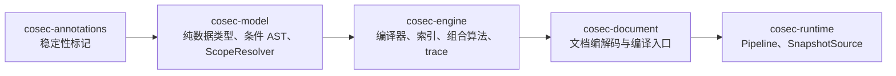

# RFC 0002：纯函数决策引擎（8.0 第一步 / RFC 0001 迁移第 2 阶段）

> 状态：已确认（第 4 版，§10 的决定于 2026-10-20 确认，2026-10-21 修订）；已交付：`cosec-model`、`cosec-engine` 与唯一的组合算法随 PR-1 至 PR-5
> 合入 `main`，PR-6 取消，7.x 路径在 RFC 0008 的切换中删除 · 上位文档：[RFC 0001](0001-target-architecture.md) §3.3、§6 第 2 阶段 ·
> 后续：组合算法由 [RFC 0004](0004-unified-model.md) §6 换成扁平算法，条件与索引由 [RFC 0005](0005-condition-ast.md) 重写，义务与外部属性的计划由
> [RFC 0006](0006-coroutine-pipeline.md) 加入，门槛由 [RFC 0008](0008-conformance-and-direct-build.md) 的规范一致性套件取代 · 范围：`model`、`engine`
>
> **2026-11-23 合订**：此前的修订说明（状态行的 2026-10-21 修订、2026-10-26 的 RFC 0008 修订、2026-11-08 的 #1297，以及 §7.2、§8、§10 中带日期的
> 就地标注与删除线）已并入正文，被取代的说法已删去。本文写的是第 2 阶段的引擎：按层的组合顺序、适配 7.x 的引擎输入、与 7.x 逐条等价的门槛。
> 它们后来都被取代（见上一行），正文现在陈述今天的引擎，被取代的设计写成一句话并指向取代它的章节。章节号、章节标题与 S1–S16、S10a、E1–E5、
> X1–X8、P1–P4、PR-1–PR-6、Q1–Q14 的编号不变。合订前的全文见 git 历史：`git show 10567a41:docs/rfc/0002-pure-engine.md`；§9 与附录 B 的原文见
> `git show 3cd4dca9:docs/rfc/0002-pure-engine.md`。修订沿革见文末。

## 0. 结论先行

本阶段只做一件事：**把决策算法抽成一个同步、无 I/O 的函数，并让它成为唯一的实现**。今天的入口（`core/engine/`）：

```
Engine.evaluate(EngineRequest, SnapshotView, TraceLevel) -> Evaluation(Decision, EvaluationTrace?)
```

- 两个模块：`cosec-model`（请求、作用域、决策、条件 AST 等纯数据类型）和 `cosec-engine`（编译器、索引、组合算法与 trace）。两者只依赖
  Kotlin 标准库与 `cosec-annotations` 的稳定性标记，由 `DependencyRulesTest` 与 `EnginePurityTest` 强制（§2）。
- 组合算法只有一份（`Evaluator`，唯一实现 `CoSecEngine`）。执法、`explain`、`simulate`、影子比较与代码内检查都调用它（RFC 0001 P3）。
  第 2 阶段的算法按 7.x 的层顺序执行（§4.1）；第 4 阶段换成扁平算法：先扫完全部 DENY，再扫 ALLOW，出错的 ALLOW 按未命中处理（RFC 0004 §6.1）。
- 引擎的输入是 Pipeline 准备好的 `EngineRequest`（请求、经 `ScopeResolver` 校验的作用域、成员关系、请求时间、宿主属性与外部属性）和
  `SnapshotSource` 安装好的 `SnapshotView`（平台、应用、租户三份编译后的文档）。引擎不读时钟，不做 I/O，不打日志。
- trace 即解释：`TraceLevel` 有 `OFF`、`FULL`、`EXHAUSTIVE` 三级，决策与 trace 级别无关；带 trace 的求值器（`TracingEvaluator`）是单独的类，
  热路径不带 trace 代码（§5）。7.x 的 `AuthorizationExplainer`、`ExplainerConsistencyTest`、`Policy.verify` / `Statement.verify` 已删除。
- 匹配器 SPI 在第 2 阶段保留（§6）；第 4、5 阶段由条件 AST 取代，今天没有匹配器插件。
- 第 2 阶段的门槛是与 7.x 逐条比较、差异为零；它由 RFC 0008 的规范一致性套件取代：规则登记表、正反例场景、性质测试与变异检查（§8）。
  本文定义的性质 P2（决策与 trace 级别无关）与 P4（前置条件不重复求值）留在套件里（§8.4）。

---

## 1. 范围与非目标

### 1.1 本阶段要做的

第 2 阶段交付了下面几项，前四项至今仍在：

1. 新建 `cosec-model`、`cosec-engine`，定义 §3 的类型（之后由第 4–6 阶段扩展）。
2. 实现唯一的组合算法（§4），带三级 trace（§5.1）。
3. 让执法、解释、影子、代码内检查都调用同一次评估（§5）。
4. 删除第二、第三份算法：`Policy.verify`、`Statement.verify`（`cosec-api`）、`AuthorizationExplainer.Narrator`（随切换删除）。
5. 在 `cosec-core` 中写 7.x 模型到引擎输入的适配层（§3.3、§3.4），以及新旧实现的比较器与离线回放（§8）：它们是只为等价存在的脚手架，
   随 RFC 0008 的切换删除。
6. JMH 前后对比（§7）。

### 1.2 非目标（留给后续阶段）

第 2 阶段不做、留给后续阶段的事，今天都已落地：

| RFC 0001 的内容 | 第 2 阶段的处理 | 落在 |
|---|---|---|
| 快照、`SnapshotSource`、按需加载（§3.4） | 引擎的输入每请求现取、现适配 | RFC 0003：`SnapshotDocumentStore` + `SnapshotSource`，引擎读 `SnapshotView` |
| 删除 `BlockingAware`、热路径无 `Mono`（§3.4） | 适配层按 `BlockingAware` 切换线程（S13） | RFC 0006：随匹配器一起删除 |
| 编译执行：AST、索引、索引完整性性质测试（§3.3） | 引擎按源顺序线性扫描 | RFC 0005：按命名空间的索引，`IDX-1` |
| `Binding`、成员关系、平台层 / 租户层、黑名单拆分、root 作为 break-glass 绑定（§3.2） | 7.x 的三层结构被适配成引擎输入 | RFC 0004 |
| 条件 AST 取代 OGNL/SpEL 和 part 匹配器；`MatchResult(bindings)`（P6、P10） | 现有匹配器原样调用（§6） | RFC 0005；自定义匹配器在转换时被拒绝，改为 `AttributeProvider` 加条件（RFC 0008 §6 Q4） |
| 扁平组合顺序、ALLOW 出错按未命中处理、`onMissing`、`withinBoundary`（§3.3） | 保持 7.x 的语义（§4.3） | RFC 0004 §6.1；`onMissing` 在 RFC 0006 §5.4.3；边界在 RFC 0007 §7.6 |
| `ScopeResolver`、经校验的 `Scope`（P4） | 只定义类型，`Scope` 标明来源为"客户端声明" | RFC 0004 §4.6：`Scope` 只能由 `ScopeResolver` 构造（`SCP-5`） |
| 503、`Decision` 直接进入 Pipeline、义务、`DecisionListener` | `Indeterminate` 在适配层还原为原异常，状态码不变（§3.5） | RFC 0006 |
| 协程、`cosec-runtime` | 引擎本身是同步函数，任何阶段都不依赖协程 | RFC 0006 |
| 控制面、访问分析、schema 生成 | 不做（§5.6） | RFC 0007 |

第 2 阶段不改变任何授权语义（基准是包含 S10a 修复的 7.0）；改变语义的修复放在后续阶段，由规范一致性套件检查（RFC 0008）。

---

## 2. 模块与依赖

### 2.1 依赖图



| 模块 | 依赖 | 对外暴露 | 不允许 |
|---|---|---|---|
| `cosec-model` | `kotlin-stdlib`、`cosec-annotations` | `AuthzRequest`、`Subject`、`Action`、`Resource`、`Environment`、`Scope`、`ScopeResolver`、`Memberships`、`Binding`、条件 AST、`Decision`、`Cause`、`Obligation`、`StatementRef` | 依赖 `cosec-api`、Reactor、Jackson、Guava、日志库 |
| `cosec-engine` | `api(project(":model"))`、`cosec-annotations` | `Engine`、`CoSecEngine`（无状态单例）、`EngineRequest`、`SnapshotView`、`ViewVersion`、编译后的文档、`AttributePlan`、`Evaluation`、`EvaluationTrace`、`TraceLevel` | 同上，另外不允许 I/O、线程、时钟、协程 |

`cosec-model` 不依赖 `cosec-api`：`cosec-api` 曾经返回 `Mono`，依赖它就等于把 Reactor 带进引擎的编译类路径。模块的整体依赖方向见
RFC 0011 §2、§5；文档的编解码与编译入口在 `cosec-document`（RFC 0013 §3）。引擎的多数声明标为 `@InternalCoSecApi`：应用不直接调用引擎，
而是经 Pipeline、`AuthorizationChecker` 与测试工具（RFC 0010）。

### 2.2 Gradle 层面

根 `build.gradle.kts` 的 `pureProjects`（`annotations`、`api`、`model`、`engine`）不得到库模块的默认依赖（平台、SLF4J）。
`DependencyRulesTest`（`test/architecture`）检查它们解析到的依赖：`annotations`、`api`、`model` 与 `engine` 只解析到 Kotlin 标准库
（它取代了第 2 阶段的 `verifyPureClasspath` 任务，RFC 0011 PR-1）。它防的是"有人加了一行 `implementation(...)`"，`EnginePurityTest`
防的是"代码真的引用了"。

### 2.3 ArchUnit 规则

`EnginePurityTest`（`test/architecture`，RFC 0011 §5）分析 `me.ahoo.cosec.model` 与 `me.ahoo.cosec.engine` 的主代码，白名单优先：

- `onlyStdlib`：只能依赖自身、`me.ahoo.cosec.annotations` 与标准库的若干精确包（`kotlin`、`kotlin.collections..`、`kotlin.jvm..`、
  `kotlin.ranges..`、`kotlin.sequences..`、`kotlin.text..`、`kotlin.enums..`、`kotlin.internal..`、`java.lang`、`java.util`、
  `org.jetbrains.annotations..`）。
- `noImpureJdk`：`java.lang` 与 `java.util` 里仍有不纯的类：线程、时钟、进程、随机数、类加载、反射、并发（`Thread`、`System`、`Runtime`、
  `ThreadLocal`、`Random`、`UUID`、`Date`、`ServiceLoader`……，以及 `java.lang.reflect..`、`java.util.concurrent..`）一律禁止。

- 包名用精确包（`"java.util"` 而非 `"java.util.."`），所以 `java.util.concurrent`、`java.io`、`java.nio`、`java.net`、`java.time`
  都不在白名单内；`kotlin.io`、`kotlin.concurrent`、`kotlinx.coroutines`、`reactor`、`org.springframework`、`tools.jackson`、
  `com.google.common`、`org.slf4j`、`io.github.oshai` 同理。
- 白名单中的包以 `javap` 实际看到的为准，可以增补，但每加一个包都要在 PR 里说明为什么它没有 I/O。
- 引擎不打日志：诊断信息由 trace 提供。
- 这两条规则对应 RFC 0001 §5"不阻塞事件循环"与"纯决策"两行。

ArchUnit 是只用于测试的依赖（§10 Q4）。

---

## 3. 类型设计

### 3.1 `cosec-model`

今天的类型（节选；与 RFC 0001 §3.2 的草图一致）：

```kotlin
package me.ahoo.cosec.model

/** 一次评估的请求部分，不可变。作用域、成员关系与时间在引擎的 EngineRequest 上（§3.2）。 */
class AuthzRequest(
    val subject: Subject,
    val action: Action,
    val resource: Resource,
    val environment: Environment,
)

class Subject(
    val id: String,
    val authenticated: Boolean,
    val attributes: Map<String, Any>,
    val principalBindings: Boolean,   // 凭据带角色上限时为 false（RFC 0009 §4.2）
    val breakGlass: Boolean,          // 只有 CoSec 自己验证的令牌可以为 true（BRK-8）
)

/** HTTP 场景下 namespace = "http"，verb = 方法；路由映射给出 service:verb（RFC 0005）。 */
class Action(val namespace: String, val verb: String)

/** HTTP 场景下 type = "http"，id = 规范化后的路径。 */
class Resource(val type: String, val id: String, val attributes: Map<String, String> = emptyMap())

class Environment(
    val remoteIp: String,
    val requestId: String,
    val deviceId: String,
    val blocked: Boolean,             // 阶段 A 的黑名单属性（RFC 0006 §5.4.4）
)

/** 只能由 ScopeResolver 构造（internal 构造器，SCP-5）。 */
class Scope internal constructor(val tenant: TenantId, val app: AppId, val space: SpaceId, val roles: List<RoleId>)

sealed interface Decision {
    class Permit(val by: StatementRef.Policy, val obligations: List<Obligation>) : Decision
    class Deny(val by: StatementRef?) : Decision          // by == null 即隐式拒绝
    class Indeterminate(val cause: Cause) : Decision
}
```

说明：

- 应用读到、不由它构造的值（`Decision`、`Cause`、`Obligation`）是写出 `equals`、`hashCode`、`toString` 的普通类，不是数据类：增加字段
  不会破坏调用方（RFC 0010 C4）。请求一侧的类型同样不用数据类，它们不需要 `copy`/`componentN`。
- `Cause` 是会增长的封闭集合：`MatcherFailed`、`MissingPolicies`、`AmbiguousPolicy`、`SourceUnavailable`、`DocumentInvalid`、`NotLoaded`、
  `BoundaryUnavailable`、`AttributeUnavailable`、`CheckFailed`、`MembershipUnavailable`、`RequiredListenerFailed`、`RateLimiterUnavailable`
  等，后几项由 Pipeline 而不是引擎产生。第 2 阶段的 `MissingPermissions`（S10a）随统一模型消失：权限是文档里的策略，悬空引用不编译
  （`DOC-1`）。
- 租户、主体、应用、空间、角色、策略、绑定的 id 是值类型（`TenantId`、`PrincipalId`……，RFC 0004 §4.1），第 2 阶段推迟的这一项在第 4 阶段完成。
- 第 2 阶段的过渡字段（`HostFacts`、`Subject.root`、`Subject.roles/policies`、`Scope.declared`、`LayerKind`）已删除：root 是 break-glass 绑定，
  成员关系在 `Memberships`，宿主属性经 `ConditionInput` 读取（RFC 0004、RFC 0005 §3.2）。

### 3.2 `cosec-engine`

```kotlin
package me.ahoo.cosec.engine

interface Engine {
    fun evaluate(request: EngineRequest, snapshot: SnapshotView, trace: TraceLevel = TraceLevel.OFF): Evaluation
    /** 这次评估可能读到的外部属性：Pipeline 在 evaluate 之前取齐（RFC 0006 §5.4.2）。纯函数。 */
    fun plan(request: EngineRequest, snapshot: SnapshotView): AttributePlan
}

/** 默认实现：无状态，线程安全。 */
object CoSecEngine : Engine

class EngineRequest(
    val request: AuthzRequest,
    val scope: Scope,                       // ScopeResolver 的结果：租户、应用、空间与该空间里的角色
    val memberships: Memberships,           // 附加的策略与各空间的角色
    val time: Long,                         // 请求时间：绑定过期与 environment.time；引擎不读时钟
    val attributes: ConditionInput = AbsentAttributes,   // 宿主属性（http.*、request.attributes.*）
    val external: ExternalValues = ExternalValues.NONE,  // 按 AttributePlan 取到的外部属性
)

/** trace 为 OFF 时为 null，且不产生任何 trace 相关的分配。 */
class Evaluation(val decision: Decision, val trace: EvaluationTrace?)

enum class TraceLevel {
    OFF,         // 只求决策
    FULL,        // 另外记录每个候选的每条语句及排除它的原因；在未带 trace 的求值停下处停下，但走完做出决策的那一遍
    EXHAUSTIVE,  // 同 FULL，DENY 一遍做出决策后仍走 ALLOW 一遍
}
```

**引擎输入**是 `SnapshotView`：平台文档，加上租户文档，以及需要时的应用文档（RFC 0004 §7.3）。视图必须属于请求的租户与应用，否则引擎拒绝
（`IllegalArgumentException`）。第 2 阶段的输入类型（`PolicySet`、`LayerInput`、`RuleGroup`、`Rule`、`Guard`、`RuleVisitor`、`UnresolvedGrant`）
是适配 7.x 的内部契约，随第 4 阶段删除。

- **捕获范围**：匹配语句时抛出的 `Exception`（无法解码的路径、违反 `ConditionInput` 契约的宿主属性）是那条语句的错误，记为
  `MatcherFailed`；`Error` 照常向外传播，到 Pipeline 成为未建模的异常（500）。例外只有一处：`FULL`/`EXHAUSTIVE` 下**只为 trace 而评估**的语句
  （`afterDecision`）抛出的 `Throwable`，除 `VirtualMachineError`、`LinkageError`、`InterruptedException` 之外都记为错误，不向外传播：
  `OFF` 根本不会评估它们，解释不应在执法不失败的地方失败。
- **决策与 trace 级别无关**（P2，`ALG-8`）：决策之前评估的语句，两种求值器以同样的顺序检查、失败方式相同；trace 多评估的语句带
  `afterDecision`，结果与错误只进入 trace。
- 遍历候选与语句不为访问分配集合：按候选顺序（`CandidateOrder`）访问，被多个绑定引用的策略每遍只求值一次（`ALG-9`）。

**Trace**：`EvaluationTrace` 按候选（`CandidateTrace`：引用、效果、结果、错误、`afterDecision`）记录，取代第 2 阶段按层的 `Trace`/`LayerTrace`/
`GroupTrace`/`RuleTrace`。`explain` 由同一次评估的 trace 生成（RFC 0007 §10.3）。

### 3.3 从现有模型到引擎输入

第 2 阶段在 `cosec-core` 中把 7.x 的 `Request`、`SecurityContext`、`Policy`、`AppRolePermission` 逐请求适配成 `PolicySet`。这层适配随切换删除。
今天引擎的输入由两处准备：

| 输入 | 来源 |
|---|---|
| `SnapshotView` | `SnapshotSource` 按作用域取得已安装的编译文档（RFC 0003；三份文档见 RFC 0004 §7） |
| `EngineRequest` | Pipeline 的各阶段：认证得到主体，阶段 A 得到成员关系与黑名单，`ScopeResolver` 得到作用域，阶段 B 得到外部属性（RFC 0006 §5.2） |

文档在安装时编译一次（`PolicyDocumentCompiler`，`cosec-document`；编译器与索引在 `cosec-engine`），请求期不再适配任何东西。

### 3.4 `EngineAuthorization` 的流程

`EngineAuthorization` 是第 2 阶段在 7.x 装饰器链里调用引擎的适配实现（取数据 → 适配 → `Engine.evaluate` → 映射回 `AuthorizationDecision`），
与 7.x 的 `SimpleAuthorization` 一起在切换时删除。今天调用引擎的是 Pipeline 的 `Evaluate` 阶段：先用 `Engine.plan` 定出要取的外部属性，取齐后
`Engine.evaluate`，再由 `RunObligations` 执行义务（RFC 0006）。`AuthorizationChecker` 复用同一段（视图、属性、引擎）。

### 3.5 引擎结果到现有结果的映射，以及 `Indeterminate` 的状态码

第 2 阶段把 `Decision` 映射回 7.x 的 `AuthorizationDecision`，`Indeterminate` 原样抛出原异常，状态码保持 7.x（500，`RegexTimeoutException` 为 403；
§10 Q3）。今天 `Decision` 直接进入 Pipeline，状态码只由 `StatusMapping` 产生：Permit 继续，Deny 匿名 401、已认证 403，每个 `Indeterminate`
都是 503，500 只留给未建模的异常（RFC 0006 §3 K1，`PIP-1`、`PIP-2`）。

---

## 4. 唯一的组合算法

### 4.1 伪代码（第 2 阶段：按层顺序）

第 2 阶段的算法按 7.x 的层顺序执行：黑名单 → root → 全局 → 主体 → 角色；每层先评估全部前置条件，再先 DENY 后 ALLOW；一层显式拒绝或无法判定
立即结束，一层的 ALLOW 只记下，后面的层仍要检查 DENY。它的唯一目的是与 7.x 在包括出错路径在内的所有情况下逐条等价（§4.2），原文见合订前的全文。

第 4 阶段起，算法是扁平的（RFC 0004 §6.1，`Evaluator`；与 RFC 0001 §3.3 的伪代码相同）：

```
candidates = CandidateOrder：黑名单规则、平台与租户的 Anyone 绑定、附加与主体绑定、应用与租户的角色绑定、break-glass（最后）
for s in candidates 的全部 DENY 语句:
    MATCH -> return Deny(s)
    ERROR -> 记下
if 有出错的 DENY，或有未解决的输入: return Indeterminate(cause)
for s in candidates 的全部 ALLOW 语句:
    MATCH -> return withinBoundary(Permit(s, obligations))
    ERROR -> continue
return 有 ALLOW 因外部属性不可用而跳过 ? Indeterminate(AttributeUnavailable) : Deny(null)
```

决策只取决于候选的集合，不取决于顺序（`ALG-1` 至 `ALG-6`）。trace 只是在同一遍里加记录（§5.1）。

### 4.2 与现在的 `SimpleAuthorization` 逐条对照

本节记录第 2 阶段的引擎与 7.x `SimpleAuthorization` 的逐条对照，是按层算法的依据；7.x 的代码已删除。每一项在第 2 阶段都一致：

| # | 7.x 的行为 | 今天 |
|---|---|---|
| S1 | 黑名单最先判定，命中即拒绝，不检查 root，不读仓库 | 黑名单规则是第一个候选，被拉黑的请求只读平台文档（`BLK-1`） |
| S2 | root 跳过全部三层 | root 是 break-glass 绑定，受全部 DENY 约束（`BRK-1`） |
| S3 | 三层按 全局 → 主体 → 角色 串联 | 没有层，候选顺序见 RFC 0004 §6 |
| S4 | 每层先评估该层**每一个**策略条件，任一抛错本层出错 | 策略条件只在它的语句匹配了动作与资源之后才评估，每次评估至多一次（`ALG-7`，RFC 0004 C1c） |
| S5 | 本层先找第一条命中的 DENY，再找第一条命中的 ALLOW；角色层按授予顺序，`*` 授予按 `permissionIndexer` 的顺序访问权限 | 先扫完全部 DENY 再扫 ALLOW；`cosec-migrate` 转换 `*` 授予时保持这个顺序 |
| S6 | 前一层显式拒绝即返回；前一层 ALLOW 时后一层仍评估，只有显式拒绝能覆盖它；任何一层出错立即成为错误 | 扁平算法：任何 DENY 命中优先于别处的错误（`ALG-1`） |
| S7 | 都没有结果 → 隐式拒绝 | `Deny(null)`（`ALG-5`） |
| S8 | 主体引用的策略缺失 → `MissingPolicyException`，只在评估到达主体层时发生 | 缺失的附加或策略是未解决的输入：没有 DENY 命中时 `Indeterminate`（`ALG-3`） |
| S9 | 主体没有策略 → 主体层为空，不读仓库 | 附加来自成员关系，不读任何仓库 |
| S10 | 角色按 `RoleScope.rolesIn(spaceId, roles)` 划分空间，按 `(appId, spaceId, 角色)` 读应用权限 | 角色绑定只在它的应用与空间内生效（`BND-5`）；空间由成员关系确认（`SCP-1`） |
| S10a | 7.0 发布前的修复：角色授予了不存在的权限 id，拒绝扫描到达它时失败即拒绝（500）；引擎按授予位置判定，与 7.0 一致（PR-2 中更正） | 权限是文档里的策略，悬空引用不编译（`DOC-1`） |
| S11 | D7：语句之间清空路径变量 | 捕获的变量只在该语句的条件里可见（`ALG-10`） |
| S12 | `inRole` 匹配器按字面与空间后缀比较角色（第二轮审查 M1/M2） | 角色由 `ScopeResolver` 与成员关系判定，没有 `inRole` 匹配器（§10 Q12） |
| S13 | `BlockingAware`：含阻塞匹配器的层在 `boundedElastic` 上评估 | 没有匹配器；引擎在调用线程上运行 |
| S14 | 匹配器异常成为错误信号，`RegexTimeoutException` 为 403，其余 500 | 出错的语句按 §3.2 处理，`Indeterminate` 一律 503 |
| S15 | 命中策略语句或角色权限时写 `VerifyContext` | 做出决策的语句与绑定在 `Decision` 与 `DecisionEvent` 里（`by`、`via`） |
| S16 | 限流、影子、审计、指标、追踪是包在外面的装饰器 | 义务与监听器（RFC 0006） |

### 4.3 与 RFC 0001 §3.3 扁平算法的关系

在**没有错误**的输入上，按层顺序与扁平顺序的结果完全相同：只要前面的层没有显式拒绝，每一层都会被评估，所以"结果为 Deny"⇔"有一条 DENY 命中"，
做出决策的 DENY 都是按（层，组，规则）顺序的第一条；没有 DENY 命中时，两者都返回按同一顺序的第一条 ALLOW，都没有则隐式拒绝。

区别只在出错路径上。第 2 阶段为了零差异采用按层顺序（§10 Q2）；第 4 阶段切换到扁平顺序时，E1、E2、E4、E5 成为 RFC 0004 §5.3 列出的有意的语义变化（RFC 0004 §6.2 的对照表）：

| # | 情形 | 按层（7.x） | 扁平（今天） | 对应 |
|---|---|---|---|---|
| E1 | 前一层 ALLOW 命中，后一层某条 ALLOW 抛错 | 500 | Permit | C1a，唯一的放宽（按 deny-first 论证是安全的） |
| E2 | 前一层某个匹配器抛错，后一层有 DENY 命中 | 500 | 403 | C1b |
| E3 | 全局层 DENY 命中，主体策略缺失或主体层读取失败 | 403 | 403（DENY 命中优先） | 不再是差异：RFC 0001 §3.3 原来的伪代码会是 500，扁平算法让命中的 DENY 优先 |
| E4 | 只有一条 ALLOW 抛错，没有其他命中 | 500 | 隐式拒绝（401 / 403） | C1a |
| E5 | 某策略的前置条件抛错，但它的语句与请求无关 | 500 | 不评估这个条件 | C1c |

### 4.4 已知差异及处理

逐条对照（§4.2）没有发现**决策**上的差异。下面是第 2 阶段的引擎与 7.x 在决策之外、可观察到的差异，以及它们在 8.0 的结局
（`wiki/operations/upgrading.md`）：

| # | 差异（第 2 阶段） | 8.0 |
|---|---|---|
| X1 | I/O 形态：三层并行预取，而不是逐层惰性读取 | 过渡形态。8.0 每请求不读任何策略，引擎读已安装的快照 |
| X2 | 线程：含 `BlockingAware` 匹配器时整次评估切到 `boundedElastic` | 过渡形态。`BlockingAware` 已删除 |
| X3 | 调用方的 `SecurityContext` 不再留下路径变量 | 写进升级说明的已删除 API |
| X4 | 自定义匹配器在前置条件里写路径变量，每个前置条件前都重置 | 过渡形态。自定义匹配器已删除 |
| X5 | 覆写 `Statement.verify` 的实现在删除 `verify` 后编译失败 | 写进升级说明的已删除 API |
| X6 | 解释输出：出错之后的层标为未评估，`TRACE_INCONSISTENT` 删除 | 过渡形态。7.x 的解释器已删除，`explain` 是控制面操作（RFC 0007 §10.3） |
| X7 | DEBUG 日志从每个命中点一条改为决策后一条 | 写进升级说明的可观察性变化 |
| X8 | 捕获范围：引擎只捕获 `Exception`，`Error` 照常传播 | 过渡形态。8.0 的策略不运行用户代码；未建模的异常是 500 `internal-error` |
| X9 | （已撤销）"角色授予不存在的权限 id 时静默跳过"，已由 7.0 发布前的修复改为失败即拒绝（S10a、§10 Q11） | 不是差异 |

---

## 5. trace 即解释

### 5.1 trace 级别的不变量

- **决策与 trace 级别无关**：同一输入在 `OFF`、`FULL`、`EXHAUSTIVE` 下得到的 `Decision` 必须相同（性质 P2，`EnginePropertyTest`；`ALG-8`）。
  `FULL`/`EXHAUSTIVE` 多评估的语句带 `afterDecision`，它们的结果和错误只进入 trace。
- `OFF` 时引擎不创建任何 trace 对象。带 trace 的求值器（`TracingEvaluator`）是单独的类，未带 trace 的 `Evaluator` 不含 trace 代码（§7）。
- 解释的副作用面不比执法大：8.0 的条件是 AST，求值没有副作用。

### 5.2 被替换或删除的部分

| 7.x | 结局 |
|---|---|
| `Policy.verify`（`cosec-api` 默认方法） | 删除（§10 Q5） |
| `Statement.verify`、`Statement : PermissionVerifier`、`PermissionVerifier` | 删除（§10 Q5）；`VerifyResult` 随 RFC 0006 的结果类型统一删除 |
| `DefaultPolicyEvaluator`、`DefaultAppPermissionEvaluator`（加载时用模拟请求把每个匹配器跑一遍） | 删除：文档在编译时检查类型与成本（RFC 0005） |
| `AuthorizationExplainer.Narrator`、`firstDecisive` | 删除：解释由同一次评估的 trace 生成 |
| `ExplainerConsistencyTest` | 删除：解释与决策是同一次评估，不可能不一致；由 P2 守护 |
| `ExplainWarningCode.TRACE_INCONSISTENT` | 删除（X6） |

### 5.3 影子（`ShadowAuthorization`）

7.x 的 `ShadowAuthorization` 在内部用叠加仓库重新构造一个授权实现。今天影子评估是 BEST_EFFORT 监听器（`ShadowListener`）：采样后在暂存的
候选文档上再调用一次 `Engine.evaluate`，比较两个结果，按窗口上报（RFC 0006 §9.5、RFC 0007 §6.4；候选只为比较编译，`SNP-10`）。
叠加仓库已删除。

### 5.4 `AuthorizationChecker`

`AuthorizationChecker`（`cosec-runtime`）复用 Pipeline 的后半段（视图、属性、引擎），以已放行请求的主体检查更多的动作；它不执行义务、
不调用监听器（`PIP-15`、`PIP-26`，`wiki/integration/checks.md`）。路径变量不再是共享状态，所以不需要隔离的上下文。

### 5.5 `PolicyTestKit`

7.x 的 `PolicyTestKit` 经解释器间接使用引擎。今天应用的策略测试工具是 `cosec-testkit`：场景在引擎层与 Pipeline 层运行，规范一致性套件复用它的
场景格式（`wiki/policies/testing.md`）。第 2 阶段的临时入口 `PolicyTestKit.parity` 已删除。

### 5.6 `AccessAnalyzer`

7.x 的 `AccessAnalyzer` 不调用决策算法：只对动作做匹配，回答"谁可能访问"。今天访问分析是控制面的 `analyze`，基于编译后的文档，以绑定的主体
表达答案（RFC 0007 §10.3）。

---

## 6. 匹配器怎么迁移（SPI 决定，已确认）

### 6.1 两个方案

第 2 阶段在两个方案之间选择：A 是当时就把 `ActionMatcher.match` 改为返回 `MatchResult(matched, bindings)`；B 是保留匹配器 SPI，由适配层给每条
语句提供一个只属于它的路径变量上下文。选择 B（§10 Q1）：下游只改一次，零差异门槛才可行，D1/D7 同样在结构上消除；SPI 的形状应该由第 4 阶段的
编译模型决定。

结局：条件 AST 取代 OGNL/SpEL 与 part 匹配器（RFC 0005）。原计划让自定义匹配器经一个不可分析的 `legacy` 节点过渡，它没有实现：8.0 只有一次
切换，`AttributeProvider` 与条件 AST 同时可用，转换工具拒绝自定义匹配器并报告位置，改写成 `AttributeProvider` 加条件（RFC 0005 §3.7，
RFC 0008 §6 Q4）。今天没有匹配器 SPI：动作与资源模式编译后返回捕获的变量，条件 AST 读取它们（RFC 0001 P6）。

### 6.2 方案 B 的语句作用域上下文

第 2 阶段的语句作用域上下文（`StatementScopedContext`）把 `PATH_VARIABLES` 存在字段里，每条语句开始时重置；它随适配层删除。今天捕获的变量
作为匹配结果返回，只在该语句的条件里可见，一条语句有多个资源模式时，条件按每个命中模式的捕获分别检验（`ALG-10`）。

---

## 7. 性能

### 7.1 目标

第 2 阶段的目标以 7.x 的 `SimpleAuthorizationBenchmark`（场景 `global`、`role`、`none`）为基线：吞吐每个场景不低于基线的 95 %，每操作分配
不高于基线，分配不随策略数量增长，trace 关闭无成本。

今天的要求：

| 指标 | 要求 |
|---|---|
| 吞吐 | 编译执行在 `global`、`role`、`none`、`role-heavy` 上不低于 7.0 的 `SimpleAuthorization` 的 100 %：以 7.0 实测数字设定的绝对预算（RFC 0005 §11 的决定，RFC 0008 §3.8） |
| 分配与策略规模无关 | trace 关闭时，每个请求的分配量不随策略数量增长（RFC 0001 §5"热路径有基准"）；`EngineBenchmark` 按绑定数（10、1,000、100,000）与角色数参数化 |
| trace 关闭无成本 | `OFF` 走不含 trace 代码的 `Evaluator`（§5.1） |

"分配不随策略数增长"指引擎本身；路径模式命中时创建的捕获随**命中**次数变化，不在目标之内。

### 7.2 测量方法

JMH 任务默认只跑 1 fork × 1 iteration，是冒烟，不足以判定几个百分点的差异。比较版本时：

1. **Gradle 属性**：`-PjmhWarmupIterations`、`-PjmhIterations`、`-PjmhFork`、`-PjmhProfilers`（传给 JMH 的 `profilers`）、`-PjmhJavaVersion`
   （用 `javaToolchains.launcherFor` 取得该版本的 JDK 运行基准 JVM，编译仍用基线 JDK）。不传时保持冒烟的默认值。
2. **固定命令**（前后对比都用它）：

   ```bash
   ./gradlew :engine:jmh -PjmhIncludes=EngineAuthorizationBenchmark -PjmhJavaVersion=25 -PjmhWarmupIterations=5 -PjmhIterations=10 -PjmhFork=3 -PjmhProfilers=gc
   ```

   每次迭代使用 JMH 默认的 10 秒。整个 Pipeline 用 `:e2e:jmh -PjmhIncludes=PipelineBenchmark`。直接运行 `jmhJar` 时加
   `-jvmArgsAppend -Dlogback.configurationFile=$PWD/config/logback-jmh.xml`，否则 fork 的 JVM 按 DEBUG 打日志，数字失真（AGENTS.md）。
3. **环境**：空闲机器，交流供电，关闭其他 Gradle daemon、IDE 索引、Docker 和其他会话的构建；运行前后各记录一次 `uptime` 负载，负载高于 1 时
   作废重跑。记录 `java -version`、CPU 型号、核数、操作系统版本。
4. **交替测量**：基线与新实现在同一台机器上交替跑三轮，取每轮结果，报告均值与 99.9 % 置信区间；JMH 的 JSON 结果作为 PR 附件。
   同一 CI 机器上的两个提交可以用 `jmh-ab.yml` 比较（`scripts/jmh-ab/README.md`）。
5. **记录位置**：每个热路径 PR 的描述里附前后对比（AGENTS.md 的不变量）；参考结果在 `docs/perf/`，最终数字在 `wiki/architecture/overview.md`
   的性能一节。

当时的测量（第 2 阶段，7.x 的适配路径；只作历史参考，那条路径已删除）：

- 基线（PR-1）：[`docs/perf/rfc-0002-baseline`](../perf/rfc-0002-baseline/README.md)，JDK 25.0.4.1，含 `global-deny` 场景；录制时机器负载 1.6–2.9，
  只作参考。
- PR-3（#993）：[`docs/perf/rfc-0002-pr-3`](../perf/rfc-0002-pr-3/README.md)，`role` 场景吞吐为基线的 93.5 %，未达到 95 %，合入时豁免。
- 角色层热路径优化（#1000）：[`docs/perf/rfc-0002-role-hot-path`](../perf/rfc-0002-role-hot-path/README.md)，`role` 95.0 %、`none` 92.6 %、
  `role-heavy` 87.1 %、`global` 98.2 %；剩余差距来自"每个授予位置一个规则对象"，是按层算法的固有成本。协调者（2026-10-21）对第 2 阶段接受
  最多约 7 % 的差距，并把"不低于 7.0 的 100 %"定为第 4 阶段编译执行必须满足的要求（上表）。

---

## 8. 切换门槛

第 2 阶段的门槛是：新旧实现在离线语料、百万随机用例与真实部署的离线回放上逐条比较，**差异为零**才删除旧实现（PR-6）。这一节由 RFC 0008 取代
（维护者 2026-10-26）：8.0 不考虑兼容性，正确性来自 8.0 的规范本身，而不是与 7.x 等价；PR-6 取消，按层引擎与 7.x 路径在 RFC 0008 的切换中
一起删除（RFC 0008 §4.2、§4.4）。今天的门槛是规范一致性套件：规则登记表、正反例场景、可追溯检查、不变量性质与变异检查（RFC 0008 §3）。
下面各小节只记录仍然有效的部分。

### 8.1 比较器

第 2 阶段的比较器 `DecisionParity`（PR-4，#997；比较两个 `DecisionAuthorization` 的结果元组）与回放工具在 `cosec-core` 的测试夹具中，从不发布，随切换删除
（RFC 0008 §4.2；§10 Q14）。今天比较两份文档的结果是影子窗口的事（§5.3），比较两个提交的性能是 `jmh-ab.yml` 的事（§7.2）。

### 8.2 语料

第 2 阶段的语料（参数化的现有测试、`PolicyTestKit` 套件、百万随机用例、真实数据的离线回放）随门槛取消。今天的语料是规范一致性套件的场景
（`test/conformance/src/test/resources/scenarios/`）与各模块的性质测试；`propertyStress` 以更多用例运行已登记的性质，一百万次的运行在 CI 上
（AGENTS.md）。

#### 8.2.1 离线回放（2026-10-21 新增）

离线回放随门槛取消，回放工具已删除。仍然有效的是两件事：

**导出格式**：7.x 的数据以文件导出时，`cosec-migrate convert --from-files` 读这个格式（RFC 0004 §8.2；`ExportDirectory`）：

- `policies.json`：7.x 策略的数组，每条带 `id`；
- `global-policies.json`：全局策略索引里的 id 数组；
- `app-role-permissions.json`：每个应用一项，`{ "appPermission": { "id": "billing", ... }, "grants": { "admin": ["*"], "auditor@s1": ["invoice.read"] } }`，
  没有应用权限的应用写成 `{ "appId": "reports", "grants": { ... } }`；
- 可选的 `rate-limit-rules.json`：该部署的限流规则。

格式不对的一项让读取失败：导出有误，不是数据有误。

**数据处理**：导出的数据可能含个人数据（主体 id、IP、设备 id、请求路径）和真实的策略内容，只保存在维护者或用户本地，转换也在本地执行；不提交进
仓库，不附到 PR，不上传到 CI。需要和别人讨论时，先脱敏成最小复现用例，作为普通测试提交。

### 8.3 "差异为零"的判定口径

第 2 阶段比较的元组是：Pipeline 给出的状态、拒绝的原因（显式或隐式）、做出决策的规则、出错时异常的类名、写进调用方上下文的规则；全部相等才算相同。
这个口径随门槛取消。今天每条规范性规则的期望值写在它的场景里，从 RFC 的规则推出，不从 7.x 的行为推出（RFC 0008 §3.2、§3.3）。

### 8.4 性质测试

第 2 阶段定义的四条性质，都用固定种子的 `kotlin.random.Random`：

- **P1 加入匹配的 DENY 绝不会得到 Permit**：对任意策略集合和请求，追加一条前置条件恒真、必然命中的 DENY，结果必为 `Deny` 或 `Indeterminate`。
  第 2 阶段 root 按 7.x 的语义（D5）跳过全部策略，所以排除 root。今天由更强的 P1′ 取代：加入一条适用且命中的 DENY，结果总是 Deny，root（break-glass）
  与未解决的数据也不例外（RFC 0004 §9.5，`EnginePropertyTest`，`ALG-1`）。
- **P2 决策与 trace 级别无关**：同一输入在 `OFF`、`FULL`、`EXHAUSTIVE` 下的 `Decision` 相同（`EnginePropertyTest` 的
  `P2 the decision does not depend on the trace level`，`ALG-8`）。
- **P3 新旧等价**：按 §8.3 比较新旧实现。随门槛取消。
- **P4 引擎对输入的使用是只读的**：引擎不重复评估同一个前置条件，`OFF` 下不评估决策之后的语句。今天是 `ALG-7` 的性质形式（策略的条件每次评估
  至多一次，且只在它的一条语句匹配了动作与资源之后；未带 trace 时，做出决策的语句之后什么都不评估；RFC 0008 §3.5）。

---

## 9. 实现拆分

> **2026-11-23 压缩时删去**：本节是实现的 PR 划分，都已合入。原文见 `git show 3cd4dca9:docs/rfc/0002-pure-engine.md`。

## 10. 决定

以下各项于 **2026-10-20** 由用户确认，**2026-10-21** 由维护者修订（引擎直接在 8.0 交付）。门槛有关的部分（Q6–Q8、Q14）由 RFC 0008
（2026-10-26）取代，各行写的是今天的结局。

| # | 问题 | 决定 | 理由 |
|---|---|---|---|
| Q1 | **匹配器 SPI**：第 2 阶段改成 `MatchResult(bindings)`，还是保留 SPI、在引擎侧隔离路径变量？ | **已决定**：保留 SPI（§6 方案 B），第 4 阶段随条件 AST 一次性迁移。今天没有匹配器 SPI（§6.1） | 下游只改一次；零差异门槛才可行；D1/D7 同样在结构上消除 |
| Q2 | **组合顺序**：按层顺序，还是直接采用 RFC 0001 §3.3 的扁平顺序和"ALLOW 出错按未命中"？ | **已决定**：第 2 阶段按层顺序；扁平顺序连同 E1–E5 在第 4 阶段作为列出的语义变更切换（RFC 0004 §5.3、§6.1） | 只有按层顺序才能让"差异为零"成立；扁平顺序的前提第 4 阶段才具备 |
| Q3 | **`Indeterminate` 的状态码** | **已决定**：第 2 阶段原样抛出原异常，状态码不变（500，`RegexTimeoutException` 为 403）；503 在第 5 阶段引入：每个 `Indeterminate` 都是 503（RFC 0006 Q1，`PIP-2`） | 第 2 阶段没有 503 的来源；改状态码不属于"只抽引擎" |
| Q4 | **新增测试依赖 ArchUnit**（`com.tngtech.archunit:archunit-junit5`） | **已决定**：引入，只用于测试；版本在 `gradle/libs.versions.toml` | 白名单式的类级依赖规则只有它能低成本做到 |
| Q5 | **`cosec-api` 的删除项** | **已决定**：8.0 删除 `Policy.verify`、`Statement.verify`、`PermissionVerifier`；`VerifyResult` 在第 5 阶段删除（RFC 0006） | 留着它们就留着第二份算法；覆写 `verify` 的实现编译失败比静默改变行为好 |
| Q6 | **开关属性 `cosec.authorization.engine`** | **已决定**：不引入。没有任何 `cosec.*` 属性选择引擎实现；8.0 只有一个引擎 | 不需要生产中的陪跑；PR-6 之前没有发布版本，开关也就没有使用者 |
| Q7 | **真实数据的口径** | **已决定（2026-10-21），由 RFC 0008 取代**：真实数据的导出与离线回放不再需要；导出格式由 `cosec-migrate` 沿用，数据只留在本地（§8.2.1） | 与 7.x 等价只能证明"与 7.x 相同"；回放依赖的导出一直没有发生 |
| Q8 | **门槛需要什么版本** | **已决定**：门槛不需要任何版本。RC 与 GA 只在目标架构达成之后发布，在此之前可以发布预览版（RFC 0001 §6、§7.1）；第 2 阶段的离线门槛由规范一致性套件取代（RFC 0008） | 维护者决定目标架构全部达成之前不发布 RC 与 GA |
| Q9 | **集成方式** | **已决定**：`main` 是 8.0 线，不开长期分支；`7.x` 是维护分支，只接收安全和关键修复，两条线都需要的修复先进 `main` 再回移（`CONTRIBUTING.md`）。PR-1 到 PR-5 只做加法，各自 squash 合入 `main` | 与其他 PR 的合并方式一致 |
| Q10 | **解释输出的变化**（X6） | **已决定**：第 2 阶段起按新输出，`ExplainWarningCode.TRACE_INCONSISTENT` 删除，写进升级说明。今天 `explain` 是控制面操作（RFC 0007 §10.3） | 解释与决策已是同一次评估 |
| Q11 | **角色授予了不存在的权限 id** | **已决定**：在 7.0 发布前修复为失败即拒绝（500），与 D2 相同；第 2 阶段保持它（S10a）。8.0 中权限是文档里的策略，悬空引用不编译（`DOC-1`） | 静默跳过会让授予给角色的 DENY 权限失效 |
| Q12 | **`inRole` 的已知行为**（第二轮审查 M1/M2） | **已决定**：第 2 阶段原样保留；第 4 阶段改为按 `Scope` 和成员关系判定，`inRole` 匹配器删除 | 匹配器不动是方案 B 的前提；它们的修复是语义变化 |
| Q13 | **三层并行预取**（X1） | **已决定**：同意。第 3 阶段起引擎读已安装的快照，问题消失 | 引擎需要完整输入；决策和错误信号不变 |
| Q14 | **比较器和回放工具的去留**（2026-10-21 新增，RFC 0003 Q12） | **已决定（RFC 0008）**：两者是只为等价存在的脚手架，在切换中删除（§8.1） | 门槛取消之后它们没有使用者 |

---

## 附录 A：已确认差异

门槛期间发现、并经用户确认属于旧实现缺陷的差异登记在这里。第 2 阶段的门槛在任何差异登记之前由 RFC 0008 取代，表为空。

| 编号 | 输入 | 旧实现 | 引擎 | 结论 | 确认人 / 日期 |
|---|---|---|---|---|---|

## 附录 B：涉及的现有代码

> **2026-11-23 压缩时删去**：本节是7.x 里与本文有关的文件清单，这些代码已删除。原文见 `git show 3cd4dca9:docs/rfc/0002-pure-engine.md`。

---

## 修订沿革

只列日期与出处，内容都在正文里。

- 2026-10-20：提出（#960）；文档改写（#970）。
- 2026-10-21：直接在 8.0 交付（#976）；门槛改为离线回放（#981）；随 RFC 0003 的确认保留比较器与回放工具（#986）；实现与审查期间的更正
  （#982、#983、#989、#994、#995、#997、#999、#1000、#1001、#1002）。
- 2026-10-25：回放门槛第 2 轮审查的修复（#1016）。
- 2026-10-26：门槛由 RFC 0008 的规范一致性套件取代（#1039）。
- 2026-10-28：模块目录与项目名去掉 `cosec-` 前缀（#1132、#1139）。
- 2026-11-08：审计记录的来源改为 `source.via`（#1297，记录于 #1299）。
- 2026-11-23：§9 与附录 B 压缩为一行（#1882）。
