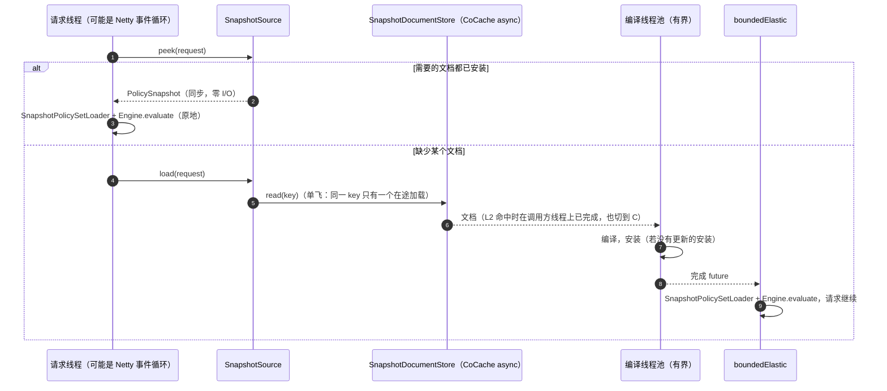

# RFC 0003：策略快照分发（RFC 0001 迁移第 3 阶段）

> 状态：已确认（第 2 版，§12 的决定已于 2026-10-21 由维护者确认）· 上位文档：[RFC 0001](0001-target-architecture.md) §3.4、§6 第 3 阶段 ·
> 前置：[RFC 0002](0002-pure-engine.md)（第 2 阶段，PR-1、PR-2 已合入，PR-3 进行中）·
> 基线：`main` @ `a130eb90` · 交付：全部合入 `main`（8.0 线）；8.0 在 RFC 0001 第 2–6 阶段全部完成、各做完两轮审查之前不发布任何版本 ·
> 范围：`cosec-core`、`cosec-cocache`、`cosec-spring-boot-starter`；`engine/`、`model/` 不改

## 0. 结论先行

本阶段只做一件事：**授权读取的策略数据全部来自内存中一份不可变、带版本号的快照，评估途中不再有任何策略 I/O。**

```
请求 → SnapshotSource.peek(keys)（内存，同步）→ SnapshotPolicySetLoader（同步）→ Engine.evaluate(AuthzRequest, PolicySet)
                  └ 未加载：SnapshotSource.load(keys)（异步，单飞，不在事件循环上编译）→ 同上
```

- **分区按数据实际的形状，而不是按租户**（§3.2）。现有数据没有租户维度：策略按 id 全局存放，全局策略对所有租户生效，应用权限按
  `appId` 存放（§3.1）。按租户分区就得改变语义，那是第 4 阶段的事（§2 I1）。本阶段的快照由两种文档组成：一份**共享文档**
  `policies`（全部策略），以及每个应用一份**应用文档** `app:<appId>`（应用权限加上该应用在所有空间的角色授予）。一次评估持有
  一个 `PolicySnapshot`，版本号是 `SnapshotVersion(shared, scoped)` 这一对。第 4 阶段把这一对换成 `(platform, tenant)`，加载、
  失效、陈旧度、冷加载这套机制原样复用（§3.7）。
- **引擎不改**（§3.5）。本阶段不改变组合算法，引擎的输入仍是 RFC 0002 的 `PolicySet`。变的只是 `PolicySet` 的来源：PR-3 的
  `PolicySetLoader` 每次请求经 `Mono.zip` 读三个仓库；本阶段换成 `SnapshotPolicySetLoader`，同步地从已编译的快照里取出预先构造好的
  规则组。`Engine.evaluate(request, snapshot)` 留到第 4 阶段编译执行时再引入。
- **存储**（§4）：新增一个 CoCache 缓存 `PolicySnapshotCache: Cache<SnapshotKey, SnapshotDocument>`，`ttl = null`、
  `ReadFailureMode.THROW`、`ForeignFormatMode.FAIL`。一次发布只写一个 key，D4 在读写两侧都消失。编译后的快照由 CoSec 自己持有，
  **不依赖 CoCache L2 常驻**：`ttl = null` 时 CoCache 不做提前刷新，L2 每过 `localMaxAge` 必然冷读一次（§2 I4）。
- **陈旧度有上界，并且可以观测**（§4.5）。落后时长定义为"距上次经条件读向 Redis 确认版本的时间"；条件读在摘要未变时不传正文，
  带宽由变更决定（Q5）。默认 60 秒告警、5 分钟升级，可以按租户开启
  `fail-closed`（RFC 0001 §7.1）。本阶段 `fail-closed` 映射为 500：503 留到第 5 阶段（§2 I7）。
- **热路径**（§5）：快照已加载时，策略数据零 I/O、零调度器切换。`CacheFutures.toLocalFirstMono` 删除。冷未命中在 CoSec 自己的
  有界编译线程上编译，请求在 `boundedElastic` 上继续；失败即拒绝。**`BlockingAware` 不在本阶段删除**：它管的是阻塞的自定义匹配器，
  不是策略数据，它的替代品 `AttributeProvider` 在第 5 阶段（§2 I2）。
- **不改变任何决策**（§8）。门槛沿用 RFC 0002 的比较口径和离线回放，比较"第 2 阶段结束时的实现"与"读快照的实现"。另加一条更强的
  性质测试：同一份数据经快照和经仓库产生的 `PolicySet` **结构相同**。
- **三项前置决定已确认**（2026-10-21）：CoCache 6.7 增加条件写入和**必需的**条件读（§4.5、§4.6，Q5；CoCache 6.7 的发布本身仍待维护者确认），
  RFC 0002 PR-6 保留比较器和回放工具（§8.1，Q12，本 PR 同时修订 RFC 0002），以及用快照文档 SPI 取代
  `PolicyRepository`/`AppRolePermissionRepository` 这两个 SPI（§4.2，Q3）。完整列表见 §12。
- 拆成 6 个 PR（§11）。前 4 个只做加法，可以在 RFC 0002 PR-6 之前开工；切换（PR-5）和删除（PR-6）必须等 RFC 0002 PR-6 和本阶段的门槛。

---

## 1. 范围与非目标

### 1.1 本阶段要做的

1. 定义快照模型（§3）：`SnapshotKey`、`SnapshotDocument`、编译结果、`PolicySnapshot`、`SnapshotVersion`。
2. `SnapshotSource`（§4.2、§4.3）：持有编译后的快照，提供按需加载、单飞、有序安装、重新校验、LRU、落后时长和失败即拒绝。
3. `SnapshotDocumentStore` SPI（§4.2）及其两个实现：基于 CoCache 6.x 的 Redis 实现（`cosec-cocache`），以及内存实现（测试、本地策略文件、`PolicyTestKit`）。
4. `SnapshotPublisher`（§4.6）：取代 `PolicyRepository.setPolicy` 和对 `AppPermissionCache`/`RolePermissionCache` 的直接写入。
5. `SnapshotPolicySetLoader`（§3.5）：取代 PR-3 的 `PolicySetLoader`，`SimpleAuthorization` 改为读快照。
6. 读取 7.x Redis 数据并转换成快照文档的库函数（§4.7），用于门槛、规模测量和开发环境；面向用户的数据迁移在第 4 阶段一次性提供。
7. 比较器、回放和规模测量工具（§8、§4.8），JMH 前后对比（§9）。
8. 删除每请求读仓库的路径：`RedisPolicyRepository`、`RedisAppRolePermissionRepository`、`CacheFutures.toLocalFirstMono`、四个策略/权限缓存及其 bean、
   `Overlay*Repository`（§11 PR-6）。

### 1.2 非目标

| 内容 | 本阶段的处理 | 留到 |
|---|---|---|
| 按租户分区、平台层与租户层、`Binding`、成员关系（RFC 0001 §3.2） | 不做。分区按现有数据的形状（§3.2）；`PolicySnapshot` 的形状为第 4 阶段预留（§3.7） | 第 4 阶段 |
| 编译执行：AST、路由前缀树索引、`Engine.evaluate(request, snapshot)`（RFC 0001 §3.3） | 不做。"编译"在本阶段指：JSON → 现有的 `PolicyData`/`AppPermissionData` → PR-3 的适配规则组，一次完成，按版本缓存（§3.4） | 第 4 阶段 |
| 删除 `BlockingAware`（RFC 0001 §6 第 3 阶段原文） | 不做。只删除策略数据的调度器切换（§5.2，§2 I2） | 第 5 阶段 |
| 协程、`suspend` 的 `SnapshotSource`、`Flow`（RFC 0001 §3.4、§3.8） | 不做。本阶段的接口返回 `CompletableFuture`（§4.2，§2 I3） | 第 5 阶段 |
| 状态码 503（RFC 0001 §3.5） | 不做。快照不可用、陈旧超限都是 500（§4.5，§2 I7） | 第 5 阶段 |
| 限流规则进快照（RFC 0001 P11、§3.5） | 不做。规则仍来自 `RateLimitRuleProvider`（§3.6，§2 I6） | 第 5 阶段（义务） |
| 编译失败时保留旧版本（RFC 0001 §3.4） | 不做。保持 7.0 的行为：读到无法使用的策略时，到达对应层的请求失败（§4.4，§2 I5） | 第 6 阶段（控制面在发布前编译） |
| 控制面：`PolicyStore`、修订、回滚、发布前影子窗口、控制面自身的授权（RFC 0001 §3.7） | 不做。`SnapshotPublisher` 只覆盖 7.0 已有的写操作（§4.6） | 第 6 阶段 |
| 把快照版本写进审计事件（RFC 0001 §3.6 `DecisionEvent`） | 不改 `AuditEvent`。版本号经 DEBUG 日志和 actuator 端点暴露（§4.5） | 第 5 阶段 |

**本阶段不改变任何授权决策。** 基准是第 2 阶段结束时（RFC 0002 PR-6 合入后）的 `SimpleAuthorization`，它与 7.0 逐条等价。
可观察到的非决策差异列在 §7。

---

## 2. RFC 0001 中与第 3 阶段有关的不一致

RFC 0001 是目标架构，对第 3 阶段的描述有几处彼此矛盾，或者与现有代码、CoCache 6.6 的实际 API 不符。本 RFC 不悄悄选边，逐条列出，
每条给出本阶段的处理，对应 §12 的一个决定。

| # | RFC 0001 原文 | 矛盾之处 | 本阶段的处理 |
|---|---|---|---|
| I1 | §3.4：快照按租户分区，`Cache<TenantId, SnapshotDocument>`，版本 `(platform, tenant)` | 现有数据没有租户维度（§3.1）：`PolicyCache` 按策略 id 存放，`GlobalPolicyIndexCache` 只有一个 key，`AppPermissionCache` 按 `appId` 存放。`Policy` 虽然实现了 `Tenant`，但 `SimpleAuthorization` 从不读 `tenantId`，全局策略对所有租户生效，主体可以引用任何租户的策略。按租户分区就是改变语义 | 按数据实际的形状分区（§3.2），形状与第 4 阶段同构（§3.7）。Q1 |
| I2 | §6 第 3 阶段："删除 `BlockingAware`" | `BlockingAware` 声明的是**匹配器**是否阻塞（`cosec-core/.../policy/BlockingAware.kt`），与策略数据从哪里来无关。快照只能消除"读数据"的切换，消除不了"执行阻塞匹配器"的切换。取代阻塞匹配器的 `AttributeProvider` 在 §6 第 5 阶段才有。本阶段删除它，含阻塞匹配器的策略就会在 Netty 事件循环上执行 | 本阶段只删除策略数据的切换（`toLocalFirstMono`）；`BlockingAware` 留到第 5 阶段。Q9 |
| I3 | §3.4：`suspend fun snapshot(tenant)`、`fun updates(): Flow<SnapshotChange>` | 协程是第 5 阶段（§6），第 3 阶段的 `SimpleAuthorization` 和 `SecurityPipeline` 仍是 Reactor | 本阶段的接口返回 `CompletableFuture`，变更通知用监听器；第 5 阶段加上挂起包装。Q10 |
| I4 | §3.4："CoSec 把 `localMaxAge` 设为快照最大落后时长"；§3.11：严格读失败模式；§7.1："默认只告警" | 如果编译后的快照常驻在 CoCache L2 里，`localMaxAge` 到期后 L2 就丢掉副本，下一次读取去 Redis。Redis 不可用时严格读抛错，每个请求都是 500，也就是默认 fail-closed，与 §7.1 矛盾。另外，`ttl = null` 时 CoCache 不做提前刷新：`AbstractEngine.localEntry` 只在 L1 有寿命时才计算 `refreshAt`，所以每个文档每过 `localMaxAge` 必有一个请求冷读 Redis | 编译后的快照由 `SnapshotSource` 持有，只会被更新的版本替换或被 LRU 淘汰，不随 L2 到期；版本由对 L1 的条件读确认（§4.5），`localMaxAge` 只约束冷加载和写入方经过的 L2。Q5、Q7 |
| I5 | §3.4："编译失败就保留旧版本并告警" | 本阶段不改变决策。7.0 读到无法解码的策略时，请求得到 500；保留旧版本意味着这些请求改为按旧内容决策，可能放行新内容本要拒绝的请求 | 本阶段保持 7.0 的行为（§4.4 F4、F5）；"保留旧版本"在第 6 阶段控制面发布前强制编译之后再引入。Q8 |
| I6 | P11、§3.5：限流规则"也是快照的一部分" | 本阶段的任务把限流排除在外；限流规则现在由 `RateLimitRuleProvider` 提供（静态列表），执行它们的义务在第 5 阶段 | 规则和计数器都不进本阶段的快照（§3.6）。Q17 |
| I7 | §3.4：超过上限时 fail-closed "该租户的请求返回 503" | 503 在第 5 阶段引入（RFC 0002 §3.5、Q3）。现在引入要连同 `SecurityStatus`、`WebAdapterParityTest`、`web.md` 一起改，属于状态码变更 | 本阶段映射为 500（`SecurityStatus.ERROR`），第 5 阶段统一改为 503。Q16 |
| I8 | §3.4：`SnapshotSource` 是"数据面唯一的策略存储 SPI"，未加载时"异步加载并编译" | 把编译放进 SPI，每个存储实现都要重复编译、版本比较、单飞和失效处理，而这些正是容易出错、需要统一测试的部分 | 拆成两层：SPI `SnapshotDocumentStore` 只读写文档、通知变更；`SnapshotSource` 是 `cosec-core` 的类，负责编译与持有（§4.2）。Q3 |
| I9 | §3.7：`PolicyStore` "乐观并发（CAS on version）"；§3.11："一次发布只写一个 key" | CoCache 6.6 没有条件写入（`Cache`/`AsyncCache` 只有无条件的 `put`，`RemoteStore.reclaim` 比较摘要但只转为 lease）。一个文档包含多条策略后，"读—改—写"会丢失并发更新，例如多个实例启动时 `LocalPolicyInitializer` 同时写入本地策略 | 在 CoCache 6.7 中增加条件写入与条件读（§4.5、§4.6）。Q5 |
| I10 | §6：第 2 阶段的门槛"之后每个改变语义的阶段都沿用" | RFC 0002 PR-6 删除比较器 `EngineParity`、回放工具和 `PolicyTestKit.parity`。第 3 阶段要证明等价，第 4 阶段要做影子门槛，都需要它们 | RFC 0002 PR-6 已随本 RFC 修订：把它们改名为通用的比较器和回放工具保留下来，而不是删除（§8.1）。Q12 |

另外，RFC 0001 §1.1 的 D4 一行写"读侧的混合版本要靠 3.4 节的快照解决"。本阶段兑现这一条：全局策略的内容与"哪些策略是全局的"放在
同一份文档里，一次读取得到的是同一个版本（§3.2）。

---

## 3. 快照模型

### 3.1 现状：数据怎么存、怎么读

以 `main` @ `a130eb90` 为准（[`CoSecCacheSpecs`](../../cosec-cocache/src/main/kotlin/me/ahoo/cosec/cache/CoSecCacheSpecs.kt)、
[`RedisPolicyRepository`](../../cosec-cocache/src/main/kotlin/me/ahoo/cosec/cache/RedisPolicyRepository.kt)、
[`RedisAppRolePermissionRepository`](../../cosec-cocache/src/main/kotlin/me/ahoo/cosec/cache/RedisAppRolePermissionRepository.kt)）：

| 缓存 | Redis key | 值 | 谁写 | 每个请求怎么读 |
|---|---|---|---|---|
| `PolicyCache` | `<p>:policy:<policyId>` | 一条策略 | `PolicyRepository.setPolicy` | 主体层：`getAll(principal.policies)`；全局层：`getAll(索引里的 id)` |
| `GlobalPolicyIndexCache`（`SetCache`） | `<p>:global:policy` | 全局策略的 id 集合 | `setPolicy`（元素级原子增删） | 全局层：先读索引，再读内容，只保留内容类型为 `GLOBAL` 的 |
| `AppPermissionCache` | `<p>:app:permission:<appId>` | 一个应用的应用权限 | 应用直接写这个 bean | 角色层：`get(request.appId)` |
| `RolePermissionCache` | `<p>:app:role:permission:<appId>:<roleId>[@<spaceId>]` | 一个角色在一个应用、一个空间的权限 id | 应用直接写这个 bean | 角色层：`getAll(作用域内的每个角色)` |

四个缓存都是 `storeOfRecord()`：`ttl = null`、`ReadFailureMode.THROW`、`ForeignFormatMode.FAIL`，由 `CacheTtlPolicyTest`、
`StrictCacheFailureTest` 守护。读取经 `Cache.async()`，再由 [`toLocalFirstMono`](../../cosec-cocache/src/main/kotlin/me/ahoo/cosec/cache/CacheFutures.kt)
转成 `Mono`：L2 命中在调用方线程上完成，未命中则在 `boundedElastic` 上继续。由 `LocalCacheFastPathTest` 守护。

可以看出三点：

1. **没有租户维度**（§2 I1）。
2. **D4 的读侧仍在**：全局索引和策略内容是两个 key，一次评估可能读到索引的新版本和内容的旧版本，或者反过来。#946 调整了写入顺序，保证
   写到一半失败时停在安全的一侧，但读侧的混合仍会产生"不可解释的决策"。
3. **读取粒度是请求驱动的**：主体层按主体引用的策略 id，角色层按 `(appId, spaceId, 角色)`。没有任何一处需要"枚举全部"，CoCache 也不提供枚举。

### 3.2 分区：一份共享文档 + 每个应用一份应用文档

```kotlin
/** 快照文档的 key。第 4 阶段增加 Platform / Tenant，删除这两种（§3.7）。 */
sealed interface SnapshotKey {
    /** 全部策略（全局与非全局）。每个请求都需要它，启动时预热，不被淘汰。 */
    data object Policies : SnapshotKey
    /** 一个应用的应用权限与该应用在所有空间的角色授予。按需加载，LRU。 */
    data class App(val appId: String) : SnapshotKey
}
```

一次评估需要的文档：

| 请求 | 需要的文档 | 依据 |
|---|---|---|
| 被拉黑，或 root | 无 | `Engine.requiresPolicies` 为 false（RFC 0002 §4.2 S1、S2），与现在一样什么都不读 |
| 主体没有角色，或角色在请求空间里都不生效，或 `appId` 无效 | `Policies` | 角色层为 `Absent`，不读应用文档（RFC 0002 S10） |
| 其余 | `Policies` + `App(request.appId)` | — |

**为什么这样分**：

- 每个分区内部的引用都是封闭的：角色授予引用的权限 id 在同一个应用文档里（S10a 的 `UnresolvedGrant` 在同一个版本内判定）；主体引用的策略
  和全局策略在同一份 `Policies` 文档里。两种文档之间**没有引用**，所以分别带版本读取，不会读到"引用的对象属于另一个版本"的状态。
- 全局层由 `Policies` 文档里类型为 `GLOBAL` 的策略组成，不再有单独的索引，D4 在读写两侧都消失。
- 形状与第 4 阶段一致："一份所有请求共享的文档 + 一份按分区的文档"，见 §3.7。

**被否决的方案**（Q1）：

| 方案 | 否决理由 |
|---|---|
| A. 按租户分区（RFC 0001 原文） | 要改变语义：全局策略只对本租户生效、主体只能引用本租户的策略，属于第 4 阶段 |
| B. 不改存储，在数据面用现有的四个缓存拼出快照 | D4 的读侧仍在；数据里没有版本号，无法提供 `SnapshotVersion`；角色授予无法按应用枚举，只能按请求读取，那仍是"缓存"而不是"快照" |
| C. 整个部署一份文档 | 角色授予按 `(app, role, space)` 计，空间可能很多，规模没有上限；任何一个应用的授予变化都要重写和重新编译全部数据 |
| D. 每条策略一份文档 | 全局层要么回到"索引 + 内容"两个 key（D4），要么全局策略的内容存两份，两份之间同样会混合版本 |

`Policies` 文档的规模取决于部署里非全局策略的数量，`App` 文档的规模取决于空间数，两者都要用真实数据测量（§4.8）。超过上限时的分片方案
也在那里给出，接口不变。

### 3.3 文档格式

文档是存进 Redis 的 JSON。`policies` 和 `appPermission` 沿用现有的 schema，内容与 7.0 存的值完全相同，只是换了容器：

```jsonc
// SnapshotKey.Policies
{
  "schema": 1,
  "revision": 42,                    // 发布时递增，见 §4.6
  "publishedAt": "2026-10-21T08:00:00Z",
  "policies": [                      // cosec-policy.schema.json 的数组，按 id 排序（§7 X3）
    { "id": "deny-ip", "type": "global", "statements": [ ... ] },
    { "id": "user-admin", "type": "custom", "statements": [ ... ] }
  ]
}

// SnapshotKey.App("order-service")
{
  "schema": 1,
  "revision": 7,
  "publishedAt": "2026-10-21T08:00:00Z",
  "appPermission": { "id": "order-service", "condition": { ... }, "groups": [ ... ] },  // cosec-app-permission.schema.json
  "grants": {                        // RolePermissionCache 的全部内容：key 同 AppSpacedRoleId 去掉 "<appId>:"
    "admin": ["*"],
    "editor": ["order.read", "order.write"],
    "editor@team-a": ["order.read"]
  }
}
```

- `grants` 里每个角色的权限 id 是 JSON 数组，与 7.0 `RolePermissionCache` 存的值相同。访问顺序**不是**数组顺序：7.0 的编解码器把它解码为
  `Set<PermissionId>`，Jackson 构造的是 `java.util.HashSet`，角色层按哈希顺序访问（RFC 0002 S5）。编译器用同一类型解码，所以顺序与 7.0 相同
  （P5 守护）；发布者和转换器因此不需要保持数组顺序。第 4 阶段若要定义顺序，在那里决定。
- 应用存在但从未写过应用权限时，没有 `App` 文档，与 7.0 的"空 `Mono`"对应（`Absent(NO_APP_PERMISSION)`）。只有授予、没有应用权限的数据在
  7.0 里不生效（`getAppRolePermission` 读不到应用权限就返回空），文档里也没有它们的位置，转换时报告出来（§4.7）。
- `schema` 是文档格式的版本，与 Redis 数据布局的 schema 标记（§4.7）是两回事：后者说明"Redis 里是哪一代布局"，前者说明"这份文档怎么解析"。

### 3.4 编译后的快照与版本号

"编译"在本阶段指：解析 JSON → 构造现有的 `PolicyData`/`AppPermissionData`（经现有的 Jackson 反序列化器和匹配器工厂，`DefaultPolicyEvaluator`、
`PathVariableScope.requireScoped` 等加载期检查照常执行）→ 构造 RFC 0002 PR-3 的适配规则组（`PolicyGroup`、`AppPermissionRules`）。
每个修订版本只做一次，结果不可变。

```kotlin
/** 一份已编译的 Policies 文档。 */
internal class CompiledPolicies(
    val revision: Long,
    /** 按文档顺序的全局策略组。整个列表可以作为 GLOBAL 层的 LayerInput.Loaded 直接复用。 */
    val globalLayer: LayerInput,
    /** 按 id 查找主体层的策略组；某条策略编译失败时，值是记录了原因的 Broken。 */
    val byId: Map<String, CompiledPolicy>,
)

/** 一份已编译的 App 文档。 */
internal class CompiledApp(
    val revision: Long,
    val appId: String,
    val appPermission: CompiledAppPermission,          // AppPermissionData + 其规则表，或 Broken
    /** key 为 (roleId, spaceId)，值为按授予顺序预先构造好的规则序列（含 UnresolvedGrant）。 */
    val grants: Map<AppSpacedRoleId, GrantRules>,
)

/** 两个文档的修订号。App 文档不存在或不需要时 scoped = 0。第 4 阶段改为 (platform, tenant)。 */
data class SnapshotVersion(val shared: Long, val scoped: Long)

/** 一次评估持有的快照：只引用已编译的不可变对象，构造它不复制任何集合。 */
class PolicySnapshot internal constructor(
    internal val policies: DocumentState<CompiledPolicies>,
    internal val app: DocumentState<CompiledApp>?,     // 本请求不需要应用文档时为 null
) {
    val version: SnapshotVersion
}

/** 一个文档在 SnapshotSource 中的状态。 */
internal sealed interface DocumentState<out T> {
    data class Present<T>(val compiled: T) : DocumentState<T>
    /** Redis 里没有这个文档（已由 schema 标记保证不是"未迁移"）。 */
    data object Absent : DocumentState<Nothing>
    /** 读取或解码失败；评估到达它所供给的层时得到 Indeterminate(SourceUnavailable)。 */
    data class Failed(val error: Throwable) : DocumentState<Nothing>
}
```

- **版本号**是每个文档自己的单调递增整数，由发布者分配（§4.6）。`SnapshotVersion` 是"这次评估读到的两个文档各是哪个修订"，第 5 阶段写进
  `DecisionEvent`。快照之间没有全局版本号：两个文档之间没有引用（§3.2），全局版本号不会带来额外的一致性。
- **单条策略编译失败**（例如新版本写入方用了本实例没有注册的匹配器类型）不让整份文档失败：这条策略编译为 `Broken(error)`，其余照常。
  这正是 7.0 的语义：7.0 里一条读不出来的策略只让读到它的那一层失败（§4.4 F4）。
- 编译结果中的 `PolicyData`、`AppPermissionData` 和规则组都是不可变的，被所有请求共享，所以 RFC 0002 §3.3 的"适配对象复用"在快照里自然成立，
  而且不再依赖 CoCache L2 返回同一个实例。

### 3.5 引擎怎么消费：`SnapshotPolicySetLoader`

引擎的签名不变（Q2）：`Engine.evaluate(AuthzRequest, PolicySet, TraceLevel)`。`SnapshotPolicySetLoader` 是同步函数
`(AuthzRequest, LegacyFacts, PolicySnapshot) -> PolicySet`，逐层产生与 PR-3 `PolicySetLoader` 在**同一份数据**上相同的 `LayerInput`：

| 层 | PR-3 `PolicySetLoader`（读仓库） | `SnapshotPolicySetLoader`（读快照） |
|---|---|---|
| GLOBAL | `getGlobalPolicy()`：列表 → `Loaded`，空 `Mono` → `Absent(NO_POLICIES)`，错误 → `Unavailable` | `Policies` 为 `Present` → 复用 `globalLayer`（构造一次，跨请求共享）；`Absent` → 与"没有任何策略"时 PR-3 的输出相同；`Failed` → `Unavailable`；任一全局策略为 `Broken` → `Unavailable(该错误)`（7.0 中 `getAll` 整体失败） |
| PRINCIPAL | `principal.policies` 为空 → `Absent(NO_POLICIES)`；结果缺少 id → `Loaded(missing = MissingPolicies)`；错误 → `Unavailable` | 为空 → `Absent(NO_POLICIES)`；按 `principal.policies` 的迭代顺序查 `byId`，缺失 → `Loaded(missing = MissingPolicies)`；命中 `Broken` → `Unavailable`；`Policies` 为 `Failed` → `Unavailable` |
| ROLE | `RoleScope.rolesIn` 为空 → `Absent(NO_ROLES / NO_ROLE_IN_SPACE)`；应用无应用权限 → `Absent(NO_APP_PERMISSION)`；否则一个 `AppPermissionGroup` | 同样先 `RoleScope.rolesIn`；`appId` 无效或文档 `Absent` → `Absent(NO_APP_PERMISSION)`；`Failed` 或应用权限 `Broken` → `Unavailable`；否则一个只引用预构造 `GrantRules` 的组，角色顺序与授予顺序都与 PR-3 相同 |

"相同"不靠这张表保证，而靠性质测试 P5（§8.4）：随机生成 7.x 数据，分别装进内存仓库和转换成快照文档，比较两个加载器产生的 `PolicySet`
在结构上相等（层的种类与顺序、`Absent` 的原因、`missing` 的集合、组的 id 与顺序、每个组访问到的条目序列）。

每请求的分配：GLOBAL 层零分配（复用）；PRINCIPAL 层一个组列表（大小 = 主体引用的策略数，与现在相同）；ROLE 层一个组对象；外加
`PolicySet` 和 `PolicySnapshot` 各一个。比 PR-3 少了三个仓库 `Mono`、`Mono.zip` 及其元组，以及 `AppRolePermissionData` 的每请求重建（§9 的目标）。

### 3.6 不进快照的数据

| 数据 | 为什么不进 | 本阶段 |
|---|---|---|
| 限流计数器 | 高频变化的运行时状态，不是策略 | 不变：`RedisRateLimiter` 或本地限流器 |
| 限流规则 | RFC 0001 P11 把它算作快照数据（§2 I6），但规则现在是静态的 `RateLimitRuleProvider`，执行它的义务在第 5 阶段 | 不变；第 5 阶段随义务一起进快照 |
| Token 吊销（`RevokedTokenCache`） | 高基数、随 token 过期，降级读是文档化的例外（AGENTS.md "Fail closed"） | 不变 |
| 黑名单名单 | 高基数、变化快（RFC 0001 §3.2）；现在由 `BlacklistChecker` 判定 | 不变：仍在引擎之前判定，结果进 `Environment.blocked` |
| API Key | 认证数据，不是授权策略 | 不变 |
| 主体的角色与策略引用（`principal.roles`/`policies`） | 成员关系，高基数（P11），来自 token | 不变 |
| 策略修订历史（`<p>:policy:history:*`） | 控制面数据，不参与评估 | 不变；第 6 阶段迁入 `cosec-control` |
| root 判定 | `RootPrincipalMatcher` 是配置，不是数据 | 不变 |

### 3.7 与第 4 阶段 `Binding` 的边界

第 4 阶段把 `principal.policies`、`RolePermission`、`GLOBAL` 统一为 `Binding`，按 `(tenant, app?, space?)` 划定作用域，并分出平台层与租户层。
本阶段**不引入**这些语义，只保证第 4 阶段不必重做下面这些部分：

| 部分 | 第 3 阶段 | 第 4 阶段 |
|---|---|---|
| `SnapshotKey` | `Policies`、`App(appId)` | `Platform`、`Tenant(tenantId)`，删除前两种 |
| 一次评估读的文档 | 共享文档 + 按分区的文档 | 平台文档 + 租户文档（RFC 0001 §3.2 "合并编译成一份"） |
| `SnapshotVersion` | `(shared, scoped)` | `(platform, tenant)`：字段改名，含义一一对应 |
| 编译函数 | JSON → `PolicyData` → 适配规则组 | JSON → AST → 索引 |
| 引擎输入 | `PolicySet`（经 `SnapshotPolicySetLoader`） | `PolicySnapshot` 直接进入 `Engine.evaluate` |
| `SnapshotSource`：单飞、有序安装、重新校验、落后时长、LRU、预热、就绪、指标 | 实现 | **原样复用** |
| `SnapshotDocumentStore`、CoCache 缓存声明、失效监听、条件写入 | 实现 | **原样复用**，只换文档类型 |
| 7.x 数据读取器（§4.7） | 用于门槛、测量和开发环境 | 作为面向用户的一次性转换工具的输入端 |

本阶段刻意不做的：不给文档加 `tenantId` 字段，不在 `SnapshotKey` 里预留租户，不把 `App` 文档设计成"未来的租户文档"。那样会把
"全局策略属于哪个租户"这类第 4 阶段的语义问题提前定下来。

---

## 4. 分发：CoCache 6.x

### 4.1 存储

```kotlin
CacheSpec.builder<SnapshotKey, SnapshotDocument>("PolicySnapshotCache")
    .namespace("$keyPrefix:snapshot")        // <p>:snapshot:policies、<p>:snapshot:app:<appId>
    .keyPrefix("")
    .keyEncoder { key -> when (key) { Policies -> "policies"; is App -> "app:${key.appId}" } }  // 显式编码，不用 ofToString（§10）
    .codec(SnapshotDocumentCodec)            // §4.4：解码时只解析头部，正文留到编译时
    .policy(policy.storeOfRecord().toBuilder().localMaxAge(localMaxAge).build())
    .build()
```

- `storeOfRecord()` 照旧在任何 customizer 和 `cocache.*` 属性之后施加（`CoSecCacheSpecs.pinnedPolicy`），不变量"策略缓存永不过期、读失败抛出"原样适用于
  这个缓存（§6）。
- 直接用 `CacheRuntime.create(spec)` 得到 `Cache<SnapshotKey, SnapshotDocument>`，**不**经 `CacheProxies.create` 包一层接口代理（现在的四个缓存都是
  JDK 动态代理），所以不需要代理 hint（§10）。
- `localMaxAge` 默认 30 秒（§4.5、Q7），比现在四个缓存的 5 分钟短：L2 在这里只服务于冷加载和写入方，不是常驻副本；已安装的快照由条件读直接向 L1 确认。
- `AppSpacedRoleId` 的约束（`appId` 不含 `:`、角色 id 不含 `@`）沿用：`App` 的 key 只接受有效的 `appId`，发布者拒绝无效的角色 id。

### 4.2 两层接口

```kotlin
/** SPI：只读写文档、通知变更。不编译，不缓存编译结果。替代 PolicyRepository / AppRolePermissionRepository 的读侧。 */
interface SnapshotDocumentStore {
    /** 冷加载用，可以经 L2。不阻塞，不同步抛出。以 Present(文档, 摘要) 或 Absent 完成；读取失败时异常完成，
     *  文档存在但无法解码时异常的 cause 链中带 SnapshotFormatException（据此区分 F1/F6 与 F3/F5）。 */
    fun read(key: SnapshotKey): CompletableFuture<SnapshotRead>

    /** 条件读（必需，Q5）：总是读 L1；摘要等于 known 时以 Unchanged 完成，不传正文。重新校验与 onReset 后的重新加载都用它。 */
    fun readIfChanged(key: SnapshotKey, known: SnapshotDigest?): CompletableFuture<SnapshotRead>

    /** 文档可能已变化时回调 onChanged；变更通知可能已丢失时回调 onReset。返回值关闭即取消订阅。 */
    fun subscribe(listener: SnapshotChangeListener): AutoCloseable
}

interface SnapshotChangeListener {
    fun onChanged(keys: Collection<SnapshotKey>)
    fun onReset()
}

/** cosec-core 的类（不是 SPI）：持有编译后的快照。 */
class SnapshotSource(store: SnapshotDocumentStore, compiler: SnapshotCompiler, options: SnapshotOptions, clock: Clock) : AutoCloseable {
    /** 只看内存，不做 I/O，不分配（命中时）。全部需要的文档都已安装时返回快照，否则 null。 */
    fun peek(request: AuthzRequest, facts: LegacyFacts): PolicySnapshot?

    /** 加载缺少的文档后返回快照。不阻塞调用方；冷加载在编译线程上完成；同一文档的并发加载合并为一次。 */
    fun load(request: AuthzRequest, facts: LegacyFacts): CompletableFuture<PolicySnapshot>

    /** 启动时预热；全部完成前 readiness 不就绪（§4.3）。 */
    fun prewarm(keys: Collection<SnapshotKey>): CompletableFuture<Void>
}
```

与 RFC 0001 §3.4 的区别（§2 I3、I8）：编译和持有不在 SPI 里；返回 `CompletableFuture` 而不是 `suspend`；变更通知是监听器而不是 `Flow`。
第 5 阶段在 `cosec-runtime` 里给 `SnapshotSource` 加挂起包装，SPI 的形状不需要再变。

**对下游的影响**（Q3）：`PolicyRepository`、`AppRolePermissionRepository` 是 SPI，`wiki/architecture/extending.md` 教用户实现它们
（"Your own repositories"）。按 AGENTS.md，改 SPI 要先问。本阶段用 `SnapshotDocumentStore` 取代它们的读侧；自己实现仓库的应用要改为
实现这个 SPI（返回整份文档，而不是按 id 或按角色查询）。这是 8.0 的破坏性变更，写进 `upgrading.md`。`PolicyRepository.setPolicy` 的写侧由
`SnapshotPublisher` 取代（§4.6）。

### 4.3 按需加载与冷未命中



- **单飞**：每个 key 至多一个在途加载；并发的请求共享它的 future（每个调用方拿到自己的派生 future，取消只影响自己，与 CoCache `AsyncCache` 的约定一致）。
- **编译不在事件循环上**：即使文档从 CoCache L2 同步拿到，编译也提交到编译线程池（默认 2 个线程、有界队列 64）。编译可能耗时几十到几百毫秒
  （正则、路径模板），放在事件循环上会拖住这个线程上的所有连接。
- **请求在 `boundedElastic` 上继续**：编译线程只用来编译，请求后续（评估、下游处理器）不能占用它，所以完成后 `publishOn(boundedElastic)`，
  与现在 `toLocalFirstMono` 对未命中的处理相同。只有冷路径切换。
- **请求侧的等待上限**：`cold-load-timeout` 默认 2 秒。超时后这个请求失败（500），加载在后台继续，下一个请求可能命中。CoCache 的
  `LoadPolicy.asyncTimeout` 默认 30 秒，对请求来说太长，只作为后台加载的上限。
- **冷加载读哪一层**：本实例从未见过的 key 用 `read`（可以经 L2），装上之后立即补一次条件读，确认或替换它；本实例见过的 key（包括被 LRU
  淘汰过的）冷加载直接用条件读（L1），所以一份更旧的 L2 副本不会替换本实例已经用过的修订，也不会触发虚假的回退告警。`confirmedAt` 取读取开始的时间；
  来自 L2 的安装按存储声明的 `localCopyMaxAge`（CoCache 的 `localMaxAge`）往前回拨，只有条件读成功才能让它显得新鲜。
- **存储读取的上界**：存储返回的 future 超过 `store-read-timeout`（默认 30 秒）未完成即视为读取失败（F1/F6），这个 key 不会被一个永不完成的读取卡住。
- **LRU**：`App` 文档按访问淘汰，默认最多 1024 个（Q19，用测量校准）。`Policies` 文档常驻，不被淘汰。被淘汰的文档下次是冷加载。
- **预热**：启动时加载 `Policies` 和 `cosec.authorization.snapshot.prewarm-apps` 列出的应用。全部成功之前，starter 的 `cosecSnapshot`
  健康指标为 `OUT_OF_SERVICE` 并加入 readiness 组（Q15）。预热失败不阻止启动（与现在"启动时不读策略"一致），但实例保持不就绪，并按退避重试。

### 4.4 失效、重新校验与版本竞态

`SnapshotSource` 对每个已安装的 key 维护：编译结果（或 `Absent`/`Failed`）、修订号、`confirmedAt`（上次成功确认的时间）、是否有在途加载、
是否"脏"。重新加载的触发：

| 触发 | 来源 | 处理 |
|---|---|---|
| 变更通知 | `SnapshotChangeListener.onChanged`；Redis 实现在 `<p>:snapshot` 命名空间上订阅 CoCache 的失效通道（Q6） | 标记脏，调度重新加载 |
| 通知可能丢失 | `onReset`（CoCache 在订阅重新建立后回调） | 所有已安装的 key 标记脏，按有界并发逐个重新加载 |
| 周期性重新校验 | 每 `revalidate-interval`（默认 10 秒）一次 | 对每个已安装的 key 发一次**条件读**（§4.5）：带上已安装修订的摘要直接问 L1，摘要未变时 Redis 只回"未变"，不传正文；变了才返回整份文档 |
| 冷未命中 | §4.3 | 加载 |

**有序安装**：每个 key 同一时间至多一个在途加载；加载期间收到通知就标记脏，这次加载完成后立即再加载一次。所以同一个 key 的安装严格按开始顺序
发生，晚开始的读取不会被早开始的读取覆盖。

**修订号只是元数据，不做门卫**：Redis 是权威存储。读到的修订号比已安装的小（Redis 主从异步复制：主节点确认写入后、副本收到之前发生切换，
被提升的副本就丢了这次已确认的写），照样安装并告警（`SnapshotMetrics.onRegression`，即 `cosec.snapshot.regressions` 计数），否则这个实例会永远与 Redis、
与刚冷加载的其他实例不一致。"未变"由摘要判定而不是修订号：摘要相同只刷新 `confirmedAt`，不重新编译；修订号相同而摘要不同（丢写之后修订号被重用）
同样安装并按回退告警。比较的基准是该 key 上次安装的修订，LRU 淘汰后仍保留。

**见过的文档不会变成"没有策略"**：没有任何操作删除快照文档，所以一个 key 一旦装过（或读到过）文档，之后读到 `Absent` 就是存储丢了数据：
安装 `Failed`（失败即拒绝，`SnapshotMetrics.onDocumentLost` 告警），直到文档重新出现；这条记忆在 LRU 淘汰后仍保留，随实例生命周期。
从未见过的 key 读到 `Absent` 才是 F2。

**只解析头部**：`SnapshotDocumentCodec` 解码时只读 `schema`、`revision`、`publishedAt`，正文保留为字节，编译时才完整解析。条件读返回正文时
（文档确实变了），解析和编译只发生一次。

**监听器的顺序**：CoCache 的 Redis 和内存后端都按订阅顺序在同一线程上回调同一命名空间的监听器（`RedisInvalidationChannel` 的
`CopyOnWriteArrayList`）。缓存创建时 CoCache 引擎先订阅，CoSec 的监听器后订阅，所以 CoSec 收到通知时，引擎已经淘汰了 L2，随后的 `read`
读到 L1 的新值。这依赖 CoCache 的实现细节，用一个测试固定下来（§6 F9）；即使顺序变了，最坏也只是等到下一次周期性重新校验。

**失败时的状态**（保持 7.0 的语义，§2 I5、Q8）：

| 情形 | 安装的状态 | 评估时 | 与 7.0 的对应 |
|---|---|---|---|
| F1 冷加载读取失败（Redis 不可用、严格读失败） | `Failed(error)`，不缓存，下次请求重试 | 它供给的层为 `Unavailable` → 500 | 7.0 该层读取失败 → 500 |
| F2 文档不存在（本实例从未见过这个 key 的文档） | `Absent` | 见 §3.5 | 7.0 读到空 |
| F2a 见过的文档变为不存在 | `Failed`，告警 | 同 F1 | 7.0 读到空（7.0 无法区分，本阶段失败即拒绝） |
| F3 文档无法解码（外来格式、JSON 损坏、`schema` 不认识） | `Failed(CacheReadException / SnapshotFormatException)` | 同 F1 | 7.0 解码失败 → `ForeignFormatMode.FAIL` → 500 |
| F4 文档可解码，但某条策略或应用权限编译失败 | 文档 `Present`，该条为 `Broken` | 到达读它的层 → `Unavailable` → 500；其余策略照常 | 7.0 只有读到这条的请求失败 |
| F5 已安装修订 r，重新加载得到的 r+1 解码失败 | 安装 `Failed`，**不保留 r** | 同 F1 | 7.0 每个实例收到失效后重读、失败 → 500 |
| F6 重新加载时读取失败（Redis 暂时不可用） | **保留已安装的 r**，`confirmedAt` 不前进 | 照常用 r；落后时长增长，按 §4.5 告警或 fail-closed | 7.0 的 L2 在 `localMaxAge` 内照常命中，之后读失败 → 500 |

F5 与 F6 的区别是有意的：F6 是"不知道有没有新版本"，旧快照仍是一份已发布的一致状态（RFC 0001 §7.1 的理由），由落后时长约束；F5 是"知道有新版本，
但它无法使用"，按 7.0 失败即拒绝。F6 相对 7.0 的差异见 §7 X1。

### 4.5 陈旧时间有上界

**定义**：一个已安装文档的**落后时长** `lag = now - confirmedAt`，`confirmedAt` 是最近一次对 L1 的条件读成功返回"未变"（或者返回了新修订并安装成功）的时间。
一次评估的落后时长取它用到的文档中最大的一个。

**条件读（必需，Q5）**：CoCache 6.7 提供一个按摘要比较的读取，例如 `AsyncCache.lookupIfChanged(key, digest)`：总是读 L1（绕过 L2），在同一个
Lua 脚本里比较当前值的摘要，未变时只返回"未变"（不传正文），变了才返回整份值，不存在时返回 `Absent`。两处使用：

- `SnapshotSource` 的周期性重新校验和 `onReset` 后的重新校验（§4.4）；
- CoCache 自己在 L2 副本到达 `localMaxAge` 时的重新确认：用条件读确认 L1 未变就续期 L2 副本，而不是重新传输和解码整份值。

**上界**：因为重新校验直接问 L1，`lag` 就是文档相对 Redis 的陈旧度上界，不再需要叠加 L2 的 `localMaxAge`。Redis 可达时，`lag` ≤ `revalidate-interval`
+ 一次条件读的耗时，默认参数下约 10 秒；通知正常送达时通常是毫秒级（通知直接触发重新加载）。L2 只服务于冷加载和写入方，它的陈旧度仍按 CoCache RFC 0003 G1
（事件送达时 ≤ 事件延迟，事件丢失时 ≤ `min(localMaxAge, 心跳超时 + 重连时长)`），但已安装的快照不经过 L2 确认。

**带宽由变更决定，而不是由实例数决定**：没有条件读时，每个实例每个已加载文档每 `localMaxAge` 要重新传输整份文档，带宽 = 文档大小 × 实例数 × 文档数 ÷ `localMaxAge`，
大文档、多实例时不可接受。有了条件读，常量部分只是每个实例每个文档每 `revalidate-interval` 一次几十字节的往返；传输正文的次数 = 发生变更的文档数 × 实例数，
与文档大小和 `localMaxAge` 无关。`localMaxAge` 因此可以保持 30 秒（Q7），不再受带宽约束。

**超过阈值时**（RFC 0001 §7.1 的决定，参数化为属性）：

| 阈值 | 默认 | 行为 |
|---|---|---|
| `lag-warn` | 60 秒 | WARN 日志（每个 key 每分钟至多一条），`cosec.snapshot.lag` 指标 |
| `lag-escalate` | 5 分钟 | ERROR 日志，健康指标详情标为 `STALE`（不改变就绪状态） |
| `fail-closed.max-lag` | 30 分钟，只对 `fail-closed.tenants` 列出的租户生效 | 这些租户的请求，若本次评估的 `lag` 超过上限，抛出 `SnapshotStaleException` → 500 |

"按租户"在本阶段的含义：快照没有租户分区，所以判断依据是**请求的租户**（`context.tenant.tenantId`）和**这次评估用到的文档**的落后时长。

**可观测性**：Micrometer 指标 `cosec.snapshot.lag`（按 key 类型，不按 `appId`：`appId` 基数高）、`cosec.snapshot.loads`（结果：hit/cold/failed/timeout）、
`cosec.snapshot.compile.duration`、`cosec.snapshot.installed`、`cosec.snapshot.regressions`；starter 的 actuator 端点 `cosecsnapshot` 列出已安装的 key、修订号、
落后时长和状态，并可以强制重新加载某个 key（只读本节点，不写 Redis）。CoCache 自己的 per-key actuator 继续可用。

### 4.6 写入：`SnapshotPublisher` 与条件写入

```kotlin
interface SnapshotPublisher {
    fun setPolicy(policy: Policy): Mono<Void>                                   // 取代 PolicyRepository.setPolicy
    fun setAppPermission(appPermission: AppPermission): Mono<Void>              // 取代直接写 AppPermissionCache
    fun setRoleGrants(appId: AppId, roleId: RoleId, spaceId: SpaceId, permissionIds: Set<PermissionId>): Mono<Void>  // 取代直接写 RolePermissionCache
    fun removeRoleGrants(appId: AppId, roleId: RoleId, spaceId: SpaceId): Mono<Void>
}
```

每个写操作都是对**一个**文档的"读—改—写"：读当前文档 → 修改 → 校验（`DefaultPolicyEvaluator`、`DefaultAppPermissionEvaluator`，与 7.0 相同）→ 以
`revision + 1` 写回。`setPolicy` 不再需要 #946 那套"先内容后索引 / 先索引后内容"的写入顺序：全局与否只是同一文档里一条策略的类型。

**并发**（§2 I9）：两个写入方同时"读—改—写"同一个文档会丢失一次更新。这不是理论问题：`LocalPolicyInitializer` 在每个实例启动时检查并写入本地策略，
N 个实例同时启动就是 N 个并发写入方。而 CoCache 6.6 只有无条件的 `put`。写入方还可能从自己节点的 L2 读到旧副本（广播尚未到达）。

方案（Q5）：

| 方案 | 做法 | 评价 |
|---|---|---|
| **A. 在 CoCache 6.7 中增加条件写入（已决定）** | 例如 `Cache.replace(key, expected: Digest?, value)`：在 L1 的同一个 Lua 脚本里比较当前值的摘要再写入并广播；`expected = null` 表示"仅当不存在"。CoCache 已经有 `Digest`（`RemoteStore.reclaim` 用它做条件回收），缺的只是"比较后写入"。读取用 §4.5 的条件读（绕过 L2），保证比较的是 L1 的当前值 | 正确性由一个原子脚本保证，CoSec 侧只是"冲突则重读重试"。CoCache 是同一维护者的项目，可以随 6.7 发布 |
| B. CoSec 侧加锁（只在 CoCache 6.7 未获准发布时作为计划） | 每个文档一把 Redis 锁（`SET NX PX` + 比较后删除），锁内先 `CacheAdmin.clearLocal()` 清掉本节点 L2 再读 | 锁过期与慢写入之间仍有窗口，需要 fencing token；`clearLocal` 清的是整个缓存的 L2；属于事后难以审查正确性的代码 |
| C. 不处理 | — | 会丢更新，不可接受 |

已决定 A（Q5）。PR-3（§11）依赖 CoCache 6.7 同时提供条件写入和条件读（§4.5）。**CoCache 6.7 的发布本身仍需维护者确认**；只有在它未获准发布时，
PR-3 才改用 B，并在 PR 中附上锁过期窗口的分析和测试；那时条件读也没有替代品，重新校验退回到读整份文档，`localMaxAge` 要按 §4.8 的带宽测量重新确定。

**写入后的可见性**：条件写入成功即 L1 已更新、失效已广播；本节点的 `SnapshotSource` 立即标记该 key 为脏（不依赖广播回到自己）。
`SnapshotPublisher` 的 `Mono` 完成时，本节点后续的请求看到新版本（读己之写）；其他节点在通知送达后看到，最迟 `lag` 上界。

**`PolicyHistory`**：`VersionedPolicyRepository` 现在包装 `PolicyRepository.setPolicy` 来记录修订；改为包装 `SnapshotPublisher.setPolicy`，行为不变。
回滚（`PolicyHistory` 把旧修订重新发布）同样经发布者，得到一个新的、更大的 `revision`。

### 4.7 从现有 Redis 数据构建快照；7.0 数据怎么办

**读取器**（`cosec-cocache`，库函数，PR-3）：`CoSec7xReader` 读取 7.x 布局的全部策略数据，产生快照文档：

1. 用 `SCAN` 枚举 `<p>:policy:*`（排除 `<p>:policy:history:*`，与 `CoSecSchemaMarker` 和 `CoSecCoCache5Migration` 的做法一致）、`<p>:app:permission:*`、
   `<p>:app:role:permission:*`；值经现有的四个 CoCache 缓存读取，所以格式和严格读语义与 7.0 完全相同。
2. 全局策略 = 索引中、内容类型为 `GLOBAL` 的策略（与 `RedisPolicyRepository.globalPoliciesOf` 相同）。
3. 7.0 中会让请求失败或被忽略的数据，转换时**报告并拒绝**，由运维先修正，不由读取器替运维决定：索引中有 id 却没有内容（7.0 每个请求都是 500）；
   类型为 `GLOBAL` 却不在索引里的策略（7.0 不把它当全局策略，文档里没有单独的索引来表达它）；只有角色授予、没有应用权限的应用；授予了应用未定义的权限 id
   （7.0 按 S10a 在拒绝扫描到达时失败，文档里原样保留，评估时行为相同，只报告不拒绝）。
4. 输出：两种文档、每种文档的条目数和字节数、输入的 SHA-256。

**为什么本阶段不提供面向用户的迁移**（Q11）：8.0 在第 2–6 阶段完成前不发布任何版本，用户从 7.x 直接升到 8.0 GA。第 4 阶段还要把数据转换成
`Binding` 和按租户的文档（RFC 0001 §6 第 4 阶段"一次性的数据转换工具"）。如果第 3 阶段也给用户一个迁移，用户的数据要么迁移两次，要么第 3 阶段的
迁移从未被任何用户用过。所以：

- 第 3 阶段的读取器服务于门槛（§8）、规模测量（§4.8）和 `main` 上的开发/测试部署（`./gradlew :cosec-cocache:snapshotConvert -PredisUrl=... -PkeyPrefix=...`，
  测试源码集里的 `JavaExec` 任务，不进发布的 jar）。
- 面向用户的 7.x → 8.0 迁移在第 4 阶段的 RFC 里设计，读取端复用这个读取器。
- `upgrading.md` 在第 3 阶段只写 API 层面的破坏性变更（§11.3），不写数据迁移步骤。

**schema 标记**：`CoSecSchemaMarker.SCHEMA_VERSION` 从 `"7"` 改为 `"8"`（PR-5）。8.0 启动时发现 7.x 数据而没有 `"8"` 标记就拒绝启动，与 7.0 处理 6.x 数据的方式相同。
没有这一条，未转换的部署会读到"没有 `Policies` 文档"，即没有任何全局策略，全局 DENY 静默失效（与 round-2 审查 H1 同一类问题）。
`snapshotConvert` 写完文档后写入 `"8"` 标记；它不删除 7.x 的 key。

### 4.8 规模与 CoCache 适配性：需要测量什么（RFC 0001 §7.2）

RFC 0001 §7.2 留下两个问题：快照的规模上限，以及快照文档放进 CoCache 是否合适。它们只能用真实数据回答。真实数据只留在维护者本地，与 RFC 0002 §8.2.1 相同。

**数据**：从维护者指定的部署（与 RFC 0002 Q7 的部署相同）取一份**完整**的 7.x 策略数据，而不是只取请求样本涉及的部分：把该部署 Redis 的 RDB 恢复到本地
Redis，或者在维护窗口内对生产 Redis 只读运行读取器。另用 RFC 0002 回放已有的 `requests.jsonl` 估计活跃应用数。

**工具**（PR-4）：`./gradlew :cosec-cocache:snapshotMeasure -PredisUrl=redis://localhost:6379 -PkeyPrefix=cosec -PrequestsFile=<可选>`，测试源码集里的
`JavaExec` 任务。它运行读取器，再对每个文档测量：

| 测量项 | 方法 | 用来决定 |
|---|---|---|
| 文档大小（JSON 字节数，以及 CoCache 编码后的字节数） | 读取器输出 | 是否分片（下表）；变更时的传输量 |
| 条目数：策略数、全局策略数、语句数；每个应用的权限数、授予的 `(role, space)` 数、空间数 | 读取器输出 | 规模假设（RFC 0001 §3.4 "万级语句以内"）是否成立 |
| 编译耗时：p50、p99、最大 | 每个文档在 JDK 25 上编译 30 次，丢弃前 10 次 | 编译线程数；`cold-load-timeout` |
| 编译结果的常驻内存 | 编译前后 `System.gc()` + `MemoryMXBean` 堆差值，另用 JOL 的 `GraphLayout.totalSize` 交叉验证 | LRU 上限；每实例能常驻多少个应用 |
| CoCache 往返：`put`、冷 `get`（L1）、L2 命中 `get`，以及另一个实例收到失效通知的延迟 | 对本地 Redis 各测 100 次，报告 p50/p99 | CoCache 是否适合存放最大的文档 |
| 重新校验开销 | 条件读的往返耗时（p50/p99）× 文档数 × 部署实例数 ÷ `revalidate-interval`；变更时的正文传输 = 文档大小 × 实例数 | `revalidate-interval` 的默认值；CoCache 6.7 未发布时的回退方案 |
| 活跃应用数 | `requests.jsonl` 中按 5 分钟、1 小时窗口统计的不同 `appId` 数（部署级，是每实例的上界） | LRU 上限的默认值 |

**输出与数据处理**：控制台摘要和 `snapshot-measure.json`，只含计数、大小、耗时分布和输入的 SHA-256，不含任何策略内容、id 或主体数据；
与 RFC 0002 §8.2.1 一样不提交、不附到 PR、不上传到 CI。维护者把摘要贴进 PR-4 或单独的 issue。

**判定与分片（Q14，阈值待测量后确认）**：

| 条件 | 处理 |
|---|---|
| 所有文档 ≤ 8 MB 且编译 p99 ≤ 200 ms | 按本 RFC 的两种文档实现 |
| `Policies` 超限 | 拆成 `PoliciesGlobal`（全部全局策略，一份）和 `PoliciesShard(n)`（非全局策略按 `policyId` 的稳定哈希分到 N 份，N 写在 `PoliciesGlobal` 里）。主体层按 id 定位分片。分片之间没有引用，不影响一致性 |
| 某个 `App` 超限 | 拆成 `App(appId)`（应用权限 + 默认空间的授予）和 `AppSpace(appId, spaceId)`。一次评估读两份；授予引用的权限可能刚被删除，表现为 `UnresolvedGrant`（500），失败即拒绝，不会放行 |
| CoCache 往返的 p99 对最大文档不可接受（例如 > 50 ms），或 Redis 单值过大带来运维问题 | 回到维护者：考虑分片，或者把文档正文压缩后存放（`SnapshotDocumentCodec` 内部完成，格式不变） |

分片是接口内部的事：`SnapshotKey` 多几种，`SnapshotPolicySetLoader` 多查一次，`SnapshotSource` 不变。

---

## 5. 热路径

### 5.1 流程

第 2 阶段结束时（RFC 0002 PR-6 之后）`SimpleAuthorization.decide` 是"黑名单 → `AuthzRequest` → 读三个仓库（`Mono.zip`）→ 引擎"。本阶段改为：

```
decide(request, context):
    blocked  = !blacklistChecker.check(request, context)                  // Mono，不变，最先执行
    authz    = AuthzRequests.of(request, context, blocked, rootPrincipalMatcher)
    if !engine.requiresPolicies(authz): return evaluate(authz, PolicySet.NOT_LOADED)
    snapshot = snapshotSource.peek(authz, facts)                          // 内存，同步
    if snapshot != null:
        return evaluateOn(snapshot)                                       // 热路径：不经过任何 future
    return Mono.fromFuture(snapshotSource.load(authz, facts))             // 冷路径（§4.3）
               .timeout(coldLoadTimeout)
               .publishOn(boundedElastic)
               .flatMap(::evaluateOn)

evaluateOn(snapshot):
    failClosedCheck(snapshot, context.tenant)                             // §4.5，超限 → SnapshotStaleException
    policies = SnapshotPolicySetLoader.load(authz, facts, snapshot)
    if policies 中任一组 requiresBlocking: 在 boundedElastic 上 engine.evaluate   // BlockingAware 保留（§5.2）
    else: 原地 engine.evaluate
```

### 5.2 删掉什么，保留什么

| 现有 | 处理 | 理由 |
|---|---|---|
| `CacheFutures.toLocalFirstMono`（未命中时切到 `boundedElastic`） | 删除（PR-6） | 策略数据不再按请求从 CoCache 读取 |
| `RedisPolicyRepository`、`RedisAppRolePermissionRepository` | 删除（PR-6） | 被 `RedisSnapshotDocumentStore` 取代 |
| `PolicyCache`、`GlobalPolicyIndexCache`、`AppPermissionCache`、`RolePermissionCache` 及其 bean、`CoSecPolicyCacheAutoConfiguration`/`CoSecPermissionCacheAutoConfiguration` 中对应部分 | 删除（PR-6）；7.x 读取器在测试源码集中自带这四个缓存的声明 | 数据面不再读它们 |
| `PolicyRepository`、`AppRolePermissionRepository`（SPI） | 删除（PR-6，Q3） | 被 `SnapshotDocumentStore` + `SnapshotPublisher` 取代 |
| `OverlayPolicyRepository`、`OverlayAppRolePermissionRepository` | 删除（PR-5），影子改为快照叠加：`PolicySnapshot.overlay(candidates)` 在候选集变化时编译一次（RFC 0001 §3.6，RFC 0002 §5.3 把它们留到本阶段） | 仓库从数据面消失 |
| `BlockingAware`、`requiresBlocking`、`SimpleAuthorization` 中按它切换 `boundedElastic` | **保留**（Q9） | 它管的是阻塞匹配器（§2 I2）；第 5 阶段 `AttributeProvider` 落地后删除 |
| `RedisRateLimiter` 的 `subscribeOn(boundedElastic)` | 保留 | 限流不是策略数据（§3.6） |
| `SecurityContextParseSchedulers`（吊销检查、API Key 存储） | 保留 | 认证数据，第 5 阶段 `Authenticator` 挂起化时处理 |

### 5.3 线程模型

| 路径 | 在哪个线程上 | 是否切换 |
|---|---|---|
| 快照已加载、无阻塞匹配器 | 调用方线程（WebFlux/Gateway 是 Netty 事件循环） | 否。与 7.0 的"L2 全部命中"相同，但不再经过 `CompletableFuture` 和 `Mono.fromFuture` |
| 快照已加载、有阻塞匹配器 | 整次评估在 `boundedElastic` | 是，与第 2 阶段相同（RFC 0002 X2） |
| 冷未命中 | 读取：CoCache 异步执行器；编译：编译线程池；继续：`boundedElastic` | 是，只此一次 |
| 重新加载、重新校验、`onReset` | 编译线程池与一个调度线程，不在任何请求线程上 | 不影响请求 |

---

## 6. 不变量

AGENTS.md 的每条不变量在本阶段如何成立，新的失败模式各由哪个测试守护：

| 不变量 | 本阶段如何成立 | 守护 |
|---|---|---|
| **Deny-first** | 组合算法不变（引擎不改）；快照加载器产生的 `PolicySet` 与仓库加载器结构相同，所以每一条 DENY 都在原来的位置 | `SimpleAuthorizationTest`（参数化：仓库来源 / 快照来源）；性质测试 P1（引擎，不变）、P5（§8.4） |
| **Fail closed** | 读取失败、解码失败、编译失败、冷加载超时、编译队列满都变成它所供给的层的 `Unavailable`，或者在评估前抛出，最终 500；唯一的放宽是 F6（旧快照在落后上界内继续使用），这是 RFC 0001 §7.1 已确认的决定，并且可以按租户 fail-closed | 下表 F1–F13 |
| **One decision path** | 新的异常（`SnapshotUnavailableException`、`SnapshotStaleException`）只在 `SimpleAuthorization` 内产生，由 `SecurityPipeline` 现有的错误映射变成 500；不新增状态码 | `WebAdapterParityTest` 增加"快照不可用"和"快照陈旧超限"两例，三个适配器状态码一致 |
| **No blocking on the event loop** | 热路径不经过任何 future；冷路径的编译在编译线程池，后续在 `boundedElastic`；`BlockingAware` 保留 | `SnapshotHotPathTest`（快照已加载时，在一个 `NonBlocking` 线程上调用，断言在同一线程上完成，并且对文档存储零调用）；`SnapshotColdMissOffEventLoopTest`（冷未命中时编译不在调用线程上，BlockHound 在测试中检测阻塞调用）；`LocalCacheFastPathTest` 随 `toLocalFirstMono` 删除 |
| **Authorization is a pure decision** | 不变：快照是不可变数据，加载器是同步纯函数 | 审查；ArchUnit 规则不变 |
| **策略/权限缓存 `ttl = null`、`ReadFailureMode.THROW`（及 `ForeignFormatMode.FAIL`）** | 适用对象从四个缓存换成 `PolicySnapshotCache`，仍在 customizer 和属性之后施加。另加一条：`SnapshotSource` 中的编译结果不按时间过期，只会被同一个 key 的更新安装替换，或被 LRU 淘汰；淘汰后的下一次读取是严格读，所以"过期丢策略"仍不可能 | `CacheTtlPolicyTest`、`StrictCacheFailureTest` 改为针对新缓存；`SnapshotNeverExpiresTest`（推进时钟远超 `localMaxAge`，Redis 不可用，已安装的文档仍在且 `lag` 增长） |
| **Hot-path changes come with a JMH before/after** | §9 | `SimpleAuthorizationBenchmark`、新增的 `SnapshotAuthorizationBenchmark` |

**关于 BlockHound**：PR-1 没有引入 BlockHound。理由：它要新增测试依赖，并且在 JDK 17+ 上需要 `-XX:+AllowRedefinitionToAddDeleteMethods`；而 PR-1 的
存储是内存实现和测试替身，从不调用阻塞的 JDK 方法，BlockHound 在这里检测不到任何东西。"不阻塞事件循环"由结构性的测试守护：热路径测试在
`NonBlocking` 线程上调用 `peek`，断言它的工作（含指标回调）都在调用线程上完成，且对存储、编译线程池和调度器零调用；冷未命中测试断言编译只在
`cosec-snapshot-compile-*` 线程上发生。会真正阻塞的是 PR-3 的 Redis 存储，BlockHound（或 `RedisRateLimitingOffEventLoopTest` 式的线程断言）在那里引入。

**新的失败模式**（编号接 §4.4）：

| # | 失败模式 | 结果 | 守护（真实实现，不用 mock：CoCache 内存后端与真实 Redis） |
|---|---|---|---|
| F1–F6 | 见 §4.4 | — | `SnapshotSourceFailureTest`（CoCache 内存后端，可注入故障的 `RemoteStore`）逐条覆盖 |
| F7 | 冷加载超过 `cold-load-timeout` | 这个请求 500，加载在后台继续 | `SnapshotColdLoadTimeoutTest` |
| F8 | 编译队列满 | 冷路径请求 500；已安装的文档不受影响 | `SnapshotCompileRejectedTest` |
| F9 | 变更通知丢失、乱序，或 CoSec 的监听器先于 CoCache 引擎被回调 | 最迟一个 `revalidate-interval` 之后安装新版本 | `SnapshotInvalidationOrderTest`（固定监听器顺序；另一例打乱顺序，断言重新校验仍能收敛） |
| F10 | 订阅重置（`onReset`） | 全部已安装的 key 重新加载 | `SnapshotResetTest` |
| F11 | 修订号回退（Redis 丢写） | 安装回退的版本并告警 | `SnapshotRegressionTest` |
| F12 | 两个写入方并发修改同一文档 | 后者冲突、重读重试，两次修改都保留 | `SnapshotPublisherConcurrencyTest`（真实 Redis，N 个线程并发 `setPolicy` 不同策略，最终文档包含全部） |
| F13 | 未转换的 7.x 数据（没有 `"8"` 标记） | 启动失败 | `CoSecSchemaMarkerTest` 增加 7 → 8 的用例 |
| F14 | 请求在冷加载期间被取消 | 请求不产生决策；共享的加载继续 | `SnapshotCancellationTest` |
| F15 | 落后时长超过租户的 `fail-closed.max-lag` | 该租户的请求 500，其他租户不受影响 | `SnapshotFailClosedTest`（手动时钟） |

---

## 7. 已知差异

逐层对照（§3.5）和 P5 保证**决策**不变。下面是决策之外、可以观察到的差异。它们在 PR-5 之前不会出现在 `main` 的执法路径上，
PR-5 起成为唯一的行为，用户在 8.0.0 GA 中第一次看到：

| # | 差异 | 谁能观察到 | 处理 |
|---|---|---|---|
| X1 | **Redis 不可用时的行为**：7.0 在 L2 副本到期（默认 5 分钟）后，读到该数据的请求开始 500；本阶段已安装的快照继续使用（F6），落后时长增长并告警，只有开启 `fail-closed` 的租户在上限后 500 | 运维、依赖"Redis 故障即拒绝"的部署 | 接受：这是 RFC 0001 §7.1 已确认的决定。需要旧行为的部署对全部租户开启 `fail-closed`，并把上限设为 5 分钟。写进 `upgrading.md` 和 `storage.md` |
| X2 | **I/O 形态**：7.0 每个请求在 L2 未命中时读 Redis，L2 每 `localMaxAge` 重新传输整份值；本阶段每个实例每个已加载文档每 `revalidate-interval` 一次条件读（未变时不传正文），只有文档变更时才传输整份文档 | Redis 读次数（更多但更小）、Redis 带宽（由变更决定） | 接受；往返开销用 §4.8 测量 |
| X3 | **全局策略的顺序**：7.0 全局层按 `GlobalPolicyIndexCache` 返回的集合顺序（Redis 集合的迭代顺序，没有约定）；本阶段按文档顺序，即按 `policyId` 排序 | 多条全局语句同时命中、效果相同时，**哪一条**被记为做出决策的语句（`VerifyContext`、审计的 `source`），决策本身不变 | 接受：7.0 的顺序本来就没有定义，可能因实例而异。门槛中两边读同一份导出数据，按同一顺序装载（§8.2），不受影响。写进 `upgrading.md` |
| X4 | **错误的异常类型**：读取失败时，7.0 由仓库抛出 `CacheReadException` 等；本阶段抛出 `SnapshotUnavailableException`（原异常作为 `cause`） | 按异常类型判断的自定义错误处理、日志告警规则 | 接受，状态码不变（500）。写进 `upgrading.md` 和 `troubleshooting.md` |
| X5 | **D4 的情形不再出现**：7.0 中"索引里有 id 却没有内容"让每个请求 500（`MissingPolicyException`，`source = GLOBAL_POLICY_INDEX`）；文档里没有单独的索引，这种状态不可能存在 | 依赖这个异常的告警 | 接受；转换时拒绝这种数据（§4.7） |
| X6 | **冷启动**：7.0 启动后第一个请求读 Redis；本阶段启动时预热，预热完成前实例不就绪 | 部署编排、启动时长 | 接受，写进 `deployment.md` |
| X7 | **写 API**：`PolicyRepository.setPolicy` 和对 `AppPermissionCache`/`RolePermissionCache` bean 的写入被 `SnapshotPublisher` 取代 | 写策略、写角色授予的应用代码 | 破坏性变更（Q3、Q4），写进 `upgrading.md` |
| X8 | **新应用的第一个请求**：7.0 在 L2 未命中时异步读 Redis（毫秒级）；本阶段还要编译整个应用文档 | 冷应用的首个请求延迟 | 接受，用 §4.8 的编译耗时校准 `cold-load-timeout` 和预热列表 |

---

## 8. 门槛与等价

### 8.1 要证明什么，用什么比较

本阶段**不改变任何决策**。要证明的是：对同一份数据和同一个请求，"第 2 阶段结束时的实现"（引擎 + 仓库加载器，下称**基准**）与"本阶段的实现"
（引擎 + 快照加载器，下称**候选**）给出相同的结果。

比较器沿用 RFC 0002 §8.1 的 `EngineParity` 和 §8.3 的元组（状态、`AuthorizeResult.reason`、做出决策的规则、出错时的异常类名）。问题是 RFC 0002 PR-6
原计划删除 `EngineParity`、回放工具和 `PolicyTestKit.parity`（§2 I10）。已决定（Q12）修订 RFC 0002 PR-6，修订随本 PR 写进
[RFC 0002](0002-pure-engine.md) 的 §8.1、§9.2 和 §10 Q14：

- 比较"任意两个 `DecisionAuthorization`"的 `DecisionParity` 留在 `cosec-core` 的测试夹具中（`testFixtures`，不进发布的 jar）；RFC 0002 PR-4 已直接以这个名字和形状引入它，不再经过 `EngineParity`；
- 回放任务 `engineReplay` 改名为 `decisionReplay`，用参数选择两边的实现；
- `PolicyTestKit.parity` 照常删除（它是公共 API）。

异常类名一项对本阶段有一个已知的固定差异（X4）：比较器对"两边都出错"的样本比较 `cause` 链中最内层的异常类名。

### 8.2 语料

| 来源 | 内容 | 何时跑 |
|---|---|---|
| 现有测试 | §6 守护列中的测试，以及 `SimpleAuthorizationTest`、`InRoleSpaceTest`、`PathVariableScopeTest`、`ResourceCheckTest`、`RootPrincipalIdentityTest`、`AuthorizationCheckerTest`、`ShadowAuthorizationTest`、`ShadowAppPermissionTest`、`MissingPolicyFailClosedTest`、`RolePermissionScopeTest`、`WebAdapterParityTest`，改为参数化：仓库来源 / 快照来源各跑一遍 | 每次 `check`，直到 PR-6 删除仓库来源 |
| `PolicyTestKit` 套件 | `cosec-core/src/test/resources/cosec-policy-test/` 下的套件，经 `DecisionParity` 两边各跑一遍 | 每次 `check` |
| 随机生成 | 复用 RFC 0002 §8.2 的生成器，另加：数据先写进内存仓库，同时经 `CoSec7xReader` 的转换逻辑写成快照文档 | `check` 跑固定种子 2,000 例；`-PparityIterations=1000000` 手动跑百万例，PR-5 前必须跑过一次 |
| 真实数据离线回放 | RFC 0002 §8.2.1 的同一批导出（策略、角色权限、≥ 100 万条、≥ 7 天的请求），不需要重新导出 | PR-4 合入之后、PR-5 合入之前 |

**回放怎么装载两边**：基准把 `policies.json`、`app-role-permissions.json` 装进内存仓库（RFC 0002 回放工具已有的做法）；候选把同两个文件经转换逻辑
写成快照文档，装进内存 `SnapshotDocumentStore`，再经 `SnapshotSource` 加载。两边的全局策略按同一顺序装载（X3）：回放工具先按 `policyId` 排序，再分别装进两边。

**回放覆盖不到的**：时序和运行时行为，包括失效通知、重新校验、冷加载、LRU、线程、Redis 故障。它们由 §6 的测试（CoCache 内存后端和真实 Redis）
覆盖，并留到目标架构达成后的 RC 或预发环境验证（RFC 0001 §6）。

### 8.3 判定

- 离线语料与随机用例：零差异。任何差异要么修候选，要么证明是基准的缺陷，登记在附录 A 并由维护者确认。
- 离线回放：每个部署 `mismatch` 为 0；`candidate_error` 为 0，或者每一条都对应基准同样出错的样本。§7 的 X1–X8 不属于决策差异，不在比较之内。
- 发现差异并修复后，对所有部署的导出数据从零重跑。
- 证据只记录计数和哈希（RFC 0002 §8.2.1 的数据处理规则不变）。

### 8.4 性质测试

沿用 RFC 0002 §8.4 的写法（固定种子的 `kotlin.random.Random`，不引入新的测试库）：

- **P5 快照加载与仓库加载结构相同**：对任意生成的 7.x 数据和请求，`SnapshotPolicySetLoader` 与 `PolicySetLoader` 产生的 `PolicySet` 结构相等（§3.5 列出的各项）。
  它比比较决策更强：两边的规则序列一致，所以任何规则集上的决策都一致，包括随机生成器没有碰到的规则组合。
- **P6 安装单调**：对任意交错的"通知 / 加载完成 / 重新校验"序列（用可控的 `SnapshotDocumentStore` 和手动时钟模拟），同一个 key 的安装顺序等于加载开始顺序，
  最终安装的修订等于存储中的最终修订。
- **P7 快照一致**：一次评估中用到的每个文档只来自一个修订（测试用的文档在编译时给每个规则组打上修订号，评估后检查 trace 中出现的修订号唯一）。

---

## 9. 性能

### 9.1 目标

| 基准 | 比较 | 目标 |
|---|---|---|
| `SimpleAuthorizationBenchmark`（`cosec-core`，场景 `global`、`role`、`none`、`global-deny`） | 参数 `source` ∈ {`legacy`, `legacy-deferred`, `engine`, `engine-deferred`, `snapshot`}（每个值是一种实际存在的组合，矩阵里没有重复格）：`engine`/`engine-deferred` 是第 2 阶段结束时的实现（内存仓库），`snapshot` 是已加载的快照；setup 断言各来源对每个场景的决策相同 | 吞吐不低于 `engine` 的 95%（判定方法同 RFC 0002 §7.1）；B/op 不高于 `engine`。预期两者都更好：少了三个 `Mono`、`Mono.zip` 和 `AppRolePermissionData` 的重建 |
| `global-deny` | 同上 | 只记录，不设门槛。第 2 阶段并行预取三层（RFC 0002 X1）；快照下三层都在内存里，这笔开销应当消失 |
| 新增 `SnapshotAuthorizationBenchmark`（`cosec-cocache`，新的 `jmh` 源码集） | CoCache **内存后端**上，7.0 的 Redis 仓库（L2 全部命中，经 `toLocalFirstMono`）与快照 | 只记录。这是本阶段真正改变的热路径：现有基准用的是返回 `Mono.just` 的内存仓库，测不到 CoCache 的开销。PR-2 加上 `jmh` 源码集和 `repository` 一侧；`snapshot` 一侧依赖 CoCache 快照存储，随 PR-3 加入 |
| 新增 `SnapshotCompileBenchmark`（`cosec-core`，`avgt`，ms/op） | 编译 10、100、1,000、10,000 条语句的文档 | 只记录，用来解释 §4.8 的真实数据 |
| `EngineBenchmark`（`engine/`） | — | 不变（引擎不改） |

"分配不随策略数量增长"（AGENTS.md 与 RFC 0001 §5"热路径有基准"）：`SimpleAuthorizationBenchmark` 的 `snapshot` 来源增加参数 `globalPolicies` ∈ {10, 100, 1000}，
B/op 不随它变化（GLOBAL 层复用预构造的 `LayerInput`）。PR-2 的测量（只计调用线程的分配）：快照加载器不随策略数分配；剩下的增长来自引擎的守卫位图
（`Evaluator` 在一层超过 64 个组时分配 `ceil(组数 / 64)` 个 `long`，1000 个组即 144 B），引擎不在本阶段修改，是否消除由维护者决定。JMH 的
`gc.alloc.rate.norm` 计入所有线程，吞吐低时还会摊入后台分配，不能单独用来判定这一条。

### 9.2 测量方法

完全沿用 RFC 0002 §7.2 和 [`docs/perf/rfc-0002-baseline`](../perf/rfc-0002-baseline/README.md) 的做法：

```bash
./gradlew :cosec-core:jmh -PjmhIncludes=SimpleAuthorizationBenchmark,SnapshotCompileBenchmark -PjmhJavaVersion=25 -PjmhWarmupIterations=5 -PjmhIterations=10 -PjmhFork=3 -PjmhProfilers=gc
```

`globalPolicies` 不在默认矩阵里，从基准 jar 运行：

```bash
./gradlew :cosec-core:jmhJar
```

```bash
java -jar cosec-core/build/libs/cosec-core-<version>-jmh.jar SimpleAuthorizationBenchmark -p source=engine,snapshot -p scenario=none -p trace=off -p globalPolicies=10,100,1000 -f 3 -wi 5 -i 10 -prof gc -jvmArgsAppend -Dlogback.configurationFile=$PWD/config/logback-jmh.xml
```

```bash
./gradlew :cosec-cocache:jmh -PjmhIncludes=SnapshotAuthorizationBenchmark -PjmhJavaVersion=25 -PjmhWarmupIterations=5 -PjmhIterations=10 -PjmhFork=3 -PjmhProfilers=gc
```

- `cosec-cocache` 现在没有 `jmh` 源码集，PR-2 按根 `build.gradle.kts` 中 `cosec-core` 的配置加上，并支持同样的 `-Pjmh*` 属性。
- `SnapshotCompileBenchmark` 由注解声明为 `avgt`、ms/op；根构建只在传入 `-PjmhMode` 时覆盖基准自己的模式。
- 空闲机器，负载低于 1，否则作废重跑；记录 JDK、CPU、操作系统；`repository` 与 `snapshot` 在同一台机器上交替跑三轮。
- 结果按 `docs/perf/` 的格式记录在 `docs/perf/rfc-0003-snapshot/README.md`（JMH JSON 裁剪为 `benchmark`、`params`、`primaryMetric`、`gc.alloc.rate.norm`），
  在 PR-5 的描述中附前后对比；PR-6 把最终数字写进 `wiki/architecture/overview.md` 的性能一节（中英文）。

---

## 10. AOT（RFC 0001 §3.10）

| 约束 | 本阶段的做法 |
|---|---|
| 不用反射和动态代理（`model`、`engine`） | 不涉及：本阶段不改这两个模块 |
| 不用 JDK 动态代理包装缓存 | `PolicySnapshotCache` 直接用 `CacheRuntime.create(spec)` 返回的 `Cache`，不经 `CacheProxies.create`（它用 `Proxy.newProxyInstance`）。CoCache 的 `CoCacheAotProcessor` 只为 `@EnableCoCache(caches = ...)` 声明的接口注册代理 hint，CoSec 在 starter 的 `@Bean` 方法里用 `CacheProxies.create` 手工创建的四个缓存不在其中，这个已有的缺口随 PR-6 删除它们而消失 |
| key 编码不用反射 | 显式的 `keyEncoder`，不用 `KeyEncoder.ofToString()`（它经 `getMethod("toString")` 检查 key 类型，需要反射 hint） |
| 文档解码 | `SnapshotDocumentCodec` 用 Jackson 流式 API 读头部，不经数据绑定；正文中的策略和应用权限沿用现有的反序列化路径（`CoSecModule` 及其反序列化器）。PR-3 给 `cosec-cocache` 加一个 `RuntimeHintsRegistrar`（经 `META-INF/spring/aot.factories` 注册），覆盖文档正文用到的数据类，并用 `RuntimeHintsPredicates` 写测试 |
| 匹配器工厂显式注册 | 不变：编译经现有的 `MatcherFactoryRegistry.getRequired` |
| 缺少 hint 必须导致加载失败和拒绝 | 缺少 hint 表现为解码或编译失败，即 F3/F4，到达对应层的请求 500，不会跳过语句 |
| 不能为了 native 拖慢 JIT 路径 | 热路径只是内存查找；§9 的 JMH 守护 |
| JDK 25 AOT cache | 启动预热（§4.3）让训练运行加载并编译快照，相关的类和方法 profile 进入 AOT cache。`docs/perf/gateway-aot-cache` 的测量在 PR-5 后对 `cosec-gateway-server` 重跑一次，作为参考 |

---

## 11. 实现拆分

### 11.1 交付方式

- 全部 PR 以 `main` 为 base，squash 合并；不开长期分支；不发布任何版本（RFC 0001 §6）。
- **PR-1 到 PR-4 只做加法**：新类、新缓存声明、新工具，starter 不装配，`SimpleAuthorization` 不改，不新增 `cosec.*` 属性，标题不带 `!`。
- **PR-5 是切换**，**PR-6 是删除**，两者都是破坏性变更，都在 RFC 0002 PR-6 和本阶段的门槛（§8）之后。
- 每个 PR 合入后照例做两轮审查，修复以 `fix(core|cocache): round-N review fixes ...` 的 PR 合入。
- 需要同时进 `7.x` 的修复先进 `main` 再回移（`CONTRIBUTING.md`）；本阶段的改动都不回移。

### 11.2 PR 列表

| PR | 标题（Conventional Commits） | 范围 | 依赖 | 能否在 RFC 0002 PR-6 之前开工 | 完成标准 |
|---|---|---|---|---|---|
| PR-1 | `feat(core): add the snapshot source with on-demand loading and bounded staleness` | `SnapshotKey`、`SnapshotDocument`、`SnapshotVersion`、`SnapshotDocumentStore`/`SnapshotChangeListener` SPI、内存 `SnapshotDocumentStore`、`SnapshotSource`（对编译函数泛化：单飞、有序安装、重新校验、LRU、落后时长、fail-closed 判定、预热、指标接口）；F1–F11、F14、F15 的测试和 P6（用一个假的编译函数） | 本 RFC 获批 | **能**：不依赖引擎适配层 | `:cosec-core:check` 通过，变更行覆盖率 ≥ 80% |
| PR-2 | `feat(core): compile policy snapshots and load the PolicySet from them` | `SnapshotCompiler`（JSON → `PolicyData`/`AppPermissionData` → PR-3 的规则组，含 `Broken`）、`CompiledPolicies`/`CompiledApp`、`PolicySnapshot`、`SnapshotPolicySetLoader`；P5、P7；`SimpleAuthorizationBenchmark` 的 `source` 参数（`snapshot` 来源在 PR-5 之前经测试用的装配运行）；`SnapshotCompileBenchmark`；`cosec-cocache` 的 `jmh` 源码集 | PR-1；RFC 0002 PR-3（`PolicySetLoader`、`PolicyGroup`、`AppPermissionRules`） | **能**：RFC 0002 PR-3 合入即可 | `:cosec-core:check` 及依赖它的模块通过；P5 固定种子 2,000 例零差异 |
| PR-3 | `feat(cocache): store snapshot documents in CoCache` | `PolicySnapshotCache` 声明（`storeOfRecord`，显式 key 编码）、`SnapshotDocumentCodec`、`RedisSnapshotDocumentStore`（含失效通道订阅）、`RedisSnapshotPublisher`（条件写入）、`CoSec7xReader` 与 `snapshotConvert` 任务、`RuntimeHintsRegistrar`；F3、F9、F12 在真实 Redis 上的测试；`CacheTtlPolicyTest`、`StrictCacheFailureTest` 增加针对新缓存的用例 | PR-1；CoCache 6.7 的条件写入与条件读（Q5；6.7 的发布待维护者确认，未获准时才按 §4.6 方案 B） | **能** | `:cosec-cocache:check` 通过（需要 Redis）；一个人为制造的并发写入测试证明不丢更新 |
| PR-4 | `test: add snapshot parity, replay and sizing tools` | `DecisionParity` 对快照来源的装配；回放工具增加候选为快照的模式；百万例任务；`snapshotMeasure` 任务（§4.8）；§8.2 第一行的参数化测试 | PR-2、PR-3；RFC 0002 PR-4（比较器、回放工具） | **能**：基于 RFC 0002 PR-4 的代码；RFC 0002 PR-6 之后改用改名后的 `DecisionParity`、`decisionReplay`（Q12） | 用仓库内的合成数据跑通回放和测量；一个人为制造的差异出现在报告中；百万例跑通 |
| — | **门槛** | 维护者在本地：对 RFC 0002 的同一批导出数据跑回放（§8.3）；对完整数据跑 `snapshotMeasure`（§4.8），据此确认 Q7、Q14、Q19 的数字 | PR-4 | — | 回放零差异；测量摘要贴在 issue 或 PR-5 中 |
| PR-5 | `refactor!: authorize from the policy snapshot` | `SimpleAuthorization` 改为 §5.1 的流程；starter 装配 `SnapshotSource`、`RedisSnapshotDocumentStore`、`SnapshotPublisher`、健康指标、actuator 端点、`cosec.authorization.snapshot.*` 属性；`LocalPolicyInitializer`、`PolicyHistory`、解释、`AuthorizationChecker`、`PolicyTestKit` 改为读快照或经发布者写入；影子改为快照叠加，删除 `Overlay*Repository`；`CoSecSchemaMarker` 升为 `"8"`；`WebAdapterParityTest` 的新用例；文档（§11.3）；JMH 对比 | RFC 0002 PR-6；PR-4；门槛 | **不能** | 全部模块 `check` 通过；门槛证据（计数与哈希）附在 PR 上；§9 的目标满足 |
| PR-6 | `refactor(cocache)!: remove the per-request policy repositories` | 删除 `PolicyRepository`、`AppRolePermissionRepository`、两个 Redis 仓库、四个缓存及其 bean 和属性（`cosec.authorization.cache.policy.*`、`.role.*`）、`CacheFutures.kt`、`LocalCacheFastPathTest`；参数化测试去掉仓库来源（`DecisionParity`、`decisionReplay` 保留，Q12）；文档中仓库的描述 | PR-5 | **不能** | 全部模块 `check` 通过；`wiki` 检查通过 |

PR-1 和 PR-3 互不依赖对方的实现（PR-3 只用 PR-1 的 SPI 类型），可以在 PR-1 的类型合入后并行；PR-2 等 RFC 0002 PR-3。

### 11.3 文档落点（中英文同步）

按 AGENTS.md 的 "Where a change has to land"：

| 文件 | PR | 内容 |
|---|---|---|
| `wiki/operations/storage.md` | PR-5、PR-6 | 快照文档、Redis key（`<p>:snapshot:*`）、发布（`SnapshotPublisher`、条件写入、读己之写）、陈旧度上界与 `fail-closed`、Redis 不可用时的行为（X1）、schema 标记 `"8"`；删除四个缓存与全局索引的章节 |
| `wiki/operations/configuration.md` | PR-5、PR-6 | `cosec.authorization.snapshot.*`（`local-max-age`、`revalidate-interval`、`lag-warn`、`lag-escalate`、`fail-closed.tenants`、`fail-closed.max-lag`、`cold-load-timeout`、`max-apps`、`prewarm-apps`、`compile-threads`）；删除 `cosec.authorization.cache.policy.*`、`.role.*` |
| `wiki/operations/observability.md` | PR-5 | `cosec.snapshot.*` 指标、`cosecSnapshot` 健康指标、`cosecsnapshot` actuator 端点 |
| `wiki/operations/deployment.md` | PR-5 | 预热与 readiness（X6）、`prewarm-apps` |
| `wiki/operations/troubleshooting.md`、`skills/cosec-troubleshoot` | PR-5 | 新症状：快照落后告警、冷加载超时 500、`SnapshotUnavailableException`/`SnapshotStaleException`、schema `"8"` 标记缺失时拒绝启动、发布冲突重试 |
| `wiki/operations/upgrading.md` | PR-5、PR-6 | 7.x → 8.0：仓库 SPI 被 `SnapshotDocumentStore` 取代、写 API 被 `SnapshotPublisher` 取代（X7）、四个缓存 bean 和属性删除、X1、X3、X4。**不写数据迁移步骤**（§4.7，第 4 阶段） |
| `wiki/architecture/overview.md` | PR-5、PR-6 | 请求路径与缓存一节改为快照；"No blocking" 不变量的守护测试换成 §6 的新测试；JMH 数字 |
| `wiki/architecture/extending.md`、`skills/cosec-custom-matcher` | PR-5 | "Repositories" 扩展点改为 `SnapshotDocumentStore`；`BlockingAware` 的说明保留 |
| `wiki/policies/role-permissions.md` | PR-5 | 角色授予经 `SnapshotPublisher.setRoleGrants` 写入，存放在应用文档中 |
| `wiki/integration/web.md` | PR-5 | 快照不可用、陈旧超限时的状态（500） |
| `wiki/guide/quick-start.md`、`wiki/guide/introduction.md`、`skills/cosec-integration` | PR-5 | 写策略和角色授予的示例代码 |
| `AGENTS.md` | PR-5 | Mental model 的 "Caching" 一条；Invariants 表中缓存一行的适用对象与 "No blocking" 一行的守护测试 |

PR-1 到 PR-4 不改 `wiki/`：它们不改变任何行为，新的类型在 PR-5 之前没有使用者。

---

## 12. 决定

以下各项已于 **2026-10-21** 由维护者确认，全部按本文的推荐决定；Q5 另加一条：条件读是必需的，不是可选的。标注"测量后确认"的（Q7、Q14、Q18、Q19），
PR 按这里的值实现，数字由门槛的测量结果（§4.8）校准。

| # | 问题 | 决定 | 理由 |
|---|---|---|---|
| Q1 | **快照怎么分区**（§3.2，§2 I1） | **已决定**：一份共享的 `Policies` 文档 + 每个应用一份 `App` 文档；不按租户 | 现有数据没有租户维度，按租户分区就是改变语义；两种文档之间没有引用，分别带版本读取不会混合；形状与第 4 阶段的"平台 + 租户"同构 |
| Q2 | **引擎签名**（§3.5） | **已决定**：本阶段不改，仍是 `evaluate(request, PolicySet)`；`evaluate(request, snapshot)` 在第 4 阶段编译执行时引入 | 本阶段的规则仍是 PR-3 的适配对象，引擎没有理由知道快照的形状；不改引擎才能直接沿用第 2 阶段的门槛 |
| Q3 | **SPI**（§4.2，§2 I8；AGENTS.md 要求先问） | **已决定**：用 `SnapshotDocumentStore` 取代 `PolicyRepository`/`AppRolePermissionRepository` 的读侧；编译和持有放在 `cosec-core` 的 `SnapshotSource`，不进 SPI | 快照要求"整份文档"，按 id 或按角色查询的仓库无法提供；把编译放进 SPI 会让每个实现重复最容易出错的部分 |
| Q4 | **写 API**（§4.6） | **已决定**：`SnapshotPublisher` 只覆盖 7.0 已有的写操作（策略、应用权限、角色授予）；第 6 阶段由控制面取代 | 读写分离（P9）在本阶段先落到接口层面；不提前设计第 6 阶段的修订、回滚和审批 |
| Q5 | **条件写入与条件读**（§4.5、§4.6，§2 I9） | **已决定**：在 CoCache 6.7 中增加按摘要比较的条件写入，以及按摘要比较的条件读（总是读 L1，摘要未变时不返回正文）。条件读是**必需的**：`SnapshotSource` 的重新校验和 CoCache 在 `localMaxAge` 到期时的重新确认都用它。PR-3 依赖两者。CoCache 6.7 的发布本身仍需维护者确认；未获准时才按 §4.6 方案 B | 一个文档包含多条策略后，"读—改—写"必须原子，CoCache 6.6 没有这个原语；在 CoCache 的 Lua 脚本里做，比 CoSec 自己加锁容易证明正确。条件读让重新校验直接确认 L1，`lag` 成为真实陈旧度的上界，带宽由变更而不是实例数和文档数决定 |
| Q6 | **变更通知的来源**（§4.4） | **已决定**：在快照命名空间上订阅 CoCache 的 `InvalidationChannel`（`CacheRuntime.backend.channel.subscribe`，公开的 SPI），周期性重新校验兜底 | 通知到达即重新加载，陈旧度通常是毫秒级；用的是 CoCache 的 SPI 而非内部类，Redis 与内存后端都支持同一命名空间的多个监听器。备选：请 CoCache 提供面向用户的变更回调，或只靠周期性重新校验 |
| Q7 | **陈旧度参数**（§4.5，§2 I4）（测量后确认） | **已决定**：`localMaxAge` 30 秒、`revalidate-interval` 10 秒、告警 60 秒、升级 5 分钟、`fail-closed` 按租户可选、默认上限 30 分钟 | 沿用 RFC 0001 §7.1；条件读直接向 L1 确认，落后时长就是真实陈旧度的上界；条件读的往返开销用 §4.8 校准 |
| Q8 | **编译或解码失败**（§4.4，§2 I5） | **已决定**：本阶段保持 7.0 的语义：失败的文档或条目让到达它的层 500，不保留旧版本（F4、F5）；读取暂时失败时保留已安装的版本（F6）。RFC 0001 的"保留旧版本"推迟到第 6 阶段控制面在发布前编译之后 | 本阶段承诺不改变决策；保留旧版本会让本该拒绝的请求按旧内容放行 |
| Q9 | **`BlockingAware`**（§5.2，§2 I2） | **已决定**：本阶段保留，只删除策略数据的调度器切换；第 5 阶段 `AttributeProvider` 落地后删除 | 它针对阻塞匹配器，删除它会让这些匹配器在事件循环上执行，违反"不阻塞事件循环" |
| Q10 | **`SnapshotSource` 的编程模型**（§4.2，§2 I3） | **已决定**：本阶段返回 `CompletableFuture`，变更通知用监听器；第 5 阶段加挂起包装 | 协程在第 5 阶段才进入运行时；`CompletableFuture` 与 CoCache 的异步 API 直接对应 |
| Q11 | **7.0 数据的迁移**（§4.7） | **已决定**：本阶段只提供读取器和 `snapshotConvert`（测试源码集），用于门槛、测量和开发环境；面向用户的 7.x → 8.0 迁移在第 4 阶段一次性提供；schema 标记升为 `"8"` | 8.0 在第 6 阶段之前不发布，用户只迁移一次；第 3 阶段的文档布局是内部的中间状态 |
| Q12 | **比较器与回放工具**（§8.1，§2 I10） | **已决定**：修订 RFC 0002 PR-6：`EngineParity`、`engineReplay` 改名为通用的 `DecisionParity`、`decisionReplay` 留在测试夹具中，不删除；`PolicyTestKit.parity` 照常删除 | 第 3 阶段证明等价、第 4 阶段的影子门槛都需要它们；先删再加只是重复劳动 |
| Q13 | **全局策略的顺序**（§7 X3） | **已决定**：按 `policyId` 排序 | 7.0 的顺序是 Redis 集合的迭代顺序，没有定义；确定的顺序让解释和审计在实例之间一致；决策不变 |
| Q14 | **规模上限与分片**（§4.8）（测量后确认） | **已决定**：文档 ≤ 8 MB、编译 p99 ≤ 200 ms；超限时按 §4.8 的方案分片 | 给测量一个明确的判定标准；分片只影响 `SnapshotKey` 和加载器，接口不变 |
| Q15 | **预热与就绪**（§4.3） | **已决定**：启动时预热 `Policies` 和 `prewarm-apps`；完成前 readiness 不就绪；预热失败不阻止启动，按退避重试 | 避免实例在快照未就绪时接流量；不阻止启动，与 7.0 "启动时不读策略" 的可用性一致 |
| Q16 | **快照不可用或陈旧超限时的状态码**（§2 I7） | **已决定**：本阶段 500；第 5 阶段统一改为 503 | 503 属于状态码变更，RFC 0002 Q3 已决定放在第 5 阶段 |
| Q17 | **限流规则**（§3.6，§2 I6） | **已决定**：本阶段不进快照；第 5 阶段随义务一起进入 | 规则现在是静态配置，没有分发问题；义务的形状在第 5 阶段才确定 |
| Q18 | **冷加载的请求侧等待上限**（§4.3）（测量后确认） | **已决定**：2 秒 | CoCache 的 `asyncTimeout` 默认 30 秒，对请求太长；用 §4.8 的编译耗时校准 |
| Q19 | **应用文档的 LRU 上限**（§4.3）（测量后确认） | **已决定**：1024 个 | 用 §4.8 的活跃应用数和每个应用文档的常驻内存校准 |
| Q20 | **快照版本的可见性**（§1.2） | **已决定**：本阶段经 DEBUG 日志和 `cosecsnapshot` 端点暴露，不改 `AuditEvent`；第 5 阶段写进 `DecisionEvent` | 改 `AuditEvent` 是可观测性契约的变更，第 5 阶段 `DecisionEvent` 本来就要重新定义它 |

---

## 附录 A：已确认差异

门槛期间发现、并经维护者确认属于基准缺陷的差异登记在这里（初始为空）。

| 编号 | 输入 | 基准 | 候选 | 结论 | 确认人 / 日期 |
|---|---|---|---|---|---|

## 附录 B：涉及的现有代码

本文对现有行为的描述，以 `main` @ `a130eb90` 的下列代码和 CoCache `v6.6.0` 为准：

- 决策：`cosec-core/.../authorization/SimpleAuthorization.kt`、`PolicyRepository.kt`、`AppRolePermissionRepository.kt`、`RoleScope.kt`、
  `MissingPolicyException.kt`；`policy/BlockingAware.kt`、`policy/PolicyData.kt`、`permission/AppPermissionData.kt`、`policy/condition/BoolConditionMatcher.kt`
- 引擎输入：`engine/src/main/kotlin/me/ahoo/cosec/engine/PolicySet.kt`、`Engine.kt`；RFC 0002 PR-3 的适配层（进行中，`me.ahoo.cosec.authorization.engine`）
- 存储：`cosec-cocache/.../cache/CoSecCacheSpecs.kt`、`PolicyCache.kt`、`GlobalPolicyIndexCache.kt`、`AppPermissionCache.kt`、`RolePermissionCache.kt`、
  `AppSpacedRoleId.kt`、`RedisPolicyRepository.kt`、`RedisAppRolePermissionRepository.kt`、`CacheFutures.kt`、`CoSecSchemaMarker.kt`、
  `CoSecCoCache5Migration.kt`、`RolePermissionKeyMigration.kt`、`RedisPolicyRevisionStore.kt`、`limiter/RedisRateLimiter.kt`
- 写入方：`cosec-core/.../policy/LocalPolicyInitializer.kt`、`policy/history/PolicyHistory.kt`
- 影子与解释：`cosec-core/.../shadow/ShadowAuthorization.kt`、`OverlayPolicyRepository.kt`、`OverlayAppRolePermissionRepository.kt`、
  `explain/AuthorizationExplainer.kt`、`explain/SnapshotRepositories.kt`
- 限流：`cosec-core/.../limiter/RateLimitRuleProvider.kt`
- starter：`cosec-spring-boot-starter/.../authorization/cache/CoSecPolicyCacheAutoConfiguration.kt`、`CoSecPermissionCacheAutoConfiguration.kt`、
  `authorization/CoSecAuthorizationAutoConfiguration.kt`、`authorization/SecurityContextParseSchedulers.kt`
- 测试：`cosec-cocache/src/test/.../CacheTtlPolicyTest.kt`、`LocalCacheFastPathTest.kt`、`limiter/RedisRateLimitingOffEventLoopTest.kt`；
  `cosec-spring-boot-starter/src/test/.../cache/StrictCacheFailureTest.kt`
- 基准：`cosec-core/src/jmh/.../authorization/SimpleAuthorizationBenchmark.kt`（内存仓库，返回 `Mono.just`）、`engine/src/jmh/.../EngineBenchmark.kt`
- CoCache 6.6.0：`cocache-api` 的 `Cache`、`AsyncCache`、`Lookup`、`spi/InvalidationChannel`、`spi/CoherenceBackend`、`spi/RemoteStore`、`spi/Digest`；
  `cocache-core` 的 `policy/CachePolicy`（`ttl`、`localMaxAge`、`refreshWindow`、`LocalPolicy.maximumSize`、`LoadPolicy.asyncTimeout`、`ReadFailureMode`、
  `ForeignFormatMode`）、`engine/AbstractEngine.localEntry`（`ttl = null` 时 `refreshAt` 为永不）、`CacheRuntime.backend`、`CacheAdmin`、`ExternalInvalidator`、
  `proxy/CacheProxies`；`cocache-redis` 的 `RedisInvalidationChannel`（同一频道多个监听器）、`RedisBackendOptions.heartbeat`；`cocache-coroutines` 的
  `SuspendingCache`（第 5 阶段使用）；`cocache-spring-boot-starter` 的 `CoCacheAotProcessor`；CoCache `docs/rfc/0003-target-architecture.md` 的 G1
