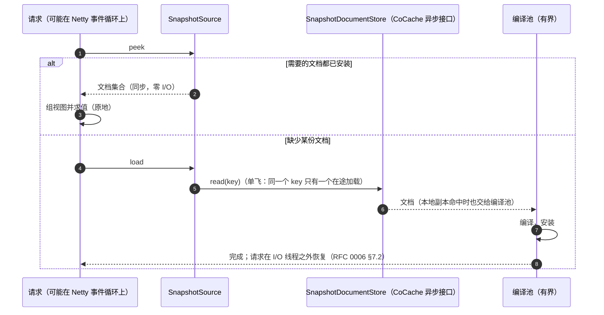

# RFC 0003：策略快照分发（RFC 0001 迁移第 3 阶段）

> 状态：已确认（第 2 版，§12 的决定已于 2026-10-21 由维护者确认）；已实现，形状由 [RFC 0004](0004-unified-model.md)（三种文档）、
> [RFC 0006](0006-coroutine-pipeline.md)（协程管道）、[RFC 0007](0007-control-plane.md)（控制面）与 [RFC 0008](0008-conformance-and-direct-build.md)（直接构建）定下 ·
> 上位文档：[RFC 0001](0001-target-architecture.md) §3.4、§6 第 3 阶段 ·
> 范围：`cosec-spi`（`spi/snapshot/`）、`cosec-runtime`（`runtime/snapshot/`）、`cosec-document`（`SnapshotDocuments`）、`cosec-cocache`（`cocache/snapshot/`）、`cosec-spring-boot`
>
> **2026-11-23 合订**：此前的修订说明与实现说明（2026-10-26 至 2026-11-22）已并入正文，被取代的说法已删去。本文原按第 3 阶段的过渡设计写成
> （共享的 `Policies` 文档加每个应用一份 `App` 文档、`SnapshotPolicySetLoader`、`SnapshotPublisher`、CoCache 6、`CompletableFuture` 接口），
> 正文现在陈述今天的实现；过渡设计中被后来的 RFC 改掉的部分，指向改动它的条目。章节号与 I1–I10、F1–F15、X1–X8、P5–P7、Q1–Q20、PR-1–PR-6 的编号不变；
> §3.1、§3.2、§3.5、§4、§4.6、§8 的标题本身是被取代的说法，已改写。合订前的全文见 git 历史：`git show 10567a41:docs/rfc/0003-policy-snapshot.md`。修订沿革见文末。

## 0. 结论先行

快照只做一件事：**授权读取的策略数据全部来自内存中不可变、带修订号的已编译文档，评估途中没有任何策略 I/O。**

```
请求 → SnapshotSource.peek（内存，同步，无 I/O）→ 一次评估的视图（平台 + 租户 + 应用）→ 引擎
         └ 缺文档：load（读存储不阻塞调用方，编译在有界编译池上，同一份文档的并发加载合并为一次）→ 同上
```

- **三种文档**（§3.2）：平台文档（每个请求都需要，启动时加载，不淘汰）、每个应用一份应用文档、每个租户一份租户文档（RFC 0004 §7.1，`schema: 2`）。
  一次评估读到的每份文档只来自一个修订（P7，`SNP-1`）；它读到哪几个修订就是 `ViewVersion(platform, app, tenant)`（RFC 0004 I4、I5）。
  第 3 阶段的过渡形状（共享的 `Policies` 文档加 `App` 文档）由第 4 阶段取代，加载、失效、陈旧度与冷加载这套机制原样留下（§3.7）。
- **两层**（§4.2）：SPI `SnapshotDocumentStore`（`cosec-spi`，8.0 中是 `@ExperimentalCoSecApi`）只读文档、报告变更；`SnapshotSource`（`cosec-runtime`）编译并持有。
- **存储**（§4.1）：Redis 是权威存储。文档放在一个 CoCache 8 的 `Store` 里（`PolicySnapshotCache`），一份文档一个 key，永不过期，读失败即抛出，
  谁创建它都一样（`SNP-3`）；Redis 必须用 `maxmemory-policy noeviction`。
- **陈旧度有上界，并且可以观测**（§4.5）：落后时长是距存储上次经条件读确认这份文档的时间；条件读只比较存储的摘要，未变时不传正文。
  周期性再验证关不掉（`SNP-6`）。落后 6 个再验证间隔记 WARN、30 个记 ERROR（`SNP-23`）；列在 `fail-closed.tenants` 里的租户，落后超过
  `fail-closed.max-lag` 时请求为 503，除非有 DENY 命中（`SNP-5`）。
- **失败即拒绝**（§4.4）：读不了、解码不了、编译不了的文档，让需要它的请求不确定（503）。唯一的放宽是 F6：重载读不到时继续用已安装的修订，由落后时长约束。
- **写入**（§4.6）：只经控制面（RFC 0007 §5）与 `cosec-migrate`，一次写一个 key，用 CoCache 的条件写入。
- **容量与参数是算出来的**：每个族驻留多少文档由文档的堆份额算出（§4.3，`SNP-24`）；冷加载等待、告警阈值、编译线程数由再验证间隔、管线超时与机器算出（`SNP-23`）。
- **热路径**（§5）：文档已安装时零 I/O、零调度器切换；冷加载在编译池上编译，请求在 I/O 线程之外恢复（RFC 0006 §7.2）。

---

## 1. 范围与非目标

### 1.1 本阶段要做的

本 RFC 规定下面这些，全部已实现：

1. 快照模型（§3）：`SnapshotKey`、`SnapshotDocument`、编译结果与文档状态、一次评估读到的文档集合、`ViewVersion`。
2. `SnapshotSource`（§4.2–§4.5）：持有编译后的文档，提供按需加载、单飞、有序安装、再验证、按族淘汰、落后时长、预热与就绪，以及失败即拒绝。
3. `SnapshotDocumentStore` SPI（§4.2）及其两个实现：基于 CoCache 8 的 `RedisSnapshotDocumentStore`（`cosec-cocache`），以及
   `InMemorySnapshotDocumentStore`（`cosec-spi`：测试、`cosec-testkit` 与手写的文档）。
4. 写入（§4.6）：一次写一个 key 的条件写入，取代 7.x 的 `PolicyRepository.setPolicy` 和对 `AppPermissionCache`/`RolePermissionCache` 的直接写入。
   第 3 阶段为此提供的 `SnapshotPublisher` 随切换删除，今天写文档的是控制面与 `cosec-migrate`。
5. 读取 7.x Redis 数据并转换成文档（§4.7）：今天在 `cosec-migrate` 里（`CoSec7xReader`）。
6. 删除每请求读仓库的路径：`RedisPolicyRepository`、`RedisAppRolePermissionRepository`、`CacheFutures.toLocalFirstMono`、四个策略/权限缓存及其 bean、
   `Overlay*Repository`（§5.2）。

第 3 阶段原计划的比较器、回放与规模测量工具（§8、§4.8），随 RFC 0008 取消门槛方法而删除（RFC 0008 §4.2）。
实现分六个 PR（§11）：PR-1 至 PR-4 已合入（PR-3 是 #1006，PR-4 是 #1030），PR-5（切换）取消，PR-6（删除）并入 RFC 0008 的切换 PR（RFC 0008 §4.4）。

### 1.2 非目标

第 3 阶段不做、留给后面阶段的事项，以及它们今天的样子：

| 内容 | 第 3 阶段的处理 | 后来 |
|---|---|---|
| 按租户分区、平台层与租户层、`Binding`、成员关系（RFC 0001 §3.2） | 不做。分区按 7.x 数据的形状（§3.2），形状为第 4 阶段预留（§3.7） | 第 4 阶段（RFC 0004）：平台、应用、租户三种文档 |
| 编译执行：AST、路由前缀树索引、`Engine.evaluate(request, snapshot)`（RFC 0001 §3.3） | 不做 | 第 4、5 阶段（RFC 0004、RFC 0005）：文档编译为 AST 与索引，引擎直接读视图 |
| 删除 `BlockingAware`（RFC 0001 §6 第 3 阶段原文） | 不做，只删除策略数据的调度器切换（§2 I2） | 第 5 阶段（RFC 0006）：外部属性改由 `AttributeProvider` 提供，`BlockingAware` 已删除 |
| 协程、`suspend` 的 `SnapshotSource`、`Flow`（RFC 0001 §3.4、§3.8） | 不做，接口返回 `CompletableFuture`（§2 I3） | 第 5 阶段（RFC 0006）：管道经 `SuspendingSnapshotSource` 挂起等待；SPI 仍返回 `CompletableFuture`（Q10） |
| 状态码 503（RFC 0001 §3.5） | 不做，快照不可用、陈旧超限都是 500（§2 I7） | 第 5 阶段（RFC 0006）：不确定一律 503，500 只留给未建模的异常（`PIP-2`） |
| 限流规则进快照（RFC 0001 P11、§3.5） | 不做（§2 I6） | 第 5 阶段（RFC 0006）：规则是文档的 `rateLimits` 一节，许可之后作为义务执行（Q17） |
| 编译失败时保留旧版本（RFC 0001 §3.4） | 不做，读到无法使用的文档时到达它的请求失败（§2 I5） | 仍不做：控制面在发布前编译，编译不过的不发布（RFC 0007 §3 M2）；数据面装上的修订编译不过即失败即拒绝（Q8） |
| 控制面：修订、回滚、发布前影子窗口、控制面自身的授权（RFC 0001 §3.7） | 不做，`SnapshotPublisher` 只覆盖 7.0 已有的写操作 | 第 6 阶段（RFC 0007） |
| 把快照版本写进审计事件（RFC 0001 §3.6 `DecisionEvent`） | 不改 `AuditEvent`，版本号经日志暴露 | 第 5 阶段（RFC 0006）：`DecisionEvent.snapshotVersion` 是 `ViewVersion`（Q20） |

第 3 阶段承诺**不改变任何授权决策**，可观察到的非决策差异列在 §7。决策后来由第 4 阶段改变（RFC 0004 §5、§13），这些差异的说法仍适用于从 7.x 升级。

---

## 2. RFC 0001 中与第 3 阶段有关的不一致

RFC 0001 是目标架构，对第 3 阶段的描述有几处彼此矛盾，或者与现有代码、CoCache 6.6 的实际 API 不符。本 RFC 不悄悄选边，逐条列出，
每条给出本阶段的处理，对应 §12 的一个决定。

| # | 合订前的 RFC 0001（`git show b164f273:docs/rfc/0001-target-architecture.md`） | 矛盾之处 | 本阶段的处理 |
|---|---|---|---|
| I1 | §3.4：快照按租户分区，`Cache<TenantId, SnapshotDocument>`，版本 `(platform, tenant)` | 现有数据没有租户维度（§3.1）：`PolicyCache` 按策略 id 存放，`GlobalPolicyIndexCache` 只有一个 key，`AppPermissionCache` 按 `appId` 存放。`Policy` 虽然实现了 `Tenant`，但 `SimpleAuthorization` 从不读 `tenantId`，全局策略对所有租户生效，主体可以引用任何租户的策略。按租户分区就是改变语义 | 按数据实际的形状分区（§3.2），形状与第 4 阶段同构（§3.7）。Q1 |
| I2 | §6 第 3 阶段："删除 `BlockingAware`" | `BlockingAware` 声明的是**匹配器**是否阻塞（`core/.../policy/BlockingAware.kt`），与策略数据从哪里来无关。快照只能消除"读数据"的切换，消除不了"执行阻塞匹配器"的切换。取代阻塞匹配器的 `AttributeProvider` 在 §6 第 5 阶段才有。本阶段删除它，含阻塞匹配器的策略就会在 Netty 事件循环上执行 | 本阶段只删除策略数据的切换（`toLocalFirstMono`）；`BlockingAware` 留到第 5 阶段。Q9 |
| I3 | §3.4：`suspend fun snapshot(tenant)`、`fun updates(): Flow<SnapshotChange>` | 协程是第 5 阶段（§6），第 3 阶段的 `SimpleAuthorization` 和 `SecurityPipeline` 仍是 Reactor | 本阶段的接口返回 `CompletableFuture`，变更通知用监听器；第 5 阶段加上挂起包装。Q10 |
| I4 | §3.4："CoSec 把 `localMaxAge` 设为快照最大落后时长"；§3.11：严格读失败模式；§7.1："默认只告警" | 如果编译后的快照常驻在 CoCache L2 里，`localMaxAge` 到期后 L2 就丢掉副本，下一次读取去 Redis。Redis 不可用时严格读抛错，每个请求都是 500，也就是默认 fail-closed，与 §7.1 矛盾。另外，`ttl = null` 时 CoCache 不做提前刷新：`AbstractEngine.localEntry` 只在 L1 有寿命时才计算 `refreshAt`，所以每个文档每过 `localMaxAge` 必有一个请求冷读 Redis | 编译后的快照由 `SnapshotSource` 持有，只会被更新的版本替换或被 LRU 淘汰，不随 L2 到期；版本由对 L1 的条件读确认（§4.5），`localMaxAge` 只约束冷加载和写入方经过的 L2。Q5、Q7 |
| I5 | §3.4："编译失败就保留旧版本并告警" | 本阶段不改变决策。7.0 读到无法解码的策略时，请求得到 500；保留旧版本意味着这些请求改为按旧内容决策，可能放行新内容本要拒绝的请求 | 本阶段保持 7.0 的行为（§4.4 F4、F5）；"保留旧版本"在第 6 阶段控制面发布前强制编译之后再引入。Q8 |
| I6 | P11、§3.5：限流规则"也是快照的一部分" | 本阶段的任务把限流排除在外；限流规则现在由 `RateLimitRuleProvider` 提供（静态列表），执行它们的义务在第 5 阶段 | 规则和计数器都不进本阶段的快照（§3.6）。Q17 |
| I7 | §3.4：超过上限时 fail-closed "该租户的请求返回 503" | 503 在第 5 阶段引入（RFC 0002 §3.5、Q3）。现在引入要连同 `SecurityStatus`、`WebAdapterParityTest`、`web.md` 一起改，属于状态码变更 | 本阶段映射为 500（`SecurityStatus.ERROR`），第 5 阶段统一改为 503。Q16 |
| I8 | §3.4：`SnapshotSource` 是"数据面唯一的策略存储 SPI"，未加载时"异步加载并编译" | 把编译放进 SPI，每个存储实现都要重复编译、版本比较、单飞和失效处理，而这些正是容易出错、需要统一测试的部分 | 拆成两层：SPI `SnapshotDocumentStore` 只读写文档、通知变更；`SnapshotSource` 是 `cosec-core` 的类，负责编译与持有（§4.2）。Q3 |
| I9 | §3.7：`PolicyStore` "乐观并发（CAS on version）"；§3.11："一次发布只写一个 key" | CoCache 6.6 没有条件写入（`Cache`/`AsyncCache` 只有无条件的 `put`，`RemoteStore.reclaim` 比较摘要但只转为 lease）。一个文档包含多条策略后，"读—改—写"会丢失并发更新，例如多个实例启动时 `LocalPolicyInitializer` 同时写入本地策略 | 在 CoCache 6.7 中增加条件写入与条件读（§4.5、§4.6）。Q5 |
| I10 | §6：第 2 阶段的门槛"之后每个改变语义的阶段都沿用" | RFC 0002 PR-6 删除比较器 `EngineParity`、回放工具和 `PolicyTestKit.parity`。第 3 阶段要证明等价，第 4 阶段要做影子门槛，都需要它们 | RFC 0002 PR-6 已随本 RFC 修订：把它们改名为通用的比较器和回放工具保留下来，而不是删除（§8.1）。Q12 |

表中“本阶段的处理”是第 3 阶段当时的决定；每一项后来的样子见 §1.2 与 §12 的对应决定。

另外，RFC 0001 §1.1 的 D4 一行写"读侧的混合版本要靠 3.4 节的快照解决"。本阶段兑现这一条：全局策略的内容与"哪些策略是全局的"放在
同一份文档里，一次读取得到的是同一个版本（§3.2）。

---

## 3. 快照模型

### 3.1 7.x：数据怎么存、怎么读

7.x 的布局如下（这些代码已删除；`cosec-migrate` 的 `CoSec7xReader` 仍按它读取 7.x 的数据，§4.7）：

| 缓存 | Redis key | 值 | 谁写 | 每个请求怎么读 |
|---|---|---|---|---|
| `PolicyCache` | `<p>:policy:<policyId>` | 一条策略 | `PolicyRepository.setPolicy` | 主体层：`getAll(principal.policies)`；全局层：`getAll(索引里的 id)` |
| `GlobalPolicyIndexCache`（`SetCache`） | `<p>:global:policy` | 全局策略的 id 集合 | `setPolicy`（元素级原子增删） | 全局层：先读索引，再读内容，只保留内容类型为 `GLOBAL` 的 |
| `AppPermissionCache` | `<p>:app:permission:<appId>` | 一个应用的应用权限 | 应用直接写这个 bean | 角色层：`get(request.appId)` |
| `RolePermissionCache` | `<p>:app:role:permission:<appId>:<roleId>[@<spaceId>]` | 一个角色在一个应用、一个空间的权限 id | 应用直接写这个 bean | 角色层：`getAll(作用域内的每个角色)` |

四个缓存都永不过期、读失败抛出、读不懂外来格式即失败。读取经 CoCache 的异步接口转成 `Mono`：L2 命中在调用方线程上完成，未命中则在
`boundedElastic` 上继续。可以看出三点：

1. **没有租户维度**（§2 I1）。
2. **D4 的读侧仍在**：全局索引和策略内容是两个 key，一次评估可能读到索引的新版本和内容的旧版本，或者反过来。#946 调整了写入顺序，保证
   写到一半失败时停在安全的一侧，但读侧的混合仍会产生"不可解释的决策"。
3. **读取粒度是请求驱动的**：主体层按主体引用的策略 id，角色层按 `(appId, spaceId, 角色)`。没有任何一处需要"枚举全部"，CoCache 也不提供枚举。

### 3.2 分区：平台文档、应用文档与租户文档

```kotlin
/** cosec-spi，spi/snapshot/SnapshotKey.kt */
sealed interface SnapshotKey {
    /** 平台的策略与绑定。每个请求都需要它：启动时加载，不被淘汰。 */
    data object Platform : SnapshotKey
    /** 一个应用的目录、权限策略与角色绑定。按需加载，按最近最少使用淘汰。 */
    data class App(val appId: String) : SnapshotKey
    /** 一个租户自己的策略与绑定。按需加载，按最近最少使用淘汰。 */
    data class Tenant(val tenantId: String) : SnapshotKey
}
```

应用 id 与租户 id 只接受能拥有文档的 id（`Identifiers.isDocumentOwner`：不空、不是 `*`、不含 `:` 与 `/`、有长度上限、不含控制字符与落单的代理项），
所以任何 id 都只能落到它自己的那个 Redis key。

一次评估需要的文档（RFC 0004 §7.4，`ViewDocuments`；执法、`simulate`、`explain` 与影子比较共用这一条规则，`CTL-3`）：

| 请求 | 需要的文档 |
|---|---|
| 被拉黑 | `Platform`：黑名单规则在其中做出决定 |
| 其余 | `Platform` + `Tenant(主体的租户)`，再加上 `App(作用域的应用)`：当作用域在该应用里有角色，或者租户文档把该应用的某条权限策略绑定给 `Anyone` 或某个主体时 |

**为什么这样分**：

- 每份文档有自己的修订号，分别读取、分别确认；应用文档与租户文档可以引用平台的策略，反过来不行。引用在每个请求上查找：平台文档可以单独变化，
  找不到被引用的策略时这个请求不确定（RFC 0004 §7.1、§7.4）。
- 全局层就是平台文档里的策略与 `Anyone` 绑定，不再有单独的索引，D4 在读写两侧都消失。
- 规模按分区控制：一份文档的上限与分片见 §4.8。

**被否决的方案**（Q1，第 3 阶段的分区）：

| 方案 | 否决理由 |
|---|---|
| A. 按租户分区（RFC 0001 原文） | 要改变语义：全局策略只对本租户生效、主体只能引用本租户的策略，属于第 4 阶段 |
| B. 不改存储，在数据面用现有的四个缓存拼出快照 | D4 的读侧仍在；数据里没有版本号，无法提供版本；角色授予无法按应用枚举，只能按请求读取，那仍是"缓存"而不是"快照" |
| C. 整个部署一份文档 | 角色授予按 `(app, role, space)` 计，空间可能很多，规模没有上限；任何一个应用的授予变化都要重写和重新编译全部数据 |
| D. 每条策略一份文档 | 全局层要么回到"索引 + 内容"两个 key（D4），要么全局策略的内容存两份，两份之间同样会混合版本 |

第 3 阶段因此先按 7.x 数据的形状分成共享的 `Policies` 文档与每个应用一份的 `App` 文档；第 4 阶段有了租户维度，换成今天的三种文档（RFC 0004 I4、I5）。

### 3.3 文档格式

文档是存进 Redis 的 JSON，格式由 RFC 0004 §7.1 定义（`schema: 2`，`PolicyDocumentCodec`；`schema/8.0/cosec-snapshot-document.schema.json` 由格式描述符生成）：

```jsonc
// SnapshotKey.Tenant("acme")
{
  "schema": 2,
  "revision": 42,                    // 每次发布同一个 key 加一，见 §4.6
  "publishedAt": "2026-10-21T08:00:00Z",
  "policies": [ ... ],               // RFC 0004 §7.1、RFC 0005
  "bindings": [ ... ],
  "rateLimits": [ ... ]              // 可选，RFC 0006
}
```

- **文档以正文为准**（`SNP-12`）。存储的字节就是整份文档，文档头（`schema`、`revision`、`publishedAt`）在正文里；`SnapshotDocument` 只能由
  `cosec-document` 的 `SnapshotDocuments` 造出：`read` 从字节里读出文档头，`of` 从它编码的文档里读。构造器是内部的，任何模块的主代码都不调用它，
  所以内存存储、应用自己的存储、测试工具与控制面的影子候选，都造不出“文档头说修订 8、正文是修订 7”的文档，实例上报的已安装修订就是它执行的内容的修订。
  影子候选的记录只存它的窗口、基础修订与文档本身；在文档旁边另写一份文档头的记录被当作读不懂的候选拒绝。
- `schema` 是文档格式的版本。不是这个版本的格式（`schema` 不同、未知字段、多出的操作符、类型不对的值）都解码失败，需要它的请求失败即拒绝（`DOC-3`，F3）。
- 文档没有自己的“属于谁”字段：所属由 key 决定，编译器按 key 编译（`SnapshotCompiler.compile(key, document)`）。应用的权限策略
  （`perm:<app>/…`）只能在这个应用的文档里，也只能由它绑定（`TNT-2`），所以把应用 A 的文档复制到 `app:B` 编译不过，B 的主体得不到 A 的授予。

### 3.4 编译后的快照与版本号

"编译"指：解析 JSON → 按 RFC 0004 §7、RFC 0005 §6 编译成引擎的 `CompiledDocument`（AST 与索引，`PolicyDocumentCompiler`）。每个修订只编译一次，
结果不可变，被所有请求共享，直到更新的修订取代它。

```kotlin
/** 一份文档在 SnapshotSource 中的状态（cosec-runtime，runtime/snapshot/DocumentState.kt）。 */
sealed interface DocumentState<out T : Any> {
    data class Present<out T : Any>(val compiled: T) : DocumentState<T>
    /** 存储里没有这份文档，并且本实例启动以来从未在这个 key 下见过文档。 */
    data object Absent : DocumentState<Nothing>
    /** 文档不能用。它供给的每一层都不可用，评估到达它即失败即拒绝。 */
    data class Failed(val error: Throwable) : DocumentState<Nothing>
}
```

- **版本号**是每份文档自己的单调递增整数，由写入方分配（§4.6）。一次评估读到的修订是 `ViewVersion(platform, app, tenant)`，写进
  `DecisionEvent.snapshotVersion`（Q20）。文档之间没有全局版本号：每份文档各自带修订读取，全局版本号不会带来额外的一致性。
- **一份文档整体编译，或者整体失败**（`PolicyDocumentCompiler`）：任何编译错误都让整份文档以 `Failed` 安装，需要它的每个请求失败即拒绝（`DOC-1`，F4）。
  第 3 阶段的编译器允许单条策略编译为 `Broken` 而其余照常（这是 7.0 的语义：一条读不出来的策略只让读到它的那一层失败），第 4 阶段的编译器不再这样：
  文档在发布前由控制面编译（RFC 0007 §3 M2），存储里出现编译不过的文档只可能是绕过控制面写入的，或由更新的版本写入。`SnapshotCompiler` 的契约仍允许实现
  把单个条目记为失败，CoSec 自己的编译器不用它。
- 存储里的文档在本实例上编译不过，有自己的原因（`SNP-11`）：需要它的请求不确定，判定事件里是 `Cause.DocumentInvalid(document, revision, error)`，
  不是表示“存储读不到”的 `SourceUnavailable`；给客户端的 503 与任何不可用相同，不带编译器的消息。实例按“修订、摘要、据以编译的输入”各记一次 ERROR，
  恢复编译时记一次 INFO，健康检查给出无效文档的个数与前十个。“输入变了、尚未重新编译”的过渡状态不算无效，仍是读不到；另一种 `schema` 的文档在读取时
  就被拒绝，也是读不到。

### 3.5 引擎怎么消费

`SnapshotSource` 交出一次评估读到的文档集合（`SnapshotSet`），`DocumentSnapshotViews` 把平台、租户与应用文档组成一个视图（`SnapshotView`），
引擎在视图上求值（RFC 0004 §7.4、RFC 0005 §6）。组视图的规则：

- 存储里没有的应用或租户文档，是它的所有者的一份空文档：还没有为它发布任何东西。
- 失败的文档（读不到、解码不了、编译不了、丢失）不确定：视图不带它，评估不确定，除非有 DENY 命中（RFC 0004 §7.4，`DOC-1`）。失败的平台文档当作一份空文档
  加上这个原因，所以黑名单规则仍能拒绝被拉黑的请求。
- 不能命名文档的租户 id 同样不确定，绝不落到另一个 key。
- starter 装配的视图要求平台文档：没有平台文档时请求不确定，而不是当作空文档。要么还没有发布过（`cosec-migrate publish` 写第一份），每个请求失败即拒绝直到发布；
  要么它丢了（例如被 Redis 淘汰），当作空文档会让每一条全局 DENY 静默失效（RFC 0008 §4.4）。
- 列在 `fail-closed.tenants` 里的租户，视图中最旧的文档超过 `fail-closed.max-lag` 未被确认时不确定（`SNP-5`，§4.5）。

第 3 阶段在这一层用的是 `SnapshotPolicySetLoader`：把快照里预先构造的规则组交给第 2 阶段的引擎，引擎签名不变（Q2），等价由性质测试 P5 保证（§8.4）。
它随切换删除（RFC 0008 §4.2），引擎直接读视图（RFC 0004）。

### 3.6 不进快照的数据

| 数据 | 为什么不进 | 今天 |
|---|---|---|
| 限流计数器 | 高频变化的运行时状态，不是策略 | 限流器自己的存储（`<p>:rate-limiter`）或本地限流器 |
| 限流规则 | RFC 0001 P11 把它算作快照数据（§2 I6） | 已进快照：文档的 `rateLimits` 一节（第 5 阶段，Q17） |
| 令牌吊销（`RevokedTokenCache` 与撤销主体缓存） | 高基数、随令牌过期；验证请求的令牌时读不到吊销表是文档化的例外（AGENTS.md "Fail closed"，`PIP-7`） | 不进 |
| 黑名单名单 | 高基数、变化快（RFC 0001 §3.2） | 不进：由阶段 A 的属性提供者判定，结果进 `environment.blocked`，平台文档里的内置 DENY 读它（RFC 0006 K17） |
| API Key | 认证数据，不是授权策略 | 不进 |
| 主体的成员关系 | 高基数（P11），来自令牌或 `MembershipProvider` | 不进 |
| 策略修订历史 | 控制面数据，不参与评估 | 控制面的修订记录（RFC 0007 §5） |

### 3.7 与第 4 阶段 `Binding` 的边界

第 4 阶段把 `principal.policies`、`RolePermission`、`GLOBAL` 统一为 `Binding`，按 `(tenant, app?, space?)` 划定作用域，并分出平台层与租户层。
第 3 阶段**不引入**这些语义，只保证第 4 阶段不必重做下面这些部分。第 4 阶段兑现了这一承诺（RFC 0004 §7.4）：

| 部分 | 第 3 阶段 | 第 4 阶段（今天） |
|---|---|---|
| `SnapshotKey` | `Policies`、`App(appId)` | `Platform`、`App(appId)`、`Tenant(tenantId)` |
| 一次评估读的文档 | 共享文档 + 按分区的文档 | 平台文档 + 租户文档 + 需要时的应用文档（§3.2） |
| 版本 | `SnapshotVersion(shared, scoped)` | `ViewVersion(platform, app, tenant)`（RFC 0004 I5） |
| 编译函数 | JSON → `PolicyData` → 适配规则组 | JSON → AST → 索引 |
| 引擎输入 | `PolicySet`（经 `SnapshotPolicySetLoader`） | 视图直接进入引擎 |
| `SnapshotSource`：单飞、有序安装、再验证、落后时长、按族淘汰、预热、就绪、指标 | 实现 | **原样复用**，后来改写了内部实现（§4.2） |
| `SnapshotDocumentStore`、CoCache 存储声明、失效监听、条件写入 | 实现 | **原样复用**，只换文档类型；CoCache 6 换成 CoCache 8（§4） |
| 7.x 数据读取器（§4.7） | 用于门槛、测量和开发环境 | `cosec-migrate` 的输入端 |

第 3 阶段刻意没有给文档加 `tenantId` 字段，也没有在 `SnapshotKey` 里预留租户，免得把"全局策略属于哪个租户"这类第 4 阶段的语义问题提前定下来。

---

## 4. 分发：CoCache 与 Redis

本节最初按 CoCache 6 写成；CoSec 自 #1203 起运行在 CoCache 8 上，今天是 8.2.0。下文陈述 CoCache 8 上的实现。

### 4.1 存储

文档存在一个 CoCache 8 的 `Store` 里（`PolicySnapshotCache`，`CoSecCacheSpecs.policySnapshot` 声明，`createPolicySnapshotCache` 创建），一份文档一个 Redis key：
`<p>:snapshot:platform`、`<p>:snapshot:app:<appId>`、`<p>:snapshot:tenant:<tenantId>`，`<p>` 是 `cosec.key-prefix`。

- **永不过期、读失败抛出，谁创建都一样**（`SNP-3`）。`createPolicySnapshotCache` 对任何声明都施加快照自己的 key 编码器与编解码器、去掉 key 过滤器与按条目的 TTL、
  把 `ttl` 固定为永不过期、把 `unknown-read` 固定为 `throw`；CoSec 的锁（`CoSecCacheSpecs.locks`）再把它们与存储布局、本地副本的最大年龄固定住，
  在 `cocache.caches.[name].unlock` 之后施加，所以应用的 `cocache.*` 属性与 customizer 改得了别的，改不了这些，"打破玻璃"也不能让策略过期，
  或让失败的读读成"不存在"。starter 装配的每个 CoSec 存储，customizer 都替换不了它的编解码器、加载器、key 过滤器与按条目的寿命。
- 它是 `CoCacheFactory.create` 返回的 `Store`，不是接口代理，native image 不需要代理 hint（§10）。
- **一个前缀**（`SNP-9`）：一个部署写进 Redis 的每个 key 都在它唯一的 `cosec.key-prefix` 之下：快照文档、控制面记录、候选、影子报告、吊销、成员关系、API Key、
  限流计数与社交登录的 OAuth state；前缀不同的两个部署共用一个 Redis 也不共享任何 key。它取代的三个旧前缀若仍在环境里，启动失败（作为 CoSec 不读的 key，
  没有属性关得掉这条检查），所以不会有吊销留在没人读的地方。
- **本地副本的最大年龄**由 starter 算出：三个再验证间隔（默认 30 秒；`cosec.authorization.snapshot.local-max-age` 已不是属性，设置它启动失败）。本地（L2）副本只服务冷加载，
  已安装的文档由条件读直接向 Redis 确认（§4.5）。
- **Redis 必须用 `maxmemory-policy noeviction`**。`allkeys-*` 会淘汰快照文档：读到过它的实例失败即拒绝（F2a），但之后启动的实例从没见过它，
  读到"不存在"就是 F2；平台文档没有了，每个请求失败即拒绝（§3.5）。启动时读 `maxmemory-policy`（`SNP-3`）：超时、断线或暂时性应答在 CoCache 自己的
  上限内重试（5 次，间隔从 0.5 秒倍增至 2 秒），被拒绝的 `INFO` 不重试；读到会淘汰的策略、或重试之后仍读不到，都不算安全，`eviction-check: fail`（默认）
  时启动失败，原因照实说（超时是超时，拒绝是权限）。启动之后每个再验证间隔在探针路径之外复查一次，它的重试就是下一个间隔，由单独的健康指示器
  `cosecSnapshotEviction` 报告：可能淘汰时 DOWN；`eviction-check: warn` 下读不到时 UP 并带 `eviction: unknown`。它是告警信号，不属于就绪组。
  CoCache 8 自己也有淘汰检查，两者并存。
- **只读的数据面**（`SNP-18`）：不运行控制面的进程只读快照文档与候选，Redis 用户只要对它们有读权限，Redis 拒绝它写；运行控制面的进程写它们。
  一个进程属于哪一种，只看控制面的装配条件（它的类在类路径上，且 `cosec.control.enabled` 不是 false）；改变它的 `cocache.*` 属性或 customizer 让存储创建失败。
- CoSec 可能注入的 Redis 模板必须从主节点读，否则启动失败并点名模板；CoCache 自己的客户端从主节点读。
- **读不懂的值失败即拒绝**：CoCache 读到它读不懂的值（例如 CoCache 6 写的）抛出：快照文档的请求 503，吊销该令牌或主体 503（绝不读成"没有吊销"）。
  从 CoCache 6 的 alpha 部署升级用 `8.0.0-alpha.4` 的 `cosec-migrate cocache8`；GA 的工具里没有这个命令，`publish` 遇到它没做完留下的
  `<prefix>:meta:cocache8` 标记时拒绝写入。

### 4.2 两层接口

```kotlin
/** cosec-spi：只读文档、报告变更。不编译，不缓存编译结果。@CoSecSpi，8.0 中是 @ExperimentalCoSecApi。 */
interface SnapshotDocumentStore {
    /** 冷加载用，可以经本地副本。以 Present(文档, 摘要) 或 Absent 完成，绝不以 Unchanged 完成。 */
    fun read(key: SnapshotKey): CompletableFuture<SnapshotRead>

    /** 条件读（必需，Q5）：绕过一切本地副本读权威存储；摘要等于 known 时以 Unchanged 完成，不传正文。 */
    fun readIfChanged(key: SnapshotKey, known: SnapshotDigest?): CompletableFuture<SnapshotRead>

    /** read 从本地副本回答时副本最老可能的年龄；总是读权威存储时为零。 */
    val localCopyMaxAge: Duration get() = Duration.ZERO

    /** 文档可能已变化时回调 onChanged；变更通知可能已丢失时回调 onReset。关闭返回值即取消订阅。 */
    fun subscribe(listener: SnapshotChangeListener): AutoCloseable
}
```

- 每个方法都不阻塞、不同步抛出，失败以异常完成 future。文档存在但无法解码时，异常的原因链里带 `SnapshotFormatException`：据此区分"读失败"（F1、F6）与
  "读到了但用不了"（F3、F5）。回调在变更可读之后送达，不在存储持有监听器可能需要的锁时送达。
- **实验性**：它的形状跟随唯一的后端（future、本地副本的年龄、条件读的摘要），8.1 可能加整库版本号与批量条件读（目标规模下逐键条件再验证的开销是
  已登记的 8.1 候选项），所以签名可能在次版本中变化。自己实现这个端口的应用要显式选择加入。

`SnapshotSource`（`cosec-runtime`，`@InternalCoSecApi`）持有编译后的文档：`peek` 只看内存、不做 I/O、命中时不分配；`load`/`loadAll` 加载缺少的文档；
`prewarm` 预热；`revalidate`、`recompile`、`reload` 是维护调用。管道经 `SuspendingSnapshotSource` 挂起等待它（RFC 0006 §5.3），
应用经 `Pipeline.builder` 给出一个 `SnapshotDocumentStore` 即可（AGENTS.md）。它的内部按 RFC 0013 §5.4 改写过（每个 key 一个所有者、单线程推进的状态机），
本节与 §4.3–§4.5 的保证不变。

与 RFC 0001 §3.4 的区别（§2 I3、I8）：编译和持有不在 SPI 里；SPI 返回 `CompletableFuture` 而不是 `suspend`；变更通知是监听器而不是 `Flow`。

**对下游的影响**（Q3）：7.x 的 SPI `PolicyRepository`、`AppRolePermissionRepository` 删除；自己实现仓库的应用改为实现这个 SPI（返回整份文档，而不是
按 id 或按角色查询）。这是 8.0 的破坏性变更，写在 `upgrading.md`。

### 4.3 按需加载与冷未命中



- **单飞**：每个 key 至多一个在途加载；并发的请求共享它，各自的等待可以单独取消，取消不影响加载（F14）。
- **编译不在事件循环上**：即使文档从本地副本同步拿到，编译也交给编译池（线程名 `cosec-snapshot-compile-*`）。编译线程每两个核一个，1 到 4 之间（`SNP-23`）；
  队列 64 个。冷加载遇到满队列时等待并再试，不立刻失败，加载开始后满冷加载期限才失败（`SNP-4`，F8）。
- **请求侧的等待上限**：冷加载等 `cosec.pipeline.timeout` 的 40 %（默认 2 秒，不低于一毫秒，`SNP-23`），所以绝不会等得和它所服务的请求一样久；
  期限从请求调用起算（`SNP-17`）。超时后这个请求得到失败的文档（503），加载在后台继续，下一个请求可能命中。
- **编译有它所属加载的期限**（`SNP-22`）：冷加载是冷加载期限，重载是存储读取期限，从加载开始算；到期未答的编译在下一个周期时刻使加载以失败结束
  （冷加载失败，重载保留已安装的，重编译失败即拒绝）。已结束的加载排着队的编译不再开始；超时后仍在运行的那个修订，在它运行期间不再编译第二遍。
- **冷加载读哪一层**：本实例从未见过的 key 用 `read`（可以经本地副本），装上之后立即补一次条件读，确认或替换它；本实例见过的 key（包括被淘汰过的）
  冷加载直接用条件读，所以一份更旧的本地副本不会替换本实例已经用过的修订。`confirmedAt` 取读取开始的时间；来自本地副本的安装按 `localCopyMaxAge`
  往前回拨，只有条件读成功才能让它显得新鲜。`RedisSnapshotDocumentStore.read` 从不用本地副本回答"不存在"：CoCache 在本地记下的"没有值"可能早于一次发布，
  所以本地的任何未命中都再用条件读向 Redis 确认；Redis 没有答案时读失败，绝不当作不存在。本地副本不带摘要，摘要在调用方线程之外算（SHA-256，与 CoCache 相同）。
- **存储读取的上界**：存储的 future 超过存储读取期限（30 秒）未完成即视为读取失败（F1、F6），一个永不完成的读不会卡住这个 key。在途的加载不计入族的上限，
  由这个期限约束。
- **按族淘汰**：应用与租户两个族各有自己的上限，按最近最少使用淘汰；平台文档常驻，不被淘汰。被淘汰的文档下次是冷加载。
  - **上限从堆算出**（`SNP-24`，`STA-12`）。文档的份额是堆的四分之一（`HeapBudget.documents`），一个进程里的快照源平分它（内嵌控制面时各得一半）。
    存储里没有的文档的条目得到其中固定的十六分之一，按每条 512 字节折成条数（租户族得大部分，应用族得其中的 1/256：应用 id 来自客户端，租户 id 来自凭据），
    所以客户端随口报的 id 挤不小真实文档的额度。其余归文档：每个族的上限是它已驻留的条数，加上两个族的驻留文档称重之后余下的字节除以该族的典型重量，
    下限 64，所以比整个份额还重的文档仍然被装载和使用。文档的重量从它的组成估算（绑定数、语句数、存储大小，`DocumentWeight`），从不低于实际保留的大小；
    典型重量是驻留文档的平均值，去掉超过中位数八倍的，所以一个很重的文档只占它自己的重量；族里还没有文档时，按典型文档估算（租户 34,554 字节，
    应用 318,812 字节，`DocumentBudget.TYPICAL`）。上限在每一轮再验证时重算，并在每一次淘汰之前重算，淘汰从不按过时的上限进行；`peek` 不碰其中任何一项。
    被删除的键 `cosec.authorization.snapshot.max-apps`、`max-tenants`、`max-absent-apps`、`max-absent-tenants` 让启动失败，并说明由什么取代；
    启动日志说出份额与按首次估算折成的上限，指标 `cosec.snapshot.bound` 跟着上限变化。
  - **不存在的文档不挤掉存在的**（`SNP-7`）：读到 `Absent` 的条目在每个族里另有上限，只互相淘汰。
  - **突发之下的封顶**（`SNP-14`）：淘汰在后勤线程上异步进行，所以上限在突发时是软的：每一类条目至多比上限多出"上限与 4,096 中较小的一个"，再加上那一刻
    正在安装或加载中的条目；超过时由安装的线程在回答之前就地淘汰至多 64 个，后勤线程淘汰其余。淘汰不会把一类淘汰到上限以下（RFC 0013 §5.4）。
- **预热与就绪**：启动时先加载平台文档，再预热 `cosec.authorization.snapshot.prewarm-apps`、`prewarm-tenants`，以及宿主点名的应用：它的
  `cosec.authorization.scope.app-id`，网关上每条路由的 `cosec-app-id`（`SNP-20`；`prewarm-host-apps=false` 时只预热 `prewarm-apps`）。
  宿主报告就绪之前，等平台文档与每份预热的文档得到存储的确定答复（一份文档或"没有"，绝不是读失败）；首次读取失败的，不需要请求，按退避（1 到 30 秒）
  自己重读，所以存储读不了时启动的实例在存储恢复后变为就绪（`SNP-21`）。一份配置的文档只有在它自己的预热完成之后才算已加载。就绪由 `DocumentReadiness`
  一处回答，starter 的就绪探针与健康指示器 `cosecSnapshot`（就绪之前为 DOWN，说明缺什么）、`Pipeline.awaitDocuments` 都问它（X6）。
  就绪只等每份预热的文档被装上一次：之后被淘汰不收回就绪，所以族的上限低于它预热的文档数的宿主仍然就绪，被淘汰的文档在下一次请求时重新加载（`SNP-24`）。
  预热失败不阻止启动，实例保持不就绪。

### 4.4 失效、重新校验与版本竞态

`SnapshotSource` 对每个已安装的 key 维护：编译结果（或 `Absent`/`Failed`）、修订号、摘要、`confirmedAt`（上次成功确认的时间）、是否有在途加载、
是否"脏"。重新加载的触发：

| 触发 | 来源 | 处理 |
|---|---|---|
| 变更通知 | `SnapshotChangeListener.onChanged`；Redis 实现订阅 CoCache 在快照键空间上的失效通道（Q6） | 标记脏，调度重新加载 |
| 通知可能丢失 | `onReset`（CoCache 在订阅重新建立后回调） | 所有已安装的 key 标记脏，按有界并发逐个重新加载（F10） |
| 周期性重新校验 | 每 `cosec.authorization.snapshot.revalidate-interval`（默认 10 秒）一轮 | 对每份已安装的文档发一次**条件读**（§4.5）：带上已安装修订的摘要直接问 Redis，未变时只回"未变"，不传正文 |
| 冷未命中 | §4.3 | 加载 |
| 平台文档的上限或外部属性变化 | 新的平台文档装上 | 每份已装的应用与租户文档以新的平台文档重新编译（重编译），在途的加载也包括在内；编译不过的失败即拒绝（`SNP-4`） |

**有序安装**（P6，`SNP-2`）：每个 key 同一时间至多一个在途加载，每次加载恰好结束一次；加载期间收到通知就标记脏，这次加载结束时在同一把锁下立即再加载一次。
所以同一个 key 的安装严格按开始顺序发生，晚开始的读取不会被早开始的读取覆盖。

**周期性重新校验关不掉**（`SNP-6`）。`revalidate-interval` 至少 1 秒、至多 5 分钟，有失败即拒绝的租户时还小于 `fail-closed.max-lag`，否则启动失败并点名属性；
告警阈值是 6 和 30 个间隔（`SNP-23`），所以间隔总在它们之下。下限 1 秒是因为每一轮都对每份已安装文档做一次条件读，更短的间隔只让 Redis 空转。
它是失效通知丢失（CoCache 的通道至多送达一次）或重新加载失败之后唯一的上界：

- **一次一轮。** 每个间隔开始一轮；上一轮还在进行时，在它结束后立即开始（多少个时刻都只欠一轮），调度线程不等待。一轮同时确认 16 份文档（`SNP-23`）。
- **一轮装上它开始之前写入的变更。** 在一轮开始之前写入存储、失效通知丢失或重载失败的变更，到这一轮处理完该文档时已装上，无论那时是否有在途的加载：
  一轮从不把它开始之前发出的存储读当作自己的确认。碰到在途加载时，只有那次加载在这一轮开始之后才开始，这一轮才加入它；否则等它之后的那次加载，那次加载的读
  就是这一轮的读（计入这一轮在途的读）。所以存储仍在应答时，落后时长低于间隔加一轮，一轮比间隔长时低于两轮。
- **停住的一轮。** 一轮在存储读取期限（30 秒）内没有完成任何文档、且没有读在途时，只可能是编译拖住了它：下一个时刻放弃它并开新的一轮，所以一个永不结束的编译
  不会拖住其他文档的重新校验。有读在途的一轮、仍在完成文档的一轮都不会被放弃；停滞按单调时间计；被放弃的一轮与取代它的一轮的读不会叠加。
- **超时的在途加载。** 一轮不等待已经在途超过存储读取期限的加载；如果那次加载在这一轮开始之前就已开始，仍欠一次加载，那次加载的编译一结束就开始，
  所以这一轮本该读到的变更在那时装上，而不是在后面的某一轮。

**维护调用的 future 说明什么**（`SNP-13`）：`revalidate()` 与 `recompile()` 返回的 future，对它所覆盖的每份文档，只在一次**调用之后才开始**的加载完成之后才完成。
`revalidate()` 覆盖调用时已安装的每份文档；`recompile()` 覆盖调用时空闲或正在加载的每份应用与租户文档。调用时已经在途的那次加载可能读在调用之前，
所以 future 以紧随其后的那一次为准，与 `onReset` 相同。这不影响安装什么、拒绝什么，只影响调用者能从“完成”里知道什么。

**修订号只是元数据，不做门卫**：Redis 是权威存储。读到的修订号比已安装的小（Redis 主从异步复制：主节点确认写入后、副本收到之前发生切换，
被提升的副本就丢了这次已确认的写），照样安装并告警（`cosec.snapshot.regressions`，F11），否则这个实例会永远与 Redis、与刚冷加载的其他实例不一致。
"未变"由摘要判定而不是修订号：摘要相同只刷新 `confirmedAt`，不重新编译；修订号相同而摘要不同（丢写之后修订号被重用）同样安装并按回退告警。
比较的基准是该 key 上次安装的修订，淘汰后仍保留。

**见过的文档不会变成"没有策略"**：没有任何操作删除快照文档，所以一个 key 一旦见过文档，之后读到 `Absent` 就是存储丢了数据：
安装 `Failed`（失败即拒绝，`cosec.snapshot.lost` 告警），直到文档重新出现；这条记忆在淘汰后仍保留，随实例的生命周期。从未见过的 key 读到 `Absent` 才是 F2。

**只解析文档头**：编解码器解码时只用流式解析读出 `schema`、`revision`、`publishedAt`，正文保留为字节，编译时才完整解析。条件读返回正文时（文档确实变了），
解析和编译只发生一次。

**监听器的顺序**：CoCache 按订阅顺序回调同一键空间的监听器；存储创建时先订阅，CoSec 的监听器后订阅，所以 CoSec 收到通知时，本地副本已经丢弃，
随后的读读到 Redis 的新值。这依赖 CoCache 的通道契约，由测试固定（F9）；即使顺序变了，最坏也只是等到下一轮再验证。

**失败时的状态**（Q8）：

| 情形 | 安装的状态 | 评估时 |
|---|---|---|
| F1 冷加载读取失败（Redis 不可用、读失败） | 不安装，这次加载的等待者得到失败；下一个请求重试 | 需要它的请求不确定 → 503，除非有 DENY 命中 |
| F2 文档不存在（本实例从未见过这个 key 的文档） | `Absent` | 应用或租户文档是它的所有者的空文档；平台文档在 starter 的装配下不确定（§3.5） |
| F2a 见过的文档变为不存在 | `Failed`，告警 | 同 F1 |
| F3 文档无法解码（外来格式、JSON 损坏、格式不对，`DOC-3`） | `Failed` | 同 F1 |
| F4 文档可解码，但编译失败 | `Failed`：整份文档（§3.4，`DOC-1`、`SNP-11`） | 同 F1，判定原因是 `DocumentInvalid` |
| F5 已安装修订 r，重新加载得到的 r+1 解码或编译失败，包括以 `VirtualMachineError`（如 `StackOverflowError`）结束的编译 | 安装 `Failed`，**不保留 r**（`SNP-8`） | 同 F1 |
| F6 重新加载时读取失败（Redis 暂时不可用） | **保留已安装的 r**，`confirmedAt` 不前进 | 照常用 r；落后时长增长，按 §4.5 告警或对列出的租户失败即拒绝 |

F5 与 F6 的区别是有意的：F6 是"不知道有没有新版本"，旧修订仍是一份已发布的一致状态（RFC 0001 §7.1 的理由），由落后时长约束；F5 是"知道有新版本，
但它无法使用"，失败即拒绝。F6 相对 7.0 的差异见 §7 X1。

### 4.5 陈旧时间有上界

**定义**：一份已安装文档的**落后时长** `lag = now - confirmedAt`，`confirmedAt` 是最近一次对 Redis 的条件读返回"未变"（或者返回了新修订并安装成功）的时间。
一次评估的落后时长取它读到的文档中最大的一个。

**条件读（必需，Q5）**：CoCache 8 的 `getIfChanged(key, digest)` 总是读 Redis（绕过本地副本），在同一个 Lua 脚本里比较存储的摘要，未变时只回"未变"
（不传正文），变了才返回整份值，不存在时回"不存在"。CoCache 8 把摘要存在值的头部，所以条件读不必对整份值重新计算：每次约 7–13 µs 的 Redis 时间，
与文档大小无关（[`docs/perf/conditional-read/`](../perf/conditional-read/README.md)；CoCache 6 在 4 MiB 时约 11.7 ms）。摘要是 SHA-256（`SnapshotDigest`，带算法名），
持久化处写作 `SHA-256:<64 位十六进制>`。

**上界**：因为重新校验直接问 Redis，`lag` 就是文档相对 Redis 的陈旧度上界，不叠加本地副本的年龄。Redis 应答时，`lag` 低于再验证间隔加一轮
（一轮比间隔长时低于两轮，§4.4）；通知正常送达时通常是毫秒级（通知直接触发重新加载）。

**带宽由变更决定，而不是由实例数决定**：常量部分只是每个实例每份文档每个间隔一次几十字节的往返；传输正文的次数 = 发生变更的文档数 × 实例数，
与文档大小和本地副本的年龄无关。Redis 被再验证占用的时间约为 实例数 × 每实例持有的文档数 × 一次条件读 ÷ 间隔（`storage.md`）。

**超过阈值时**（RFC 0001 §7.1 的决定）：

| 阈值 | 值 | 行为 |
|---|---|---|
| WARN | 6 个再验证间隔（默认 60 秒，`SNP-23`） | WARN 日志（每份文档每分钟至多一条），`cosec.snapshot.lag.exceeded` 指标 |
| ERROR | 30 个再验证间隔（默认 5 分钟，`SNP-23`） | ERROR 日志，报告为陈旧（不改变就绪状态） |
| `cosec.authorization.snapshot.fail-closed.max-lag` | 30 分钟，只对 `fail-closed.tenants` 列出的租户生效 | 这些租户的请求，若视图中最旧的文档超过上限未被确认，不确定（503），除非有 DENY 命中（`SNP-5`） |

`fail-closed.tenants` 接受 `*`，指每个租户；默认为空。这是"失败即拒绝"的一个写明的例外：已安装的文档在重载失败期间继续用于判定，只有列在这里的租户
受上限约束。默认为空是协调者定的取舍（可用性优先；租户多到无法逐个列出的宿主写 `*`），登记在路线图 §6，维护者可以推翻。

**可观测性**：Micrometer 指标（名称、标签与告警以 [`observability.md`](../../wiki/operations/observability.md#snapshot-metrics) 为准；标签只取封闭的取值集合，
从不带应用或租户 id，`OBS-5`）：`cosec.snapshot.loads`（冷加载、失败、超时；命中不计数，它是每个请求都走的路径）、`cosec.snapshot.compile.duration`、
`cosec.snapshot.installs`、`cosec.snapshot.installed`（按状态，各状态之和等于实例持有的条目）、`cosec.snapshot.lag`、`cosec.snapshot.lagging`、
`cosec.snapshot.summary.age`、`cosec.snapshot.lag.exceeded`、`cosec.snapshot.regressions`、`cosec.snapshot.lost`、`cosec.snapshot.evictions`、
`cosec.snapshot.bound`、`cosec.snapshot.handoffs.refused`、`cosec.snapshot.housekeeping.refused`；指标抛错从不让加载失败。健康指示器 `cosecSnapshot`
说出缺什么与无效的文档（§3.4、§4.3）。

### 4.6 写入：条件写入

写快照文档的只有控制面（RFC 0007 §5：`ControlStore` 的 Redis 实现 `CoCacheControlStore`）与 `cosec-migrate`（`publish` 与 `bootstrap`，经同一个
`ControlStore` 写第一批修订）。第 3 阶段的 `SnapshotPublisher`（`setPolicy`、`setAppPermission`、`setRoleGrants`）只覆盖 7.0 已有的写操作（Q4），
随切换删除。每次写入都是对**一个** key 的条件写入：

**并发**（§2 I9）：两个写入方同时"读—改—写"同一份文档会丢失一次更新，而 CoCache 6.6 只有无条件的 `put`。所以在 CoCache 中增加了按摘要比较的条件写入
（`putIfMatch`，一个 Lua 脚本：比较当前值的摘要再写入并广播失效；`expected = null` 表示"仅当不存在"）与条件读（Q5，方案 A）。被否决的是在 CoSec 侧
加锁（方案 B：锁过期与慢写入之间仍有窗口，需要 fencing token，事后难以审查正确性）与不处理（方案 C：丢更新）。

**冲突与结果未知**：文档头只在它被读到时的摘要上写，从不把冲突时存储返回的当前值当作下一次的期望值（它可能是一份本实例读不懂的值，拿它的摘要直接写，
就会覆盖一份谁都没读过的文档）。控制面的发布遇到冲突时不写，变更转为 `CONFLICTED`，在新的基础上重新提出（RFC 0007 §5）；`cosec-migrate publish` 只在文档
不存在时写。写入超时等结果未知的失败不重写：`putIfMatch` 不是幂等的，用自己那份值的摘要读回，`Unchanged` 即已写入。

**主从切换丢失已确认的写入**：写入方**不**等副本（RFC 0007 Q27）。理由：

1. `WAIT` 只缩小、不消除这个窗口：它确认的是"副本收到了"，切换时 Sentinel/Cluster 不保证提升的正是收到的那个副本，Redis 文档也说明 `WAIT`
   不让 Redis 成为强一致存储；
2. 丢写之后的状态能被发现，并且失败方向安全：`SnapshotSource` 把更小的修订号、或者修订号相同而摘要不同当作回退照常安装并告警（F11），所有实例与 Redis 一致；
   控制面的修订链看到断链；下一次发布在 Redis 现有的内容上进行，不会恢复已丢的修改，也不会把它与新修改混在一起；
3. CoCache 的 API 不暴露 `WAIT`。

需要更强保证的部署应当让 Redis 自己保证（`min-replicas-to-write` 等），写在 `storage.md`。

**写入后的可见性**：条件写入成功即 Redis 已更新、失效已广播；写入方所在实例立即标记该 key 为脏（`RedisSnapshotDocumentStore.notifyChanged`，不依赖广播回到自己），
所以本实例后续的请求看到新版本（读己之写）；其他实例在通知送达后看到，最迟 `lag` 上界。

### 4.7 从现有 Redis 数据构建快照；7.0 数据怎么办

**读取器**（`CoSec7xReader`，今天在 `cosec-migrate` 里）读取 7.x 布局的全部策略数据，作为 `cosec-migrate convert` 的输入端（RFC 0004 §8）：

1. 用 `SCAN` 枚举 `<p>:policy:*`（排除 `<p>:policy:history:*`）、`<p>:app:permission:*`、`<p>:app:role:permission:*`，读出 7.x 的原始数据，
   连同全局索引与输入的 SHA-256。
2. 把这些数据组成平台、应用与租户文档是 `convert` 的事（RFC 0004 §8）。7.0 中会让请求失败或被忽略的数据，转换时**报告并拒绝**，由运维先修正，
   不由工具替运维决定，例如索引中有 id 却没有内容（7.0 每个请求都是 500，`GLOBAL_INDEX_WITHOUT_CONTENT`）；拒绝项写在 `upgrading.md`。

**为什么第 3 阶段不提供面向用户的迁移**（Q11）：8.0 在第 2–6 阶段完成前不发布任何版本，用户从 7.x 直接升到 8.0；第 4 阶段又要把数据转换成
`Binding` 和按租户的文档。如果第 3 阶段也给用户一个迁移，用户的数据要么迁移两次，要么第 3 阶段的迁移从未被任何用户用过。所以面向用户的
7.x → 8.0 迁移是第 4 阶段的 `cosec-migrate`，读取端就是这个读取器；第 3 阶段的 `snapshotConvert` 任务随切换删除。

**没有转换的部署**：8.0 不读 7.x 的 key。没有平台文档时每个请求失败即拒绝，实例也不就绪（§3.5、§4.3），而不是读成"没有任何全局策略"让全局 DENY 静默失效。
第 3 阶段为此设计的 Redis 布局标记（`"8"`）随切换删除：文档自带 `schema`（`DOC-3`），缺少平台文档本身就是失败即拒绝。

### 4.8 规模与 CoCache 适配性：需要测量什么（RFC 0001 §7.2）

RFC 0001 §7.2 留下两个问题：快照的规模上限，以及快照文档放进 CoCache 是否合适。第 3 阶段计划用真实部署的数据测量（`snapshotMeasure` 任务）；
真实数据没有拿到，这个任务随 RFC 0008 取消门槛方法而删除，上限改用合成数据在边界上验证。今天的上限：

| 维度 | 上限 | 依据 |
|---|---|---|
| 一份文档的大小 | 8 MB（编码后的字节） | Q14；控制面拒绝更大的文档（`ChangeOptions`） |
| 编译耗时 | p99 ≤ 200 ms | Q14；控制面的严格编译由 `ControlPlaneBenchmark` 记录（一份约 1 MB 的租户文档） |
| 一份文档的主体绑定 | 1,000 | RFC 0004 Q2（`PolicyDocumentCompiler.DEFAULT_PRINCIPAL_BINDING_LIMIT`） |
| 角色展开出的派生绑定 | 50,000 | RFC 0012 §6.3 |
| 一份文档的条目 | 条目预算 | `CTL-40` |
| 每个实例驻留多少文档 | 从堆算出 | §4.3（`SNP-24`） |

**条件读的 Redis 成本**：CoCache 6 的条件读在 Lua 里对整份值重新计算摘要，Redis 线程时间与文档大小成正比（8 MB 约 20 ms），所以当时要求按
Σ 文档大小 × 实例数 ÷ 间隔估算 Redis 被占用的比例。CoCache 8 把摘要存在值里，这个比例与文档大小无关（§4.5），公式与缓解办法（在 `SNP-6` 的范围内
调大间隔）写在 `storage.md`。

**超过上限时的分片**（Q14）：等真实部署碰到上限再做，是 8.1 的工作（路线图 §7"大文档"：租户文档按空间或应用拆分等）；分片只影响 `SnapshotKey` 与组视图的规则，
`SnapshotSource` 不变。

---

## 5. 热路径

### 5.1 流程

第 2 阶段结束时（RFC 0002 PR-6 之后）`SimpleAuthorization.decide` 是"黑名单 → `AuthzRequest` → 读三个仓库（`Mono.zip`）→ 引擎"。本阶段改为：

```
decide(request, context):
    blocked  = !blacklistChecker.check(request, context)                  // Mono，不变，最先执行
    authz    = AuthzRequests.of(request, context, blocked, rootPrincipalMatcher)
    if !engine.requiresPolicies(authz): return evaluate(authz, PolicySet.NOT_LOADED)
    snapshot = snapshotSource.peek(authz, facts)                          // 内存，同步
    if snapshot != null:
        return evaluateOn(snapshot)                                       // 热路径：不经过任何 future
    return Mono.fromFuture(snapshotSource.load(authz, facts))             // 冷路径（§4.3）
               .timeout(coldLoadTimeout)
               .publishOn(boundedElastic)
               .flatMap(::evaluateOn)

evaluateOn(snapshot):
    failClosedCheck(snapshot, context.tenant)                             // §4.5，超限 → SnapshotStaleException
    policies = SnapshotPolicySetLoader.load(authz, facts, snapshot)
    if policies 中任一组 requiresBlocking: 在 boundedElastic 上 engine.evaluate   // BlockingAware 保留（§5.2）
    else: 原地 engine.evaluate
```

### 5.2 删掉什么，保留什么

| 现有 | 处理 | 理由 |
|---|---|---|
| `CacheFutures.toLocalFirstMono`（未命中时切到 `boundedElastic`） | 删除（PR-6） | 策略数据不再按请求从 CoCache 读取 |
| `RedisPolicyRepository`、`RedisAppRolePermissionRepository` | 删除（PR-6） | 被 `RedisSnapshotDocumentStore` 取代 |
| `PolicyCache`、`GlobalPolicyIndexCache`、`AppPermissionCache`、`RolePermissionCache` 及其 bean、`CoSecPolicyCacheAutoConfiguration`/`CoSecPermissionCacheAutoConfiguration` 中对应部分 | 删除（PR-6）；7.x 读取器在测试源码集中自带这四个缓存的声明 | 数据面不再读它们 |
| `PolicyRepository`、`AppRolePermissionRepository`（SPI） | 删除（PR-6，Q3） | 被 `SnapshotDocumentStore` + `SnapshotPublisher` 取代 |
| `OverlayPolicyRepository`、`OverlayAppRolePermissionRepository` | 删除（PR-5），影子改为快照叠加：`PolicySnapshot.overlay(candidates)` 在候选集变化时编译一次（RFC 0001 §3.6，RFC 0002 §5.3 把它们留到本阶段） | 仓库从数据面消失 |
| `BlockingAware`、`requiresBlocking`、`SimpleAuthorization` 中按它切换 `boundedElastic` | **保留**（Q9） | 它管的是阻塞匹配器（§2 I2）；第 5 阶段 `AttributeProvider` 落地后删除 |
| `RedisRateLimiter` 的 `subscribeOn(boundedElastic)` | 保留 | 限流不是策略数据（§3.6） |
| `SecurityContextParseSchedulers`（吊销检查、API Key 存储） | 保留 | 认证数据，第 5 阶段 `Authenticator` 挂起化时处理 |

### 5.3 线程模型

| 路径 | 在哪个线程上 | 是否切换 |
|---|---|---|
| 快照已加载、无阻塞匹配器 | 调用方线程（WebFlux/Gateway 是 Netty 事件循环） | 否。与 7.0 的"L2 全部命中"相同，但不再经过 `CompletableFuture` 和 `Mono.fromFuture` |
| 快照已加载、有阻塞匹配器 | 整次评估在 `boundedElastic` | 是，与第 2 阶段相同（RFC 0002 X2） |
| 冷未命中 | 读取：CoCache 异步执行器；编译：编译线程池；继续：`boundedElastic` | 是，只此一次 |
| 重新加载、重新校验、`onReset` | 编译线程池与一个调度线程，不在任何请求线程上 | 不影响请求 |

冷未命中在调用方线程上做的唯一一件可能等待的事，是给这次加载挂上超时（`cold-load-timeout`、`store-read-timeout`）：向调度线程的
`ScheduledThreadPoolExecutor` 提交一个延时任务，会取得它的延时队列（`DelayedWorkQueue`）的锁，做一次堆插入。这把锁只在插入期间持有，
从不跨越 I/O；把挂超时交给调度线程去做也一样要向一个同类的队列提交任务，JDK 里没有不取锁的延时调度，Reactor 自己在事件循环上的定时器
也是如此。所以这是有界的短暂等待，不是阻塞调用：`SnapshotStoreBlockHoundTest` 只对 `DelayedWorkQueue.offer` 这一个方法放行（以及测试日志
配置本身的 appender 锁），其余任何等待都算失败。没有这条放行时，该测试只在这把锁恰好被争用时失败，是不确定的，而不是发现了问题。

---

## 6. 不变量

AGENTS.md 的每条不变量在本阶段如何成立，新的失败模式各由哪个测试守护：

| 不变量 | 本阶段如何成立 | 守护 |
|---|---|---|
| **Deny-first** | 组合算法不变（引擎不改）；快照加载器产生的 `PolicySet` 与仓库加载器结构相同，所以每一条 DENY 都在原来的位置 | `SimpleAuthorizationTest`（参数化：仓库来源 / 快照来源）；性质测试 P1（引擎，不变）、P5（§8.4） |
| **Fail closed** | 读取失败、解码失败、编译失败、冷加载超时、编译队列满都变成它所供给的层的 `Unavailable`，或者在评估前抛出，最终 500；唯一的放宽是 F6（旧快照在落后上界内继续使用），这是 RFC 0001 §7.1 已确认的决定，并且可以按租户 fail-closed | 下表 F1–F13 |
| **One decision path** | 新的异常（`SnapshotUnavailableException`、`SnapshotStaleException`）只在 `SimpleAuthorization` 内产生，由 `SecurityPipeline` 现有的错误映射变成 500；不新增状态码 | `WebAdapterParityTest` 增加"快照不可用"和"快照陈旧超限"两例，三个适配器状态码一致 |
| **No blocking on the event loop** | 热路径不经过任何 future；冷路径的编译在编译线程池，后续在 `boundedElastic`；`BlockingAware` 保留 | `SnapshotHotPathTest`（快照已加载时，在一个 `NonBlocking` 线程上调用，断言在同一线程上完成，并且对文档存储零调用）；`SnapshotColdMissOffEventLoopTest`（冷未命中时编译不在调用线程上，BlockHound 在测试中检测阻塞调用）；`LocalCacheFastPathTest` 随 `toLocalFirstMono` 删除 |
| **Authorization is a pure decision** | 不变：快照是不可变数据，加载器是同步纯函数 | 审查；ArchUnit 规则不变 |
| **策略/权限缓存 `ttl = null`、`ReadFailureMode.THROW`（及 `ForeignFormatMode.FAIL`）** | 适用对象从四个缓存换成 `PolicySnapshotCache`，仍在 customizer 和属性之后施加。另加一条：`SnapshotSource` 中的编译结果不按时间过期，只会被同一个 key 的更新安装替换，或被 LRU 淘汰；淘汰后的下一次读取是严格读，所以"过期丢策略"仍不可能 | `CacheTtlPolicyTest`、`StrictCacheFailureTest` 改为针对新缓存；`SnapshotNeverExpiresTest`（推进时钟远超 `localMaxAge`，Redis 不可用，已安装的文档仍在且 `lag` 增长） |
| **Hot-path changes come with a JMH before/after** | §9 | `SimpleAuthorizationBenchmark`、新增的 `SnapshotAuthorizationBenchmark` |

**关于 BlockHound**：PR-1 没有引入 BlockHound。理由：它要新增测试依赖，并且在 JDK 17+ 上需要 `-XX:+AllowRedefinitionToAddDeleteMethods`；而 PR-1 的
存储是内存实现和测试替身，从不调用阻塞的 JDK 方法，BlockHound 在这里检测不到任何东西。"不阻塞事件循环"由结构性的测试守护：热路径测试在
`NonBlocking` 线程上调用 `peek`，断言它的工作（含指标回调）都在调用线程上完成，且对存储、编译线程池和调度器零调用；冷未命中测试断言编译只在
`cosec-snapshot-compile-*` 线程上发生。会真正阻塞的是 PR-3 的 Redis 存储，BlockHound（或 `RedisRateLimitingOffEventLoopTest` 式的线程断言）在那里引入。

PR-3 引入了 BlockHound（`io.projectreactor.tools:blockhound`，`cosec-cocache` 的测试依赖，测试 JVM 加 `-XX:+AllowRedefinitionToAddDeleteMethods`）。
`SnapshotStoreBlockHoundTest` 只监视名字带固定前缀的测试线程（不加载 Reactor 的集成，所以同一个 JVM 里的其它测试不受影响），在这些线程上对真实 Redis
调用存储的全部入口、发布者的全部写操作，以及 `SnapshotSource` 经存储的冷加载，断言没有任何阻塞调用；另一例确认监视确实生效。豁免恰好两处，各自只放行
一个方法：

- logback 控制台 appender 的锁（`OutputStreamAppender.writeBytes`）：测试 JVM 用根构建指定的 `config/logback.xml`，根日志级别 TRACE、输出到控制台。
  Lettuce 在**发出命令的线程**上记录这条命令（`DefaultEndpoint.write`），所以被监视的调用方线程会在这里等这把锁。这是测试的日志配置，不是被测代码；
- 调度线程延时队列的锁（`ScheduledThreadPoolExecutor$DelayedWorkQueue.offer`）：冷加载在调用方线程上挂超时，一次堆插入的有界等待，理由见 §5.3。

与豁免无关的两点：L2 命中时的摘要在 `digestExecutor` 上计算，不在调用方线程上（`RedisSnapshotDocumentStoreTest` 固定），因为它与文档大小成正比；
发布者的修改、序列化和它自己的日志都在它的调度线程上，不在调用方线程上（`RedisSnapshotPublisherTest` 固定）。

**新的失败模式**（编号接 §4.4）：

| # | 失败模式 | 结果 | 守护（真实实现，不用 mock：CoCache 内存后端与真实 Redis） |
|---|---|---|---|
| F1–F6 | 见 §4.4 | — | `SnapshotSourceFailureTest`（CoCache 内存后端，可注入故障的 `RemoteStore`）逐条覆盖 |
| F7 | 冷加载超过 `cold-load-timeout` | 这个请求 500，加载在后台继续 | `SnapshotColdLoadTimeoutTest` |
| F8 | 编译队列满 | 冷路径请求 500；已安装的文档不受影响 | `SnapshotCompileRejectedTest` |
| F9 | 变更通知丢失、乱序，或 CoSec 的监听器先于 CoCache 引擎被回调 | 最迟一个 `revalidate-interval` 之后安装新版本 | `SnapshotInvalidationOrderTest`（固定监听器顺序；另一例打乱顺序，断言重新校验仍能收敛） |
| F10 | 订阅重置（`onReset`） | 全部已安装的 key 重新加载 | `SnapshotResetTest` |
| F11 | 修订号回退（Redis 丢写） | 安装回退的版本并告警 | `SnapshotRegressionTest` |
| F12 | 两个写入方并发修改同一文档 | 后者冲突、重读重试，两次修改都保留 | `SnapshotPublisherConcurrencyTest`（真实 Redis，N 个线程并发 `setPolicy` 不同策略，最终文档包含全部） |
| F13 | 未转换的 7.x 数据（没有 `"8"` 标记） | 启动失败 | `CoSecSchemaMarkerTest` 增加 7 → 8 的用例 |
| F14 | 请求在冷加载期间被取消 | 请求不产生决策；共享的加载继续 | `SnapshotCancellationTest` |
| F15 | 落后时长超过租户的 `fail-closed.max-lag` | 该租户的请求 500，其他租户不受影响 | `SnapshotFailClosedTest`（手动时钟） |

---

## 7. 已知差异

逐层对照（§3.5）和 P5 保证**决策**不变。下面是决策之外、可以观察到的差异。它们在 PR-5 之前不会出现在 `main` 的执法路径上，
PR-5 起成为唯一的行为，用户在 8.0.0 GA 中第一次看到：

| # | 差异 | 谁能观察到 | 处理 |
|---|---|---|---|
| X1 | **Redis 不可用时的行为**：7.0 在 L2 副本到期（默认 5 分钟）后，读到该数据的请求开始 500；本阶段已安装的快照继续使用（F6），落后时长增长并告警，只有开启 `fail-closed` 的租户在上限后 500 | 运维、依赖"Redis 故障即拒绝"的部署 | 接受：这是 RFC 0001 §7.1 已确认的决定。需要旧行为的部署对全部租户开启 `fail-closed`，并把上限设为 5 分钟。写进 `upgrading.md` 和 `storage.md` |
| X2 | **I/O 形态**：7.0 每个请求在 L2 未命中时读 Redis，L2 每 `localMaxAge` 重新传输整份值；本阶段每个实例每个已加载文档每 `revalidate-interval` 一次条件读（未变时不传正文），只有文档变更时才传输整份文档 | Redis 读次数（更多但更小）、Redis 带宽（由变更决定） | 接受；往返开销用 §4.8 测量 |
| X3 | **全局策略的顺序**：7.0 全局层按 `GlobalPolicyIndexCache` 返回的集合顺序（Redis 集合的迭代顺序，没有约定）；本阶段按文档顺序，即按 `policyId` 排序 | 多条全局语句同时命中、效果相同时，**哪一条**被记为做出决策的语句（`VerifyContext`、审计的 `source`），决策本身不变 | 接受：7.0 的顺序本来就没有定义，可能因实例而异。门槛中两边读同一份导出数据，按同一顺序装载（§8.2），不受影响。写进 `upgrading.md` |
| X4 | **错误的异常类型**：读取失败时，7.0 由仓库抛出 `CacheReadException` 等；本阶段抛出 `SnapshotUnavailableException`（原异常作为 `cause`） | 按异常类型判断的自定义错误处理、日志告警规则 | 接受，状态码不变（500）。写进 `upgrading.md` 和 `troubleshooting.md` |
| X5 | **D4 的情形不再出现**：7.0 中"索引里有 id 却没有内容"让每个请求 500（`MissingPolicyException`，`source = GLOBAL_POLICY_INDEX`）；文档里没有单独的索引，这种状态不可能存在 | 依赖这个异常的告警 | 接受；转换时拒绝这种数据（§4.7） |
| X6 | **冷启动**：7.0 启动后第一个请求读 Redis；本阶段启动时预热，预热完成前实例不就绪 | 部署编排、启动时长 | 接受，写进 `deployment.md` |
| X7 | **写 API**：`PolicyRepository.setPolicy` 和对 `AppPermissionCache`/`RolePermissionCache` bean 的写入被 `SnapshotPublisher` 取代 | 写策略、写角色授予的应用代码 | 破坏性变更（Q3、Q4），写进 `upgrading.md` |
| X8 | **新应用的第一个请求**：7.0 在 L2 未命中时异步读 Redis（毫秒级）；本阶段还要编译整个应用文档 | 冷应用的首个请求延迟 | 接受，用 §4.8 的编译耗时校准 `cold-load-timeout` 和预热列表 |

---

## 8. 门槛与等价

> **2026-10-26：本节整体由 [RFC 0008](0008-conformance-and-direct-build.md) 取代。** P6、P7 作为规范性质保留（RFC 0008 §3.5）；P5 与比较、回放一并取消。以下原文保留，仅供追溯。

### 8.1 要证明什么，用什么比较

本阶段**不改变任何决策**。要证明的是：对同一份数据和同一个请求，"第 2 阶段结束时的实现"（引擎 + 仓库加载器，下称**基准**）与"本阶段的实现"
（引擎 + 快照加载器，下称**候选**）给出相同的结果。

比较器沿用 RFC 0002 §8.1 的 `EngineParity` 和 §8.3 的元组（状态、`AuthorizeResult.reason`、做出决策的规则、出错时的异常类名）。问题是 RFC 0002 PR-6
原计划删除 `EngineParity`、回放工具和 `PolicyTestKit.parity`（§2 I10）。已决定（Q12）修订 RFC 0002 PR-6，修订随本 PR 写进
[RFC 0002](0002-pure-engine.md) 的 §8.1、§9.2 和 §10 Q14：

- 比较"任意两个 `DecisionAuthorization`"的 `DecisionParity` 留在 `cosec-core` 的测试夹具中（`testFixtures`，不进发布的 jar）；RFC 0002 PR-4 已直接以这个名字和形状引入它，不再经过 `EngineParity`；
- 回放任务 `engineReplay` 改名为 `decisionReplay`，用参数选择两边的实现；
- `PolicyTestKit.parity` 照常删除（它是公共 API）。

异常类名一项对本阶段有一个已知的固定差异（X4）：比较器对"两边都出错"的样本比较 `cause` 链中最内层的异常类名。

### 8.2 语料

| 来源 | 内容 | 何时跑 |
|---|---|---|
| 现有测试 | §6 守护列中的测试，以及 `SimpleAuthorizationTest`、`InRoleSpaceTest`、`PathVariableScopeTest`、`ResourceCheckTest`、`RootPrincipalIdentityTest`、`AuthorizationCheckerTest`、`ShadowAuthorizationTest`、`ShadowAppPermissionTest`、`MissingPolicyFailClosedTest`、`RolePermissionScopeTest`、`WebAdapterParityTest`，改为参数化：仓库来源 / 快照来源各跑一遍 | 每次 `check`，直到 PR-6 删除仓库来源 |
| `PolicyTestKit` 套件 | `core/core/src/test/resources/cosec-policy-test/` 下的套件，经 `DecisionParity` 两边各跑一遍 | 每次 `check` |
| 随机生成 | 复用 RFC 0002 §8.2 的生成器，另加：数据先写进内存仓库，同时经 `CoSec7xReader` 的转换逻辑写成快照文档 | `check` 跑固定种子 2,000 例；`-PparityIterations=1000000` 手动跑百万例，PR-5 前必须跑过一次 |
| 真实数据离线回放 | RFC 0002 §8.2.1 的同一批导出（策略、角色权限、≥ 100 万条、≥ 7 天的请求），不需要重新导出 | PR-4 合入之后、PR-5 合入之前 |

**回放怎么装载两边**：基准把 `policies.json`、`app-role-permissions.json` 装进内存仓库（RFC 0002 回放工具已有的做法）；候选把同两个文件经转换逻辑
写成快照文档，装进内存 `SnapshotDocumentStore`，再经 `SnapshotSource` 加载。两边的全局策略按同一顺序装载（X3）：回放工具先按 `policyId` 排序，再分别装进两边。

**回放覆盖不到的**：时序和运行时行为，包括失效通知、重新校验、冷加载、LRU、线程、Redis 故障。它们由 §6 的测试（CoCache 内存后端和真实 Redis）
覆盖，并留到目标架构达成后的 RC 或预发环境验证（RFC 0001 §6）。

### 8.3 判定

- 离线语料与随机用例：零差异。任何差异要么修候选，要么证明是基准的缺陷，登记在附录 A 并由维护者确认。
- 离线回放：每个部署 `mismatch` 为 0；`candidate_error` 为 0，或者每一条都对应基准同样出错的样本。§7 的 X1–X8 不属于决策差异，不在比较之内。
- 发现差异并修复后，对所有部署的导出数据从零重跑。
- 证据只记录计数和哈希（RFC 0002 §8.2.1 的数据处理规则不变）。

### 8.4 性质测试

沿用 RFC 0002 §8.4 的写法（固定种子的 `kotlin.random.Random`，不引入新的测试库）：

- **P5 快照加载与仓库加载结构相同**：对任意生成的 7.x 数据和请求，`SnapshotPolicySetLoader` 与 `PolicySetLoader` 产生的 `PolicySet` 结构相等（§3.5 列出的各项）。
  它比比较决策更强：两边的规则序列一致，所以任何规则集上的决策都一致，包括随机生成器没有碰到的规则组合。
- **P6 安装单调**：对任意交错的"通知 / 加载完成 / 重新校验"序列（用可控的 `SnapshotDocumentStore` 和手动时钟模拟），同一个 key 的安装顺序等于加载开始顺序，
  最终安装的修订等于存储中的最终修订。
- **P7 快照一致**：一次评估中用到的每个文档只来自一个修订（测试用的文档在编译时给每个规则组打上修订号，评估后检查 trace 中出现的修订号唯一）。

---

## 9. 性能

### 9.1 目标

> **2026-10-26**：下表中与 `engine`（第 2 阶段实现）比较的相对目标取消；保留的是 RFC 0003 Q14 的编译预算（RFC 0008 §3.8）。

| 基准 | 比较 | 目标 |
|---|---|---|
| `SimpleAuthorizationBenchmark`（`cosec-core`，场景 `global`、`role`、`none`、`global-deny`） | 参数 `source` ∈ {`legacy`, `legacy-deferred`, `engine`, `engine-deferred`, `snapshot`}，另有 `engine-mixed`、`engine-deferred-mixed`、`snapshot-mixed`（每 8 次调用有一次 `TraceLevel.FULL`；`legacy` 没有追踪级别，所以没有 `-mixed` 值）。每个值是一种实际存在的组合，矩阵里没有重复格：`engine`/`engine-deferred` 是第 2 阶段结束时的实现（内存仓库），`snapshot` 是已加载的快照；setup 断言各来源对每个场景的决策相同 | 吞吐不低于 `engine` 的 95%（判定方法同 RFC 0002 §7.1）；B/op 不高于 `engine`。预期两者都更好：少了三个 `Mono`、`Mono.zip` 和 `AppRolePermissionData` 的重建 |
| `global-deny` | 同上 | 只记录，不设门槛。第 2 阶段并行预取三层（RFC 0002 X1）；快照下三层都在内存里，这笔开销应当消失 |
| 新增 `SnapshotAuthorizationBenchmark`（`cosec-cocache`，新的 `jmh` 源码集） | CoCache **内存后端**上，7.0 的 Redis 仓库（L2 全部命中，经 `toLocalFirstMono`）与快照 | 只记录。这是本阶段真正改变的热路径：现有基准用的是返回 `Mono.just` 的内存仓库，测不到 CoCache 的开销。PR-2 加上 `jmh` 源码集和 `repository` 一侧；`snapshot` 一侧依赖 CoCache 快照存储，随 PR-3 加入 |
| 新增 `SnapshotCompileBenchmark`（`cosec-core`，`avgt`，ms/op） | 编译 10、100、1,000、10,000 条语句的文档 | 只记录，用来解释 §4.8 的真实数据 |
| `EngineBenchmark`（`engine/`） | — | 不变（引擎不改） |

"分配不随策略数量增长"（AGENTS.md 与 RFC 0001 §5"热路径有基准"）：`SimpleAuthorizationBenchmark` 的 `snapshot` 来源增加参数 `globalPolicies` ∈ {10, 100, 1000}，
B/op 不随它变化（GLOBAL 层复用预构造的 `LayerInput`）。PR-2 的测量（只计调用线程的分配）：快照加载器不随策略数分配；剩下的增长来自引擎的守卫位图
（`Evaluator` 在一层超过 64 个组时分配 `ceil(组数 / 64)` 个 `long`，1000 个组即 144 B），引擎不在本阶段修改，是否消除由维护者决定。JMH 的
`gc.alloc.rate.norm` 计入所有线程，吞吐低时还会摊入后台分配，不能单独用来判定这一条。

### 9.2 测量方法

完全沿用 RFC 0002 §7.2 和 [`docs/perf/rfc-0002-baseline`](../perf/rfc-0002-baseline/README.md) 的做法：

```bash
./gradlew :core:jmh -PjmhIncludes=SimpleAuthorizationBenchmark,SnapshotCompileBenchmark -PjmhJavaVersion=25 -PjmhWarmupIterations=5 -PjmhIterations=10 -PjmhFork=3 -PjmhProfilers=gc
```

`globalPolicies` 不在默认矩阵里，从基准 jar 运行：

```bash
./gradlew :core:jmhJar
```

```bash
java -jar core/core/build/libs/cosec-core-<version>-jmh.jar SimpleAuthorizationBenchmark -p source=engine,snapshot -p scenario=none -p globalPolicies=10,100,1000 -f 3 -wi 5 -i 10 -prof gc -jvmArgsAppend -Dlogback.configurationFile=$PWD/config/logback-jmh.xml
```

```bash
./gradlew :cocache:jmh -PjmhIncludes=SnapshotAuthorizationBenchmark -PjmhJavaVersion=25 -PjmhWarmupIterations=5 -PjmhIterations=10 -PjmhFork=3 -PjmhProfilers=gc
```

- `cosec-cocache` 现在没有 `jmh` 源码集，PR-2 按根 `build.gradle.kts` 中 `cosec-core` 的配置加上，并支持同样的 `-Pjmh*` 属性。
- `SnapshotCompileBenchmark` 由注解声明为 `avgt`、ms/op；根构建只在传入 `-PjmhMode` 时覆盖基准自己的模式。
- 空闲机器，负载低于 1，否则作废重跑；记录 JDK、CPU、操作系统；`repository` 与 `snapshot` 在同一台机器上交替跑三轮。
- 结果按 `docs/perf/` 的格式记录在 `docs/perf/rfc-0003-snapshot/README.md`（JMH JSON 裁剪为 `benchmark`、`params`、`primaryMetric`、`gc.alloc.rate.norm`），
  在 PR-5 的描述中附前后对比；PR-6 把最终数字写进 `wiki/architecture/overview.md` 的性能一节（中英文）。

---

## 10. AOT（RFC 0001 §3.10）

| 约束 | 本阶段的做法 |
|---|---|
| 不用反射和动态代理（`model`、`engine`） | 不涉及：本阶段不改这两个模块 |
| 不用 JDK 动态代理包装缓存 | `PolicySnapshotCache` 直接用 `CacheRuntime.create(spec)` 返回的 `Cache`，不经 `CacheProxies.create`（它用 `Proxy.newProxyInstance`）。CoCache 的 `CoCacheAotProcessor` 只为 `@EnableCoCache(caches = ...)` 声明的接口注册代理 hint，CoSec 在 starter 的 `@Bean` 方法里用 `CacheProxies.create` 手工创建的四个缓存不在其中，这个已有的缺口随 PR-6 删除它们而消失 |
| key 编码不用反射 | 显式的 `keyEncoder`，不用 `KeyEncoder.ofToString()`（它经 `getMethod("toString")` 检查 key 类型，需要反射 hint） |
| 文档解码 | `SnapshotDocumentCodec` 用 Jackson 流式 API 读头部，不经数据绑定；正文中的策略和应用权限沿用现有的反序列化路径（`CoSecModule` 及其反序列化器）。PR-3 给 `cosec-cocache` 加一个 `RuntimeHintsRegistrar`（经 `META-INF/spring/aot.factories` 注册），覆盖文档正文用到的数据类，并用 `RuntimeHintsPredicates` 写测试 |
| 匹配器工厂显式注册 | 不变：编译经现有的 `MatcherFactoryRegistry.getRequired` |
| 缺少 hint 必须导致加载失败和拒绝 | 缺少 hint 表现为解码或编译失败，即 F3/F4，到达对应层的请求 500，不会跳过语句 |
| 不能为了 native 拖慢 JIT 路径 | 热路径只是内存查找；§9 的 JMH 守护 |
| JDK 25 AOT cache | 启动预热（§4.3）让训练运行加载并编译快照，相关的类和方法 profile 进入 AOT cache。`docs/perf/gateway-aot-cache` 的测量在 PR-5 后对 `cosec-gateway-server` 重跑一次，作为参考 |

---

## 11. 实现拆分

> **2026-11-23 压缩时删去**：本节是实现的 PR 划分，都已合入。原文见 `git show 3cd4dca9:docs/rfc/0003-policy-snapshot.md`。

## 12. 决定

以下各项已于 **2026-10-21** 由维护者确认，全部按本文的推荐决定；Q5 另加一条：条件读是必需的，不是可选的。标注"测量后确认"的（Q7、Q14、Q18、Q19），
PR 按这里的值实现，数字由门槛的测量结果（§4.8）校准。

| # | 问题 | 决定 | 理由 |
|---|---|---|---|
| Q1 | **快照怎么分区**（§3.2，§2 I1） | **已决定**：一份共享的 `Policies` 文档 + 每个应用一份 `App` 文档；不按租户 | 现有数据没有租户维度，按租户分区就是改变语义；两种文档之间没有引用，分别带版本读取不会混合；形状与第 4 阶段的"平台 + 租户"同构 |
| Q2 | **引擎签名**（§3.5） | **已决定**：本阶段不改，仍是 `evaluate(request, PolicySet)`；`evaluate(request, snapshot)` 在第 4 阶段编译执行时引入 | 本阶段的规则仍是 PR-3 的适配对象，引擎没有理由知道快照的形状；不改引擎才能直接沿用第 2 阶段的门槛 |
| Q3 | **SPI**（§4.2，§2 I8；AGENTS.md 要求先问） | **已决定**：用 `SnapshotDocumentStore` 取代 `PolicyRepository`/`AppRolePermissionRepository` 的读侧；编译和持有放在 `cosec-core` 的 `SnapshotSource`，不进 SPI | 快照要求"整份文档"，按 id 或按角色查询的仓库无法提供；把编译放进 SPI 会让每个实现重复最容易出错的部分 |
| Q4 | **写 API**（§4.6） | **已决定**：`SnapshotPublisher` 只覆盖 7.0 已有的写操作（策略、应用权限、角色授予）；第 6 阶段由控制面取代 | 读写分离（P9）在本阶段先落到接口层面；不提前设计第 6 阶段的修订、回滚和审批 |
| Q5 | **条件写入与条件读**（§4.5、§4.6，§2 I9） | **已决定**：在 CoCache 6.7 中增加按摘要比较的条件写入，以及按摘要比较的条件读（总是读 L1，摘要未变时不返回正文）。条件读是**必需的**：`SnapshotSource` 的重新校验和 CoCache 在 `localMaxAge` 到期时的重新确认都用它。PR-3 依赖两者。CoCache 6.7.0 已于 2026-10-22 发布，方案 B 不再需要 | 一个文档包含多条策略后，"读—改—写"必须原子，CoCache 6.6 没有这个原语；在 CoCache 的 Lua 脚本里做，比 CoSec 自己加锁容易证明正确。条件读让重新校验直接确认 L1，`lag` 成为真实陈旧度的上界，带宽由变更而不是实例数和文档数决定 |
| Q6 | **变更通知的来源**（§4.4） | **已决定**：在快照命名空间上订阅 CoCache 的 `InvalidationChannel`（`CacheRuntime.backend.channel.subscribe`，公开的 SPI），周期性重新校验兜底 | 通知到达即重新加载，陈旧度通常是毫秒级；用的是 CoCache 的 SPI 而非内部类，Redis 与内存后端都支持同一命名空间的多个监听器。备选：请 CoCache 提供面向用户的变更回调，或只靠周期性重新校验 |
| Q7 | **陈旧度参数**（§4.5，§2 I4）（测量后确认） | **已决定**：`localMaxAge` 30 秒、`revalidate-interval` 10 秒、告警 60 秒、升级 5 分钟、`fail-closed` 按租户可选、默认上限 30 分钟 | 沿用 RFC 0001 §7.1；条件读直接向 L1 确认，落后时长就是真实陈旧度的上界；条件读的往返开销用 §4.8 校准 |
| Q8 | **编译或解码失败**（§4.4，§2 I5） | **已决定**：本阶段保持 7.0 的语义：失败的文档或条目让到达它的层 500，不保留旧版本（F4、F5）；读取暂时失败时保留已安装的版本（F6）。RFC 0001 的"保留旧版本"推迟到第 6 阶段控制面在发布前编译之后 | 本阶段承诺不改变决策；保留旧版本会让本该拒绝的请求按旧内容放行 |
| Q9 | **`BlockingAware`**（§5.2，§2 I2） | **已决定**：本阶段保留，只删除策略数据的调度器切换；第 5 阶段 `AttributeProvider` 落地后删除 | 它针对阻塞匹配器，删除它会让这些匹配器在事件循环上执行，违反"不阻塞事件循环" |
| Q10 | **`SnapshotSource` 的编程模型**（§4.2，§2 I3） | **已决定**：本阶段返回 `CompletableFuture`，变更通知用监听器；第 5 阶段加挂起包装 | 协程在第 5 阶段才进入运行时；`CompletableFuture` 与 CoCache 的异步 API 直接对应 |
| Q11 | **7.0 数据的迁移**（§4.7；**2026-10-26**：`snapshotConvert` 随切换删除，读取器由 RFC 0004 PR-5 搬进 `migrate/`，见 [RFC 0008](0008-conformance-and-direct-build.md) §4.2） | **已决定**：本阶段只提供读取器和 `snapshotConvert`（测试源码集），用于门槛、测量和开发环境；面向用户的 7.x → 8.0 迁移在第 4 阶段一次性提供；schema 标记升为 `"8"` | 8.0 在第 6 阶段之前不发布，用户只迁移一次；第 3 阶段的文档布局是内部的中间状态 |
| Q12 | **比较器与回放工具**（§8.1，§2 I10；**2026-10-26 由 [RFC 0008](0008-conformance-and-direct-build.md) 取代**：切换时删除） | **已决定**：修订 RFC 0002 PR-6：`EngineParity`、`engineReplay` 改名为通用的 `DecisionParity`、`decisionReplay` 留在测试夹具中，不删除；`PolicyTestKit.parity` 照常删除 | 第 3 阶段证明等价、第 4 阶段的影子门槛都需要它们；先删再加只是重复劳动 |
| Q13 | **全局策略的顺序**（§7 X3） | **已决定**：按 `policyId` 排序 | 7.0 的顺序是 Redis 集合的迭代顺序，没有定义；确定的顺序让解释和审计在实例之间一致；决策不变 |
| Q14 | **规模上限与分片**（§4.8）（测量后确认） | **已决定**：文档 ≤ 8 MB、编译 p99 ≤ 200 ms；超限时按 §4.8 的方案分片 | 给测量一个明确的判定标准；分片只影响 `SnapshotKey` 和加载器，接口不变 |
| Q15 | **预热与就绪**（§4.3） | **已决定**：启动时预热 `Policies` 和 `prewarm-apps`；完成前 readiness 不就绪；预热失败不阻止启动，按退避重试 | 避免实例在快照未就绪时接流量；不阻止启动，与 7.0 "启动时不读策略" 的可用性一致 |
| Q16 | **快照不可用或陈旧超限时的状态码**（§2 I7） | **已决定**：本阶段 500；第 5 阶段统一改为 503 | 503 属于状态码变更，RFC 0002 Q3 已决定放在第 5 阶段 |
| Q17 | **限流规则**（§3.6，§2 I6） | **已决定**：本阶段不进快照；第 5 阶段随义务一起进入 | 规则现在是静态配置，没有分发问题；义务的形状在第 5 阶段才确定 |
| Q18 | **冷加载的请求侧等待上限**（§4.3）（测量后确认） | **已决定**：2 秒 | CoCache 的 `asyncTimeout` 默认 30 秒，对请求太长；用 §4.8 的编译耗时校准 |
| Q19 | **应用文档的 LRU 上限**（§4.3）（测量后确认） | **已决定**：1024 个 | 用 §4.8 的活跃应用数和每个应用文档的常驻内存校准 |
| Q20 | **快照版本的可见性**（§1.2） | **已决定**：本阶段经 DEBUG 日志和 `cosecsnapshot` 端点暴露，不改 `AuditEvent`；第 5 阶段写进 `DecisionEvent` | 改 `AuditEvent` 是可观测性契约的变更，第 5 阶段 `DecisionEvent` 本来就要重新定义它 |

---

## 附录 A：已确认差异

门槛期间发现、并经维护者确认属于基准缺陷的差异登记在这里（初始为空）。

| 编号 | 输入 | 基准 | 候选 | 结论 | 确认人 / 日期 |
|---|---|---|---|---|---|

## 附录 B：涉及的现有代码

> **2026-11-23 压缩时删去**：本节是7.x 里与本文有关的文件清单，这些代码已删除。原文见 `git show 3cd4dca9:docs/rfc/0003-policy-snapshot.md`。
