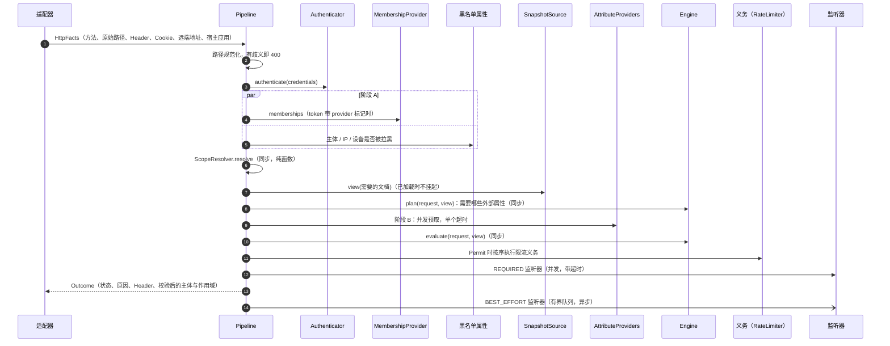

# RFC 0006：协程 Pipeline——认证、属性、义务与监听器（RFC 0001 迁移第 5 阶段）

> 状态：已确认（第 2 版，§16 的决定已于 2026-10-25 由维护者确认） · 上位文档：[RFC 0001](0001-target-architecture.md) §3.5、§3.6、§3.8、§3.9、§3.10、§5、§6 第 5 阶段、§7.1 ·
> 前置：[RFC 0002](0002-pure-engine.md)（第 2 阶段）、[RFC 0003](0003-policy-snapshot.md)（第 3 阶段）、[RFC 0004](0004-unified-model.md) 与
> [RFC 0005](0005-condition-ast.md)（第 4 阶段，2026-10-22 确认）· 基线：`main` @ `4ddaee82` · 交付：全部合入 `main`（8.0 线）；8.0 在 RFC 0001
> 第 2–6 阶段全部完成、各做完两轮审查之前不发布任何版本 ·
> 范围：新增 `runtime/`（`cosec-runtime`）；改动 `engine/`、`cosec-core`、`cosec-cocache`、`cosec-jwt`、`cosec-webflux`、`cosec-webmvc`、`cosec-gateway`、
> `cosec-opentelemetry`、`cosec-micrometer`、`cosec-kafka`、`cosec-ip2region`、`cosec-spring-boot-starter`；删除 `cosec-api` 中的响应式授权契约
>
> **2026-10-26 修订（[RFC 0008](0008-conformance-and-direct-build.md)）**：8.0 不考虑兼容性。门槛 C（§11）与 PR-8 取消；PR-9、PR-10 并入 RFC 0008 的切换 PR；PR-2 增加"同一 `CoSec-*` 参数的
> Header 与 query 值不同即 400"；PR-7 的 `WebAdapterParityTest` 只对新 Pipeline 运行。§13 的性能基准从"第 4 阶段结束时"改为 7.0 的实测数字（绝对预算）。
> R1–R3 是 8.0 的规则（例如 R1 → `PIP-2`）；§10.2 的不变量与 P9′、P13–P15 作为规范性质保留。下文保留原样以便追溯。
>
> **2026-10-26 修订（problem+json，Q27）**：保留 7.x 响应体形状的唯一理由是"客户端不必改解析"，8.0 不考虑兼容性之后它不再成立。CoSec 自己写的每个错误响应
> 改为 RFC 9457 的 `application/problem+json`，只带客户端能据以行动的区分；显式拒绝与隐式拒绝在响应中合并为 `unauthorized`/`forbidden`。改动处：§5.7、
> §6.1（`type`/`code` 列取代 `reason`）、§6.2（重写）、§6.3、§9.5.3、§10.2、§14 X5、§15.2 的 PR-2 与 PR-7、§15.3、§16 Q22 与新增的 Q27。

## 0. 结论先行

第 4 阶段结束时，引擎已经是同步纯函数，策略数据都在内存快照里。剩下的问题在引擎**外面**：`SecurityPipeline` 是一条 Reactor 链，
外面再套五层 `Authorization` 装饰器（追踪 → 审计 → 指标 → 限流 → 影子），认证是同步的、要靠调度器切换，阻塞的自定义匹配器靠
`BlockingAware` 切线程。本阶段把这一层重写成一个挂起函数：

```
suspend Pipeline.evaluate(HttpFacts): Outcome
    = 规范化路径 → Authenticator → 成员关系 + 黑名单属性 → ScopeResolver → 快照视图 → 属性计划与预取
      → Engine.evaluate（同步）→ 义务（限流）→ REQUIRED 监听器 → Outcome；BEST_EFFORT 监听器异步
```

- **一个函数，一个状态映射**（§5、§6）。所有拒绝路径都在 `Pipeline.decide` 里，对 sealed 的 `Decision` 和 `AuthnResult` 做穷举 `when`。
  状态码仍只在一处定义（`runtime/` 的 `StatusMapping`），`WebAdapterParityTest` 仍是守护，并补上至今没有覆盖的 Gateway 适配器（§3.2 L1）。
- **`Indeterminate` 一律 503**（§6）。RFC 0002 Q3、RFC 0003 Q16、RFC 0004 §2.2 推迟到这里的状态码变更在本阶段兑现。RFC 0001 §3.5 把
  `Indeterminate` 再拆成 503 和 500，拆分依据（"DENY 匹配出错"）在 RFC 0005 之后已经不可能出现，本文指出并建议：500 只留给未建模的异常，
  也就是 CoSec 自己的缺陷（§3 K1）。
- **装饰器链删除**（§5.7）。限流变成引擎在 Permit 时算出的**义务**，由 Pipeline 执行（§8）；审计、指标、追踪、影子变成**监听器**（§9）。
  `Authorization`/`DecisionAuthorization`（`cosec-api` 的 `Mono` 契约）、`CoSecAuthorizationCustomizer`、`SecurityContextParseSchedulers`、
  `BlockingAware`、RFC 0005 的 `legacy` 条件节点和 `ConditionMatcherFactory` SPI 一并删除。
- **协程只在 `runtime/` 和适配器里**（§7）。WebFlux / Gateway 用 `mono {}` 桥接一次，WebMvc 用 `runBlocking` 桥接一次。热路径（快照已加载、
  成员关系来自声明、没有外部属性）**零调度器切换**；真正挂起之后在 `Dispatchers.Default` 上恢复，绝不在客户端库的 I/O 线程上继续（§7.2）。
  取消永远不会让请求继续：只有 Permit 值能让适配器调用下游（§7.4）。
- **外部属性**（§5.4）：`AttributeProvider` 取代阻塞的自定义匹配器；`onMissing` 在本阶段生效。RFC 0001 说 `onMissing: indeterminate`
  "请求返回 503"，而扁平算法把出错的 ALLOW 当作未命中（403）。本文让"因外部属性不可用而跳过的 ALLOW"在没有 Permit 时得到 503（§3 K12）。
- **REQUIRED 审计失败即拒绝**（§9.4）：Permit 变为 503；Deny 保持原状态码。break-glass 决策必须至少经过一个 REQUIRED 监听器（RFC 0004 I9）。
- **门槛 C**（§11）：沿用 RFC 0004 §9 的方法和 `DecisionParity`/回放工具，基准是第 4 阶段结束时的 Reactor Pipeline 加装饰器链，
  候选是本文的 Pipeline。改动目录只有三类（R1–R3），都只改状态码，**没有放宽类**：候选放行而基准不放行的任何差异都是失败。
- **性能**（§13）：Pipeline 级基准的吞吐不低于第 4 阶段结束时的 100 %，B/op 不高于它，另加端到端压测；达不到即停在切换 PR 之前，交回维护者。
- 拆成 10 个 PR（§15）。PR-1（模块与依赖）可以在本 RFC 获批后立即开工；PR-2 起依赖第 4 阶段的引擎 PR；切换（PR-9）与删除（PR-10）
  在第 4 阶段全部完成和门槛 C 之后。

---

## 1. 范围与非目标

### 1.1 本阶段要做的

1. 新模块 `runtime/`（构件 `cosec-runtime`，§5.1）：`Pipeline`、`HttpFacts`、`Outcome`、`StatusMapping`、路径规范化、全部数据面 SPI 的挂起形式。
2. 挂起的 `Authenticator`（§5.3.2），取代同步的 `SecurityContextParser` 和 `SecurityContextParseSchedulers`。
3. `SnapshotSource`、`MembershipProvider` 的挂起形式（§5.5），以及基于 CoCache 的 `MembershipProvider`（RFC 0004 Q14 推迟到这里）。
4. `AttributeProvider`、属性计划、`onMissing` 的执行（§5.4）；黑名单改为属性提供者（RFC 0004 Q9）；`ip2region` 改为属性提供者。
5. 限流成为义务（§8）：规则进快照文档，引擎在 Permit 时算出义务，`RateLimiter` 改为挂起、非阻塞。
6. `DecisionEvent` 与 `DecisionListener`（§9）：`REQUIRED` / `BEST_EFFORT` 两类投递；审计（日志、Kafka）、Micrometer、OpenTelemetry、影子改写为监听器。
7. 三个适配器的桥接（§7.3）与上下文传播（§7.5）。
8. 状态码变更（§6），以及 `WebAdapterParityTest` 的扩展。
9. 门槛 C（§11）、JMH 与端到端压测（§13）。
10. 删除装饰器链和响应式授权契约（§5.7、§15 PR-10）。

### 1.2 非目标

| 内容 | 处理 | 留到 |
|---|---|---|
| 控制面 `cosec-control`、`PolicyStore`、修订与回滚、不能越权授权、平台边界 `withinBoundary` | 不做；`SnapshotPublisher`（`Mono` 接口）原样保留 | 第 6 阶段 |
| `onMissing: nomatch` 用于 DENY 时"控制面显式确认"（RFC 0001 §3.3） | 本阶段只允许平台层文档这样写，编译时告警（§5.4.3，Q13） | 第 6 阶段 |
| 从模型生成 `schema/*.json` | 手工更新 | 第 6 阶段 |
| 编译失败时保留旧快照（RFC 0003 Q8） | 不变 | 第 6 阶段 |
| 现有模块改名（RFC 0001 §4 的 `cosec-http-*`、`cosec-store-redis`、`cosec-authn-*`、`cosec-observability-*`） | 不做，只新增 `runtime/`（§3 K10，Q5） | 维护者决定，不早于 GA 前 |
| 社交登录、token 签发、刷新流程 | 不在请求授权路径上，不改；只改它们用到的 `TokenStore` 读接口（§5.3.2） | — |
| GraalVM native image | 不支持（RFC 0001 §3.10） | 8.0 之后，只针对 `cosec-gateway-server` |
| 虚拟线程 | CoSec 不创建线程；Servlet 宿主是否开启由应用决定（RFC 0001 §3.9） | — |

**本阶段不改变任何授权决策**（Permit / Deny 的划分）。改变的只有状态码（§6 R1–R3）、可观测性输出（§14）和 API。门槛 C 验证这一点（§11）。

---

## 2. 前面各阶段推迟到本阶段的事项

| 来源 | 推迟的内容 | 本文的处理 |
|---|---|---|
| RFC 0002 §3.5、Q3；RFC 0003 §2 I7、Q16；RFC 0004 §2.2 | `Indeterminate` 映射为 503（快照不可用、陈旧超限、成员关系不可用都暂为 500） | §6：全部 `Indeterminate` → 503；500 只留给未建模的异常（Q1） |
| RFC 0002 §5.2、Q5 | `VerifyResult` 保留到第 5 阶段，"随结果类型统一一起处理" | §5.7：`VerifyResult`、`AuthorizeResult`、`AuthorizationDecision`、`SecurityDecision` 收敛为 `Decision` + `Outcome`（Q22） |
| RFC 0003 §2 I2、Q9；RFC 0005 §3.7 | 删除 `BlockingAware`；它的替代品 `AttributeProvider` | §5.4、§5.6；PR-10 删除 |
| RFC 0003 §2 I3、Q10 | `SnapshotSource` 的挂起包装（第 3 阶段返回 `CompletableFuture`） | §5.5.1：`runtime/` 中的 `SuspendingSnapshotSource`，SPI 形状不变 |
| RFC 0004 §4.5.2、Q14 | `MembershipProvider` 的挂起形式与 Redis 实现 | §5.5.2：SPI 改为 `suspend`；实现放在 `cosec-cocache`（§3 K18） |
| RFC 0003 §2 I6、Q17；RFC 0005 §7.3、Q4 | 限流规则进快照；限流成为义务 | §8 |
| RFC 0003 §5.2 | `RedisRateLimiter` 的 `subscribeOn(boundedElastic)`（阻塞调用） | §8.4：改为非阻塞客户端，删除切换 |
| RFC 0003 §5.2 | `SecurityContextParseSchedulers`（吊销检查、API Key 存储）"第 5 阶段 `Authenticator` 挂起化时处理" | §5.3.2 |
| RFC 0003 §1.2、Q20 | 快照版本写进决策事件 | §9.2：`DecisionEvent.snapshotVersion`（RFC 0004 的三元组） |
| RFC 0004 §3 I9、Q8 | break-glass 使用写 `REQUIRED` 审计 | §9.4.3（Q20） |
| RFC 0004 §3 I7、Q7；RFC 0005 §3.4 | `onMissing` 只作用于外部属性，第 5 阶段生效 | §5.4.3（Q12、Q13） |
| RFC 0004 §3 I10、§4.7、Q9 | 黑名单名单改为 `AttributeProvider`，拆成主体、IP、设备三个集合 | §5.4.4（Q14） |
| RFC 0005 §2 J2、§3.7、Q2 | 删除 `legacy` 条件节点与 `ConditionMatcherFactory` SPI | §5.6；PR-10 删除（Q15） |
| RFC 0005 §5.2 | 路径规范化"属于第 5 阶段的 Pipeline 重组" | §5.3.1 |
| RFC 0004 §4.1 | `ScopeResolver` 留在 `model/` 还是搬进 `cosec-runtime`，"第 5 阶段再定" | §3 K4：留在 `model/`（Q4） |
| RFC 0004 §13 X6 | 后端读校验后的 `SecurityContext.scope`，而不是 Header | §7.6：适配器把 `Outcome` 中的作用域写进面向应用的 `SecurityContext` |
| RFC 0001 §3.8 | `WebAdapterParityTest` 断言三类适配器的 trace id 与审计主体一致；BlockHound；JMH 加端到端压测确认桥接开销 | §6.3、§10、§13 |
| RFC 0001 §3.11 | 请求 id、审计事件 id 经 `StringIdGenerator` 端口生成 | §9.2 |

---

## 3. RFC 0001 中与第 5 阶段有关的不一致

与 RFC 0003 §2、RFC 0004 §3 一样，不悄悄选边，逐条列出，每条对应 §16 的一个决定。

| # | RFC 0001 原文 | 问题 | 本文的处理 |
|---|---|---|---|
| K1 | §3.5 状态表：`Indeterminate` 中"快照未就绪、依赖不可用、属性缺失" → 503，"内部错误、DENY 匹配出错" → 500 | RFC 0005 之后条件 AST 求值不抛出，`legacy` 节点在本阶段删除（§5.6），"DENY 匹配出错"再也没有来源；剩下的 `Indeterminate` 原因（缺失、不可用、陈旧、超时）都是"现在无法判定"。另一方面，"内部错误"不是一个决策：它是 Pipeline 自己抛出的、没有被建模的异常 | 每个 `Indeterminate` → 503；500 只留给逃出 `Pipeline.decide` 的未建模异常（CoSec 的缺陷），它不经过 `Decision`（§6）。Q1 |
| K2 | §3.5 状态表：`Rejected`（凭证无效 / 过期 / 吊销） → 401 | 7.x 和现在的 `main` 在凭证无效时**按匿名主体评估**：允许匿名访问的路径照常放行，拒绝时才是 401 并带 `TOKEN_EXPIRED`/`TOKEN_INVALID`（[`SecurityPipeline`](../../cosec-core/src/main/kotlin/me/ahoo/cosec/pipeline/SecurityPipeline.kt) 的 `toDecision`）。`DefaultSecurityContextParser` 还从 cookie 读 token，一律 401 会让带着过期 cookie 的浏览器打不开公开页面 | 保持现在的语义：`Rejected` 按匿名评估，拒绝时 401 并带拒绝原因（§5.3.2）。Q2 |
| K3 | §3.5 时序图：先取快照，再预取成员关系，再 `ScopeResolver` | RFC 0004 §7.4 已确认：一次评估需要哪些文档取决于 `scope.app`、`scope.roles` 和是否被拉黑。作用域没确定之前不知道要不要 `App(appId)` 文档 | 顺序改为：认证 → 成员关系与黑名单属性（并发）→ `ScopeResolver` → 快照视图 → 属性计划与预取 → 引擎（§5.2）。Q3 |
| K4 | §6 第 5 阶段："挂起的 `Authenticator`、`ScopeResolver`、`AttributeProvider`"；§4：`ScopeResolver` 在 `cosec-runtime` | §3.5 自己说 `ScopeResolver` 是内置实现、不开放为 SPI；RFC 0004 §4.6 把它实现为 `model/` 中无 I/O 的纯函数，并且 `Scope` 的 `internal` 构造器要求两者同模块。它没有任何需要挂起的理由；挂起的是它的输入（成员关系） | `ScopeResolver` 留在 `model/`，保持同步纯函数；挂起的是 `MembershipProvider`（§5.3.3）。Q4 |
| K5 | §3.6：`REQUIRED` "同步，写入成功后才放行；失败时拒绝请求（`Indeterminate`，503）"；监听器"不能改变决策；REQUIRED 失败只会让请求变成拒绝" | 两处没说清：① 决策本来就是 Deny 时，审计失败是否把 403 改成 503；② 时序图里义务在监听器之前，审计失败时许可已经扣掉，而 AGENTS.md 说"denied requests never use up quotas" | ① 只有 Permit 变为 503，Deny 保持原状态码（§9.4.2，Q18）；② 先义务后审计，审计记录最终结果（含 429）；审计失败时已扣的许可不退（§9.4.2，Q19） |
| K6 | §3.6："审计、Micrometer、OpenTelemetry 都只是监听器" | 现在的 `cosec.authorize` span 包住评估：它在评估**之前**开始，评估中的 I/O 是它的子 span，审计事件里的 `spanId` 是它的 id（[`TracingAuthorization`](../../cosec-opentelemetry/src/main/kotlin/me/ahoo/cosec/opentelemetry/TracingAuthorization.kt) 先把 trace/span id 写进请求属性，内层的审计再读出）。决策之后才被调用的监听器做不到这三点 | 监听器在事件里拿到开始与结束时间和父 trace 上下文，事后用显式时间戳生成 span；评估期间的 I/O 挂在请求的父 span 下；审计记录父 span id（§9.5.1，X3）。Q21 |
| K7 | §2 P8、§3.2：`Permit(by, obligations)`；§3.5："限流是 Permit 附带的义务（来自限流规则，规则本身也是快照的一部分）" | 7.x 的限流规则不挂在语句上：一条规则有自己的动作与条件，与"哪条语句放行"无关（[`RateLimitRule`](../../cosec-core/src/main/kotlin/me/ahoo/cosec/limiter/RateLimitRule.kt)）。"Permit 附带"如果理解为"写在放行语句上"，就要改策略语言，还会让同一个请求因放行语句不同而限流不同 | 规则是快照文档里独立的一节；引擎在得到 Permit 之后匹配全部规则、算出桶 key，作为 `Permit.obligations` 返回（纯函数）；Pipeline 执行（§8.2）。Q16 |
| K8 | §3.8："协程可以在事件循环线程上运行，遇到 I/O 时挂起" | 只说了从哪里开始，没说**从哪里恢复**。`mono {}` 在上下文里没有调度器时默认用 `Dispatchers.Default`，每个请求都会切一次线程；用 `Dispatchers.Unconfined` 则在完成挂起的那个线程上继续，可能是 Lettuce 或 Kafka 客户端的 I/O 线程 | 热路径在调用线程上完成、零切换；真正挂起之后在 `Dispatchers.Default` 上恢复（§7.2）。Q8 |
| K9 | §4："除 WebFlux/Gateway 适配器外，任何模块都不得依赖 Reactor。用 ArchUnit 测试强制" | `lettuce-core` 本身依赖 `reactor-core`，CoCache 的 Redis 后端和 Spring Data Redis 都经过它；`cosec-core` 的 `SnapshotPublisher` 返回 `Mono`，控制面在第 6 阶段才重做。按字面执行，`cosec-cocache` 和 `cosec-core` 在本阶段都不可能通过 | 规则在本阶段落为两条：`runtime/`、`engine/`、`model/` 的类不引用 `reactor.*`；全部数据面 SPI 的签名中没有 Reactor 类型。实现内部可以用基于 Reactor 的客户端并 `await`（§5.1）。Q6 |
| K10 | §4：`cosec-runtime` 只依赖 `engine`；`cosec-store-redis` 等新模块取代现有模块 | RFC 0003 已把 `SnapshotSource`、编译器、文档编解码放在 `cosec-core`；把它们搬进 `runtime/` 是纯搬家，与本阶段的语义无关。改名现有模块会让每个下游的依赖坐标变化，而没有任何决策收益 | 新增 `runtime/`，依赖 `engine/`、`model/` 和 `cosec-core`；其余模块不改名（§5.1）。Q5 |
| K11 | §3.6：`DecisionEvent` 必须包含 `SnapshotVersion(platform, tenant)` | RFC 0004 Q4 已确认版本是三元组 `(platform, app, tenant)` | 用三元组（§9.2），不需要新的决定 |
| K12 | §3.3：`onMissing` 为 `indeterminate`（默认）时"请求返回 503"；`nomatch` "只允许用于 ALLOW 语句……" | 扁平算法（RFC 0004 §6.1）把出错的 ALLOW 当作未命中：没有别的 ALLOW 命中时结果是隐式拒绝（403），不是 503。这样 ALLOW 上的 `indeterminate` 与 `nomatch` 就没有区别，"`nomatch` 只允许用于 ALLOW"也就没有意义 | 因外部属性不可用（且 `onMissing: indeterminate`）而跳过的 ALLOW，在最终没有 Permit 时把结果从 `Deny(null)` 改为 `Indeterminate(AttributeUnavailable)`（§5.4.3）。任何 DENY 命中仍然优先；不会产生 Permit。Q12 |
| K13 | §3.8："取消即拒绝：请求被取消或超时属于 `Indeterminate`，不会产生 Permit" | 取消发生在订阅方已经离开时（客户端断开），没有人接收这个 `Indeterminate`；而超时是 Pipeline 自己的决定，需要一个响应。两者在协程里还是同一类异常（`TimeoutCancellationException` 是 `CancellationException` 的子类），一个笼统的 `catch` 会把外部取消吞成 503，破坏结构化并发 | 区分两者：Pipeline 自己的超时 → `Indeterminate(DeadlineExceeded)` → 503；外部取消 → 重新抛出，不产生 `Outcome`，适配器不调用下游，`BEST_EFFORT` 事件记为 `CANCELLED`（§7.4）。Q9 |
| K14 | §3.5："执行失败时按规则的 `strictFailure` 决定拒绝还是放行" | 没说拒绝的状态码。现在 `strictFailure` 的规则在后端故障时返回一个"未通过"的限流结果，即 429（[`RateLimitingAuthorization`](../../cosec-core/src/main/kotlin/me/ahoo/cosec/limiter/RateLimitingAuthorization.kt) 的 `onFailure`）。429 告诉客户端"你超额了"，而事实是"限流后端不可用" | 改为 503（`RATE_LIMITER_UNAVAILABLE`），属于门槛 C 的 R3（§8.3）。Q17 |
| K15 | §3.8："数据面 runtime 的 SPI 实现只能用非阻塞客户端……不再有 `BlockingAware`，也不再有 `Dispatchers.IO` 兜底" | 有些依赖的"非阻塞"客户端仍会阻塞调用线程：`KafkaProducer.send` 在元数据不可用或缓冲区满时最多阻塞 `max.block.ms`（默认 60 秒），所以现在的 [`KafkaAuditEventSink`](../../cosec-kafka/src/main/kotlin/me/ahoo/cosec/kafka/KafkaAuditEventSink.kt) 在自己的单线程调度器上发送。用户的成员关系或属性来源也可能只有 JDBC | CoSec 自己从不按"是否阻塞"自动切换线程（没有 `BlockingAware` 的替代品）；SPI 契约是"不得阻塞调用线程"，需要阻塞客户端的实现在实现内部切到自己的有界执行器，Kafka 监听器就是这样做的（§7.7）。Q10 |
| K16 | §3.8："上下文桥接只允许出现在适配器里……OTel 用 `opentelemetry-extension-kotlin` 的 `asContextElement()` 传播" | 适配器模块不能依赖 OpenTelemetry（它是可选的 feature variant），所以不能在适配器里直接写 `asContextElement()` | `runtime/` 定义一个窄的 `BridgeContextContributor` SPI，由 `cosec-opentelemetry`、starter（MDC）实现；适配器在桥接点调用它们。桥接仍然只发生在适配器里，且只有一处（§7.5） |
| K17 | §3.2、§3.5：黑名单名单"由 `AttributeProvider` 以 `environment.blocked` 之类的属性提供" | RFC 0004 §4.7 已确认被拉黑的请求只读常驻的 `Platform` 文档。如果黑名单属性和其他外部属性一起在快照之后预取，就要先加载 `App`、`Tenant` 文档 | 黑名单属性在"阶段 A"与成员关系并发预取，早于作用域和快照视图（§5.4.4）。Q14 |
| K18 | RFC 0004 Q14："基于 CoCache 的实现……在第 5 阶段随 `cosec-store-redis` 一起提供" | 没有 `cosec-store-redis` 这个模块（K10） | 放在 `cosec-cocache`（§5.5.2） |
| K19 | §3.8 表：属性预取"任何一个失败或超时都会取消其余调用，并返回 `Indeterminate`" | 与 RFC 0004 Q6（DENY 命中优先于不可用）冲突：一个只被 ALLOW 引用的属性超时，会让一条本来命中的 DENY 无法生效，结果从 403 变成 503；也让 `onMissing` 无从逐条语句生效 | 取消粒度是提供者：一个提供者失败只让它的属性"取不到"，其余照常；结果由引擎按 `onMissing` 逐条决定（§5.4.2）。Q3 |

### 3.1 现有代码与文档之间的不一致

| # | 文档或测试的说法 | 实际 | 本文的处理 |
|---|---|---|---|
| L1 | AGENTS.md："Three adapters must answer identically"，守护是 `WebAdapterParityTest` | [`WebAdapterParityTest`](../../cosec-spring-boot-starter/src/test/kotlin/me/ahoo/cosec/spring/boot/starter/WebAdapterParityTest.kt) 只构造 `ReactiveAuthorizationFilter` 和 `AuthorizationFilter`；`AuthorizationGatewayFilter` 与前者共用 `ReactiveSecurityFilter.filterInternal`，但从未在这个测试里被调用 | PR-7 把 Gateway 加进同一组场景（§6.3）。不必等本阶段：可以作为独立的 `test:` PR 先进 `main` |
| L2 | AGENTS.md："Fail closed：只有两个例外……" | 现在 `SecurityPipeline` 在 `SecurityContextParser` 抛出非 token 异常时记日志、得到 500（`switchIfEmpty`），审计装饰器根本没有被调用，这次失败不留审计记录 | 本阶段每个 `Outcome`（含 400、认证不可用、取消）都产生 `DecisionEvent`（§9.2，X1） |

---

## 4. 现状（`main` @ `4ddaee82`）

| 部分 | 现在怎么做 | 代码 |
|---|---|---|
| 请求解析 | `RequestParser.parse`，路径非法抛 `InvalidRequestPathException` → 400（`SecurityDecision.BAD_REQUEST`，不带 `request`，适配器只写状态码）；规范化规则在 `RequestPaths` | [`SecurityPipeline`](../../cosec-core/src/main/kotlin/me/ahoo/cosec/pipeline/SecurityPipeline.kt)、[`RequestPaths`](../../cosec-core/src/main/kotlin/me/ahoo/cosec/context/request/RequestPaths.kt) |
| 认证 | 同步的 `SecurityContextParser.parse`，经 `Mono.fromCallable(...).subscribeOn(securityContextParseScheduler)`；吊销检查（`TokenStore.isRevoked`）或阻塞的 API Key 存储开启时调度器是 `boundedElastic`，否则 `immediate` | [`SecurityContextParseSchedulers`](../../cosec-spring-boot-starter/src/main/kotlin/me/ahoo/cosec/spring/boot/starter/authorization/SecurityContextParseSchedulers.kt)、[`TokenStore`](../../cosec-core/src/main/kotlin/me/ahoo/cosec/token/TokenStore.kt)、[`ApiKeys`](../../cosec-core/src/main/kotlin/me/ahoo/cosec/apikey/ApiKeys.kt) |
| 认证失败 | `TokenVerificationException` → 匿名上下文并记下异常；其他异常 → 500 | `SecurityPipeline.parseSecurityContext`、`evaluate` |
| 授权 | `Authorization.decide(request, context): Mono<AuthorizationDecision>`；空结果 → 隐式拒绝；错误 → `toErrorDecision`（`RegexTimeoutException` → 401/403，其余 → 500） | `SecurityPipeline.authorize` |
| 装饰器链 | starter 中由外到内：`TracingAuthorization` → `AuditingAuthorization` → `MeteredAuthorization`（经 `CoSecAuthorizationCustomizer`）→ `RateLimitingAuthorization` → `ShadowAuthorization` → `SimpleAuthorization` | [`CoSecAuthorizationAutoConfiguration`](../../cosec-spring-boot-starter/src/main/kotlin/me/ahoo/cosec/spring/boot/starter/authorization/CoSecAuthorizationAutoConfiguration.kt)、[`CoSecAuditAutoConfiguration`](../../cosec-spring-boot-starter/src/main/kotlin/me/ahoo/cosec/spring/boot/starter/audit/CoSecAuditAutoConfiguration.kt)、[`CoSecOpenTelemetryAutoConfiguration`](../../cosec-spring-boot-starter/src/main/kotlin/me/ahoo/cosec/spring/boot/starter/opentelemetry/CoSecOpenTelemetryAutoConfiguration.kt)、[`CoSecMetricsAutoConfiguration`](../../cosec-spring-boot-starter/src/main/kotlin/me/ahoo/cosec/spring/boot/starter/micrometer/CoSecMetricsAutoConfiguration.kt) |
| 状态码 | `toDecision`：限流未通过 → 429；授权 → 200；否则已认证 403、匿名 401（原因优先取 token 异常）；`SecurityStatus` 只有 200/400/401/403/429/500 | [`SecurityDecision`](../../cosec-core/src/main/kotlin/me/ahoo/cosec/pipeline/SecurityDecision.kt) |
| 限流 | 授权通过后逐条匹配规则、即时算桶，按顺序 `tryAcquire`，第一条耗尽即 429；后端失败时 `strictFailure` → 429，否则跳过；`RedisRateLimiter` `subscribeOn(boundedElastic)` | [`RateLimitingAuthorization`](../../cosec-core/src/main/kotlin/me/ahoo/cosec/limiter/RateLimitingAuthorization.kt)、[`RedisRateLimiter`](../../cosec-cocache/src/main/kotlin/me/ahoo/cosec/cache/limiter/RedisRateLimiter.kt) |
| 审计 | `doOnSuccess`/`doOnError` 中同步调用 `AuditEventSink.publish`，异常吞掉记 WARN；Kafka sink 在自己的单线程有界调度器（队列 1024）上发送，满了丢弃 | [`AuditingAuthorization`](../../cosec-core/src/main/kotlin/me/ahoo/cosec/audit/AuditingAuthorization.kt)、[`KafkaAuditEventSink`](../../cosec-kafka/src/main/kotlin/me/ahoo/cosec/kafka/KafkaAuditEventSink.kt) |
| 指标 | `cosec.authorization` 计时器，标签 `result`、`source` | [`MeteredAuthorization`](../../cosec-micrometer/src/main/kotlin/me/ahoo/cosec/micrometer/MeteredAuthorization.kt) |
| 追踪 | 订阅时取 `Context.current()` 作父上下文，开 `cosec.authorize` span，把 trace/span id 写进请求属性供审计读取；span 属性从 `SecurityContext` 的可变属性里读 `VerifyContext` | [`AuthorizationMono`](../../cosec-opentelemetry/src/main/kotlin/me/ahoo/cosec/opentelemetry/AuthorizationMono.kt)、[`CoSecInstrumenter`](../../cosec-opentelemetry/src/main/kotlin/me/ahoo/cosec/opentelemetry/CoSecInstrumenter.kt) |
| 影子 | 装饰器，采样后用覆盖仓库构造候选 `SimpleAuthorization` 再评估一次（RFC 0003 PR-5 改为快照叠加） | [`ShadowAuthorization`](../../cosec-core/src/main/kotlin/me/ahoo/cosec/shadow/ShadowAuthorization.kt) |
| 适配器 | WebFlux 与 Gateway 共用 `ReactiveSecurityFilter.filterInternal`（`pipeline.evaluate(exchange).flatMap`）；WebMvc 在 Servlet 线程上 `pipeline.evaluate(request).block()`，`SecurityContextHolder` 是 `ThreadLocal` | [`ReactiveSecurityFilter`](../../cosec-webflux/src/main/kotlin/me/ahoo/cosec/webflux/ReactiveSecurityFilter.kt)、[`AuthorizationGatewayFilter`](../../cosec-gateway/src/main/kotlin/me/ahoo/cosec/gateway/AuthorizationGatewayFilter.kt)、[`AbstractAuthorizationInterceptor`](../../cosec-webmvc/src/main/kotlin/me/ahoo/cosec/servlet/AbstractAuthorizationInterceptor.kt) |
| 阻塞匹配器 | `BlockingAware.requiresBlocking` 为真的组让整次评估在 `boundedElastic` 上执行 | [`BlockingAware`](../../cosec-core/src/main/kotlin/me/ahoo/cosec/policy/BlockingAware.kt) |
| 协程 | 仓库里没有任何 `kotlinx-coroutines` 依赖 | [`libs.versions.toml`](../../gradle/libs.versions.toml) |

第 2–4 阶段改的都是 `SimpleAuthorization` 内部；上表中引擎外面的部分到第 4 阶段结束时仍是这样，本阶段的"基准"就是它（§11）。

---

## 5. Pipeline 结构

### 5.1 模块与依赖

| 模块 | 依赖 | 内容 | 不允许 |
|---|---|---|---|
| `runtime/`（`cosec-runtime`，新） | `api(project(":cosec-engine"))`、`cosec-core`、`kotlinx-coroutines-core`、`cosid-core`（`StringIdGenerator` 端口的默认实现） | `Pipeline`、`HttpFacts`、`Outcome`、`StatusMapping`、`PathNormalizer`（由 `RequestPaths` 搬来）、SPI：`Authenticator`、`MembershipProvider`、`AttributeProvider`、`RateLimiter`、`DecisionListener`、`BridgeContextContributor`；`SuspendingSnapshotSource`；内置的认证器组合、属性计划、义务执行、监听器分发 | 引用 `reactor.*`、`org.springframework.*`、`jakarta.servlet.*`（ArchUnit `RuntimeBoundaryTest`） |
| `engine/`、`model/` | 不变 | 增加 `onMissing`、外部属性的值类型、义务（§5.4.3、§8.2） | 不变：`EnginePurityTest`、`verifyPureClasspath`；引擎仍不依赖协程 |
| `cosec-webflux`、`cosec-gateway` | `cosec-runtime`、`kotlinx-coroutines-reactor` | `HttpFacts` 提取、`mono {}` 桥接、`Outcome` 写回 | — |
| `cosec-webmvc` | `cosec-runtime` | `HttpFacts` 提取、`runBlocking` 桥接 | 引用 `reactor.*`（删除 `.block()` 之后它不再需要 Reactor） |
| `cosec-opentelemetry` | `cosec-runtime`、`opentelemetry-extension-kotlin` | `TracingListener`、OTel 的 `BridgeContextContributor` | — |
| `cosec-micrometer`、`cosec-kafka` | `cosec-runtime` | `MetricsListener`、`KafkaAuditListener` | — |
| `cosec-cocache` | `cosec-runtime`（新增）、CoCache 6.7（含 `cocache-coroutines`） | `CoCacheMembershipProvider`、挂起的吊销检查、非阻塞的 `RedisRateLimiter` | SPI 签名中出现 Reactor 类型 |

- 新依赖（Q7，AGENTS.md 要求先问）：`org.jetbrains.kotlinx:kotlinx-coroutines-core`、`-reactor`（只给 WebFlux / Gateway）、`-slf4j`（starter，MDC）、
  `-test` 与 `-debug`（测试；`-debug` 自带 BlockHound 集成，把 `Dispatchers.Default` 的工作线程标为不可阻塞）；`io.opentelemetry:opentelemetry-extension-kotlin`。
  版本只写在 `gradle/libs.versions.toml`，与 Spring Boot 4 BOM 管理的 `kotlinx-coroutines` 版本对齐。
- `cosec-core` 仍有 Reactor（`SnapshotPublisher` 返回 `Mono`，§1.2）。`runtime/` 依赖 `cosec-core`，所以 `runtime/` 的**运行时类路径**上仍有 `reactor-core`；
  K9 的规则因此守的是**类引用**，不是类路径（Q6）。第 6 阶段控制面重写发布接口后，再加类路径检查。

### 5.2 总览



与 RFC 0001 §3.5 的差别：成员关系与黑名单属性在作用域之前（K3、K17）；属性预取分两段，第二段由引擎的 `plan` 决定（§5.4.2）；
REQUIRED 监听器在义务之后、返回之前（K5）。

### 5.3 各阶段

#### 5.3.1 `HttpFacts` 与路径规范化

```kotlin
/** 适配器交给 Pipeline 的全部输入，不可变。 */
class HttpFacts(
    val method: String,
    val rawPath: String,                    // 未解码
    val rawQuery: String?,
    val headers: Headers,                   // 只读视图，名字不区分大小写
    val cookies: Cookies,
    val remoteAddress: String,              // 经 RemoteIpResolver 之前的原始地址
    val host: HostScope,                    // RFC 0004 §4.6：宿主配置的应用（Gateway 来自路由元数据）
    val requestAttributes: Map<String, String>,   // Gateway 的 routeId 等，原 RequestAttributesAppender 的输出
)
```

- `PathNormalizer` 是 [`RequestPaths`](../../cosec-core/src/main/kotlin/me/ahoo/cosec/context/request/RequestPaths.kt) 的规则原样搬进 `runtime/`（解码一次、
  合并斜杠、处理 `.`/`..`、剥离 `;` 矩阵参数、拒绝二次编码与编码后的 `/`），不改任何一条规则：门槛 C 要求 400 零差异。
- 三个适配器的 `RequestParser` 只剩"从宿主对象读出 `HttpFacts`"，不再各自调用规范化。现在 [`ServletRequestParser`](../../cosec-webmvc/src/main/kotlin/me/ahoo/cosec/servlet/ServletRequestParser.kt)
  自己抛 `InvalidRequestPathException`，搬走之后这类判断只剩一处。
- 恶意路径语料（`WebAdapterParityTest` 的 `traversal`、`path parameters`、`encoded path` 等场景）三个适配器结果一致，RFC 0001 §5"路径一致"不变量。

#### 5.3.2 `Authenticator`

```kotlin
/** SPI。不阻塞调用线程（§7.7）；不同步抛出——失败用 Unavailable 表达。 */
fun interface Authenticator {
    suspend fun authenticate(credentials: Credentials): AuthnResult
}

sealed interface AuthnResult {
    class Authenticated(val subject: Subject, val method: String) : AuthnResult      // method：jwt / apikey / ...
    data object Anonymous : AuthnResult                                                // 没有凭证
    class Rejected(val reason: RejectReason) : AuthnResult                             // 凭证无效、过期、吊销
    class Unavailable(val cause: Throwable) : AuthnResult                              // 依赖不可用，例如 API Key 存储读失败
    enum class RejectReason { TOKEN_INVALID, TOKEN_EXPIRED, TOKEN_REVOKED, API_KEY_INVALID }
}
```

- `Credentials` 由 Pipeline 从 `HttpFacts` 取出，规则与现在的 [`DefaultSecurityContextParser`](../../cosec-core/src/main/kotlin/me/ahoo/cosec/context/DefaultSecurityContextParser.kt)
  相同：`Authorization` 头，否则（`allowQueryToken` 时）查询参数，否则 cookie；API Key 头另取。
- 内置 `CompositeAuthenticator` 按凭证类型分派到 JWT（`cosec-jwt`，验签是 CPU 计算，不挂起）或 API Key 认证器。
- **吊销检查**：`TokenStore.isRevoked` 改为 `suspend`；`CoCacheTokenStore` 用 CoCache 的 `SuspendingCache`。读失败按现在的文档化例外处理：视为未吊销
  （AGENTS.md "Fail closed" 的两个例外之一，不变），另加计数器 `cosec.authentication.revocation.degraded`。
- **API Key 存储**：`ApiKeyStore.findByHash` 改为 `suspend`；读失败 → `Unavailable` → 503（R2）。现在是 500，并且不留审计。
- **`Rejected` 按匿名评估**（K2，Q2）：`Subject` 为匿名主体，评估照常进行；结果为 Deny 时状态 401，原因取 `RejectReason`（与现在的
  `getTokenVerificationException()?.toAuthorizeResult()` 相同）；结果为 Permit 时以匿名身份继续。
- `SecurityContextParser`、`InjectSecurityContextParser` 的解析部分、`SecurityContextParseSchedulers` 在 PR-10 删除。

#### 5.3.3 成员关系与作用域

- 成员关系来源与 RFC 0004 §4.5 相同：token 声明（默认，不挂起），或 token 带 `cosec.membership: "provider"` 时调用 `MembershipProvider`（§5.5.2）。
- 匿名、`Rejected` 的主体没有成员关系，不调用 provider。
- `ScopeResolver.resolve(subject, declared, host)` 是 `model/` 中的同步纯函数（K4）；`Rejected(reason)` → `Deny(ScopeRejected)`，经 §6 的映射得到 401/403。

#### 5.3.4 快照视图

```kotlin
/** runtime/：SnapshotSource 的挂起包装（§5.5.1）。已安装时不挂起、不分配 future。 */
suspend fun SuspendingSnapshotSource.view(subject: Subject, scope: Scope, blocked: Boolean): SnapshotView
```

需要哪些文档沿用 RFC 0004 §7.4：被拉黑 → 只要 `Platform`；否则 `Platform` + `Tenant(subject.tenant)` + （`scope.roles` 非空且 `scope.app` 非空时）`App(scope.app)`。
读取失败、冷加载超时、编译队列满、陈旧超限（`fail-closed` 租户）都不在这里抛出，而是进 `SnapshotView.unresolved`，由引擎按扁平算法处理
（一条命中的 DENY 仍然优先，RFC 0004 §6.1），最终 `Indeterminate` → 503。

#### 5.3.5 引擎、义务、投递

见 §5.4（外部属性）、§8（义务）、§9（监听器）。引擎的签名是 RFC 0004 §6.4 的 `evaluate(request, view, trace)`，本阶段只增加 `plan`（§5.4.2）
和 `Permit.obligations`（§8.2）。

### 5.4 外部属性：`AttributeProvider`

#### 5.4.1 SPI 与属性目录

```kotlin
/** SPI。为一组外部属性取值。不阻塞调用线程；不同步抛出。 */
interface AttributeProvider {
    /** 启动时注册进属性目录：每个属性的路径（必须以 ext. 开头）与类型（RFC 0005 §3.2 的类型系统）。 */
    val attributes: List<AttributeDeclaration>
    /** 只会被问到 [names] 中、属于本提供者的属性。缺某个属性的值表示"不存在"；整体失败用异常表示。 */
    suspend fun fetch(request: AttributeRequest, names: Set<String>): Map<String, Value>
}
class AttributeDeclaration(val path: String, val type: AttributeType, val stage: Stage = Stage.B) { enum class Stage { A, B } }
```

- 外部属性的路径在 `ext.<provider>.<name>` 命名空间下，与 RFC 0005 §3.2 的内置属性目录分开：编译器据此知道哪些属性"可能**取不到**"
  （适用 `onMissing`），哪些"可能**不存在**"（RFC 0005 §3.4，不是错误）。
- 属性目录 = 内置目录 + 已注册提供者的声明，在快照编译时检查。引用了未注册的外部属性的语句是编译错误（RFC 0003 F4：该条为 `Broken`，读到它的
  请求失败即拒绝），与 7.x 中"匹配器类型未注册"的处理相同。
- `AttributeRequest` 只含已经确定的事实：主体、作用域、动作、资源、环境。提供者看不到其他属性的值，没有提供者之间的依赖。
- 提供者以 Spring bean 注册，没有 `ServiceLoader`（RFC 0001 §3.10）。

#### 5.4.2 属性计划

```kotlin
/** engine/，纯函数：本请求的候选语句（索引查找 ∩ 适用绑定）引用的外部属性的并集。 */
fun Engine.plan(request: AuthzRequest, view: SnapshotView): AttributePlan
```

- 只取候选语句需要的属性，而不是快照里出现过的全部属性：属性提供者的调用次数与请求命中的分区成正比（RFC 0005 §6 的索引）。
- **计划必须完整**：`evaluate` 读到一个不在计划里的外部属性，就把它当作"取不到"（§5.4.3），失败即拒绝；另有性质测试 P14（§10.2）断言计划 ⊇ 评估实际读取的外部属性。
- 阶段 B 的提供者在 `coroutineScope { ... async ... }` 中并发调用，每个提供者一个超时（默认 300 ms，`cosec.authorization.attributes.timeout`，可按提供者覆盖）。
  一个提供者失败或超时**不取消**其他提供者：它的属性记为"取不到"，其余属性照常使用。这与 RFC 0001 §3.8 表中"任何一个失败或超时都会取消其余调用，
  并返回 `Indeterminate`"不同——那样一个只被 ALLOW 引用的属性超时，就会让一条本来命中的 DENY 无法生效（DENY 命中优先于不可用，RFC 0004 Q6）。
  所以取消粒度是提供者，而结果由引擎按 `onMissing` 逐条语句决定。

#### 5.4.3 `onMissing`

语句可以写 `"onMissing": "indeterminate" | "nomatch"`（RFC 0005 §3.4 已定义语法），只作用于外部属性。一个外部属性"取不到"指：提供者失败、超时，
或者属性不在计划中。语义（引擎，扁平算法的补充）：

| 语句 | `onMissing` | 引用的外部属性取不到时 |
|---|---|---|
| DENY | `indeterminate`（默认） | 匹配结果为 `ERROR`：没有别的 DENY 命中 → `Indeterminate(AttributeUnavailable)`（RFC 0004 §6.1，不变） |
| DENY | `nomatch` | 匹配结果为 `NO_MATCH`。依赖故障时这条 DENY 失效，所以本阶段只允许 `Platform` 文档这样写，编译时 WARN（Q13）；控制面的显式确认在第 6 阶段 |
| ALLOW | `indeterminate`（默认） | 跳过这条语句，并记下"有 ALLOW 因属性不可用被跳过"。最终没有 Permit 时，结果是 `Indeterminate(AttributeUnavailable)` 而不是 `Deny(null)`（K12，Q12） |
| ALLOW | `nomatch` | 跳过，按未命中处理（`Deny(null)` → 401/403） |

- 修订后的 ALLOW 规则只在**最终会是隐式拒绝**时起作用：别的 ALLOW 命中就照常 Permit（全部 DENY 已经确认不命中），任何 DENY 命中就照常 Deny。
  所以它不会产生 Permit，只把一部分 403 改为 503，告诉客户端"可以重试"，而不是"你没有权限"。
- 7.x 和第 4 阶段都没有外部属性，所以这一修订在门槛 C 的数据上不可能出现差异；它由单元测试和性质测试 P9′（§10.2）守护。
- 引擎的 trace 记录每个外部属性的取值状态（`PRESENT`/`ABSENT`/`UNAVAILABLE`/`NOT_PLANNED`），解释因此能说明"为什么是 503"。

#### 5.4.4 黑名单

| 部分 | 第 4 阶段（RFC 0004 §4.7） | 本阶段 |
|---|---|---|
| 名单 | 用户实现的 `BlacklistChecker`（`Mono<Boolean>`），结果写进 `environment.blocked` | 内置的 `BlacklistAttributeProvider`（阶段 A），属性 `ext.blacklist.principal`、`ext.blacklist.ip`、`ext.blacklist.device`（`Bool`）；名单来源是新的窄 SPI `BlacklistSource { suspend fun contains(kind, value): Boolean }`，CoSec 自带内存实现与 CoCache 实现 |
| 规则 | 编译时注入的平台 DENY `cosec:blacklist#0`，条件"`environment.blocked` 为真" | 同一条内置 DENY，条件改为三个属性的 `or`，`onMissing: indeterminate`。名单读失败：没有别的 DENY 命中 → 503；有 → 403（与第 4 阶段相同，只是 500 变 503） |
| 时机 | 引擎之前 | 阶段 A，与成员关系并发（K17）。被拉黑 → 只要 `Platform` 文档（RFC 0004 §7.4） |

`BlacklistChecker` 在 PR-10 删除（Q14）。迁移：一个返回 `Mono<Boolean>` 的检查器改写成 `BlacklistSource` 或者一个声明 `ext.blacklist.*` 的 `AttributeProvider`。
`wiki/architecture/extending.md` 给出示例。

#### 5.4.5 `ip2region`

[`Ip2RegionRequestAttributesAppender`](../../cosec-ip2region/src/main/kotlin/me/ahoo/cosec/ip2region/Ip2RegionRequestAttributesAppender.kt) 改为 `Ip2RegionAttributeProvider`，
属性 `ext.ip2region.country`、`.province`、`.city`、`.isp`（本地内存库，不挂起）。转换工具把 7.x 中读 `request.attributes.ipRegion*` 的条件改写为这些路径；
其余 `RequestAttributesAppender`（例如 Gateway 的路由 id）不是外部属性，仍经 `HttpFacts.requestAttributes` 进入 `request.attributes.*`。

### 5.5 挂起包装

#### 5.5.1 `SnapshotSource`

RFC 0003 Q10 已决定：第 3 阶段的 `SnapshotSource` 返回 `CompletableFuture`，第 5 阶段加挂起包装，SPI（`SnapshotDocumentStore`）不变。

```kotlin
class SuspendingSnapshotSource(private val source: SnapshotSource /* RFC 0003 / 0004 */) {
    suspend fun view(...): SnapshotView =
        source.peek(...) ?: source.load(...).await()    // peek 命中：不挂起；冷加载：await，单飞与取消语义沿用 RFC 0003 F14
}
```

- `await()`（kotlinx-coroutines 自带的 `CompletableFuture` 扩展）在调用方被取消时取消的只是自己的派生 future，共享的加载继续（RFC 0003 §4.3 的约定）。
- 冷加载的请求侧上限 `cold-load-timeout`（2 秒）不变；超时进 `SnapshotView.unresolved`，→ 503（R1）。
- RFC 0003 §5.1 中冷路径的 `publishOn(boundedElastic)` 换成 §7.2 的恢复规则。

#### 5.5.2 `MembershipProvider`

RFC 0004 §4.5.2 的 SPI 返回 `CompletableFuture`。本阶段改为挂起函数，**直接替换**而不是另加包装（Q11）：8.0 没有发布过任何版本，
`CompletableFuture` 形式没有外部使用者。

```kotlin
fun interface MembershipProvider {
    /** 主体不存在时返回空的 Memberships(PROVIDER)；查询失败时抛出（由 Pipeline 变成 MembershipUnavailable）。不阻塞调用线程。 */
    suspend fun memberships(tenant: TenantId, principal: PrincipalId): Memberships
}
```

- 失败、超时（`cosec.authorization.membership.timeout`，500 ms，RFC 0004）→ `Indeterminate(MembershipUnavailable)` → 503（R1）。
- `CoCacheMembershipProvider`（`cosec-cocache`）：`Cache<(tenant, principal), Memberships>` 经 `SuspendingCache` 读取，带 TTL（撤销延迟 = TTL，RFC 0001 §3.2），
  变更事件到达时失效，**读失败抛出**（`ReadFailureMode.THROW`）：退回"没有角色"会让 `inRole` 的 DENY 不命中（RFC 0004 §4.5.2）。它不是策略缓存，
  所以不受"`ttl = null`"那条不变量约束，但受"读失败不得当作没有数据"约束（`MembershipCacheFailureTest`）。数据来源是应用实现的
  `MembershipLoader`（挂起）；CoSec 不规定成员关系存在哪里。

### 5.6 自定义匹配器与 `BlockingAware` 的去向

RFC 0005 Q2 保留了不可分析的 `legacy` 条件节点，承载已注册的自定义 `ConditionMatcherFactory`，"第 5 阶段 `AttributeProvider` 落地时删除"。本阶段兑现：

| 7.x / 第 4 阶段 | 本阶段 |
|---|---|
| 自定义 `ConditionMatcherFactory`（可能 `BlockingAware`），经 `legacy` 节点执行 | 拆成两半：取数据的部分写成 `AttributeProvider`（挂起，自己负责线程，§7.7），判断的部分写成 AST 条件（RFC 0005 的九个运算符）。例如"地理围栏"= 提供者给出 `ext.geo.inFence: Bool` + 条件 `eq(ext.geo.inFence, true)` |
| `BlockingAware`、`requiresBlocking`、按它切换 `boundedElastic` | 删除。引擎不再调用任何用户代码，所以没有东西需要切线程 |
| `MatcherFactoryRegistry`（`ServiceLoader` + Spring bean）、`META-INF/services` 中的条件工厂条目 | 删除（RFC 0005 PR-9 之后只剩 `legacy` 用它） |
| `LegacyCondition` 窄接口（RFC 0005 §6.4）、`EnginePurityTest` 中它的豁免 | 删除；"引擎不调用用户代码"在本阶段无例外成立 |

`cosec-migrate` 遇到 `legacy` 节点时拒绝转换并报告位置（RFC 0005 §7 的原则：只做精确翻译）。`skills/cosec-custom-matcher` 改写为"写一个属性提供者"。

### 5.7 装饰器链怎么映射，删除什么

| 现有 | 本阶段 | 落点 |
|---|---|---|
| `TracingAuthorization`、`CoSecMonoTrace`、`TraceFilterSubscriber` | `TracingListener`（BEST_EFFORT）+ OTel 的 `BridgeContextContributor` | §9.5.1、§7.5 |
| `AuditingAuthorization`、`AuditEventSink` | `AuditListener`：`LoggingAuditListener`（BEST_EFFORT）、`KafkaAuditListener`（BEST_EFFORT 或 REQUIRED） | §9.5.3 |
| `MeteredAuthorization`、`CoSecAuthorizationCustomizer` 里的指标定制器 | `MetricsListener`（BEST_EFFORT） | §9.5.2 |
| `RateLimitingAuthorization`、`RateLimitRuleProvider`、`LocalRateLimitRuleLoader` | 义务：规则进快照文档，引擎算义务，Pipeline 执行 | §8 |
| `ShadowAuthorization` | `ShadowListener`（BEST_EFFORT，采样） | §9.5.4 |
| `SimpleAuthorization`（第 4 阶段已由引擎实现）、`DecisionAuthorization`、`cosec-api` 的 `Authorization` | 删除；Pipeline 直接调用 `Engine.evaluate` | §5.8 |
| `SecurityPipeline`、`SecurityDecision`、`SecurityStatus` | `runtime/` 的 `Pipeline`、`Outcome`、`Status` | §6 |
| `AuthorizationDecision`、`AuthorizeResult`、`VerifyResult`、`VerifyContext` 及其子类 | `Decision`（model）+ `Outcome`（runtime）；~~响应体的 JSON 形状保留~~（2026-10-26 修订：响应体改为 problem+json，由 `Outcome` 携带，§6.2） | Q22、Q27 |
| `SecurityContextParser`、`SecurityContextParseSchedulers` | `Authenticator` | §5.3.2 |
| `BlacklistChecker` | `BlacklistSource` / `AttributeProvider` | §5.4.4 |
| `RequestAttributesAppender`（`ip2region`） | `AttributeProvider` | §5.4.5 |
| `BlockingAware`、`legacy` 节点、`ConditionMatcherFactory`、`MatcherFactoryRegistry` | 删除 | §5.6 |
| `AuthorizationChecker.check(...): Mono<Boolean>` | `suspend fun check(security, action, resource): Boolean`；`cosec-webflux` 提供 `Mono` 扩展，`cosec-webmvc` 提供阻塞扩展 | §7.6 |
| `CoSecAuthorizationCustomizer` | 删除：没有可以包装的 `Authorization` 了；需要观察决策的应用实现 `DecisionListener` | Q11 |

**装饰器的顺序不再是语义**：义务在 `Pipeline.decide` 里按代码顺序执行；监听器之间没有顺序（REQUIRED 并发，BEST_EFFORT 各自一个队列），
所以"审计看得到 429 吗""追踪包不包住限流"这类问题由 §9 的事件内容回答，而不是由 bean 的包装顺序回答。

### 5.8 `Pipeline.decide`

```kotlin
class Pipeline internal constructor(/* 认证器、成员关系、快照、属性、引擎、义务、监听器、时钟、id 生成器、选项 */) {

    /** 适配器唯一调用的入口。外部取消原样传播（§7.4）；其余一切都变成 Outcome。 */
    suspend fun evaluate(facts: HttpFacts): Outcome {
        val started = clock.nanoTime()
        val outcome = try {
            withTimeoutOrNull(options.deadline) { decide(facts) } ?: Outcome.indeterminate(DeadlineExceeded)
        } catch (e: CancellationException) {
            listeners.cancelled(facts, started)              // 不挂起：BEST_EFFORT trySend
            throw e
        } catch (e: Exception) {                             // 未建模的异常 = CoSec 的缺陷 → 500
            log.error(e) { "..." }
            Outcome.error(e)
        }
        return listeners.deliver(outcome, started)           // REQUIRED（可能把 Permit 改成 503），再 BEST_EFFORT
    }

    private suspend fun decide(facts: HttpFacts): Outcome {
        val path = PathNormalizer.normalize(facts.rawPath) ?: return Outcome.BAD_REQUEST
        val authn = when (val r = resumeOffIo { authenticator.authenticate(credentials(facts)) }) {
            is AuthnResult.Unavailable -> return Outcome.indeterminate(AuthenticatorUnavailable(r.cause))
            else -> r
        }
        val subject = authn.subjectOrAnonymous()
        val (memberships, blocked) = coroutineScope {          // 阶段 A
            val m = async { memberships(subject) }
            val b = async { stageA(subject, facts) }
            m.await() to b.await()
        }
        val scope = when (val r = ScopeResolver.resolve(subject.with(memberships), declared(facts), facts.host)) {
            is ScopeResolution.Rejected -> return Outcome.denied(Deny(ScopeRejected(r.reason)), authn)
            is ScopeResolution.Resolved -> r.scope
        }
        val view = snapshots.view(subject, scope, blocked.isBlocked)
        val request = authzRequest(subject, scope, path, facts, blocked)
        val attributes = fetch(engine.plan(request, view), request)   // 阶段 B
        val evaluation = engine.evaluate(request.with(attributes), view, options.traceLevel)
        return when (val d = evaluation.decision) {
            is Decision.Permit -> obligations.execute(d, request)          // Permit | 429 | 503（§8）
            is Decision.Deny -> Outcome.denied(d, authn)                   // 401 / 403
            is Decision.Indeterminate -> Outcome.indeterminate(d.cause)    // 503
        }
    }
}
```

- `when` 对 sealed 的 `Decision`、`AuthnResult`、`ScopeResolution` 穷举，编译器检查遗漏（RFC 0001 §3.8 的"fail closed 可审查"）。
- `withTimeoutOrNull` 只吞掉它**自己**的超时：外部取消照常抛出 `CancellationException`（§7.4）。
- `resumeOffIo` 见 §7.2。
- `Outcome` 只能由 `StatusMapping` 构造（`internal` 构造器），适配器拿到的永远是映射后的结果（§6.3）。不放行的 `Outcome` 同时带上它的
  problem（§6.2，2026-10-26 修订）。

---

## 6. 状态码

### 6.1 完整列表

> **2026-10-26 修订（Q27）**：最后第二列由"响应体 `reason`"改为 problem 的 `type`（slug，完整 URI 见 §6.2）与 `code`。原来的 `EXPLICIT_DENY`、`IMPLICIT_DENY`
> 在响应中合并为 `unauthorized`/`forbidden`；`SCOPE_REJECTED` 只给已认证主体；`INDETERMINATE` 与 `RATE_LIMITER_UNAVAILABLE` 合并为 `unavailable`；
> `ERROR` 改为 `internal-error`。细分的原因只进审计与 `explain`（§6.2、§9.5.3）。"与第 4 阶段结束时相比"一列只比较状态码；响应体在每一行都变了（X5）。

| 情况 | `Decision` / 原因 | 状态 | `type` / `code` | 与第 4 阶段结束时相比 |
|---|---|---|---|---|
| 路径无法无歧义解释（含 `SCP-4`：同一 `CoSec-*` 参数的 Header 与 query 不一致） | —（不进入引擎） | 400 | `invalid-request` / `INVALID_REQUEST` | 不变；原来没有响应体，也不带 `CoSec-Request-Id`，现在两者都有 |
| `Rejected`（无效 / 过期 / 吊销）且评估为 Deny | `Deny`，匿名 | 401 | `token-invalid` / `TOKEN_INVALID`、`token-expired` / `TOKEN_EXPIRED`、`token-revoked` / `TOKEN_REVOKED` | 不变（K2）；吊销原来报 `Token Invalid` |
| `Rejected` 且评估为 Permit | `Permit`，匿名 | 继续 | — | 不变（K2） |
| `Deny` 且匿名（凭证未被 `Rejected`） | `Deny(by)`、`Deny(null)`、`Deny(ScopeRejected)`（含匿名请求带 `CoSec-Space-Id`，`SCP-3`） | 401 | `unauthorized` / `UNAUTHORIZED` | 不变 |
| `Deny` 且已认证 | `Deny(by)`、`Deny(null)` | 403 | `forbidden` / `FORBIDDEN` | 不变 |
| `Deny` 且已认证，作用域被拒绝 | `Deny(ScopeRejected)`（`APP_MISMATCH`、`SPACE_NOT_MEMBER`） | 403 | `scope-rejected` / `SCOPE_REJECTED` | 不变 |
| Permit，限流义务耗尽 | `Permit` + 义务结果 | 429，带 `Retry-After` | `too-many-requests` / `TOO_MANY_REQUESTS` | 不变 |
| Permit，`strictFailure` 规则的后端失败 | `Permit` + 义务失败 | **503** | `unavailable` / `UNAVAILABLE` | 429 → 503（R3，Q17） |
| Permit，非 `strictFailure` 规则的后端失败 | 跳过该规则 | 继续 | — | 不变（文档化的例外） |
| `Indeterminate`：快照不可用、冷加载超时、编译队列满、陈旧超限 | `SourceUnavailable`、`SnapshotStale` | **503** | `unavailable` / `UNAVAILABLE` | 500 → 503（R1） |
| `Indeterminate`：附加了缺失的策略、悬空引用 | `MissingPolicies` | **503** | `unavailable` / `UNAVAILABLE` | 500 → 503（R1） |
| `Indeterminate`：成员关系不可用 | `MembershipUnavailable` | **503** | `unavailable` / `UNAVAILABLE` | 500 → 503（R1） |
| `Indeterminate`：外部属性不可用（含黑名单） | `AttributeUnavailable` | **503** | `unavailable` / `UNAVAILABLE` | 黑名单 500 → 503（R1）；其余是新路径 |
| `Indeterminate`：Pipeline 整体超时 | `DeadlineExceeded` | **503** | `unavailable` / `UNAVAILABLE` | 新路径 |
| 认证器的依赖不可用（API Key 存储等） | `AuthenticatorUnavailable` | **503** | `unavailable` / `UNAVAILABLE` | 500 → 503（R2） |
| Permit，REQUIRED 监听器失败或超时 | `RequiredListenerFailed` | **503** | `unavailable` / `UNAVAILABLE` | 新路径（§9.4） |
| 未建模的异常（CoSec 的缺陷） | 不是决策 | 500 | `internal-error` / `INTERNAL_ERROR` | 不变（仍是 500，但来源只剩缺陷） |
| 外部取消（客户端断开） | 不是决策 | 不写响应 | — | 不变（Reactor 同样不再写） |
| `Permit` | `Permit(by)` | 继续 | — | 不变 |

- 第 4 阶段 RFC 0005 已消除 `RegexTimeoutException`（门槛 B 的 D3），所以"ReDoS 超时映射为 403"这一特殊情形在本阶段的基准里已经不存在。
- 匿名主体的 Deny 先看凭证：凭证被 `Rejected` 时一律是 `token-*`，包括作用域被拒绝的情形（客户端该做的是换凭证）；否则是 `unauthorized`。
  401 与 403 的划分不变（RFC 0004 §4.6 的"匿名 401、已认证 403"），`scope-rejected` 因此只出现在 403 上：匿名主体没有成员关系，能做的只有认证。
- RFC 0007 §7.6 的边界拒绝（`BOUNDARY`）是一个 `Deny`，按上表得到 `unauthorized`/`forbidden`；`BOUNDARY` 只进审计。
- 所有响应都带 `CoSec-Request-Id`（2026-10-26 修订：包括 400，现在的 400 不带）；允许和 429 的响应带 `RateLimit-Limit`、`RateLimit-Remaining`、`RateLimit-Reset`
  （与现在的 `SecurityDecision.responseHeaders` 相同）。
- 503 **不带** `Retry-After`：CoSec 不知道依赖何时恢复（Q1）。需要的部署在网关层配置。

### 6.2 响应体

> **2026-10-26 修订（Q27）**：本节重写。原文是"`AuthorizeResult` 这个类型在 PR-10 删除，响应体的形状保留（`{"authorized": false, "reason": "..."}`），`reason` 的取值换成
> 上表的原因码；客户端解析不需要改（X5）"。8.0 不考虑兼容性（[RFC 0008](0008-conformance-and-direct-build.md)），保留形状的理由随之消失。

**现状**（`main`）：拒绝时，WebFlux / Gateway 的 [`ReactiveSecurityFilter`](../../cosec-webflux/src/main/kotlin/me/ahoo/cosec/webflux/ReactiveSecurityFilter.kt) 与
WebMvc 的 [`AbstractAuthorizationInterceptor`](../../cosec-webmvc/src/main/kotlin/me/ahoo/cosec/servlet/AbstractAuthorizationInterceptor.kt) 各自用 Jackson
（`CoSecJsonSerializer`）把 `AuthorizeResult` 写成 `application/json` 的 `{"authorized": false, "reason": "..."}`；`reason` 是人读的英文（`Explicit Deny`、
`Implicit Deny`、`Token Expired`、`Token Invalid`、`Too Many Requests`），500 时也写 `Implicit Deny`，吊销的 token 报 `Token Invalid`。400
（[`SecurityPipeline`](../../cosec-core/src/main/kotlin/me/ahoo/cosec/pipeline/SecurityPipeline.kt) 的 `SecurityDecision.BAD_REQUEST`）没有响应体，也不带 `CoSec-Request-Id`。

**8.0**：CoSec 自己写的每个响应（400、401、403、429、500、503）都是 [RFC 9457](https://www.rfc-editor.org/rfc/rfc9457) 的 problem：

```http
HTTP/1.1 403 Forbidden
Content-Type: application/problem+json
CoSec-Request-Id: 0TEC7Hw00001zR0

{"type":"https://cosec.ahoo.me/problems/forbidden","title":"Forbidden","status":403,"code":"FORBIDDEN","requestId":"0TEC7Hw00001zR0"}
```

| 规则 | 内容 |
|---|---|
| 媒体类型 | 一律 `application/problem+json`，UTF-8；不做内容协商（`Accept` 不影响响应） |
| `type` | `https://cosec.ahoo.me/problems/<slug>`，`<slug>` 是 §6.1 的 `type` 列。每个 URI 解析到 `troubleshooting.md` 中的同名锚点（中英文各一个）。文档站目前没有 `/problems/` 路径，切换 PR 让每个 `type` URI 落到该锚点，并让 `wiki` 的检查在任何一个 `type` 缺少中英文锚点时失败（§15.3） |
| `title` | 每个 `type` 一个固定的英文短语，不本地化：`Invalid Request`、`Unauthorized`、`Token Invalid`、`Token Expired`、`Token Revoked`、`Forbidden`、`Scope Rejected`、`Too Many Requests`、`Service Unavailable`、`Internal Server Error` |
| `status` | 与响应状态码相同 |
| `code`（扩展） | 稳定的 UPPER_SNAKE 代码，与 `type` 一一对应（§6.1）。客户端按 `code` 或 `type` 分支，二者等价 |
| `requestId`（扩展） | 等于响应头 `CoSec-Request-Id`；运维凭它在审计与 `explain`（RFC 0007 §10.3）中找到细节 |
| `traceId`（扩展） | 只在追踪生效时出现：桥接时捕获的 trace 上下文（§7.5，与 `DecisionEvent.trace` 是同一个）有效时，写它的 trace id；否则省略这个成员 |
| 不出现的成员 | 没有 `detail`、没有 `instance`，也没有任何其他成员 |
| 成员顺序 | 固定为 `type`、`title`、`status`、`code`、`requestId`、`traceId`，使三个适配器的响应体逐字节相同（§6.3） |

- **只带客户端能据以行动的区分**：重新认证（`unauthorized`）、换凭证（`token-*`）、换作用域（`scope-rejected`）、不再重试（`forbidden`）、
  稍后重试（`too-many-requests`、`unavailable`）、报告缺陷（`internal-error`）、修正请求（`invalid-request`）。显式与隐式拒绝对客户端没有区别，
  而区分它们会告诉调用者"这里有一条 DENY"，所以在响应中合并。
- **响应体不泄露细节**：策略 id、语句名、绑定、`Cause` 的类型与内容、异常信息与原因链、外部属性的名称与值都不出现在响应中。细节只进审计
  （`DecisionEvent`，§9.2）与 `explain`，以 `requestId` 关联。
- **`requestId` 来自客户端**：它可以由请求头 `CoSec-Request-Id` 给出，所以编码器按 RFC 8259 转义 `"`、`\` 与全部控制字符，并把非 ASCII 字符写成 `\uXXXX`；
  响应体永远是合法的 JSON，客户端给的值不能注入成员。
- **一个编码器**：problem 是 `Outcome` 的一部分，由 `StatusMapping` 构造（`Outcome.problem`，放行时为 null）。`runtime/` 提供唯一的手写编码器
  （`ProblemEncoder`，输出 `ByteArray`），三个适配器只写它的结果。这条路径不用 Jackson，也不用 Spring 的 `ProblemDetail`：没有反射，不需要 AOT 提示
  （RFC 0001 §3.10），也不会因为宿主的 `ObjectMapper` 配置而改变字节。
- **没有配置项**：不能自定义 `type` 的前缀，不能本地化 `title`，不能加成员。需要别的形状的部署在网关层改写。
- **格式描述**：`schema/problem.schema.json` 由 RFC 0007 PR-2（#1038）的格式描述生成，与其余 schema 相同，不手写。

### 6.3 "一条决策路径"

| 要求 | 怎么做 | 守护 |
|---|---|---|
| 状态码只在一处定义 | `runtime/` 的 `StatusMapping` 是唯一构造 `Outcome` 的地方（`internal` 构造器）；适配器只把 `Outcome.status`、`headers` 与 `ProblemEncoder` 编码的 `problem` 写到宿主响应上（2026-10-26 修订：原文为 `reason`） | ArchUnit：适配器模块不引用 `me.ahoo.cosec.model.Decision`、`Cause`，只引用 `Outcome`；适配器模块的写回代码不引用 Jackson 与 `org.springframework.http.ProblemDetail` |
| 三个适配器回答一致 | `WebAdapterParityTest` 增加 Gateway（§3.1 L1），并增加场景：每一种 503 原因、REQUIRED 监听器失败、整体超时、外部属性不可用、`strictFailure`。2026-10-26 修订：断言从"状态码一致"扩大为状态码、响应头（含 `Content-Type`）与响应体**逐字节相同**，覆盖 §6.1 的每一个 `type`（含 400 与 500） | `WebAdapterParityTest` |
| 响应体只含允许的成员与取值（2026-10-26 新增） | 见 §10.2 的 P16 | `ProblemBodyPropertyTest` |
| trace id 与审计主体一致（RFC 0001 §3.8） | 三个适配器对同一请求产生的 `DecisionEvent` 中，`traceId`、`subject`、`scope`、`requestId` 相同；2026-10-26 修订：响应体的 `requestId`、`traceId` 与事件中的相同 | `WebAdapterParityTest` 新增断言，用一个记录事件的测试监听器 |
| 比较器不复制状态规则 | `DecisionParity` 的 Pipeline 模式（§11.2）直接比较两边的 `Outcome` 与 `SecurityDecision`，状态由各自的映射给出 | `DecisionParityTest` |

---

## 7. 协程

### 7.1 调度器

| 用途 | 调度器 | 理由 |
|---|---|---|
| WebFlux / Gateway 请求的开始 | 调用线程（Netty 事件循环），不切换 | 热路径不挂起，切一次线程就是现在 `boundedElastic` 的代价（RFC 0001 §3.8） |
| 真正挂起之后的恢复（WebFlux / Gateway） | `Dispatchers.Default` | 恢复后只做非阻塞的 CPU 工作（评估、映射）；不能留在 Lettuce、Kafka 等客户端的 I/O 线程上（§7.2） |
| WebMvc | `runBlocking` 自己的事件循环，即 Servlet 请求线程（平台线程或虚拟线程） | Servlet 线程本来就允许阻塞；恢复回到同一个线程，`ThreadLocal`（`SecurityContextHolder`）语义不变 |
| BEST_EFFORT 监听器的消费者 | 每个监听器一个协程，在 `Dispatchers.Default` 上 | 监听器只能挂起，不能阻塞（§7.7） |
| 快照编译 | RFC 0003 的有界编译线程池，不变 | — |
| Kafka 发送 | `KafkaAuditListener` 自己的单线程执行器（现在的 `cosec-kafka-audit`），经 `asCoroutineDispatcher()` | `KafkaProducer.send` 可能阻塞（K15） |

CoSec 不使用 `Dispatchers.IO`，不使用 `GlobalScope`。BEST_EFFORT 消费者、快照重新校验等后台工作都在 `runtime/` 自己的 `CoroutineScope` 里
（`SupervisorJob`，随 Spring 上下文关闭而取消，关闭时最多等待 `cosec.observability.listener.drain-timeout` 把队列排空）。

### 7.2 从哪里恢复

`mono {}` 在上下文里没有调度器时默认用 `Dispatchers.Default`，每个请求都会多一次线程切换；`Dispatchers.Unconfined` 没有切换，但恢复发生在完成挂起
的那个线程上（K8）。两者都不对。要求的行为是 RFC 0003 §5.3 那张线程表的协程版本：

| # | 行为 | 守护 |
|---|---|---|
| T1 | 没有任何真正挂起时（快照已加载、成员关系来自声明、计划为空或只有不挂起的提供者、没有匹配的限流规则），整个 `evaluate` 在调用线程上完成，零调度 | `PipelineHotPathTest`：在一个 Reactor `NonBlocking` 线程上调用，断言在同一线程完成，且测试用的调度器计数为 0 |
| T2 | 一个 SPI 调用真正挂起之后，后续代码在 `Dispatchers.Default`（WebFlux / Gateway）或请求线程（WebMvc）上运行，绝不在客户端库的线程上运行 | `PipelineResumeTest`：用一个在自定义线程上完成的假提供者，断言恢复后的线程名 |
| T3 | 恢复规则只由适配器给出的上下文决定，`runtime/` 中没有任何代码判断"当前是哪个宿主" | 审查；`RuntimeBoundaryTest` |

实现：`runtime/` 在每个 SPI 调用点经 `resumeOffIo { ... }` 调用。它用 `startCoroutineUninterceptedOrReturn` 启动 SPI 调用：调用同步完成（返回值不是
`COROUTINE_SUSPENDED`）就直接继续，不经过拦截器；真正挂起时，完成回调把外层续体交给适配器在上下文中放入的 `ResumeDispatcher`
（WebFlux / Gateway 是 `Dispatchers.Default`；WebMvc 不放，续体经 `runBlocking` 的拦截器回到请求线程）。适配器的桥接上下文同时放入
`Dispatchers.Unconfined` 作为拦截器，所以开始阶段不切换。PR-2 用 `kotlinx-coroutines-test` 固定这三条行为；如果实现时有更简单的做法满足 T1–T3，
以测试为准。

### 7.3 适配器桥接

```kotlin
// cosec-webflux / cosec-gateway：ReactiveSecurityFilter
fun filterInternal(exchange: ServerWebExchange, chain: (ServerWebExchange) -> Mono<Void>): Mono<Void> =
    mono(Dispatchers.Unconfined + ResumeDispatcher(Dispatchers.Default) + contributors.capture()) {
        pipeline.evaluate(HttpFactsReader.read(exchange))
    }.flatMap { outcome -> writeOrProceed(exchange, outcome, chain) }   // 只有 outcome.proceed 才调用 chain

// cosec-webmvc：AbstractAuthorizationInterceptor
protected fun authorize(request: HttpServletRequest, response: HttpServletResponse): Boolean {
    val outcome = runBlocking(contributors.capture()) { pipeline.evaluate(HttpFactsReader.read(request)) }
    return writeOrProceed(request, response, outcome)
}
```

- 每个请求在边界桥接一次，桥接点只有这两处（RFC 0001 §3.8）。ArchUnit：只有 `cosec-webflux`、`cosec-gateway`、`cosec-webmvc` 引用 `kotlinx.coroutines.reactor`
  或 `runBlocking`。
- `mono {}` 的协程随 Reactor 订阅的取消而取消（§7.4）；`runBlocking` 在 Servlet 宿主上看不到客户端断开，只受整体超时约束。
- 不在已经是协程的上下文里调用 `runBlocking`：Servlet 过滤器运行在容器线程上，不是协程。Spring MVC 的挂起控制器方法在过滤器之后执行，与此无关。
- 允许的请求：WebFlux 把校验后的 `SecurityContext` 写进 Reactor `Context` 和 exchange 属性（现在的 `writeSecurityContext`、`setSecurityContext`），WebMvc 写进
  `SecurityContextHolder` 并在 `finally` 中清除（现在的 [`AuthorizationFilter`](../../cosec-webmvc/src/main/kotlin/me/ahoo/cosec/servlet/AuthorizationFilter.kt) 已经这样做）。

### 7.4 取消、超时与 fail closed

| 情形 | 发生什么 | 为什么仍然 fail closed |
|---|---|---|
| 客户端断开（WebFlux / Gateway 取消订阅） | `mono {}` 取消协程；挂起点抛出 `CancellationException`；`Pipeline.evaluate` 记一条 BEST_EFFORT 的 `CANCELLED` 事件后重新抛出；没有 `Outcome`，适配器的 `flatMap` 不执行 | 适配器只在拿到 `outcome.proceed == true` 时调用下游；取消时这个值根本不存在。RFC 0001 的"取消即拒绝"由结构保证，而不是由一个映射保证 |
| Pipeline 整体超时（`cosec.pipeline.timeout`） | `withTimeoutOrNull` 返回 null → `Indeterminate(DeadlineExceeded)` → 503 | 超时是一个 `Outcome`，不是异常；只有 `Decision.Permit` 能变成 `proceed` |
| 单个提供者超时 | 该提供者的属性"取不到"，按 `onMissing`（§5.4.3） | 引擎决定：DENY 命中优先，没有 Permit 时 503 |
| 成员关系、认证器、REQUIRED 监听器超时 | 各自的 `withTimeoutOrNull` → 对应的 `Indeterminate` → 503 | 同上 |
| 快照冷加载期间取消 | 只取消本请求的派生 future；共享的加载继续（RFC 0003 F14） | 不影响其他请求 |
| 限流义务执行中取消 | 许可可能已经在 Redis 上扣掉，也可能没有；请求不继续 | 方向安全：多扣，不会少扣；下游不会被调用 |
| REQUIRED 监听器写入中取消 | 写入可能成功也可能失败；请求不继续 | 没有放行，审计里多一条或少一条 `ALLOW` 都不会让未审计的请求通过 |

**捕获规则**（`PipelineCancellationTest` 守护）：

1. `Pipeline` 中任何 `catch (e: Exception)` 之前都有 `catch (e: CancellationException) { throw e }`，或者用 `runCatching` 之外的写法；
   `detekt` 加一条规则：`runtime/` 中禁止 `runCatching` 包住挂起调用（它会吞掉取消）。
2. 超时一律用 `withTimeoutOrNull`，不用 `withTimeout`：后者抛出的 `TimeoutCancellationException` 是 `CancellationException`，会被第 1 条重新抛出，变成"像外部取消一样消失"，
   这正是 K13 指出的混淆。
3. `Error`（`StackOverflowError` 等）不捕获，与 RFC 0002 §3.2 相同：它们传到适配器，Reactor 与 Servlet 容器各自返回 500。

### 7.5 上下文传播

| 上下文 | 现在 | 本阶段 |
|---|---|---|
| 主体、请求 id、作用域 | `SecurityContext` 的可变 `attributes`、Reactor `Context` 的字符串 key、`ThreadLocal` | Pipeline 内部是局部变量（`Subject`、`Scope`、`AuthzRequest`），不放进任何上下文；`CoroutineContext` 中只有一个只读的 `RequestElement(requestId)`，供提供者打日志 |
| OpenTelemetry | `TracingAuthorization` 订阅时取 `Context.current()` | 适配器在桥接点调用 `BridgeContextContributor.capture()`；`cosec-opentelemetry` 的实现取 `Context.current()`（与现在完全相同的捕获点），返回 `context.asContextElement()`。它在每次恢复时把 OTel 上下文设为当前，所以提供者里经过插桩的客户端（Lettuce、HTTP）照常产生子 span |
| MDC | CoSec 不写 MDC | starter 的 `BridgeContextContributor` 返回 `MDCContext()`（`kotlinx-coroutines-slf4j`）：恢复时还原桥接时的 MDC。CoSec 仍不写自己的 MDC key |
| Reactor `Context` | 主体经 `writeSecurityContext` 写入，供下游读取 | 不变（下游读取的方式不变）；Pipeline 内部不读 Reactor `Context` |

`BridgeContextContributor` 是 `runtime/` 中的 SPI：`fun capture(): CoroutineContext`，在适配器的订阅线程上调用。它让"桥接只在适配器里、只有一处"（RFC 0001 §3.8）
与"适配器不依赖 OTel"（K16）同时成立。

### 7.6 面向应用的 API

- `SecurityContext`（应用读取的主体、租户）保留为只读视图，增加 `scope`（RFC 0004 X6），删除内部使用的可变属性（`setVerifyContext`、
  `getTokenVerificationException`、`setRequest`、路径变量缓存等；Q22）。
- `AuthorizationChecker`：`suspend fun check(security, action, resource): Boolean`；`cosec-webflux` 提供 `Mono<Boolean>` 扩展，`cosec-webmvc` 提供阻塞扩展。
  它走同一个 `Pipeline` 的 `decide` 后半段（快照视图 → 计划 → 引擎 → **不**执行义务、不投递 REQUIRED），与现在"检查不扣限流"一致。

### 7.7 阻塞的 SPI 实现

SPI 的契约（KDoc 与 `extending.md`）：**不得阻塞调用线程**。CoSec 自己从不按"是否阻塞"切换线程（K15，Q10）：

- 内置实现全部非阻塞：CoCache 的 `SuspendingCache`、Lettuce 的非阻塞 API（经 `await`）、内存实现。BlockHound 测试在 Netty 线程和 `Dispatchers.Default` 线程上
  覆盖它们（§10）。
- 只能用阻塞客户端（JDBC 等）的应用实现，在实现内部 `withContext(自己的有界调度器) { ... }`。文档给出示例，并说明为什么 CoSec 不替它做：自动切换就是
  `BlockingAware` 的翻版，"是否阻塞"必须由实现者声明，而一个声明错了的实现照样会阻塞事件循环。
- Kafka 是内置的例子：`KafkaAuditListener` 在自己的单线程执行器上调用 `send`，再 `await` 返回的 future。

### 7.8 JDK 17

全部协程代码只用 JDK 8 的 API；`kotlinx-coroutines` 支持 JDK 8 以上。虚拟线程与 JEP 491 都是运行时的选择（RFC 0001 §3.9）：WebMvc 的 `runBlocking`
在虚拟线程上挂起时，等待用的是 `LockSupport.park`，不钉住载体线程。CI 在 17 和 25 上都跑全部测试，不需要提高基线。

---

## 8. 限流：义务

### 8.1 规则进快照

- 规则成为快照文档的一节 `rateLimits`：`Platform`、`App(appId)`、`Tenant(tenantId)` 都可以有（RFC 0004 §7.1 的文档各加一个字段，文档 `schema` 加一）。
  规则的匹配部分已由 RFC 0005 §7.3 翻译成 AST；`key` 是属性路径。
- 静态配置的规则（现在的 `LocalRateLimitRuleLoader` 与 `RateLimitRuleProvider`）由 `cosec-migrate` 转换进 `Platform` 文档；本地开发用内存
  `SnapshotDocumentStore` 装载本地文件，与本地策略相同（RFC 0003）。`RateLimitRuleProvider` SPI 在 PR-10 删除（Q16，AGENTS.md 要求先问）。
- 规则是低基数、慢变化的数据，正是 P11 定义的快照数据（RFC 0003 I6）；计数器不进快照。

### 8.2 引擎算义务

```kotlin
// model/
sealed interface Obligation { class RateLimit(val ruleId: String, val bucket: String, val limit: RateLimitSpec, val strictFailure: Boolean) : Obligation }
// Decision.Permit 增加 val obligations: List<Obligation>（RFC 0001 §3.2 的原型）
```

- 只在结果为 Permit 时计算：按文档顺序（`Platform` → `App` → `Tenant`，每份文档内按规则顺序）匹配全部规则，命中的规则立即按**它自己**的捕获计算桶 key。
  捕获是匹配函数的返回值（RFC 0005 §6.1），D1 在结构上不可能发生；现在 `RateLimitingAuthorization.matchRules` 为了绕开共享的 `PATH_VARIABLES` 而"匹配后立即算桶"的写法不再需要。
- 桶 key 引用的属性不存在时落进空值桶（RFC 0005 §7.3，与 7.x 相同）；引用的**外部**属性取不到时，该规则的义务是"无法计算"，执行时按 `strictFailure` 处理（§8.3）。
  计划（§5.4.2）因此包含 Permit 之后才会用到的规则所引用的外部属性。
- 引擎仍然纯：匹配和桶计算都是对 `AuthzRequest` 的读取。Deny 和 Indeterminate 不计算义务，所以**被拒绝的请求从不进入扣减**（AGENTS.md 不变量），这一点由类型保证：
  只有 `Permit` 有 `obligations` 字段。

### 8.3 Pipeline 执行

```kotlin
suspend fun execute(permit: Decision.Permit, request: AuthzRequest): Outcome {
    var tightest: RateLimitResult? = null
    for (o in permit.obligations) {                         // 顺序执行，与 7.x 相同
        val result = withTimeoutOrNull(options.rateLimitTimeout) { resumeOffIo { limiter.tryAcquire(o.ruleId, o.bucket, o.limit) } }
            ?: failure(o)                                    // 超时与异常同样处理
        when {
            result is Failed && o.strictFailure -> return Outcome.indeterminate(RateLimiterUnavailable(o.ruleId))   // 503（R3）
            result is Failed -> continue                     // 非 strict：跳过，计数并限频记日志（与现在相同）
            !result.allowed -> return Outcome.tooManyRequests(permit, result)   // 429，第一条耗尽即停
            else -> tightest = tighter(tightest, result)
        }
    }
    return Outcome.permit(permit, tightest)
}
```

- 语义逐条沿用 [`RateLimitingAuthorization`](../../cosec-core/src/main/kotlin/me/ahoo/cosec/limiter/RateLimitingAuthorization.kt)：顺序执行；第一条耗尽即 429，后面的规则不扣；前面的规则已扣的不退；
  响应头取剩余最少的那条；非 strict 规则的后端失败跳过并限频记日志。唯一的改动是 strict 失败从 429 改为 503（K14，Q17）。
- "无法计算桶 key"现在是"配置错误，失败即拒绝"（`matched.bucket.getOrThrow()` 在失败处理之外抛出 → 500）。本阶段桶 key 的计算是 AST 属性读取，
  只有外部属性取不到这一种失败，按上面的 `strictFailure` 处理。
- 影子评估、`AuthorizationChecker` 不执行义务。

### 8.4 `RateLimiter`

```kotlin
fun interface RateLimiter {
    /** 不阻塞调用线程。后端失败时抛出（由 Pipeline 按 strictFailure 处理）。 */
    suspend fun tryAcquire(ruleId: String, bucket: String, limit: RateLimitSpec): RateLimitResult
}
```

- `LocalRateLimiter`：不挂起，时钟可注入（现在已经是 `clock: () -> Long`），门槛 C 用它做可重放的限流比较（§11.3）。
- `RedisRateLimiter`：现在经阻塞的 Spring Data Redis 模板执行 `DefaultRedisScript`，所以要 `subscribeOn(boundedElastic)`。改为经响应式模板（Lettuce）执行同一个脚本并 `await`，删除切换；Reactor 只出现在实现内部（§3 K9）。脚本与 Redis key 布局不变，
  所以本阶段不改变任何计数，滚动升级时新旧实例共享同一组桶。`RedisRateLimitingOffEventLoopTest` 改为断言"在 Netty 线程上调用、BlockHound 无报告、恢复在 `Default` 上"。

---

## 9. 观察：`DecisionEvent` 与监听器

### 9.1 SPI

```kotlin
interface DecisionListener {
    val name: String
    val delivery: Delivery                       // REQUIRED 或 BEST_EFFORT（默认）
    /** 不能改变决策；REQUIRED 失败只会让 Permit 变成 503（§9.4）。不阻塞调用线程。 */
    suspend fun onDecision(event: DecisionEvent)
}
enum class Delivery { REQUIRED, BEST_EFFORT }
```

### 9.2 `DecisionEvent`

```kotlin
class DecisionEvent(
    val id: String,                              // StringIdGenerator（默认 CosIdGenerator，可排序，RFC 0001 §3.11）
    val requestId: String,
    val time: Long,                              // epoch 毫秒，即 environment.time（RFC 0004 §4.1）
    val elapsedNanos: Long,
    val kind: Kind,                              // DECIDED / BAD_REQUEST / AUTHENTICATION_UNAVAILABLE / CANCELLED / ERROR
    val outcome: OutcomeSummary,                 // 状态、原因码、限流结果
    val decision: Decision?,                     // 进入引擎时才有；Permit 带义务
    val by: StatementRef?,                       // 做出决策的语句
    val via: BindingRef?,                        // 经哪条绑定或附加（RFC 0004 §6.5）
    val breakGlass: Boolean,                     // 经 break-glass 绑定放行
    val snapshotVersion: SnapshotVersion?,       // (platform, app, tenant)，RFC 0004 §7.2；RFC 0003 Q20
    val subject: SubjectSummary,                 // 租户、id、是否认证、认证方式、拒绝原因
    val scope: Scope?,                           // 作用域被拒绝或未到达时为 null
    val action: Action?, val resource: ResourceSummary?,
    val request: RequestSummary,                 // 方法、规范化路径、远端 IP、设备、路由 id
    val attributes: Map<String, AttributeStatus>,// 外部属性的取值状态，不含值（§5.4.3）
    val trace: TraceContext?,                    // 桥接时捕获的父 trace id 与 span id
    val requiredFailures: List<String>,          // 失败的 REQUIRED 监听器名（BEST_EFFORT 收到的事件里才有）
    internal val replay: ReplayHandle?,          // 只给影子监听器：请求、视图与已取到的属性（§9.5.4）
)
```

- RFC 0001 §3.6 要求的四项（快照版本、`StatementRef`、`Scope`、请求 id）都在；版本是三元组（K11）。
- **每个结果都有事件**：400、认证不可用、取消、未建模的异常都产生事件（`kind` 区分）。现在认证阶段的失败不留任何审计（§3.1 L2，X1）。
- 事件中没有外部属性的**值**、请求头和 token：审计里不该出现的东西在事件里就不出现。需要的话，监听器自己从 `ReplayHandle` 之外拿不到它们。
- `ReplayHandle` 持有快照视图的引用，只在影子采样命中时创建，避免 BEST_EFFORT 队列中的事件让旧快照无法回收。

### 9.3 投递

| | `REQUIRED` | `BEST_EFFORT`（默认） |
|---|---|---|
| 何时 | 义务之后、`evaluate` 返回之前；所有 REQUIRED 监听器在 `coroutineScope` 中并发执行 | `evaluate` 返回之前 `trySend` 进该监听器自己的有界 `Channel`（默认容量 1024），不挂起 |
| 超时 | 每个监听器 `cosec.audit.required.timeout`（默认 1 秒） | 无（消费者协程里执行，不在请求路径上） |
| 失败或超时 | 见 §9.4 | 计数 `cosec.listener.failures{listener}`，限频 WARN |
| 队列满 | — | 丢弃，计数 `cosec.listener.dropped{listener}`，绝不阻塞请求 |
| 看到的结果 | REQUIRED 处理之前的结果 | 最终结果（含 REQUIRED 失败造成的 503，`requiredFailures` 列出原因） |
| 顺序 | 监听器之间无顺序 | 同一监听器内按 `trySend` 顺序；监听器之间无顺序 |

每个 BEST_EFFORT 监听器各有一个队列和一个消费者，一个慢监听器（例如 Kafka 不可用）不会让指标或追踪丢事件。

### 9.4 REQUIRED 审计

#### 9.4.1 谁是 REQUIRED

- 监听器在注册时声明。内置的只有 `KafkaAuditListener` 可以配置为 REQUIRED（`cosec.audit.kafka.delivery=required`）：它 `await` broker 的确认，
  建议配 `acks=all`。日志审计（`LoggingAuditListener`）只能是 BEST_EFFORT：日志框架的异步 appender 会静默丢弃，声明为 REQUIRED 是假的保证。
- 应用可以实现自己的 REQUIRED 监听器（例如写数据库），契约同 §7.7：不阻塞调用线程，并且应当幂等（以 `event.id` 去重），因为超时后写入可能已经成功。

#### 9.4.2 失败时

| 决策 | REQUIRED 监听器全部成功 | 任一失败或超时 |
|---|---|---|
| Permit（含 429 以外的放行） | 继续 | **503**，`Indeterminate(RequiredListenerFailed)`；不调用下游 |
| Permit 但义务给出 429 | 429 | 429（已经是拒绝） |
| Deny、Indeterminate、400 | 原状态码 | **原状态码**（Q18）；ERROR 日志，计数 `cosec.audit.required.failures` |

- 只改 Permit：它是唯一会让请求"在没有审计记录的情况下"产生效果的结果。把一次 403 改成 503 不增加任何安全性，只会让客户端误以为可以重试。
  这是 K5 ① 的处理。
- **先义务，后审计**（K5 ②，Q19）：审计要记录最终结果，包括 429；所以 REQUIRED 在义务之后。代价是审计失败的请求已经扣了许可：一次被拒绝的请求用掉了配额。
  AGENTS.md 的"denied requests never use up quotas"指的是**授权**拒绝（引擎的 Deny），在本阶段由类型保证（§8.2）；审计失败是执法之后的故障，
  多扣许可的方向是更严，不会放行。`wiki/policies/rate-limiting.md` 写明这一例外。另一种顺序（先审计后义务）会让审计记下 `ALLOW` 而请求实际是 429，
  或者为 429 再写第二条事件，两者都更糟。
- REQUIRED 失败与整体超时共用 `cosec.pipeline.timeout`：审计后端的长时间卡顿最终表现为 503，而不是挂住请求。

#### 9.4.3 break-glass

RFC 0001 §3.7、RFC 0004 I9：break-glass 的每一次使用都要写入 REQUIRED 审计。

- `event.breakGlass` 为真的 Permit 必须**至少有一个** REQUIRED 监听器成功；没有配置任何 REQUIRED 监听器时，这类 Permit 也是 503（Q20）。
  启动时如果没有 REQUIRED 监听器，打一条 WARN，说明 break-glass 绑定将无法使用。
- 第 4 阶段的过渡做法（WARN 日志 + 现有审计事件，RFC 0004 §4.8）随之删除。

### 9.5 现有集成的映射

#### 9.5.1 OpenTelemetry（`cosec-opentelemetry`）

| 现在 | 本阶段 |
|---|---|
| `TracingAuthorization` 在评估前开 `cosec.authorize` span | `TracingListener`（BEST_EFFORT）用 OTel `SpanBuilder.setStartTimestamp` 与 `Span.end(timestamp)`，按事件的开始时间和耗时事后生成同名 span，父上下文是 `event.trace`（K6，Q21） |
| span 属性从 `SecurityContext` 的 `VerifyContext` 读取 | 从事件读取：主体、租户、作用域、`by`、`via`、快照版本、结果、原因码；属性名沿用 `CoSecAttributesExtractor` 的现有 key，新增 `cosec.snapshot.version`、`cosec.binding.id` |
| 评估中的 I/O 是 `cosec.authorize` 的子 span | 挂在请求的父 span 下（父上下文经 `asContextElement()` 传播，§7.5）；与 `cosec.authorize` 是兄弟关系（X3） |
| 审计事件的 `spanId` 是 `cosec.authorize` 的 id | 审计事件的 `traceId` 不变，`spanId` 改为父 span 的 id（X3） |
| — | 不经 `Instrumenter`：它的 `start`/`end` 取当前时间，按显式时间戳生成 span 的入口不在公共 API 中 |

**为什么不保留一个"包住评估"的钩子**：那就是一个装饰器——它能抛异常、能阻塞、能决定是否调用内层。RFC 0001 删除装饰器的理由正是"顺序成了语义、观察者能改变决策"。
事后生成的 span 在 trace 视图里的时间位置与现在相同，丢掉的只是"I/O 是它的子 span"这层嵌套；需要它的部署可以看提供者自己的 span 名。Q21 列出替代方案。

#### 9.5.2 Micrometer（`cosec-micrometer`）

| 指标 | 现在 | 本阶段 |
|---|---|---|
| `cosec.authorization`（timer） | 标签 `result` ∈ {allow, explicit_deny, implicit_deny, too_many_requests, error}，`source` ∈ {global_policy, principal_policy, role_permission, root, blacklist, none, unknown} | `MetricsListener`（BEST_EFFORT）。`result` 增加 `indeterminate`、`bad_request`、`cancelled`，`error` 只剩未建模的异常；`source` 按 RFC 0004 X1 改为 {policy, binding, attachment, scope, builtin, none}；新增 `cause` 标签（只在 `indeterminate` 时：`source_unavailable`、`missing_policies`、`membership`、`attribute`、`authenticator`、`rate_limiter`、`required_listener`、`deadline`）。耗时是 Pipeline 全程，而不是只算授权（X4） |
| 新增 | — | `cosec.listener.dropped`、`cosec.listener.failures`（`listener` 标签）、`cosec.audit.required.failures`、`cosec.attribute.fetch`（timer，`provider`、`result`）、`cosec.authentication.revocation.degraded` |

所有标签都是低基数的枚举，不含策略 id、应用 id 或租户 id。

#### 9.5.3 审计（`cosec-core`、`cosec-kafka`）

- `AuditEvent`（`cosec-api`）由 `DecisionEvent` 映射而来，映射函数 `AuditEvents.from(event)` 在 `cosec-core`。新增字段：`snapshotVersion`、`binding`、`breakGlass`、`kind`；
  `AuditDecision` 增加 `INDETERMINATE`；`AuditReasonCode` 增加 `INDETERMINATE`、`SCOPE_REJECTED`、`RATE_LIMITER_UNAVAILABLE`、`TOKEN_REVOKED`（2026-10-26 修订：原文为"§6.1 的新原因码"，
  §6.1 已不再列原因码。审计保留细分的原因，包括 `EXPLICIT_DENY` 与 `IMPLICIT_DENY` 的区别；响应体不保留，§6.2）；`AuditSourceType` 已在 RFC 0004 Q18 改过，不再变化。
- `LoggingAuditListener`：BEST_EFFORT，行为与现在的 `LoggingAuditEventSink` 相同。
- `KafkaAuditListener`：key 与 value 的格式不变（`[tenantId, principalId]` 与事件 JSON）。BEST_EFFORT 时与现在相同（单线程执行器、有界、满了丢弃）；REQUIRED 时等待确认（§9.4）。
- `AuditEventSink` 接口在 PR-10 删除；自定义 sink 改为实现 `DecisionListener`（或者一个只接收 `AuditEvent` 的适配器 `AuditListener.of(sink)`，免得每个实现都自己映射）。

#### 9.5.4 影子（`cosec-core`）

- `ShadowListener`（BEST_EFFORT）：按 `sample-rate` 采样（采样在创建事件时决定，未命中不创建 `ReplayHandle`）；用 `ReplayHandle` 中的请求、视图和**已经取到的**外部属性，
  在候选快照（RFC 0003 PR-5 的快照叠加）上再调用一次 `Engine.evaluate`，比较两个 `Decision`，差异经 `ShadowEventSink` 发布。
- 候选语句引用了基准没有取过的外部属性：影子不去取（不让影子产生额外 I/O），这些属性按"不在计划中"处理，差异标记为 `CANDIDATE_INDETERMINATE`。
- 影子不执行义务、不触发 REQUIRED。`ShadowDiffKind` 增加 `CANDIDATE_INDETERMINATE`。

---

## 10. 不变量

### 10.1 AGENTS.md 的每一条

| 不变量 | 本阶段如何成立 | 守护 |
|---|---|---|
| **Deny-first** | 引擎不变（RFC 0004 扁平算法）；`onMissing` 的补充规则只把 `Deny(null)` 改成 `Indeterminate`，从不产生 Permit，任何 DENY 命中仍然优先；义务只在 Permit 之后；监听器不能改变决策 | P1′（RFC 0004，扩展到外部属性不可用的输入）；`PipelineDenyFirstTest`：任意注入的提供者、监听器、限流故障下，加入一条命中的 DENY，结果从不是 proceed |
| **Fail closed** | 每个阶段的失败、超时都是 `Indeterminate` → 503；未建模的异常 → 500；外部取消不产生 `Outcome`（§7.4）。文档化的例外仍然只有两个：非 `strictFailure` 的限流规则、吊销检查降级。`onMissing: nomatch` 是策略作者的显式声明，不是运行时默认，写进 `security-model.md` 的同一节 | `SecurityPipelineTest` 改写为 `PipelineFailClosedTest`（逐阶段注入失败、超时、取消）；性质测试 P13（§10.2） |
| **One decision path** | `StatusMapping` 是唯一构造 `Outcome` 的地方；适配器只写 `Outcome` | `WebAdapterParityTest`（加上 Gateway 与 §6.3 的新场景）；ArchUnit：适配器不引用 `Decision`、`Cause` |
| **No blocking on the event loop** | 全部数据面 SPI 挂起；内置实现非阻塞；恢复规则 T1–T3（§7.2）；`BlockingAware` 删除——引擎不再调用用户代码；Kafka 在自己的执行器上发送 | `PipelineHotPathTest`、`PipelineResumeTest`；`PipelineBlockHoundTest`（`cosec-spring-boot-starter`，真实 Redis，Netty 与 `Default` 线程，经 `kotlinx-coroutines-debug` 的 BlockHound 集成）；`RedisRateLimitingOffEventLoopTest` 改写；RFC 0003 的 `SnapshotHotPathTest` 不变 |
| **Authorization is a pure decision** | 引擎纯（`EnginePurityTest` 不变，`LegacyCondition` 豁免删除，§5.6）；义务在引擎内**计算**、在 Pipeline 中**执行**；只有 `Permit` 有义务字段，被拒绝的请求从不扣配额 | `EnginePurityTest`；`RateLimitingAuthorizationTest` 改写为 `RateLimitObligationTest`（含"Deny 与 Indeterminate 从不调用 `RateLimiter`"） |
| **策略 / 权限缓存 `ttl = null`、读失败抛出** | 不变：仍是同一个 `PolicySnapshotCache`；限流规则进快照后同样适用。新的成员关系缓存有 TTL（按设计），但读失败抛出 | `CacheTtlPolicyTest`、`StrictCacheFailureTest` 不变；新增 `MembershipCacheFailureTest` |
| **Hot-path changes come with a JMH before/after** | §13 | `PipelineBenchmark`、端到端压测 |

### 10.2 新的不变量与性质测试

| 不变量 | 守护 |
|---|---|
| （新）**观察不改变决策**：BEST_EFFORT 监听器的失败、阻塞、队列满对 `Outcome` 没有任何影响；REQUIRED 只能把 Permit 改成 503 | `ListenerIsolationTest`；ArchUnit：`DecisionListener` 的实现拿不到 `Outcome` 的构造器 |
| （新）**取消从不放行**：外部取消不产生 `Outcome`，下游从不被调用 | `PipelineCancellationTest`（在每个挂起点取消） |
| （新）**桥接只在适配器** | ArchUnit：只有三个适配器模块引用 `kotlinx.coroutines.reactor` / `runBlocking`；`runtime/` 不引用 `reactor.*` |
| P9′ **不可用不会产生 Permit**（RFC 0004 P9 扩展） | 任意快照与请求，把任意外部属性换成"取不到"，结果不会从 Deny / Indeterminate 变成 Permit |
| P13 **任何 SPI 失败或超时都不会产生 Permit** | 随机选择一个阶段注入失败或超时，与无故障时的结果比较：无故障为 Deny 时有故障必为 Deny 或 Indeterminate；无故障为 Permit 时有故障为 Permit、429 或 503 |
| P14 **属性计划完整** | 随机快照与请求，`plan` ⊇ `evaluate` 实际读取的外部属性（引擎在测试中记录读取） |
| P15 **义务只随 Permit** | 随机快照与请求，`Decision` 不是 Permit 时 `RateLimiter` 调用次数为 0 |
| P16 **响应体只含允许的成员与取值**（2026-10-26 新增，§6.2） | `ProblemBodyPropertyTest`（`runtime/`，PR-2）：随机生成每一种不放行的 `Outcome`（§6.1 的每一行；`Cause`、策略 id、语句名、绑定 id、异常信息与原因链里放入随机的标记串），随机的 `requestId`（含引号、反斜杠、控制字符、非 ASCII）与有无 `traceId`，用通用 JSON 解析器解析编码结果：成员集合是 `{type, title, status, code, requestId}` 或再加 `traceId`；`(type, title, status, code)` 是 §6.1 中的一行，`status` 等于 `Outcome.status`；`requestId` 等于响应头的值；标记串不出现在字节中 |

AGENTS.md 的 Invariants 表在 PR-9 更新：守护列换成上面的测试名；新增"观察不改变决策""取消从不放行"两行；Mental model 的 "Request path" 与 "Authorization"
两条改写（装饰器链删除，§15.3）。

---

## 11. 门槛 C

> **2026-10-26：本节整体由 [RFC 0008](0008-conformance-and-direct-build.md) 取代。** 以下原文保留，仅供追溯。

### 11.1 要证明什么

本阶段**不改变 Permit / Deny 的划分**。要证明的是：对同一份数据和同一批请求，第 4 阶段结束时的 Pipeline（`SecurityPipeline` + 装饰器链 + 编译执行的引擎，下称**基准**）
与本文的 Pipeline（下称**候选**）给出相同的结果，除了 §11.4 列出的状态码改动。判据沿用 RFC 0004 §9.1：

1. **完备**：每一条差异都归入 R1–R3 之一；未归类差异为 0。
2. **可信**：每条归类都带证据，由基准的异常类与候选的 `Cause` 机械地检查。
3. **没有放宽类**：R1–R3 都只把一种拒绝换成另一种拒绝。候选 proceed 而基准没有 proceed 的任何一条样本都是失败，不能归类。

### 11.2 比较器

`DecisionParity`（`cosec-core` 测试夹具，RFC 0002 Q14、RFC 0003 Q12）比较的是两个 `DecisionAuthorization`，本阶段两边不再都是它。PR-8 在同一个测试夹具中增加
`PipelineParity`：

- 对同一个样本，基准经 `SecurityPipeline.evaluate`（装配方式与第 4 阶段的 starter 完全相同，含装饰器链），候选经 `Pipeline.evaluate`（`runBlocking`，测试中）。
- 结果元组：状态、原因码、做出决策的语句（`StatementRef` + `BindingRef`）、限流结果（`limit`、`remaining`、是否耗尽）、是否 proceed。
- 两边的 `Request`/`HttpFacts` 由同一条样本构造；两边读同一份 `cosec-migrate` 转换后的文档，经同一个内存 `SnapshotDocumentStore`。
- 回放任务（现名 `engineReplay`，RFC 0002 PR-6 改名为 `decisionReplay`）增加 `-PreplayMode=pipeline`。
- 差异分类器沿用 RFC 0004 §9.2 的 `DifferenceClassifier`，类别换成 R1–R3，每一类都有正例与反例测试。

### 11.3 语料

| 来源 | 内容 | 何时跑 |
|---|---|---|
| 现有测试 | `SecurityPipelineTest`、`WebAdapterParityTest`、`RateLimitingAuthorizationTest`、`AuditingAuthorizationTest`、`MeteredAuthorizationTest`、`TracingAuthorizationTest`、`ShadowAuthorizationTest`、`KafkaAuditEventSinkTest` 参数化为"基准 / 候选"两边各跑一遍；预期不同的断言按 R 类标注，每一处在 PR 描述里列出 | 每次 `check`，直到 PR-10 |
| 合成语料 | R1–R3 每类的正例与反例；§7.4 的每一种取消与超时；§9.4 的 REQUIRED 失败矩阵 | 每次 `check` |
| 随机生成 | RFC 0004 的生成器，另加：按概率失败或超时的认证器、成员关系、外部属性、限流后端、监听器 | `check` 跑固定种子 2,000 例；`-PparityIterations=1000000` 手动跑百万例，PR-9 前必须跑过一次 |
| 限流重放 | 两边都用 `LocalRateLimiter`，注入同一个虚拟时钟，按样本时间戳顺序重放；限流规则来自导出部署的配置（经转换工具进 `Platform` 文档） | 与离线回放一起 |
| 审计字段 | 对每条样本比较基准的 `AuditEvent` 与候选经 `AuditEvents.from` 得到的 `AuditEvent`：只允许 §14 X1–X3 列出的字段不同 | 与离线回放一起 |
| 真实数据离线回放 | RFC 0002 §8.2.1 的同一批导出，不需要重新导出；两边都在 `cosec-migrate convert --from-files` 的输出上 | PR-8 合入之后、PR-9 合入之前 |

回放覆盖不到的行为（真实的取消、线程、Redis 与 Kafka 的时序、端到端延迟）由 §10 的测试和 §13 的压测覆盖，留到目标达成后的 RC 或预发验证（RFC 0001 §6）。

### 11.4 改动目录

| # | 改动 | 基准 | 候选 | 方向 | 证据 |
|---|---|---|---|---|---|
| R1 | **`Indeterminate` → 503**（§6.1） | 500（`SecurityStatus.ERROR`） | 503 | 只改状态码 | 基准异常类属于 {`SnapshotUnavailableException`、`SnapshotStaleException`、`MissingPolicyException`、`MembershipUnavailableException`、黑名单检查的错误信号、冷加载超时}；候选为 `Indeterminate`，`Cause` 与该异常类一一对应（对应表在分类器中，单元测试固定） |
| R2 | **认证器的依赖不可用 → 503**（§5.3.2） | 500（`parseSecurityContext` 的非 token 异常） | 503 | 只改状态码 | 基准在认证阶段出错（没有进入授权）；候选为 `AuthenticatorUnavailable` |
| R3 | **`strictFailure` 的后端失败 → 503**（§8.3，Q17） | 429 | 503 | 只改状态码 | 基准的限流结果来自 `onFailure`（不是真实计数）；候选为 `RateLimiterUnavailable`，同一条规则 |

**必须为零差异的**：400 的判定（路径规范化原样搬家）、401/403 的划分与原因码、429 的判定与响应头、做出决策的语句、`Rejected` 按匿名评估的结果、非 strict 限流规则的跳过。

### 11.5 判定

与 RFC 0004 §9.4 相同：合成语料、离线语料与随机用例的未归类差异为 0；离线回放每个部署至少 100 万条、至少 7 天，未归类差异为 0，`candidate_error` 为 0
（或每条都对应基准同样出错的样本）。各类别的计数写进 PR-9 的门槛证据，只有计数和哈希（RFC 0002 §8.2.1 的数据处理规则不变）。发现未归类差异时：修候选，
或者证明是基准的缺陷并登记附录 A，或者修订本 RFC 的改动目录后从零重跑。

---

## 12. AOT（RFC 0001 §3.10）

| 约束 | 本阶段的做法 |
|---|---|
| `model/`、`engine/` 不用反射和动态代理 | 新增的类型（`Obligation`、外部属性的值与状态、`onMissing`）都是普通类和 sealed 接口；`EnginePurityTest` 守护 |
| `runtime/` 不用反射 | 只有普通类、sealed 接口和挂起函数；SPI 实现以 Spring bean 注入，没有 `ServiceLoader`、类路径扫描或按类名实例化 |
| 匹配器工厂的 `ServiceLoader` | 随 `legacy` 节点删除（§5.6）；`cosec-core` 的 `META-INF/services` 中条件工厂的条目删除 |
| `kotlinx-coroutines` | 只用 `core`、`reactor`、`slf4j`；不用 `Dispatchers.Main`（它经 `ServiceLoader` 查找 `MainDispatcherFactory`）。Spring AOT 对挂起函数 bean 没有额外要求 |
| Kafka 审计的 JSON | 事件经 `CoSecJsonSerializer` 序列化。若 `AuditEventData` 走 Jackson 数据绑定，`cosec-kafka` 自带 `RuntimeHintsRegistrar`（`META-INF/spring/aot.factories`）并用 `RuntimeHintsPredicates` 测试；PR-6 实现时先确认现在是否已经覆盖 |
| 缺少 hint 必须导致失败和拒绝 | 外部属性目录在快照编译时检查：一个提供者因缺少 hint 没有注册，引用它的语句编译失败（`Broken`，读到它的请求失败即拒绝），不会被当作"属性不存在"跳过 |
| 不能为了 native 拖慢 JIT 路径 | §13 |
| JDK 25 AOT cache | 训练运行要覆盖 Pipeline（协程、监听器分发）；`docs/perf/gateway-aot-cache` 的测量在 PR-9 后重跑一次作参考 |

---

## 13. 性能

### 13.1 目标

> **2026-10-26**：`impl` 的对照从 `phase4` 改为从 `v7.0.1` 标签构建的 7.0 `SecurityPipeline` + 装饰器链，端到端压测同样对照 7.0；百分比不变（[RFC 0008](0008-conformance-and-direct-build.md) §3.8）。

| 基准 | 比较 | 目标 |
|---|---|---|
| 新增 `PipelineBenchmark`（`runtime/` 的 `jmh` 源码集） | 参数 `impl` ∈ {`phase4`, `coroutine`}：`phase4` 是第 4 阶段结束时的 `SecurityPipeline` + 与 starter 相同的装饰器链（OTel 用 no-op SDK，审计到 no-op sink，指标到 `SimpleMeterRegistry`）；`coroutine` 是本文的 Pipeline，监听器配置对应。参数 `bridge` ∈ {`mono`, `runBlocking`}，场景 `scenario` ∈ {`global`, `role`, `none`, `blocked`, `rate-limited`（`LocalRateLimiter`）, `anonymous`} | **吞吐不低于 `phase4` 的 100 %**（交替三轮的平均；任何一轮不低于 97 %）；**B/op 不高于 `phase4`**。任一场景达不到，切换 PR（PR-9）停止，交回维护者（与 RFC 0005 Q12 同样的做法，Q24） |
| `PipelineBenchmark` 的 `listeners` 参数 ∈ {0, 3, 3 + REQUIRED（内存实现）} | — | 只记录：BEST_EFFORT 投递的每请求开销；REQUIRED 的额外延迟 |
| `SimpleAuthorizationBenchmark`、`EngineBenchmark` | 引擎不变 | 不变；`onMissing` 与义务的计算只在相关场景出现，另加 `obligations` 场景只记录 |
| 端到端压测：`cosec-gateway-server`（Gateway）与一个 WebMvc 示例服务，JDK 25，同一台空闲机器，wrk2 定速 | `phase4` 与 `coroutine` 两个构建交替三轮 | 最大吞吐不低于 `phase4` 的 100 %；在 70 % 负载下 p99 不高于 `phase4` 的 105 %（延迟比吞吐噪声大）；结果附在 PR-9 |

预期：每个请求少了五层装饰器的 `Mono.defer` 与操作符、`subscribeOn(immediate)`、`SecurityContext` 属性 map 的写入；多了一次 `mono {}` 的协程创建和
`Outcome` 对象。RFC 0001 §3.8 说"与网络 I/O 相比可以忽略，落地时用 JMH 加端到端压测确认"，上表就是这次确认。

### 13.2 测量方法

完全沿用 RFC 0002 §7.2：JDK 25、`-PjmhWarmupIterations=5 -PjmhIterations=10 -PjmhFork=3 -PjmhProfilers=gc`、空闲机器（负载 < 1）、两边交替三轮。

```bash
./gradlew :cosec-runtime:jmh -PjmhIncludes=PipelineBenchmark -PjmhJavaVersion=25 -PjmhWarmupIterations=5 -PjmhIterations=10 -PjmhFork=3 -PjmhProfilers=gc
```

`runtime/` 的 `jmh` 源码集按根 `build.gradle.kts` 中 `cosec-core` 的配置加上，支持同样的 `-Pjmh*` 属性。结果记在 `docs/perf/rfc-0006-pipeline/README.md`；
PR-9 的描述附前后对比，PR-10 把最终数字写进 `wiki/architecture/overview.md`（中英文）。

---

## 14. 已知的非决策差异

| # | 差异 | 谁能观察到 | 处理 |
|---|---|---|---|
| X1 | **审计范围**：每个结果都产生事件，包括 400、认证不可用、取消、未建模的异常；新增字段 `snapshotVersion`、`binding`、`breakGlass`、`kind`；`AuditDecision.INDETERMINATE` | 审计消费方 | 写进 `observability.md`、`upgrading.md` |
| X2 | **审计耗时**：`elapsedNanos` 是 Pipeline 全程（含认证、属性、限流），现在只算授权装饰器内部 | 按耗时告警的规则 | 同上 |
| X3 | **追踪**：`cosec.authorize` span 事后生成，评估中的 I/O span 不再是它的子 span；审计事件的 `spanId` 是父 span 的 id（§9.5.1） | trace 视图、按 `spanId` 关联审计的工具 | 同上，Q21 |
| X4 | **指标**：`cosec.authorization` 的 `result`、`source` 取值变化，新增 `cause` 标签；耗时口径同 X2 | 仪表盘、告警 | 写进 `observability.md`、`upgrading.md` |
| X5 | ~~**响应体原因码**：新增 `INDETERMINATE`、`SCOPE_REJECTED`、`RATE_LIMITER_UNAVAILABLE`、`TOKEN_REVOKED`~~（2026-10-26 改写，Q27）**响应体改为 problem+json，破坏性变更**：`Content-Type` 从 `application/json` 改为 `application/problem+json`；`{"authorized", "reason"}` 删除，改为 `type`、`title`、`status`、`code`、`requestId`（追踪生效时加 `traceId`）；显式与隐式拒绝在响应中不再区分（`unauthorized`/`forbidden`）；400 现在带响应体与 `CoSec-Request-Id`；500 是 `internal-error`（原来写 `Implicit Deny`）；吊销是 `token-revoked`（原来是 `Token Invalid`） | 解析拒绝响应体的客户端、按 `reason` 告警的网关与日志规则 | 写进 `web.md`（状态表与响应体示例）、`troubleshooting.md`（每个 `type` 一个锚点）、`upgrading.md`；切换 PR 的标题带 `!` |
| X6 | **线程**：真正挂起之后，下游 WebFlux 处理链在 `Dispatchers.Default` 的线程上继续，而不是 `boundedElastic` | 依赖线程名或 `ThreadLocal` 的下游代码（本来就不可靠） | 写进 `web.md` |
| X7 | **API**：§5.7 的全部删除项；`CoSecAuthorizationCustomizer` 删除；`AuthorizationChecker` 变为挂起 | 应用代码、自定义扩展 | 破坏性变更，写进 `upgrading.md`；PR 标题带 `!` |
| X8 | **配置**：新增 `cosec.pipeline.*`、`cosec.authorization.attributes.*`、`cosec.audit.kafka.delivery`、`cosec.audit.required.timeout`、`cosec.observability.listener.*`；本地限流规则文件的属性删除（规则进快照） | 部署配置 | 写进 `configuration.md`、`upgrading.md` |

---

## 15. 实现拆分

### 15.1 交付方式

与 RFC 0002 §9.1、RFC 0003 §11.1、RFC 0004 §14.1 相同：全部以 `main` 为 base，squash 合并；不发布任何版本；PR-1 到 PR-8 只做加法，starter 不装配新代码，
标题不带 `!`；PR-9 是切换、PR-10 是删除；每个 PR 合入后两轮审查，修复以 `fix(runtime|...): round-N review fixes` 的 PR 合入。

### 15.2 PR 列表

| PR | 标题 | 范围 | 依赖 | 能否提前开工 | 完成标准 |
|---|---|---|---|---|---|
| PR-1 | `build: add the cosec-runtime module with kotlinx-coroutines` | `runtime/` 空模块与 BOM；`libs.versions.toml` 增加协程与 `opentelemetry-extension-kotlin`（Q7）；`RuntimeBoundaryTest`（ArchUnit）；`jmh` 源码集；`detekt` 的 `runCatching` 规则 | 本 RFC 获批 | **能**：只依赖已合入的 `model/`、`engine/` | `:cosec-runtime:check` 通过；临时引用一个 `reactor.core` 类能让 ArchUnit 失败（PR 描述给出输出） |
| PR-2 | `feat(runtime): add the coroutine pipeline with outcomes and one status mapping`（**2026-10-26 改动**：增加 Header 与 query 不一致即 400，见 [RFC 0008](0008-conformance-and-direct-build.md) §4.1；**2026-10-26 改动（Q27）**：`Outcome` 带 problem，见下） | `HttpFacts`、`PathNormalizer`（搬家）、`Authenticator` SPI、`Outcome`、`StatusMapping`（含 §6.1 的 `type`/`code` 词汇与 `Outcome.problem`）、`ProblemEncoder`（§6.2）、`ProblemBodyPropertyTest`（P16）、`problem` 的格式描述与生成的 `schema/problem.schema.json`、`Pipeline.decide` 骨架、整体超时、取消规则、`resumeOffIo` 与 T1–T3、`SuspendingSnapshotSource`；全部用测试替身 | PR-1；RFC 0004 PR-2（`evaluate(request, view)`）、PR-1（`Scope`、`ScopeResolver`） | RFC 0004 PR-2 合入后 | 变更行覆盖率 ≥ 80%；`PipelineHotPathTest`、`PipelineResumeTest`、`PipelineCancellationTest` |
| PR-3 | `feat(core,jwt,cocache): authenticate and resolve memberships with suspend functions` | `CompositeAuthenticator`、JWT 与 API Key 认证器、挂起的 `TokenStore.isRevoked`、`ApiKeyStore`；`MembershipProvider` 改为 `suspend`（Q11）与 `CoCacheMembershipProvider`；`MembershipCacheFailureTest` | PR-2；RFC 0004 PR-3 | RFC 0004 PR-3 合入后 | `:cosec-core:check`、`:cosec-jwt:check`、`:cosec-cocache:check` 通过（需要 Redis） |
| PR-4 | `feat(engine,runtime): fetch external attributes and apply onMissing` | `AttributeProvider`、属性目录、`Engine.plan`、`onMissing`（§5.4.3）、阶段 A / B 预取、`BlacklistAttributeProvider` 与 `BlacklistSource`、`Ip2RegionAttributeProvider`；P9′、P14 | PR-2；RFC 0005 PR-1、PR-4（AST、编译执行）；RFC 0004 PR-4（文档编译） | RFC 0005 PR-4 合入后 | `:cosec-engine:check`、`:cosec-runtime:check`、`:cosec-ip2region:check` 通过 |
| PR-5 | `feat(engine,runtime): enforce rate limits as obligations` | 文档的 `rateLimits` 节与编译、`Obligation`、`Permit.obligations`、义务执行、挂起的 `RateLimiter`、非阻塞的 `RedisRateLimiter`；P15；`RateLimitObligationTest`；转换工具把 7.x 规则写进 `Platform` 文档 | PR-4；RFC 0005 PR-6（限流规则的翻译） | RFC 0005 PR-6 合入后 | `:cosec-cocache:check` 通过；`RedisRateLimitingOffEventLoopTest` 改写后通过 |
| PR-6 | `feat(runtime,opentelemetry,micrometer,kafka): add decision events and listeners` | `DecisionEvent`、`DecisionListener`、投递（§9.3、§9.4）、break-glass 规则；`TracingListener`、`MetricsListener`、`LoggingAuditListener`、`KafkaAuditListener`、`ShadowListener`、`AuditEvents.from`；`BridgeContextContributor` 的 OTel 与 MDC 实现；`ListenerIsolationTest` | PR-2；RFC 0004 PR-2（`BindingRef`、三元组版本） | PR-2 合入后，与 PR-3 到 PR-5 并行 | 各模块 `check` 通过 |
| PR-7 | `feat(webflux,gateway,webmvc): bridge the adapters to the coroutine pipeline`（**2026-10-26 改动**：`WebAdapterParityTest` 只对新 Pipeline 运行） | `HttpFactsReader`、`mono {}` 与 `runBlocking` 桥接、`Outcome` 写回（2026-10-26 修订，Q27：写 `application/problem+json` 与 `ProblemEncoder` 的字节，400 也带 `CoSec-Request-Id`；`WebAdapterParityTest` 断言状态、响应头与响应体逐字节相同，§6.3）、`SecurityContext.scope`、挂起的 `AuthorizationChecker` 与两种扩展；`WebAdapterParityTest` 增加 Gateway（L1）与 §6.3 的场景，两种实现各跑一遍；`PipelineBlockHoundTest` | PR-2、PR-6 | **能**（L1 的 Gateway 场景可以先作为独立的 `test:` PR 进 `main`） | `:cosec-spring-boot-starter:check` 通过（需要 Redis） |
| ~~PR-8~~ | ~~`test: compare the coroutine pipeline with the phase 4 pipeline in replay`~~ **已取消（2026-10-26，[RFC 0008](0008-conformance-and-direct-build.md)）** | `PipelineParity`、R1–R3 的类别与正反例、合成语料、限流重放（虚拟时钟）、审计字段比较、回放的 `pipeline` 模式、百万例任务 | PR-3 到 PR-7；RFC 0004 PR-6（分类器） | RFC 0004 PR-6 合入后 | 每一类的正例被归入、反例不被归入；用仓库内的合成数据跑通回放 |
| — | ~~**门槛 C**~~ **已取消（2026-10-26）** | 维护者在本地：对同一批导出跑回放（§11.5） | PR-8；第 4 阶段的切换（RFC 0004 PR-7、RFC 0005 PR-8，基准是切换后的实现） | — | 未归类差异为 0；证据附在 PR-9 |
| ~~PR-9~~ | ~~`refactor!: serve requests through the coroutine pipeline`~~ **并入 RFC 0008 的切换 PR（2026-10-26）** | starter 装配 `Pipeline`、认证器、提供者、监听器与新属性（X8）；三个适配器改用新桥接；状态码变更生效；`upgrading.md` 与其余文档（§15.3）；JMH 与端到端压测（§13，Q24） | 第 4 阶段全部完成（RFC 0004 PR-8、RFC 0005 PR-9）；PR-8；门槛 C | **不能** | 全部模块 `check` 通过；门槛证据；§13 的目标 |
| ~~PR-10~~ | ~~`refactor!: remove the decorator chain, BlockingAware and the reactive authorization API`~~ **并入 RFC 0008 的切换 PR（2026-10-26）**，删除清单不变（比较器与回放工具也一并删除） | 删除 §5.7 表中的全部旧类型与 SPI、`legacy` 节点、`ConditionMatcherFactory`、`MatcherFactoryRegistry`、`SecurityPipeline`、`SecurityContextParseSchedulers`、`RateLimitRuleProvider`、`BlacklistChecker`、`AuditEventSink`；参数化测试去掉基准一侧（`DecisionParity`、`PipelineParity`、回放工具保留在测试夹具中） | PR-9 | **不能** | 全部模块 `check` 通过；`wiki` 检查通过 |

PR-1 可以立即开工；PR-2 只等 RFC 0004 PR-2；PR-6、PR-7 只等 PR-2，可以与 PR-3 到 PR-5 并行。L1（Gateway 进 `WebAdapterParityTest`）不依赖本 RFC 的任何代码，
建议立即作为独立 PR 处理。

### 15.3 文档落点（中英文同步）

| 文件 | PR | 内容 |
|---|---|---|
| `wiki/architecture/overview.md` | PR-9、PR-10 | 请求路径（§5.2 的时序图）、模块与依赖规则（`runtime/`）、协程模型与线程表（§7.1、§7.2）、装饰器链删除、不变量（§10）、JMH 数字 |
| `wiki/integration/web.md` | PR-9（2026-10-26：即 RFC 0008 的切换 PR） | 完整状态码表（§6.1）、~~响应体原因码~~ problem+json 的响应体示例与成员说明（§6.2，Q27）、三个适配器的桥接、`SecurityContext.scope`、请求属性（`HttpFacts.requestAttributes`）、X6 |
| `wiki/integration/checks.md` | PR-9 | 挂起的 `AuthorizationChecker` 与 `Mono`/阻塞扩展；检查不执行义务 |
| `wiki/integration/authentication.md` | PR-9 | `Authenticator`、凭证读取顺序、`Rejected` 按匿名评估、吊销检查降级、API Key 存储不可用即 503 |
| `wiki/operations/observability.md` | PR-9 | `DecisionEvent`、REQUIRED 与 BEST_EFFORT、Kafka 的 `delivery`、指标（§9.5.2）、span（§9.5.1）、X1–X4 |
| `wiki/operations/configuration.md` | PR-9、PR-10 | X8 的全部属性及默认值；删除的属性 |
| `wiki/operations/troubleshooting.md`、`skills/cosec-troubleshoot` | PR-9（2026-10-26：即 RFC 0008 的切换 PR） | 2026-10-26 新增（Q27）：§6.1 的每个 `type` 一个锚点，锚点名与 slug 相同（中文页用 `{#<slug>}`），并写明凭 `requestId` 查审计与 `explain`；站点让 `https://cosec.ahoo.me/problems/<slug>` 落到该锚点；`pnpm check:docs` 检查每个 `type` 都有中英文锚点；新症状：503 及各 `cause`、REQUIRED 审计失败、监听器丢弃、整体超时、外部属性不可用、break-glass 因没有 REQUIRED 监听器而 503 |
| `wiki/operations/upgrading.md` | PR-9、PR-10（2026-10-26：即 RFC 0008 的切换 PR） | 2026-10-26 新增（Q27）：错误响应体改为 problem+json、显式与隐式拒绝在响应中不再区分、旧 `reason` 到新 `code` 的对照；R1–R3、X1–X8、删除的 API 与 SPI 及迁移方法（装饰器 → 监听器、自定义匹配器 → 属性提供者、`BlacklistChecker` → `BlacklistSource`、`AuditEventSink` → 监听器） |
| `wiki/operations/storage.md` | PR-5、PR-9 | 快照文档的 `rateLimits` 节；成员关系缓存（TTL、失效、读失败抛出） |
| `wiki/policies/rate-limiting.md`、`schema/rate-limit-rule.schema.json` | PR-5、PR-9 | 规则在快照文档中；义务语义；`strictFailure` → 503；REQUIRED 审计失败时许可已扣（§9.4.2） |
| `wiki/policies/language.md`、`skills/cosec-policy-author`、`schema/cosec-policy.schema.json` | PR-4、PR-9 | 外部属性 `ext.*`、`onMissing` 的语义（§5.4.3）、黑名单属性 |
| `schema/problem.schema.json`（2026-10-26 新增，Q27） | PR-2 | 由 `problem` 的格式描述生成（RFC 0007 PR-2，#1038）；切换 PR 在 `web.md` 中链接它 |
| `wiki/policies/testing.md` | PR-9 | 影子监听器、`CANDIDATE_INDETERMINATE` |
| `wiki/guide/security-model.md` | PR-9 | "Fail closed"（503 与 500 的区分、取消、`onMissing: nomatch`、REQUIRED 审计）、"Evaluation order"（义务在 Permit 之后） |
| `wiki/architecture/extending.md`、`skills/cosec-custom-matcher` | PR-9、PR-10 | 扩展点改为 `Authenticator`、`MembershipProvider`、`AttributeProvider`、`BlacklistSource`、`RateLimiter`、`DecisionListener`、`BridgeContextContributor`；阻塞客户端的写法（§7.7）；删除 `BlockingAware`、`ConditionMatcherFactory` |
| `wiki/guide/quick-start.md`、`skills/cosec-integration` | PR-9 | 装配示例 |
| `AGENTS.md` | PR-9 | Mental model 的 "Layers"（`runtime/`）、"Request path"、"Authorization"（装饰器链 → 义务与监听器）；Invariants 表（§10）；"Where a change has to land" 增加"外部属性、监听器"两行 |

---

## 16. 决定

以下各项已于 **2026-10-25** 由维护者确认，全部按本文的推荐决定（含 Q7 的新依赖、Q11 与 Q22 的 SPI 与 `cosec-api` 变更）。标注"测量后确认"的（Q25），PR 按这里的值实现，数字由测量结果校准。

| # | 问题 | 决定 | 理由 |
|---|---|---|---|
| Q1 | **`Indeterminate` 的状态码**（§3 K1、§6） | **已决定**：每个 `Indeterminate` → 503，不带 `Retry-After`；500 只留给未建模的异常 | RFC 0001 的 500 一行在 RFC 0005 之后已经没有来源；"无法判定"的原因都是可重试的依赖或数据问题；500 因此只表示 CoSec 的缺陷，告警更有意义 |
| Q2 | **凭证无效时的处理**（§3 K2） | **已决定**：保持现在的语义：按匿名评估，拒绝时 401 并带拒绝原因 | 一律 401 会让带过期 cookie 的浏览器打不开公开页面；不改变决策，门槛 C 可以要求零差异 |
| Q3 | **阶段顺序**（§3 K3、§5.2） | **已决定**：认证 → 成员关系与黑名单属性（并发）→ 作用域 → 快照视图 → 属性计划与预取 → 引擎 → 义务 → 监听器 | 需要哪些文档取决于作用域和黑名单（RFC 0004 §7.4，已确认）；属性只取候选语句需要的 |
| Q4 | **`ScopeResolver` 的位置**（§3 K4；RFC 0004 §4.1 留待本阶段） | **已决定**：留在 `model/`，同步纯函数 | 它没有 I/O；`Scope` 的 `internal` 构造器要求同模块；挂起的是成员关系 |
| Q5 | **模块布局**（§3 K10、§5.1） | **已决定**：只新增 `runtime/`（构件 `cosec-runtime`），依赖 `cosec-core`；不改名现有模块；成员关系的 Redis 实现放 `cosec-cocache` | 搬家和改名都没有决策收益，却会改变每个下游的依赖坐标；与"短目录名、构件保留前缀"的约定一致 |
| Q6 | **"不依赖 Reactor"的范围**（§3 K9） | **已决定**：本阶段守两条：`runtime/`、`engine/`、`model/` 的类不引用 `reactor.*`；数据面 SPI 的签名不含 Reactor 类型。类路径检查在第 6 阶段之后 | Lettuce 自己依赖 `reactor-core`；`SnapshotPublisher` 在第 6 阶段才重写；按字面执行本阶段无法通过 |
| Q7 | **新依赖**（AGENTS.md 要求先问） | **已决定**：引入 `kotlinx-coroutines-core`、`-reactor`、`-slf4j`、`-test`、`-debug` 与 `opentelemetry-extension-kotlin`，版本与 Spring Boot 4 BOM 对齐 | RFC 0001 §3.8 已决定协程；这些是它的最小集合，`-debug` 提供 BlockHound 集成 |
| Q8 | **恢复线程**（§3 K8、§7.2） | **已决定**：热路径零切换；真正挂起之后在 `Dispatchers.Default`（WebFlux / Gateway）或请求线程（WebMvc）上恢复；用 T1–T3 三个测试固定 | `mono {}` 的默认调度器让每个请求多切一次线程；`Unconfined` 让 CPU 工作落到客户端的 I/O 线程上 |
| Q9 | **取消与超时**（§3 K13、§7.4） | **已决定**：外部取消重新抛出、不产生 `Outcome`、记 `CANCELLED` 事件；Pipeline 自己的超时用 `withTimeoutOrNull`，得到 503；禁止 `runCatching` 包住挂起调用 | 取消时没有人接收响应，"不放行"由"只有 Permit 能 proceed"在结构上保证；超时必须是一个响应；混淆两者会破坏结构化并发 |
| Q10 | **阻塞的 SPI 实现**（§3 K15、§7.7） | **已决定**：CoSec 不自动切换线程，不提供 `BlockingAware` 的替代品；契约是"不得阻塞调用线程"，需要阻塞客户端的实现在内部切到自己的有界执行器；文档给出示例 | "是否阻塞"只有实现者知道；自动切换就是 `BlockingAware` 的翻版，并且声明错了照样阻塞 |
| Q11 | **SPI 变更**（AGENTS.md 要求先问） | **已决定**：`Authenticator` 取代 `SecurityContextParser`；`MembershipProvider`、`TokenStore`、`ApiKeyStore`、`RateLimiter` 改为挂起（直接替换，不另加包装）；新增 `AttributeProvider`、`BlacklistSource`、`DecisionListener`、`BridgeContextContributor`；删除 `CoSecAuthorizationCustomizer`、`AuditEventSink`（提供 `AuditListener.of(sink)`） | 8.0 没有发布过，`CompletableFuture` 形式没有外部使用者，包装只会留下两套接口；没有可包装的 `Authorization` 之后，定制器没有意义 |
| Q12 | **`onMissing` 与 ALLOW**（§3 K12、§5.4.3） | **已决定**：因外部属性不可用（`indeterminate`）而跳过的 ALLOW，在最终没有 Permit 时得到 `Indeterminate`（503）；任何 DENY 命中仍优先；不会产生 Permit | 否则 ALLOW 上的 `indeterminate` 与 `nomatch` 没有区别；依赖故障应当告诉客户端"可重试"，而不是"没有权限" |
| Q13 | **DENY 上的 `onMissing: nomatch`**（§5.4.3） | **已决定**：本阶段只允许 `Platform` 文档这样写，编译时 WARN；控制面的显式确认在第 6 阶段 | 它让依赖故障时 DENY 失效（RFC 0001 §3.3）；没有控制面时，把它限制在平台管理员发布的文档里 |
| Q14 | **黑名单**（§3 K17、§5.4.4；RFC 0004 Q9） | **已决定**：内置 `BlacklistAttributeProvider`，三个属性 `ext.blacklist.principal`/`ip`/`device`，名单来源是新的 `BlacklistSource` SPI；阶段 A 预取；删除 `BlacklistChecker` | 名单是外部数据，取值可能失败，正是 `AttributeProvider` 的用途；阶段 A 保住"被拉黑只读 `Platform`"（RFC 0004 §7.4） |
| Q15 | **自定义匹配器与 `BlockingAware`**（§5.6；RFC 0005 Q2） | **已决定**：PR-10 删除 `legacy` 节点、`ConditionMatcherFactory`、`MatcherFactoryRegistry`、`BlockingAware`；自定义匹配器改写为 `AttributeProvider` + AST；`cosec-migrate` 拒绝 `legacy` 节点 | RFC 0005 Q2 的过渡到此结束；之后引擎不再调用任何用户代码，"纯决策"无例外成立 |
| Q16 | **限流规则与义务**（§3 K7、§8；RFC 0003 Q17） | **已决定**：规则进快照文档（`rateLimits` 节）；引擎在 Permit 后匹配规则、算桶，作为 `Permit.obligations` 返回；Pipeline 顺序执行；删除 `RateLimitRuleProvider` | 规则本来就独立于放行语句；匹配留在纯引擎里，执行留在 Pipeline 里；只有 Permit 有义务，"被拒绝的请求不扣配额"由类型保证 |
| Q17 | **`strictFailure` 的状态码**（§3 K14） | **已决定**：503（`RATE_LIMITER_UNAVAILABLE`），门槛 C 的 R3 | 429 说的是"你超额了"，事实是"限流后端不可用"；与"依赖不可用即 503"一致。备选：保持 429，R3 删除 |
| Q18 | **REQUIRED 失败时的 Deny**（§3 K5 ①、§9.4.2） | **已决定**：只把 Permit 改成 503；Deny、Indeterminate、429 保持原状态码，记 ERROR 并计数 | 只有 Permit 会在没有审计记录的情况下产生效果；把 403 改成 503 只会让客户端误以为可以重试 |
| Q19 | **义务与 REQUIRED 的顺序**（§3 K5 ②） | **已决定**：先义务后 REQUIRED；审计失败时已扣的许可不退，写进 `rate-limiting.md` | 审计要记录最终结果（含 429）；多扣的方向是更严；反过来的顺序会让审计记下错误的结果 |
| Q20 | **break-glass 与 REQUIRED**（§9.4.3；RFC 0004 I9） | **已决定**：break-glass 的 Permit 至少要有一个 REQUIRED 监听器成功；没有配置时也是 503；启动时 WARN | RFC 0001 §3.7 要求每一次使用都写 REQUIRED 审计；没有 REQUIRED 监听器时无法满足，只能拒绝 |
| Q21 | **OpenTelemetry**（§3 K6、§9.5.1） | **已决定**：`TracingListener` 按事件的时间戳事后生成 `cosec.authorize` span；评估中的 I/O 挂在父 span 下；审计记录父 span id。备选：保留一个只能包住评估的钩子（它就是一个装饰器） | 保住"观察不改变决策"这条结构性保证；trace 视图里的时间位置不变，丢掉的只是一层嵌套 |
| Q22 | **`cosec-api` 的删除项**（AGENTS.md 要求先问；RFC 0002 Q5 推迟的 `VerifyResult`） | **已决定**：PR-10 删除 `Authorization`、`DecisionAuthorization`、`AuthorizationDecision`、`AuthorizeResult`、`VerifyResult`、`VerifyContext` 及子类、`SecurityContext` 中内部使用的可变属性；`SecurityContext` 保留为只读视图并增加 `scope`；~~响应体的 JSON 形状保留~~（2026-10-26 由 Q27 推翻：响应体改为 problem+json） | 四种结果类型收敛为 `Decision` + `Outcome`（RFC 0001 §1.2）；~~保留响应体形状，客户端不必改解析~~（8.0 不考虑兼容性之后不再成立，Q27） |
| Q23 | ~~**门槛 C 的标准**（§11）~~（2026-10-26 由 [RFC 0008](0008-conformance-and-direct-build.md) 取代） | **已决定**：沿用 RFC 0004 Q20："未归类差异为零"；改动目录 R1–R3 都只改状态码，没有放宽类；新增类别必须修订本 RFC | 本阶段承诺不改变 Permit / Deny 的划分；没有放宽类，任何放宽都直接失败 |
| Q24 | **性能要求**（§13；**2026-10-26 修订**：对照从第 4 阶段改为 7.0，见 [RFC 0008](0008-conformance-and-direct-build.md) §3.8） | **已决定**：`PipelineBenchmark` 全部场景吞吐不低于第 4 阶段结束时的 100 %、B/op 不高于它；端到端最大吞吐不低于 100 %、70 % 负载下 p99 不高于 105 %；达不到时 PR-9 停止，交回维护者 | "不回退"需要一个可检查的数字；装饰器链的开销应当大于协程桥接的开销，否则这次重组没有兑现 RFC 0001 §3.8 的前提 |
| Q25 | **超时默认值**（测量后确认） | **已决定**：整体 `cosec.pipeline.timeout` 5 秒（上限，不是各阶段之和）；认证 1 秒；成员关系 500 ms（RFC 0004）；外部属性每个提供者 300 ms；冷加载 2 秒（RFC 0003）；限流 200 ms；REQUIRED 监听器 1 秒；BEST_EFFORT 队列 1024 | 给每个外部调用一个上界；数字用端到端压测和真实部署的依赖延迟校准 |
| Q26 | **审计的范围**（§3.1 L2、§9.2） | **已决定**：每个结果都产生 `DecisionEvent`，包括 400、认证不可用、取消、未建模的异常 | 现在认证阶段的失败不留任何记录；"无法判定"与"出错"恰恰是事后最需要追查的 |
| Q27 | **错误响应体**（§6.1、§6.2、X5；2026-10-26 新增） | **已决定（2026-10-26，维护者）**：CoSec 自己写的每个错误响应用 RFC 9457 的 `application/problem+json`，不做内容协商；`type` 是 `https://cosec.ahoo.me/problems/<slug>`，解析到中英文文档锚点；成员只有 `type`、`title`（每个 `type` 固定的英文）、`status` 与扩展 `code`、`requestId`（追踪生效时加 `traceId`），没有 `detail`、`instance`；词汇只有 §6.1 的十个 `type`，显式与隐式拒绝合并为 `unauthorized`/`forbidden`；响应体不泄露策略、语句与异常，细节只进审计与 `explain`；`StatusMapping` 把 problem 作为 `Outcome` 的一部分构造，`runtime/` 的手写编码器是唯一的序列化路径（不用 Jackson、不用 Spring `ProblemDetail`）；没有配置项。推翻 §6.2 原文与 Q22 的"响应体的 JSON 形状保留"，X5 改为破坏性变更 | 保留 7.x 形状只为不改客户端解析，8.0 不考虑兼容性（RFC 0008）；problem+json 是标准，客户端与网关有现成的处理；只暴露客户端能据以行动的区分，响应不再告诉调用者"这里有一条 DENY"；手写编码器让三个适配器逐字节相同，也不需要 AOT 提示。维护者原话："Adopt problem+json as recommended (P1–P8), including collapsing explicit/implicit deny into unauthorized/forbidden." |

---

## 附录 A：已确认差异

门槛期间发现、并经维护者确认的差异登记在这里（初始为空）。

| 编号 | 类别 | 计数 | 结论 | 确认人 / 日期 |
|---|---|---|---|---|

## 附录 B：涉及的现有代码

本文对现有行为的描述，以 `main` @ `4ddaee82` 的下列代码为准：

- Pipeline 与状态码：`cosec-core/.../pipeline/SecurityPipeline.kt`、`SecurityDecision.kt`（`SecurityStatus`、`responseHeaders`）、`context/request/RequestPaths.kt`、
  `context/DefaultSecurityContextParser.kt`、`context/SecurityContextParser.kt`
- 装饰器：`cosec-core/.../limiter/RateLimitingAuthorization.kt`、`RateLimitRule.kt`、`RateLimiter.kt`、`LocalRateLimiter.kt`、`audit/AuditingAuthorization.kt`、
  `shadow/ShadowAuthorization.kt`；`cosec-micrometer/.../MeteredAuthorization.kt`；`cosec-opentelemetry/.../TracingAuthorization.kt`、`AuthorizationMono.kt`、`CoSecInstrumenter.kt`
- starter 装配：`authorization/CoSecAuthorizationAutoConfiguration.kt`（`cosecAuthorization` 的包装顺序）、`CoSecAuthorizationCustomizer.kt`、`SecurityContextParseSchedulers.kt`、
  `audit/CoSecAuditAutoConfiguration.kt`、`opentelemetry/CoSecOpenTelemetryAutoConfiguration.kt`、`micrometer/CoSecMetricsAutoConfiguration.kt`
- 适配器：`cosec-webflux/.../ReactiveSecurityFilter.kt`、`ReactiveAuthorizationFilter.kt`、`ReactiveSecurityContexts.kt`；`cosec-gateway/.../AuthorizationGatewayFilter.kt`；
  `cosec-webmvc/.../AbstractAuthorizationInterceptor.kt`、`AuthorizationFilter.kt`、`ServletRequestParser.kt`
- 认证依赖：`cosec-core/.../token/TokenStore.kt`、`RevocableTokenVerifier.kt`、`apikey/ApiKeys.kt`；`cosec-cocache/.../CoCacheTokenStore.kt`、`CoSecCacheSpecs.kt`（吊销缓存的降级读）
- 其他：`cosec-core/.../blacklist/BlacklistChecker.kt`、`policy/BlockingAware.kt`、`authorization/AuthorizationChecker.kt`、`context/request/RequestAttributesAppender.kt`；
  `cosec-ip2region/.../Ip2RegionRequestAttributesAppender.kt`；`cosec-cocache/.../limiter/RedisRateLimiter.kt`；`cosec-kafka/.../KafkaAuditEventSink.kt`；
  `cosec-api/.../audit/AuditEvent.kt`
- 快照：`cosec-core/.../snapshot/SnapshotSource.kt`（`peek`/`load` 返回 `CompletableFuture`）、`SnapshotDocumentStore.kt`
- 测试：`cosec-spring-boot-starter/src/test/.../WebAdapterParityTest.kt`（只构造 WebFlux 与 WebMvc 两个适配器）；`cosec-core/src/testFixtures/.../parity/DecisionParity.kt`、
  `DecisionReplay.kt`；`cosec-core/build.gradle.kts`（`engineReplay` 任务）
