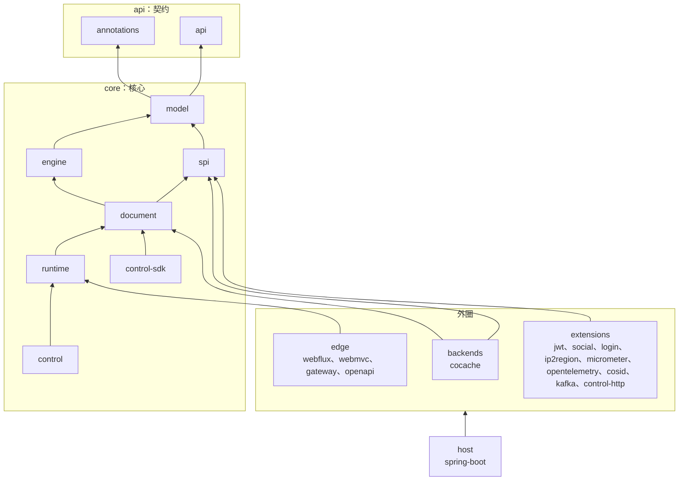

# RFC 0011：模块架构——六边形分层与目录分组

> 状态：已确认（2026-10-28，维护者："Write the RFC"，D1–D5 按协调者的建议采用） · 上位文档：[RFC 0001](0001-target-architecture.md) §4；
> [RFC 0006](0006-coroutine-pipeline.md) Q5（被本 RFC 修订：模块要改名）；[RFC 0008](0008-conformance-and-direct-build.md) L11 ·
> 被修订：[RFC 0013](0013-target-architecture.md) §3（`cosec-document` 模块、影子窗口的端口进 `spi`、`kafka` 进 `extensions/`）·
> 参考：Wow 的 [06 模块与目录](https://github.com/Ahoo-Wang/Wow/blob/main/documentation/designs/06-modules.md)、`test/architecture` ·
> 交付：§7 的 PR-1 至 PR-3 已于 2026-10-28 合入（#1139、#1141、#1155）
>
> **2026-11-23 合订**：此前的修订说明、补充、实现说明与决定（2026-10-28 至 2026-11-22，包括 §3 表中带日期的行）已并入正文，被取代的说法已删去；
> 章节号、D1–D5 与 PR-1–PR-3 的编号不变。starter 的启动检查、唯一 mapper 的严格读取与 D4 的落地并入 §6，作为 D2、D3、D4 下的小节（§6.1–§6.3），§6.4 是出自本 RFC 的规则索引。
> 合订前的全文见 git 历史：`git show 61e98a14:docs/rfc/0011-module-architecture.md`。修订沿革见文末。

## 0. 结论先行

目标是让核心模型稳定、可靠、可扩展：技术的变化只发生在外圈，核心模块的公共 API 不因第三方库、宿主或存储的变化而变化。

- **何时成为一个模块**：只有四个理由（§1）；都不满足的，用包划分。
- **分层**：`api` 契约 → `core`（模型、引擎、端口、文档、运行时、控制面及其门面）→ `backends`、`edge`、`extensions` → `host`（§2、§3）。
- **端口归它签名所用类型的那一层**：签名只用 `model` 与 `api` 类型的端口进 `spi`，其余留在 `runtime` 或 `control`（§3）。
- **原来的 `core/` 模块拆散**：端口进 `spi`，CoSec 存储与交换的格式进 `document`，请求路径进 `runtime`；`core/` 变成分组目录（§4）。
- **守卫集中到 `test/architecture`**：依赖图、源码引用与发布的元数据三类规则，取代分散在各模块的边界测试（§5）。
- **五项决定**（§6）：项目名去掉 `cosec-` 前缀；starter 改为按类路径装配，所需模块缺失时启动失败；Jackson 只作实现细节，不进入公共签名；
  ABI 校验与 API 分级；`gateway-server` 移到 `platform/`。

## 1. 模块的划分原则

一个边界值得成为模块，只有四个理由（与 Wow 相同）：

1. **依赖隔离**：用户只为自己选的技术付出依赖。
2. **有独立的消费者**：有人只需要它。
3. **独立的公开面**：它有自己的 ABI 承诺。
4. **架构约束要由编译器守住**：同一模块里的约束只能靠评审。

按这四条，讨论中提出过的两个模块，一个成立，一个不成立：

- `document` 成立（理由 1、2，详见 RFC 0013 §3.2）。它是 CoSec 存储和交换的格式：策略文档及其编解码器与编译器、格式描述符、路由映射、
  `CoSec-Identity` 与影子窗口的编解码、唯一的 Jackson mapper。它是一片叶子，不依赖请求路径；`migrate`（命令行工具）与 `openapi`（生成器）只要它，
  控制面对 `runtime` 的引用也大多是文档，它若留在 `runtime` 里，只要它的使用方就要背上整条请求路径；写进文档的稳定 API（`PolicyDocument`、`PolicyDocumentCodec`、
  `PolicyDocumentCompiler`、`RouteMap` 等）的包名在 8.x 的整个周期里冻结，不应带着与它们无关的 `runtime`。快照源编译文档所经的端口
  `SnapshotCompiler` 在 `spi`，所以 `document` 不认识 `runtime`。
- `json`（Jackson 编解码单独成适配器，加 `DocumentCodec` 端口）不成立：要挡在核心之外的是 Reactor 与 Spring；Jackson 作为实现细节留在核心模块里，
  唯一的 mapper 在 `document`，条件见 D3。

成立的新模块还有 `spi`：

- 理由 2：第三方实现 `MembershipProvider`、`AttributeProvider` 或存储时，只需要端口。
- 理由 4：PR-2 之前，`cocache` 以 `api(project(":cosec-core"))` 依赖原来的 `core/` 模块，并以 `compileOnly` 依赖 `cosec-control` 与 `cosec-runtime`，
  后端伸进了应用层。端口独立之后，后端只依赖 `spi` 与 `document`（§5）。

`runtime` 不再拆：`snapshot`、`event`、`audit`、`identity` 的使用方本来就依赖整条请求路径，再分模块只多出构件，不减少任何依赖（RFC 0013 §3.1）。

## 2. 分层

依赖只指向内圈；外圈模块之间不互相依赖，例外以数据登记在 `test/architecture`（§5）：`jwt` → `login`（`jwt` 实现 `login` 的签发端口）、
`social` → `login`、`gateway` → `webflux`。`model` 依赖 `annotations`：否则带稳定性标记的类型可以不声明 opt-in 就被使用。
`control-sdk` 只依赖 `api`、`spi` 与 `document`，绝不依赖 `runtime` 与 `control`：只经 HTTP 调用控制面宿主的应用两样都不带。只有 `host` 看得到全部模块。

## 3. 模块与目录

端口归**定义它签名所用类型的那一层**，不一律进 `spi`：`spi` 只收签名只用 `model` 与 `api` 类型（以及普通值）的端口。
`ControlStore`（签名用控制面的变更与修订模型）与 `ChangeListener` 留在 `control`；`DecisionListener`（`DecisionEvent` 带引擎的 `FlatTrace` 与
`SnapshotView`、运行时的认证结果）与 `RequestGate` 留在 `runtime`。把这些模型搬进 `spi` 会让 `spi` 依赖 `engine` 与 Jackson，违反 §2；
改成传字节则是新的抽象，违反 RFC 0010 Q1。

| 目录 | 项目 | 构件 | 内容 |
|---|---|---|---|
| `api/annotations/` | `:annotations` | `cosec-annotations` | 稳定性标记：`@InternalCoSecApi`、`@ExperimentalCoSecApi`、`@CoSecSpi`（D4） |
| `api/api/` | `:api` | `cosec-api` | 7.x 留下的薄契约（RFC 0008 L11），宿主代码会 import：主体视图 `CoSecPrincipal`（仍扩展 `java.security.Principal`）、令牌、`SecurityContext`、审计事件 |
| `core/model/` | `:model` | `cosec-model` | 决策模型、条件 AST、绑定、属性目录；`CoSecException` |
| `core/engine/` | `:engine` | `cosec-engine` | 编译后的结构与求值（不变） |
| `core/spi/` | `:spi` | `cosec-spi` | 签名只用 `model` 与 `api` 类型的端口及其值：快照文档存储与 `SnapshotCompiler`、`MembershipProvider`、`RevocationReader`、`TokenVerifier` 与令牌存储、`ApiKeyReader`、`RateLimiter`、`AttributeProvider`、`Authenticator`（含 `Identity` 与声明值）、`AuditEventSink`、`IdGenerator`、影子窗口的端口与值（`spi.shadow`）；它们的内存实现 |
| `core/document/` | `:document` | `cosec-document` | CoSec 存储和交换的格式：策略文档及其编解码器与编译器、格式描述符（生成 `schema/`）、路由映射、`CoSec-Identity` 与影子窗口的编解码、唯一的 Jackson mapper（RFC 0013 §3）。只依赖 `engine`、`spi` 与 Jackson |
| `core/runtime/` | `:runtime` | `cosec-runtime` | 请求路径：Pipeline、快照源与视图、令牌校验、身份传递、限流义务、决策事件与审计、影子记录；适配器契约（`RequestGate`、`HttpFacts`、`Outcome`，包 `runtime.http`） |
| `core/control/` | `:control` | `cosec-control` | 控制面，含 `ControlStore`、`ChangeListener` 与门面的进程内实现 |
| `core/control-sdk/` | `:control-sdk` | `cosec-control-sdk` | 应用调用控制面的门面（`CTL-65`、`CTL-76`）：`ControlService` 一个接口两种实现（进程内的在 `cosec-control`，HTTP 的在 `cosec-control-http`）、`ControlCaller`、`ControlRefusedException`，以及类型化层 `ControlClient` 与它的类型。依赖 `api`、`spi`、`document`，绝不依赖 `runtime` 与 `control` |
| `backends/cocache/` | `:cocache` | `cosec-cocache` | Redis 上的存储端口实现，以及控制面的 `ControlStore` |
| `edge/webflux/`、`edge/webmvc/`、`edge/gateway/` | `:webflux` 等 | `cosec-webflux` 等 | 驱动适配器，只翻译 |
| `edge/openapi/` | `:openapi` | `cosec-openapi` | 由 OpenAPI 生成路由映射；只依赖 `cosec-document` |
| `extensions/jwt/`、`social/`、`login/` | `:jwt` 等 | `cosec-jwt` 等 | 凭据；`login` 是登录与 token 签发（从原来的 `core/authentication`、`core/token` 的签发部分、`api/authentication` 移来），与其余扩展一样是 `suspend`，不用 Reactor |
| `extensions/ip2region/`、`micrometer/`、`opentelemetry/` | | | 属性提供者、指标、追踪 |
| `extensions/kafka/` | `:kafka` | `cosec-kafka` | 审计与变更通知：`DecisionListener` 与 `ChangeListener` 的实现。它实现的是监听器，不是 `spi` 的存储端口，所以不是后端 |
| `extensions/control-http/` | `:control-http` | `cosec-control-http` | `ControlService` 的 HTTP 实现（`CTL-77`），调控制面宿主的服务端口，用 JDK 的 HTTP 客户端。依赖 `control-sdk` 与 `runtime`：以请求主体的身份调用时，身份头要用网关转发身份的那一套映射来写，而它在 `runtime` 里 |
| `extensions/cosid/` | `:cosid` | `cosec-cosid` | 基于 CosId 5 的 `IdGenerator`，由 starter 按类路径装配；只有它与 `host/spring-boot` 可以引用 `me.ahoo.cosid`（§6.3） |
| `host/spring-boot/` | `:spring-boot` | `cosec-spring-boot` | 自动配置，只做装配（D2） |
| `migration/migrate/` | `:migrate` | `cosec-migrate` | 7.x 数据迁移 |
| `test/testkit/` | `:testkit` | `cosec-testkit` | 用户的策略测试工具 |
| `test/conformance/`、`test/architecture/`、`test/e2e/`、`test/client-host/`、`test/system-test/`、`test/system-behind/`、`test/system-auth/`、`test/system-enforcer/`、`test/code-coverage-report/` | | 不发布 | 规范一致性、架构规则、端到端、客户端测试所对的宿主、系统测试及其服务、覆盖率 |
| `bom/bom/` | `:bom` | `cosec-bom` | 只对齐 CoSec 自己的、作为依赖使用的模块（不含 `cosec-migrate`），不导入任何第三方平台 |
| `bom/dependencies/` | `:dependencies` | 不发布 | CoSec 自己构建与测试所用版本的内部平台；任何发布的模块都不提它（下文） |
| `platform/gateway-server/` | `:gateway-server` | Docker 镜像（不发布到 Maven） | 给用户直接部署的网关服务；也是端到端、AOT 与压测的对象（D5） |
| `platform/control-server/` | `:control-server` | Docker 镜像（不发布到 Maven） | 给用户直接部署的控制面宿主（`STA-10`）：starter 加控制面，别的都没有；不验证任何凭据，相信到达它的 `CoSec-Identity`，运维必须写明谁能到达它才启动。设计见 `docs/reviews/2026-11/control-server-design.md` |

根目录保留 `config/`、`docs/`、`gradle/`、`k8s/`、`schema/`、`scripts/`、`skills/`、`wiki/`。

**`cosec-dependencies` 不发布。** 它导入 Spring Boot、CoCache 等的 BOM，并管着测试与构建工具；发布的元数据若导入它，一个应用加入一个 CoSec 模块，
整个构建的版本就被抬高。所以库模块用一个不进入任何发布变体的配置取得这个平台，发布时写出它实际解析到的版本（“至少这个版本”）；POM 把仅编译期的
API 依赖（`compileOnlyApi`）写成 `provided`，否则 Maven 使用方加入 `cosec-cocache` 就把 `cosec-control` 与 `cosec-runtime` 带到运行时。守卫见 §5。

**`typescript/`，一个不属于 Gradle 的工作区。** CoSec 的 TypeScript 客户端在本仓库（维护者决定）：`typescript/cosec-fetcher`
（`@ahoo-wang/cosec-fetcher`，CoSec 应用的客户端）与 `typescript/cosec-react`（`@ahoo-wang/cosec-react`，它的 React 钩子）。它是一个独立的
pnpm 工作区，有自己的锁文件，与 `wiki/` 的互不相见；不是 Gradle 项目，所以不在 §5 的项目清单里，由 `test/architecture` 的
`TypeScriptWorkspaceTest` 单独约束：包名与目录、版本等于 `gradle.properties` 的版本（Maven 与 npm 由同一个标签发布）、只有一个锁文件、
依赖方向单向指向 fetcher 的包且不依赖被它取代的 `@ahoo-wang/fetcher-cosec`、CI 的任务不带条件与密钥并在必需检查之内。Kotlin 的结构规则
（每文件 400 行、一个类型）不适用于它；与 `api/<project>.api` 对应的是每个包的公共 API 报告。客户端可以依赖什么，以
`wiki/integration/clients.md` 为准；它的测试对着本仓库的一个真实的 CoSec 应用（`test/client-host`）运行，所以改了线上契约而没有改客户端的 PR 不会通过。

包名与模块对齐：`me.ahoo.cosec.spi.*`、`me.ahoo.cosec.document.*`、`me.ahoo.cosec.runtime.*` 等；同一个包不跨模块。

## 4. 今天的 `core/` 与 `api/` 的去向

本节记录 PR-2（与 RFC 0013 §3 的移动）之前、8.0 开发期间的 `core/` 模块与 `api/` 中各部分的去向，是 §1 至 §3 的动机；按死代码清理（RFC 0008 PR-5）之后的剩余内容为准，去向写的是今天的位置。

| 原来 | 去向 |
|---|---|
| `core/snapshot`（`SnapshotDocumentStore`、`InMemorySnapshotDocumentStore`） | 端口、内存实现与 `SnapshotCompiler` 进 `spi`，快照源进 `runtime` |
| `core/snapshot/document`、`core/snapshot/format` | `cosec-document`（`document`、`document.format`） |
| `core/membership`、`core/apikey`、`core/limiter`、`core/token` 的校验与吊销部分 | 端口进 `spi`，实现与解析进 `runtime` |
| `core/token` 的签发部分、`core/authentication`、`api/authentication` | `extensions/login` |
| `core/identity`、`core/route`、`core/audit` | 编解码与路由映射进 `cosec-document`，身份的签发与校验、审计监听器进 `runtime`；`AuditEventSink` 进 `spi` |
| `core/context`（`SecurityContextHolder` 等） | 宿主可见的部分进 `api`，线程绑定的实现进 `edge/webmvc` |
| `core/serialization` | 唯一的 mapper，在 `cosec-document`（`document.json`） |
| `CoSecException`、`Delegated` | `model` |
| `api/` 中只有 7.x 用的类型 | 由 PR-5 删除 |

## 5. 守卫：`test/architecture`

照 Wow 的 `ArchitectureRules`、`DependencyRule`、`MainProjectDependenciesTest`：

- **项目清单**：一个类按组列出每个项目（目录、项目名、组）；`settings.gradle.kts` 里的项目必须恰好属于一个组。
- **依赖图**：读各项目的 `main` 依赖，检查 §2 的方向。
- **源码引用**：扫描 `src/main` 的 import 与全限定名。

| 组 | 允许依赖 |
|---|---|
| `annotations`、`api`、`model`、`engine` | 仅标准库（`model` 依赖 `annotations` 的标记） |
| `spi` | 以上，加 kotlinx-coroutines |
| `document` | `engine`、`spi`，加 Jackson；没有日志门面 |
| `runtime`、`control` | 以上，加日志门面；不得引用 Reactor、Spring、Servlet、Redis 客户端 |
| `control-sdk` | `api`、`spi`、`document`；与 `runtime`、`control` 一样不得有 Reactor、Spring、Servlet、Redis 客户端，且运行时类路径上没有 `runtime` |
| `backends` | `spi`、`document` 与自己的技术。**不依赖 `runtime`**：主代码不声明、运行时类路径解析不到、类不引用 `me.ahoo.cosec.runtime.*`（编译类路径不查：`cocache` 以 `compileOnlyApi` 用 `control` 实现 `ControlStore`）。对 `document` 只用四样：唯一的 mapper（`CoSecJson`）、每种存储记录的格式号怎么读写（`StoredFormat`，`CTL-53`）、它所存格式的编解码器（`ShadowCodec`）、构造它返回的 `SnapshotDocument` 的唯一办法（`SnapshotDocuments`，只读文档头，`SNP-12`）：后端只存字节，不读文档授予了什么。对 `control` 只经 `test/architecture` 里的数据白名单 |
| `edge`、`extensions` | `spi`、`document`、`runtime`。Reactor 只允许出现在 `edge` 与 `host`：`extensions` 不用（`cocache` 的例外见下表）。`openapi` 只依赖 `document`，运行时类路径上没有 `runtime`；`kafka` 对 `control` 只用变更监听端口 |
| `host` | 全部；Spring 只允许出现在 `host` 与 `edge` |
| 任何模块的 `main` | 不得依赖 `test/*` 与 `platform/*` |
| `platform/*` | 是 CoSec 模块的应用：只依赖发布的模块，像用户一样使用它们；上面各组的规则不适用于它 |

再加一条：`core/*` 的公共签名中不得出现 `tools.jackson.*`（D3）。

发布出去的东西也有守卫：`PublishedMetadataTest` 读每个发布模块与 BOM 生成的 POM 和 Gradle 模块元数据，不得有平台导入、没有版本的依赖、测试或构建工具；
POM 带进运行时的不得多于 Gradle 的运行时变体，仅编译期的 API 依赖在 POM 里是 `provided`；后端与只读写文档的模块（`openapi`、`control-sdk`）的 POM
不带 `cosec-runtime`；BOM 恰好是作为依赖的那些模块。

例外都以数据形式登记在 `test/architecture`，新增一条就是一次评审过的改动：

| 例外 | 理由 |
|---|---|
| `cocache` 可以引用 `me.ahoo.cosec.document.json.CoSecJson`、`document.json.StoredFormat`、`document.shadow.ShadowCodec`（都是 `@InternalCoSecApi`）与 `document.SnapshotDocuments` | 存储格式只有一份配置，字节固定测试覆盖每一种存储类型；`StoredFormat` 是每种存储记录的格式号怎么读写（`CTL-53`），`ShadowCodec` 是它所存格式的编解码，`SnapshotDocuments` 是构造它返回的 `SnapshotDocument` 的唯一办法，只读文档头（`SNP-12`）。四项都不读文档授予了什么 |
| `cocache` → `control`（`compileOnlyApi`），只到 `ControlStore` 的包与它签名所带的变更值 | `CoCacheControlStore` 实现控制面的 `ControlStore` |
| `kafka` → `control`，只到变更监听端口与它的事件 | `KafkaChangeListener` 是控制面的 `ChangeListener` |
| `gateway` → `webflux` | 网关过滤器运行在 WebFlux 桥上 |
| `social` → `login` | 社交登录是 `login` 的一个认证提供者 |
| `cocache` 内部使用 Reactor | 非阻塞的 Redis 读取用 Spring Data Redis 的响应式 API；公共签名中不得出现 Reactor 类型 |
| `backends`、`extensions` 使用各自技术的 Spring 部分（`cocache`：`data.redis`、`aot.hint`；`kafka`：`spring-kafka` 与 `DisposableBean`；`social`：`data.redis.core`） | 只限它所适配的技术 |
| `testkit` 的 `me.ahoo.cosec.testkit.webflux` 与 `.webmvc` 两个包使用 Reactor、Spring 与 Servlet API（以 `compileOnly` 依赖 `webflux`、`webmvc`，`ApiVariantTest` 为这两个包登记了评审过的例外），工具包其余部分不用 | 测试绑定（`PIP-29`）属于测试工具，不随适配器的生产 jar 发布；应用只加一个测试依赖。由 `SourceRulesTest` 的正面规则约束 |

`EnginePurityTest`、`RuntimeBoundaryTest`、`ControlBoundaryTest` 与 `verifyPureClasspath` 的规则并入这里，原测试删除；`RuntimeBoundaryTest` 中
不属于依赖方向的规则（`runBlocking`、`GlobalScope`、`Dispatchers.IO`、`runCatching`）作为源码规则一并迁入。

## 6. 决定

| # | 决定 | 理由 |
|---|---|---|
| D1 | **项目名去掉 `cosec-` 前缀**（`:engine` 在 `core/engine`），根构建把 jar 名与 Maven `artifactId` 设为 `cosec-<name>`；构件坐标不变 | 与目录一致（Wow D87）。代价：CI 工作流、`property-stress.yml` 的 `modules` 输入、AGENTS.md 与文档里的 `:cosec-*` 全部改；`jmh-v7-v8.yml` 的 v7 一侧保留旧名 |
| D2 | **starter 取消 Gradle 特性变体**，改为一个按类路径生效的自动配置模块 `cosec-spring-boot`；用户直接加技术模块（`cosec-cocache`、`cosec-webflux` …） | 特性变体只在 Gradle 里有效，Maven 用户只能手工补依赖（Wow D44）。**fail closed**：由属性或宿主的类路径开启的功能，缺它所需的东西（模块、必需的监听器、Redis 连接）时启动失败，错误信息写明要加什么；规则 `STA-1`（`startup` 级）。starter 的启动检查见 §6.1 |
| D3 | **Jackson 作为核心模块的实现细节**：唯一的 mapper 在 `document`，`runtime`、`control` 可以在实现里用它 | 要挡在核心外的是 Reactor 与 Spring。条件：公共 API 只收发 `ByteArray`、`String` 或 CoSec 自己的类型；`PolicyDocumentCodec.decode(…, JsonNode)` 是 `@InternalCoSecApi`，`ConditionJson`、`RouteMapCodec.tree(…): ObjectNode` 是 `internal`，`testkit` 需要时以 `@InternalCoSecApi` 打开。否则 Jackson 的一次大版本升级就是 CoSec 的破坏性变更。这个 mapper 同时是严格的（§6.2） |
| D4 | **ABI 校验与 API 分级**：Kotlin Gradle 插件的 `abiValidation` 进入 `check`，每个发布模块保存转储文件；`@InternalCoSecApi`（opt-in 为 ERROR，不进转储）、`@ExperimentalCoSecApi`（WARNING，进转储） | 核心模型的稳定靠构建守住，不靠评审（Wow D216、D282）。RC 时开启，GA 时冻结：此后转储的删除或签名改变即破坏性变更，PR 标题带 `!`。落地见 §6.3 |
| D5 | **`gateway-server` 移到 `platform/`** | 它是给用户直接部署的产品（Docker 镜像），不是示例，也不是库：它是 CoSec 模块的一个应用，只依赖发布的模块，与 Wow 的 `platform/` 服务同一种定位。Maven 不发布它 |

RFC 0006 Q5（不改模块名）由 D1 修订。RFC 0008 L11（`cosec-api` 保留为薄契约模块）不变，内容按 §3 收窄。

### 6.1 D2：starter 的启动检查

**模块检查（`STA-1`）。** 由 `CoSecModuleCheckAutoConfiguration` 实现，排在所有自动配置的最前面：缺一个模块时，报出的是要加哪个构件，
而不是缺模块造成的某个 bean 先因别的原因失败。每项检查只在需要那个模块的功能开启时生效，没有功能用到的模块什么都不需要：网关之后的服务
（`cosec.pipeline.mode=gateway`）关闭 JWT 时不装配 Redis 的数据面，类路径上有 `cosec-cocache` 也不需要 Redis。`cosec-cocache` 被用到时，
还检查 Redis 模板与 CoCache 的 `CacheRuntime`（没有它，快照会退回一个永远不就绪的空存储），错误信息指向 CoCache 的 starter。

**延迟初始化不会关掉任何检查（`STA-3`）。** starter 的每个启动检查都是一个 `StartupTask` bean，延迟初始化不会推迟它：
`spring.main.lazy-initialization=true` 下，检查照样让启动失败。必须不经请求就运行的组件（驱逐策略监视、影子上报、控制面维护、监听器指标的绑定）
同样在启动时开始。结构测试（`StartupTaskTest`）保证 starter 的自动配置里没有返回裸 `InitializingBean` 或 `SmartInitializingSingleton`
（或把类型写成 `Any`）的 `@Bean` 方法。

**网关宿主的 Actuator 端点（`STA-2`）。** 由 `CoSecGatewayEndpointCheckAutoConfiguration` 实现，在启动时检查网关宿主：

- **检查条件：** Spring Cloud Gateway 宿主，执法模式，且 CoSec 打开。
- **失败条件：** 应用端口（未设 `management.server.port`，或它等于应用端口）上通过 HTTP 暴露了 `health` 以外的 Actuator 端点，除非
  `cosec.gateway.unprotected-endpoints` 列出了它；错误信息写明端点、要设什么与文档。`gateway` 端点在任何端口上都不能列入。独立的管理端口上，
  或管理服务器关闭时，任何端点都可以暴露。
- **按真实端点检查：** 操作端点与控制器端点一样检查，包括 Spring Cloud Gateway 自己的 `@RestControllerEndpoint`。

**应用提供的任何东西，在宿主打开的每个端口上都要先经过 CoSec（`STA-4`）。**

- **事实。** WebFlux 的管理服务器是一个子上下文，它收集父上下文的 `PipelineWebFilter`，它的 `RouterFunctionMapping` 也读到父上下文的
  `RouterFunction` bean：应用用函数式写的路由在管理端口上有应答（应用的 `@Controller` 在那里是 404）。WebMvc 的 `FilterRegistrationBean`
  到不了管理服务器。
- **定下的。** 被 CoSec 把守的范围不变。在宿主打开的每一个端口上，应用提供的东西都不会不经 CoSec 就应答：WebFlux 应用的管理服务器
  （`management.server.port` 不同于应用端口）在管道之下，它的探针与它继承的应用函数式路由都是；WebMvc 应用的管理服务器只提供 Actuator 的端点，
  控制器、函数式路由都不在那里应答；网关的管理服务器只提供 Actuator 的端点，网关的路由只在 Spring Cloud Gateway 分不清端口时（随机的管理端口）
  在那里应答，且在网关的过滤器之下。CoSec 自己的路由（控制面接口、登录路由）在任何宿主的管理端口上都不提供（`CTL-69`）。只有一个端口时，探针就是
  普通的请求。这些由带真实服务器的测试逐项钉住（`ManagementPortTest`）：Spring Boot 升级改变子上下文继承的东西时，是这些测试先知道。
- **否决的做法。** 按路径豁免探针：适配器里的第二条判定路径，路径匹配与路由之间的任何差异都是绕过。在 WebFlux 的管理服务器上跳过过滤器、
  同时由 starter 清空子上下文的函数式路由映射：应用的路由在那个端口上是否受保护，从此取决于 CoSec 是否跟得上 Spring 的子上下文继承了什么，
  漏掉一项时的失败方向是放行。
- **应用怎样配探针（写进文档）。** 经过 CoSec 的服务器上，探针就是一个请求：就绪探针需要平台文档里一条放行它的语句，文档发布之前回答 `503`，
  而“还没就绪”正是这时该有的回答。存活与启动探针不能依赖平台文档：WebMvc 用管理端口；WebFlux 不用经过 CoSec 的 HTTP 探针，用应用端口上的
  `tcpSocket`。没有测的：Jetty 与 Undertow，真实的 kubelet（重启循环是由存活探针的 `503` 推断的）。文档在 `wiki/integration/web.md`
  （应用上的 Actuator）、`wiki/operations/deployment.md`（就绪）与 `wiki/operations/troubleshooting.md`。

**应用声明了 CORS 的来源时，starter 把 CORS 过滤器接在管道之前（`STA-5`）。**

- **事实。** CoSec 不设置任何 `Access-Control-*` 响应头。没有这个过滤器时，在 Spring MVC 与 WebFlux 上，浏览器的预检请求（不带凭据的
  `OPTIONS`）先到 CoSec，被当作匿名调用方的 `http:OPTIONS` 判定，应用自己的 `@CrossOrigin` 与 `addCorsMappings` 轮不到应答；只用策略放行
  `OPTIONS` 得到的是不带 CORS 头的 `200`，浏览器照样拦截。唯一能让预检请求与被拒绝的响应都被脚本读到的安排，是在 CoSec 之前有一个 CORS 过滤器；
  网关的 `globalcors` 本来就是这样。
- **定下的。** 应用声明了 `CorsConfigurationSource`（两个栈各自的那个接口），且没有自己注册 `CorsFilter` 或 `CorsWebFilter` 时，starter 在管道的
  过滤器之前紧挨着注册一个 CORS 过滤器。预检请求（带 `Origin` 与 `Access-Control-Request-Method` 的 `OPTIONS`）由它应答，不被判定；不是预检的请求
  照旧判定，被拒绝的响应带 CORS 头。没有这个 bean 时什么都不注册：预检请求被当作匿名调用方的 `http:OPTIONS` 判定。不新增 `cosec.*` 属性，bean 就是开关。
  Spring MVC 总有一个 `CorsConfigurationSource`，即它自己的 `HandlerMappingIntrospector`（读各处理器的 `@CrossOrigin` 与 `addCorsMappings`），
  它不是应用的声明：条件与工厂都把它排除在外，应用自己声明的不是恰好一个时启动失败并说明要自己注册 `CorsFilter`。WebFlux 上没有这样的默认 bean。
  网关宿主不从 starter 得到这个过滤器（`globalcors` 不是 bean）。
- **代价，写进文档。** 预检请求不经过 CoSec：策略对 `http:OPTIONS` 的 DENY、限流、黑名单、审计、判定事件与指标都看不到它。不带
  `Access-Control-Request-Method` 的 `OPTIONS` 不是预检请求，照旧判定。来源不被允许的跨域请求由 CORS 过滤器在管道之前以普通的 `403` 拒绝，
  不是 problem+json，也没有 `CoSec-Request-Id`。预检请求只从这个 bean 应答，`@CrossOrigin` 与 `addCorsMappings` 只作用于随后的请求。
- **由带真实服务器的测试钉住**（两个栈，`CorsWiringTest`），连同一个把装配改成无条件的变异体；它改变了管道能看到什么，所以进升级文档。

### 6.2 D3：唯一的 mapper 是严格的

`CoSecJson.mapper` 打开 `STRICT_DUPLICATE_DETECTION`（`DOC-5`）：CoSec 读的每种存储格式（文档、API Key、成员关系、影子报告、吊销、
`cosec-migrate` 读的 7.x 输入）与每个控制面请求体都拒绝重复的 key，不按后出现的值读。吊销缓存也用它，不用应用的 `ObjectMapper`。
唯一的例外是 starter 读 Spring 的配置元数据（`UnknownProperties`）：那不是 CoSec 的格式，用 `without(STRICT_DUPLICATE_DETECTION)` 读，后出现的值生效。

### 6.3 D4 的落地

- 用 Kotlin Gradle 插件内置的 `abiValidation`（不另加插件），转储在各模块的 `api/<project>.api`，`checkKotlinAbi` 随 `check` 运行，`updateKotlinAbi` 重写转储。
  `cosec-migrate` 不做 ABI 校验：它的契约是命令行，类不是库 API。
- `@CoSecSpi` 是纯文档标记（不用 `@SubclassOptInRequired`：这些接口本来就是给应用实现的，强制 opt-in 会让最常用的扩展点看起来不稳定）；
  `SpiMarkerTest` 要求 `cosec-spi` 的每个可实现公共接口与 `wiki/architecture/extending.md` 扩展点表中的每个类型都带它。
- `@ExperimentalCoSecApi` 标在可能在次版本中改变的声明上；带它的声明以转储为准。GA 后删除或改变一行转储是破坏性变更（PR 标题带 `!`），
  `@ExperimentalCoSecApi` 声明的行除外。
- `RequestGate` 带 `@SubclassOptInRequired(InternalCoSecApi::class)`：只有 CoSec 能实现（以后放开是新增，以后收紧才是破坏）。
- 控制面的执法组件不可替换：`ControlAuthorizer`、`ChangeAuthority`、`Changes`、`ControlPlane`、`ControlHttp` 不是 `@ConditionalOnMissingBean`，
  starter 的启动检查要求每种恰好是 CoSec 自己的那一个 bean，第二个同类 bean 让启动失败；`DocumentConfirmation` 由 starter 在装配授权时构造，不是 bean。
  `ControlStore`、变更监听器、`ChangeOptions` 与维护调度仍可替换。
- 原则：GA 前把公共面收到最小（改成 `internal` 现在零成本，GA 后就是破坏）。各发布模块的公共声明在 ABI 冻结前已逐一归类（#1354、#1356、#1358，
  RFC 0010 修订沿革 2026-11-14）；应用测试要用的 Pipeline 夹具由 `cosec-testkit` 公开提供。
- CosId：只有 `extensions/cosid` 与 `host/spring-boot` 可以引用 `me.ahoo.cosid` 或解析 CosId 构件（`DependencyRules.COSID_OWNERS`）：
  CoSec 的 id 由 `IdGenerator` 产生，应用用哪个版本的 CosId 都能把 CoSec 放上类路径。

### 6.4 出自本 RFC 的规则

措辞与守卫以规则登记表（`test/conformance/src/test/resources/rules/`）为准；破坏这些规则的变异体在 `test/conformance/mutants/`。

| 规则 | 级别 | 一句话 |
|---|---|---|
| `STA-1` | startup | 由属性或宿主类路径开启的功能，缺它所需的东西（模块、必需的监听器、Redis 连接）时启动失败并写明要加什么；没有功能用到的模块什么都不需要 |
| `STA-2` | startup | 执法模式的 Spring Cloud Gateway 宿主，应用端口上经 HTTP 暴露了 `health` 以外、未被 `cosec.gateway.unprotected-endpoints` 列出的任何 Actuator 端点（操作端点或控制器端点）时启动失败，该属性在哪里都不接受 `gateway`；独立的管理端口上或管理服务器关闭时，任何端点都可以暴露 |
| `STA-3` | startup | 不论 `spring.main.lazy-initialization` 怎么设，starter 的每个启动检查照样让启动失败，持续运行的组件照样在启动时开始：它们都是延迟初始化不会推迟的 `StartupTask` bean，没有一个以别的方式声明 |
| `STA-4` | startup | 在宿主打开的每个端口上，应用提供的东西没有一样不经 CoSec 就应答：WebFlux 应用的管理服务器在管道之下；WebMvc 应用与网关的管理服务器只提供 Actuator 的端点（网关的路由只在随机管理端口上、在网关的过滤器之下应答）；CoSec 自己的路由不在管理端口上 |
| `STA-5` | startup | 应用声明了 `CorsConfigurationSource` 且没有自己的 CORS 过滤器时，starter 在 Spring MVC 与 WebFlux 上紧挨管道之前注册一个：预检请求由它应答、不被判定，其余请求照旧判定，不被允许的来源在管道之前被它拒绝；没有这个 bean 时什么都不注册 |
| `DOC-5` | build | CoSec 读的每种存储格式与每个控制面请求体都拒绝重复的 key |

## 7. 交付

| PR | 内容 | 前置 | 状态 |
|---|---|---|---|
| PR-1 | `refactor(build)!`：按 §3 移动目录；D1；D5；`test/architecture` 建立，迁入现有边界测试与 `verifyPureClasspath` | RFC 0008 PR-5、RFC 0010 C1–C3 合入 | 已合入（#1139） |
| PR-2 | `refactor!`：新建 `spi`，按 §4 拆散 `core/`，包名对齐；`extensions/login`；D3；D2 与 `STA-1`；§5 的全部规则 | PR-1 | 已合入（#1141） |
| PR-3 | `build`：D4 | RC 之前 | 已合入（#1155） |

- 两个 PR 都以移动代码为主；PR-2 的行为改动只有 D2 的启动检查。
- 每个 PR：受影响模块的 `check`（本机一次一个模块），`:conformance:mutationCheck` 一次，`pnpm build`；完整矩阵由 CI 跑。
- 文档：`wiki/architecture/overview.md`（模块图）、`wiki/architecture/extending.md`（端口在 `spi`）、`wiki/guide/quick-start.md` 与
  `skills/cosec-integration`（依赖写法改为直接加技术模块）、`wiki/operations/upgrading.md`（包名映射、构件变化）、AGENTS.md（模块表、命令）。
- RFC 0009 PR-3（API Key 新格式）排在 PR-2 之后，按新结构写。

## 修订沿革

只列日期与出处，内容都在正文里。

- 2026-10-28：确认（#1135）；端口归层（#1140）；§5 的例外（#1142）；PR-1、PR-2、PR-3（#1139、#1141、#1155）。
- 2026-10-29：D4 的落地（#1155）；CosId（#1170）。
- 2026-11-03：`STA-2`（#1194）。
- 2026-11-04：严格的 mapper（#1200，`DOC-5`）。
- 2026-11-08：`STA-1` 的 `CacheRuntime` 检查（#1283）；模块检查按需生效（#1293）。
- 2026-11-09：令牌契约（#1302）；`cosec-login`、`cosec-social` 转 `suspend`（#1303）；`cosec-model` 依赖 `cosec-annotations`（#1307）。
- 2026-11-14：`STA-3`（#1339）；`cosec-document`、影子端口、`kafka`（RFC 0013 §3，#1369、#1370、#1372）。
- 2026-11-15：`cosec-dependencies` 不再发布（#1408）。
- 2026-11-17：`STA-4`（#1558）；`STA-5`（#1576）；`typescript/` 工作区（#1569、#1571）。
- 2026-11-19：测试工具包的测试绑定（#1705）。
- 2026-11-21：控制面宿主（#1793，`STA-10`）；`cosec-control-sdk`（#1832、#1836）；管理端口上不提供 CoSec 自己的路由（#1811，`CTL-69`）。
- 2026-11-22：`cosec-control-http`（#1837）。
- 2026-11-23：合订。
