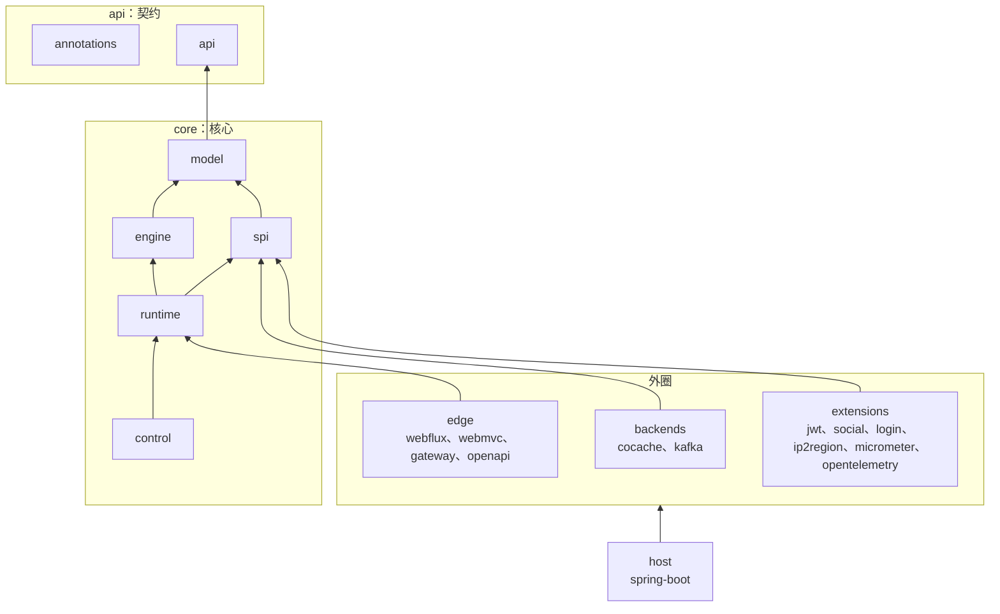

# RFC 0011：模块架构——六边形分层与目录分组

> 状态：已确认（2026-10-28，维护者："Write the RFC"，D1–D5 按协调者的建议采用） · 上位文档：[RFC 0001](0001-target-architecture.md) §4；
> [RFC 0006](0006-coroutine-pipeline.md) Q5（被本 RFC 修订：模块要改名）；[RFC 0008](0008-conformance-and-direct-build.md) L11 ·
> 参考：Wow 的 [06 模块与目录](https://github.com/Ahoo-Wang/Wow/blob/main/documentation/designs/06-modules.md)、`test/architecture` ·
> 基线：`main` @ `457092c2` · 交付：§7 的 PR-1、PR-2 排在 RFC 0008 PR-5（死代码清理）与 RFC 0010 的 C1–C3 之后，GA 之前合入；PR-3 在 RC 之前

> **2026-10-28 修订（PR-2 盘点）**：端口归**定义它的类型所在的层**，不一律进 `spi`。`ControlStore`（签名用控制面的变更与修订模型、文档模型）、
> 影子报告存储、`ChangeListener` 留在 `control`/`runtime`；`DecisionListener`（`DecisionEvent` 带引擎的 `FlatTrace` 与 `SnapshotView`、
> 运行时的 `AuthnResult`）留在 `runtime`。把这些模型搬进 `spi` 会让 `spi` 依赖 `engine` 与 Jackson，违反 §2；改成传字节则是新的抽象，
> 违反 RFC 0010 Q1。`spi` 只收签名只用 `model` 与 `api` 类型的端口（§3 的表已按此改）。§5 的 `backends` 规则改为显式白名单（下文）。

## 0. 结论先行

目标是让核心模型稳定、可靠、可扩展：技术的变化只发生在外圈，核心模块的公共 API 不因第三方库、宿主或存储的变化而变化。

- **何时成为一个模块**：只有四个理由（§1）；都不满足的，用包划分。
- **分层**：`api` 契约 → `core`（模型、引擎、端口、运行时、控制面）→ `backends`、`edge`、`extensions` → `host`（§2、§3）。
- **今天的 `core/` 模块拆散**：端口进新的 `spi`，其余进 `runtime`；`core/` 变成分组目录（§4）。
- **守卫集中到 `test/architecture`**：依赖图与源码引用两类规则，取代分散在各模块的边界测试（§5）。
- **五项决定**（§6）：项目名去掉 `cosec-` 前缀；starter 改为按类路径装配；`runtime` 允许使用 Jackson，但 Jackson 不进入公共签名；
  RC 时启用 ABI 校验与 API 分级；`gateway-server` 移到 `platform/`。

## 1. 模块的划分原则

一个边界值得成为模块，只有四个理由（与 Wow 相同）：

1. **依赖隔离**：用户只为自己选的技术付出依赖。
2. **有独立的消费者**：有人只需要它。
3. **独立的公开面**：它有自己的 ABI 承诺。
4. **架构约束要由编译器守住**：同一模块里的约束只能靠评审。

按这四条，讨论中提出过的两个模块不成立：

- `document`（文档模型与编译器单独成模块）：没有独立的消费者，不隔离依赖。而且 `PolicyDocumentCompiler` 依赖快照层的
  `SnapshotCompiler`、`SnapshotDocument`、`SnapshotKey`、`SnapshotFormatException`，属于快照层，放进 `runtime`。
- `json`（Jackson 编解码单独成适配器，加 `DocumentCodec` 端口）：要挡在核心之外的是 Reactor 与 Spring；Jackson 作为实现细节留在 `runtime`，
  条件见 D3。

成立的新模块是 `spi`：

- 理由 2：第三方实现 `MembershipProvider`、`AttributeProvider` 或存储时，只需要端口。
- 理由 4：`cocache` 今天 `api(project(":cosec-core"))`，并以 `compileOnly` 依赖 `cosec-control` 与 `cosec-runtime`，后端已经伸进应用层。
  端口独立之后，后端只依赖 `spi`。

## 2. 分层

依赖只指向内圈；外圈模块之间不互相依赖（`extensions/login` 与 `extensions/jwt` 例外：`jwt` 实现 `login` 的签发端口）。只有 `host` 看得到全部模块。

## 3. 模块与目录

| 目录 | 项目 | 构件 | 内容 |
|---|---|---|---|
| `api/annotations/` | `:annotations` | `cosec-annotations` | 稳定性标记：`@InternalCoSecApi`、`@ExperimentalCoSecApi`、`@CoSecSpi`（D4） |
| `api/api/` | `:api` | `cosec-api` | 宿主代码会 import 的契约：`SecurityContext`、主体视图、租户、线上契约的值（`CoSec-Identity` 的头名与字段、problem 类型） |
| `core/model/` | `:model` | `cosec-model` | 决策模型、条件 AST、绑定、属性目录；`CoSecException` |
| `core/engine/` | `:engine` | `cosec-engine` | 编译后的结构与求值（不变） |
| `core/spi/` | `:spi` | `cosec-spi` | 签名只用 `model` 与 `api` 类型的端口及其值：快照文档存储、`MembershipProvider`、`RevocationReader`、`ApiKeyReader`、`TokenVerifier`、`RateLimiter`、`AttributeProvider`、`Authenticator`（含 `Identity` 与声明值）、`RequestGate`（含 `HttpFacts`）、`AuditEventSink`；它们的内存实现。`DecisionListener` 在 `runtime`，`ControlStore`、`ChangeListener` 与影子报告存储在 `control`/`runtime` |
| `core/runtime/` | `:runtime` | `cosec-runtime` | Pipeline、快照源与视图、文档模型与编译器（`runtime.document`）、身份传递、限流义务、编解码 |
| `core/control/` | `:control` | `cosec-control` | 控制面 |
| `backends/cocache/` | `:cocache` | `cosec-cocache` | Redis 上的 `spi` 实现 |
| `backends/kafka/` | `:kafka` | `cosec-kafka` | 审计与变更通知 |
| `edge/webflux/`、`edge/webmvc/`、`edge/gateway/` | `:webflux` 等 | `cosec-webflux` 等 | 驱动适配器，只翻译 |
| `edge/openapi/` | `:openapi` | `cosec-openapi` | 由 OpenAPI 生成路由映射 |
| `extensions/jwt/`、`social/`、`login/` | `:jwt` 等 | `cosec-jwt` 等 | 凭据；`login` 是登录与 token 签发（从 `core/authentication`、`core/token` 的签发部分、`api/authentication` 移来，保留 Reactor） |
| `extensions/ip2region/`、`micrometer/`、`opentelemetry/` | | | 属性提供者、指标、追踪 |
| `host/spring-boot/` | `:spring-boot` | `cosec-spring-boot` | 自动配置，只做装配（D2） |
| `migration/migrate/` | `:migrate` | `cosec-migrate` | 7.x 数据迁移 |
| `test/testkit/` | `:testkit` | `cosec-testkit` | 用户的策略测试工具 |
| `test/conformance/`、`test/architecture/`、`test/e2e/`、`test/code-coverage-report/` | | 不发布 | 规范一致性、架构规则、端到端、覆盖率 |
| `bom/bom/`、`bom/dependencies/` | `:bom`、`:dependencies` | `cosec-bom`、`cosec-dependencies` | 版本平台 |
| `platform/gateway-server/` | `:gateway-server` | Docker 镜像（不发布到 Maven） | 给用户直接部署的网关服务；也是端到端、AOT 与压测的对象（D5） |

根目录保留 `config/`、`docs/`、`gradle/`、`k8s/`、`schema/`、`scripts/`、`skills/`、`wiki/`。

包名与模块对齐：`me.ahoo.cosec.spi.*`、`me.ahoo.cosec.runtime.*`、`me.ahoo.cosec.runtime.document.*` 等；同一个包不跨模块。

## 4. 今天的 `core/` 与 `api/` 的去向

按死代码清理（RFC 0008 PR-5）之后的剩余内容为准，原则如下：

| 现在 | 去向 |
|---|---|
| `core/snapshot`（`SnapshotDocumentStore`、`InMemorySnapshotDocumentStore`） | 端口与内存实现进 `spi`，其余进 `runtime` |
| `core/snapshot/document`、`core/snapshot/format` | `runtime.document` |
| `core/membership`、`core/apikey`、`core/limiter`、`core/token` 的校验与吊销部分 | 端口进 `spi`，实现与解析进 `runtime` |
| `core/token` 的签发部分、`core/authentication`、`api/authentication` | `extensions/login` |
| `core/identity`、`core/route`、`core/audit` | 值与编解码进 `runtime`；`AuditEventSink` 进 `spi` |
| `core/context`（`SecurityContextHolder` 等） | 宿主可见的部分进 `api`，线程绑定的实现进 `edge/webmvc` |
| `core/serialization` | `runtime` 内部 |
| `CoSecException`、`Delegated` | `model` |
| `api/` 中只有 7.x 用的类型 | 由 PR-5 删除 |

## 5. 守卫：`test/architecture`

照 Wow 的 `ArchitectureRules`、`DependencyRule`、`MainProjectDependenciesTest`：

- **项目清单**：一个类按组列出每个项目（目录、项目名、组）；`settings.gradle.kts` 里的项目必须恰好属于一个组。
- **依赖图**：读各项目的 `main` 依赖，检查 §2 的方向。
- **源码引用**：扫描 `src/main` 的 import 与全限定名。

| 组 | 允许依赖 |
|---|---|
| `annotations`、`api`、`model`、`engine` | 仅标准库 |
| `spi` | 以上，加 kotlinx-coroutines |
| `runtime`、`control` | 以上，加 Jackson 与日志门面；不得引用 Reactor、Spring、Servlet、Redis 客户端 |
| `backends` | `spi` 与自己的技术。例外只经 `test/architecture` 里的数据白名单：`cocache` 以 `compileOnly` 用 `control`（`ControlStore`）与 `runtime`（影子报告存储）；`kafka` 用 `runtime`（`DecisionListener`）与 `control`（`ChangeListener`）。其余一律不得依赖 `runtime`、`control` |
| `edge`、`extensions` | `spi`、`runtime`；Reactor 只允许出现在这里 |
| `host` | 全部；Spring 只允许出现在 `host` 与 `edge` |
| 任何模块的 `main` | 不得依赖 `test/*` 与 `platform/*` |
| `platform/*` | 是 CoSec 模块的应用：只依赖发布的模块，像用户一样使用它们；上面各组的规则不适用于它 |

再加一条：`core/*` 的公共签名中不得出现 `tools.jackson.*`（D3）。

`EnginePurityTest`、`RuntimeBoundaryTest`、`ControlBoundaryTest` 与 `verifyPureClasspath` 的规则并入这里，原测试删除；`RuntimeBoundaryTest` 中
不属于依赖方向的规则（`runBlocking`、`GlobalScope`、`Dispatchers.IO`、`runCatching`）作为源码规则一并迁入。

## 6. 决定

| # | 决定 | 理由 |
|---|---|---|
| D1 | **项目名去掉 `cosec-` 前缀**（`:engine` 在 `core/engine`），根构建把 jar 名与 Maven `artifactId` 设为 `cosec-<name>`；构件坐标不变 | 与目录一致（Wow D87）。代价：CI 工作流、`property-stress.yml` 的 `modules` 输入、AGENTS.md 与文档里的 `:cosec-*` 全部改；`jmh-v7-v8.yml` 的 v7 一侧保留旧名 |
| D2 | **starter 取消 Gradle 特性变体**，改为一个按类路径生效的自动配置模块 `cosec-spring-boot`；用户直接加技术模块（`cosec-cocache`、`cosec-webflux` …） | 特性变体只在 Gradle 里有效，Maven 用户只能手工补依赖（Wow D44）。**fail closed**：凡是由属性开启的安全功能（API Key、吊销、黑名单、必需的监听器、网关身份），所需模块不在类路径上时启动失败，错误信息写明要加的构件；新规则 `STA-1`（`startup` 级） |
| D3 | **`runtime` 允许 Jackson，作为实现细节** | 要挡在核心外的是 Reactor 与 Spring。条件：公共 API 只收发 `ByteArray`、`String` 或 CoSec 自己的类型；`PolicyDocumentCodec.decode(…, JsonNode)`、`ConditionJson.write(…): JsonNode`、`RouteMapCodec.tree(…): ObjectNode` 改为 `internal`，`testkit` 需要时以 `@InternalCoSecApi` 打开。否则 Jackson 的一次大版本升级就是 CoSec 的破坏性变更 |
| D4 | **ABI 校验与 API 分级**：Kotlin Gradle 插件的 `abiValidation` 进入 `check`，每个发布模块保存转储文件；`@InternalCoSecApi`（opt-in 为 ERROR，不进转储）、`@ExperimentalCoSecApi`（WARNING，进转储） | 核心模型的稳定靠构建守住，不靠评审（Wow D216、D282）。RC 时开启，GA 时冻结：此后转储的删除或签名改变即破坏性变更，PR 标题带 `!` |
| D5 | **`gateway-server` 移到 `platform/`** | 它是给用户直接部署的产品（Docker 镜像），不是示例，也不是库：它是 CoSec 模块的一个应用，只依赖发布的模块，与 Wow 的 `platform/` 服务同一种定位。Maven 不发布它 |

RFC 0006 Q5（不改模块名）由 D1 修订。RFC 0008 L11（`cosec-api` 保留为薄契约模块）不变，内容按 §3 收窄。

## 7. 交付

| PR | 内容 | 前置 |
|---|---|---|
| PR-1 | `refactor(build)!`：按 §3 移动目录；D1；D5；`test/architecture` 建立，迁入现有边界测试与 `verifyPureClasspath` | RFC 0008 PR-5、RFC 0010 C1–C3 合入 |
| PR-2 | `refactor!`：新建 `spi`，按 §4 拆散 `core/`，包名对齐；`extensions/login`；D3；D2 与 `STA-1`；§5 的全部规则 | PR-1 |
| PR-3 | `build`：D4 | RC 之前 |

- 两个 PR 都以移动代码为主；PR-2 的行为改动只有 D2 的启动检查。
- 每个 PR：受影响模块的 `check`（本机一次一个模块），`:conformance:mutationCheck` 一次，`pnpm build`；完整矩阵由 CI 跑。
- 文档：`wiki/architecture/overview.md`（模块图）、`wiki/architecture/extending.md`（端口在 `spi`）、`wiki/guide/quick-start.md` 与
  `skills/cosec-integration`（依赖写法改为直接加技术模块）、`wiki/operations/upgrading.md`（包名映射、构件变化）、AGENTS.md（模块表、命令）。
- RFC 0009 PR-3（API Key 新格式）排在 PR-2 之后，按新结构写。
