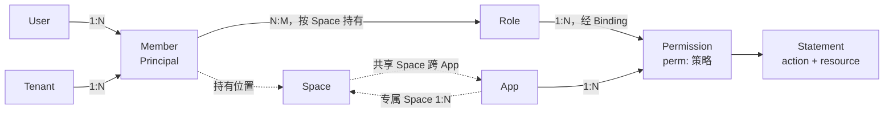

# RFC 0012：角色与权限的写法，以及 Space 的归属

> 状态：草案（2026-11-08，等待维护者确认；未确认前不写代码） · 上位文档：[RFC 0001](0001-target-architecture.md) P11 ·
> 修订：[RFC 0004](0004-unified-model.md) §4.6、§4.9，[RFC 0007](0007-control-plane.md) §5.8、§7.1、§9.2 ·
> 基线：`main` @ `50e7945c` · 交付：§11 的 G1–G4，8.0 GA 之前合入

## 0. 结论先行

1. **引擎不变。** `roles` 和简写权限在编译前展开成普通的 `Binding` 和 `perm:` 策略。授出分析、影子窗口、回滚、审计都作用于展开结果。
2. **目录条目写了 `action` 就是权限**，一行代替一条策略。需要条件时仍可手写策略。
3. **角色成为文档里的条目**：有 id、名称、说明和权限列表，可以没有权限。系统角色在 App 文档，自定义角色在 Tenant 文档。
4. **Space 是可选的**，不用 Space 的 App 什么都不写。用 Space 时有两种：`wms:wh-01` 专属于一个 App，`store-1` 可跨 App 共享。
5. **Binding 留在文档里**，继续作为唯一的授权关系（§8）。

真实场景（§1）下，要手写的条目从 657 条（190 条策略加 467 条绑定）降到 7 条角色；190 条权限本来就在目录里。

## 1. 问题

一个真实的 WMS 控制台：190 个权限；7 个系统角色，分别有 72、4、190、36、62、37、66 个权限，合计 467 对；租户还能新建角色、另存为，自定义角色可以暂时没有权限。
界面上有类型（系统/自定义）、说明、权限 x/190、成员数；系统角色对租户只读。

今天的写法对不上这个场景：

| 问题 | 现状 |
|---|---|
| 一个权限写三处 | 目录条目、`perm:` 策略、绑定各写一遍；目录和策略之间没有校验 |
| 每对“角色×权限”一条绑定 | 467 条，每条都要 `id`、`subject`、`app`、`space`、`policy` |
| 角色没有定义 | 只是 token 和绑定里的字符串。名称、说明无处存放，0 权限的角色无法表示 |
| 另存为很重 | 复制 N 条绑定，一次变更 N 条操作 |
| 租户读不到系统角色 | `cosec:tenant-admin` 只覆盖 `doc/tenant/{t}/**`，`TenantIsolation` 也不让租户读 App 文档 |
| Space 的语义没定 | `clerk@team-a` 在每个 App 里都算，同名 Space 加同名 Role 会串到别的 App |

## 2. 模型

### 2.1 实体

| 概念 | CoSec 里是什么 | 在哪里 | 本 RFC |
|---|---|---|---|
| User | 不在 CoSec，属于身份系统 | — | 不变 |
| Member | `Principal`：租户加 id，id 只在租户内唯一 | token 或 `MembershipProvider` | 不变 |
| Organization | 不在 CoSec；部门由 `MembershipProvider` 展开成角色，或作为属性进条件 | — | 不变 |
| Tenant | id，外加一份 Tenant 文档 | — | 不变 |
| App | id，外加一份 App 文档；平台拥有，所有租户共用 | — | 不变 |
| Space | 字符串，可选 | Membership 和 Binding 里出现 | §3：增加专属写法 |
| Role | 字符串 | Membership 和 Binding 里出现 | §5：增加角色条目 |
| Permission | 目录条目加 `perm:` 策略，靠命名约定对应 | App 文档 | §4：目录条目可直接定义 |
| Policy | Statement（`action`、`resource`、`condition`）的集合 | 三种文档 | 不变 |
| Binding | 谁、在哪、哪条策略 | 三种文档 | 不变，`roles` 展开成它 |
| Boundary | 租户能得到的许可的上限 | Platform 文档 | 不变，用来表达“租户开通了哪些 App” |

### 2.2 关系



对应维护者的关系图：

| 图上 | CoSec |
|---|---|
| Operation Resources | 非 `spaced` 组里的权限 |
| Space Resources | `spaced` 组里的权限 |
| Operation Roles | 在默认空间持有的 Role |
| Space Roles | 在某个 Space 持有的 Role |

Operation Roles 与 Space Roles 不是两种类型，同一个 Role 持有在哪里就是哪一种。这沿用现有语义：只有在请求所在 Space 持有的角色才算（`ScopeResolver`）。

App 保持平台级：一份 App 文档服务所有租户，系统角色对所有租户生效。“租户开通 App”没有独立的关系，由 Boundary 表达；要更细的管理放到业务系统。

## 3. Space

### 3.1 Space 是可选的

**硬要求：不用 Space 的 App 不需要写任何与 Space 有关的内容。** 目录不写 `spaced`，角色条目没有 Space 字段，token 里是不带 `@` 的角色，请求不带 `CoSec-Space-Id`。默认空间 `""` 就是“没有 Space”。

这样的 App 收到声明了 Space 的请求时，角色带来的简写权限不生效（§4.2 的条件为假），结果是拒绝。

### 3.2 两种 Space

| 写法 | 含义 | 场景 |
|---|---|---|
| `wms:wh-01` | 专属于 App `wms`，App 1:N Space | WMS 的仓库、项目管理的项目、知识库的空间 |
| `store-1` | 租户级，可被多个 App 使用，即今天的语义 | 多个 App 共用的门店、事业部、团队工作区 |
| `""` | 默认空间 | 不用 Space，或 App 级的操作 |

推荐写法是专属 Space：多数场景里 Space 属于一个 App，也不会串用。需要跨 App 时才用共享写法。

### 3.3 规则（修订 RFC 0004 §4.6）

`ScopeResolver` 在查成员关系之前增加一条：

> 声明的 Space 含 `:` 时，第一个 `:` 之前必须非空且等于请求的 App，之后必须非空；否则 `SPACE_NOT_MEMBER`。

- App id 不允许含 `:`，所以解析没有歧义。Space id 不用 `/`，因为控制面的 `scope/<tenant>/<app>/<space>` 资源的一段不能含 `/`。
- 没有 App 的请求声明专属 Space 时被拒绝（App 为空，不相等）。
- 不加新的拒绝原因，`SPACE_NOT_MEMBER` 够用。
- token 格式不变：`role@space` 只按 `@` 切分，`clerk@wms:wh-01` 可直接使用。
- `MembershipProvider`、`Binding`、引擎都不变。`Space` 不成为实体。
- 控制面增加一条检查：`app` 已确定的绑定，其 `space` 若专属于另一个 App，永远不会生效，报 `V2`。不放进编译，避免已发布的文档在加载时失败。

### 3.4 为什么不按 App 建 Membership 的键

严格做到 App 1:N Space 要把 `Memberships.roles` 的键改成 `(app, space)`。这要改 token 格式和 `MembershipProvider` SPI，跨 App 的场景还要逐个 App 重复授予。上面的写法用一条校验得到同样的隔离，并保留共享。

### 3.5 代价

- `CoSec-Space-Id` 和 `scope.space` 都是完整字符串 `wms:wh-01`，业务存的 spaceId（包括 Wow 聚合上的）也要带前缀。
- 含 `:` 的 Space id 语义变化，是破坏性变更，所以必须在 GA 前做，并写进 `wiki/operations/upgrading.md`。
- 共享写法下串用的风险还在。同一个 Role id 被多个 App 文档定义时，控制面给出告警（§7.5），但拦不住所有情况。

## 4. 权限（修订 RFC 0004 §4.9）

### 4.1 写法

目录条目增加两个可选字段：

```json
{
  "catalog": { "groups": [
    { "name": "仓库", "permissions": [
      { "id": "warehouse.read", "name": "查看仓库", "action": "wms:warehouse.read" },
      { "id": "warehouse.edit", "name": "编辑仓库", "action": "wms:warehouse.edit" }
    ]},
    { "name": "入库单", "spaced": true, "permissions": [
      { "id": "inbound.ship", "name": "发货", "action": "wms:inbound.ship", "resource": "inbound/{id}" }
    ]}
  ]}
}
```

| 字段 | 类型 | 含义 |
|---|---|---|
| `action` | 动作模式或非空数组，同语句的 `action` | 写了它，这个条目就定义了权限 |
| `resource` | 资源模式或非空数组，同语句的 `resource`；需要 `action` | 不写表示任何资源 |

### 4.2 语义

写了 `action` 的条目展开成策略 `perm:<app>/<id>`，一条 ALLOW 语句，`attachable` 为 false。

- 非 `spaced` 组的权限，策略带条件 `{ "eq": ["scope.space", ""] }`：只在默认空间生效。这就是 Operation Resources。
- `spaced` 组的权限没有这个条件：在角色持有的任何 Space 里生效，默认空间也算一个 Space。这就是 Space Resources。

这条限制放在权限上，而不是绑定上，有两个原因：

1. 租户文档编译时读不到 App 的目录，派生绑定无法按组决定 `space`。放在策略上，系统角色和自定义角色的行为自然一致。
2. 授出分析靠它收窄作用域（`refine` 读 `scope.space`）。没有这个条件，派生绑定是 `space: *`，持有角色的授权者永远覆盖不了（§7.3）。

### 4.3 与手写策略的关系

- 同一个权限既写了 `action`，又有同 id 的手写策略：编译错误。一个权限只有一处定义，避免删除手写策略时悄悄换成无条件的简写策略。
- 需要条件、DENY 或多条语句时手写 `perm:` 策略，`spaced` 的限制由作者自己写。
- 既没有 `action` 也没有策略的条目仍然只用于显示，与今天一样；但它不能被 `roles` 引用（§6.2）。旧文档的语义不变，加载不会失败。

### 4.4 `action` 从哪里来

简写权限要求请求能解析出它写的动作：路由映射、OpenAPI 生成或代码里的检查。没有路由映射的服务也可以直接写 HTTP：`"action": "http:GET", "resource": "/orders/**"`，这样不需要维护路由映射。

`cosecServiceGenerator/app` 改为生成简写权限，不再生成策略。

## 5. 角色

### 5.1 App 文档：系统角色

```json
{
  "roles": [
    { "id": "warehouse-manager", "name": "仓库管理员", "description": "管理仓库与库存",
      "permissions": ["warehouse.read", "warehouse.edit"] },
    { "id": "super-admin", "name": "超级管理员", "permissions": "*" },
    { "id": "draft", "name": "待配置", "permissions": [] }
  ]
}
```

- 对所有租户生效，与今天不带 `tenant` 的角色绑定相同。
- `"*"` 表示目录里所有已定义的权限，只允许在 App 文档里写。目录增长时这些角色自动获得新权限，变更差异和审批里能看到（§7.4）。

### 5.2 Tenant 文档：自定义角色

```json
{
  "roles": [
    { "id": "night-shift", "name": "夜班",
      "permissions": { "wms": ["warehouse.read"], "crm": ["lead.read"] } }
  ]
}
```

- 租户文档覆盖多个 App，所以按 App 分组；App 文档只有一个 App，所以直接写列表。这与现有格式“文档能确定的就不写”一致（租户文档的 principal 不写 `tenant`）。
- 不允许 `"*"`：否则 App 目录的一次发布会悄悄扩大每个租户的角色，而租户侧没有分析。
- 只对本租户生效。

### 5.3 字段与校验

| 字段 | 类型 | 校验 |
|---|---|---|
| `id` | 字符串，必填 | 非空，不是 `*`，不含 `@`（成员关系的分隔符），文档内唯一。建议不透明 |
| `name`、`description` | 字符串 | 只用于显示 |
| `permissions` | 见上，必填，可以为空 | 引用未定义的权限是错误（§6.2） |

角色条目不提供 `space`、`expiresAt`、`breakGlass`、`tenant`，也不能绑定 principal 或 `Anyone`。这些情况继续写 `bindings`，两种写法可以并存，结果取并集。

`roles` 和 `bindings` 对同一个角色的授予都生效，控制台的“权限 x/190”只统计 `roles`。

## 6. 展开

### 6.1 一个函数

`RoleExpansion.effective(document): PolicyDocument`（`cosec-runtime`）是纯函数，存储的文档保持简写。所有需要语义的地方都先调用它：

| 位置 | 作用 |
|---|---|
| `PolicyDocumentCompiler` | 数据面与校验的编译 |
| `GrantDocuments.of` | 授出分析的前后两侧 |
| `Revisions.references` | 反向引用索引 |
| `ChangeChecks.unresolved` | 候选文档和被引用的 App 文档 |
| `ControlPlane.diff` | 差异 |

### 6.2 规则

派生绑定：

| 字段 | 值 |
|---|---|
| `id` | `role:<roleId>@<app>:<permission>` |
| `subject` | Role；App 文档 `tenant` 为空，Tenant 文档为文档所属租户 |
| `app` | 确定的 App |
| `space` | `*` |
| `policy` | `perm:<app>/<permission>` |

- 角色 id 不含 `@`、App id 不含 `:`，所以 id 不会因拼接而相撞。与手写绑定相撞时编译错误。`role:` 加入控制面的保留前缀。
- 派生绑定排在手写绑定之后，按角色、权限的书写顺序。顺序不影响决定，只影响报告哪条语句。
- 引用未定义的权限：App 文档编译错误；Tenant 文档编译时看不到 App 文档，由控制面报 `REFERENCES`，数据面遇到时按现有规则 `unresolved`，失败即拒绝。
- 没有 `roles`、也没有 `action` 的文档，`effective` 返回原文档。

### 6.3 上限

简写会放大：8 MiB 的文档手写绑定最多约 5 万条，而 `"*"` 的展开量是角色数乘以目录大小。编译时限制派生绑定不超过 **50,000 条**（`roleGrantLimit`，与 `principalBindingLimit` 同样由编译器持有），超过则编译错误，路径指向 `$.roles`。

## 7. 控制面（修订 RFC 0007）

### 7.1 操作

增加 `PutRole(role, ifMatch)` 和 `RemoveRole(id, ifMatch)`，JSON 为 `putRole`、`removeRole`。`PutRole` 整体替换一个角色的权限列表。文档增加 `roles` 段；`CandidateDigest` 覆盖它，批准绑定到内容的语义不变。

资源增加条目类型 `role`：`doc/tenant/acme/role/night-shift`。

### 7.2 授权

`PutRole` 需要 `cosec:write` 作用于该角色条目；它新增的每条派生绑定按 `PutBinding` 的要求检查 `cosec:grant`，同一 App 只检查一次。`RemoveRole` 和只减少权限的 `PutRole` 只需要 `cosec:write`。

因为写权限按条目检查，可以给出比 `cosec:tenant-admin` 窄的“权限配置员”：`cosec:write` 作用于 `doc/tenant/<t>/role/*`，`cosec:grant` 作用于 `scope/<t>/*/*`。

### 7.3 授出分析

`GrantAnalyzer` 不变，输入是展开后的文档，所以片段按权限拆分，`NOT_COVERED` 能指出具体哪个权限授不了。

**已知限制，按现有定义如此（§7.4.2 不放宽）**：

- 非 `spaced` 权限：§4.2 的条件把作用域收窄到默认空间，授权者在默认空间持有相应角色即可，包含成立。
- `spaced` 权限：派生绑定是 `space: *`，要求授权者在**每个** Space 都有这项权限。经角色持有的权限只在持有的 Space 里算，永远覆盖不了 `*`，结果是 UNKNOWN，走审批。

所以用 Space 的 App，租户管理员要能自助配置，需要由信任根给他一条 `space: *` 的 principal 绑定（或 attachment）；否则这类变更走平台审批。这一点写进 `wiki/policies/role-permissions.md`。不用 Space 的 App 不受影响。

### 7.4 差异

`DocumentDiff` 增加 `roles: EntryChanges`，`bindings` 按展开后的文档计算。`"*"` 角色因目录增长获得的权限，表现为新增的派生绑定。

### 7.5 引用与检查

- 反向索引按展开后的绑定计算，所以租户角色引用的权限，App 删除时在发布阶段被拦住（RFC 0007 §5.8），不会让这些角色失败即拒绝。
- 新增告警：Role id 已被另一份 App 文档定义，或 Tenant 文档的角色 id 与它引用的 App 的系统角色相同。结果是并集，不构成越权（租户的授予仍经授出分析），但控制台上会让人困惑。

### 7.6 租户读取目录和系统角色

增加 `appCatalog(operator, app): AppCatalogView`，HTTP 为 `GET /apps/{app}/catalog`。

- 返回目录（分组、id、名称、说明、`spaced`）和角色（id、名称、说明、展开后的权限列表）。**不返回** `action`、策略和绑定。
- 需要 `cosec:read` 作用于 `doc/app/<app>/catalog`。内置的 `cosec:tenant-admin` 和租户只读策略获得 `doc/app/*/catalog` 上的 `cosec:read`。
- `TenantIsolation` 不变，`read` 仍然不让租户读 App 文档。这个接口是单独的路径，只暴露这个视图。
- 平台要收紧时，用 DENY 限制具体 App。

### 7.7 控制台对应的调用

| 界面动作 | 调用 |
|---|---|
| 角色列表 | `appCatalog` 加本租户文档的 `roles`；类型按来源；权限 x/N 按列表长度和目录。成员数由业务系统提供 |
| 系统角色只读 | 来自 `appCatalog`，租户没有写入路径 |
| 新建角色 | 一条 `putRole`，权限为空 |
| 另存为 | 一条 `putRole`，新 id，复制列表 |
| 保存权限矩阵 | 一条 `putRole` 带 `ifMatch`；`propose` → 分析为包含 → `skip-shadow`（易用性审查 U10）→ `publish` |

不新增“一步发布”接口。一次保存只有一条操作，再加上 E2b 的 #1218（一次变更只确认一次），成本已经可接受。

## 8. Binding 不拆出文档

- **原子性**：一次变更同时改策略和绑定，靠单 key 的条件写。Cluster 上没有多 key CAS（RC1-33）。
- **引用完整性**：文档整份编译，绑定指向的策略在编译时检查。
- **变更单元**：修订、影子、审批、回滚都以文档为单位。
- **热路径**：一次请求读三份已编译文档，不增加 I/O。

以后单份文档放不下时，可以增加“绑定分片”这一文档类型，是纯新增，不需要现在做。

## 9. 兼容与时机

- `schema: 2` 不变，只增加可选字段。严格的读取器拒绝未知字段，所以**先升级全部数据面实例，再发布带 `roles` 的文档**。8.0 GA 前只写进升级说明；GA 之后由 RFC 0010 C5 的格式门槛保护，这也是要在 GA 前做的原因。
- §3.3 是破坏性变更（含 `:` 的 Space id），标 `!`。
- 7.x 迁移工具的输出不变，继续生成绑定。两种写法并存。
- `DocumentDiff`、`Operation`、`PolicyDocument`、`Catalog` 的公共签名变化，更新 ABI dump。
- 热路径：查找结构不变，每个非 `spaced` 简写权限多一次 `scope.space` 比较。G1 带 `PipelineBenchmark` 的前后对比。

## 10. 规范规则

新增规则族 `ROL`，并扩展 `SCP`、`TNT`。每条都有正反场景和变异体。

| 规则 | 内容 |
|---|---|
| `ROL-1` | 带 `roles` 的文档与写出 `effective` 结果的文档决定完全相同（性质测试） |
| `ROL-2` | 编译、授出分析、引用索引、差异都读展开后的文档 |
| `ROL-3` | App 文档引用未定义的权限不能编译；Tenant 文档报 `REFERENCES`；数据面失败即拒绝 |
| `ROL-4` | `"*"` 只在 App 文档；目录增长表现为新增的派生绑定 |
| `ROL-5` | 同一权限既有 `action` 又有手写策略不能编译 |
| `ROL-6` | 非 `spaced` 的简写权限只在默认空间生效 |
| `ROL-7` | 角色 id 的校验；派生绑定 id 相撞不能编译；`role:` 保留 |
| `ROL-8` | 派生绑定超过上限不能编译 |
| `ROL-9` | `PutRole` 按权限走授出分析，无法证明包含的走审批 |
| `ROL-10` | 被租户角色引用的权限不能从 App 删除 |
| `SCP-10` | 专属 Space 只在所属 App 的请求里有效 |
| `TNT-*` | `appCatalog` 不返回策略、绑定和 `action`；`read` 对租户仍不开放 App 文档 |

## 11. 交付

| PR | 内容 | 主要模块 |
|---|---|---|
| G1 | 格式（`roles`、`action`、`resource`）、`RoleExpansion`、编译、schema、`SCP-10`、JMH | `cosec-runtime`、`cosec-model` |
| G2 | 操作、授权、摘要、分析、差异、引用、检查 | `cosec-control` |
| G3 | `appCatalog`、内置策略、HTTP 接口 | `cosec-control`、`cosec-spring-boot` |
| G4 | 文档、skill、OpenAPI 生成器；与 F2 合并 | `wiki/`、`skills/`、`cosec-openapi` |

建议顺序：F1 → G1 → G2 → G3 → F2（含 G4）→ E2b。F2 的模型类图以本 RFC §2 为准。

## 12. 非目标

- 把 Binding 移出文档（§8）。
- ReBAC、角色继承、用户组。
- Space 的注册表或层级。
- 成员数和成员管理，属于业务系统。
- “可授出范围”的只读预检，用于控制台灰显授不了的权限。8.0 在保存时显示 `NOT_COVERED`；预检接口是纯新增，放 8.1。
- 把 `spaced` 权限的包含判定放宽为“授权者在默认空间持有即可”（§7.3）。这会改变 RFC 0007 §7.4.2 的定义，需要单独论证。

## 13. 决定

| 事项 | 结论 | 状态 |
|---|---|---|
| Binding 留在文档里 | §8 | 维护者 2026-11-08 按建议 |
| User、Organization 不进模型 | §2 | 维护者 2026-11-08 按建议 |
| App 平台级，开通用 Boundary | §2 | 维护者 2026-11-08 按建议 |
| 不拆 Operation / Space 两种 Role | §2.2 | 维护者 2026-11-08 按建议 |
| Space 两种都支持 | §3.2 | 维护者 2026-11-08："两种都支持" |
| Space 对 App 是可选的 | §3.1 | 维护者 2026-11-08 |
| 文档格式增加 `roles`、`action`、`resource` | §4、§5 | 待确认 |
| 非 `spaced` 权限用策略条件限制在默认空间 | §4.2 | 待确认 |
| `spaced` 权限的自助授出需要 `space: *` 的 principal 绑定 | §7.3 | 待确认 |
| 租户可读所有 App 的目录和系统角色 | §7.6 | 待确认 |
| 在 F1 之后、F2 之前实现 | §11 | 待确认 |
