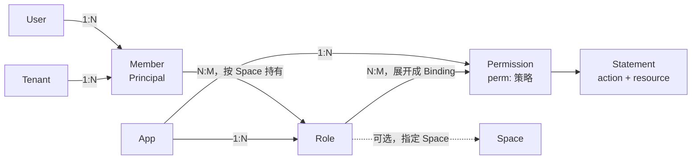

# RFC 0012：角色与权限的写法，以及 Space 的归属

> 状态：已确认（2026-11-08，维护者："按建议定稿"） · 上位文档：[RFC 0001](0001-target-architecture.md) P11 ·
> 修订：[RFC 0004](0004-unified-model.md) §4.6、§4.9，[RFC 0007](0007-control-plane.md) §5.8、§7.1，[RFC 0009](0009-identity-and-credentials.md) ·
> 基线：`main` @ `50e7945c` · 交付：§11 的 G1–G3，§3.5 随 R7b，都在 8.0 GA 之前合入

## 0. 结论先行

1. **引擎不变。** `roles` 和简写权限在编译前展开成普通的 `Binding` 和 `perm:` 策略。授出分析、影子窗口、回滚、审计都作用于展开结果。
2. **目录条目写了 `action` 就是权限**，一行代替一条策略。需要条件时仍可手写策略。
3. **角色成为文档里的条目，属于一个 App**：有 id、名称、说明和权限列表，可以没有权限，可以指定一个 Space。系统角色在 App 文档，自定义角色在 Tenant 文档。
4. **Space 是可选的**，不用 Space 的 App 什么都不写。App 与 Space 的关系由角色上的 `(app, space)` 决定，所以“一个 App 多个 Space”和“一个 Space 跨多个 App”都支持，不需要新规则。
5. **Binding 留在文档里**，继续作为唯一的授权关系（§8）。
6. **事实源可以在 CoSec 之外**：身份系统通过控制面同步角色，不新增接口（§7.7）。
7. **token 绑定 App**：token 声明它属于哪个 App，客户端不再声明 App。Space 仍由 token 列出范围、请求选择一个（§3.5）。

## 1. 问题

### 1.1 一个 WMS 控制台

190 个权限；7 个系统角色，分别有 72、4、190、36、62、37、66 个权限，合计 467 对；租户还能新建角色、另存为，自定义角色可以暂时没有权限。
界面上有类型（系统/自定义）、说明、权限 x/190、成员数；系统角色对租户只读。按本 RFC，要手写的条目从 657 条（190 条策略加 467 条绑定）降到 7 条角色；190 条权限本来就在目录里。

### 1.2 一个多 App 的身份系统

一个基于 CoSec、采用事件溯源的身份系统，为多个产品提供租户、成员、角色和应用开通。这里只把它当作场景证据，不当规格。

| 事实 | 对本 RFC 的影响 |
|---|---|
| 角色属于一个 App，分系统和自定义两类，权限集合整体替换 | 角色属于一个 App；`putRole` 整体替换 |
| 角色按 Space 存放，权限按角色和 Space 查找 | 角色可以指定 Space |
| Space 属于一个 App，id 是生成的不透明值；另有跨产品的协作边界 | Space 既可属于一个 App，也可共享 |
| 登录时按 App 签发 token，只放当前 App 的角色 | token 绑定 App（§3.5） |
| 租户 Owner 作为 token 里的一条 policy 下发 | 租户 Owner 走 attachment，授出分析按 `(*, *)` 计 |
| 租户开通 App 有状态和有效期，认证时检查 | 开通状态不进文档 |
| 角色变更以事件形式发生，事实源在身份系统，CoSec 是消费方 | 需要外部事实源的同步路径 |
| 7.x 的 `Permission` 内联了 `action` | 简写权限是找回 8.0 丢掉的写法 |

### 1.3 今天的写法对不上这些场景

| 问题 | 现状 |
|---|---|
| 一个权限写三处 | 目录条目、`perm:` 策略、绑定各写一遍；目录和策略之间没有校验 |
| 每对“角色×权限”一条绑定 | 467 条，每条都要 `id`、`subject`、`app`、`space`、`policy` |
| 角色没有定义 | 只是 token 和绑定里的字符串。名称、说明无处存放，0 权限的角色无法表示 |
| 另存为很重 | 复制 N 条绑定，一次变更 N 条操作 |
| 角色不属于 App | `clerk` 在每个绑定了它的 App 里都算，默认空间和命名 Space 都一样 |

## 2. 模型

### 2.1 实体

| 概念 | CoSec 里是什么 | 在哪里 | 本 RFC |
|---|---|---|---|
| User | 不在 CoSec，属于身份系统 | — | 不变 |
| Member | `Principal`：租户加 id，id 只在租户内唯一 | token 或 `MembershipProvider` | 不变 |
| Organization | 不在 CoSec；部门由 `MembershipProvider` 展开成角色，单值属性可进条件 | — | 不变 |
| Tenant | id，外加一份 Tenant 文档 | — | 不变 |
| App | id，外加一份 App 文档；平台拥有，所有租户共用 | — | 不变 |
| Space | 不透明字符串，可选 | Membership、Binding、角色条目里出现 | §3：语义写清楚，不加规则 |
| Role | 字符串 | Membership 和 Binding 里出现 | §5：增加角色条目，属于一个 App |
| Permission | 目录条目加 `perm:` 策略，靠命名约定对应 | App 文档 | §4：目录条目可直接定义 |
| Policy | Statement（`action`、`resource`、`condition`）的集合 | 三种文档 | 不变 |
| Binding | 谁、在哪、哪条策略 | 三种文档 | 不变，`roles` 展开成它 |
| Boundary | 租户能得到的许可的静态上限 | Platform 文档 | 不变 |

### 2.2 关系



对应维护者的关系图：

| 图上 | CoSec |
|---|---|
| Operation Resources | 非 `spaced` 组里的权限 |
| Space Resources | `spaced` 组里的权限 |
| Operation Roles | 在默认空间持有的 Role |
| Space Roles | 在某个 Space 持有的 Role，或指定了 Space 的 Role |

Operation Roles 与 Space Roles 不是两种类型，同一个 Role 持有在哪里就是哪一种。这沿用现有语义：只有在请求所在 Space 持有的角色才算（`ScopeResolver`）。

### 2.3 App 与 Tenant

App 保持平台级：一份 App 文档服务所有租户，系统角色对所有租户生效。

**租户开通 App 不进文档。** 开通是业务状态：试用、暂停、到期，变化频繁，归业务系统所有。推荐在签发 token 时检查；要求暂停立即生效时，用 token 吊销或 `ext.*` 属性。Boundary 只表达静态上限，不用来跟踪这些状态：否则每次暂停都是一次控制面发布，每种开通组合还要一条边界策略。

## 3. Space

### 3.1 Space 是可选的

**硬要求：不用 Space 的 App 不需要写任何与 Space 有关的内容。** 目录不写 `spaced`，角色条目不写 `space`，token 里是不带 `@` 的角色，请求不带 `CoSec-Space-Id`。默认空间 `""` 就是“没有 Space”。

这样的 App 收到声明了 Space 的请求时，角色带来的简写权限不生效（§4.2 的条件为假），结果是拒绝。

### 3.2 App 与 Space 的关系

Space 是不透明字符串，CoSec 不保存它的归属。关系由角色决定：

| 场景 | 写法 | 效果 |
|---|---|---|
| 一个 App 多个 Space | 角色 `app: wms, space: wh-01`；`wh-01` 只被 `wms` 的角色使用 | 只有 `wms` 的角色在 `wh-01` 生效 |
| 一个 Space 跨多个 App | `store-1` 被 `wms`、`pos` 各自的角色使用，成员分别持有 | 同一个 Space，每个 App 的权限各自授予 |
| 系统角色 | App 文档的角色，不指定 Space | 在成员持有它的任何 Space 生效 |
| 不用 Space | 什么都不写 | 默认空间 |

需要“授予一次，多个 App 都生效”时，用 `bindings` 把同一个角色绑到多个 App，这是显式的选择。

发给 `wms` 的 token 请求 App `pos`，在作用域解析时就被拒绝（§3.5），轮不到 Space。

### 3.3 为什么不用 `<app>:<space>` 前缀

草案曾提议让 `wms:wh-01` 只在 App `wms` 的请求里有效。对照实际场景后撤回：

1. 它只堵住命名 Space 这一条路，默认空间的 `clerk` 照样在每个 App 里都算。角色属于 App 之后两条路都堵住了。
2. 它是破坏性变更，业务存的 spaceId（包括 Wow 聚合上的）也要带前缀，而这些 id 多半是生成的不透明值。
3. 角色属于 App 之后，它没有额外的隔离效果。

### 3.4 为什么不按 App 建 Membership 的键

把 `Memberships.roles` 的键改成 `(app, space)` 要改 token 格式和 `MembershipProvider` SPI，跨 App 的场景还要逐个 App 重复授予。

### 3.5 token 绑定 App（修订 RFC 0004 §4.6、RFC 0009）

> 2026-11-08 维护者"按建议定"。随 R7b（主体与令牌契约重切）交付，不在 G1–G3 里。

token 和 API key 声明它们属于哪个 App，用 JWT 标准的 `aud`，8.0 只允许单个值。今天的 token 不声明 App，也不校验 audience：同一个签名密钥下，发给一个 App 的 token 在另一个 App 也有效，只要两边有同名角色就生效。

`ScopeResolver` 按下表解析：

| 宿主 App | 凭证 App | 结果 |
|---|---|---|
| `wms` | `wms` | `wms` |
| `wms` | `pos` | 拒绝（`APP_MISMATCH`） |
| `wms` | 未声明 | 拒绝（`APP_MISMATCH`） |
| 未配置 | `wms` | `wms` |
| 未配置 | 未声明 | 没有 App，不读 App 文档 |

- 匿名请求没有凭证，App 取宿主的。
- **客户端不再声明 App**：`CoSec-App-Id` 删除。易用性审查的 U15（`client-declared-app` 开关）取消。
- token 里的角色都属于这个 App，同名系统角色不再跨 App 生效。
- 一次登录访问多个 App 时，按 App 各换一个 token。操作控制面的 token 发给控制面的 App。
- 已签发的 token 在配置了 App 的宿主上失效，这是破坏性变更，GA 前做。

**Space 不绑定单个值。** token 用 `role@space` 列出可用范围（或由 `MembershipProvider` 给出），请求用 `CoSec-Space-Id` 选一个，`SPACE_NOT_MEMBER` 挡住其余。这是选择，不是授权；绑定单个值意味着每次切换 Space 都要换 token。要把 Agent、服务账号或 API key 限定在一个 Space，token 只列那个 Space 的角色即可。

## 4. 权限（修订 RFC 0004 §4.9）

### 4.1 写法

目录条目增加两个可选字段：

```json
{
  "catalog": { "groups": [
    { "name": "仓库", "permissions": [
      { "id": "warehouse.read", "name": "查看仓库", "action": "wms:warehouse.read" },
      { "id": "warehouse.edit", "name": "编辑仓库", "action": "wms:warehouse.edit" }
    ]},
    { "name": "入库单", "spaced": true, "permissions": [
      { "id": "inbound.ship", "name": "发货", "action": "wms:inbound.ship", "resource": "inbound/{id}" }
    ]}
  ]}
}
```

| 字段 | 类型 | 含义 |
|---|---|---|
| `action` | 动作模式或非空数组，同语句的 `action` | 写了它，这个条目就定义了权限 |
| `resource` | 资源模式或非空数组，同语句的 `resource`；需要 `action` | 不写表示任何资源 |

### 4.2 语义

写了 `action` 的条目展开成策略 `perm:<app>/<id>`，一条 ALLOW 语句，`attachable` 为 false。

- 非 `spaced` 组的权限，策略带条件 `{ "eq": ["scope.space", ""] }`：只在默认空间生效。这就是 Operation Resources。
- `spaced` 组的权限没有这个条件：在角色生效的任何 Space 里生效，默认空间也算一个 Space。这就是 Space Resources。

这条限制放在权限上，而不是绑定上，有两个原因：

1. 租户文档编译时读不到 App 的目录，派生绑定无法按组决定 `space`。放在策略上，系统角色和自定义角色的行为自然一致。
2. 授出分析靠它收窄作用域（`refine` 读 `scope.space`）。没有这个条件，`space: *` 的派生绑定是持有角色的授权者覆盖不了的（§7.3）。

### 4.3 与手写策略的关系

- 同一个权限既写了 `action`，又有同 id 的手写策略：编译错误。一个权限只有一处定义，避免删除手写策略时悄悄换成无条件的简写策略。
- 需要条件、DENY 或多条语句时手写 `perm:` 策略，`spaced` 的限制由作者自己写。
- 既没有 `action` 也没有策略的条目仍然只用于显示，与今天一样；但它不能被 `roles` 引用（§6.2）。旧文档的语义不变，加载不会失败。

### 4.4 `action` 从哪里来

简写权限要求请求能解析出它写的动作：路由映射、OpenAPI 生成或代码里的检查。没有路由映射的服务也可以直接写 HTTP：`"action": "http:GET", "resource": "http:path:/orders/**"`，这样不需要维护路由映射。

`cosecServiceGenerator/app` 改为生成简写权限，不再生成策略。

## 5. 角色

### 5.1 App 文档：系统角色

```json
{
  "roles": [
    { "id": "wms.warehouse-manager", "name": "仓库管理员", "description": "管理仓库与库存",
      "permissions": ["warehouse.read", "warehouse.edit"] },
    { "id": "wms.super-admin", "name": "超级管理员", "permissions": "*" },
    { "id": "wms.draft", "name": "待配置", "permissions": [] }
  ]
}
```

- 对所有租户生效，与今天不带 `tenant` 的角色绑定相同。App 由文档决定，不用写。
- `"*"` 表示目录里所有已定义的权限，只允许在 App 文档里写。目录增长时这些角色自动获得新权限，变更差异和审批里能看到（§7.4）。
- 不能指定 `space`：Space 是租户里的实例，平台级的角色不知道它们。

### 5.2 Tenant 文档：自定义角色

```json
{
  "roles": [
    { "id": "night-shift", "app": "wms", "name": "夜班", "permissions": ["warehouse.read"] },
    { "id": "wh-01-keeper", "app": "wms", "space": "wh-01", "name": "一号仓管理员",
      "permissions": ["inbound.ship"] }
  ]
}
```

- `app` 必填：角色属于一个 App。要在多个 App 里授权，就建多个角色；确实要同一个角色跨 App 时写 `bindings`。
- `space` 可选：不写表示 `*`，即在成员持有它的任何 Space 生效；写了就只在那个 Space 生效，`""` 是默认空间。
- `permissions` 只能写列表，不允许 `"*"`：否则 App 目录的一次发布会悄悄扩大每个租户的角色，而租户侧没有分析。
- 只对本租户生效。

### 5.3 字段与校验

| 字段 | 文档 | 校验 |
|---|---|---|
| `id` | 两种，必填 | 非空，不是 `*`，不含 `@`（成员关系的分隔符），文档内唯一。建议不透明 |
| `app` | Tenant，必填 | 合法的 App id |
| `space` | Tenant，可选 | 不是保留的 Space id |
| `name`、`description` | 两种，可选 | 只用于显示；事实源在外部时可以不写 |
| `permissions` | 两种，必填，可以为空 | 引用未定义的权限是错误（§6.2） |

角色条目不提供 `expiresAt`、`breakGlass`、`tenant`，也不能绑定 principal 或 `Anyone`。这些情况继续写 `bindings`，两种写法可以并存，结果取并集。

`roles` 和 `bindings` 对同一个角色的授予都生效，控制台的“权限 x/190”只统计 `roles`。

## 6. 展开

### 6.1 一个函数

`RoleExpansion.effective(document): PolicyDocument`（`cosec-runtime`）是纯函数，存储的文档保持简写。所有需要语义的地方都先调用它：

| 位置 | 作用 |
|---|---|
| `PolicyDocumentCompiler` | 数据面与校验的编译 |
| `GrantDocuments.of` | 授出分析的前后两侧 |
| `Revisions.references` | 反向引用索引 |
| `ChangeChecks.unresolved` | 候选文档和被引用的 App 文档 |
| `ControlPlane.diff` | 差异 |
| `Revisions.referenced`、`ChangeAuthority.analyze`、`referringBindings`、`Narrowing`、`ControlPlane.analyze` | 删除校验、授出分析、收窄判定和访问审查 |

### 6.2 规则

派生绑定：

| 字段 | 值 |
|---|---|
| `id` | `role:<roleId>@<app>:<permission>` |
| `subject` | Role；App 文档 `tenant` 为空，Tenant 文档为文档所属租户 |
| `app` | 角色的 App |
| `space` | 角色的 `space`；没写是 `*` |
| `policy` | `perm:<app>/<permission>` |

- 角色 id 不含 `@`、App id 不含 `:`，所以 id 不会因拼接而相撞。与手写绑定相撞时编译错误。`role:` 加入控制面的保留前缀。
- 派生绑定排在手写绑定之后，按角色、权限的书写顺序。顺序不影响决定，只影响报告哪条语句。
- 引用未定义的权限：App 文档编译错误；Tenant 文档编译时看不到 App 文档，由控制面报 `REFERENCES`，数据面遇到时按现有规则 `unresolved`，失败即拒绝。
- 没有 `roles`、也没有 `action` 的文档，`effective` 返回原文档。

### 6.3 上限

简写会放大：8 MiB 的文档手写绑定最多约 5 万条，而 `"*"` 的展开量是角色数乘以目录大小。编译时限制派生绑定不超过 **50,000 条**（`roleGrantLimit`，与 `principalBindingLimit` 同样由编译器持有），超过则编译错误，路径指向 `$.roles`。

## 7. 控制面（修订 RFC 0007）

### 7.1 操作

增加 `PutRole(role, ifMatch)` 和 `RemoveRole(id, ifMatch)`，JSON 为 `putRole`、`removeRole`。`PutRole` 整体替换一个角色。文档增加 `roles` 段；`CandidateDigest` 覆盖它，批准绑定到内容的语义不变。

资源增加条目类型 `role`：`doc/tenant/acme/role/night-shift`。

### 7.2 授权

`PutRole` 需要 `cosec:write` 作用于该角色条目。它新增派生绑定时，按 `PutBinding` 的要求检查 `cosec:grant`；一个角色只有一个作用域，只检查一次。`RemoveRole` 和只减少权限的 `PutRole` 只需要 `cosec:write`。

因为写权限按条目检查，可以给出比 `cosec:tenant-admin` 窄的管理员：

| 管理员 | `cosec:write` | `cosec:grant` |
|---|---|---|
| 权限配置员 | `doc/tenant/<t>/role/*` | `scope/<t>/*/*` |
| Space 管理员 | `doc/tenant/<t>/role/*` | `scope/<t>/wms/wh-01` |

### 7.3 授出分析

`GrantAnalyzer` 不变，输入是展开后的文档，所以片段按权限拆分，`NOT_COVERED` 能指出具体哪个权限授不了。RFC 0007 §7.4.2 的定义不放宽，结果如下：

| 角色授出的 | 作用域 | 授权者需要 |
|---|---|---|
| 非 `spaced` 权限 | §4.2 的条件收窄到默认空间 | 在默认空间持有相应权限 |
| 指定了 Space `S` 的角色 | `S` | 在 `S` 持有相应权限 |
| 未指定 Space 的角色的 `spaced` 权限 | 所有 Space | 在所有 Space 都有：经 attachment 或 `space: *` 的 principal 绑定 |

经角色持有的权限只在持有的 Space 里算，永远覆盖不了“所有 Space”，所以第三种情况的结果是 UNKNOWN，走审批。

租户 Owner 用 attachment 表达最合适：token 的 `policies` 声明一条可附加的策略，授出分析按 `(*, *)` 计。Owner 的授予和转移由身份系统决定，不需要写文档。这一点写进 `wiki/policies/role-permissions.md`。

### 7.4 差异

`DocumentDiff` 增加 `roles: EntryChanges`，`bindings` 按展开后的文档计算。`"*"` 角色因目录增长获得的权限，表现为新增的派生绑定。

### 7.5 引用与检查

反向索引按展开后的绑定计算，所以租户角色引用的权限，App 删除时在发布阶段被拦住（RFC 0007 §5.8），不会让这些角色失败即拒绝。

新增告警，都不构成越权（租户的授予仍经授出分析），但会让人困惑：

- Tenant 文档的角色 id 与它的 App 的系统角色相同，结果是并集；
- 指定了 Space 的角色包含非 `spaced` 权限，这项权限在那个 Space 里永远不生效。

### 7.6 CoSec 自己的控制面

| 操作 | 调用 |
|---|---|
| 新建角色 | 一条 `putRole`，权限为空 |
| 另存为 | 一条 `putRole`，新 id，复制列表 |
| 保存权限矩阵 | 一条 `putRole` 带 `ifMatch`；`propose` → 分析为包含 → `skip-shadow`（易用性审查 U10）→ `publish` |

不新增“一步发布”接口。一次保存只有一条操作，再加上 E2b 的 #1218（一次变更只确认一次），成本已经可接受。

### 7.7 外部事实源同步

角色和权限的事实源可以在 CoSec 之外，例如一个事件溯源的身份系统。这时 CoSec 的文档是下游投影，**仍然只经控制面写入**，不直接写缓存：否则绕过校验、编译和审计。

| 来源的变化 | 控制面调用 |
|---|---|
| 角色的权限变化 | `putRole`，不带 `ifMatch` |
| 角色删除 | `removeRole` |
| App 的权限变化 | `putCatalog` |
| 定期对账 | `apply`，`MERGE`；来源是唯一写入者时用 `REPLACE` |

- 每次变更走 `propose` → `skip-shadow` → `publish`。
- 执行者是持有 `cosec:approve`、`cosec:skip-shadow`、`cosec:publish` 的平台服务主体，即信任根（RFC 0007 §7.3）。谁能授予由来源系统判断，CoSec 记录审计。
- `putRole` 整体替换，重放是幂等的。冲突（409）由投影重试。
- 暂存槽被占用时 `skip-shadow` 返回 409，只有收窄的变更能抢占，所以同一份文档不要同时有人工变更和同步。

不新增接口。

## 8. Binding 不拆出文档

- **原子性**：一次变更同时改策略和绑定，靠单 key 的条件写。Cluster 上没有多 key CAS（RC1-33）。
- **引用完整性**：文档整份编译，绑定指向的策略在编译时检查。
- **变更单元**：修订、影子、审批、回滚都以文档为单位。
- **热路径**：一次请求读三份已编译文档，不增加 I/O。

以后单份文档放不下时，可以增加“绑定分片”这一文档类型，是纯新增，不需要现在做。

## 9. 兼容与时机

- `schema: 2` 不变，只增加可选字段。严格的读取器拒绝未知字段，所以**先升级全部数据面实例，再发布带 `roles` 的文档**。8.0 GA 前只写进升级说明；GA 之后由 RFC 0010 C5 的格式门槛保护，这也是要在 GA 前做的原因。
- G1–G3 没有破坏性变更，Space id 的语义不变。§3.5 是破坏性变更，随 R7b 交付。
- 7.x 迁移工具继续生成绑定（#1284 只改了星期的拼法）。两种写法并存。
- `DocumentDiff`、`Operation`、`PolicyDocument`、`Catalog` 的公共签名变化，更新 ABI dump。
- 热路径：查找结构不变，每个非 `spaced` 简写权限多一次 `scope.space` 比较。G1 带 `PipelineBenchmark` 的前后对比。

## 10. 规范规则

新增规则族 `ROL`，并扩展 `SCP`。每条都有正反场景和变异体。

| 规则 | 内容 |
|---|---|
| `ROL-1` | 带 `roles` 的文档与写出 `effective` 结果的文档决定完全相同（性质测试） |
| `ROL-2` | 编译、授出分析、引用索引、差异都读展开后的文档 |
| `ROL-3` | App 文档引用未定义的权限不能编译；Tenant 文档报 `REFERENCES`；数据面失败即拒绝 |
| `ROL-4` | `"*"` 只在 App 文档；目录增长表现为新增的派生绑定 |
| `ROL-5` | 同一权限既有 `action` 又有手写策略不能编译 |
| `ROL-6` | 非 `spaced` 的简写权限只在默认空间生效 |
| `ROL-7` | 角色 id 的校验；派生绑定 id 相撞不能编译；`role:` 保留 |
| `ROL-8` | 派生绑定超过上限不能编译 |
| `ROL-9` | `PutRole` 按权限走授出分析，无法证明包含的走审批 |
| `ROL-10` | 被租户角色引用的权限不能从 App 删除 |
| `ROL-11` | 角色只在自己的 App 生效；指定了 Space 的角色只在那个 Space 生效 |
| `SCP-11` | 凭证声明的 App 与宿主的 App 不同，或宿主有 App 而凭证未声明，作用域解析拒绝；请求不能声明 App（随 R7b） |

## 11. 交付

| PR | 内容 | 主要模块 |
|---|---|---|
| G1 | 格式（`roles`、`action`、`resource`）、`RoleExpansion`、编译、schema、JMH | `cosec-runtime` |
| G2 | 操作、授权、摘要、分析、差异、引用、检查 | `cosec-control` |
| G3 | 文档、skill、OpenAPI 生成器；与 F2 合并 | `wiki/`、`skills/`、`cosec-openapi` |

G1 与 G2 合成一个 PR：只有 G1 时，控制面能发布带 `roles` 的文档却不做授出分析。整体顺序见 `docs/roadmap.md`。F2 的模型类图以本 RFC §2 为准。

## 12. 非目标

- 把 Binding 移出文档（§8）。
- ReBAC、角色继承、用户组。
- Space 的注册表或层级；Space 的归属校验（§3.3）。
- `Memberships` 按 App 建键（§3.4）。
- 成员数和成员管理、部门、受信设备、行级过滤，属于业务系统。
- 租户开通 App 的状态（§2.3）。
- 把 `spaced` 权限的包含判定放宽为“授权者在默认空间持有即可”（§7.3）。这会改变 RFC 0007 §7.4.2 的定义，需要单独论证。

放到 8.1，都是纯新增：

- **租户读取目录和系统角色**：`GET /apps/{app}/catalog`，只返回目录和角色定义，不返回 `action`、策略和绑定。身份系统这类事实源在外部的部署读自己的数据，所以不阻塞 GA。在此之前，CoSec 自己的控制台要由平台侧的服务读取。
- **“可授出范围”的只读预检**，用于控制台灰显授不了的权限。8.0 在保存时显示 `NOT_COVERED`。

## 13. 决定

| 事项 | 结论 | 状态 |
|---|---|---|
| Binding 留在文档里 | §8 | 维护者 2026-11-08 按建议 |
| User、Organization 不进模型 | §2 | 维护者 2026-11-08 按建议 |
| App 平台级，开通状态不进文档 | §2.3 | 维护者 2026-11-08 按审查结论 |
| 不拆 Operation / Space 两种 Role | §2.2 | 维护者 2026-11-08 按建议 |
| App 与 Space 两种关系都支持，由角色的 `(app, space)` 决定，不加前缀校验 | §3 | 维护者 2026-11-08 “两种都支持”、按审查结论 |
| Space 对 App 是可选的 | §3.1 | 维护者 2026-11-08 |
| 角色属于一个 App，可指定 Space | §5 | 维护者 2026-11-08 按审查结论 |
| 外部事实源经控制面同步 | §7.7 | 维护者 2026-11-08 按审查结论 |
| 租户读目录和系统角色放 8.1 | §12 | 维护者 2026-11-08 按审查结论 |
| 文档格式增加 `roles`、`action`、`resource` | §4、§5 | 维护者 2026-11-08 "按建议定稿" |
| 非 `spaced` 权限用策略条件限制在默认空间 | §4.2 | 维护者 2026-11-08 "按建议定稿" |
| 未指定 Space 的角色授出 `spaced` 权限，需要 `(*, *)` 的持有，否则走审批 | §7.3 | 维护者 2026-11-08 "按建议定稿" |
| 在 F1 之后、F2 之前实现 | §11 | 维护者 2026-11-08 "按建议定稿" |
| token 绑定 App，Space 不绑定单个值 | §3.5 | 维护者 2026-11-08 "按建议定" |
