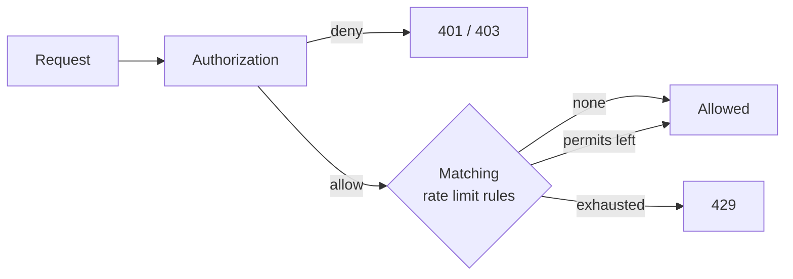

# Rate Limiting

Rate limits cap how often requests may pass. They are separate from policies: a policy decides whether a
request is allowed, and a rate limit rule decides how often allowed requests may pass. Only requests that
authorization allows spend permits. A denied request is already rejected and must not use up the quota of
legitimate callers.



## Rules

Rules are JSON files, by default every `classpath:cosec-rate-limit/*-rate-limit.json` (see
[`cosec.limiter.locations`](./configuration.md#rate-limiting)). A file holds one rule or an array of rules.

```json
[
  {
    "id": "login-by-ip",
    "action": { "path": { "pattern": "/auth/login", "method": "POST" } },
    "key": "request.remoteIp",
    "permitsPerSecond": 0.1,
    "windowSeconds": 60,
    "strictFailure": true
  },
  {
    "id": "export-free-tier",
    "action": "/export/**",
    "condition": { "inRole": { "value": "free" } },
    "key": "context.principal.id",
    "permitsPerSecond": 0.2,
    "windowSeconds": 60
  }
]
```

| Field | Required | Description |
|---|---|---|
| `id` | yes | Names the quota. Letters, digits, `_`, `.` and `-`. Counters belong to the id, so two rules never share a quota by accident. Ids must be unique. |
| `action` | yes | Which requests the rule applies to, written like a statement's [action](./policies.md#actions). |
| `condition` | no | Narrows the rule further, written like a statement's [condition](./policies.md#conditions). Defaults to always. |
| `key` | no | A request or context [part](./policies.md#value-conditions) that splits the quota into one bucket per value, e.g. per IP or per user. Without it, all matching requests share one bucket. Requests whose part is empty share one bucket, so leaving out a header does not get around the limit. `request.path.var.<name>` reads the variables captured by this rule's own `path` action, whatever other rules match the same request. A key that is not a supported part fails when the rule loads. |
| `permitsPerSecond` | yes | The allowed rate. A window allows `permitsPerSecond × windowSeconds` requests, and at least one. |
| `windowSeconds` | no | Window length, default `1`. Use a longer window for low rates: `0.1` per second over `60` seconds is 6 requests a minute. |
| `strictFailure` | no | What a backend failure means: `false` (default) skips the rule, `true` rejects the request with `429`. |

A rule may read `request.path.var.<name>`, in its `condition` or its `key`, only when its `action` is a `path`
action. It then reads the variables that action captured, never those of a policy or another rule. A rule with
any other action that reads path variables fails to load with `PathVariableScopeException`
([Path variables](./policies.md#actions)).

Every matching rule spends one permit, in order. The first exhausted rule rejects the request, and the rules
after it spend nothing.

Rule files load like local policy files: anything that would silently drop a rule stops the application from
starting, because a rate limit that is silently dropped removes a protection without anyone noticing. That is a
file that cannot be read, a rule id declared twice (in one file or in two), and a configured location that does not
exist or matches no file, usually a typo in the path. Only the default location
`classpath:cosec-rate-limit/*-rate-limit.json` may match nothing, so applications without rules need no setting. A
file matched by two locations is loaded once.

To load rules from somewhere else, such as a database, declare your own `RateLimitRuleProvider` bean. It is
called on every allowed request, so it must answer from memory.

## Counting

Both backends use the same sliding window: the estimate is the previous window's count, weighted by how much
of it still overlaps, plus the current window's count. Rejected requests are not counted.

| Backend | When | Scope |
|---|---|---|
| `RedisRateLimiter` | `cache-support` and a `StringRedisTemplate` bean | Cluster-wide. Counters live under `<key-prefix>:<id>:<bucket>:<window>` and expire after two windows. |
| `LocalRateLimiter` | otherwise | Per instance. With N instances the effective limit is N times higher. Keeps at most 100,000 buckets and drops buckets idle for an hour. A dropped bucket starts again from zero. |

To use another store, declare your own `RateLimiter` bean (see [Extending](../architecture/extending.md#rate-limiter-backends)).

## Responses

A request that exceeds a rule is answered with `429 Too Many Requests` and the body
`{"authorized":false,"reason":"Too Many Requests"}`. When a rule matched, the response carries these
headers, whether the request was allowed or rejected:

| Header | Value |
|---|---|
| `RateLimit-Limit` | Permits per window of the tightest matching rule. |
| `RateLimit-Remaining` | Permits left in the current window. |
| `RateLimit-Reset` | Seconds until the current window ends. |
| `Retry-After` | Only on `429`: seconds until the current window ends. |

Rejections are audited with decision `TOO_MANY_REQUESTS`, together with the policy or permission that
allowed the request.

## Migrating from rate-limit conditions

Up to 6.0, rate limits were conditions inside policies (`rateLimiter`, `groupedRateLimiter`,
`redisRateLimiter`, `redisGroupedRateLimiter`). They were removed in 6.1.0. A policy that still uses one no
longer parses: a local policy file that uses one stops startup (since 7.0; 6.1 skipped it with an `ERROR` log),
and a policy stored in Redis fails its read, which denies the request. Move each one into a rule before upgrading:

| Before | After |
|---|---|
| The statement's `action` | The rule's `action` |
| The statement's other conditions | The rule's `condition` |
| `part` | `key` |
| `permitsPerSecond`, `windowSeconds`, `strictFailure` | The same fields |
| `rateLimiter` / `groupedRateLimiter` | Rules run on `LocalRateLimiter` when Redis is absent |
| `expireAfterAccessSecond` | Not needed: idle buckets are dropped after an hour |

Three behaviors change:

- **Denied requests no longer spend permits.** Before, a rate limit in a policy condition also counted
  requests that another layer then denied.
- **Quotas belong to the rule id.** Before, Redis limiters with identical settings shared one quota.
- **Counters restart.** Redis keys moved from `<key-prefix>:<settings hash>:…` to `<key-prefix>:<id>:…`, so the
  old counters are abandoned and expire on their own.
