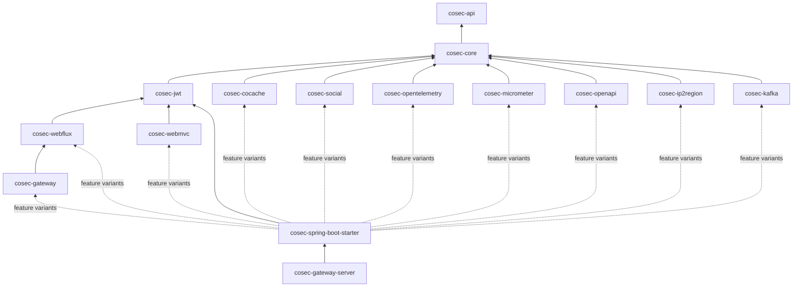
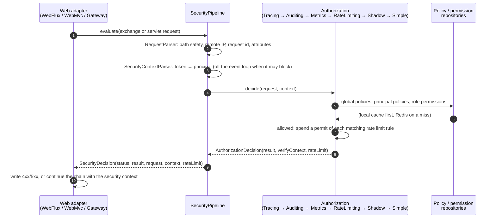

# Architecture Overview

This page is for people who change or extend CoSec. It describes the structure, the request path, the
decision algorithm, and the invariants every change must keep. File links point at `main`.

## Modules

- **`cosec-api`** holds the public contracts: `CoSecPrincipal`, `Policy`, `Statement`,
  `ActionMatcher`, `ConditionMatcher`, `Authorization`, `Request`, `SecurityContext`. It depends only on
  Reactor.
- **`cosec-core`** holds every algorithm: the policy engine and matchers, `SimpleAuthorization`, the
  `SecurityPipeline`, the token abstractions, local policy loading, auditing, and JSON serialization.
- Integration modules adapt one technology each. The starter wires them through Gradle feature
  variants, so applications only pull in what they request.

## Request path

- [`SecurityPipeline`](https://github.com/Ahoo-Wang/CoSec/blob/main/cosec-core/src/main/kotlin/me/ahoo/cosec/pipeline/SecurityPipeline.kt)
  owns every transport-independent step, including **all status and error mapping**. Adapters
  ([`ReactiveSecurityFilter`](https://github.com/Ahoo-Wang/CoSec/blob/main/cosec-webflux/src/main/kotlin/me/ahoo/cosec/webflux/ReactiveSecurityFilter.kt),
  [`AbstractAuthorizationInterceptor`](https://github.com/Ahoo-Wang/CoSec/blob/main/cosec-webmvc/src/main/kotlin/me/ahoo/cosec/servlet/AbstractAuthorizationInterceptor.kt))
  only translate a `SecurityDecision` into a response. `WebAdapterParityTest` asserts that the adapters
  respond identically.
- Authorization decorators implement
  [`DecisionAuthorization`](https://github.com/Ahoo-Wang/CoSec/blob/main/cosec-core/src/main/kotlin/me/ahoo/cosec/authorization/AuthorizationDecision.kt),
  so the matched `VerifyContext` flows through tracing and auditing as a value.

## Decision algorithm

[`SimpleAuthorization`](https://github.com/Ahoo-Wang/CoSec/blob/main/cosec-core/src/main/kotlin/me/ahoo/cosec/authorization/SimpleAuthorization.kt):

1. A blacklisted request (`BlacklistChecker`) is denied, whoever the principal is.
2. Only if root is enabled (`cosec.authorization.root-enabled`, off by default): a root principal (decided by
   `RootPrincipalMatcher`; `RootPrincipalMatcher.DEFAULT` only accepts the platform tenant's root id) is allowed.
3. Three layers are evaluated: global policies, the principal's policies, and the role permissions of the
   principal's roles in the request's space (`role@space`), as granted in the request's app. In each layer every
   `deny` is checked before any `allow`. Layers are combined
   deny-first: an `EXPLICIT_DENY` in any layer ends evaluation, and an `ALLOW` is only returned once every
   layer has had the chance to deny.
4. Otherwise the result is `IMPLICIT_DENY`.

A policy's own condition is evaluated exactly once per request, before its statements. A statement matches
when its action and condition both match.

## Invariants

Every change must keep these.

| Invariant | Meaning |
|---|---|
| **Deny-first** | No combination of policies or layers lets an `ALLOW` win over a matched `DENY`. |
| **Fail closed** | Errors deny (`500`, regex timeout `403`). The only exceptions are documented degraded modes: rate limit rules without `strictFailure`, and the revocation check. Policy and permission caches use strict Redis failure and fail on content they cannot read (such as unmigrated CoCache 5 values), and a principal policy the repository does not have fails authorization rather than being skipped. |
| **No blocking on the event loop** | Blocking work (token revocation, Redis rate limit counters) runs on `boundedElastic`. Repository reads answered from the local cache stay on the caller's thread; the others read Redis without blocking and continue on `boundedElastic`. A custom condition matcher that must block implements `BlockingAware`: `SimpleAuthorization` evaluates a layer on `boundedElastic` only when its policies or app permission contain one, so other policies pay no thread hop. |
| **One decision path** | Status codes and error mapping live only in `SecurityPipeline`. Adapters never decide. |
| **Authorization is a pure decision** | Built-in matchers only read the request and security context, do no I/O and keep no state (path matchers record path variables in the context). Rate limiting, which spends permits, is a separate decorator that runs only for allowed requests (see [Rate Limiting](../guide/rate-limiting.md)). |
| **Policies are data** | Policies and permissions are JSON. Matchers are created through factories registered by type (`ServiceLoader` or Spring beans). |

`AuthorizationChecker` reuses this algorithm for checks in code: a plain `SimpleAuthorization`, outside the
decorator chain, so checks are neither audited nor rate limited.

## Data and caching

The repositories (`PolicyRepository`, `AppRolePermissionRepository`) are interfaces in `cosec-core`. The
Redis implementations in `cosec-cocache` are built on [CoCache 6](https://cocache.ahoo.me):

- [`CoSecCacheSpecs`](https://github.com/Ahoo-Wang/CoSec/blob/main/cosec-cocache/src/main/kotlin/me/ahoo/cosec/cache/CoSecCacheSpecs.kt)
  declares the caches. Redis is the store of record, so policy and permission caches never expire and a failed
  Redis read throws; the starter applies this after any CoCache customizer or property. `CacheTtlPolicyTest` and
  `StrictCacheFailureTest` guard this.
- Reads go through CoCache's async view. A local hit is an already completed future, so the repository answers
  on the caller's thread; a miss reads Redis without blocking and the request continues on `boundedElastic`
  (`LocalCacheFastPathTest`).
- The global policy index is a CoCache `SetCache`, updated with atomic `add` / `remove`.
  `GlobalPolicyIndexConcurrencyIntegrationTest` runs two instances writing concurrently. Readers apply only
  indexed policies whose content is of type `global`, and fail with `MissingPolicyException` on an indexed id
  without content, so no interleaving of publishes widens access (`GlobalPolicyConsistencyTest`).

## Performance

`SimpleAuthorizationBenchmark` (`cosec-core/src/jmh`) measures the hot path with in-memory repositories,
on JDK 17:

| Scenario | Time | Allocated |
|---|---|---|
| Matched by a global allow | 1.9 µs | 6.1 KB |
| Matched by a role permission | 2.2 µs | 6.6 KB |
| No match | 1.8 µs | 1.8 KB |

Two decisions dominate this: each request parses its path once and shares it across all path matchers, and
deny-first evaluation loops over the source lists without per-item wrappers. Any performance change should
come with a JMH comparison.

`RateLimitingAuthorizationBenchmark` measures, on JDK 21, what rate limiting adds on top of an authorization that always
allows (17 ns): about 20 ns with no rules, 40 ns when no rule matches, and 250 ns for one matching per-IP rule
counted in memory. A Redis-counted rule adds a Redis round trip. Shadow mode adds one more `SimpleAuthorization`
evaluation to each sampled request.
