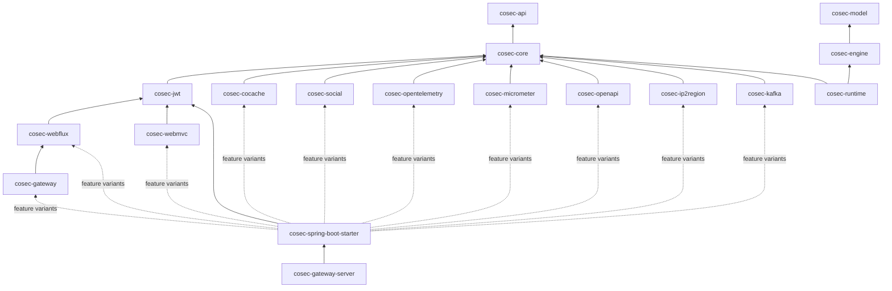
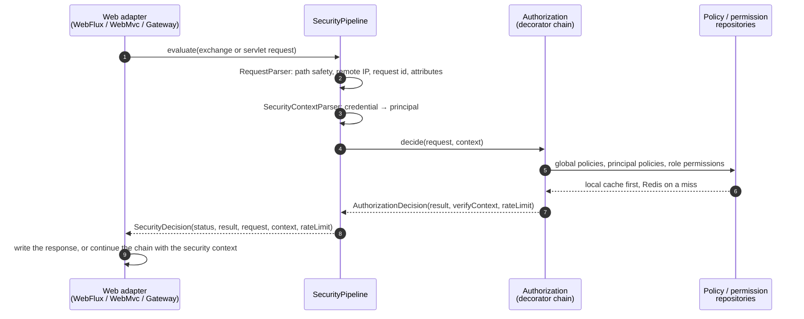
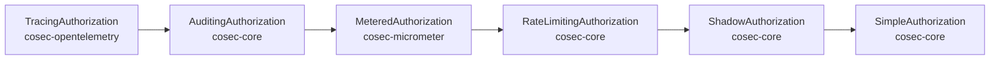

# Architecture Overview

For contributors changing CoSec and integrators who want to know how it works inside. This page explains the
module layering, how a request travels through the pipeline, how the authorization decorators fit together, and
the invariants every change must keep. What a decision *means* (evaluation order, deny-first, fail closed) is in
the [security model](../guide/security-model.md); this page explains how the code keeps those promises.

## Design goals

- **One decision, many transports.** WebFlux, WebMvc and Spring Cloud Gateway must answer the same request
  identically, so every decision is made once, in transport-independent code.
- **Deny wins, errors deny.** Adding a policy can never widen access past a matching deny, and an outage never
  opens the gate.
- **Fast on the event loop.** Authorization runs on every request, often on a Netty thread. The hot path does no
  I/O and no thread hop when the data is in the local cache.
- **Policies are data.** Policies and permissions are JSON documents. New matcher types plug in through factories;
  nothing in the engine changes.
- **Pay for what you use.** An application pulls in only the integrations it asks for.

## Module layering



Arrows point at what a module depends on. The rules behind the picture:

- **`cosec-api`** holds the public contracts only (`CoSecPrincipal`, `Policy`, `Statement`, `ActionMatcher`,
  `ConditionMatcher`, `Authorization`, `Request`, `SecurityContext`, `AuditEventSink`) and depends on Reactor
  alone. Downstream code compiles against it, so changing it is a breaking change.
- **`cosec-core`** holds every algorithm (the policy engine and its matchers, `SimpleAuthorization`, the
  `SecurityPipeline`, the authorization decorators for auditing, rate limiting and shadow mode, token
  abstractions, local loading, JSON serialization) and the SPIs that other modules and applications implement
  (see [Extending CoSec](./extending.md)).
- **`cosec-model` and `cosec-engine`** (directories `model/` and `engine/`) will hold the pure decision engine new in 8.0
  ([RFC 0002](https://github.com/Ahoo-Wang/CoSec/blob/main/docs/rfc/0002-pure-engine.md), Chinese). They depend on the Kotlin standard library only: `EnginePurityTest` (ArchUnit) fails on
  any reference to Reactor, Spring, logging, I/O, threads or clocks, and the `verifyPureClasspath` task, part of
  `check`, fails on any other dependency. Nothing uses them yet.
- **`cosec-runtime`** (directory `runtime/`) will hold the coroutine request pipeline new in 8.0
  ([RFC 0006](https://github.com/Ahoo-Wang/CoSec/blob/main/docs/rfc/0006-coroutine-pipeline.md), Chinese). It depends on
  `cosec-engine` and `cosec-core`. Coroutines stay in this module and the web adapters, and Reactor only at the adapter
  bridges: `RuntimeBoundaryTest` (ArchUnit) fails when code in `runtime/`, `engine/` or `model/` references `reactor.*`,
  when a data-plane SPI signature carries a Reactor type, when `runtime/` references Spring, the Servlet API or a
  coroutine bridge (`kotlinx.coroutines.reactor`, `runBlocking`), `GlobalScope` or `Dispatchers.IO`, or when it calls
  `runCatching`, which swallows cancellation. `cosec-core` still brings Reactor onto its classpath, so the test checks references, not dependencies.
  The module is empty so far.
- **Every other library module adapts exactly one technology**: JWT, Redis through CoCache, OAuth, OpenTelemetry,
  Micrometer, OpenAPI, ip2region, Kafka, or one web stack. An adapter module never contains a decision.
- **`cosec-spring-boot-starter`** wires everything. Each integration is a Gradle feature variant declared in
  [`cosec-spring-boot-starter/build.gradle.kts`](https://github.com/Ahoo-Wang/CoSec/blob/main/cosec-spring-boot-starter/build.gradle.kts):
  the adapter module is a dependency of that variant only, and its auto-configuration is guarded by
  `@ConditionalOnClass`, so it is active only when the application requests the capability. A new integration
  is a new module plus a new variant, never a new hard dependency of the starter. The capabilities and the modules
  behind them are listed in the [introduction](../guide/introduction.md#modules).
- **`cosec-gateway-server`** is a ready-to-run application built from the starter. It is never published.

## Request path



What a contributor needs to know about this path:

- [`SecurityPipeline`](https://github.com/Ahoo-Wang/CoSec/blob/main/cosec-core/src/main/kotlin/me/ahoo/cosec/pipeline/SecurityPipeline.kt)
  owns every transport-independent step, **including all status and error mapping**. The adapters
  ([`ReactiveSecurityFilter`](https://github.com/Ahoo-Wang/CoSec/blob/main/cosec-webflux/src/main/kotlin/me/ahoo/cosec/webflux/ReactiveSecurityFilter.kt)
  for WebFlux and Gateway,
  [`AbstractAuthorizationInterceptor`](https://github.com/Ahoo-Wang/CoSec/blob/main/cosec-webmvc/src/main/kotlin/me/ahoo/cosec/servlet/AbstractAuthorizationInterceptor.kt)
  for WebMvc) only turn a `SecurityDecision` into a response. A change that makes an adapter decide something
  breaks parity; put it in the pipeline instead.
- Every outcome, including an exception thrown synchronously by an `Authorization`, becomes a `SecurityDecision`.
  Nothing escapes the pipeline as an error.
- `SecurityContextParser.parse` is synchronous. It runs on the caller's thread unless parsing may block (token
  revocation enabled, or an API key store that does I/O), in which case the starter moves it to `boundedElastic`.
  A `TokenVerificationException` makes the caller anonymous and is reported in the denial; any other exception is
  an error.
- The status codes and response headers the adapters write, and how application code reads the security context,
  are documented for users in [Web integration](../integration/web.md#responses-and-status-codes).

## Authorization chain

The `Authorization` bean is a chain of decorators around `SimpleAuthorization`, built by the starter:



| Decorator | Does |
|---|---|
| `TracingAuthorization` | Opens a span per decision. |
| `AuditingAuthorization` | Publishes an `AuditEvent` to the `AuditEventSink`. |
| `MeteredAuthorization` | Records decision metrics. It is a `CoSecAuthorizationCustomizer`, the same hook applications use. |
| `RateLimitingAuthorization` | Spends one permit per matching rule, for allowed requests only; an exhausted rule turns the decision into `TOO_MANY_REQUESTS`. |
| `ShadowAuthorization` | Re-evaluates sampled requests against candidate policies and reports the difference. The enforced decision is unchanged. |
| `SimpleAuthorization` | The decision itself. Its evaluation order is described in the [security model](../guide/security-model.md#evaluation-order). |

Which decorators are present, and the properties that turn them on, are listed in
[The decision chain](../operations/observability.md#the-decision-chain).

Why this order:

- Rate limiting sits **inside** auditing and tracing, so `429`s are audited and traced like any other decision.
- Shadow mode wraps `SimpleAuthorization` **directly**, inside rate limiting, because it compares pure decisions:
  a shadow evaluation must never spend permits.
- Customizers (`CoSecAuthorizationCustomizer`, applied in `@Order` order) wrap the result of rate limiting and
  sit inside auditing and tracing.

Every decorator implements
[`DecisionAuthorization`](https://github.com/Ahoo-Wang/CoSec/blob/main/cosec-core/src/main/kotlin/me/ahoo/cosec/authorization/AuthorizationDecision.kt)
and forwards `decide(...)`. The result is an `AuthorizationDecision` that carries the matched `VerifyContext` (which
policy and statement decided) as a value, so auditing, tracing and explanation see what matched without
re-evaluating. A decorator that only implements `authorize(...)` would drop that context.

`AuthorizationChecker`, which applications use to [check permissions in code](../integration/checks.md), uses a
plain `SimpleAuthorization` outside the chain: checks are not audited and not rate limited.

## Invariants

Each invariant exists for a reason, and most have a test guarding it. Never weaken the guard to make a change pass.
[`AGENTS.md`](https://github.com/Ahoo-Wang/CoSec/blob/main/AGENTS.md) holds the same list for coding agents.

| Invariant | Why | Guard |
|---|---|---|
| **Deny-first.** No `ALLOW` wins over a matched `DENY`, within a layer or across layers. | Otherwise adding a policy can widen access. | `SimpleAuthorizationTest` |
| **Fail closed.** Errors deny, apart from the documented exceptions listed in the [security model](../guide/security-model.md#fail-closed). | An outage must not open the gate. | `SecurityPipelineTest`, `RateLimitingAuthorizationTest`, `RedisRateLimitingOffEventLoopTest` |
| **One decision path.** Status codes and error mapping live only in `SecurityPipeline`. | Three adapters must answer identically. | `WebAdapterParityTest` |
| **No blocking on the event loop.** Blocking calls run on `boundedElastic`. Cache reads not answered locally read Redis without blocking and continue on `boundedElastic`. A blocking custom condition matcher implements `BlockingAware`; only layers containing one hop threads. | Blocking a Netty thread stalls every request on it. | `RedisRateLimitingOffEventLoopTest`, `LocalCacheFastPathTest`, `SecurityContextParseSchedulersTest`; `BlockingAwareTest` covers how the flag propagates |
| **Authorization is a pure decision.** Built-in matchers do no I/O and keep no state. Rate limiting is a separate decorator that spends permits only for allowed requests. | Keeps evaluation fast, predictable and explainable; denied requests never use up quotas. | review, `RateLimitingAuthorizationTest` |
| **Policy and permission caches never expire and throw on failed reads** (`ttl = null`, `ReadFailureMode.THROW`), applied after any CoCache customizer or property. | Redis is the store of record; expiry or a swallowed error would silently drop policies. | `CacheTtlPolicyTest`, `StrictCacheFailureTest` |
| **The explainer narrates the real algorithm.** `AuthorizationExplainer` describes the same order and combination as `SimpleAuthorization`. | An explanation that disagrees with the decision misleads whoever debugs an access problem. | `ExplainerConsistencyTest` |
| **Hot-path changes come with a JMH before/after.** | Authorization runs on every request. | `SimpleAuthorizationBenchmark` (review) |

Two of these need care when you add code:

- `BlockingAwareTest` checks that the `requiresBlocking` flag is computed and propagated (through `bool`, policies
  and app permissions). No test asserts that `SimpleAuthorization` then evaluates the layer on `boundedElastic`; a
  change to that hop is caught only in review.
- Purity is guarded by review. A built-in matcher that performs I/O or keeps state compiles and passes the tests.

## Data and caching

The repositories are interfaces in `cosec-core` (`PolicyRepository`, `AppRolePermissionRepository`). The Redis
implementations in `cosec-cocache` are built on [CoCache 6](https://cocache.ahoo.me). The design decisions:

- **Redis is the store of record; the local cache is a view of it.**
  [`CoSecCacheSpecs`](https://github.com/Ahoo-Wang/CoSec/blob/main/cosec-cocache/src/main/kotlin/me/ahoo/cosec/cache/CoSecCacheSpecs.kt)
  declares every cache. Policy and permission caches never expire and throw on a failed Redis read. The starter
  applies this after any CoCache customizer or property, so configuration cannot loosen it.
- **Local hits cost no thread hop.** Repositories read through CoCache's async view. A local hit is an already
  completed future, so the repository answers on the caller's thread; a miss reads Redis without blocking and the
  request continues on `boundedElastic`.
- **Missing data fails, it is not skipped.** A principal policy the repository does not return fails authorization
  with `MissingPolicyException` (the pipeline answers `500`). The global policy index is read the same way: an
  indexed id without content fails, because the missing policy might be a global `DENY`. A role grant naming a
  permission id its app does not define fails the same way, with `MissingPermissionException`.
- **Concurrent publishes cannot widen access.** The global policy index is a CoCache `SetCache` updated with atomic
  `add` / `remove`, and the content is written before the index entry. Readers apply only indexed policies whose
  content is of type `global` (`GlobalPolicyConsistencyTest`, `GlobalPolicyIndexConcurrencyIntegrationTest`).
- **Local files load strictly.** Policies, rate limit rules, shadow candidates and test inputs are resolved by
  `JsonResources`: a configured location that matches no file, a file that cannot be read and an id declared twice
  fail loading. Only the built-in default locations may match nothing.

How to choose a store, run Redis, behave during an outage, and publish or roll back changes is operational
knowledge and lives in [Storage](../operations/storage.md).

## Startup schema check

CoSec 7.0 stores its Redis data in the CoCache 6 layout. Unmigrated 6.x data is not always where 7.0 looks: a key
prefix ending in `:`, a changed prefix or a rolled-back migration leaves it elsewhere. 7.0 would then read every
policy, global `DENY` and revocation as *missing*, which fails open, and no read error would ever reveal it.

So before any CoSec cache is created, the starter runs
[`CoSecSchemaMarker`](https://github.com/Ahoo-Wang/CoSec/blob/main/cosec-cocache/src/main/kotlin/me/ahoo/cosec/cache/CoSecSchemaMarker.kt)
against the marker key `<p>:meta:schema`: while CoSec data exists in Redis without the 7.0 marker, startup stops
with `CoSecSchemaException`. The migration writes the marker last, so a half-finished migration still stops startup.
Each state and its outcome is in [Schema marker](../operations/storage.md#schema-marker), and running the migration
in [Migrating the data](../operations/upgrading.md#migrating-the-data). The check is guarded by
`CoSecSchemaMarkerTest` and `CoSecCacheSchemaAutoConfigurationTest`.

## Performance

`SimpleAuthorizationBenchmark` (`cosec-core/src/jmh`) measures the hot path with in-memory repositories: three
global policies (25 statements), two principal policies (20 statements) and an app permission with 51 permissions.
Throughput is decisions per second on one thread; time is its inverse; allocation is bytes allocated per decision
(`gc.alloc.rate.norm`).

| Scenario | Throughput | Time | Allocated |
|---|---|---|---|
| Matched by a global allow (`global`) | 474,816 ± 7,769 ops/s | 2.1 µs | 5,997 B |
| Matched by a role permission (`role`) | 438,331 ± 5,376 ops/s | 2.3 µs | 6,488 B |
| No match (`none`) | 508,364 ± 4,057 ops/s | 2.0 µs | 1,640 B |

`RateLimitingAuthorizationBenchmark` measures what rate limiting adds on top of an authorization that always allows
(16 ns, `plain`): about 20 ns with no rules (`noRules`), 45 ns when no rule matches (`unmatched`), and 240 ns for one
matching per-IP rule counted in memory (`local`). A Redis-counted rule adds a Redis round trip. Shadow mode adds one
more `SimpleAuthorization` evaluation to each sampled request.

Two decisions dominate the hot path: each request parses its path once and shares it across all path matchers, and
deny-first evaluation loops over the source lists without per-item wrappers. Any change to authorization, matchers
or repositories should come with a before/after comparison.

### What the 7.0 fixes cost

7.0 is 6 to 9 % slower than 6.1.0 in `SimpleAuthorizationBenchmark`; a decision matched by a global allow went from
about 1.9 µs to 2.1 µs. Allocation grew by 34 to 56 bytes per decision. Rate limiting did not change beyond noise.

| Benchmark | Scenario | 6.1.0 (ops/s) | 7.0 (ops/s) | Change | B/op 6.1.0 → 7.0 |
|---|---|---|---|---|---|
| `SimpleAuthorizationBenchmark` | `global` | 522,486 ± 6,807 | 474,816 ± 7,769 | −9.1 % | 5,963 → 5,997 |
| `SimpleAuthorizationBenchmark` | `none` | 541,901 ± 8,984 | 508,364 ± 4,057 | −6.2 % | 1,584 → 1,640 |
| `SimpleAuthorizationBenchmark` | `role` | 466,934 ± 3,601 | 438,331 ± 5,376 | −6.1 % | 6,432 → 6,488 |
| `RateLimitingAuthorizationBenchmark` | `local` | 3,857,082 ± 34,161 | 3,928,012 ± 15,368 | +1.8 % | 1,168 → 1,208 |
| `RateLimitingAuthorizationBenchmark` | `noRules` | 28,791,080 ± 224,392 | 27,880,383 ± 127,124 | −3.2 % | 352 → 352 |
| `RateLimitingAuthorizationBenchmark` | `plain` | 62,553,549 ± 618,196 | 61,807,452 ± 727,007 | −1.2 % | 152 → 152 |
| `RateLimitingAuthorizationBenchmark` | `unmatched` | 16,863,776 ± 459,156 | 16,466,577 ± 99,516 | −2.4 % | 376 → 376 |

The cost comes from five security fixes on the decision path, which together account for the 6 to 9 %
([what each one changes](../operations/upgrading.md#authorization-and-loading-changes)):

- **The blacklist is checked first**, before root, so a blacklisted root principal is denied.
- **Missing principal policies fail**: the policies the repository returns are checked against every id the
  principal lists, so a missing deny cannot be skipped.
- **Role grants are scoped to a space**: the principal's roles are filtered to the request's space before the grants
  are read.
- **Path variables are cleared** before each policy's conditions and before every statement, so a condition sees
  only the variables its own statement captured.
- **Missing role permissions fail**: every permission id a role is granted is checked against the app's catalog.

The project accepted this cost for 7.0. The pure decision engine planned for 8.0
([RFC 0002](https://github.com/Ahoo-Wang/CoSec/blob/main/docs/rfc/0002-pure-engine.md), Chinese) targets at least
95 % of the current `SimpleAuthorization`'s throughput in every `SimpleAuthorizationBenchmark` scenario, with no
more allocation. The
trimmed JMH results for both versions are in
[`docs/perf/7.0-vs-6.1.0`](https://github.com/Ahoo-Wang/CoSec/tree/main/docs/perf/7.0-vs-6.1.0), for later changes to
compare against.

### Measuring

The numbers above were taken in October 2026 on one Apple M4 (10 cores, macOS 27) with JDK 17.0.20.1: 3 forks,
5 warm-up and 10 measurement iterations of 2 s each, one thread, `-prof gc`, and the WARN-level
`config/logback-jmh.xml`. Both versions ran one after the other on the same machine, with a load average of 2.3 to
3.3 (a Docker VM was running). 6.1.0 is the `v6.1.0` tag; 7.0 is `main` at `580809a2`.

Build the benchmark jar and run it with the same settings:

```bash
./gradlew :cosec-core:jmhJar
java -jar cosec-core/build/libs/cosec-core-*-jmh.jar 'SimpleAuthorizationBenchmark|RateLimitingAuthorizationBenchmark' \
  -f 3 -wi 5 -i 10 -w 2s -r 2s -prof gc -rf json -rff jmh.json \
  -jvmArgsAppend "-Dlogback.configurationFile=$PWD/config/logback-jmh.xml"
```

**Pass `-jvmArgsAppend -Dlogback.configurationFile=…` when you run the jar yourself.** The jar contains Logback but no
configuration, so without it every forked JVM logs at DEBUG, including the per-decision `log.debug` lines, and the
results measure logging as much as authorization. `./gradlew :cosec-core:jmh` passes the file already, but runs one
fork with one warm-up and one measurement iteration (the defaults in the root `build.gradle.kts`): enough to see that
a benchmark runs, not to compare versions.

Gradle properties override those defaults: `-PjmhWarmupIterations`, `-PjmhIterations`, `-PjmhFork`, `-PjmhProfilers`
(comma-separated, such as `gc`) and `-PjmhJavaVersion`, the JDK toolchain the benchmark JVMs run on (the code is still
compiled for 17). RFC 0002 compares the engine with the current `SimpleAuthorization` using this command, which adds
the `global-deny` scenario (denied by a global policy while the other layers have data); the baseline is in
[`docs/perf/rfc-0002-baseline`](https://github.com/Ahoo-Wang/CoSec/tree/main/docs/perf/rfc-0002-baseline):

```bash
./gradlew :cosec-core:jmh -PjmhIncludes=SimpleAuthorizationBenchmark -PjmhJavaVersion=25 \
  -PjmhWarmupIterations=5 -PjmhIterations=10 -PjmhFork=3 -PjmhProfilers=gc
```

How much to trust the numbers:

- **Numbers taken on a busy machine are not reliable.** Other processes (builds, IDEs, Docker, other benchmarks)
  steal CPU and change JIT and GC timing. Compare before and after on the same machine, one right after the other,
  and treat differences smaller than the error columns as noise. The 7.0 comparison was taken under load, so an idle
  machine may give higher absolute numbers; what the comparison shows is the relative change.
- Compare throughput with the same JDK on both sides: a different JDK changes JIT decisions more than most code
  changes do.

## Where the architecture is going

[RFC 0001: target architecture](https://github.com/Ahoo-Wang/CoSec/blob/main/docs/rfc/0001-target-architecture.md)
(Chinese) describes the planned redesign: a pure model and synchronous engine, snapshot-based distribution,
listeners instead of decorators, and the migration path from the structure described here.

**Next:** add your own conditions, repositories and hooks, in [Extending CoSec](./extending.md).
