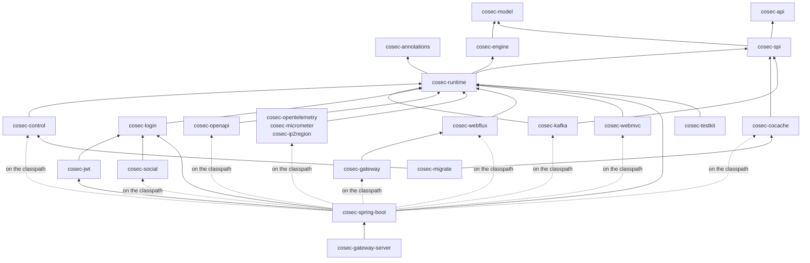
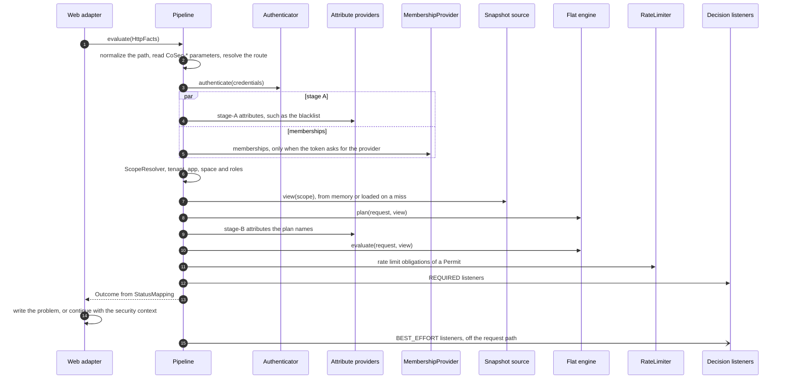
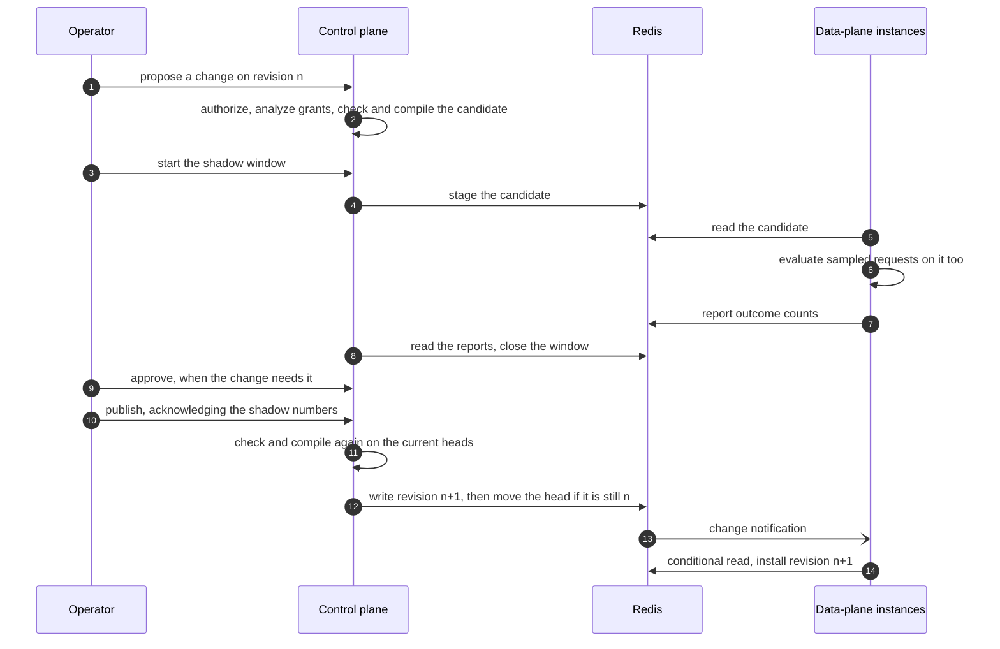

# Architecture Overview

For contributors changing CoSec and integrators who want to know how it works inside. This page explains how the
modules depend on each other, how a request travels through the coroutine pipeline, how the engine finds and evaluates
policies, how policy snapshots reach every instance, how the control plane publishes them, and which invariants every
change must keep. What a decision *means* (deny first, default deny, fail closed, break-glass) is in the
[security model](../guide/security-model.md); this page explains how the code keeps those promises.

## Design goals

- **One decision, many transports.** WebFlux, WebMvc and Spring Cloud Gateway must answer the same request
  identically, so every decision and every status code is made once, in transport-independent code.
- **A pure decision.** The engine is a synchronous function over a request and an immutable snapshot: no I/O, no
  clock, no threads. Everything that needs I/O (credentials, memberships, attributes, rate limits, audit) happens around
  it, in the pipeline.
- **Deny wins, errors deny.** Adding a policy can never widen access past a matching deny, and data that cannot be
  read never permits.
- **Fast on the event loop.** A request whose data is already in memory finishes on the thread that received it,
  without a dispatch or a timer. A request that must wait for I/O suspends, and never blocks a thread.
- **One writer.** Policy documents change only through the control plane (or `cosec-migrate`, which writes through the
  same store), as revisions that are checked, compiled and optionally shadowed before they go live.
- **Pay for what you use.** An application pulls in only the integrations it asks for.

## Module layering

Modules sit in group directories: `api/` (annotations, api), `core/` (model, engine, spi, runtime, control),
`backends/` (cocache, kafka), `edge/` (webflux, webmvc, gateway, openapi), `extensions/` (jwt, social, login,
ip2region, micrometer, opentelemetry), `host/` (spring-boot), `migration/`, `test/`, `bom/` and `platform/`
(gateway-server). A Gradle project is named after its directory (`:engine`, `:spring-boot`); its artifact keeps the
`cosec-` prefix.



Arrows point at what a module depends on; the dotted ones are modules the starter wires when the application adds them.
The rules behind the picture:

- **`cosec-model` and `cosec-engine`** (directories `core/model/` and `core/engine/`) are the pure core: ids, bindings,
  memberships, the condition AST, scopes and decisions in the model; action and resource patterns, the policy compiler
  and the flat engine in the engine. They depend on the Kotlin standard library only. `EnginePurityTest` (ArchUnit)
  fails on any reference to Reactor, Spring, logging, I/O, threads or clocks, and `DependencyRulesTest` fails on any
  other resolved dependency. `ScopeConstructionTest` checks that only `ScopeResolver` constructs a resolved `Scope`.
- **`cosec-api`** (directory `api/api/`) holds the contracts applications compile against: `CoSecPrincipal`, `Tenant`,
  tokens, `SecurityContext`, `AuditEvent`, and their simple implementations (`SimplePrincipal`, `SimpleTenant`). It
  depends on the Kotlin standard library alone. Changing it is a breaking change.
- **`cosec-annotations`** (directory `api/annotations/`) holds the stability markers
  ([Stability levels](./extending.md#stability-levels)). `@InternalCoSecApi` is an opt-in marker at error level: a
  declaration carrying it is public only so CoSec's own modules can reach it, and has no compatibility promise.
  Applications do not opt in; `SourceRulesTest` fails when an opt-in appears outside CoSec's own Kotlin sources.
  `@ExperimentalCoSecApi` (an opt-in at warning level) marks public API that a minor release may still change, and
  `@CoSecSpi` the interfaces applications implement.
- **`cosec-spi`** (directory `core/spi/`) holds the ports a request or a store calls, with their values and in-memory
  implementations, under `me.ahoo.cosec.spi.*`: the snapshot store (`SnapshotDocumentStore`), memberships, token
  verification and revocation (`TokenVerifier`, `RevocationReader`, `TokenStore`, `TokenRevoker`), API keys, rate
  limiters, attribute providers, authenticators, the forwarded identity and the audit sink. It depends on
  `cosec-model`, `cosec-api`, `cosec-annotations` and kotlinx-coroutines only, so a third party implements a port
  against it alone. A port
  whose signature needs a layer's types stays with that layer: `DecisionListener`, `RequestGate`, the shadow window
  ports in `cosec-runtime`; `ControlStore` and `ChangeListener` in `cosec-control`
  ([Extending](./extending.md)).
- **`cosec-runtime`** (directory `core/runtime/`) is the data plane: the coroutine `Pipeline`, `StatusMapping`,
  `AuthorizationChecker`, the snapshot documents and their codec, compiler and format descriptors (which generate
  `schema/*.schema.json`), `SnapshotSource`, route maps, token verification, the built-in authenticators and the
  logging audit sink. Its one Jackson mapper, `CoSecJson`, is internal (`@InternalCoSecApi`), and no Jackson type
  appears in a public signature of `api/` or `core/` (`JacksonSignatureTest`). Coroutines stay in this module and the adapters,
  Reactor only at the adapter bridges: `RuntimeBoundaryTest` (ArchUnit) fails when code in `runtime/`, `engine/` or
  `model/` references `reactor.*`, when a data-plane SPI signature carries a Reactor type, when `runtime/` references
  Spring, the Servlet API or a coroutine bridge (`kotlinx.coroutines.reactor`, `runBlocking`), `GlobalScope` or
  `Dispatchers.IO`, or when it calls `runCatching`, which swallows cancellation.
- **`cosec-control`** (directory `core/control/`) is the control plane: revisions, change requests, shadow windows,
  approvals, break-glass, simulation and analysis. It is a library that a host wires in. `ControlBoundaryTest`
  (ArchUnit) imports the module's own compiled classes and fails when one of them is outside `me.ahoo.cosec.control`,
  references Spring, `reactor.*`, the coroutine or Reactive Streams bridges or a Redis client, or calls `runBlocking`,
  `Dispatchers.IO` or `GlobalScope`.
- **Every other library module adapts exactly one technology**: a web stack (`cosec-webflux`, `cosec-webmvc`,
  `cosec-gateway`), Redis through CoCache (`cosec-cocache`: snapshot store, control store, revocation, rate limiter,
  shadow reports), Kafka (`cosec-kafka`), login and token issuing (`cosec-login`, which keeps the 7.x Reactor login
  contracts), JWT (`cosec-jwt`), OAuth (`cosec-social`), OpenAPI, or an observer of decisions
  (`cosec-opentelemetry`, `cosec-micrometer`, `cosec-ip2region`). An adapter never decides; it translates.
- **`cosec-spring-boot`** (directory `host/spring-boot/`) wires everything. It brings `cosec-runtime`, `cosec-login`
  and `cosec-jwt`; every other module is `compileOnly` in
  [`host/spring-boot/build.gradle.kts`](https://github.com/Ahoo-Wang/CoSec/blob/main/host/spring-boot/build.gradle.kts),
  and its auto-configuration is guarded by `@ConditionalOnClass`, so it is active only when the application adds the
  module. A module that a turned-on feature needs is checked at startup (STA-1,
  [`CoSecModuleCheckAutoConfiguration`](https://github.com/Ahoo-Wang/CoSec/blob/main/host/spring-boot/src/main/kotlin/me/ahoo/cosec/spring/boot/starter/CoSecModuleCheckAutoConfiguration.kt)):
  a forgotten adapter would otherwise leave a web host without a filter, so startup fails and names the artifact.
  The modules and what each needs are listed in the [introduction](../guide/introduction.md#modules).
- **`cosec-testkit`** (directory `test/testkit/`) runs scenarios against an application's own documents in JUnit 5. It
  depends on `cosec-runtime` and `junit-jupiter-api` (both part of its API). It holds the engine level of the scenario
  format, which `conformance` runs too, so the suite and the applications' tests evaluate scenarios one way.
- **`cosec-migrate`** converts 7.x data into 8.0 documents and publishes them; no application depends on it.
  **`cosec-gateway-server`** is a ready-to-run gateway built from the starter; it is never published. **`conformance`**,
  **`architecture`** and **`e2e`** are test-only modules and are never published either.

`architecture` (directory `test/architecture/`) holds the structural rules that scan several modules (RFC 0011 §5):

- `DependencyRulesTest` reads the declared and resolved main dependencies of every project, which the root build's
  `architectureFacts` task writes, and fails when a declared dependency points outwards (the reviewed exceptions, such
  as `cosec-kafka` on `cosec-runtime` for `DecisionListener`, are listed with their reason in `DependencyRules`), when
  `cosec-annotations`, `cosec-api`, `cosec-model` or `cosec-engine` resolves anything but the Kotlin standard library
  (`cosec-spi` adds coroutines), or when `cosec-runtime` or `cosec-control` resolves Reactor, Spring, the Servlet API or
  a Redis client.
- `SourceRulesTest` scans the compiled classes: Reactor only in the edge, the extensions and the host (and
  `cosec-cocache`, whose reactive Redis client the suspending ports await); no Spring, Servlet API or Redis client in
  `api/` and `core/`; the backends and extensions use only their own Spring technology; the backends reach into
  `cosec-runtime` and `cosec-control` only through the listed ports and `CoSecJson`; a package belongs to one module;
  opt-ins to the internal API only in CoSec's own sources.
- `JacksonSignatureTest` (no Jackson type in a public signature of `api/` or `core/`, and no Reactor type in one of
  `cosec-cocache`, which reads Redis reactively inside), the purity and boundary tests above, the one-decision-path and token rules, the project list
  (`ProjectListTest`) and the version catalog.
- `SpiMarkerTest`: every public interface of `cosec-spi` that an application can implement, and every extension point
  [Extending](./extending.md#extension-points) lists, carries `@CoSecSpi`, and the marker is on nothing else.

The public API itself is held by the build, not by review (RFC 0011 D4): every published library module but
`cosec-migrate` (a command-line tool) keeps its ABI in a dump, `api/<project>.api` in its directory, and its `check`
runs the Kotlin Gradle plugin's `checkKotlinAbi`, which fails when a public signature changed without the dump. `@InternalCoSecApi` declarations are not in the dumps. From 8.0 GA
on, a removed or changed line of a dump is a breaking change.

## Request path

`Pipeline.evaluate` in
[`Pipeline.kt`](https://github.com/Ahoo-Wang/CoSec/blob/main/core/runtime/src/main/kotlin/me/ahoo/cosec/runtime/Pipeline.kt)
is one suspend function from the request's facts to an `Outcome`. The adapters (`PipelineWebFilter`,
`PipelineServletFilter`, `PipelineGatewayFilter`) only read the request into `HttpFacts`, call it, and write what it
returns. They depend on `RequestGate`, the interface `Pipeline` implements. The other `RequestGate` is `IdentityGate`,
which a service behind a CoSec gateway uses instead (`cosec.pipeline.mode=gateway`): it reads the caller from the
`CoSec-Identity` header the gateway forwarded, with no authenticator, snapshot, engine or listeners, and builds its
outcomes through `StatusMapping` too, so both gates answer alike on every adapter. Why that needs a network boundary is
in [Trust boundaries](../guide/security-model.md#trust-boundaries).



- **Read.** The adapter reads the method, raw path, query, headers, cookies, client address (through the configured
  `X-Forwarded-For` depth) and host once, and starts the pipeline (step 1). On WebFlux and Gateway the request starts on
  the event loop without a dispatch; after a real suspension it continues on `Dispatchers.Default`, never on a client
  library's I/O thread. On WebMvc the bridge is `runBlocking` on the servlet thread.
- **Route.** A path that does not normalize, or an ambiguous `CoSec-*` parameter, is a `400` (step 2). A
  [route map](./extending.md#route-maps) turns a mapped request into a `service:verb` action on a typed resource; any
  other request is `http:<METHOD>` on `http:path:<path>`.
- **Authenticate.** The `Authenticator` turns the token or API key into a principal (step 3). A rejected credential is
  evaluated as anonymous; an authenticator that fails or times out is a `503`.
- **Memberships and stage A.** Stage-A attributes, those that decide what is loaded such as the blacklist, are fetched
  together with the memberships (steps 4 and 5). Memberships come from the token's claims, or from the
  `MembershipProvider` for an API key and for a token that carries the provider marker, narrowed to a key's cap. A
  principal the provider does not know or knows as deactivated refuses the credential, and the request is decided as
  anonymous. A membership source that fails, times out or answers the wrong kind of memberships is a `503`, never "no
  roles".
- **Scope.** `ScopeResolver` turns the declared app and space into a checked scope (step 6): the tenant is the
  principal's (the default tenant when anonymous); a service bound to an app (`cosec.authorization.scope.app-id`) uses
  that app and rejects a request that declares another; a space other than the default needs a role in it. A rejected
  scope is a deny ([trust boundaries](../guide/security-model.md#trust-boundaries)).
- **Snapshot view.** The snapshot source answers the view (platform, app and tenant documents) from memory, or loads
  what is missing (step 7). A blocked request loads only the platform document.
- **Stage B.** When a provider declares stage-B attributes, the engine's `plan` names the external attributes this
  request could read, and only those are fetched, each provider in parallel with its own timeout (steps 8 and 9). A
  provider that fails makes only its own attributes unavailable.
- **Decide.** The engine answers `Permit` (with obligations), `Deny` or `Indeterminate` (step 10).
- **Obligations.** A permit's rate limit obligations run in order (step 11). The first exhausted rule is a `429`; a rule
  that cannot be counted is a `503` when it is strict and is skipped otherwise.
- **REQUIRED listeners.** They see the outcome before it is returned (step 12); a failure turns only a permit into a
  `503`. A permit through a break-glass binding needs at least one REQUIRED listener, or it is a `503`.
- **Status mapping.** `StatusMapping` is the only place that builds an `Outcome`: status, headers and the
  `application/problem+json` body (step 13). At a gateway the outcome also names the headers to forward: the verified
  `CoSec-Identity` on a permit for an authenticated principal, and otherwise none, so the adapter removes any the
  client sent. The adapter writes it, or lets a permitted request continue with its
  security context (step 14). The status of each outcome and the `CoSec-*` parameters are documented in
  [Web integration](../integration/web.md).
- **BEST_EFFORT listeners.** The audit log, metrics, tracing, the shadow listener and, by default, Kafka get the final
  event through their own bounded queues, off the request path (step 15).

Every SPI call goes through one wrapper: it applies the call's timeout (`cosec.pipeline.*` and
`cosec.authorization.*`, see [Configuration](../operations/configuration.md); a snapshot load is bounded by
`cold-load-timeout` instead), turns any failure into a value, and lets only an external cancellation through. The whole evaluation has a deadline too; past it the request is a `503`. Timers are armed lazily: a request
that never suspends arms none. An exception nothing modelled is a `500`. A client that goes away cancels the coroutine,
and nothing is written.

`AuthorizationChecker` reuses the second half of this path (view, attributes, engine) to
[check further actions in code](../integration/checks.md) as the principal of a permitted request. A check runs no
obligation and no listener, so it is neither rate limited nor audited, and a permit that only break-glass gives is not a
permit there.

## The flat engine

The engine
([`FlatEngine.kt`](https://github.com/Ahoo-Wang/CoSec/blob/main/core/engine/src/main/kotlin/me/ahoo/cosec/engine/flat/FlatEngine.kt))
evaluates one request against one `SnapshotView`: the compiled platform document, plus the tenant's document and, when
the scope has roles in an app, that app's document. It reads no clock (the request carries its time) and does no I/O
(external attributes arrive with the request). The view must belong to the request's tenant and app; the engine refuses
any other.

### Candidate order

The engine first enumerates the policies that apply to the request, the *candidates*
([`CandidateOrder.kt`](https://github.com/Ahoo-Wang/CoSec/blob/main/core/engine/src/main/kotlin/me/ahoo/cosec/engine/flat/CandidateOrder.kt)):

| # | Candidates |
|---|---|
| 0 | The built-in blacklist rule `cosec:blacklist`, which denies a blocked request. |
| 1 | Platform bindings to anyone, by policy id. |
| 2 | Tenant bindings to anyone, by policy id. |
| 3 | For an authenticated principal: its attachments in claim order, then its principal bindings in the platform and the tenant document, by binding id. For a credential with a role cap, DENY candidates only: a cap removes ALLOWs, never DENYs. |
| 4 | Role bindings of the app document, then of the tenant document: by the scope's roles in claim order, and within a role in document order. |
| 5 | For an authenticated principal: its break-glass bindings, last. |

A binding is a candidate only in its app and space, and only before it expires. An attachment or binding that names a
policy the snapshot does not have, or one that both the tenant and the platform define with different content, is
recorded as missing or ambiguous; it does not silently disappear.

### Evaluation

The decision depends on the set of candidates, never on their order; the order only decides which statement is reported
when several match. At a high level:

1. Every candidate's DENY statements are checked first. The first match is the decision.
2. Without a matching DENY, anything that could hide one (a DENY that failed, a missing or ambiguous policy, a document
   or attribute that could not be read) makes the decision `Indeterminate`.
3. Only then are the ALLOW statements checked; the first match is a `Permit`. Nothing matched is a `Deny` with no
   statement (the implicit deny).
4. A permit for a tenant held by a platform boundary stays a permit only if a boundary statement also matches.

The exact rules, including break-glass and the boundary, are in the
[security model](../guide/security-model.md). A policy with many statements is indexed by action, resource and condition keys, so a candidate
costs only the statements that could match. Untraced evaluation records nothing and allocates almost nothing; the traced
evaluator, used for decision events at `cosec.pipeline.trace-level` and for `explain`, is a separate class so the hot
path carries no trace code.

## Policy snapshots

Policies reach the engine as **snapshot documents**, one per key: the platform document, one document per app and one per
tenant. They are stored as JSON (schema 2), compiled once per revision, and held in memory as immutable compiled
documents. A view is a reference to three of them, so an evaluation always sees one revision of each document
(`SNP-1`, guarded by `SnapshotConsistencyPropertyTest`).

[`SnapshotSource`](https://github.com/Ahoo-Wang/CoSec/blob/main/core/runtime/src/main/kotlin/me/ahoo/cosec/runtime/snapshot/SnapshotSource.kt)
holds them:

- **Hot path.** `peek` is a synchronous lookup in memory, with no future and no I/O, safe on an event loop. Only a miss
  goes to `load`.
- **Single flight.** Concurrent loads of one key share one read and one compilation. Compilation runs on a small
  bounded pool (`compile-threads`); a full queue fails the load closed. Installs of one key happen in the order their
  loads started (`SNP-2`, `SnapshotInstallOrderPropertyTest`).
- **Bounded memory.** The platform document is loaded at startup and never evicted. App and tenant documents are loaded on
  demand and evicted least recently used beyond `max-apps` and `max-tenants`; selected ones can be prewarmed.
- **Revalidation.** Every installed document is revalidated every `revalidate-interval` (10 s by default) with a
  conditional read of the store of record, which transfers no body when the digest is unchanged. Change notifications
  from the store trigger a reload sooner. A cold key is read once (possibly from a local copy) and then confirmed by a
  conditional read at once.
- **Fail closed.** A read that fails while a document is installed keeps the installed revision, and the lag is
  reported. A document that is present but cannot be decoded or compiled is installed as *failed*. A cold read that
  fails or does not finish within `cold-load-timeout` is answered as failed. A key that once had a document and then
  reads as absent is a failure, not "no policies". A failed document is left out of the view as *unresolved*, and the
  decision is `Indeterminate` unless a DENY matches. With the starter, a missing platform document is unresolved too,
  so every request fails closed until one is published.

The store is an SPI, `SnapshotDocumentStore`. With `cosec-cocache` it is
[`RedisSnapshotDocumentStore`](https://github.com/Ahoo-Wang/CoSec/blob/main/backends/cocache/src/main/kotlin/me/ahoo/cosec/cache/snapshot/RedisSnapshotDocumentStore.kt):
Redis is the store of record, CoCache keeps a local copy for at most `local-max-age`, conditional reads bypass every
local copy, and CoCache's invalidation channel carries the change notifications. Without it, the starter uses an
in-memory store. Redis keys, the `noeviction` requirement and behavior when Redis is unavailable are in
[Storage](../operations/storage.md); the `cosec.authorization.snapshot.*` properties are in
[Configuration](../operations/configuration.md).

## Control plane

The control plane (`cosec-control`) is the only component that writes policy documents. Data-plane instances only read
them. It runs inside a host application, behind the same pipeline as every other request, and exposes its API under
`cosec.control.http.base-path`.



What makes it safe:

- **Revisions.** Every publish writes an immutable revision record first, then moves the document's head with one
  conditional write that succeeds only if the head is still the change's base. Two concurrent publishes cannot both win,
  and a reader sees the old head or the new one, never a mix. History, diff and rollback read the revision chain.
- **Changes.** A change request is a base revision plus entry-level operations, checked and compiled with the data
  plane's compiler. A moved head makes it `CONFLICTED` until it is rebased. Each document has one staging slot.
- **Authorization.** Every control-plane action is authorized again as the operator, with `cosec:*` actions on document
  resources, against a snapshot that is confirmed current from the store before each check. A grant the analysis cannot
  prove contained is an escalation and needs an approval by another person.
- **Shadow windows.** Instances sample requests (`cosec.authorization.shadow.sample-rate`), evaluate them on the staged
  candidate as well, and report how the outcomes differ (`SAME`, `WIDENED`, `NARROWED`, ...). An instance that cannot
  compile or evaluate the candidate blocks the window, and a blocked change never publishes. Documents compile against
  the platform's attribute declarations and the host's `AttributeProvider`s, so the control host and every instance
  must register the same providers: a candidate only the control host can compile blocks its window. Publishing requires the
  operator to acknowledge the numbers whenever anything changed or the evidence was insufficient.
- **Break-glass** bindings are created only through the control plane, with a second approver, an expiry and a
  REQUIRED change listener.
- **Maintenance.** Every control-plane instance periodically reclaims old revision records and closes shadow windows
  (`ControlMaintenanceScheduler`). The `ControlStore` lists what those passes visit (`documents()`,
  `openChanges()`), and a lease (`acquireLease`, `releaseLease`) lets one instance at a time do each piece of work
  ([Revisions, history and rollback](../operations/storage.md#revisions-history-and-rollback)).

How to use changes, simulation, shadow windows and approvals is in [Testing policies](../policies/testing.md); the
`cosec.control.*` properties are in [Configuration](../operations/configuration.md).

## Invariants

Each invariant exists for a reason, and each has tests guarding it. Never weaken a guard to make a change pass. The
normative rules behind them are in
[`test/conformance/src/test/resources/rules/`](https://github.com/Ahoo-Wang/CoSec/tree/main/test/conformance/src/test/resources/rules),
each with its scenarios or guard tests, and `:conformance:mutationCheck` breaks the rules on purpose
([`test/conformance/mutants/`](https://github.com/Ahoo-Wang/CoSec/tree/main/test/conformance/mutants)) to prove a test fails.
[`AGENTS.md`](https://github.com/Ahoo-Wang/CoSec/blob/main/AGENTS.md) holds the same list for coding agents.

| Invariant | Why | Guard |
|---|---|---|
| **Deny first.** No ALLOW wins over a matched DENY, whatever document, binding or order it comes from. | Otherwise adding a policy can widen access. | `FlatEnginePropertyTest` (`P1' adding a matching deny always denies`, `the decision is that of the pseudocode`), `ALG-1` scenarios |
| **Fail closed.** Missing or unreadable data never permits; an error is a `503` or `500`, never a `200`. The documented exceptions are in the [security model](../guide/security-model.md). | An outage must not open the gate. | `FlatEnginePropertyTest` (`P9 missing and unavailable data never permit`), `PipelineTest` (`indeterminateDecisionIs503`, `unmodelledExceptionIs500`, `failingLateOrWrongMembershipsAre503`, `snapshotSourceFailureIs503`) |
| **One decision path.** Status codes and problem bodies are made only in `StatusMapping`; adapters never see a decision. | Three adapters must answer identically. | `OneDecisionPathTest`, `WebAdapterParityTest` |
| **No blocking on the event loop.** SPIs suspend instead of blocking; store reads and digests run off the caller's thread. | Blocking a Netty thread stalls every request on it. | `SnapshotStoreBlockHoundTest`, `RedisSnapshotDocumentStoreTest` (`computesTheDigestOfALocalCopyOffTheCallersThread`), `PipelineBlockHoundTest`, `SuspendingRedisRateLimitingTest`, `RuntimeBoundaryTest` |
| **Authorization is a pure decision.** The engine does no I/O and keeps no state; rate limits are obligations of a permit, so a denied request never spends a permit. | Keeps evaluation fast, predictable and explainable; denied requests never use up quotas. | `EnginePurityTest`, `RateLimitObligationTest` (engine and runtime) |
| **Snapshot caches never expire and throw on failed reads**, whatever a CoCache customizer or property says. | Redis is the store of record; expiry or a swallowed error would silently drop policies. | `CacheTtlPolicyTest`, `StrictCacheFailureTest` |
| **One revision per document per evaluation**, installed in load order. | A decision must never mix two revisions of one document. | `SnapshotConsistencyPropertyTest`, `SnapshotInstallOrderPropertyTest` |
| **Hot-path changes come with a JMH before/after.** | Authorization runs on every request. | `FlatAuthorizationBenchmark`, `PipelineBenchmark` (review) |
| **Public signatures change only on purpose.** Each published module's ABI is in its dump; a change that is not in the dump fails the build. | Applications compile against CoSec and implement its SPIs; a signature change nobody noticed breaks them. | `checkKotlinAbi` (part of `check`), `SpiMarkerTest` |

## Performance

Two benchmarks measure the hot path:

- **`FlatAuthorizationBenchmark`** (`core/engine/src/jmh`) measures the engine alone: three global policies, two attached
  principal policies and an app with 50 permissions granted to roles, in the scenarios `global` (a global ALLOW
  matches), `role` (a permission near the end of the app's list), `none` (nothing matches) and `role-heavy`, each with
  no platform boundary or a boundary of 1 or 8 statements.
- **`PipelineBenchmark`** (`test/e2e/src/jmh`) measures `Pipeline.evaluate` end to end, with the same data published to
  Redis and read through CoCache, a warm snapshot, and the scenarios `global`, `role`, `none`, `anonymous`,
  `blacklist`, `blocked` and `listener`.

8.0 must be at least as fast as 7.x in every comparable scenario. That gate is the manual CI workflow
[`jmh-v7-v8.yml`](https://github.com/Ahoo-Wang/CoSec/blob/main/.github/workflows/jmh-v7-v8.yml): on one runner it
alternates 7.x's `SimpleAuthorizationBenchmark` and `SecurityPipelineBenchmark` with 8.0's `FlatAuthorizationBenchmark`
(no boundary) and `PipelineBenchmark`, and fails when any scenario's median 8.0/7.x speed ratio is below 100 %. The run
that admitted the 8.0 path ([40640046212](https://github.com/Ahoo-Wang/CoSec/actions/runs/40640046212)) passed every
scenario: the engine at 364 to 601 % of 7.x, the pipeline at 126 to 219 %.

On an Apple M4, one thread, a warm request through the whole pipeline takes under 2 µs and allocates 3 to 5 kB in the
`global`, `role`, `none` and `anonymous` scenarios.
The rounds, conditions and per-scenario numbers are in
[`docs/perf/e2e-slice`](https://github.com/Ahoo-Wang/CoSec/tree/main/docs/perf/e2e-slice); other reference results
(engine baselines, the platform boundary, the control plane, the gateway's AOT cache) are in
[`docs/perf/`](https://github.com/Ahoo-Wang/CoSec/tree/main/docs/perf).

### Measuring

Run a benchmark through Gradle:

```bash
./gradlew :engine:jmh -PjmhIncludes=FlatAuthorizationBenchmark
./gradlew :e2e:jmh -PjmhIncludes=PipelineBenchmark      # needs Redis on localhost:6379
```

These runs use one fork with one warm-up and one measurement iteration (the defaults in the root `build.gradle.kts`):
enough to see that a benchmark runs, not to compare versions. Gradle properties override the defaults:
`-PjmhWarmupIterations`, `-PjmhIterations`, `-PjmhFork`, `-PjmhProfilers` (comma-separated, such as `gc`) and
`-PjmhJavaVersion`, the JDK toolchain the benchmark JVMs run on (the code is still compiled for 21).

To compare versions, build the jar and run it with real settings:

```bash
./gradlew :e2e:jmhJar
java -jar test/e2e/build/libs/e2e-*-jmh.jar 'PipelineBenchmark.evaluate' \
  -f 3 -wi 5 -i 10 -w 2s -r 2s -prof gc -rf json -rff jmh.json \
  -jvmArgsAppend "-Dlogback.configurationFile=$PWD/config/logback-jmh.xml"
```

**Pass `-jvmArgsAppend -Dlogback.configurationFile=…` when you run a jar yourself.** The jar contains Logback but no
configuration, so without it every forked JVM logs at DEBUG and the results measure logging as much as authorization.
The Gradle `jmh` task passes the file already.

For a routine change, `jmh-ab.yml` compares two refs on one CI runner as head/base ratios (see
[`scripts/jmh-ab/README.md`](https://github.com/Ahoo-Wang/CoSec/blob/main/scripts/jmh-ab/README.md)), and
`jmh-v7-v8.yml` compares 8.0 with a 7.x tag.

How much to trust the numbers:

- **Numbers taken on a busy machine are not reliable.** Other processes (builds, IDEs, Docker, other benchmarks)
  steal CPU and change JIT and GC timing. Compare before and after on the same machine, one right after the other, and
  treat differences smaller than the error columns as noise. On a shared CI runner, only ratios from the same job mean
  anything.
- Compare with the same JDK on both sides: a different JDK changes JIT decisions more than most code changes do.

**Next:** add your own authenticators, attribute providers, listeners and stores, in [Extending CoSec](./extending.md).
