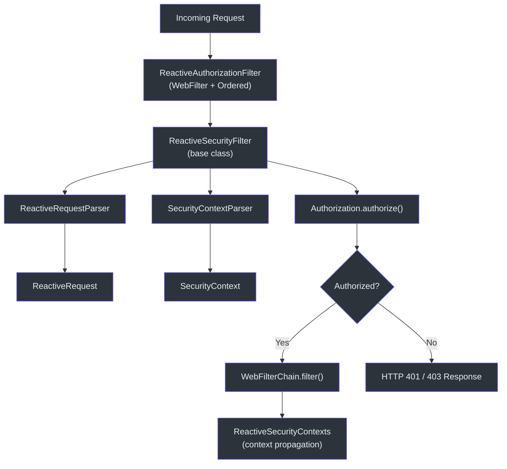
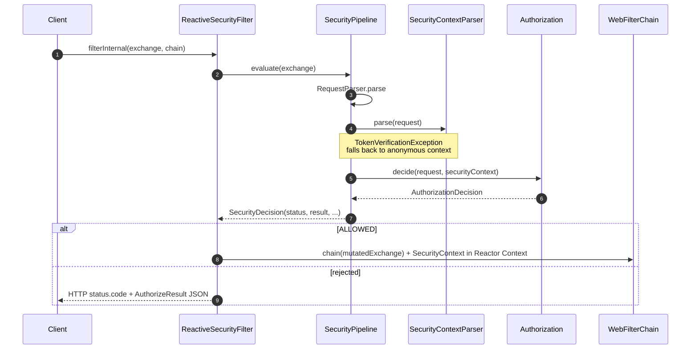
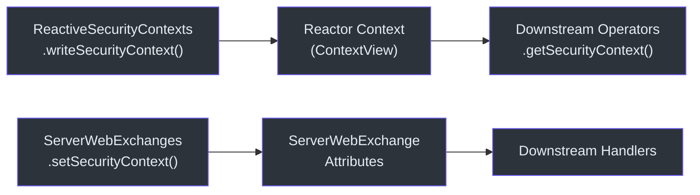
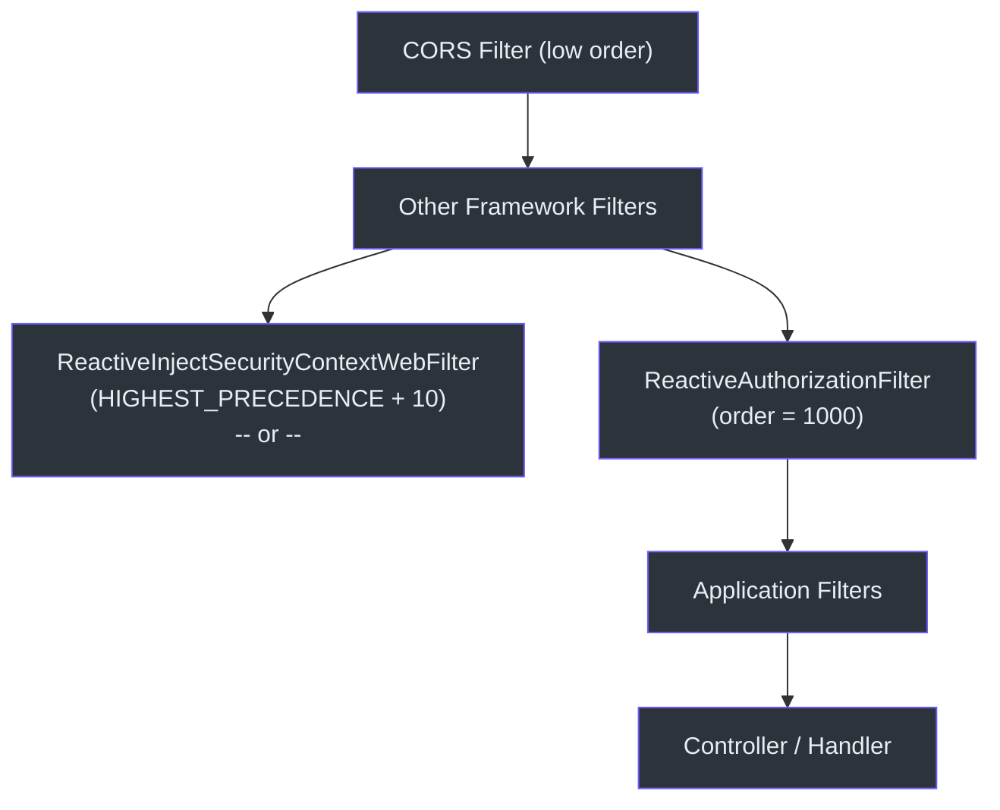

# Spring WebFlux Integration

CoSec provides first-class reactive integration with Spring WebFlux through a suite of filters and context-propagation utilities built on Project Reactor. Every request passes through a non-blocking authorization pipeline that preserves the reactive contract end to end.

## Architecture Overview



## Core Components

### ReactiveAuthorizationFilter

The entry point for WebFlux security. It implements both `WebFilter` and `Ordered` with an order of `1000`, placing it after framework filters (CORS, etc.) but before most application logic.

```kotlin
class ReactiveAuthorizationFilter(
    pipeline: SecurityPipeline<ServerWebExchange>
) : ReactiveSecurityFilter(pipeline),
    WebFilter,
    Ordered {
    constructor(
        securityContextParser: SecurityContextParser,
        requestParser: RequestParser<ServerWebExchange>,
        authorization: Authorization,
        securityContextParseScheduler: Scheduler = Schedulers.immediate()
    )
}
```

- **Order**: `REACTIVE_AUTHORIZATION_FILTER_ORDER = 1000` -- runs after CORS and other infrastructure filters.
- Delegates the real work to [ReactiveSecurityFilter](#reactivesecurityfilter), which runs the shared `SecurityPipeline`.
- On success, calls `chain.filter(exchange)` so downstream handlers receive an enriched exchange with the principal set.

### ReactiveSecurityFilter

The shared base class for the WebFlux filter and the Spring Cloud Gateway filter. It contains no authorization logic of its own: it runs each exchange through a transport-agnostic [`SecurityPipeline`](https://github.com/Ahoo-Wang/CoSec/blob/main/cosec-core/src/main/kotlin/me/ahoo/cosec/pipeline/SecurityPipeline.kt) (shared with the servlet integration) and translates the resulting `SecurityDecision` into a response.



`SecurityPipeline` maps every outcome, including errors, to a `SecurityDecision`, so WebFlux and WebMvc respond identically (enforced by `WebAdapterParityTest`):

| Situation | `SecurityStatus` | HTTP | Response body |
|---|---|---|---|
| Invalid request path (`InvalidRequestPathException`) | `BAD_REQUEST` | 400 | none |
| Authorized | `ALLOWED` | -- | request proceeds |
| Denied, anonymous principal | `UNAUTHORIZED` | 401 | result (token failure reason, e.g. `Token Expired`, takes precedence) |
| Denied, authenticated principal | `FORBIDDEN` | 403 | result |
| `TooManyRequestsException` | `TOO_MANY_REQUESTS` | 429 | `Too Many Requests` |
| `RegexTimeoutException` (ReDoS guard) | `FORBIDDEN` | 403 | `Implicit Deny` (fail-closed deny, not a 5xx) |
| Any other error, including security context parse failures | `ERROR` | 500 | `Implicit Deny` |
| Authorization emitted no result | treated as `IMPLICIT_DENY` | 401 / 403 | `Implicit Deny` |

Security context parsing runs on `securityContextParseScheduler` (default `Schedulers.immediate()`). The starter switches it to `Schedulers.boundedElastic()` when `cosec.jwt.token-revocation.enabled=true`, because the revocation check may block on Redis.

### ReactiveRequestParser

Converts a `ServerWebExchange` into a `ReactiveRequest`, extracting path, method, remote IP, origin, referer, and request ID. It also applies any registered `RequestAttributesAppender` instances (e.g., IP geolocation).

### ReactiveRequest

An immutable data class that wraps a `ServerWebExchange` and implements CoSec's `Request` interface. It provides lazy access to headers, query parameters, and cookies from the underlying exchange.

### ReactiveSecurityContexts

Utility object for propagating the `SecurityContext` through Reactor's `Context`:



Two propagation channels are used in parallel:

| Channel | Mechanism | Use Case |
|---------|-----------|----------|
| Reactor `Context` | `contextWrite { it.setSecurityContext(ctx) }` | Reactive operators within the same chain |
| `ServerWebExchange` attributes | `exchange.setSecurityContext(ctx)` | Direct access in downstream handlers |

### ReactiveInjectSecurityContextWebFilter

Designed for downstream services behind an API gateway. Instead of performing authorization, it injects the security context from request headers (set by the upstream gateway) without token verification. This avoids redundant JWT verification in microservice-to-microservice calls.

## Filter Chain Order



Choose between `ReactiveAuthorizationFilter` and `ReactiveInjectSecurityContextWebFilter` based on whether the service is a front-line service or a downstream microservice.

## References

- [cosec-webflux/src/main/kotlin/me/ahoo/cosec/webflux/ReactiveAuthorizationFilter.kt:36](https://github.com/Ahoo-Wang/CoSec/blob/main/cosec-webflux/src/main/kotlin/me/ahoo/cosec/webflux/ReactiveAuthorizationFilter.kt#L36) -- Filter entry point
- [cosec-webflux/src/main/kotlin/me/ahoo/cosec/webflux/ReactiveSecurityFilter.kt:59](https://github.com/Ahoo-Wang/CoSec/blob/main/cosec-webflux/src/main/kotlin/me/ahoo/cosec/webflux/ReactiveSecurityFilter.kt#L59) -- Base class translating `SecurityDecision` into a WebFlux response
- [cosec-webflux/src/main/kotlin/me/ahoo/cosec/webflux/ReactiveRequestParser.kt:28](https://github.com/Ahoo-Wang/CoSec/blob/main/cosec-webflux/src/main/kotlin/me/ahoo/cosec/webflux/ReactiveRequestParser.kt#L28) -- Request parsing
- [cosec-webflux/src/main/kotlin/me/ahoo/cosec/webflux/ReactiveRequest.kt:22](https://github.com/Ahoo-Wang/CoSec/blob/main/cosec-webflux/src/main/kotlin/me/ahoo/cosec/webflux/ReactiveRequest.kt#L22) -- Request data class
- [cosec-webflux/src/main/kotlin/me/ahoo/cosec/webflux/ReactiveSecurityContexts.kt:21](https://github.com/Ahoo-Wang/CoSec/blob/main/cosec-webflux/src/main/kotlin/me/ahoo/cosec/webflux/ReactiveSecurityContexts.kt#L21) -- Context propagation

## Related Pages

- [Spring WebMVC Integration](./spring-webmvc.md)
- [Spring Cloud Gateway Integration](./spring-cloud-gateway.md)
- [Auto-Configuration](../extending/auto-configuration.md)
- [Testing](../operations/testing.md)
