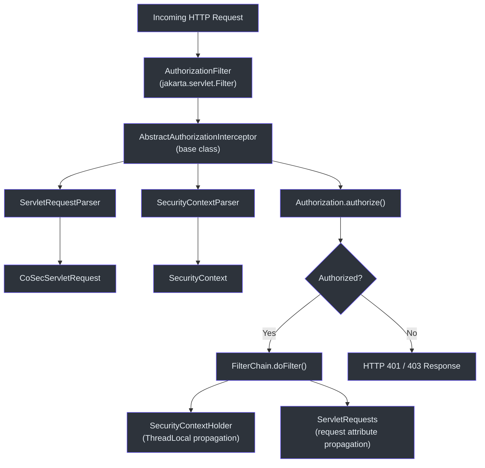
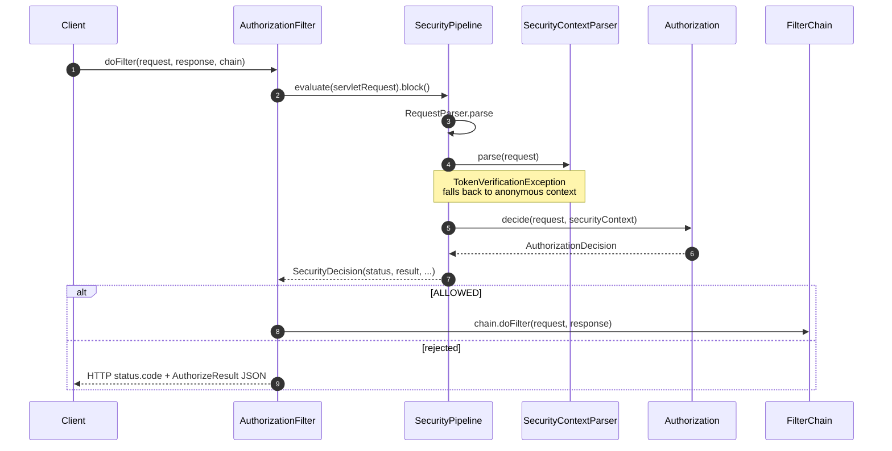
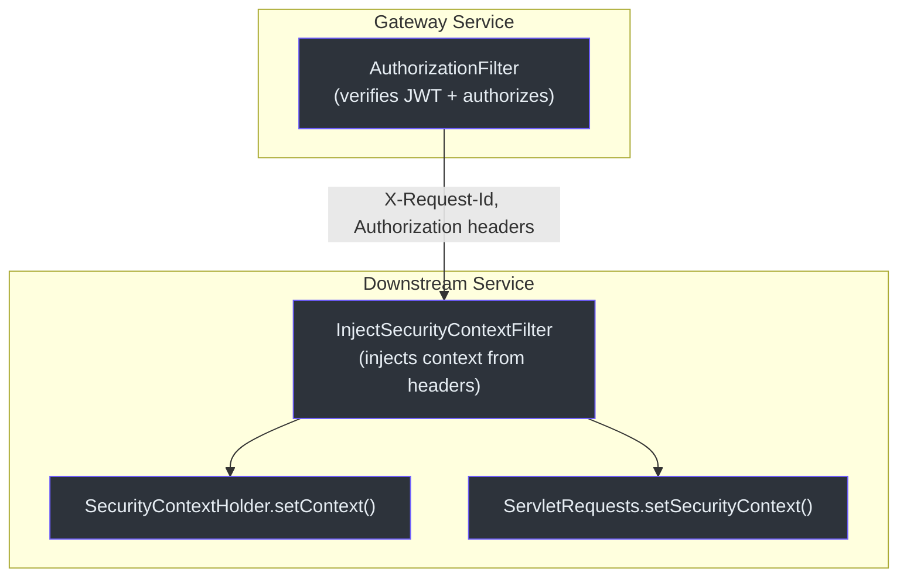

# Spring WebMVC Integration

CoSec provides a servlet-based integration path for traditional Spring MVC applications through `jakarta.servlet.Filter` implementations. The servlet integration shares the transport-agnostic `SecurityPipeline` with the reactive WebFlux integration, and uses thread-local context propagation instead of Reactor Context.

## Architecture Overview

## Core Components

### AuthorizationFilter

The servlet filter entry point. It implements `jakarta.servlet.Filter` and extends `AbstractAuthorizationInterceptor`, which runs each request through the shared, transport-agnostic [`SecurityPipeline`](https://github.com/Ahoo-Wang/CoSec/blob/main/cosec-core/src/main/kotlin/me/ahoo/cosec/pipeline/SecurityPipeline.kt).

`AuthorizationFilter.doFilter` calls `authorize()`, proceeds with `chain.doFilter` only when it returns `true`, and always clears `SecurityContextHolder` in a `finally` block.

### AbstractAuthorizationInterceptor

Translates a `SecurityDecision` into a servlet response. It holds no authorization logic of its own -- status codes and error mapping come from `SecurityPipeline`, so WebMvc and WebFlux respond identically (enforced by `WebAdapterParityTest`):

| Situation | `SecurityStatus` | HTTP | Response body |
|---|---|---|---|
| Invalid request path (`InvalidRequestPathException`) | `BAD_REQUEST` | 400 | none |
| Authorized | `ALLOWED` | -- | request proceeds |
| Denied, anonymous principal | `UNAUTHORIZED` | 401 | result (token failure reason, e.g. `Token Expired`, takes precedence) |
| Denied, authenticated principal | `FORBIDDEN` | 403 | result |
| `TooManyRequestsException` | `TOO_MANY_REQUESTS` | 429 | `Too Many Requests` |
| `RegexTimeoutException` (ReDoS guard) | `FORBIDDEN` | 403 | `Implicit Deny` (fail-closed deny, not a 5xx) |
| Any other error, including security context parse failures | `ERROR` | 500 | `Implicit Deny` |
| Authorization emitted no result | treated as `IMPLICIT_DENY` | 401 / 403 | `Implicit Deny` |

When the request could be parsed, `authorize()` binds the security context to `SecurityContextHolder` and the request attributes, and sets the `CoSec-Request-Id` response header.

### ServletRequestParser

Converts a `jakarta.servlet.http.HttpServletRequest` into a `CoSecServletRequest`, extracting path (via `servletPath`), method, remote IP, origin, referer, and request ID. It also applies registered `RequestAttributesAppender` instances.

### CoSecServletRequest

An immutable data class wrapping an `HttpServletRequest`. Implements CoSec's `Request` interface and `Delegated<HttpServletRequest>`, providing access to headers, query parameters, and cookies from the underlying servlet request.

### InjectSecurityContextFilter

The servlet counterpart of `ReactiveInjectSecurityContextWebFilter`. Designed for downstream services behind an API gateway that have already performed authorization. It uses `SecurityContextParser.ensureParse()` to extract the security context from request headers without token verification.

### SecurityContextHolder

A thread-local holder for the current security context. Uses `InheritableThreadLocal` so child threads inherit the parent's context. Provides static methods `setContext()`, `context`, `requiredContext`, and `remove()`.

## Context Propagation

Unlike the reactive integration which uses Reactor's `Context`, the servlet integration uses two parallel channels:

| Channel | Mechanism | Scope |
|---------|-----------|-------|
| `SecurityContextHolder` | `InheritableThreadLocal` | Current thread and child threads |
| `HttpServletRequest` attributes | `request.setAttribute()` | Current request lifecycle |

Both are set in `AbstractAuthorizationInterceptor.authorize()` so downstream code can access the security context via either mechanism.

## References

- [cosec-webmvc/src/main/kotlin/me/ahoo/cosec/servlet/AuthorizationFilter.kt:45](https://github.com/Ahoo-Wang/CoSec/blob/main/cosec-webmvc/src/main/kotlin/me/ahoo/cosec/servlet/AuthorizationFilter.kt#L45) -- Servlet filter entry point
- [cosec-webmvc/src/main/kotlin/me/ahoo/cosec/servlet/AbstractAuthorizationInterceptor.kt:51](https://github.com/Ahoo-Wang/CoSec/blob/main/cosec-webmvc/src/main/kotlin/me/ahoo/cosec/servlet/AbstractAuthorizationInterceptor.kt#L51) -- Base interceptor translating `SecurityDecision` into a servlet response
- [cosec-webmvc/src/main/kotlin/me/ahoo/cosec/servlet/ServletRequestParser.kt:32](https://github.com/Ahoo-Wang/CoSec/blob/main/cosec-webmvc/src/main/kotlin/me/ahoo/cosec/servlet/ServletRequestParser.kt#L32) -- Request parsing
- [cosec-webmvc/src/main/kotlin/me/ahoo/cosec/servlet/CoSecServletRequest.kt:22](https://github.com/Ahoo-Wang/CoSec/blob/main/cosec-webmvc/src/main/kotlin/me/ahoo/cosec/servlet/CoSecServletRequest.kt#L22) -- Request data class
- [cosec-webmvc/src/main/kotlin/me/ahoo/cosec/servlet/InjectSecurityContextFilter.kt:43](https://github.com/Ahoo-Wang/CoSec/blob/main/cosec-webmvc/src/main/kotlin/me/ahoo/cosec/servlet/InjectSecurityContextFilter.kt#L43) -- Downstream context injection
- [cosec-core/src/main/kotlin/me/ahoo/cosec/context/SecurityContextHolder.kt:26](https://github.com/Ahoo-Wang/CoSec/blob/main/cosec-core/src/main/kotlin/me/ahoo/cosec/context/SecurityContextHolder.kt#L26) -- Thread-local context holder

## Related Pages

- [Spring WebFlux Integration](./spring-webflux.md)
- [Spring Cloud Gateway Integration](./spring-cloud-gateway.md)
- [Auto-Configuration](../extending/auto-configuration.md)
- [Testing](../operations/testing.md)
