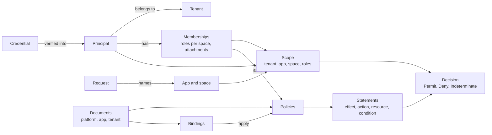

# Concepts

For everyone who reads the rest of these docs. This page defines the terms the other pages use and shows how they relate, so the guides and references can link here instead of redefining them.

## The big picture

CoSec answers one question per request: may this **principal** perform this **action** on this **resource**, in this
**scope**? The answer comes from the **policies** that apply to the request through **bindings** and
**attachments**, read from a **snapshot** of the policy **documents** that the **control plane** publishes.

The principal and its memberships come from the verified credential (or your membership provider). The request side
(method, path, headers, the app and space it names) comes from the client and is checked before it is trusted.

## Principal and tenant

### Principal

Who is making the request: an id, a tenant and free-form attributes. The principal comes from the verified credential,
a JWT access token or an API key, so the client cannot change it. A request without a valid credential has the
**anonymous** principal, id `(0)`, in the default tenant, with no roles and no attachments. Policies can allow the
anonymous principal too; that is how public endpoints work.

### Tenant

The customer boundary the principal belongs to, taken from the credential's tenant:

| Tenant id | Meaning |
|---|---|
| `(0)` | The default tenant: anonymous principals, and credentials that name no tenant. |
| `(platform)` | The platform tenant: the operators of the system. Its principals administer the control plane, only they can be given break-glass, and no platform boundary applies to it. |
| anything else | A user tenant. |

A principal is evaluated only against its own tenant's document; principal ids are unique only within a tenant. How
far tenants are isolated is in the [security model](./security-model.md).

## Request

The transport-neutral facts of the HTTP request: method, path, query, headers, client IP, the device id, and the app and
space the client names in `CoSec-*` parameters (see [Web integration](../integration/web.md)). All of it is chosen by
the client.

### App

The application a request belongs to. Each app has its own document: its permission catalog, its permission policies
and the role bindings that grant them. A service can be bound to one app, in which case the app a request names must
match it.

### Space

A partition inside an app, such as a team or a project, in which a principal can hold different roles. A request that
names no space is in the **default space**. A role claimed as `clerk` applies in the default space; `clerk@team-a`
applies in `team-a` only. A request can name a space other than the default only when the principal has a role there.

### Scope

The checked context of one request: its tenant (always the principal's), its app, its space, and the principal's roles
in that space. `ScopeResolver` builds it from the principal and the app and space the request names, or rejects the
request; nothing else can construct one. Where these checks draw the line is in
[Trust boundaries](./security-model.md#trust-boundaries).

### Action and resource

What the request does and to what. Without a route map, an HTTP request is the action `http:<METHOD>` (such as
`http:GET`) on the resource `http:path:<path>`. A [route map](../architecture/extending.md#route-maps) can give a
service's routes their own actions and typed resources, such as `order:read` on `order/42`.

## Documents and policies

### Document

A versioned JSON file that holds policies and bindings. There are three kinds:

| Kind | One per | Holds |
|---|---|---|
| Platform document | deployment | Policies shared by every tenant, bindings to anyone or to principals, platform boundaries, and the condition limits and attribute catalog every document compiles against. |
| App document | app | The app's permission catalog, its permission policies (`perm:<app>/<permission>`) and the role bindings that grant them. |
| Tenant document | tenant | The tenant's own policies, its bindings to anyone, to principals and to roles, and the platform boundary that holds the tenant, if not the default one. |

Every kind of document can also carry rate limit rules. App and tenant documents may refer to platform policies, never
the other way round. Every field is in the [Policy language](../policies/language.md).

### Policy

A named set of statements, with an optional condition that every statement also needs. An **attachable** policy can be
attached to a principal directly. A policy has no effect until a binding or an attachment applies it.

### Statement

One rule in a policy:

- an **effect**: `allow` or `deny`;
- one or more **actions**, such as `http:GET`, `order:read`, `order:*` or `*`;
- **resources**, such as `http:path:/orders/{id}` or `order/**` (none means any resource);
- an optional **condition**.

A statement matches when an action, a resource and the condition all match. Variables a resource pattern captures are
visible to that statement's condition only.

### Condition

A test over attributes of the request: the subject (`subject.id`, `subject.authenticated`), the scope (`scope.space`,
`scope.roles`), the action and resource, the environment (`environment.ip`, `environment.time`), and external attributes
(`ext.<provider>.<name>`) that attribute providers fetch. Operators such as `eq`, `in`, `prefix`, `cidr`, `time` and
`exists` combine with `and`, `or` and `not`. The full list is in the [Policy language](../policies/language.md).

## Bindings and memberships

### Binding

"This subject is subject to this policy, in this app and space." A binding names a subject (anyone, a principal of a
tenant, or a role), an app and a space (each exact or `*` for any), a policy, and optionally an expiry. It has no effect
of its own: the policy's statements decide. An expired binding does not apply.

### Attachment

A policy a principal lists directly, in its token's `policies` claim or from the membership provider. Only attachable
policies of the platform or of the principal's tenant can be attached.

### Membership

What a principal is a member of: its roles in each space and its attachments. Memberships come from the token's claims,
or, when the token carries the provider marker, from a `MembershipProvider`. They are never part of a document. When they
cannot be read, the request fails closed; it is never treated as having no roles.

### Catalog

An app's permission catalog: groups of permissions with ids, names and descriptions, for user interfaces, generators
and validation. It takes no part in evaluation; the permission policies and role bindings do. Writing catalogs and
granting permissions to roles is in [Role permissions](../policies/role-permissions.md).

## Decisions

The engine answers every request it evaluates with one of three decisions:

| Decision | When |
|---|---|
| `Permit` | An ALLOW statement matched, no DENY did, nothing that could hide a DENY was left unchecked, and the tenant's platform boundary, if any, allows the request too. It may carry obligations. |
| `Deny` | A DENY statement matched, the scope was rejected, or nothing matched (the implicit deny). |
| `Indeterminate` | No DENY matched, but something that could hide one could not be checked: a document, a policy, a membership or an attribute that could not be read, or a DENY that failed. Callers deny. |

The rules behind them are in the [security model](./security-model.md). How each becomes an HTTP response (`401` for an
anonymous caller and `403` for a signed-in one when denied, `503` when indeterminate, and so on) is in
[Web integration](../integration/web.md).

### Obligation

Something the pipeline must do before a permitted request proceeds. Today the only obligation is a **rate limit**: spend
one permit from the rule's bucket. A denied request never spends one. An exhausted rule turns the permit into a `429`;
see [Rate limiting](../policies/rate-limiting.md).

## Snapshots and the control plane

### Snapshot

The compiled, immutable documents an instance holds in memory. One evaluation reads one revision of the platform
document, of its tenant's document and, when needed, of its app's document. Redis is the store of record; instances
revalidate their copies. See [Storage](../operations/storage.md).

### Revision

One published version of a document, numbered from 1 and increasing by one per publish. Each revision is recorded with
its parent, so history, diff and rollback read the chain. The **head** is the revision instances serve.

### Control plane

The only writer of documents (with `cosec-migrate`, which writes through the same store). It authorizes every operation
as the operator, checks and compiles every change before it is published, and moves a head only from the revision the
change was based on. Its data-plane counterpart, the request pipeline, only reads.

### Change and shadow window

A **change** (change request) is a set of edits to one document, based on one revision: proposed, checked, optionally
shadowed and approved, then published. A **shadow window** stages the change's candidate so that running instances
evaluate a sample of live requests against it too and report where the outcomes would differ, before anything is
enforced. How to use them is in [Testing policies](../policies/testing.md).

### Break-glass

An emergency binding of a platform principal to a platform policy (by default the built-in `cosec:root`, which allows
everything), with an expiry. It is created only through the control plane, with a second person's approval, and every
request it permits must be written to a REQUIRED audit listener. Its policy is evaluated like any other, so a matching
DENY still wins; it is reported as the reason for a permit only when nothing else permits the request.

**Next:** the guarantees every decision keeps, in [Security model](./security-model.md); or, to write rules, [Policy language](../policies/language.md).
