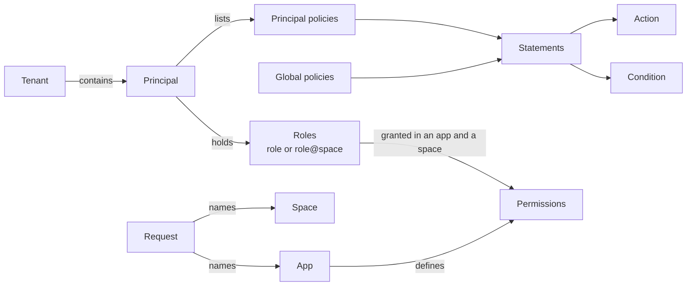

# Concepts

For everyone who reads the rest of these docs. This page defines the terms the other pages use and shows how they relate, so the guides and references can link here instead of redefining them.

## The big picture

CoSec answers one question per request: may this **principal** make this **request**? The answer comes from
the **policies** that apply to the request and from the **permissions** granted to the principal's **roles**.

The principal side (tenant, principal, roles, attached policies) comes from the verified credential. The
request side (path, method, headers, app, space) comes from the client.

## Principal and tenant

### Principal

Who is making the request: an id, a set of roles, a set of attached policy ids, and free-form attributes. The
principal comes from the verified credential, a JWT access token or an API key, so the client cannot change it.
A request without a credential has the **anonymous** principal, id `(0)`. Policies can allow the anonymous
principal too; that is how public endpoints work.

### Tenant

The customer boundary the principal belongs to, taken from the credential's `tenantId` claim:

| Tenant id | Meaning |
|---|---|
| `(0)` | The default tenant, used when the credential names none. |
| `(platform)` | The platform tenant: the operators of the system. Only its principal can be [root](./security-model.md#root-principal). |
| anything else | A user tenant. |

CoSec does not isolate tenants by itself; see [Tenant isolation](./security-model.md#tenant-isolation).

## Request

The transport-neutral view of the HTTP request that rules match against: path, method, query parameters,
headers, cookies, client IP, origin and referer, plus the app, space and device the client names in CoSec
headers (see [App and space](../integration/web.md#app-and-space)). All of it is chosen by the client.

### App

The application the request belongs to. Each app defines its own permission catalog, and
role grants are looked up in the named app only.

### Space

A partition inside the app, such as a team or a project, in which a principal can hold
different roles. A request that names no space is in the **default space**. A role written `clerk` applies in the
default space; `clerk@team-a` applies in `team-a` only.

The **device** id identifies the client device. Conditions can read it, and audit events record it.

Because the client sets the app and the space, how far they can be trusted is spelled out in
[Trust boundaries](./security-model.md#trust-boundaries).

## Policies and statements

### Policy

A named set of statements, stored as a JSON document. Its type decides when it is evaluated:

| Type | Evaluated for |
|---|---|
| `global` | Every request. |
| `system`, `custom` | Only principals whose credential lists the policy's id. `system` policies are managed by the platform, `custom` ones by tenants; authorization treats them the same. |

A policy can carry a condition; when the condition does not hold, the whole policy is skipped.

### Statement

One rule in a policy:

- an **effect**: `allow` (the default) or `deny`;
- an **action**: which requests the statement covers, usually path patterns, optionally with methods;
- a **condition** (optional): what must also hold.

A statement matches when both its action and its condition match. A matched `deny` produces
`EXPLICIT_DENY`, a matched `allow` produces `ALLOW`.

### Condition

A test on the request and the principal. Examples: the caller is signed in (`authenticated`), holds a role
(`inRole`), belongs to a tenant (`inTenant`), a request value equals, starts with or matches something (`eq`,
`in`, `startsWith`, `regular`), or the time is in a window (`time`). `bool` combines conditions. The full list
is in [Conditions](../policies/language.md#conditions).

## App permissions and roles

The role-based way to grant access, for rules that follow job functions rather than individual principals:

1. An **app permission** is an app's catalog of **permissions**. Each permission is a statement with an id, such
   as `order.read`, and permissions are grouped for display.
2. A **role grant** gives a role a set of permission ids, in one app and one space. The id `*` grants all of the
   app's permissions.
3. A request is checked against the permissions granted, in the request's app, to the principal's roles that
   apply in the request's space.

Use role permissions for access that administrators assign by role; use policies for rules that apply to
everyone or that you attach to individual principals. How to write catalogs and grants is in
[Role permissions](../policies/role-permissions.md).

## Decisions

Every request ends in one of these outcomes:

| Outcome | When |
|---|---|
| `ALLOW` | A statement or permission allowed the request and none denied it, or the principal is root. The request reaches your handler. |
| `EXPLICIT_DENY` | A `deny` statement or permission matched, or the blacklist blocked the request. |
| `IMPLICIT_DENY` | Nothing matched. This is the default. |
| `TOO_MANY_REQUESTS` | The request was allowed, but a [rate limit](../policies/rate-limiting.md) rule had no permits left. |
| error | CoSec could not decide: a policy could not be read, a condition failed, and so on. It denies. |

The order in which these are reached is in [Evaluation order](./security-model.md#evaluation-order). How each
outcome becomes an HTTP response (`401` for an anonymous caller, `403` for a signed-in one, and so on) is in
[Responses and status codes](../integration/web.md#responses-and-status-codes).

**Next:** the guarantees every decision keeps, in [Security model](./security-model.md); or, to write rules, [Policy language](../policies/language.md).
