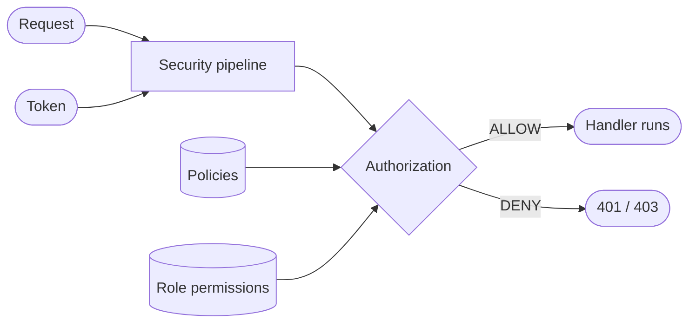

# Concepts

For everyone who reads the rest of these docs. This page defines the terms the other pages use and shows how they relate, so the guides and references can link here instead of redefining them.

## The big picture

<!-- Planned (explanation). One diagram of how a request, a principal and the stored rules meet in a decision. The diagram below is a placeholder kept to exercise Mermaid rendering; replace or refine it. -->

## Principal and tenant

<!-- Planned (explanation). Principal fields (id, roles, policies, attributes), anonymous `(0)`, default/platform/user tenants. -->

## Request

<!-- Planned (explanation). Transport-neutral request: path, method, IP, headers, app id, space id, device id. Header names are owned by integration/web. -->

## Policies and statements

<!-- Planned (explanation). Policy types, statement = effect + action + condition. Field-level detail is owned by policies/language. -->

## App permissions and roles

<!-- Planned (explanation). Permission catalogs per app, roles granting them per space. Detail is owned by policies/role-permissions. -->

## Decisions

<!-- Planned (explanation). ALLOW, EXPLICIT_DENY, IMPLICIT_DENY, TOO_MANY_REQUESTS. Order and guarantees are owned by security-model; status codes by integration/web. -->
