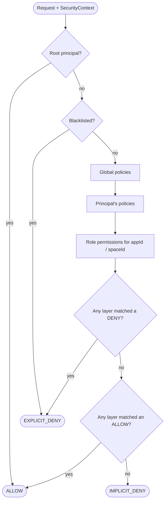

# Introduction

CoSec is a reactive, multi-tenant security framework for Spring Boot applications and gateways. It
answers one question for every request: **may this principal perform this action, in this context?**
The answer comes from IAM-style policies (inspired by
[AWS IAM](https://docs.aws.amazon.com/IAM/latest/UserGuide/introduction.html)) and role-based app
permissions, evaluated deny-first.

## Core concepts

| Concept | What it is |
|---|---|
| **Principal** | Who is calling: an id, its roles, the policies attached to it, and free-form attributes. Anonymous callers are a principal too (id `(0)`). Carried in a JWT. |
| **Tenant** | The tenant the principal acts in. `(0)` is the default tenant and `(platform)` is the platform tenant; any other id is a user tenant. |
| **Request** | The transport-neutral view of an HTTP request: path, method, remote IP, origin, referer, headers, app id (`CoSec-App-Id`), space id (`CoSec-Space-Id`), and device id (`CoSec-Device-Id`). |
| **Policy** | A named set of **statements** with a type: `GLOBAL` applies to every request; `SYSTEM` (platform-managed) and `CUSTOM` (user-defined) apply only to principals that list them in their `policies`. An optional policy-level condition gates the whole policy. |
| **Statement** | One rule: an **effect** (`ALLOW` or `DENY`), an **action** (which requests it covers, usually path patterns) and an optional **condition** (when it applies). |
| **App permission** | Per application (`appId`), a catalog of permissions grouped for UI display. **Roles** grant permissions by id, per space. |

Policies and permissions are JSON documents. See [Policies](./policies.md) for the language.

## How a decision is made

- **Deny wins everywhere.** A `DENY` matched in any layer overrides an `ALLOW` matched in any other
  layer. A global `ALLOW` cannot override a principal- or role-level `DENY`.
- **Default deny.** If nothing matches, the request is denied (`IMPLICIT_DENY`).
- **Fail closed.** Errors deny: an unreachable policy store, a failed condition, or an exhausted
  regex time budget never let a request through.

The web integration turns the decision into a response: `401` for anonymous callers, `403` for
authenticated ones, `429` when a [rate limit](./rate-limiting.md) is hit. See [Web Integration](./web-integration.md).

## Modules

Applications depend on `cosec-spring-boot-starter` and request integrations as Gradle capabilities
(see [Quick Start](./quick-start.md#_1-add-the-dependency)). Each capability adds one module plus its
third-party dependencies.

| Module | Starter capability | Purpose |
|---|---|---|
| `cosec-api` | always | Public contracts: principal, policy, authorization, request, security context. |
| `cosec-core` | always | Policy engine, matchers, authorization, security pipeline, local policy loading, auditing. |
| `cosec-jwt` | always | JWT issuing and verification. |
| `cosec-webflux` | `webflux-support` | Spring WebFlux adapter. |
| `cosec-webmvc` | `webmvc-support` | Spring MVC adapter. |
| `cosec-gateway` | `gateway-support` | Spring Cloud Gateway adapter. |
| `cosec-cocache` | `cache-support` | Redis-backed policies, permissions and revoked tokens with a local cache ([CoCache](https://github.com/Ahoo-Wang/CoCache)); cluster-wide rate limit counters. |
| `cosec-social` | `oauth-support` | OAuth social login via [JustAuth](https://github.com/justauth/JustAuth). |
| `cosec-opentelemetry` | `opentelemetry-support` | A tracing span per decision. |
| `cosec-micrometer` | `micrometer-support` | A `cosec.authorization` timer by result and source. |
| `cosec-openapi` | `openapi-support` | Policy generation from your OpenAPI description; bearer auth in the OpenAPI document. |
| `cosec-ip2region` | `ip2region-support` | IP geolocation as a request attribute. |
| `cosec-kafka` | `kafka-support` | Audit events to Kafka. |
| `cosec-bom` | | Version alignment for all modules. |
| `cosec-gateway-server` | | A ready-to-run gateway built from the modules above (an application, not a library). |

Next: [Quick Start](./quick-start.md).
