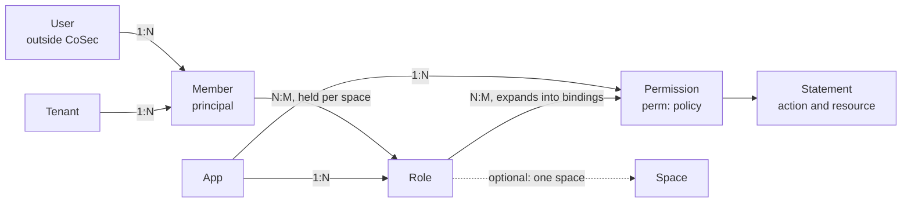
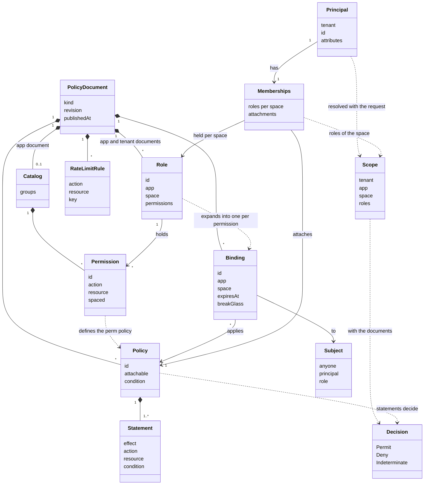

# Model

For architects and policy authors who want the whole picture before writing a document. This page shows the entities of
CoSec's authorization model, how they relate, which document each one lives in, and what CoSec leaves to your own
systems. The terms are defined in [Concepts](./concepts.md); the fields are in the [policy language](../policies/language.md);
worked examples start at [Simple mode](../scenarios/simple-mode.md).

## The entities

| Concept | In CoSec | Lives in |
|---|---|---|
| User | Not in CoSec. The people of your identity system. | Your systems |
| Member | A **principal**: a tenant and an id, unique only within the tenant. | The token's claims, or your `MembershipProvider` |
| Organization | Not in CoSec. A department expands into roles in your `MembershipProvider`; a single-valued fact about it can be a principal attribute that conditions read. | Your systems |
| Tenant | An id, with one tenant document. | Tenant document |
| App | An id, with one app document. The platform owns it and every tenant shares it. | App document |
| Space | An optional, opaque string. CoSec keeps no registry of spaces and no owner for one. | Memberships (`role@space`), a binding's or a role's `space`, the request's `CoSec-Space-Id` |
| Role | An id. A role has an entry in a document, its name and the permissions it holds; a member holds it through its memberships. | App document (system roles), tenant document (custom roles) |
| Permission | A catalog entry that writes an `action`, which is also the policy `perm:<app>/<id>`. | App document |
| Policy | A named list of statements: effect, actions, resources, condition. | Any document |
| Binding | "This subject is subject to this policy, in this app and space." | Any document |
| Boundary | The ceiling of what a tenant can be permitted, set by the platform. | Platform document, named by the tenant document |

## How they relate

A role belongs to one app, and may be tied to one space. That is the only place where an app and a space meet, so
"one app with several spaces" and "one space shared by several apps" need no further rule; see
[Apps and spaces](#apps-and-spaces).

## Class diagram

Two things in the diagram are derived, not stored. A role's bindings are written out from its entry whenever a
document is read (`RoleExpansion`), so compilation, the grant analysis, the diff and `explain` all see the same
bindings; the stored document keeps the role as one entry. A permission's policy is written out from the catalog entry
the same way. The [role permissions](../policies/role-permissions.md#roles) page has the rules.

The control plane adds its own records around a document: a **change** based on one revision, its **shadow window**
and its **approval**, which end in a new revision ([Testing policies](../policies/testing.md#changes)).

## What each document holds

| Item | Platform | App | Tenant |
|---|---|---|---|
| Policies and bindings | yes | yes | yes |
| Bindings to anyone (`"*"`) | yes | | yes |
| Bindings to a principal | yes | | yes |
| Bindings to a role | | yes | yes |
| Permission catalog and `perm:` policies | | yes | |
| Roles | | system roles | custom roles, each of one app |
| Break-glass bindings | yes | | |
| Limits, attributes, boundaries | yes | | |
| The tenant's boundary | | | yes |
| Rate limit rules | yes | yes | yes |

The rules behind the table, in short:

- A role binding cannot be in the platform document: the platform is shared by all tenants, so a role there would mean
  the same to every tenant. Bind a role in an app or tenant document.
- An app document defines only `perm:<app>/…` policies, which are never attachable, and binds only roles.
- `cosec:platform-admin` is bound only in the platform document and in the document of the `(platform)` tenant.
- Break-glass is in the platform document only, binds a principal of the `(platform)` tenant, and expires.

Each is checked when the document is compiled; the exact rules are in [Policy language](../policies/language.md#bindings).

## Apps and spaces

A space is optional. An app that does not use spaces writes nothing about them: no `spaced` in its catalog, no `space`
on its roles, roles without `@` in its tokens, and no `CoSec-Space-Id` in its requests. The default space `""` is
"no space".

When an app does use spaces, the role says where it applies:

| You want | Write | Effect |
|---|---|---|
| No spaces | nothing | Everything happens in the default space |
| One app, several spaces | A role with `app: wms` and `space: wh-01`, or a system role the member holds as `role@wh-01` | The role grants only in the spaces the member holds it in |
| One space shared by several apps | Each app's own roles, held in the same space id | The same space, with each app's permissions granted by its own roles |
| A system role | A role in the app document | It applies in any space a member holds it in, in every tenant |

Only roles held in the request's space count, and a token is issued for one app, so a space id never carries a grant
from one app to another. Scenarios: [An app without spaces](../scenarios/app.md) and
[Apps with spaces](../scenarios/spaces.md).

## What stays outside CoSec

| Not in CoSec | Where it belongs |
|---|---|
| Users, passwords, profiles, organizations and departments | Your identity system. CoSec sees the principal and its memberships. |
| Whether a tenant has an app, its trial or its expiry | Your business system. Check it when a token is issued, or revoke tokens or read an `ext.*` attribute when it must apply at once. The boundary is a static ceiling, not a subscription state. |
| Member management, member counts, invitations | Your product. |
| Who owns a space, a registry of spaces, a space hierarchy | Your product. CoSec accepts a space only when the token lists it. |
| Role inheritance, user groups, relationship-based access | Not modelled. Expand them in your `MembershipProvider`, or write a role per combination. |
| Row-level filtering | Your queries. CoSec decides on an action and a resource id; see [Object-level rules](../integration/checks.md#object-level-rules). |

## One request, through the model

1. The credential gives a **principal** and its **memberships**: roles per space, and attached policies.
2. `ScopeResolver` joins them with the app and space the request is for into a **scope**: tenant, app, space, and the
   roles held in that space. It rejects a token of another app and a space the principal holds no role in.
3. The request's **action** and **resource** come from the [route map](../integration/web.md#route-maps) or, without one,
   from the HTTP method and path.
4. The engine reads the platform document, the tenant document, and the app document when the request has an app, and
   collects the **policies** that apply through **bindings** and attachments, in
   [a fixed order](./security-model.md#evaluation-order).
5. A matching DENY decides; otherwise a matching ALLOW permits, held to the tenant's **boundary**; otherwise the request is
   denied. The result is a **decision**.

**Next:** the guarantees every decision keeps, in [Security model](./security-model.md); or, to write rules, [Policy language](../policies/language.md).
