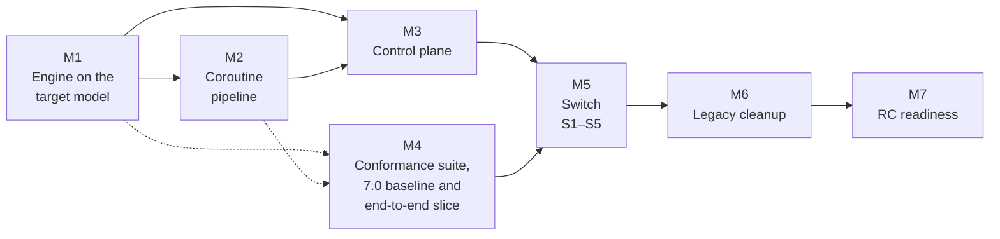

# Roadmap

For teams running CoSec 7.x, or evaluating CoSec, who want to know what 8.0 is and when it can ship. This page
stays at milestone level. Per-PR progress is in the contributor tracker,
[`docs/roadmap.md`](https://github.com/Ahoo-Wang/CoSec/blob/main/docs/roadmap.md) (Chinese), and every design
decision is in the [RFCs](https://github.com/Ahoo-Wang/CoSec/tree/main/docs/rfc). Where this page and an RFC differ,
the RFC is right.

## What 8.0 is

8.0 is a ground-up redesign of CoSec with no compatibility goal: it follows the target architecture, not 7.x
behavior ([RFC 0008 §2](https://github.com/Ahoo-Wang/CoSec/blob/main/docs/rfc/0008-conformance-and-direct-build.md)).
Correctness is defined by the 8.0 specification and checked by a conformance suite. What changes:

- **A pure decision engine.** Authorization is a function of the request and an in-memory policy set, with no I/O
  ([RFC 0002](https://github.com/Ahoo-Wang/CoSec/blob/main/docs/rfc/0002-pure-engine.md)).
- **One flat algorithm over bindings**, with a platform layer and a tenant layer, memberships and scopes, instead of the
  7.x layer order of global policies, principal policies and role permissions
  ([RFC 0004](https://github.com/Ahoo-Wang/CoSec/blob/main/docs/rfc/0004-unified-model.md)).
- **A typed condition AST, `service:verb` actions and compiled execution**, replacing OGNL, SpEL and the built-in
  matchers ([RFC 0005](https://github.com/Ahoo-Wang/CoSec/blob/main/docs/rfc/0005-condition-ast.md)).
- **Policy snapshots** instead of repository reads on every request
  ([RFC 0003](https://github.com/Ahoo-Wang/CoSec/blob/main/docs/rfc/0003-policy-snapshot.md)).
- **A coroutine pipeline**: `Indeterminate` decisions answer 503, rate limits become obligations, and decision
  listeners replace the decorator chain
  ([RFC 0006](https://github.com/Ahoo-Wang/CoSec/blob/main/docs/rfc/0006-coroutine-pipeline.md)).
- **RFC 9457 problem+json** for every error response CoSec writes (RFC 0006 Q27).
- **A control plane** with revisions, shadow windows before publishing, and grant analysis so no one can grant more
  than they hold ([RFC 0007](https://github.com/Ahoo-Wang/CoSec/blob/main/docs/rfc/0007-control-plane.md)).
- **AOT-friendly** by design
  ([RFC 0001 §3.10](https://github.com/Ahoo-Wang/CoSec/blob/main/docs/rfc/0001-target-architecture.md)).

7.x applications have to migrate: policies, permissions and configuration change shape, and `cosec-migrate`
converts 7.x data to the 8.0 format. [Upgrading](../operations/upgrading.md) will list every change and how to
migrate when 8.0 is assembled.

## Milestones

In dependency order, without dates. They follow the dependency table and critical path in RFC 0008 §4.5. Status is
as of `main` on 2026-10-29. This page changes only when a milestone starts or ends (RFC 0008 §4.7); per-PR status is in
[`docs/roadmap.md`](https://github.com/Ahoo-Wang/CoSec/blob/main/docs/roadmap.md).

| Milestone | What you get | Done when | Status |
|---|---|---|---|
| **M1** Engine on the target model | Bindings, memberships, the condition AST and `service:verb` actions compiled into snapshot documents; route maps; `cosec-migrate` to convert 7.x data (RFC 0005 PR-4–PR-6, RFC 0004 PR-4, PR-5) | Snapshot documents compile and are evaluated by the flat engine; `cosec-migrate convert` produces them from 7.x data | Done: model, flat algorithm, condition AST, action matching, route maps and `cosec-migrate` (including the 7.x matcher to AST translation) merged; only the switch steps remain |
| **M2** Coroutine pipeline | Suspend-based authentication and memberships, external attributes, obligations, decision listeners, 503 and problem+json, all three web adapters on the new pipeline (RFC 0006 PR-2–PR-7) | The three adapters answer identically through the new pipeline | Done: authentication, memberships, external attributes, listeners, rate limits as obligations and all three adapters on the new pipeline merged; only the starter wiring at the switch remains |
| **M3** Control plane | Revisions, conditional publishing, validation, grant analysis, shadow windows, break-glass, tenant self-service, change audit, HTTP API (RFC 0007 PR-3–PR-9) | Every write goes through the control plane library and its HTTP routes | Done: storage, revisions, the change flow, grant analysis, authorization with approvals, shadow windows, break-glass, tenant self-service, change audit, platform boundaries and the control plane library and HTTP routes merged, along with the round-1 review security fixes; only the registration in the starter at the switch remains |
| **M4** Conformance suite, baseline and end-to-end slice | A rule registry with positive and negative scenarios for every normative rule, property and mutation checks, and a 7.0 performance baseline (RFC 0008 PR-1–PR-3). An end-to-end slice wires snapshots, the flat engine, the coroutine pipeline and WebFlux over real CoCache and Redis, and measures the performance budgets as soon as it runs (RFC 0008 §4.4.3). The dotted arrows: the slice needs part of M1 and M2 | Every merged rule has both scenarios; the 7.0 baseline is recorded; the slice runs and its first measurement is recorded | In progress: conformance suite (including mutation checks), end-to-end slice and the 7.0 JMH baseline merged; the k6 end-to-end measurement remains |
| **M5** Switch | Five PRs in order (RFC 0008 §4.4): S1 wires the 8.0 path in the starter and moves `cosec-gateway-server` to it; S2–S4 remove the 7.x path module by module; S5 writes the docs and [Upgrading](../operations/upgrading.md) | S1 merges only when all of RFC 0008 §3.9 holds (suite green, no pending rule, properties and mutants pass, budgets met); there is no way back after S1. S2–S5 merge in order, each reviewed twice | Done: S1 wired the 8.0 path in the starter (the point of no return, with the RFC 0008 §3.9 evidence), S2–S4 removed the 7.x path and S5 wrote the docs and [Upgrading](../operations/upgrading.md) |
| **M6** Legacy cleanup | Code, build settings and doc history that exist only for older versions removed (RFC 0008 §4.6, PR-5, PR-6) | The §4.6.1 inventory is empty except "keep" items and its guards run in `check` | Done: the legacy code and build settings are removed (RFC 0008 PR-5), and a docs guard keeps removed APIs out of the docs in CI (PR-6) |
| **M7** RC readiness | A candidate the maintainer can release | Two review rounds of the whole system on the RC candidate: the RC security review, then a correctness review of each module; the `cosec-gateway-server` AOT cache smoke test passes in CI; an RC security review of the integrated system (tenant isolation, control-plane privilege escalation and grant analysis, break-glass, snapshot and cache poisoning, problem+json disclosure, denial of service) is done and its findings are fixed; the maintainer decides between an RC and GA | In progress: the AOT cache smoke test passes in CI and ABI validation (RFC 0011 PR-3) is merged. Round 1, the RC security review, is done; its fixes go in by area (identity and authentication are merged; grant analysis and the control plane are next, then the gateway, then denial of service and snapshots). Round 2, a review of each module, follows. `8.0.0-alpha.1` and `8.0.0-alpha.2` are published as previews (see below) |

## Release policy

- **The 8.0 alphas (latest `8.0.0-alpha.2`) are previews with no compatibility promise.** Public APIs, `cosec.*` properties, the document
  and wire formats (`schema: 2`, `CoSec-Identity`) and authorization semantics may change in any later alpha or RC,
  without a migration path between previews. Try it outside production; do not build on it yet.
- RC and GA wait for M7: two review rounds of the whole system (the RC security review, then a review of each module) with their findings fixed, and ABI validation,
  which freezes the public API at GA (RFC 0011 D4). Only then does semantic versioning apply to 8.0.
- **8.0 is not slower than 7.0.** Performance budgets are set from 7.0 measurements: compiled authorization and
  pipeline throughput at least 100 % of 7.0, with no more allocation (RFC 0008 §3.8). They are first measured on the
  end-to-end slice, and S1 does not merge until they are met.

## For 7.x users today

- `7.x` gets security and critical fixes until 6 months after 8.0 GA; `release/6.1.x` gets security fixes only
  ([`CONTRIBUTING.md`](https://github.com/Ahoo-Wang/CoSec/blob/main/CONTRIBUTING.md)).
- The latest fix is
  [7.0.2](https://github.com/Ahoo-Wang/CoSec/releases/tag/v7.0.2): the policy decoder now rejects malformed policies
  (unknown fields, scalars where a list belongs, duplicate keys) instead of compiling them to something broader.
  Read its upgrade note first: policies already stored in Redis may fail requests until you republish them.
- The latest advisory is
  [GHSA-2293-jx8h-56m8](https://github.com/Ahoo-Wang/CoSec/security/advisories/GHSA-2293-jx8h-56m8), fixed in
  7.0.1 and 6.1.2.
- What to do now: stay on 7.0.2, the latest 7.0.x, in production. To evaluate 8.0, try the latest alpha (`8.0.0-alpha.2`, Java 21) in a test
  environment with [Upgrading](../operations/upgrading.md); expect changes before the RC.

## How to follow

- [RFC index](https://github.com/Ahoo-Wang/CoSec/tree/main/docs/rfc): the design, decisions and open questions.
- [`docs/roadmap.md`](https://github.com/Ahoo-Wang/CoSec/blob/main/docs/roadmap.md): per-PR progress and review
  rounds (Chinese).
- [Issues](https://github.com/Ahoo-Wang/CoSec/issues) and
  [pull requests](https://github.com/Ahoo-Wang/CoSec/pulls) on GitHub.
