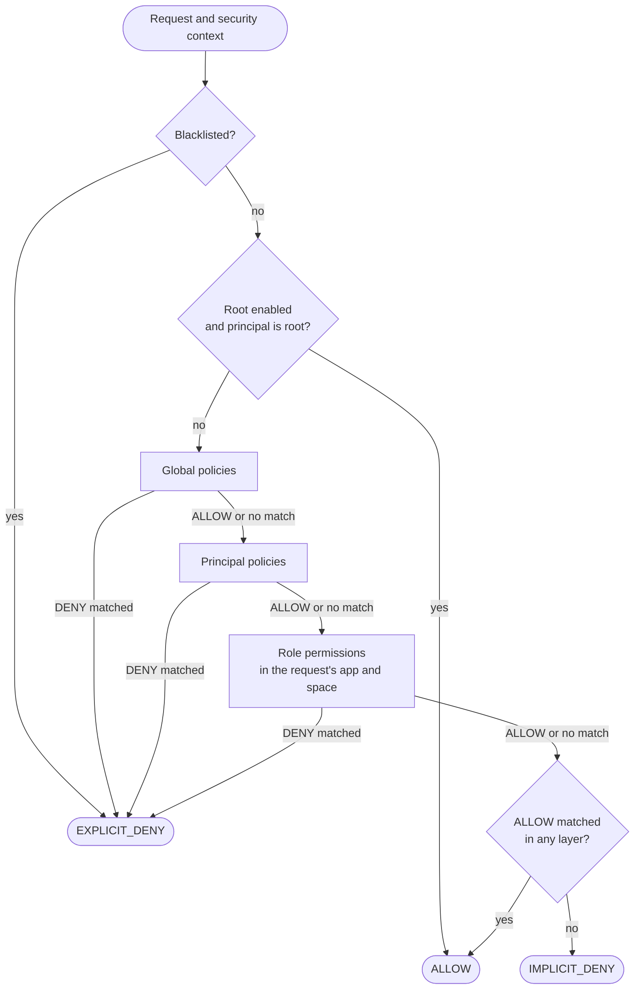

# Security Model

For security reviewers, architects and policy authors who need to know exactly when a request is allowed. This page is the single home of the evaluation order and the deny-first, default-deny and fail-closed guarantees; every other page links here instead of restating them.

## Evaluation order

`SimpleAuthorization` decides every request in five layers, in this order:

1. **Blacklist.** The `BlacklistChecker` bean says whether the request is blocked. A blocked request is
   `EXPLICIT_DENY`, and nothing else is consulted. The starter's default checker blocks nothing.
2. **Root.** Only when root is enabled: a [root principal](#root-principal) is allowed, and no policy or
   permission is consulted.
3. **Global policies**: every policy of type `global`, for every request.
4. **Principal policies**: the policies whose ids the principal's credential lists.
5. **Role permissions**: the permissions granted to the principal's roles, in the app and space the request
   names (see [Role scope and inRole](#role-scope-and-inrole)).

A request that these layers allow then passes through rate limiting: each matching
[rate limit rule](../policies/rate-limiting.md) spends one permit, and an exhausted rule turns the `ALLOW` into
`TOO_MANY_REQUESTS`. Denied requests spend no permits, so they cannot use up the quota of legitimate callers.

**Why the blacklist comes first, even before root.** The blacklist is how you shut a principal or an address
out right now, during an incident. If root could bypass it, a stolen root credential could not be stopped
without a redeploy.

**Why global policies come before the principal's own.** Global policies hold the rules that apply to everyone,
including the denies that protect the whole system. Evaluating them first lets a global deny end evaluation
before any principal-specific rule is read. The order only affects which rule is reported: thanks to
[deny first](#deny-first), the decision itself does not depend on it.

## Deny first

An `ALLOW` never wins over a matched `DENY`, at every level:

- **Within a layer**, every `deny` statement of every applicable policy is checked before any `allow`
  statement. The order of policies, and of statements within them, does not change the result. Role
  permissions follow the same rule.
- **Across layers**, an `EXPLICIT_DENY` in any layer ends evaluation. An `ALLOW` does not: the remaining layers
  are still evaluated, and the `ALLOW` stands only if none of them matches a `DENY`. A global `allow` cannot
  override a principal or role `deny`, and a role `allow` cannot override a global `deny`.

Two details decide whether a `deny` is reached at all:

- A policy whose own `condition` does not match is skipped entirely, its `deny` statements included. The same
  holds for an app permission's `condition` and every permission under it. A deny that must always apply
  belongs in a policy without a condition.
- A principal policy that the repository does not have fails the request with an error instead of being skipped.
  The missing policy may be the deny that keeps the principal out, so deciding without it could widen access.

**Why.** Deny first makes changes safe in one direction: adding a `deny` can only narrow access, and adding an
`allow` can never undo a `deny` someone else wrote. Without it, the outcome would depend on evaluation order,
and every new policy would need a review of every existing one.

## Default deny

If no statement or permission in any layer matches, the result is `IMPLICIT_DENY`. Access exists only where a
rule grants it: a new endpoint is closed until a policy opens it, and a typo in a path pattern closes an
endpoint rather than opening one.

`IMPLICIT_DENY` and `EXPLICIT_DENY` produce the same response. They differ in what they tell you when you
investigate: nothing matched, or a deny matched. See
[Troubleshooting](../operations/troubleshooting.md#find-out-what-decided).

## Fail closed

When CoSec cannot decide, it denies. Every error is turned into a decision in one place, `SecurityPipeline`, so
the WebFlux, WebMvc and Gateway adapters answer identically. The status codes are listed in
[Responses and status codes](../integration/web.md#responses-and-status-codes).

| What went wrong | Outcome |
|---|---|
| The request path cannot be parsed (for example `..` segments) | Rejected as a bad request, before authorization. |
| The token is invalid, expired or revoked | The request continues as the anonymous principal. If it is then denied, the response gives the token's reason (`Token Invalid`, `Token Expired`). |
| The security context cannot be built for another reason | Error: denied. |
| A policy or permission cannot be read (Redis unreachable, unreadable content, a missing principal policy) | Error: denied. |
| A condition throws | Error: denied. |
| A regular expression exceeds its time budget | `IMPLICIT_DENY`: an expected deny, not a server error. |

The policy and permission caches never expire entries and throw on a failed Redis read. An expired entry, or a
read error treated as a miss, would look exactly like "no policy here", which silently drops global denies.
See [When Redis is unavailable](../operations/storage.md#when-redis-is-unavailable).

**Why.** An outage of a dependency must not open the gate. An error response is visible and gets fixed; an allow that
should have been a deny goes unnoticed.

### The two documented exceptions

Two checks let a request through when their backend fails, because failing closed would turn a Redis outage
into a full outage while protecting little:

- **Rate limit rules without `strictFailure`.** If the counter store fails, the rule is skipped. A rule with
  `"strictFailure": true` rejects the request as `TOO_MANY_REQUESTS` instead. Rate limits only apply to requests that the policies already
  allowed, so skipping one never grants access the policies did not. See
  [Failure behavior](../policies/rate-limiting.md#failure-behavior).
- **Token revocation.** If the revocation store cannot be read, the token counts as not revoked. Its signature
  and expiry are still checked, so the exposure is bounded by the access token lifetime: keep access tokens
  short-lived. See [Logout and revocation](../integration/authentication.md#logout-and-revocation).

Nothing else fails open.

## Root principal

Root is off by default. With `cosec.authorization.root-enabled: true` (see
[Configuration](../operations/configuration.md#authorization)), a principal is root only if both hold:

- its id equals the `cosec.root` JVM system property (`cosec` by default), and
- it belongs to the platform tenant, `(platform)`.

A root principal skips layers 3 to 5 and is allowed. The blacklist still applies to it.

**Why the tenant check.** Principal ids are unique only within a tenant. A user tenant's identity provider can
issue a principal called `cosec` too; without the check, that principal would bypass every policy. A principal
without a tenant is never root. For a stronger signal than an id, provide your own `RootPrincipalMatcher` bean.

**Why off by default.** Root skips every global deny you write. Most deployments do not need it, so turning it
on should be a decision, not a default you inherit.

## Trust boundaries

Every input to a decision comes either from the verified credential or from the client. A grant is only as
trustworthy as the inputs it depends on.

| Input | Source | Controlled by |
|---|---|---|
| Principal id, roles, attached policies, attributes | The verified credential (JWT claims, API key) | Whoever issues credentials |
| Tenant | The credential (`tenantId` claim) | Whoever issues credentials |
| Path, method, query, headers, cookies, origin, referer | The HTTP request | The client |
| App (`CoSec-App-Id`), space (`CoSec-Space-Id`), device (`CoSec-Device-Id`) | A header, or a query parameter of the same name | The client |
| Client IP | The connection, or `X-Forwarded-For` up to the trusted number of hops | The client, beyond the proxies you trust |

The rule to follow: **a grant may depend on a client-controlled value only if no other value the client could
send gains more.** CoSec's own scoping follows that rule for the space, but not for the app.

- **Space.** The client names the space, but only chooses among the spaces the credential states. With
  `CoSec-Space-Id: team-a`, only roles written `role@team-a` apply; without the header, only roles without a
  suffix apply. Naming another space never picks up a role the token does not carry.
- **App.** CoSec takes `CoSec-App-Id` as sent, and grants the principal's roles the permissions of that app. A
  principal holding roles in two apps can send one app's id with a path of the other. If both apps'
  permissions match that path (apps sharing a path namespace such as `/api/**`), the request is decided by the
  grants of the app the client named.

To keep the app id from widening access when several apps share a gateway or a path namespace, do one of:

- bind the app at the edge: have each gateway route set or overwrite `CoSec-App-Id`, so the client's value
  never reaches authorization (see [App and space](../integration/web.md#app-and-space));
- add a global `deny` for each app's path prefix whose condition requires `request.appId` to name the app
  that owns it;
- keep app permission paths disjoint, so no app's permissions match another app's paths.

Two more boundaries:

- **Trusting an upstream gateway.** With `cosec.inject.enabled: true` and `cosec.authorization.enabled: false`, a
  service reads the principal from the token without verifying its signature or revocation (expiry is still
  checked), assuming the gateway in front of it already verified it. Enable it only on services that clients cannot reach except through that gateway. See
  [Behind a gateway](../integration/authentication.md#behind-a-gateway).
- **Client IP.** Behind proxies, set `cosec.authorization.remote-ip.max-trusted-index` to the number of proxy
  hops you trust; entries beyond that are written by the client. See
  [Client IP behind proxies](../integration/web.md#client-ip-behind-proxies).

## Tenant isolation

CoSec does not separate tenants by itself. A policy's `tenantId` records which tenant owns the policy;
authorization does not compare it with the principal's tenant. A `global` policy applies to principals of every
tenant, and a principal policy applies to whoever's credential lists it.

Isolation therefore comes from what you write and issue:

- issue credentials that list only policies of the principal's own tenant;
- restrict shared rules to a tenant with the `inTenant` condition;
- treat the platform tenant `(platform)` as privileged: it is the only tenant whose principal can be
  [root](#root-principal).

The tenant itself comes from the credential, so a client cannot switch tenants without a different credential.

## Role scope and inRole

A principal's roles are strings in its credential, each with an optional space: `clerk` applies in the default
space (requests without `CoSec-Space-Id`), `clerk@team-a` in `team-a` only. Role permissions and the `inRole`
condition use these scopes differently, and the difference matters:

- **Role permissions** use the scope strictly. A request is evaluated with only the roles that apply in its space,
  and with only the grants made in its app ([Role grant scope](../policies/role-permissions.md#role-grant-scope)).
- **The `inRole` condition** matches more broadly: a bare value matches in every space. The exact rules are in
  [Matching roles](../policies/language.md#matching-roles).

**Why a bare value matches in every space.** `inRole` is mostly used in denies. The space header is chosen by
the client: if a bare `inRole: suspended` matched only in the default space, a suspended principal could step
out of the deny by naming any other space. Matching `suspended@<space>` as well keeps such a deny working when
tokens start carrying spaced roles.

**What this means for allows.** No form of `inRole` limits a grant to the request's space. In particular, a deny written
as "deny unless `inRole: admin`" (`"negate": true`) is lifted for a principal holding `admin@team-a` whenever the
client sends `CoSec-Space-Id: team-a`, for every path the deny covers, not only team-a's. To grant something only
within a space, add a condition on `request.spaceId`, or grant it through role permissions, which are scoped for
you.

## Path variable scope

A `path` action such as `/orders/{orderId}` captures path variables, which conditions read as
`request.path.var.orderId`. The variables belong to the statement whose action captured them: a condition sees
only what its own statement's `path` action captured, never what another statement, policy or layer left behind,
and a policy, app permission or rate limit rule that reads them anywhere else is rejected when it loads. Where
exactly they may be read is in [Path variables](../policies/language.md#path-variables).

**Why.** If variables leaked across statements, whether a condition matched would depend on which statements
happened to run before it. A deny comparing `request.path.var.ownerId` with the principal could then be satisfied,
or skipped, by a value captured from a different pattern. Scoping makes each statement mean the same thing
wherever it sits, and the load-time check turns a policy that could only be wrong into a startup error.

## What CoSec does not protect against

CoSec decides whether a request may reach your handler. It does not:

- verify that a client-named app or space is the right one for the path (see [Trust boundaries](#trust-boundaries));
- decide which records a handler returns, or which fields: filter data in your own code, and use
  [checks in code](../integration/checks.md) for object-level rules;
- protect credentials it did not issue: a stolen token is valid until it expires or is revoked;
- stop a request that a policy allows by mistake: test policies before you publish them
  ([Policy testing](../policies/testing.md));
- replace transport security: run behind TLS, and keep `cosec.jwt.secret` secret.

## Hardening checklist

Before production:

- Load `cosec.jwt.secret` from a secret store, and keep access tokens short-lived.
- Set `cosec.authorization.remote-ip.max-trusted-index` to match your proxy chain.
- When apps share a gateway or path namespace, bind `CoSec-App-Id` per route at the gateway.
- Turn on inject mode (`cosec.inject.enabled` with `cosec.authorization.enabled: false`) only on services that
  cannot be reached except through the verifying gateway.
- Keep `cosec.authorization.root-enabled` off unless you need root. When it is on, issue platform-tenant tokens
  only from a source users cannot influence.
- Put denies that must always apply in policies without a condition.
- Give rate limit rules that protect against abuse `"strictFailure": true` if a Redis outage must not lift them.

**Next:** how the code keeps these guarantees, in [Architecture overview](../architecture/overview.md); or, to start using CoSec, [Quick start](./quick-start.md).
