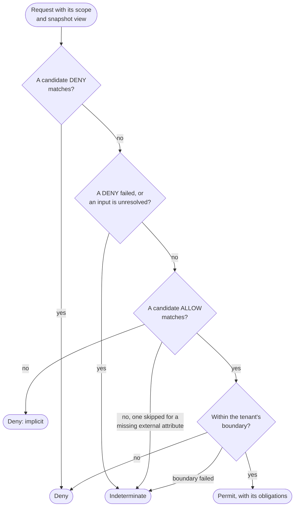

# Security Model

For security reviewers, architects and policy authors who need to know exactly when a request is allowed. This page
is the single home of the decision rules: the evaluation order, deny-first, default deny, Indeterminate, the
platform boundary, the built-in policies and break-glass, fail closed and its two exceptions, and the trust
boundaries. Every other page links here instead of restating them.

## Evaluation order

Every request goes through one pipeline, whatever the adapter. Before the engine decides, the pipeline:

1. rejects a path or a `CoSec-*` parameter it cannot read without ambiguity, with `400`
   ([Web integration](../integration/web.md#the-request-path));
2. authenticates the credential. A rejected credential (invalid, expired, revoked) does not stop the request: it is
   evaluated as the anonymous principal ([Authentication](../integration/authentication.md));
3. resolves the principal's memberships, and fetches the blacklist attributes;
4. resolves the scope (tenant, app, space and the roles there) with `ScopeResolver`. A rejected scope is a deny
   ([Trust boundaries](#trust-boundaries));
5. reads the snapshot view: the platform document, the document of the scope's tenant, and the app's document when
   the principal has roles in the scope's app. A blocked request reads the platform document only;
6. fetches the external attributes the candidate statements need.

The engine (`FlatEvaluator`) then decides in two passes over the **candidates**, the policies that apply to the
request:

1. **The DENY pass.** It visits every candidate's DENY statements. The first one that matches is the decision:
   **Deny**.
2. If no DENY matched, but a DENY failed (the statement, or the policy condition reached through it, threw), or
   something the request needed is unresolved ([Indeterminate](#indeterminate)), the decision is **Indeterminate**.
3. **The ALLOW pass.** The first ALLOW statement that matches is the decision: **Permit**. An ALLOW that fails counts
   as no match.
4. If no ALLOW matched, the decision is the **implicit deny**: Deny, by no statement.
5. A Permit is then held to the tenant's [platform boundary](#platform-boundary), which can only turn it into a Deny
   or an Indeterminate.
6. A Permit carries the rate limit rules it must spend as obligations
   ([Rate limiting](../policies/rate-limiting.md)). A Deny or Indeterminate spends nothing.

The pipeline turns the decision into a response: Permit proceeds, Deny is `401` or `403`, Indeterminate is always
`503` ([Responses and status codes](../integration/web.md#responses-and-status-codes)).

### Candidates

The candidates are the policies that bindings and attachments make applicable to this request, in this order
(`CandidateOrder`):

1. the built-in blacklist policy `cosec:blacklist` ([Built-in policies](#built-in-policies));
2. the platform document's `Anyone` bindings (`"subject": "*"`), then the tenant document's;
3. the principal's attachments (the `policies` membership claim), in claim order; then the principal bindings of
   the platform document and of the tenant document;
4. the role bindings of the app document, then of the tenant document, for each role the principal has in the
   request's space, in claim order;
5. the principal's [break-glass](#break-glass) bindings, last.

A binding applies only when its app and space match the scope exactly (`*` matches any), when a role binding that
names a tenant names the principal's, and when it has not expired. An anonymous principal has no attachments, no
principal or role bindings and no break-glass: only `Anyone` bindings apply to it.

The order never changes the kind of decision, only which statement is reported when several match: the DENY pass
always visits every candidate before the ALLOW pass starts.

### Policy conditions

A policy may have its own `condition`. It is evaluated at most once per request, and only once one of the policy's
statements has matched on its action and resource. When it does not hold, none of the policy's statements match,
DENYs included. When it throws, a DENY reached through it counts as a failed DENY (Indeterminate), an ALLOW as no
match. A DENY that must always apply belongs in a policy without a condition.

## Deny first

An ALLOW never wins over a matching DENY. Every candidate's DENY statements are evaluated before any ALLOW
statement, whatever document, binding or attachment they come from. A platform ALLOW cannot override a tenant DENY,
a tenant ALLOW cannot override a platform DENY, and break-glass cannot override any DENY.

A matching DENY also wins over everything that would otherwise make the decision Indeterminate: a failed statement,
a missing policy, a document that could not be read, an external attribute that could not be fetched.

**Why.** Deny first makes changes safe in one direction: adding a DENY can only narrow access, and adding an ALLOW
can never undo a DENY someone else wrote. Since the decision depends only on the set of candidates, a reviewer never
has to reason about their order.

## Default deny

When no statement matches, the decision is the implicit deny. Access exists only where an ALLOW grants it: a new
endpoint is closed until a policy opens it, and a typo in a pattern closes an endpoint rather than opening one.

An implicit deny and an explicit one produce the same response, so a response never tells a caller that a DENY
exists. They differ only in what you see when you investigate: no statement, or the DENY that matched
([Explaining a decision](../integration/checks.md#explaining-a-decision)).

## Indeterminate

Indeterminate means "CoSec could not decide": there might be a DENY nobody could check. It is never a Permit, and
the pipeline always answers it with `503`. Without a matching DENY, the decision is Indeterminate when:

- a DENY statement, or the policy condition reached through it, fails;
- an attached or bound policy does not exist, or an attachment names a policy that is not `attachable`;
- an attached or bound id names both a tenant policy and a platform policy with different content: neither one
  silently wins;
- a document the request needs could not be read or does not compile, or was not loaded. An absent platform
  document counts as unreadable, never as an empty one, so until one is published every request is Indeterminate
  unless a DENY matches;
- the blacklist could not be read ([Blacklist](#blacklist));
- an ALLOW was skipped because an external attribute it reads could not be fetched, and no other ALLOW matched
  ([Missing external attributes](#missing-external-attributes));
- a boundary statement failed, or the tenant's boundary policy does not exist ([Platform boundary](#platform-boundary)).

The pipeline adds its own unavailable outcomes, also `503`: memberships that cannot be resolved, a credential check
that fails, and the others in [Fail closed](#fail-closed).

## Fail closed

When CoSec cannot decide, it does not permit. Every failure becomes an outcome in one place, `StatusMapping`, so the
WebFlux, WebMvc and Gateway adapters answer identically. Only a Permit lets a request proceed.

| What went wrong | Outcome |
|---|---|
| The path or a `CoSec-*` parameter cannot be read without ambiguity | `400`, before authentication |
| The credential is invalid, expired or revoked | Evaluated as anonymous: a Permit proceeds, a Deny is `401` naming the reason |
| The authenticator fails or does not answer in `cosec.pipeline.authentication-timeout`; the API key store cannot be read | `503` |
| The revocation store reports an error | `503` (but see [the exceptions](#the-two-documented-exceptions)) |
| The memberships cannot be resolved (no provider, provider failure or timeout, a token that both carries the provider marker and claims roles) | `503`, never "no memberships" |
| The snapshot source fails | `503` |
| A document, policy, statement, blacklist or boundary cannot be read or evaluated | Indeterminate (`503`) unless a DENY matches |
| An attribute provider fails or times out | Only its own attributes are unavailable; see [Missing external attributes](#missing-external-attributes) |
| A REQUIRED decision listener fails or times out on a Permit | `503` |
| The whole evaluation exceeds `cosec.pipeline.timeout` | `503` |
| An exception nothing models (a defect) | `500` |
| The client goes away | Nothing is written, the handler is never called |

The timeouts and their defaults are in [Configuration](../operations/configuration.md). What happens when Redis is
down is in [When Redis is unavailable](../operations/storage.md#when-redis-is-unavailable).

**Why.** An outage of a dependency must not open the gate. An error response is visible and gets fixed; a Permit
that should have been a Deny goes unnoticed.

### The two documented exceptions

Two checks let a request through when their backend fails, because failing closed would turn a Redis outage into a
full outage while protecting little:

- **Token revocation, on a degraded read.** When the revocation store cannot be read, CoCache's degraded read answers
  "not revoked". The token's signature and expiry are still checked, so the exposure is bounded by the access token
  lifetime. Only this degraded read counts a token as not revoked: an error the revocation check reports fails the
  request with `503`, and a revocation entry that cannot be decoded fails the read too
  ([Logout and revocation](../integration/authentication.md#logout-and-revocation)).
- **Rate limit rules without `strictFailure`.** When a rule cannot be counted (its limiter fails, times out or is
  missing), it is skipped. A rule with `"strictFailure": true` refuses the request with `503` instead. Rate limits
  only apply to requests the policies already permitted, so skipping one never grants what the policies did not
  ([Rate limiting](../policies/rate-limiting.md)).

Nothing else fails open by default. One more lapse exists, but only where you write it on purpose: a DENY with
`onMissing: nomatch`, below.

### Missing external attributes

A statement may read external attributes (`ext.<provider>.<name>`) that an `AttributeProvider` fetches per request.
When one cannot be fetched, the statement's `onMissing` decides:

- **`indeterminate`** (the default): a DENY that reads it counts as failed, so the decision is Indeterminate unless
  another DENY matches. An ALLOW that reads it is skipped; if no other ALLOW matches, the decision is Indeterminate
  (`503`, to retry) rather than the implicit deny.
- **`nomatch`**: the statement simply does not match. On an ALLOW this is harmless. On a DENY it means the DENY
  lapses while the provider is down, so a DENY with `onMissing: nomatch` compiles, in any document, only with the
  confirmation the control plane records (`onMissingConfirmed`). A rate limit rule may say `nomatch` only in the
  platform document.

A provider that fails makes only its own attributes unavailable: the other providers' attributes are still read,
and their DENYs still match. A statement that reads an external attribute no registered provider declares does not
compile. The fields are in [Policy language](../policies/language.md).

## Built-in policies

Every platform document has these policies, and no document can define them:

| Policy | What it is |
|---|---|
| `cosec:blacklist` | One DENY matching any action on any resource when `environment.blocked` is true. Always the first candidate. It cannot be bound. |
| `cosec:root` | One ALLOW on every action and resource. Only a [break-glass](#break-glass) binding may bind it, and it cannot be attached. |
| `cosec:platform-admin`, `cosec:tenant-admin`, `cosec:tenant-viewer` | The control plane's own permissions: `cosec:*` actions on `doc/...` and `scope/...` resources ([Checks in code](../integration/checks.md#explaining-a-decision)). |

There is no root principal in 8.0: no principal id, tenant or property bypasses the policies. Root access is a
break-glass binding to `cosec:root`, with an expiry and an audit trail.

### Blacklist

A request is blocked when an attribute provider reports it: the starter registers none by default. Register a
`BlacklistAttributeProvider` bean over your own `BlacklistSource` to block principals (by tenant and id), client
addresses or devices (`CoSec-Device-Id`). A blocked request reads only the platform document and meets
`cosec:blacklist`: nothing can permit it, break-glass included.

A blacklist that cannot be read is never "not blocked": the request is Indeterminate (`503`) unless a DENY matches.

**Why first.** The blacklist is how you shut a principal or an address out right now, during an incident. Since it
is a DENY, and deny wins, nothing written in any document can lift it.

## Break-glass

Break-glass grants a named principal a policy for a bounded time, for emergencies. A break-glass binding:

- exists only in the platform document, binds only a principal, and must have `expiresAt`;
- to `cosec:root`, applies only to a principal of the platform tenant `(platform)`;
- is created only through the control plane: one person requests it, a second approves it, and its lifetime is at
  most `cosec.control.break-glass.max-duration` ([Testing policies](../policies/testing.md));
- is the last candidate. It permits only what nothing else permits, and every DENY still applies to the principal.

Every request that break-glass permits must be written to a REQUIRED decision listener first. Without one, or when
it fails, the request is `503`. A permission check in code (`AuthorizationChecker`) that only break-glass permits is
`false`, since a check writes no audit event ([Checks in code](../integration/checks.md)).

## Platform boundary

A boundary limits what a whole tenant can be permitted, whatever its own document grants. The platform document
defines boundary policies (`"boundary": true`, ALLOW statements only) and a default (`boundaries.default`); the
control plane can set another one for a tenant in that tenant's document (`boundary`). The platform tenant has no
boundary.

When a tenant has a boundary, a Permit stays a Permit only if a statement of the boundary policy matches the request.
Otherwise it becomes a Deny, or Indeterminate when a boundary statement failed. A boundary the platform does not
define makes the request Indeterminate. A boundary can only turn a Permit into a Deny or an Indeterminate: it never
permits anything, and without boundaries it changes nothing. A request the boundary denies spends no rate limit.

## Trust boundaries

Every input to a decision comes either from the verified credential, from your configuration, or from the client.
A grant is only as trustworthy as the inputs it depends on.

| Input | Source | Controlled by |
|---|---|---|
| Principal id, attributes, roles and attached policies | The verified credential (JWT claims, API key), or your `MembershipProvider` | Whoever issues credentials |
| Tenant | The credential (`tenantId` claim, API key tenant); `(0)` when it has none. An anonymous request is always in `(0)` | Whoever issues credentials |
| App | `cosec.authorization.scope.app-id` when set (a different `CoSec-App-Id` is rejected); otherwise `CoSec-App-Id` | Your configuration, or the client |
| Space | `CoSec-Space-Id`, accepted only when the principal has a role in that space | The client, among the credential's spaces |
| Device | `CoSec-Device-Id` | The client |
| Method, path, query | The HTTP request; the route map turns method and path into an action and a resource | The client, within your route map |
| Client IP | The connection, or `X-Forwarded-For` up to `cosec.authorization.remote-ip.max-trusted-index` hops | The client, beyond the proxies you trust |
| Headers, `Origin`, `Referer` (`http.*`) | The HTTP request | The client |
| Request attributes (`request.attributes.*`) | The adapter, such as the gateway's route id | You |
| External attributes (`ext.*`) | Your `AttributeProvider` beans | You |
| The caller of a service in gateway mode: principal, tenant, app, space, roles, claims | The `CoSec-Identity` header | The gateway, and anyone else who can reach the service |

How `ScopeResolver` checks the scope:

- **Tenant.** Always the credential's. A client cannot switch tenants without a different credential.
- **Space.** A declared space is accepted only when the principal has at least one role in it; otherwise the
  request is rejected (`SPACE_NOT_MEMBER`), never moved to the default space. `*` is never a space. Without
  `CoSec-Space-Id`, the request is in the default space. An anonymous principal has no roles, so it can only be in
  the default space.
- **App.** With `cosec.authorization.scope.app-id` set, the host's app applies, and a request that declares another
  one is rejected (`APP_MISMATCH`). Without it, the declared app applies as sent. A declared app that cannot be an app
  id (blank, `*`, containing `:` or longer than 128 characters) is rejected either way. The app is checked before the
  space.
- Matching is exact: no trimming, no case folding.

A rejected scope is a Deny: `401` for an anonymous caller, `403` (`scope-rejected`) for an authenticated one.

**The app is the weak spot.** A principal's roles belong to spaces, not to apps. Without a host app, the client
picks which app document's role bindings apply to those roles. If two apps' role bindings grant on the same actions
and resources (apps sharing the `http` namespace on one path prefix, say), the client decides which grants apply.
To keep the app id from widening access:

- set `cosec.authorization.scope.app-id` on every service that serves one app;
- on a gateway, where one host app covers every route, keep the apps' route maps and resources disjoint, or add a
  platform DENY per app prefix, such as DENY `http:*` on `http:path:/orders/**` with the condition
  `{"not": {"eq": ["scope.app", "order"]}}`.

**Client IP.** `max-trusted-index` is the number of proxies in front of the application; the default `1` assumes
one. CoSec takes that entry counted from the right of `X-Forwarded-For`, which your proxy appended. On a host that
clients reach directly, set it to `0`, or a client can write any address into the header
([Client IP behind proxies](../integration/web.md#client-ip-behind-proxies)).

**Headers are client input.** Conditions can read request headers (`http.header.<name>`), `Origin` and `Referer`
(`http.origin`, `http.referer` and their hosts): the client writes all of them. A DENY on a header is a hint the
client can drop, and an ALLOW on one is a grant the client can claim. A header sent more than once with different
values has no single value: a DENY on it is Indeterminate (`503`) and an ALLOW on it does not match
([Attributes](../policies/language.md#attributes)). Request attributes (`request.attributes.<name>`, such as the
gateway's route id) are set by the host, not the client.

Conditions cannot read the headers that carry credentials: `authorization`, `proxy-authorization`, `cookie`,
`set-cookie`, `x-api-key` and `cosec-identity`. A condition on one of them does not compile. Otherwise a policy could
leak another principal's credential through decisions, one character at a time, or trust an identity a client wrote.
An API key header renamed with `cosec.pipeline.api-key-header` is not on that list.

**Services behind a gateway.** A service in gateway mode (`cosec.pipeline.mode=gateway`) holds no keys and no
documents: it believes the `CoSec-Identity` header it receives, and decides nothing itself. The guarantees above then
hold only if the gateway is the only one that can reach the service:

- The gateway removes any `CoSec-Identity` a client sends, on every request and whatever its own configuration, and
  sets one only on a permit for an authenticated principal. So a request through the gateway carries either the
  identity the gateway verified, in the scope it decided in, or none.
- Anyone else who can send the service a request can claim any principal, tenant and role. Keep the service
  reachable from the gateway only: a network policy, a private network, or mutual TLS
  ([Services behind the gateway](../operations/deployment.md#services-behind-the-gateway)).
- The header is not signed. The service refuses one issued longer ago than `cosec.pipeline.gateway.max-age`
  (60 seconds) plus `cosec.authentication.revocation.skew`, or whose credential has expired, with `401`
  `token-expired`, so a header captured inside the network replays only for that long. One that cannot be read or
  arrives twice is `400`, never anonymous. A request without the header is anonymous.
- The service sees what the gateway decided with, nothing more: the roles of that one scope, no policies, and only
  the claims `cosec.gateway.identity.claims` names.

## What anonymous callers can do

A request without a credential, or with one that was rejected, is the anonymous principal `(0)` of the default
tenant `(0)`. It:

- matches only `Anyone` bindings: those of the platform document, and those of tenant `(0)`'s document;
- has no roles and no attachments, and never matches a principal, role or break-glass binding;
- can only be in the default space: a request that declares `CoSec-Space-Id` is rejected with `401`;
- is denied with `401`, never `403`, so the client's remedy is always to authenticate. When its credential was
  rejected, the problem names why (`token-invalid`, `token-expired`, `token-revoked`).

So an anonymous caller can reach exactly what an `Anyone` binding permits, such as a login endpoint, and nothing
else.

## Tenant isolation

Each tenant has its own tenant document. A request reads the platform document and the document of its principal's
tenant, never another tenant's, so another tenant's document never changes a decision for this tenant's principals.
A tenant document may refer only to its own policies and the platform's, and the control plane lets a tenant's
principals write only their own tenant's document.

What is shared across tenants, and so needs care:

- **The platform document** applies to every tenant: its `Anyone` bindings apply to every principal of every
  tenant, anonymous included.
- **App documents** are shared too. An app role binding without a `tenant` applies to the principals of every tenant
  holding that role in the scope; name a tenant in the binding to restrict it to that tenant's principals.
- **The platform tenant `(platform)`** is privileged: only its principals can be bound to `cosec:root` through
  break-glass, and only they act on the platform and app documents in the control plane. Issue `(platform)` tokens
  only from a source users cannot influence.

## Roles in conditions

Role bindings use the request's space strictly: only the roles the principal has in that space bind it. Conditions
can read roles three ways, and only one of them is scoped:

| Attribute | Holds |
|---|---|
| `scope.roles` | The roles the principal has in the request's space. |
| `subject.roles` | The bare role ids the principal has in **any** space. |
| `subject.scopedRoles` | The roles as the token claims them: `role`, `role@space`. |

Use `subject.roles` in DENYs: a DENY on `{"in": ["suspended", "subject.roles"]}` applies in every space, so a
suspended principal cannot step out of it by declaring another space. Do not use it to grant: an ALLOW conditioned
on `subject.roles` permits in every space, including spaces where the principal does not hold the role. To grant
within a space, use a role binding, or `scope.roles`.

## Path variable scope

A resource pattern such as `order/{orderId}` or `http:path:/orders/{id}` captures variables, which conditions read
as `resource.var.<name>`. The variables belong to the statement whose pattern captured them: no other statement and
no policy condition can read them. A captured value never changes a pattern, and a captured path value that holds a
`/` (a decoded `%2F`) is refused with `400` rather than becoming part of a typed resource id.

**Why.** If variables leaked across statements, whether a condition matched would depend on which statements ran
before it. Scoping makes each statement mean the same thing wherever it sits.

## What CoSec does not protect against

CoSec decides whether a request may reach your handler. It does not:

- verify that a client-named app is the right one for the path when no host app is set (see
  [Trust boundaries](#trust-boundaries));
- keep anyone but the gateway from reaching a service in gateway mode: that is the network's job
  ([Trust boundaries](#trust-boundaries));
- decide which records a handler returns, or which fields: filter data in your own code, and use
  [checks in code](../integration/checks.md) for object-level rules;
- protect credentials it did not issue: a stolen token is valid until it expires or is revoked;
- stop a request that a policy permits by mistake: try changes before you publish them
  ([Testing policies](../policies/testing.md));
- replace transport security: run behind TLS, and keep `cosec.jwt.secret` secret.

## Hardening checklist

Before production:

- Load `cosec.jwt.secret` from a secret store, and keep access tokens short-lived.
- Set `cosec.authorization.remote-ip.max-trusted-index` to match your proxy chain, `0` on a directly exposed host.
- Set `cosec.authorization.scope.app-id` on every service that serves one app.
- Run Redis with `maxmemory-policy noeviction` ([Storage](../operations/storage.md)).
- Register a REQUIRED decision listener before anyone needs break-glass.
- Put DENYs that must always apply in policies without a condition, and never grant on a header the client
  writes.
- Give rate limit rules that protect against abuse `"strictFailure": true` if a Redis outage must not lift them.
- Issue `(platform)` tokens only from a source users cannot influence.
- Make every service in gateway mode reachable from the gateway only.

**Next:** how the code keeps these guarantees, in [Architecture overview](../architecture/overview.md); or, to start using CoSec, [Quick start](./quick-start.md).
