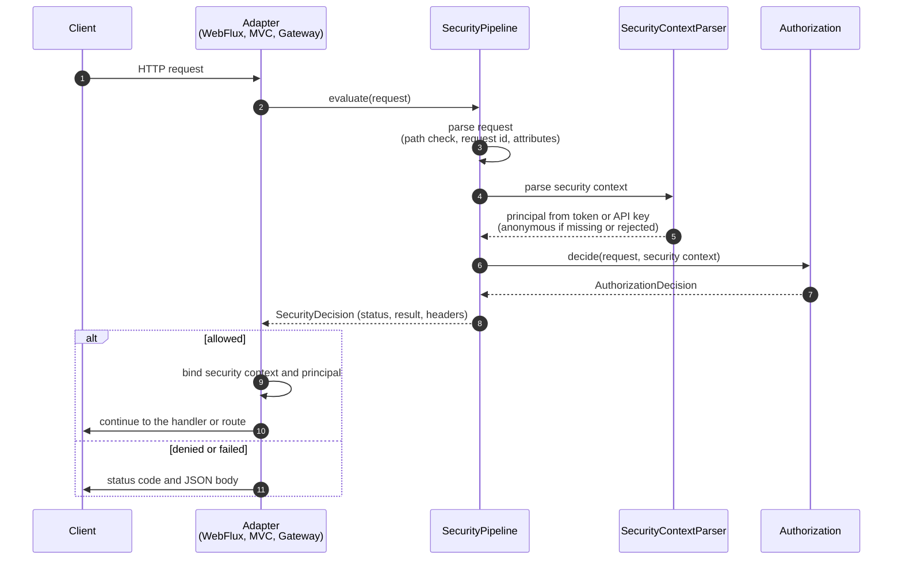

# Web Integration

For developers wiring CoSec into a web application or gateway. This page covers choosing an adapter, what happens
to a request on its way through CoSec, the responses CoSec writes, the headers and request attributes it reads, and
how to reach the security context from your handlers.

## Choosing an adapter

Pick the adapter for your stack by requesting its capability of `cosec-spring-boot-starter`. All three run the same
`SecurityPipeline`, so they answer every request identically; only the plumbing differs.

| Stack | Capability | Component the starter registers | Order |
|---|---|---|---|
| Spring WebFlux | `webflux-support` | `ReactiveAuthorizationFilter` (`WebFilter`) | `1000` |
| Spring MVC | `webmvc-support` | `AuthorizationFilter` (servlet `Filter`, every URL) | Spring Boot's default filter order |
| Spring Cloud Gateway | `gateway-support` | `AuthorizationGatewayFilter` (`GlobalFilter`) | `HIGHEST_PRECEDENCE + 10` |

Every adapter needs the same three things: the capability, a `PolicyRepository` and an
`AppRolePermissionRepository` (from `cache-support`, or your own beans; see
[Choosing a store](../operations/storage.md#choosing-a-store)), and a JWT secret. The snippets below show only what
differs per adapter. The full walk-through, with a first policy and a login endpoint, is the
[Quick Start](../guide/quick-start.md).

**Spring WebFlux**

```kotlin
dependencies {
    implementation(platform("me.ahoo.cosec:cosec-bom:<version>"))
    implementation("me.ahoo.cosec:cosec-spring-boot-starter") {
        capabilities { requireCapability("me.ahoo.cosec:webflux-support") }
    }
    implementation("me.ahoo.cosec:cosec-spring-boot-starter") {
        capabilities { requireCapability("me.ahoo.cosec:cache-support") }
    }
}
```

```yaml
cosec:
  jwt:
    secret: ${COSEC_JWT_SECRET}
```

**Spring MVC**: the same, with `webmvc-support` instead of `webflux-support`. The servlet filter blocks its request
thread until the decision is made, which is the normal servlet model. Policies see the request URI without the
context path, `DispatcherServlet` prefix included ([The request path](#the-request-path)).

**Spring Cloud Gateway**: the same, with `gateway-support`. When the gateway's `GlobalFilter` is on the classpath,
the starter registers `AuthorizationGatewayFilter` and no `ReactiveAuthorizationFilter`. Turning the gateway
filter off ([feature switches](../operations/configuration.md#feature-switches)) therefore leaves the gateway with no
authorization at all. See [Gateway](#gateway) for what the gateway adds.

With Maven, which has no feature variants, add `cosec-spring-boot-starter` plus the adapter module itself
(`cosec-webflux`, `cosec-webmvc` or `cosec-gateway`). The [module list](../guide/introduction.md#modules) names the
module behind every capability.

## How a request is handled

Every adapter hands the request to `SecurityPipeline`, which always ends in a `SecurityDecision`, errors included.
The adapter only writes that decision out; it never decides anything itself.



1. The adapter receives the request.
2. It hands the transport request to the pipeline.
3. The pipeline turns it into a CoSec `Request` ([The request path](#the-request-path)). A path with traversal
   segments stops here with `400`. Otherwise it
   takes the caller's `CoSec-Request-Id` or generates one, resolves the [client IP](#client-ip-behind-proxies), and
   runs every [request attributes](#request-attributes) appender.
4. The security context parser reads the credential: an API key if one is configured and sent, otherwise the
   token ([Authentication](./authentication.md#tokens)). When token revocation or a blocking API key store is
   enabled, the reactive adapters run this step on `boundedElastic`, off the event loop.
5. A missing or rejected credential is not an error: the request goes on as anonymous, and the rejection is kept
   to explain a later `401`. Any other parser error ends in `500`.
6. The authorization chain decides, in the order described in the
   [security model](../guide/security-model.md#evaluation-order).
7. It returns the decision, together with any rate limit result.
8. The pipeline maps the decision to a status, as in the [table below](#responses-and-status-codes).
9. For an allowed request the adapter binds the security context (and, in WebFlux and the gateway, the exchange
   principal) where your code can read it ([Accessing the security context](#accessing-the-security-context)).
10. The request continues to your handler, or to the route's downstream service.
11. A denied or failed request gets the status and a JSON body, and never reaches your handler.

## The request path

The path that `path` actions and the `request.path` part see is the same on every adapter, apart from where it
starts:

| Adapter | Path |
|---|---|
| Spring MVC | The request URI without the servlet context path (`server.servlet.context-path`). It keeps the `DispatcherServlet` mapping prefix: with `spring.mvc.servlet.path=/api`, `/api/admin/users` is matched as `/api/admin/users`. |
| WebFlux, Gateway | The full request path. |

On every adapter the path is:

- **not decoded.** `path` actions decode each segment before they match, but a condition that compares
  `request.path` as a string (`eq`, `regular`, …) sees `/a%20b`, not `/a b`.
- **without `;` path parameters**, as Spring routes it: `/orders;jsessionid=1/42` is matched as `/orders/42`.
- **rejected with `400`** when, after the path parameters are removed, it has a `.` or `..` segment (also
  percent-encoded), or a malformed percent-escape. So `/public/..;/admin`, which a servlet container resolves to
  `/admin`, is rejected too.

## Responses and status codes

Every status comes from `SecurityPipeline`; the adapters only copy it to the response.

| Status | When | Body `reason` |
|---|---|---|
| `200` (request passes) | The authorization decision allows it. | none, the handler answers |
| `400` | The path has a `.` or `..` segment (also percent-encoded, or followed by a path parameter such as `..;`), or a malformed percent-escape (`InvalidRequestPathException`, see [The request path](#the-request-path)). | no body |
| `401` | Denied, and the caller is anonymous: no credential, or one that was rejected. | `Token Expired` or `Token Invalid` when the credential was rejected; otherwise `Implicit Deny` or `Explicit Deny` |
| `403` | Denied, and the caller is authenticated. | `Implicit Deny` or `Explicit Deny` |
| `401`, `403` | A regex condition ran over its time budget (`RegexTimeoutException`). An implicit deny, mapped like the two rows above, not a server error. | as the two rows above |
| `429` | The request was allowed, but a matching [rate limit rule](../policies/rate-limiting.md) has no permit left. | `Too Many Requests` |
| `500` | Any other error. CoSec fails closed instead of guessing. | `Implicit Deny` |

`500` covers, among others:

- `MissingPolicyException`: the principal (or the global policy index) lists a policy the repository does not
  have. It may be the deny that keeps the request out, so CoSec does not evaluate without it.
- `MissingPermissionException`: a role of the principal is granted a permission id its app does not define
  ([Granting permissions to roles](../policies/role-permissions.md#granting-permissions-to-roles)).
- `CacheReadException`: a policy or permission is not in the local cache and Redis cannot be read, or the stored
  value cannot be decoded (for example 6.x data that was not migrated). See
  [When Redis is unavailable](../operations/storage.md#when-redis-is-unavailable).
- `PathVariableScopeException`, or an unsupported condition part: a policy or permission stored by an earlier
  version breaks a rule 7.0 checks at load, so it is rejected when it is read
  ([Path variables](../policies/language.md#path-variables), [Parts](../policies/language.md#parts)).
- A custom matcher, repository or API key store that throws (a Redis-backed API key store that cannot reach Redis
  included).

Why errors deny is in [Fail closed](../guide/security-model.md#fail-closed), and the two deliberate exceptions in
[The two documented exceptions](../guide/security-model.md#the-two-documented-exceptions). For each status, the
[troubleshooting guide](../operations/troubleshooting.md#by-status-code) lists the usual causes.

A rejected request has a JSON body with the content type `application/json`:

```json
{ "authorized": false, "reason": "Implicit Deny" }
```

**Response headers.** Every request that gets past the path check carries `CoSec-Request-Id`: the caller's own
value if it sent one, otherwise a generated id. The gateway also forwards it downstream. When a rate limit rule
matched the request, the response, allowed or rejected, also carries `RateLimit-Limit`, `RateLimit-Remaining` and
`RateLimit-Reset`, and a `429` also `Retry-After`. Their values are defined in
[Responses and headers](../policies/rate-limiting.md#responses-and-headers).

## Accessing the security context

The security context holds the principal, its tenant and the parsed request. For an allowed request your
handler can read it as shown below; a denied request never reaches the handler.

**WebFlux and the gateway**: from the Reactor context of the request, or from the exchange attributes. The exchange
principal is also set, so `exchange.getPrincipal()` returns the CoSec principal.

```kotlin
import me.ahoo.cosec.webflux.ReactiveSecurityContexts.getSecurityContext
import me.ahoo.cosec.webflux.ServerWebExchanges.getSecurityContext

fun currentUser(): Mono<String> =
    Mono.deferContextual { context -> Mono.just(context.getSecurityContext().principal.id) }

// with an exchange at hand; null if the request never reached CoSec
val securityContext = exchange.getSecurityContext()
```

**Spring MVC**: from the thread-bound holder, or from the servlet request. The filter clears the holder when the
request completes, so read it on the request thread, not on a thread you started yourself.

```kotlin
import me.ahoo.cosec.context.SecurityContextHolder
import me.ahoo.cosec.servlet.ServletRequests.getSecurityContext

val securityContext = SecurityContextHolder.requiredContext
// or
val securityContext = httpServletRequest.getSecurityContext()
```

To ask from code whether the current principal may do something else, see [Checks in Code](./checks.md).

## App and space

Three request headers name where a request runs. Each one can also be sent as a parameter of the same name in the
URL query string; the header wins. A form field in the request body is never read: an authorization filter does not
read request bodies, on any adapter.

| Header | Meaning | Read by |
|---|---|---|
| `CoSec-App-Id` | The app the request is for. Role grants apply only in the app they were made in. | role permissions, `request.appId` in conditions |
| `CoSec-Space-Id` | The space within the app. Only the principal's roles written `role@<that space>` apply; without the header, only roles without a suffix apply. | role permissions, `inRole`, `request.spaceId` in conditions |
| `CoSec-Device-Id` | The caller's device. Informational: CoSec makes no decision from it unless a policy does. | `request.deviceId` in conditions, audit events, traces |

How roles, spaces and grants combine is in [Role grant scope](../policies/role-permissions.md#role-grant-scope),
and how a token carries `role@space` in [Roles and spaces](./authentication.md#roles-and-spaces).

The client sets all three. The space only selects among the roles the credential states, but CoSec takes the app id
as sent; what that means when apps share paths, and how to bind it at the gateway, is in
[Trust boundaries](../guide/security-model.md#trust-boundaries).

## Client IP behind proxies

Policies and audit events see the client IP as `request.remoteIp`. Set
`cosec.authorization.remote-ip.max-trusted-index` ([Authorization properties](../operations/configuration.md#authorization))
to the number of proxies in front of the application. CoSec then counts that many entries from the right of
`X-Forwarded-For` (the entries your own proxies appended) and takes that one, so a value the client put at the
left of the header is never used. `0` ignores `X-Forwarded-For` and uses the socket address. A request with no
`X-Forwarded-For`, or with more than one such header, also uses the socket address. The IP is never resolved
through reverse DNS.

## Request attributes

Request attributes are string values attached to the request before authorization. Conditions read them as
`request.attributes.<name>`, and audit events include them. The client cannot set them: they come only from
`RequestAttributesAppender` beans.

| Attribute | Added by | Value |
|---|---|---|
| `ipRegion` | `ip2region-support` | The client IP's location (country, region, city, ISP) from an embedded [ip2region](https://github.com/lionsoul2014/ip2region) database. Absent if the lookup fails. |
| `cosec.audit.routeId` | `gateway-support`, with auditing on | The id of the matched gateway route. |

```json
{ "contains": { "part": "request.attributes.ipRegion", "value": "中国" } }
```

To add your own, declare a `RequestAttributesAppender` bean; every one is applied in turn
([Request and security context](../architecture/extending.md#request-and-security-context)).

## CORS

Browsers send CORS preflight requests without credentials, so authorization would answer them `401`. With
WebFlux, register `OrderedCorsWebFilter`; it runs at order `999`, just before the authorization filter, and answers
preflights itself:

```kotlin
@Bean
fun corsWebFilter(source: CorsConfigurationSource) = OrderedCorsWebFilter(source)
```

With Spring MVC, register a CORS filter that runs before `AuthorizationFilter`.

## Gateway

On Spring Cloud Gateway, CoSec authorizes the request before any route filter runs. In addition to what every
adapter does, `AuthorizationGatewayFilter`:

- forwards `CoSec-Request-Id` to the downstream service, so its logs share the gateway's request id;
- adds the matched route id as the [request attribute](#request-attributes) `cosec.audit.routeId`.

On a gateway host that also serves the control plane's routes (`control-support`), the starter adds a
`PipelineWebFilter` limited to `cosec.control.http.base-path`, because the gateway's filter runs on gateway routes
only. Actuator endpoints are not covered by CoSec on a gateway host: protect them with the management port or network
policy.

Services behind the gateway do not need to authorize again: they can read the principal from the forwarded token
without verifying its signature. [Behind a gateway](./authentication.md#behind-a-gateway) shows the configuration
and when it is safe.

**Ready-to-run gateway.** `cosec-gateway-server` is a Spring Cloud Gateway application with CoSec authorization,
Redis-backed policies and local policy initialization, published as a container image:

```bash
docker run -p 8080:8080 -e COSEC_JWT_SECRET=... ahoowang/cosec-gateway:<version>
```

The image is also published as `ghcr.io/ahoo-wang/cosec-gateway`. Configure routes and CoSec through standard Spring
configuration; the defaults are in its
[`application.yaml`](https://github.com/Ahoo-Wang/CoSec/blob/main/gateway-server/src/main/resources/application.yaml).
Example Kubernetes manifests are in [`k8s/`](https://github.com/Ahoo-Wang/CoSec/tree/main/k8s). They read the JWT
secret from a Secret named `cosec-jwt-secret`; create it first, and set the image tag to the version you deploy:

```bash
kubectl create secret generic cosec-jwt-secret --from-literal=secret=<random value>
```

**Next:** issue, refresh and revoke the tokens the adapter reads, in [Authentication](./authentication.md).
