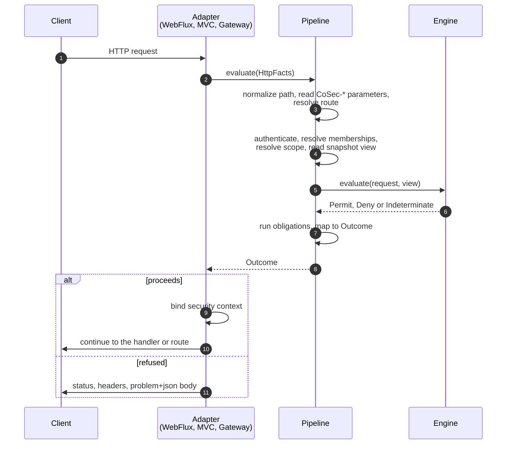

# Web Integration

For developers wiring CoSec into a web application or gateway. This page covers choosing an adapter, what happens
to a request on its way through CoSec, route maps, the responses CoSec writes, the `CoSec-*` parameters it reads,
and how to reach the security context from your handlers. It is the home of the status mapping and the problem
types.

## Choosing an adapter

Pick the adapter for your stack by requesting its capability of `cosec-spring-boot-starter`. All three hand the
request to the same `Pipeline`, so they answer every request byte for byte alike; only the plumbing differs.

| Stack | Capability | Filter the starter registers | Order |
|---|---|---|---|
| Spring WebFlux | `webflux-support` | `PipelineWebFilter` (`WebFilter`) | `1000` |
| Spring MVC | `webmvc-support` | `PipelineServletFilter` (servlet `Filter`, every URL) | `HIGHEST_PRECEDENCE + 100` |
| Spring Cloud Gateway | `gateway-support` | `PipelineGatewayFilter` (`GlobalFilter`) | `HIGHEST_PRECEDENCE + 10` |

Every adapter needs the capability, `cache-support` (the snapshot documents and token revocation live in Redis), a
JWT secret and a route map; a service that only reads the identity its gateway forwards needs none of them
([Services behind the gateway](#services-behind-the-gateway)). The
[Quick start](../guide/quick-start.md#add-the-dependency) shows the dependencies; the snippets below show only what
differs.

**Spring WebFlux.** The filter starts the pipeline on the event loop without a thread switch. After a real
suspension (a Redis read, say) the request continues on `Dispatchers.Default`, never on a client library's I/O
thread.

**Spring MVC.** The servlet filter blocks its request thread until the outcome is known, which is the normal
servlet model.

**Spring Cloud Gateway.** When the gateway's `GlobalFilter` is on the classpath, the starter registers
`PipelineGatewayFilter` and no `PipelineWebFilter`. See [Gateway](#gateway) for what differs.

With Maven, which has no feature variants, add `cosec-spring-boot-starter` plus the adapter module itself
(`cosec-webflux`, `cosec-webmvc` or `cosec-gateway`) and `cosec-cocache`. The
[module list](../guide/introduction.md#modules) names the module behind every capability.

## How a request is handled

Every adapter reads the request once into `HttpFacts` and hands it to `Pipeline.evaluate`, which always ends in an
`Outcome`, errors included. The adapter only writes that outcome; it never decides anything itself.



1. The adapter receives the request.
2. It reads the method, raw path (without the context path), query, headers, cookies and the
   [client IP](#client-ip-behind-proxies), and hands them to the pipeline.
3. The pipeline rejects a path or a `CoSec-*` parameter it cannot read without ambiguity, with `400`
   ([The request path](#the-request-path), [App and space](#app-and-space)), and resolves the
   [route](#route-maps) into an action and a resource.
4. It authenticates the credential ([Authentication](./authentication.md)), resolves the principal's memberships,
   checks the scope, and reads the snapshot documents the request needs.
5. The engine decides, as the [security model](../guide/security-model.md#evaluation-order) describes.
6. It returns Permit, Deny or Indeterminate.
7. A Permit's rate limit obligations run ([Rate limiting](../policies/rate-limiting.md)), and the decision becomes
   an `Outcome` ([Responses and status codes](#responses-and-status-codes)).
8. The pipeline returns the outcome to the adapter.
9. For a Permit, the adapter binds the security context where your code can read it
   ([Accessing the security context](#accessing-the-security-context)).
10. The request continues to your handler, or to the route's downstream service.
11. Anything else gets its status, its headers and a problem body, and never reaches your handler.

Why there is exactly one decision path is in [Architecture overview](../architecture/overview.md).

## The request path

The path CoSec authorizes is the request path within the application:

| Adapter | Path |
|---|---|
| Spring MVC | The request URI without the servlet context path (`server.servlet.context-path`). It keeps the `DispatcherServlet` mapping prefix: with `spring.mvc.servlet.path=/api`, `/api/admin/users` is authorized as `/api/admin/users`. |
| WebFlux, Gateway | The path within the application, without `spring.webflux.base-path`. |

Before anything else, `PathNormalizer` checks it. On every adapter the path is:

- **without `;` path parameters**, as Spring routes it: `/orders;jsessionid=1/42` is authorized as `/orders/42`;
- **not decoded**: the resource of an unmapped request is the path as received, percent-escapes included. How
  patterns match encoded paths is in [Policy language](../policies/language.md);
- **rejected with `400` `invalid-request`**, before authentication, when after removing path parameters and
  decoding once it has a `.` or `..` segment (also with an encoded `;`, and with `\` or `%5C` as a separator), when
  it has a malformed percent-escape, when it is longer than 2048 characters, or when a segment is longer than 256
  characters. So `/public/..;/admin`, which a servlet container resolves to `/admin`, is rejected.

## Route maps

A route map gives each route of a service an action and a typed resource, so policies speak of `order:read` on
`order/42` rather than `GET /orders/42`. WebFlux and WebMvc hosts load the route maps listed in
`cosec.authorization.routes.location` (default `classpath:cosec-routes.json`; a comma-separated list):

```json
{
  "service": "order",
  "routes": [
    { "method": "GET",  "path": "/orders/{orderId}",        "action": "order:read",   "resource": "order/{orderId}" },
    { "method": "POST", "path": "/orders/{orderId}/cancel", "action": "order:cancel", "resource": "order/{orderId}" }
  ]
}
```

- A route matches a request with exactly its `method` whose path matches its `path` pattern. The resource template's
  `{variables}` are captures of the path.
- A request no route matches keeps the action `http:<METHOD>` on the resource `http:path:<path>`. A statement on a
  `service:verb` action never covers it: no route falls back to a wildcard.
- A route map loads whole or not at all. A location that does not exist, a malformed file (an unknown or missing
  field, a repeated key, a value of the wrong type), a malformed route, or two routes one request could match (same
  method, paths not provably disjoint) fails startup and names the location. Set the property to an empty value to
  run without a route map on purpose.
- A captured value that is empty or holds a `/` (a decoded `%2F`) cannot be a segment of a typed resource id: the
  request is refused with `400` `invalid-request`, never evaluated as another resource.

A Spring Cloud Gateway host loads no route map: every gateway request is in the `http` namespace.

With `openapi-support` and Spring Boot Actuator, the endpoint `cosecServiceGenerator/routes` generates a route map
from the service's OpenAPI document, and `cosecServiceGenerator/app` the matching app document to publish through
the control plane ([Role permissions](../policies/role-permissions.md)).

## Responses and status codes

Every status comes from `StatusMapping` in the pipeline; the adapters only copy it to the response. A request
proceeds to your handler only on a Permit.

| Status | Problem type | When |
|---|---|---|
| `200` (proceeds) | none, your handler answers | The decision is Permit and every rate limit obligation had a permit left. |
| `400` | `invalid-request` | The path cannot be read without ambiguity ([The request path](#the-request-path)), a `CoSec-*` parameter has conflicting values ([App and space](#app-and-space)), or a route captured a value that cannot be a resource id segment ([Route maps](#route-maps)). The engine never sees the request. Behind a gateway: a `CoSec-Identity` that cannot be read ([Services behind the gateway](#services-behind-the-gateway)). |
| `401` | `unauthorized` | Deny, and the caller is anonymous: no credential. Includes a rejected scope, such as an anonymous request that declares `CoSec-Space-Id`. |
| `401` | `token-invalid` | Deny, and the credential was rejected as invalid: a token that does not verify, or an unknown, disabled or expired API key. Behind a gateway: a `CoSec-Identity` of an unknown version, from the future, or without a credential expiry. |
| `401` | `token-expired` | Deny, and the token had expired. Behind a gateway: a `CoSec-Identity`, or its credential, that is too old. |
| `401` | `token-revoked` | Deny, and the token, or every token of its principal, was revoked. |
| `403` | `forbidden` | Deny, and the caller is authenticated: an explicit DENY, the implicit deny, or the platform boundary. |
| `403` | `scope-rejected` | The caller is authenticated, and the scope was rejected: a declared app other than the host's, or a space the principal has no role in. |
| `429` | `too-many-requests` | Permit, but a matching [rate limit rule](../policies/rate-limiting.md) has no permit left. |
| `503` | `unavailable` | No decision could be made: Indeterminate, the authenticator or a membership provider failed or timed out, the snapshot source failed, a strict rate limit rule could not be counted, a REQUIRED decision listener failed on a Permit, a Permit only break-glass gives without a REQUIRED listener, or `cosec.pipeline.timeout` passed. |
| `500` | `internal-error` | An exception nothing modelled: a defect of CoSec. At a gateway, also a Permit whose identity cannot be forwarded ([Forwarding the identity](#forwarding-the-identity)). |

A rejected credential is not an error. The request is evaluated as anonymous: a Permit still proceeds (a public
path works with an expired token), and only a Deny names the credential's problem. Explicit and implicit denies
are both `forbidden` (or `unauthorized`), so a response never tells a caller that a DENY exists. Why errors refuse
is in [Fail closed](../guide/security-model.md#fail-closed); for each status, the
[troubleshooting guide](../operations/troubleshooting.md) lists the usual causes.

### Problem bodies

Every response that does not proceed has an RFC 9457 body with the content type `application/problem+json`:

```json
{"type":"https://cosec.ahoo.me/problems/forbidden","title":"Forbidden","status":403,"code":"FORBIDDEN","requestId":"0ef3c9d2a4b14d7e","traceId":"4bf92f3577b34da6a3ce929d0e0e4736"}
```

| Member | Content |
|---|---|
| `type` | `https://cosec.ahoo.me/problems/<slug>`, one per row of the table above. |
| `title` | `Invalid Request`, `Unauthorized`, `Token Invalid`, `Token Expired`, `Token Revoked`, `Forbidden`, `Scope Rejected`, `Too Many Requests`, `Service Unavailable`, `Internal Server Error`. |
| `status` | The HTTP status. |
| `code` | The slug in upper snake case: `INVALID_REQUEST`, `UNAUTHORIZED`, `TOKEN_INVALID`, `TOKEN_EXPIRED`, `TOKEN_REVOKED`, `FORBIDDEN`, `SCOPE_REJECTED`, `TOO_MANY_REQUESTS`, `UNAVAILABLE`, `INTERNAL_ERROR`. |
| `requestId` | The same value as the `CoSec-Request-Id` response header. |
| `traceId` | The trace id, only when tracing captured one at the adapter. |

The members always come in this order, and the body holds nothing else: no policy, statement, binding, cause or
exception message. One hand-written encoder (`ProblemEncoder`) writes it, so the three adapters produce the same
bytes whatever the host's JSON configuration. The body is ASCII: every non-ASCII and control character of the
request id is escaped. The vocabulary is also published as `schema/problem.schema.json`.

### Response headers

- **`CoSec-Request-Id`**, on every outcome, the `400`s included: the caller's own `CoSec-Request-Id` header when it
  is a plain id (1 to 64 characters of `A-Z a-z 0-9 . _ -`), otherwise a generated id. The gateway forwards it
  downstream.
- **`RateLimit-Limit`, `RateLimit-Remaining`, `RateLimit-Reset`**, when a matching rate limit rule was counted: on
  the proceeding response (for the rule with the fewest permits left) and on a `429`. A `429` also carries
  `Retry-After`. Their values are defined in
  [Responses and headers](../policies/rate-limiting.md#responses-and-headers).
- A `503` never carries `Retry-After`.

## App and space

The client sends the `CoSec-*` parameters as headers or as query parameters of the same name:

| Parameter | Meaning | Conditions read it as |
|---|---|---|
| `CoSec-App-Id` | The app the request is for. Ignored in favour of `cosec.authorization.scope.app-id` when that is set; a different value is then rejected. | `scope.app` |
| `CoSec-Space-Id` | The space within the app. Accepted only when the principal has a role in it; empty means the default space. | `scope.space` (and `scope.roles`, the roles there) |
| `CoSec-Device-Id` | The caller's device. Informational unless a policy or the blacklist reads it. | `environment.device` |
| `CoSec-Request-Id` | Header only: the request id ([Response headers](#response-headers)). | |

Rules for reading them:

- Header names match ignoring case; query parameter names match exactly.
- A parameter may be sent several times, in the header, in the query or both, as long as every non-blank value is
  the same. Blank values are ignored.
- Two different values, anywhere, make the request ambiguous: the pipeline and your handler could read different
  scopes. It is refused with `400` `invalid-request`. So is a `CoSec-*` query value with a malformed
  percent-escape.
- A request body is never read: an authorization filter does not read request bodies.

How `ScopeResolver` checks the app and space, and what the client therefore controls, is in
[Trust boundaries](../guide/security-model.md#trust-boundaries). How a token carries `role@space` is in
[Roles and spaces](./authentication.md#roles-and-spaces), and how role bindings are scoped to an app and a space in
[Role permissions](../policies/role-permissions.md). Read the validated scope from the
[security context](#accessing-the-security-context), never from the headers: the headers are what the client
declared.

## Accessing the security context

For a request that proceeds, the adapter binds a `SecurityContext` (`me.ahoo.cosec.api.context`) built from the
pipeline's outcome. A refused request never reaches your handler.

| Member | Content |
|---|---|
| `principal.id` | The principal; `(0)` for an anonymous caller. |
| `tenant.tenantId` | The scope's tenant: the principal's, or `(0)` for an anonymous caller. |
| `principal.roles` | The principal's roles in the request's space. |
| `principal.policies` | The principal's attached policies. |
| `principal.attributes` | The credential's attributes (the token's `attributes` claim; `apiKeyId` for an API key). Behind a gateway: the forwarded `claims`. |
| `scope.appId`, `scope.spaceId`, `scope.roles` | The scope `ScopeResolver` validated: app, space (empty for the default space) and the roles there. |

**WebFlux and the gateway**: from the exchange attributes, or from the Reactor context of the request. The exchange
principal is also set, so `exchange.getPrincipal()` returns the CoSec principal.

```kotlin
import me.ahoo.cosec.webflux.ReactiveSecurityContexts.getSecurityContext
import me.ahoo.cosec.webflux.ServerWebExchanges.getSecurityContext

fun currentUser(): Mono<String> =
    Mono.deferContextual { context -> Mono.just(context.getSecurityContext().principal.id) }

// with an exchange at hand; null if CoSec did not handle the request
val securityContext = exchange.getSecurityContext()
```

**Spring MVC**: from the thread-bound holder, or from the servlet request. The filter clears the holder when the
request completes, so read it on the request thread, not on a thread you started yourself.

```kotlin
import me.ahoo.cosec.servlet.SecurityContextHolder
import me.ahoo.cosec.servlet.ServletRequests.getSecurityContext

val securityContext = SecurityContextHolder.requiredContext
// or
val securityContext = httpServletRequest.getSecurityContext()
```

The context is the one `AuthorizationChecker` accepts, to ask whether the same principal may do something else
([Checks in code](./checks.md)).

## Client IP behind proxies

Policies, rate limit keys, the blacklist and audit events see the client IP as `environment.ip`. Set
`cosec.authorization.remote-ip.max-trusted-index` to the number of proxies in front of the application (default
`1`). CoSec then takes the entry that many places from the right of `X-Forwarded-For`, the one the outermost of
your proxies appended, so a value the client put at the left of the header is never used. When the header has
fewer entries than that, the leftmost one is used.

`0` ignores `X-Forwarded-For` and uses the socket address: set it on a host that clients reach directly, or a
client can claim any address. A request without `X-Forwarded-For`, or with more than one such header, also uses the
socket address. The IP is never resolved through reverse DNS.

## Request attributes

Besides the credential, the scope, the action and the resource, conditions can read what the HTTP request carries
(`http.header.<name>`, `http.origin`, `http.referer` and their hosts), which the client writes, and **request
attributes**, `request.attributes.<name>`, which the adapter sets and the client cannot. The gateway filter sets
`request.attributes.cosec.audit.routeId`, the id of the matched route, and `request.attributes.cosec.identity.forward`
(`false`) on a route that [opts out](#forwarding-the-identity) of identity forwarding. The attribute names, and how a
header sent more than once is read, are in [Policy language](../policies/language.md); which of them the client
controls is in [Trust boundaries](../guide/security-model.md#trust-boundaries).

Facts the request does not carry come from `AttributeProvider` beans as **external attributes**,
`ext.<provider>.<name>`, fetched only when a candidate statement reads them
([Missing external attributes](../guide/security-model.md#missing-external-attributes)). The built-in ones:

| Attributes | Added by | Value |
|---|---|---|
| `ext.ip2region.country`, `.province`, `.city`, `.isp` | `ip2region-support`, with `cosec.ip2region.enabled` (on by default) | The client IP's location from an embedded [ip2region](https://github.com/lionsoul2014/ip2region) database. |
| `ext.blacklist.principal`, `.ip`, `.device` | Your `BlacklistAttributeProvider` bean | Whether the request is blocked ([Blacklist](../guide/security-model.md#blacklist)). |

```json
{ "eq": ["ext.ip2region.country", "中国"] }
```

To add your own, declare an `AttributeProvider` bean ([Extending CoSec](../architecture/extending.md)).

## CORS

Browsers send CORS preflight requests without credentials, so authorization would answer them `401`. With
WebFlux, register `OrderedCorsWebFilter`; it runs at order `999`, just before `PipelineWebFilter`, and answers
preflights itself:

```kotlin
@Bean
fun corsWebFilter(source: CorsConfigurationSource) = OrderedCorsWebFilter(source)
```

With Spring MVC, register a CORS filter with an order before `HIGHEST_PRECEDENCE + 100`.

## Gateway

On Spring Cloud Gateway, `PipelineGatewayFilter` authorizes the request before any route filter runs. It differs
from the WebFlux filter in three ways:

- it runs on gateway routes only: a request no route matches, and the gateway's own actuator endpoints, are not
  authorized by CoSec. Protect actuator with the management port or network policy;
- it loads no route map, so every request is `http:<METHOD>` on `http:path:<path>`;
- it forwards the outcome's `CoSec-Request-Id` to the downstream service, replacing any value the client sent, so
  the backend's logs share the gateway's request id. On a Permit it also forwards the verified identity
  ([Forwarding the identity](#forwarding-the-identity)), and it removes the client's `Authorization` header unless
  `cosec.gateway.identity.forward-authorization=true`.

The host app (`cosec.authorization.scope.app-id`) is one value for the whole gateway, not one per route. When one
gateway fronts several apps, read [Trust boundaries](../guide/security-model.md#trust-boundaries) on keeping the
client-declared app from widening access.

A service behind the gateway either trusts the identity the gateway forwards
([Services behind the gateway](#services-behind-the-gateway)), or runs its own pipeline and verifies the token again
([Behind a gateway](./authentication.md#behind-a-gateway)).

**Ready-to-run gateway.** `cosec-gateway-server` is a Spring Cloud Gateway application with CoSec, reading its
documents from Redis, published as a container image:

```bash
docker run -p 8080:8080 -e SPRING_DATA_REDIS_URL=redis://redis:6379 -e COSEC_JWT_SECRET=... ahoowang/cosec-gateway:<version>
```

The image is also published as `ghcr.io/ahoo-wang/cosec-gateway`. Publish its platform document first
([Quick start](../guide/quick-start.md#publish-the-platform-document)); until then every routed request is `503`.
Configure routes and CoSec through standard Spring configuration; the defaults are in its
[`application.yaml`](https://github.com/Ahoo-Wang/CoSec/blob/main/platform/gateway-server/src/main/resources/application.yaml).
Example Kubernetes manifests are in [`k8s/`](https://github.com/Ahoo-Wang/CoSec/tree/main/k8s). They read the JWT
secret from a Secret named `cosec-jwt-secret`; create it first, and set the image tag to the version you deploy:

```bash
kubectl create secret generic cosec-jwt-secret --from-literal=secret=<random value>
```

### Forwarding the identity

On a Permit for an authenticated principal, the gateway tells the downstream service who it verified, in the
`CoSec-Identity` header. The service then needs no secret, keys, documents or Redis of its own. This is on by default
(`cosec.gateway.identity.enabled`).

**A client cannot forge it.** Every gateway host removes any `CoSec-Identity` the client sends before any other
filter runs (`IdentityStripFilter`), and again at the last hop, after every route filter (`IdentityHeadersFilter`),
which sends only the value the pipeline forwarded. Both run whatever `cosec.pipeline.mode` or `cosec.enabled` say,
so a route filter that adds the header cannot forward one either. A condition on `http.header.cosec-identity` does
not compile.

**No identity is forwarded** for an anonymous Permit, a refused request, a route whose metadata opts out, or with
`cosec.gateway.identity.enabled=false`. Opt a route out when its backend is a third party:

```yaml
spring:
  cloud:
    gateway:
      server:
        webflux:
          routes:
            - id: partner
              uri: https://partner.example.com
              predicates:
                - Path=/partner/**
              metadata:
                cosec-identity: false
```

**What it carries.** The value is base64url (no padding) of compact JSON, format version 1; the JSON Schema is
[`schema/cosec-identity.schema.json`](https://github.com/Ahoo-Wang/CoSec/blob/main/schema/cosec-identity.schema.json).

| Member | Content |
|---|---|
| `v` | `1`. |
| `tenant`, `sub` | The tenant and principal the gateway verified. |
| `scope` | `{app, space}`, as the gateway resolved them. |
| `roles` | The principal's roles in that space: those the decision used. |
| `auth` | `{method, jti, exp}`: how the principal authenticated (`jwt` and `api-key` are CoSec's own; any other non-empty name is read as it is, so a gateway with another authenticator works), the token's `jti` or the key's id, and the credential's expiry. Never the credential itself. |
| `iat` | When the gateway made the header, in epoch seconds. |
| `rid` | The gateway's request id. |
| `claims` | Only the principal attributes named in `cosec.gateway.identity.claims` (the token's `attributes` claim, or an API key's attributes): strings, numbers and booleans. |

It never carries the token, the API key, cookies or other request headers, policies, the matched statement,
external attribute values or the client IP.

**It fails closed.** The request is `500` `internal-error`, logged, and nothing is truncated, when the identity is
larger than `cosec.gateway.identity.max-size` (8 KB), when a named claim is not a string, number or boolean or is
longer than 1024 characters, or when the credential never expires (such as an [API key](./authentication.md#api-keys)
without `expires-at`): a service could not bound such an identity.

**`Authorization`.** The gateway removes the client's `Authorization` header before forwarding, so a compromised
service never sees a token. Set `cosec.gateway.identity.forward-authorization=true` only when the services behind it
verify the token again or call other APIs on the user's behalf.

### Services behind the gateway

A service behind the gateway sets `cosec.pipeline.mode=gateway` (the default is `enforce`). It needs only its web
adapter (`webflux-support` or `webmvc-support`), and should set `cosec.jwt.enabled=false` unless it also issues
tokens:

```yaml
cosec:
  pipeline:
    mode: gateway
  jwt:
    enabled: false
```

In this mode the adapter reads the forwarded identity through `IdentityGate`, and the starter wires no authenticator,
snapshot, route map, rate limits, control plane, `AuthorizationChecker` or Redis. The service decides nothing with
policies: the gateway decided. It believes any `CoSec-Identity` it receives, so **only the gateway may be able to
reach it**: how to enforce that, and the startup checks, are in
[Services behind the gateway](../operations/deployment.md#services-behind-the-gateway) of the deployment guide.

| Request | Answer |
|---|---|
| No `CoSec-Identity` | Proceeds as the anonymous principal `(0)`; your code decides what it may see. |
| A valid identity | Proceeds as that principal, in that scope. |
| Not readable (not base64url, not the format, an unknown or duplicate member, a repeated role, `iat` or `exp` past year 9999), sent more than once, larger than `cosec.pipeline.gateway.max-size` (8 KB), or a scope that does not resolve here (such as an app other than `cosec.authorization.scope.app-id`) | `400` `invalid-request` |
| An unknown version, an `iat` in the future, or no `auth.exp` | `401` `token-invalid` |
| `auth.exp` passed, or `iat` older than `cosec.pipeline.gateway.max-age` (60 seconds) | `401` `token-expired` |

The time checks allow `cosec.authentication.revocation.skew` (5 seconds) for the gateway's clock. The maximum age
limits replaying a captured header inside the network: revocation is checked at the gateway only. The response
carries the gateway's `CoSec-Request-Id`.

The [security context](#accessing-the-security-context) of a request that proceeds holds:

| Member | Content |
|---|---|
| `principal.id`, `tenant.tenantId` | `sub` and `tenant`; `(0)` for both without an identity. |
| `principal.roles`, `scope.roles` | `roles`. |
| `principal.policies` | Empty. |
| `principal.attributes` | `claims`. |
| `scope.appId`, `scope.spaceId` | `scope.app` and `scope.space`. |
| `attributes["cosec.identity.rid"]`, `attributes["cosec.identity.jti"]` | The gateway's request id and the credential's id (`auth.jti`). |

## Control-plane routes

With `control-support` (and `cache-support`), the starter serves the control plane's HTTP API under
`{cosec.control.http.base-path}/v1` (default `/cosec/control/v1`) as functional routes on a WebFlux or WebMvc host.
What the API does is in [Testing policies](../policies/testing.md) and
[Explaining a decision](./checks.md#explaining-a-decision); how its requests are handled:

- **The pipeline first.** A control request is an ordinary request to the host: your documents must permit it
  (for example `http:POST` on `http:path:/cosec/control/v1/**` for authenticated callers), or it is refused like any
  other. Until a platform document is published, every request, control routes included, is `503`, so the first
  platform document comes from `cosec-migrate publish`
  ([Quick start](../guide/quick-start.md#publish-the-platform-document)).
- **Then the control plane's own check.** Every call is authorized again as the request's principal, in the app
  `cosec.control.app-id` (default `cosec-control`) and its default space, on documents confirmed current. An
  anonymous request is `401`. Tenant isolation comes first and is not a policy: a tenant's principal acts only on
  its own tenant's document.
- **Body size.** On WebMvc at most `cosec.control.http.max-body-size` (default `16MB`) is read; a larger body is
  `400` `invalid-request`, unread. On WebFlux the body is bounded by Spring's `spring.codec.max-in-memory-size`
  (256 KB by default): raise it on control-plane hosts that receive large documents.
- **Gateway hosts.** The gateway's global filter runs on gateway routes only, so the starter adds a
  `PipelineWebFilter` limited to the base path. The control routes are authorized as on a WebFlux host; the
  gateway's routes keep the gateway filter.

The control API answers problems in the same format, with the types above plus its own: `not-found` (`404`),
`conflict` (`409`), `gone` (`410`), `precondition-failed` (`412`), `unprocessable` (`422`) and
`precondition-required` (`428`). A `400`, `409`, `410`, `412`, `422` or `428` explains the caller's own request in a
`detail` member; a `401`, `403`, `404`, `500` or `503` carries no detail, so a refusal never tells whether a
document, a change or a DENY exists.

**Next:** issue, refresh and revoke the tokens the adapter reads, in [Authentication](./authentication.md).
