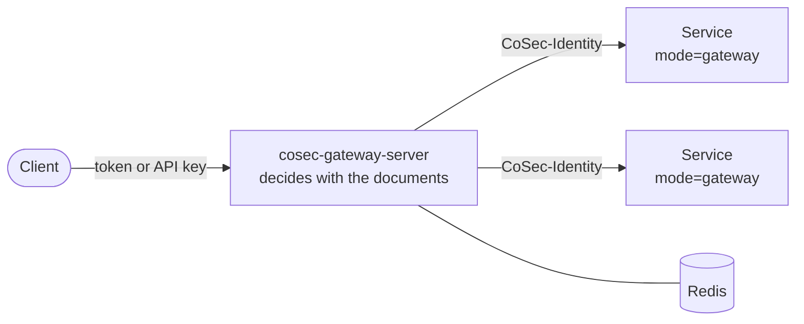

# Deploying the Gateway Server

For operators who run `cosec-gateway-server`, the ready-made Spring Cloud Gateway with CoSec in front, from its
Docker image or on Kubernetes, or who build a similar image of their own. This page covers what the image contains,
what it forwards to the services behind it, what it needs before it can answer a request, readiness and shutdown, the
Kubernetes manifests in the repository, how CI checks the image, and the JDK 25 AOT cache it ships with. Every property named here is in [Configuration](./configuration.md).

## The image

CI builds the image from [`platform/gateway-server/Dockerfile`](https://github.com/Ahoo-Wang/CoSec/blob/main/platform/gateway-server/Dockerfile)
on every push and publishes it as `ahoowang/cosec-gateway`, `ghcr.io/ahoo-wang/cosec-gateway` and
`registry.cn-shanghai.aliyuncs.com/ahoo/cosec-gateway`, for `linux/amd64` and `linux/arm64`. The gateway server is an
application: it is published only as an image, never as a library.

- **JDK.** The CoSec libraries target Java 21, which is what an application on them needs. The image is an
  application of its own and runs on JDK 25, Alibaba Dragonwell 25 (`dragonwell:25-ubuntu`), with a JDK 25
  [AOT cache](#aot-cache): its runtime is 25, not 21.
- **Required settings.** `COSEC_JWT_SECRET` (there is no default, see
  [Authentication](../integration/authentication.md)) and the Redis address, for example `SPRING_DATA_REDIS_URL`.
- **Layout.** The application lives in `/opt/cosec-gateway-server` and runs as the unprivileged `appuser`. The
  configuration is `config/application.yaml`; the JVM options are in `bin/cosec-gateway-server` (ZGC, a 2 GiB heap).
  Add options through `JAVA_OPTS`, which follows them and so overrides them ([Memory](#memory)).
- **What is in it.** The gateway filter, the Redis snapshot store (`cosec-cocache`), tracing and the Kafka module. Its
  configuration turns Kafka audit (`cosec.audit.kafka.enabled: false`), login
  (`cosec.authentication.login.enabled: false`) and ip2region (`cosec.ip2region.enabled: false`) off. It has no control plane: documents are published by
  `cosec-migrate` or by a control-plane application on the same Redis.

```bash
docker run -d -p 8080:8080 \
  -e SPRING_DATA_REDIS_URL=redis://redis:6379 \
  -e COSEC_JWT_SECRET=... \
  ahoowang/cosec-gateway
```

## What the gateway authorizes

CoSec runs as a Spring Cloud Gateway global filter, which runs on the gateway's routes only. So every routed request
is authorized, in the `http` namespace (the gateway loads no route map), and the gateway's own actuator endpoints,
health probes included, are not. Routes are ordinary Spring Cloud Gateway configuration under
`spring.cloud.gateway.server.webflux.routes`. How a request becomes an action and a resource, and how outcomes become
responses, is in [Web integration](../integration/web.md).

What a routed request carries to its backend:

- **`CoSec-Identity`**, on a permit for an authenticated principal: the identity the gateway verified and the scope it
  decided in. The gateway removes any `CoSec-Identity` a client sent from every request, before any other filter and
  again on the routed request, whatever `cosec.pipeline.mode` or `cosec.enabled` say. An anonymous permit, and a route
  whose metadata says `cosec-identity: false`, carry none. Turn forwarding off with
  `cosec.gateway.identity.enabled=false`; the other `cosec.gateway.identity.*` properties are in
  [Configuration](./configuration.md).
- **No `Authorization` header**, unless `cosec.gateway.identity.forward-authorization=true`. Turn it on only for a
  backend that calls other APIs with the user's token.
- **`CoSec-Request-Id`**, the gateway's own request id.

A credential that never expires (an API key without `expires-at`) is not forwarded: such a request answers `500`, and
the gateway logs `Request [<requestId>]: the identity cannot be forwarded.`

## Services behind the gateway

A service behind the gateway can decide for itself (the default, `cosec.pipeline.mode=enforce`, with its own
documents and keys), or trust the gateway's decision with `cosec.pipeline.mode=gateway`. In gateway mode the service
reads the caller from `CoSec-Identity` and nothing else: it has no keys, no documents, no Redis, no route map and no
decision listeners. How a service is set up for it is in
[Services behind the gateway](../integration/web.md#services-behind-the-gateway).



**Only the gateway may reach a service in gateway mode.** The service believes any `CoSec-Identity` it receives, so
anyone else who can send it a request can be whoever they claim. Enforce it in the network: a Kubernetes
`NetworkPolicy` that admits only the gateway's pods, a private network, or mutual TLS between the gateway and the
services. Each such service logs at startup, at `WARN`:

```text
cosec.pipeline.mode=gateway: this service believes any CoSec-Identity header it receives. Only the CoSec gateway, which strips the clients' own, may be able to reach it: anyone else who can is whoever they claim.
```

Startup fails when `cosec.pipeline.mode` is neither `enforce` nor `gateway`, and when it is `gateway` on a Spring Cloud
Gateway host: the gateway itself always decides with the documents. Why the boundary matters, and what a captured
header allows, is in [Trust boundaries](../guide/security-model.md#trust-boundaries).

## Before the first request

The gateway starts without any document, but answers every routed request `503` until a platform document is
published ([The first documents](./storage.md#the-first-documents)), and reports itself not ready meanwhile
([Readiness](#readiness)). For each environment:

1. **Redis with `maxmemory-policy noeviction`.** Each instance checks it at startup with `CONFIG GET` and does not
   start otherwise ([Redis requirements](./storage.md#redis-requirements)). On a managed Redis that hides
   `CONFIG GET`, set `noeviction` yourself and `COSEC_AUTHORIZATION_SNAPSHOT_EVICTION_CHECK=warn`.
2. **The documents.** Publish them with `cosec-migrate publish --to-redis <uri> --in <dir>`, then name the first
   administrator with `cosec-migrate bootstrap` if a control plane will manage them. The gateway, the control plane and
   `cosec-migrate` must use the same Redis and the same `cosec.authorization.snapshot.key-prefix`.
3. **Instance ids, if you lock Redis down per instance.** The gateway takes part in shadow windows by default, with a
   random instance id. To give each pod its own Redis user, set `COSEC_AUTHORIZATION_SHADOW_INSTANCE_ID` per pod
   ([Who may write which keys](./storage.md#who-may-write-which-keys)).
4. **The same attribute providers everywhere.** Every gateway instance, every other data-plane instance and the
   control plane's host must register the same `AttributeProvider`s, declaring the same `ext.*` attributes with the
   same types. A document compiles against the platform's declarations and the host's providers, so a change the
   control host accepts can fail to compile on an instance without the provider: in a shadow window that instance
   reports `CANDIDATE_ERROR` and the window never closes clean, so the change is not published; published without a
   window, that instance answers `503` for every request that needs the document, unless a DENY matches.

## Readiness

An instance is ready only once it has installed the platform document and every document named in
[`prewarm-apps` and `prewarm-tenants`](./configuration.md#snapshot) (empty lists mean the platform document only).
Until then it would answer every routed request `503`, so the starter turns Spring Boot's readiness state to
`REFUSING_TRAFFIC`, and back to `ACCEPTING_TRAFFIC` once the documents are installed. A load balancer that follows
`/actuator/health/readiness` sends it no traffic meanwhile. Liveness is not touched: a missing document is not a reason
to restart the instance.

With Spring Boot Actuator, the `cosecSnapshot` health indicator reports `UP` once the same documents are installed,
`DOWN` before, with the details `platform` (`installed`, `failed`, `absent` or `loading`) and `prewarmed`. To see those
details on the readiness endpoint, add it to the readiness group:

```yaml
management:
  endpoint:
    health:
      group:
        readiness:
          include: readinessState,cosecSnapshot
```

`cosecSnapshot` is also part of `/actuator/health`, which therefore reports `DOWN` until the platform document is
published.

## Shutdown

On shutdown, the decision listeners stop taking events and deliver what is queued to the `BEST_EFFORT` listeners (the
audit log, Kafka, metrics) for up to
[`cosec.observability.listener.drain-timeout`](./observability.md#decision-listeners) (5 seconds), then drop the
rest. Keep the pod's termination grace period long enough for Spring's own graceful shutdown plus that timeout.

## Kubernetes

[`k8s/`](https://github.com/Ahoo-Wang/CoSec/tree/main/k8s) holds [Kustomize](https://kustomize.io/) manifests: a base
and an overlay for each kind of cluster. Deploy an overlay, never the base on its own.

| Directory | For | Contents |
|---|---|---|
| `base/` | the overlays to build on | The Deployment and a Service (port 80 to the container's 8080). `application.yaml` (the routes and the `cosec.*` settings above) becomes a ConfigMap mounted over `/opt/cosec-gateway-server/config/`; its name carries a hash of the file, so a change to it rolls the pods. The image is `ghcr.io/ahoo-wang/cosec-gateway`, with its tag set under `images:`. One gateway gets 768Mi and a 256 MiB heap. |
| `overlays/dev/` | trying CoSec out on any cluster, kind and minikube included | The namespace `cosec-dev`, one gateway with the base's resources, and a single Redis 7.4 with `maxmemory-policy noeviction` and no password. Redis keeps its data in an `emptyDir`, which outlives a container restart but not the pod: deleting the Redis pod deletes the documents. |
| `overlays/production/` | a starting point for your own overlay | The namespace `cosec`; your Redis, from the ConfigMap `cosec-gateway-redis` (host and port; or `SPRING_DATA_REDIS_CLUSTER_NODES` for a cluster) and the Secret `cosec-redis-secret` (`password`, and `username` for an ACL user); 2 to 10 gateways behind a HorizontalPodAutoscaler on CPU (70 % of the 1 CPU each requests; it needs the metrics server); a PodDisruptionBudget that evicts one gateway at a time and always lets an unready one go, so a drain never waits for a platform document; a NetworkPolicy that admits port 8080 only; 2Gi and a 1 GiB heap per gateway, spread across nodes. |

### Deploying

1. **Create the namespace and the JWT secret.** The repository holds no secret, and the gateway does not start
   without this one (`COSEC_JWT_SECRET`, see [Authentication](../integration/authentication.md)):

   ```bash
   kubectl create namespace cosec-dev
   kubectl -n cosec-dev create secret generic cosec-jwt-secret --from-literal=secret="$(openssl rand -base64 48)"
   ```

   For the production overlay, use the namespace `cosec`, and also create the Redis credentials:
   `kubectl -n cosec create secret generic cosec-redis-secret --from-literal=password=<password>`.
2. **Production: point it at your Redis.** Set the address in the `cosec-gateway-redis` ConfigMap of the overlay's
   `kustomization.yaml`. Redis must run with `maxmemory-policy noeviction`
   ([Redis requirements](./storage.md#redis-requirements)). Keep your routes, namespace and image tag in an overlay of
   your own on top of this one: replace the configuration with
   `configMapGenerator: [{name: cosec-gateway-config, behavior: replace, files: [application.yaml]}]` and set the tag
   under `images:`.
3. **Apply the overlay:**

   ```bash
   kubectl apply -k k8s/overlays/dev
   ```

4. **Publish the platform document.** Until it is installed, every gateway runs but reports itself not ready and stays
   out of the Service ([Readiness](#readiness)), and `kubectl rollout status` waits. That is by design: it would answer
   every routed request `503`. With the dev overlay, reach its Redis with
   `kubectl -n cosec-dev port-forward svc/redis 6379` and publish with
   `cosec-migrate publish --to-redis redis://localhost:6379 --in <dir>` ([The first documents](./storage.md#the-first-documents)).
5. **Try a request** through `kubectl -n cosec-dev port-forward svc/cosec-gateway 8080:80`.

### What the manifests set

- **No service links** (`enableServiceLinks: false`). Kubernetes would otherwise put variables such as
  `COSEC_GATEWAY_SERVICE_HOST` and `COSEC_GATEWAY_PORT_80_TCP_ADDR`, derived from the Service `cosec-gateway`, into the
  gateway's environment. Spring reads them as `cosec.gateway.*` properties, which 8.0.0-alpha.1 refused at startup as
  `cosec.*` keys CoSec does not read; since alpha.2 the check skips exactly these variables
  ([Unknown properties](./configuration.md#unknown-properties)). The gateway finds services by DNS, so nothing needs
  them in its environment.
- **Pod security.** The gateway runs as the image's `appuser` (uid 999; the image names its user rather than its uid,
  so the manifests give the uid for `runAsNonRoot` to check), with a read-only root filesystem, no privilege
  escalation, every capability dropped, the runtime's default seccomp profile, and no service account token: it never
  calls the Kubernetes API. Both overlays meet the `restricted` Pod Security Standard. It writes only to three
  `emptyDir` volumes: `logs/` (the GC log), `data/` (a heap dump on `OutOfMemoryError`) and `/tmp` (Netty's native
  transport, the JVM's performance data). The AOT cache is only read.
- **Probes.** The startup and liveness probes read `/actuator/health/liveness`, the readiness probe
  `/actuator/health/readiness`, both groups that `application.yaml` enables (`management.endpoint.health.probes.enabled`).
  So a pod starts while Redis holds no platform document, and stays out of the Service until it is installed. Don't
  point a probe at `/actuator/health`: it stays DOWN until then, and a startup probe on it restarts the pod.
- **Actuator.** Only `health` is exposed over HTTP, and the `gateway` endpoint, which reads and changes routes, is off
  (`management.endpoint.gateway.access: none`). CoSec authorizes the gateway's routes, not its actuator endpoints.
- **Shutdown.** A `preStop` pause of 5 seconds lets the Service drop the pod first; `terminationGracePeriodSeconds: 45`
  covers it, Spring's graceful shutdown (30 seconds at most) and the decision listeners' drain ([Shutdown](#shutdown)).
- **JVM options**, through `JAVA_OPTS`: the memory sizes below, `-XX:+ExitOnOutOfMemoryError` so that a JVM that ran
  out of memory is restarted, and `-Dcom.sun.management.jmxremote.host=127.0.0.1`. The image's start script starts a
  JMX agent on port 5555 with no authentication; this keeps it inside the pod, and the production NetworkPolicy closes
  every port but 8080.

### Memory

A gateway's memory is its heap, its direct memory, and the JVM's own native memory. The base and the production
overlay size them for their limits:

| | `dev` (base) | `production` |
|---|---|---|
| Memory request and limit | 768Mi | 2Gi |
| Heap (`-Xms` = `-Xmx`) | 256 MiB | 1 GiB |
| Direct memory, Netty's buffers (`-XX:MaxDirectMemorySize`) | up to 64 MiB | up to 256 MiB |
| Native: the AOT cache's class data (about 105 MiB), JIT code, metaspace, GC structures, threads | about 220 MiB | about 250 MiB |
| Left for the page cache and peaks | about 230 MiB | about 500 MiB |
| CPU request and limit | 250m, 1 | 1, 2 |

- **ZGC commits the whole heap at startup**, as shared memory the container is charged for at once. A limit too small
  for the heap fails the pod within seconds, not after hours of traffic.
- **The heap needs free space.** ZGC collects while the gateway allocates; a heap that is mostly live data makes
  request threads wait for it. The compiled documents live on the heap: size it for your documents and traffic, then
  set the limit to the heap, plus the direct memory, plus about 250 MiB, plus a quarter.
- **The image's own defaults do not fit a small cluster.** Its start script sets `-Xms2048M -Xmx2048M
  -XX:MaxDirectMemorySize=512M`, about 2.8 GiB with the native part. `JAVA_OPTS` comes after them on the command line,
  so its sizes win; `JAVA_TOOL_OPTIONS` cannot change them, because the JVM reads it first. The fixed `-Xmx` also
  overrides `-XX:MaxRAMPercentage`, so give explicit sizes. The base sets them in `JVM_MEMORY_OPTS`, and the production
  overlay replaces it; change it together with the memory request and limit.
- **CPU.** The JVM sizes its GC, JIT and Netty threads from the CPU limit, and the autoscaler measures against the
  request.

The native part was measured in the image (`8.0.0-alpha.1`, `linux/arm64`, Docker with these limits and a read-only
root filesystem), after about 45,000 requests to a route and to the health endpoint with no platform document
published, so that each answered `503`: the container held 471 MiB (dev) and 1,277 MiB (production), and nothing was
killed for memory.

## How CI checks the image

After the image is pushed, the `aot-smoke` job of
[`docker-deploy.yml`](https://github.com/Ahoo-Wang/CoSec/blob/main/.github/workflows/docker-deploy.yml) runs
[`aot-smoke.sh`](https://github.com/Ahoo-Wang/CoSec/blob/main/platform/gateway-server/aot-smoke.sh) against a Redis 7
service container. It publishes a platform document with `cosec-migrate publish`, starts the image with
`-XX:AOTMode=on` (a cache that cannot be mapped fails the job), adds a `/smoke/**` route to the gateway's own health
endpoint, and checks that the health probe answers `200`, an anonymous request `401` with
`application/problem+json`, a request with a valid HS256 token `200`, and a request a DENY matches `403` with
`application/problem+json`. The same steps are a quick check of your own deployment.

## AOT cache

The image ships an AOT cache (JDK 25, [JEP 483](https://openjdk.org/jeps/483), [JEP 514](https://openjdk.org/jeps/514),
[JEP 515](https://openjdk.org/jeps/515)): the classes the gateway loads during startup, already read, parsed,
loaded and linked, plus method profiles from a training run. The JVM maps the file at startup instead of doing that
work again. No code changes and no Spring AOT are involved.

### What it changes

- **Startup, and the first seconds after it.** Time to `Started GatewayServerKt` drops by about a quarter; see
  [Measured startup](#measured-startup). The method profiles let the JIT compile hot methods sooner, which shortens
  warm-up.
- **Not peak throughput.** Once the JIT has compiled the hot paths, a JVM with the cache runs the same code as one
  without it. Authorization performance is in [Architecture overview](../architecture/overview.md#performance).
- **Memory.** The resident set size after startup is larger, because it counts the mapped part of the 104 MiB cache:
  26 MiB in the container and 66 MiB natively in [the measurements](#measured-startup). Those pages are file-backed, not heap.
- **Image size.** The cache adds about 104 MiB to the image.

### How the image uses it

The `Dockerfile` trains the cache in its final stage with
[`aot-train.sh`](https://github.com/Ahoo-Wang/CoSec/blob/main/platform/gateway-server/aot-train.sh), against the exact
jars and path the container runs, and writes it to `/opt/cosec-gateway-server/aot/cosec-gateway-server.aot`.

1. **Record.** The script starts the gateway with `-XX:AOTMode=record` and the same JVM options as production,
   waits until `/actuator/health/liveness` answers, sends a few requests, and stops it with `SIGTERM`. It uses
   ephemeral HTTP and JMX ports, because a multi-platform build trains all platforms at once and their JVMs can
   share one network.
2. **Create.** A second run with `-XX:AOTMode=create` turns the recorded configuration into the cache.
3. **Check.** A third run with `-XX:AOTMode=on` fails the build if the production options cannot map the cache.

Training needs no Redis and no network. It sets `cocache.backend=memory`, so CoCache keeps its caches in process
and the whole application starts without a Redis server; the eviction check passes for the in-memory backend. The
trade-off: classes that load only once Redis answers (the Lettuce connection path) or only for a decision on real
documents are not in the cache (with no platform document, every training request is refused). They load the normal
way, so the first authorized request costs what it would cost without a cache.

The container passes `-XX:AOTCache=…` through `JDK_JAVA_OPTIONS`, not `JAVA_OPTS`, so setting `JAVA_OPTS` keeps the
cache. Each start prints `NOTE: Picked up JDK_JAVA_OPTIONS: …` on stderr. Every other `java` command in the
container picks the option up too: one without the gateway's options, such as `java -version`, cannot use the
cache and prints the `[aot]` errors described [below](#when-the-cache-is-not-used), which are harmless.

The cache is not trained with `-Dspring.context.exit=onRefresh`, the mode Spring Boot suggests. The gateway enables
the Spring Cloud bootstrap context, and that context refreshes first, so the JVM exits before the application
context exists. The run returns 0 and prints nothing, and the resulting cache covers almost none of the
application.

### When the cache is not used

A cache that does not match the JVM is ignored: the JVM starts without it, at normal speed, and logs why. This
happens when the cache file is missing or truncated, when a jar on the class path differs from training (path,
size or modification time), when another JDK build runs it, or when the GC differs (for example `-XX:+UseG1GC`
instead of the trained ZGC). The JVM then logs lines such as:

```text
[error][aot] An error has occurred while processing the AOT cache. Run with -Xlog:aot for details.
[error][aot] Unable to map shared spaces
```

That is the default `-XX:AOTMode=auto`. **Never set `-XX:AOTMode=on` in production**: with it, a mismatched cache
stops the JVM from starting. To see whether the cache was used, add `-Xlog:aot` to `JAVA_OPTS`. To turn it off,
start the container with `-e JDK_JAVA_OPTIONS=`.

Changing `config/application.yaml` or the environment does not invalidate the cache, since configuration is not on
the class path. A configuration that turns on more features loads classes the training run never saw; retrain to
cover them.

### Training your own cache

Retrain whenever the jars, the JDK or the GC change. For an image built on top of this one, run the same script
after your changes; it overwrites the cache in place:

```dockerfile
FROM ahoowang/cosec-gateway
COPY --chown=appuser:appgroup application.yaml config/application.yaml
RUN aot-train.sh /opt/cosec-gateway-server /opt/cosec-gateway-server/aot/cosec-gateway-server.aot
```

For your own Spring Boot application on JDK 25, the same two steps apply. Run both with the class path and the JVM
options production uses, from the same directory:

```bash
# 1. Record: run a representative workload, then stop the JVM normally (SIGTERM is fine).
java -XX:AOTMode=record -XX:AOTConfiguration=app.aotconf -cp "$CLASSPATH" com.example.App
# 2. Create: needs no workload and exits by itself.
java -XX:AOTMode=create -XX:AOTConfiguration=app.aotconf -XX:AOTCache=app.aot -cp "$CLASSPATH" com.example.App
# Production
java -XX:AOTCache=app.aot -cp "$CLASSPATH" com.example.App
```

- **Train where you run.** The cache stores the class path, including each jar's modification time. Train in the
  final image stage, after the jars are in place; copying jars to another stage or directory afterwards makes the
  cache unusable.
- **Two steps or one.** JDK 25 also has a one-step mode, `-XX:AOTCacheOutput=app.aot`, which creates the cache
  in a child JVM when the training JVM exits. The image uses two steps because its training run ends with
  `SIGTERM`: each step then has its own exit status, and a failed create cannot hide behind the 143 of a stopped
  process.
- **Keep secrets out of training.** Train with throwaway credentials; build steps and their logs are not the
  place for real ones.
- **Multi-platform builds** train once per platform, because the cache is specific to the CPU architecture. A
  platform built under QEMU emulation trains several times more slowly; `aot-train.sh` waits up to
  `AOT_TRAIN_TIMEOUT` seconds (default 300) for startup.

### Measured startup

Time to `Started GatewayServerKt`, as Spring Boot logs it, and the JVM's resident set size one second after
startup. These were measured in October 2026 on the gateway before it moved to the 8.0 pipeline, and have not been
measured again since. Each run is a new JVM, and the two modes alternate. Everything ran on an Apple M4 (10 cores).

**In the container:** the image (Dragonwell 25.0.4, `linux/arm64`) against a Redis 7 container, 15 runs of each. The
machine was busy (1-minute load average 4.4 to 6.7), so the spread is wide:

| | Median | Fastest | Interquartile range | RSS (median) |
|---|---|---|---|---|
| Without the cache | 3.45 s | 2.46 s | 2.60 – 3.70 s | 524 MiB |
| With the cache | 2.53 s | 1.83 s | 2.37 – 2.77 s | 550 MiB |

**Natively on macOS:** OpenJDK 25.0.5, the image's JVM options and `cocache.backend=memory`, 7 runs of each, load
3.2 to 3.8. Here the Redis backend cannot start, because Lettuce needs the epoll or io_uring transport, so these
runs use the in-memory backend. The spread is much tighter:

| | Median | Range | RSS (median) |
|---|---|---|---|
| Without the cache | 2.41 s | 2.40 – 2.45 s | 453 MiB |
| With the cache | 1.84 s | 1.80 – 1.88 s | 519 MiB |

Both setups start about a quarter faster with the cache: 27 % on the container median, 26 % on its fastest run,
and 24 % natively. With the cache, 83 % of the classes the gateway loads come from it (13,127 of 15,884). Raw
results, the commands and the machine are in
[`docs/perf/gateway-aot-cache`](https://github.com/Ahoo-Wang/CoSec/tree/main/docs/perf/gateway-aot-cache).
