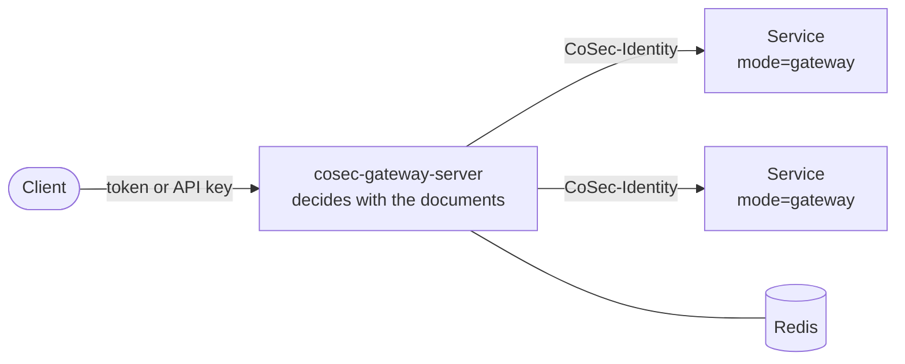

# Deploying the Gateway Server

For operators who run `cosec-gateway-server`, the ready-made Spring Cloud Gateway with CoSec in front, from its
Docker image or on Kubernetes, or who build a similar image of their own. This page covers what the image contains,
what it forwards to the services behind it, what it needs before it can answer a request, readiness and shutdown, the
Kubernetes manifests in the repository, how CI checks the image, and the JDK 25 AOT cache it ships with. Every property named here is in [Configuration](./configuration.md).

## The image

CI builds the image from [`platform/gateway-server/Dockerfile`](https://github.com/Ahoo-Wang/CoSec/blob/main/platform/gateway-server/Dockerfile)
on every push to `main`, `7.x` and the release branches, for each version tag, nightly, and for a pull
request that changes the image, and publishes it as `ahoowang/cosec-gateway`, `ghcr.io/ahoo-wang/cosec-gateway` and
`registry.cn-shanghai.aliyuncs.com/ahoo/cosec-gateway`, for `linux/amd64` and `linux/arm64`. The gateway server is an
application: it is published only as an image, never as a library.

**Tags.** A branch push is tagged with the branch name (`main`, `7.x`; a `/` in the name becomes `-`), a pull request
with `pr-<number>`, and the nightly build refreshes `main`: these tags move with every build, so never run one in
production. A version tag `v8.0.0-beta.4` publishes `8.0.0-beta.4`, which names one release. A pre-release has no
other tag; a stable release also moves `<major>.<minor>` (`8.0`) to its newest patch version. Pin
the exact version, or the digest of the image you tested (`ahoowang/cosec-gateway@sha256:...`): a floating tag can change
under a deployment between two restarts. The manifests in [`k8s/`](#kubernetes) pin a version in
`k8s/base/kustomization.yaml`.

- **JDK.** The CoSec libraries target Java 21, which is what an application on them needs. The image is an
  application of its own and runs on JDK 25, Alibaba Dragonwell 25 (`dragonwell:25-ubuntu`), with a JDK 25
  [AOT cache](#aot-cache): its runtime is 25, not 21.
- **Required settings.** `COSEC_JWT_SECRET` (there is no default, see
  [Authentication](../integration/authentication.md)) and the Redis address, for example `SPRING_DATA_REDIS_URL`.
- **Layout.** The application lives in `/opt/cosec-gateway-server` and runs as the unprivileged `appuser`. The
  image's defaults are in the jar; your configuration is `config/application.yaml` (mount it there), which is read in
  addition and wins key by key, so a file that sets your routes keeps every default below. A list, such as `routes`, is
  replaced whole. The JVM options are in `bin/cosec-gateway-server` (ZGC, a 2 GiB heap). Add options through
  `JAVA_OPTS`, which follows them and so overrides them ([Memory](#memory)). The image starts no JMX agent; to attach
  one, set it in `JAVA_OPTS`, bound to the loopback interface:
  `-Dcom.sun.management.jmxremote -Dcom.sun.management.jmxremote.port=5555 -Dcom.sun.management.jmxremote.host=127.0.0.1
  -Djava.rmi.server.hostname=127.0.0.1 -Dcom.sun.management.jmxremote.authenticate=false
  -Dcom.sun.management.jmxremote.ssl=false`, and reach it with `kubectl port-forward` or `docker exec`; `jcmd` needs
  none.
- **What is in it.** The gateway filter, the Redis snapshot store (`cosec-cocache`), tracing, the Kafka module,
  ip2region, and metrics: `cosec-micrometer` and a Prometheus registry, so `cosec.authorization`, `cosec.snapshot.*` and
  the others of [Observability](./observability.md#metrics) exist and are scraped from `/actuator/prometheus` on the
  management port (see below). Its defaults, in the jar
  ([`application.yaml`](https://github.com/Ahoo-Wang/CoSec/blob/main/platform/gateway-server/src/main/resources/application.yaml)),
  turn Kafka audit (`cosec.audit.kafka.enabled: false`), login (`cosec.authentication.login.enabled: false`) and
  ip2region (`cosec.ip2region.enabled: false`, as the [Kubernetes](#kubernetes) base does) off: a document that reads
  `ext.ip2region.*` needs `COSEC_IP2REGION_ENABLED=true`. It has no control plane: documents are published by
  `cosec-migrate` or by a control-plane application on the same Redis. It cannot use [API keys](../integration/authentication.md)
  as shipped: `cosec.api-key.enabled=true` fails startup for want of a `MembershipProvider` bean, and the image has none.
  An image derived from it, with a `MembershipProvider` bean (cosec-cocache's, over a `MembershipLoader` of yours, or
  your own), can.
- **Ports.** The gateway listens on **8080**, with its probes `/livez` and `/readyz`: the groups of Spring Boot's
  liveness and readiness, served on the gateway's own port so that a probe proves the listener clients use. They are not
  gateway routes, so CoSec does not decide them, and they answer before any document is published (liveness `200`,
  readiness `503`). The actuator is on the **management port 8081**, never on the gateway's:
  `/actuator/health` (and `/actuator/health/liveness`, `/readiness`) and the scrape endpoint `/actuator/prometheus`.
  CoSec authorizes the gateway's routes, not the actuator: keep 8081 inside the cluster or the host, and publish it to a
  monitoring network only (`-p 8080:8080` publishes the gateway alone). A probe on 8081 proves the actuator's server
  answers, not that the listener on 8080 does: probe `/livez` on 8080.
- **Metrics.** `/actuator/prometheus` on 8081 carries CoSec's meters, Spring Cloud Gateway's, the JVM's and CoCache's. The
  CoSec ones have bounded tags only (decision `result`, `source`, `problem`, `cause`; snapshot `kind`, `state`,
  `result`; listener names); no tenant, principal, path or token is a tag. The `disk_*` meters carry the working
  directory's path.
- **Docker health check.** The image's `HEALTHCHECK` probes `/livez` on 8080 every 30 seconds: up once the
  application runs, whatever Redis holds. It never probes `/actuator/health`, which is `DOWN` until the platform
  document is installed ([Readiness](#readiness)).

```bash
docker run -d -p 8080:8080 \
  -e SPRING_DATA_REDIS_URL=redis://redis:6379 \
  -e COSEC_JWT_SECRET=... \
  ahoowang/cosec-gateway
```

## What the gateway authorizes

CoSec runs as a Spring Cloud Gateway global filter, which runs on the gateway's routes only. So every routed request
is authorized, in the `http` namespace (the gateway loads no route map), and the gateway's own actuator endpoints,
health probes included, are not: the gateway does not start with an actuator endpoint other than `health` on its
application port ([Actuator on a gateway](../integration/web.md#actuator-on-a-gateway)). Routes are ordinary Spring
Cloud Gateway configuration under `spring.cloud.gateway.server.webflux.routes`. How a request becomes an action and a
resource, and how outcomes become responses, is in [Web integration](../integration/web.md).

What a routed request carries to its backend:

- **`CoSec-Identity`**, on a permit for an authenticated principal, on a route that receives it: a route to a
  registered service (`lb://`), or one whose metadata says `cosec-identity: true`. It holds the identity the gateway
  verified and the scope it decided in. The gateway removes any `CoSec-Identity` a client sent from every request,
  before any other filter and again on the routed request, whatever `cosec.pipeline.mode` or `cosec.enabled` say. An
  anonymous permit, a route to any other URI without the metadata, and a route whose metadata says
  `cosec-identity: false` carry none. Turn forwarding off with `cosec.gateway.identity.enabled=false`; the other
  `cosec.gateway.identity.*` properties are in [Configuration](./configuration.md).
- **No credentials**: no `Authorization` header, no API key header, no `authorization` query parameter and no
  `authorization` cookie, unless `cosec.gateway.identity.forward-authorization=true`, and then only on a route that
  would receive the identity. Turn it on only for a backend that verifies the token again or calls other APIs with the
  user's token. Other cookies are forwarded as they came.
- **`CoSec-Request-Id`**, the gateway's own request id.

A credential that never expires (an API key without `expires-at`) is not forwarded: on a route that receives the
identity, such a request answers `500`, and
the gateway logs `Request [<requestId>]: the identity cannot be forwarded.`

## Services behind the gateway

A service behind the gateway can decide for itself (the default, `cosec.pipeline.mode=enforce`, with its own
documents and keys), or trust the gateway's decision with `cosec.pipeline.mode=gateway`. In gateway mode the service
reads the caller from `CoSec-Identity` and nothing else: it has no keys, no documents, no Redis, no route map and no
decision listeners. How a service is set up for it is in
[Services behind the gateway](../integration/web.md#services-behind-the-gateway).
[`k8s/examples/gateway-mode-service-networkpolicy.yaml`](https://github.com/Ahoo-Wang/CoSec/blob/main/k8s/examples/gateway-mode-service-networkpolicy.yaml)
is a `NetworkPolicy` for such a service that admits its port from the gateway's pods only.

The same trust is also available to a host that decides with policies:
[`cosec.pipeline.caller=forwarded-identity`](./configuration.md#pipeline) makes the `CoSec-Identity` header the caller of
a host in `enforce` mode, with the snapshot and the control plane wired. That is how a control-plane host, or an IAM
service that embeds the control plane, runs: it verifies no credential, so it states what can reach it, with the same
statement (`only-gateway-can-reach`, or `only-trusted-callers-can-reach` when services call it directly), and the host
does not start without it. A hidden-method filter is refused there too. On such a host the web adapter does not decide a request, as in `gateway` mode: the gateway decided what came through it, and for a call that did not come through the gateway only the control plane's own authorization of each operation, as the principal the caller states, decides. A route of the application's own on such a host (the IAM service of the embedded deployment) is authorized at the gateway or not at all.



**Only the gateway may reach a service in gateway mode.** The service believes any `CoSec-Identity` it receives, so
anyone else who can send it a request can be whoever they claim. Enforce it in the network: a Kubernetes
`NetworkPolicy` that admits only the gateway's pods, a private network, or mutual TLS between the gateway and the
services. Each such service starts only when you state that it is so (`STA-7`):

```yaml
cosec:
  pipeline:
    mode: gateway
    identity:
      only-gateway-can-reach: true   # or COSEC_PIPELINE_IDENTITY_ONLY_GATEWAY_CAN_REACH=true
```

There is no default. Without the line, with `false`, or with any value but `true`, the service fails to start and the
message says what the mode trusts, what must be true of the network and the line to add
([Startup fails because the network boundary is not stated](./troubleshooting.md#startup-fails-because-the-network-boundary-is-not-stated)).
With it, the startup logs one `INFO` line saying that the operator has stated it. The statement signs nothing: it is
yours to keep true. Signing the header is planned for 8.1.

**No hidden-method filter behind a gateway** (`STA-6`). The gateway decides the method of the request line, and it
removes `X-HTTP-Method-Override`, `X-HTTP-Method` and `X-Method-Override`, in any letter case, from every request it
forwards, on every route (`PIP-31`, not configurable). A hidden-method filter in the service would still run a `POST`
as the method a form field `_method` names, which the gateway cannot remove from a body, so a `DENY` on `http:DELETE`
would be stepped around. A service in gateway mode fails to start when `spring.mvc.hiddenmethod.filter.enabled` or
`spring.webflux.hiddenmethod.filter.enabled` is `true` (both are off by default) or the application declares a
`HiddenHttpMethodFilter` bean, registered on its own or through a `FilterRegistrationBean`. A host that decides itself
(`enforce`) is not affected: CoSec's filter runs after the hidden-method filter there.

**Backends that are not CoSec services.** A gateway also fronts backends CoSec knows nothing of. The gateway forwards the
method it decided and removes the three override headers, but it cannot remove a form field or a query parameter: a
backend that picks its method from the body or the query (a `_method` field, as Rails and Laravel read it) must have that
turned off, or a `DENY` on `http:DELETE` is stepped around. CoSec refuses to start only where it can see the filter, in a
service that runs the starter in gateway mode.

Startup fails when `cosec.pipeline.mode` is neither `enforce` nor `gateway`, and when it is `gateway` on a Spring Cloud
Gateway host: the gateway itself always decides with the documents. Why the boundary matters, and what a captured
header allows, is in [Trust boundaries](../guide/security-model.md#trust-boundaries).

## Before the first request

The gateway starts without any document, but answers every routed request `503` until a platform document is
published ([The first documents](./storage.md#the-first-documents)), and reports itself not ready meanwhile
([Readiness](#readiness)). For each environment:

1. **Redis with `maxmemory-policy noeviction`, persistence, a replica and a backup.** Redis is the only copy of the
   documents and the revocations: without persistence a restart leaves every request `503` and revoked tokens valid
   again ([Redis requirements](./storage.md#redis-requirements)). With `noeviction`: Each instance checks it at startup with `INFO memory` and does not
   start otherwise. On a Redis that denies `INFO`, set
   `noeviction` yourself and `COSEC_AUTHORIZATION_SNAPSHOT_EVICTION_CHECK=warn`.
2. **The documents.** Publish them with `cosec-migrate publish --to-redis <uri> --in <dir>`, then name the first
   administrator with `cosec-migrate bootstrap` if a control plane will manage them. The gateway, the control plane and
   `cosec-migrate` must use the same Redis and the same `cosec.key-prefix` (`--key-prefix`).
3. **Instance ids, if you lock Redis down per instance.** The gateway takes part in shadow windows by default, with a
   random instance id. To give each pod its own Redis user, set `COSEC_AUTHORIZATION_SHADOW_INSTANCE_ID` per pod
   ([Who may write which keys](./storage.md#who-may-write-which-keys)).
4. **The same attribute providers everywhere.** Every gateway instance, every other data-plane instance and the
   control plane's host must register the same `AttributeProvider`s, declaring the same `ext.*` attributes with the
   same types. A document compiles against the platform's declarations and the host's providers, so a change the
   control host accepts can fail to compile on an instance without the provider: in a shadow window that instance
   reports `CANDIDATE_ERROR` and the window never closes clean, so the change is not published; published without a
   window, that instance answers `503` for every request that needs the document, unless a DENY matches.

## Readiness

**What to prewarm.** The platform document is always loaded before an instance is ready. List an app in `prewarm-apps`,
or a tenant in `prewarm-tenants`, when the first request for it after a start must not wait: the apps and tenants that
carry the traffic, and any whose document is large enough that loading and compiling it takes longer than
[`cold-load-timeout`](./configuration.md#snapshot) (2 seconds), since a request that waits longer is `503`. Every listed
document delays readiness, and one that cannot be loaded or compiled keeps the instance unready
([Instance is not ready](./troubleshooting.md#instance-is-not-ready)), so list the documents you would not serve
without, not every tenant. Keep `cold-load-timeout` below [`cosec.pipeline.timeout`](./configuration.md#pipeline)
(5 seconds), with room left for the rest of the pipeline: a request that has waited the whole pipeline timeout is
`503` with the cause `deadline`, whatever the load's own bound is.

An instance is ready only once it has installed the platform document and every document named in
[`prewarm-apps` and `prewarm-tenants`](./configuration.md#snapshot) (empty lists mean the platform document only).
Until then it would answer every routed request `503`, so the starter turns Spring Boot's readiness state to
`REFUSING_TRAFFIC`, and back to `ACCEPTING_TRAFFIC` once the documents are installed. A load balancer that follows
`/actuator/health/readiness` sends it no traffic meanwhile, provided it can reach that path: to CoSec it is a request like
any other, so on the application port of an application it needs a statement that permits it
([Actuator on an application](../integration/web.md#actuator-on-an-application)). Liveness is not touched by the missing
document: the liveness state stays `CORRECT`, which is not a reason to restart the instance. An HTTP liveness probe is
another matter: on the application port of an application it answers `503` until the first document is published, and so
does a WebFlux application's management port, so the kubelet would restart the pod before it can be ready. Point a WebMvc
application's liveness probe at its management port (outside CoSec), and give a WebFlux application a `tcpSocket` probe on
the application port.

With Spring Boot Actuator, the `cosecSnapshot` health indicator reports `UP` once the same documents are installed,
`DOWN` before, with the details `platform` (`installed`, `invalid`, `failed`, `absent` or `loading`), `prewarmed` and
`missing` (the documents not installed yet), and, when stored documents do not compile here, `invalid` (how many) and
`invalidFirst` (the first ten, by key and revision). To see those
details on the readiness endpoint, add it to the readiness group:

```yaml
management:
  endpoint:
    health:
      group:
        readiness:
          include: readinessState,cosecSnapshot
```

`cosecSnapshot` is also part of `/actuator/health`, which therefore reports `DOWN` until the platform document is
published. On Redis, `cosecSnapshotEviction` beside it is `DOWN` while Redis may evict the snapshot: an alert for your
monitoring, which does not belong in the readiness group, since a change to Redis's policy would then take every
instance out of rotation at once ([Observability](./observability.md)). Since it also turns the aggregate
`/actuator/health` `DOWN`, a load balancer or platform health check should poll the readiness group, or a group that
excludes it (`management.endpoint.health.group.<group>.exclude=cosecSnapshotEviction`), never `/actuator/health`.

## Shutdown

On shutdown, the decision listeners stop taking events and deliver what is queued to the `BEST_EFFORT` listeners (the
audit log, Kafka, metrics) for up to
[`cosec.observability.listener.drain-timeout`](./observability.md#decision-listeners) (5 seconds), then drop the
rest. The Kafka audit listener then gets up to the same timeout for the sends it still holds. Keep the pod's termination
grace period long enough for Spring's own graceful shutdown plus twice that timeout.

## Kubernetes

[`k8s/`](https://github.com/Ahoo-Wang/CoSec/tree/main/k8s) holds [Kustomize](https://kustomize.io/) manifests: a base
and an overlay for each kind of cluster. Deploy an overlay, never the base on its own.

| Directory | For | Contents |
|---|---|---|
| `base/` | the overlays to build on | The Deployment and a Service (port 80 to the container's 8080; the management port 8081 is a container port the Service does not publish). `application.yaml` (the routes and the `cosec.*` settings above) becomes a ConfigMap mounted as `/opt/cosec-gateway-server/config/application.yaml`, read in addition to the image's defaults; its CORS origin, discovery list and route are a demo to replace; its name carries a hash of the file, so a change to it rolls the pods. The image is `ghcr.io/ahoo-wang/cosec-gateway`, with its tag set under `images:`. One gateway gets 768Mi and a 256 MiB heap. |
| `overlays/dev/` | trying CoSec out on any cluster, kind and minikube included | The namespace `cosec-dev`, one gateway with the base's resources, and a single Redis 7.4 with `maxmemory-policy noeviction` and no password. Redis keeps its data in an `emptyDir`, which outlives a container restart but not the pod: deleting the Redis pod deletes the documents. |
| `overlays/production/` | a starting point for your own overlay | The namespace `cosec`; your Redis, from the ConfigMap `cosec-gateway-redis` (host and port; or `SPRING_DATA_REDIS_CLUSTER_NODES` for a cluster) and the Secret `cosec-redis-secret` (`password`, and `username` for an ACL user); 2 to 10 gateways behind a HorizontalPodAutoscaler on CPU (70 % of the 1 CPU each requests; it needs the metrics server); a PodDisruptionBudget that evicts one gateway at a time and always lets an unready one go, so a drain never waits for a platform document; a NetworkPolicy that admits port 8080 from anywhere and the management port from the `monitoring` namespace only; 3200Mi and a 2 GiB heap per gateway, spread across nodes. |

### Deploying

1. **Create the namespace and the JWT secret.** The repository holds no secret, and the gateway does not start
   without this one (`COSEC_JWT_SECRET`, see [Authentication](../integration/authentication.md)):

   ```bash
   kubectl create namespace cosec-dev
   kubectl -n cosec-dev create secret generic cosec-jwt-secret --from-literal=secret="$(openssl rand -base64 48)"
   ```

   For the production overlay, use the namespace `cosec`, and also create the Redis credentials:
   `kubectl -n cosec create secret generic cosec-redis-secret --from-literal=password=<password>`.
2. **Production: point it at your Redis.** Set the address in the `cosec-gateway-redis` ConfigMap of the overlay's
   `kustomization.yaml`. Redis must run with `maxmemory-policy noeviction`
   ([Redis requirements](./storage.md#redis-requirements)). Keep your routes, namespace and image tag in an overlay of
   your own on top of this one: replace the configuration with
   `configMapGenerator: [{name: cosec-gateway-config, behavior: replace, files: [application.yaml]}]` and set the tag
   under `images:`.
3. **Apply the overlay:**

   ```bash
   kubectl apply -k k8s/overlays/dev
   ```

4. **Publish the platform document.** Until it is installed, every gateway runs but reports itself not ready and stays
   out of the Service ([Readiness](#readiness)), and `kubectl rollout status` waits. That is by design: it would answer
   every routed request `503`. With the dev overlay, reach its Redis with
   `kubectl -n cosec-dev port-forward svc/redis 6379` and publish with
   `cosec-migrate publish --to-redis redis://localhost:6379 --in <dir>` ([The first documents](./storage.md#the-first-documents)).
5. **Try a request** through `kubectl -n cosec-dev port-forward svc/cosec-gateway 8080:80`.

### What the manifests set

- **No service links** (`enableServiceLinks: false`). Kubernetes would otherwise put variables such as
  `COSEC_GATEWAY_SERVICE_HOST` and `COSEC_GATEWAY_PORT_80_TCP_ADDR`, derived from the Service `cosec-gateway`, into the
  gateway's environment. Spring reads them as `cosec.gateway.*` properties; the check for `cosec.*` keys CoSec does not read skips exactly
  these variables ([Unknown properties](./configuration.md#unknown-properties)). The gateway finds services by DNS, so nothing needs
  them in its environment.
- **Pod security.** The gateway runs as the image's `appuser` (uid 999; the image names its user rather than its uid,
  so the manifests give the uid for `runAsNonRoot` to check), with a read-only root filesystem, no privilege
  escalation, every capability dropped, the runtime's default seccomp profile, and no service account token: it never
  calls the Kubernetes API. Both overlays meet the `restricted` Pod Security Standard. It writes only to three
  `emptyDir` volumes: `logs/` (the GC log), `data/` (a heap dump on `OutOfMemoryError`) and `/tmp` (Netty's native
  transport, the JVM's performance data). The AOT cache is only read.
- **Probes.** The startup and liveness probes read `/livez`, the readiness probe `/readyz`, on the container's `http`
  port: the groups that `application.yaml` enables (`management.endpoint.health.probes.enabled`) and serves on the
  gateway's port (`add-additional-paths`). So a pod starts while Redis holds no platform document, and stays out of the
  Service until it is installed. Don't point a probe at `/actuator/health`: it stays DOWN until then, and a startup
  probe on it restarts the pod.
- **Actuator.** On the management port (`management.server.port: 8081`, the container port `management`, which the Service
  does not publish), `health` and `prometheus` are exposed, and the `gateway` endpoint, which reads and changes routes, is
  off (`management.endpoint.gateway.access: none`). CoSec authorizes the gateway's routes, not its actuator endpoints:
  the production NetworkPolicy admits the management port only from the `monitoring` namespace (change it to your
  Prometheus's), and the dev overlay has no policy.
- **Shutdown.** A `preStop` pause of 5 seconds lets the Service drop the pod first; `terminationGracePeriodSeconds: 45`
  covers it, Spring's graceful shutdown (30 seconds at most) and the decision listeners' drain ([Shutdown](#shutdown)).
- **JVM options**, through `JAVA_OPTS`: the memory sizes below, `-XX:+ExitOnOutOfMemoryError` so that a JVM that ran
  out of memory is restarted, `-Djava.net.preferIPv4Stack=true` (for
  [netty#16082](https://github.com/netty/netty/issues/16082)). The image starts no JMX agent.

### Memory

A gateway's memory is its heap, its direct memory, and the JVM's own native memory. The base and the production
overlay size them for their limits:

| | `dev` (base) | `production` |
|---|---|---|
| Memory request and limit | 768Mi | 3200Mi |
| Heap (`-Xms` = `-Xmx`) | 256 MiB | 2 GiB |
| Direct memory, Netty's buffers (`-XX:MaxDirectMemorySize`) | up to 64 MiB | up to 256 MiB |
| Native: the AOT cache's class data (about 105 MiB), JIT code, metaspace, GC structures, threads | about 220 MiB | about 250 MiB |
| Left for the page cache and peaks | about 230 MiB | about 650 MiB |
| CPU request and limit | 250m, 1 | 1, 2 |

- **ZGC commits the whole heap at startup**, as shared memory the container is charged for at once. A limit too small
  for the heap fails the pod within seconds, not after hours of traffic.
- **The heap needs free space.** ZGC collects while the gateway allocates; a heap that is mostly live data makes
  request threads wait for it. The compiled documents live on the heap: size it for your documents and traffic, then
  set the limit to the heap, plus the direct memory, plus about 250 MiB, plus a quarter.
- **The image's own defaults do not fit a small cluster.** Its start script sets `-Xms2048M -Xmx2048M
  -XX:MaxMetaspaceSize=256M -XX:MaxDirectMemorySize=512M -Xss1m -XX:+UseZGC`, about 2.8 GiB with the native part, and
  writes the GC log to `logs/` and a heap dump on `OutOfMemoryError` to `data/`. The direct memory is a ceiling, not a
  reservation: Netty's pooled buffers, for the HTTP server and the Redis client, take it as traffic needs it, so what
  the gateway uses depends on its load and the CPU count. To see it, read the `jvm_buffer_memory_used_bytes{id="direct"}` meter on `/actuator/prometheus`, or `jcmd <pid>
  VM.native_memory` in the pod. `JAVA_OPTS` comes after the defaults on the command line,
  so its sizes win; `JAVA_TOOL_OPTIONS` cannot change them, because the JVM reads it first. The fixed `-Xmx` also
  overrides `-XX:MaxRAMPercentage`, so give explicit sizes. The base sets them in `JVM_MEMORY_OPTS`, and the production
  overlay replaces it; change it together with the memory request and limit.
- **CPU.** The JVM sizes its GC, JIT and Netty threads from the CPU limit, and the autoscaler measures against the
  request.

**How many documents fit.** The compiled documents live on the heap, and CoSec holds at most `max-apps` app documents
(1,024), `max-tenants` tenant documents (16,384) and, apart from them, the ids it knows have no document
(`max-absent-apps` 256, `max-absent-tenants` 65,536), plus the platform document, which is never dropped
([How instances read documents](./storage.md#how-instances-read-documents)). For a moment, during a burst of cold loads,
a family may hold up to twice its bound. What one document costs depends on its policies, statements and bindings;
[Sizing a SaaS gateway](#sizing-a-saas-gateway) gives measured figures and the heap they lead to. To measure your own
documents, start an instance with the platform document and one tenant, request a path that needs each tenant's
document in turn, and read `jvm_memory_used_bytes{area="heap"}` after a full collection, or `jcmd <pid> GC.heap_info`, at
a few counts. If the heap is too small, see [A pod runs out of memory](./troubleshooting.md#a-pod-runs-out-of-memory).

The native part was measured in the image (an 8.0 preview build, `linux/arm64`, Docker with these limits and a read-only
root filesystem), after about 45,000 requests to a route and to the health endpoint with no platform document
published, so that each answered `503`: the container held 471 MiB (dev) and 1,277 MiB (production), and nothing was
killed for memory.

## Sizing a SaaS gateway {#sizing-a-saas-gateway}

When the gateway decides for every service of a multi-tenant platform, its replicas are the only instances that hold
documents: the services behind them run in gateway mode and hold none ([Services behind the gateway](#services-behind-the-gateway)).
Each replica holds an entry for every tenant it serves, whether the tenant has a tenant document or not, and confirms
each one against Redis every `revalidate-interval`. The figures below are for 10,000 and 50,000 tenants, 12 apps of
12 system roles over a catalog of 100 permissions, and a tenant document, where a tenant has one, of 5 custom roles of
20 permissions and 20 role bindings. They were measured with the production compiler on one JVM, with an in-memory
store standing in for Redis.

### What a replica holds {#what-a-replica-holds}

| Entry | Heap it retains |
|---|---|
| A tenant document of that shape (3.5 KB of JSON) | about 30 KB |
| A tenant without a tenant document | about 470 bytes |
| An app document of that shape (14 KB of JSON) | about 235 KB, so 2.8 MB for the 12 |
| What a dropped document leaves behind (its last revision, to detect a regression) | about 130 bytes |
| A token's "not revoked" answer, kept 30 seconds | about 290 bytes |
| A principal's "not revoked" answer, kept 30 seconds | about 230 bytes |

With the defaults full (16,384 tenant documents and 65,536 tenants without one), the tenant entries take about 520 MB.
The revocation copies hold only the tokens and principals a replica saw in the last 30 seconds, at most
`cosec.authentication.revocation.cache.maximum-size` (500,000) of each, about 260 MB when both are full. Size the heap at
twice what these hold, plus 256 MiB for the rest of the gateway, so that ZGC has room to collect; then set the memory
limit to the heap, plus the direct memory, plus about 250 MiB, plus a quarter ([Memory](#memory)). The production
overlay follows that rule with every default at its bound: tenant documents (about 490 MB), tenants without one
(about 30 MB) and both revocation copies (about 260 MB) are about 780 MB live, so a 2 GiB heap and a 3200Mi limit. A
replica that cannot reach those bounds needs less: the settings below size the heap from what it holds.

A request of a tenant whose entry is held reads nothing from Redis. A tenant beyond the bounds is read again on its
next request: a tenant document from Redis and compiled again (about 55 µs of CPU), a tenant without one from Redis
alone. With requests spread evenly over the tenants, a replica whose bounds are smaller than its tenants reads Redis on
about 1 − bound ÷ tenants of them: over 50,000 tenants that all have a document, `max-tenants` at 16,384 reads on 670
of every 1,000 requests.

### How long a revalidation pass takes {#how-long-a-revalidation-pass-takes}

A pass confirms every entry held, `reload-concurrency` (16) at a time:

- **Its length** is about entries × one conditional read ÷ `reload-concurrency`. For 81,920 entries (the defaults full)
  that is 1.5 s at 0.3 ms a read and 5.1 s at 1 ms.
- **Lag** stays below `revalidate-interval` plus one pass, or below two passes once a pass outlasts the interval: then
  the passes run back to back ([How instances read documents](./storage.md#how-instances-read-documents)).
- **Reads per replica** are entries ÷ `revalidate-interval`, or entries ÷ pass when the pass is longer.

Each conditional read costs Redis 7 to 13 µs of its main thread, whatever the document's size
([What revalidation costs Redis](./storage.md#what-revalidation-costs-redis)). For a fleet of replicas that each hold
every tenant:

| Entries per replica | `revalidate-interval` | 5 replicas | 10 replicas | 20 replicas | 50 replicas |
|---|---|---|---|---|---|
| 10,000 | 10 s | 5,000 reads/s, 4–7 % of a Redis node | 10,000/s, 7–13 % | 20,000/s, 14–26 % | 50,000/s, 35–65 % |
| 50,000 | 10 s | 25,000/s, 18–33 % | 50,000/s, 35–65 % | 100,000/s, 70–130 % | 250,000/s, 175–325 % |
| 50,000 | 30 s | 8,300/s, 6–11 % | 16,700/s, 12–22 % | 33,000/s, 23–43 % | 83,000/s, 58–108 % |

**When to raise `revalidate-interval`.** Raise it when replicas × entries ÷ interval × 10 µs comes near half of a
Redis node: the cost falls in proportion, and the time a replica can miss a change whose invalidation message was lost
grows the same way. Keep `lag-warn` above it. A Redis Cluster divides the figures by its number of primaries.

### Settings to copy {#settings-to-copy}

| Tenants | Tenants with a tenant document | Active tokens in 30 s | `max-tenants` | `max-absent-tenants` | `revalidate-interval` | Tenant entries + revocation copies on the heap | `-Xms` = `-Xmx` | Memory limit |
|---|---|---|---|---|---|---|---|---|
| 10,000 | 10 % | up to 150,000 | default (16,384) | default (65,536) | `10s` | 34 + 80 MB | `1536m` | `2560Mi` |
| 10,000 | 100 % | up to 150,000 | default | default | `10s` | 300 + 80 MB | `1536m` | `2560Mi` |
| 50,000 | 10 % | up to 500,000 | default | default | `10s` | 170 + 260 MB | `1536m` | `2560Mi` |
| 50,000 | 100 % | up to 500,000 | `60000` | default | `30s` | 1.49 GB + 260 MB | `4g` | `6Gi` |

For 50,000 tenants that all have a tenant document:

```yaml
cosec:
  authorization:
    snapshot:
      max-tenants: 60000
      revalidate-interval: 30s
```

with `JVM_MEMORY_OPTS` set to `-Xms4g -Xmx4g -XX:MaxDirectMemorySize=256m -XX:MaxMetaspaceSize=256m` and the memory
request and limit to `6Gi`. Your own documents may be larger or smaller: measure them as [Memory](#memory) says, and
scale the heap with them.

### What a new replica costs {#what-a-new-replica-costs}

A replica that starts, or that the autoscaler adds, holds the platform document, the apps its routes name
([`prewarm-host-apps`](./configuration.md#snapshot)), and the documents of `prewarm-apps` and `prewarm-tenants`;
readiness waits for those. It is warm for apps and cold for tenants. Each other tenant's first request on it waits for
one read from Redis, and for a tenant document also its compilation, about 0.6 ms in all with a Redis that answers in
0.3 ms, and at most `cold-load-timeout` (2 s). With requests spread evenly, a new replica serving 10,000 tenants reads
Redis on most requests until it has seen each tenant once. List the busiest tenants in `prewarm-tenants` to take them
off that path.

Requests are not spread evenly in a replica's first moment: almost every one is for a tenant it has not seen, so the
distinct cold documents arrive at the request rate, faster than its two compile threads take them. A document the full
compile queue (64) refuses waits and compiles again every few milliseconds, until `cold-load-timeout`; only then is
its request `503`. Measured (`ColdBurstBenchmark`, a CI runner of 4 vCPUs, tenant documents of 30 policies and 60
bindings, default options), for a burst of distinct cold tenants requested at once:

| Burst | Served, all of them, within | Refused before this change (failed at once) |
|---|---|---|
| 100 | 13 ms | 26 of 100 |
| 500 | 67 ms | 403 of 500 |
| 2,000 | 620 ms | 1,794 of 2,000 |

That is about 3,000 cold tenant documents a second: a burst beyond about `cold-load-timeout` times that (some 6,000
distinct tenants in the same instant) is refused at the deadline, never later and never with a permit, and each
refused tenant is loaded by its next request. Larger documents compile more slowly and lower the rate.

The compile threads are what bounds that rate, not the queue in front of them. With two threads on four shared vCPUs a
replica takes about 3,500 cold documents a second, and `compile-threads` is what raises it on a host with the cores to
spare. A deeper queue (`compileQueueCapacity`, 64) matters only for a burst beyond what the pool compiles within
`cold-load-timeout`, and each queued compile holds its document, about 15 KB for these tenant documents. Measured with
the same benchmark:

| Compile queue | Memory a full queue holds | Burst of 2,000 | Burst of 10,000: served / refused at the deadline |
|---|---|---|---|
| 64 (default) | about 0.9 MB | 571 ms, all served | 5,517 / 4,483 |
| 1,024 | about 15 MB | 525 ms, all served | 5,499 / 4,501 |
| 16,384 | about 240 MB | 487 ms, all served | 8,361 / 1,639 |

### Memberships at the gateway {#memberships-at-the-gateway}

The image has no `MembershipProvider`, so a member's roles come from the access token's `roles` claim: `roleId` for the
default space, `roleId@space` for another ([Roles and spaces](../integration/authentication.md#roles-and-spaces)). Role
ids are not qualified by app in the token, so give each app's roles ids of their own (`wms.clerk`): a role id two apps
define grants in both.

| Roles a member holds | Ids | The `roles` claim | The whole access token (HS256) |
|---|---|---|---|
| One in each of 12 apps, default space | short (`app07.role03`) | 181 bytes | 572 bytes |
| One in each of 12 apps, in 5 spaces (60) | short (`app07.role03@space-0001`) | 1.6 KB | 2.4 KB |
| One in each of 12 apps, in 5 spaces (60) | about 25 characters each side | 3.3 KB | 4.7 KB |

The token travels in `Authorization` on every request, and Reactor Netty refuses a request whose headers together
exceed `server.max-http-request-header-size` (8 KB by default): about 100 long `role@space` entries reach it. The
`CoSec-Identity` header the gateway forwards carries only the roles of the request's space.

No per-request cost depends on how many members a tenant has. The gateway verifies the token, parses the roles it
carries and looks up two revocations, of the token and of its principal, keyed by the caller; the tenant's document
does not list its members. The revocation lookups keep a local copy of each "not revoked" answer for 30 seconds,
at most `cosec.authentication.revocation.cache.maximum-size` (500,000) entries per table and replica, about 300 bytes
each: a replica that sees more distinct tokens than that within 30 seconds reads Redis on the request path for the
rest ([Configuration](./configuration.md#local-cache-settings)).

How long a role removed from a member keeps working:

- **With a `MembershipRefresh` on the service that refreshes tokens:** until the member's current access token
  expires, at most `cosec.jwt.token-validity.access` (10 minutes).
- **With `cosec.jwt.session.memberships-on-refresh: from-token`** (the choice a host serving the refresh route states
  when it has no `MembershipRefresh`, `STA-8`): a refresh copies the old claims, so until the member next signs in: at
  most `cosec.jwt.session.lifetime` (30 days), as long as the member refreshes within `cosec.jwt.token-validity.refresh`
  (7 days) ([How long a removed role lives](../integration/authentication.md#how-long-a-removed-role-lives)).
- **At once:** `TokenRevoker.revokeSubject(tenant, principal)` refuses every token of the member issued before it, on
  every replica; allow up to 30 seconds more on a replica that lost the invalidation message, and
  `cosec.authentication.revocation.skew` (5 seconds) for a token issued just after
  ([Revoking every token of a principal](../integration/authentication.md#revoking-every-token-of-a-principal)).

## How CI checks the image

After the image is pushed, the `aot-smoke` job of
[`docker-deploy.yml`](https://github.com/Ahoo-Wang/CoSec/blob/main/.github/workflows/docker-deploy.yml) runs
[`aot-smoke.sh`](https://github.com/Ahoo-Wang/CoSec/blob/main/platform/gateway-server/aot-smoke.sh) against a Redis 7
service container. It publishes a platform document with `cosec-migrate publish`, starts the image with
`-XX:AOTMode=on` (a cache that cannot be mapped fails the job), adds a `/smoke/**` route to the gateway's own health
endpoint, and checks that the health probe answers `200`, an anonymous request `401` with
`application/problem+json`, a request with a valid HS256 token `200`, and a request a DENY matches `403` with
`application/problem+json`. It also runs the image's own `HEALTHCHECK`, every 2 seconds instead of 30, and requires
that it probes the liveness group and that Docker reports the container healthy. The same steps are a quick check of
your own deployment.

## The system test {#the-system-test}

[`system-test.yml`](https://github.com/Ahoo-Wang/CoSec/blob/main/.github/workflows/system-test.yml) runs CoSec as a
deployment, which no unit, slice or embedded-server test does: the gateway image built from the commit (its own
Dockerfile, the AOT cache trained), two replicas of it and a third that refuses a token while revocations cannot be read,
a service behind them in `cosec.pipeline.mode=gateway`, a login and control-plane host, a Spring MVC service that
enforces on its own, and a Redis with `maxmemory-policy noeviction`, started with Docker Compose on a GitHub-hosted runner.
The scenarios drive it over the network only, with `cosec-migrate` and `docker compose stop`, `start` and `restart` as the
operator would. It is not part of `check`; it runs nightly on `main`, on the pull requests that change it, and on demand.

To run it on a commit, such as a release candidate (a run takes about five minutes):

```bash
gh workflow run system-test.yml --ref main -f ref=<commit>
```

`-f image=ghcr.io/ahoo-wang/cosec-gateway:<tag>` tests a published gateway image instead of building one; only images of
`ghcr.io/ahoo-wang/` are accepted. A run uploads the containers' logs and state, the JUnit results and each scenario's
transcript (every request and answer) as the artifact `system-test-<run id>-<attempt>`, and its summary names each failed
scenario and the bound it waited for.

What it covers, each as an observable over the network:

- the **cold start**: with no documents every request is `503` and readiness refuses, while liveness holds; after
  `cosec-migrate publish` and `bootstrap`, every process is ready and decides;
- the **identity** a real gateway forwards (`CoSec-Identity`, with the session of CoSec's own tokens), what it strips (a
  forged identity, the client's credentials), the problem types of [`contract/`](https://github.com/Ahoo-Wang/CoSec/tree/main/contract),
  and the paths a pattern could misread;
- **documents across processes**: deny-first, tenant isolation, apps, spaces;
- **one gateway in front of several apps**: two routes name the apps `shop` and `ledger`, which define the same role ids with
  different grants; a credential of one app is refused at the route of the other, an app document's update reaches both gateways
  within the bound and each decides with its revision, a replica restarted afterwards holds both apps before it is ready and loads nothing for the first request of each, and a tenant's customisation stays inside its app. Roles come from the
  token there; where memberships come from a provider, a role held once applies in every app that defines its id, which the
  stack does not exercise (it has no provider);
- a **policy change** through the control plane, from its refusals and its shadow window on live traffic to approval, publish
  and rollback, taking effect at every process without a restart;
- **revocation** (logout, a subject), refresh rotation and reuse, a **rate limit** one bucket of which both gateways count,
  and an **API key**;
- a **Redis outage**: installed documents keep deciding, a tenant never read is `503`, a tenant that fails closed stops at
  its lag, the two settings of `cosec.authentication.revocation.fail-closed` behave as documented, and every process
  recovers without a restart; a **replica restarted under traffic** permits nothing it should refuse;
- a token from an issuer whose **clock runs ahead**, within and beyond `cosec.authentication.revocation.skew`;
- the **TypeScript client** (`@ahoo-wang/cosec-fetcher`) through the gateway, and the **metrics** of a decision.

A second job of the same workflow applies the manifests of [`k8s/`](https://github.com/Ahoo-Wang/CoSec/tree/main/k8s) on a
[kind](https://kind.sigs.k8s.io/) cluster with that image: the dev overlay starts without the Service its demo route names;
the pod stays live but out of the Service until `cosec-migrate publish`, then turns ready; a decision is made (`401`, `403`, and a
permit that fails only at the missing backend); the Prometheus endpoint of the management port is read from another pod, and the
Service does not publish that port; and the example `NetworkPolicy` for a service behind the gateway is valid for the API server
and selects the service's pods and the gateway's. That last check shows the policy says what it should, not that it is enforced:
kind's network plugin does not enforce `NetworkPolicy`, so test enforcement on your own cluster, as the example's header says.

It does not measure performance ([JMH](../architecture/overview.md#measuring)), version skew between a gateway and its services,
or Redis Cluster, TLS and per-instance users.

Every wait is a bounded poll against a documented property, named after it (the snapshot revalidation interval, the
revocation cache's 30 seconds, the fail-closed lag, the shadow window), never a sleep, and nothing is retried: a scenario
that fails once in ten runs is a finding. The bounds the suite shortens (a shadow window of seconds, a fail-closed lag of
20 seconds) are in
[`profile/shortened-bounds.yaml`](https://github.com/Ahoo-Wang/CoSec/blob/main/test/system-test/profile/shortened-bounds.yaml),
with the default each replaces: test configuration, never to be copied into a deployment.

## AOT cache

The image ships an AOT cache (JDK 25, [JEP 483](https://openjdk.org/jeps/483), [JEP 514](https://openjdk.org/jeps/514),
[JEP 515](https://openjdk.org/jeps/515)): the classes the gateway loads during startup, already read, parsed,
loaded and linked, plus method profiles from a training run. The JVM maps the file at startup instead of doing that
work again. No code changes and no Spring AOT are involved.

**Spring AOT and GraalVM native images are not supported in 8.0.** Nothing in CoSec's build processes them
(`processAot`) or tests a native image, so whether CoSec runs in one is unknown. The only runtime hints CoSec carries are `cosec-cocache`'s, for the Jackson
module that decodes snapshot documents; they are incomplete (the starter's configuration metadata and the framework
members it reads by reflection have none) and no native build has verified them. Support is planned for a later 8.x release. The JDK AOT cache described here is the supported way to start
faster. If you try anyway, expect it to fail closed rather than run unchecked: the
[unknown-property check](./configuration.md#unknown-properties) reads CoSec's configuration metadata from the class
path, and when it finds none it treats every `cosec.*` key as unknown and refuses to start.

### What it changes

- **Startup, and the first seconds after it.** Time to `Started GatewayServerKt` drops by about a quarter; see
  [Measured startup](#measured-startup). The method profiles let the JIT compile hot methods sooner, which shortens
  warm-up.
- **Not peak throughput.** Once the JIT has compiled the hot paths, a JVM with the cache runs the same code as one
  without it. Authorization performance is in [Architecture overview](../architecture/overview.md#performance).
- **Memory.** The resident set size after startup is larger, because it counts the mapped part of the 104 MiB cache:
  26 MiB in the container and 66 MiB natively in [the measurements](#measured-startup). Those pages are file-backed, not heap.
- **Image size.** The cache adds about 104 MiB to the image.

### How the image uses it

The `Dockerfile` trains the cache in its final stage with
[`aot-train.sh`](https://github.com/Ahoo-Wang/CoSec/blob/main/platform/gateway-server/aot-train.sh), against the exact
jars and path the container runs, and writes it to `/opt/cosec-gateway-server/aot/cosec-gateway-server.aot`.

1. **Record.** The script starts the gateway with `-XX:AOTMode=record` and the same JVM options as production,
   waits until `/actuator/health/liveness` answers on the management port, sends a few requests, and stops it with
   `SIGTERM`. It uses ephemeral HTTP and management ports, because a multi-platform build trains all platforms at once and their JVMs can
   share one network.
2. **Create.** A second run with `-XX:AOTMode=create` turns the recorded configuration into the cache.
3. **Check.** A third run with `-XX:AOTMode=on` fails the build if the production options cannot map the cache.

Training needs no Redis and no network. It sets `cocache.backend=memory`, so CoCache keeps its caches in process
and the whole application starts without a Redis server; the eviction check passes for the in-memory backend. The
trade-off: classes that load only once Redis answers (the Lettuce connection path) or only for a decision on real
documents are not in the cache (with no platform document, every training request is refused). They load the normal
way, so the first authorized request costs what it would cost without a cache.

The container passes `-XX:AOTCache=…` through `JDK_JAVA_OPTIONS`, not `JAVA_OPTS`, so setting `JAVA_OPTS` keeps the
cache. Each start prints `NOTE: Picked up JDK_JAVA_OPTIONS: …` on stderr. Every other `java` command in the
container picks the option up too: one without the gateway's options, such as `java -version`, cannot use the
cache and prints the `[aot]` errors described [below](#when-the-cache-is-not-used), which are harmless.

The cache is not trained with `-Dspring.context.exit=onRefresh`, the mode Spring Boot suggests. That mode stops the
JVM once the application context is refreshed, before the server takes a request, so the classes of the request path
(Netty, WebFlux, route lookup, the error handler, actuator) would not be in the cache. The script uses it only for its
check, which needs the cache mapped, not trained.

### When the cache is not used

A cache that does not match the JVM is ignored: the JVM starts without it, at normal speed, and logs why. This
happens when the cache file is missing or truncated, when a jar on the class path differs from training (path,
size or modification time), when another JDK build runs it, or when the GC differs (for example `-XX:+UseG1GC`
instead of the trained ZGC). The JVM then logs lines such as:

```text
[error][aot] An error has occurred while processing the AOT cache. Run with -Xlog:aot for details.
[error][aot] Unable to map shared spaces
```

That is the default `-XX:AOTMode=auto`. **Never set `-XX:AOTMode=on` in production**: with it, a mismatched cache
stops the JVM from starting. To see whether the cache was used, add `-Xlog:aot` to `JAVA_OPTS`. To turn it off,
start the container with `-e JDK_JAVA_OPTIONS=`.

Changing `config/application.yaml` or the environment does not invalidate the cache, since configuration is not on
the class path. A configuration that turns on more features loads classes the training run never saw; retrain to
cover them.

### Training your own cache

Retrain whenever the jars, the JDK or the GC change. For an image built on top of this one, run the same script
after your changes; it overwrites the cache in place:

```dockerfile
FROM ahoowang/cosec-gateway
COPY --chown=appuser:appgroup application.yaml config/application.yaml
RUN aot-train.sh /opt/cosec-gateway-server /opt/cosec-gateway-server/aot/cosec-gateway-server.aot
```

For your own Spring Boot application on JDK 25, the same two steps apply. Run both with the class path and the JVM
options production uses, from the same directory:

```bash
# 1. Record: run a representative workload, then stop the JVM normally (SIGTERM is fine).
java -XX:AOTMode=record -XX:AOTConfiguration=app.aotconf -cp "$CLASSPATH" com.example.App
# 2. Create: needs no workload and exits by itself.
java -XX:AOTMode=create -XX:AOTConfiguration=app.aotconf -XX:AOTCache=app.aot -cp "$CLASSPATH" com.example.App
# Production
java -XX:AOTCache=app.aot -cp "$CLASSPATH" com.example.App
```

- **Train where you run.** The cache stores the class path, including each jar's modification time. Train in the
  final image stage, after the jars are in place; copying jars to another stage or directory afterwards makes the
  cache unusable.
- **Two steps or one.** JDK 25 also has a one-step mode, `-XX:AOTCacheOutput=app.aot`, which creates the cache
  in a child JVM when the training JVM exits. The image uses two steps because its training run ends with
  `SIGTERM`: each step then has its own exit status, and a failed create cannot hide behind the 143 of a stopped
  process.
- **Keep secrets out of training.** Train with throwaway credentials; build steps and their logs are not the
  place for real ones.
- **Multi-platform builds** train once per platform, because the cache is specific to the CPU architecture. A
  platform built under QEMU emulation trains several times more slowly; `aot-train.sh` waits up to
  `AOT_TRAIN_TIMEOUT` seconds (default 300) for startup.

### Measured startup

Time to `Started GatewayServerKt`, as Spring Boot logs it, and the JVM's resident set size one second after
startup. These were measured in October 2026 on the gateway before it moved to the 8.0 pipeline, and have not been
measured again since. Each run is a new JVM, and the two modes alternate. Everything ran on an Apple M4 (10 cores).

**In the container:** the image (Dragonwell 25.0.4, `linux/arm64`) against a Redis 7 container, 15 runs of each. The
machine was busy (1-minute load average 4.4 to 6.7), so the spread is wide:

| | Median | Fastest | Interquartile range | RSS (median) |
|---|---|---|---|---|
| Without the cache | 3.45 s | 2.46 s | 2.60 – 3.70 s | 524 MiB |
| With the cache | 2.53 s | 1.83 s | 2.37 – 2.77 s | 550 MiB |

**Natively on macOS:** OpenJDK 25.0.5, the image's JVM options and `cocache.backend=memory`, 7 runs of each, load
3.2 to 3.8. Here the Redis backend cannot start, because Lettuce needs the epoll or io_uring transport, so these
runs use the in-memory backend. The spread is much tighter:

| | Median | Range | RSS (median) |
|---|---|---|---|
| Without the cache | 2.41 s | 2.40 – 2.45 s | 453 MiB |
| With the cache | 1.84 s | 1.80 – 1.88 s | 519 MiB |

Both setups start about a quarter faster with the cache: 27 % on the container median, 26 % on its fastest run,
and 24 % natively. With the cache, 83 % of the classes the gateway loads come from it (13,127 of 15,884). Raw
results, the commands and the machine are in
[`docs/perf/gateway-aot-cache`](https://github.com/Ahoo-Wang/CoSec/tree/main/docs/perf/gateway-aot-cache).

**Next:** every setting and its default, in [Configuration](./configuration.md).
