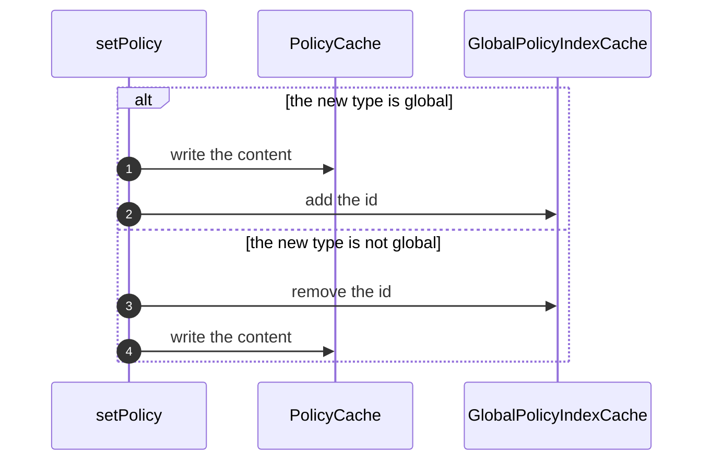

# Storage and Caching

For operators running CoSec in production. This page explains the stores CoSec reads from, what it guarantees about
them, every Redis key it writes, what happens when Redis is unavailable, and how to publish and roll back changes.
Every setting named here is listed in [Configuration](./configuration.md#cache); the move from 6.x is in
[Upgrading](./upgrading.md).

## Choosing a store

Authorization reads policies from a `PolicyRepository` and app permissions and role grants from an
`AppRolePermissionRepository`. It never reads files or a database directly.

| Store | Module | Use it when |
|---|---|---|
| Redis, through [CoCache](https://cocache.ahoo.me) | `cosec-cocache` (`cache-support`) | Several instances must see the same policies, and administrators change them at runtime. The rest of this page is about this store. |
| Your own repositories | your code | Policies live in another system. Implement the two repositories ([Repositories](../architecture/extending.md#repositories)). |

The starter provides only the Redis repositories: without `cache-support`, the application declares both repository
beans itself. [Local policy files](#local-policy-files) are not a store: they are loaded into the repository at
startup.

## Local policy files

Policies can ship with the application as JSON files and be written into the repository at startup:

| Property | Effect |
|---|---|
| `cosec.authorization.local-policy.enabled=true` | Load the files from `cosec.authorization.local-policy.locations` (default `classpath:cosec-policy/*-policy.json`). |
| `cosec.authorization.local-policy.init-repository=true` | Write the loaded policies into the `PolicyRepository` at startup. Without it the files have no effect, because authorization reads only the repository. |
| `cosec.authorization.local-policy.force-refresh=true` | Overwrite policies that already exist in the repository. Without it, startup reads each id from the repository first and writes the file only when the id is missing. |

Loading is strict: a file that cannot be read or built, two files with the same policy id, and a configured location
that matches no file all stop startup ([Loading policy files](../policies/language.md)).

::: warning `force-refresh=true` overwrites
It replaces the stored copy of **every** local policy with its file, including changes administrators made through
the repository since. Use it once, on purpose, and turn it off again
([Troubleshooting](./troubleshooting.md#startup-fails-reading-a-stored-policy)).
:::

## Redis

With `cache-support`, Redis holds policies, the global policy index, app permissions and role grants, and also revoked
token ids. Each instance keeps an in-process copy through CoCache 6.6.

### Redis is the store of record

Policies, the global policy index, app permissions and role grants have no other copy: no database behind them, no
loader that could fill a cache miss. Whatever Redis holds is what authorization decides with. Three rules follow:

- **Nothing expires.** These entries are written without a TTL. An expiry would silently delete a policy, and a
  deleted deny widens access.
- **A failed read fails the request.** When Redis cannot be read and the value is not in the local copy, the read
  throws and the request is denied ([When Redis is unavailable](#when-redis-is-unavailable)). It never degrades to
  "not found", which would drop a deny.
- **A value CoSec cannot decode fails the read and stays in Redis.** It is never reclaimed (deleted), because with no
  loader a reclaim would delete the only copy.

CoSec applies these rules itself, after any CoCache customizer or `cocache.*` property, so no configuration can
weaken them ([Precedence](./configuration.md#precedence)).

### What CoCache guarantees

- **Fail closed on foreign data.** A read that meets a value in another format (a CoCache 5 value written by
  CoSec 6.x, or anything written with plain Redis commands) fails with `CacheReadException`, caused by
  `ForeignFormatException`, and leaves the value in Redis. Every CoSec cache, revoked tokens included, uses this mode
  (`foreign-format: fail`), even when `cocache.defaults.foreign-format=reclaim`. A set, such as the global policy
  index, is not overwritten either: an update over a foreign value fails with `CacheWriteException`, caused by
  `ForeignFormatException`, and leaves it unchanged. A plain value, such as a policy or an app permission, is
  replaced by a write ([Writes before the migration](./upgrading.md#writes-before-the-migration)).
- **Changes reach every instance.** A write goes to Redis, then every instance drops its local copy through an
  invalidation message.
- **Staleness has an upper bound.** If an invalidation message is lost, a local copy still lives at most
  `localMaxAge` (5 minutes by default, set with
  [`expire-after-write`](./configuration.md#local-cache-settings)), then is read from Redis again. CoCache has no
  unlimited setting.
- **Reads do not block the event loop.** A value in the local copy is answered on the caller's thread; a miss reads
  Redis without blocking and continues on `boundedElastic`.
- **Global index updates are atomic.** Adding or removing an id is an atomic element update, so concurrent writers on
  different instances never lose entries.

### The caches

| Cache | Holds | Store of record | Redis TTL | Redis read fails | Local copy settings |
|---|---|---|---|---|---|
| `PolicyCache` | policies by id | yes | none | the request is denied | `cosec.authorization.cache.policy.*` |
| `GlobalPolicyIndexCache` | ids of the global policies, one set | yes | none | the request is denied | `cocache.caches.GlobalPolicyIndexCache.*` only |
| `AppPermissionCache` | app permissions by app id | yes | none | the request is denied | `cocache.caches.AppPermissionCache.*` only |
| `RolePermissionCache` | permission ids of a role in one app and space | yes | none | the request is denied | `cosec.authorization.cache.role.*` |
| `RevokedTokenCache` | revoked token ids, with token revocation on | no | the remaining lifetime of the token's refresh token, plus 1 second | the token is accepted | `cosec.authorization.cache.token.*` (30 seconds, 100,000 entries) |

Every cache fails on a value it cannot decode, `RevokedTokenCache` included: deleting an unreadable revocation would
make its token valid again.

Revoked tokens are not the store of record. Each revocation carries its own lifetime and the token expires on its
own, so a failed read degrades on purpose. A "not revoked" answer is cached locally for 30 seconds, which bounds how
long another instance can miss a fresh revocation if an invalidation message is lost.

### Redis keys

`<p>` is [`cosec.authorization.cache.key-prefix`](./configuration.md#cache) (`cosec` by default) with a trailing `:`
removed. CoSec's caches use no CoCache key prefix of their own: CoCache's `cocache:` default does not apply to them.

| Key | Written by | Contents |
|---|---|---|
| `<p>:policy:<policyId>` | `PolicyRepository.setPolicy` | one policy (CoCache value) |
| `<p>:global:policy` | `PolicyRepository.setPolicy` | ids of the global policies (CoCache set) |
| `<p>:app:permission:<appId>` | `AppPermissionCache` | one app permission (CoCache value) |
| `<p>:app:role:permission:<appId>:<roleId>` | `RolePermissionCache` | permission ids of a role in the default space (CoCache value) |
| `<p>:app:role:permission:<appId>:<roleId>@<spaceId>` | `RolePermissionCache` | permission ids of a role in space `<spaceId>` (CoCache value) |
| `<p>:token:revoked:<tokenId>` | `TokenStore.revoke` (logout) | `true` for a revoked token id (`jti`), with a TTL (CoCache value) |
| `<p>:meta:schema` | the schema check, the migration | `7`: the data is in the 7.0 layout ([Schema marker](#schema-marker)) |
| `<h>:<policyId>` | policy history | a list of revisions as JSON, newest first, at most `max-revisions` |
| `<h>:<policyId>:seq` | policy history | a counter: the last revision number of the policy |
| `<api-key-prefix>:<sha256>` | `RedisApiKeyStore` | one API key as JSON, by the SHA-256 of the key |
| `<rate-limit-prefix>:<ruleId>:<bucket>:<window>` | `RedisRateLimiter` | a counter of one window of one rule and bucket; expires after two windows |

- `<h>` is `<key-prefix>:policy:history`, built from the key prefix **as configured**: a prefix ending in `:` is not
  trimmed here, so `myapp:` gives `myapp::policy:history:<policyId>`. History keys exist only with
  [history](#policy-history-and-rollback) enabled; they are plain Redis data, not CoCache values.
- `<api-key-prefix>` is [`cosec.api-key.key-prefix`](./configuration.md#api-keys) (`cosec:api-key`) and
  `<rate-limit-prefix>` is [`cosec.limiter.key-prefix`](./configuration.md#rate-limiting) (`cosec:rate-limiter`),
  each with a trailing `:` removed. They do **not** follow `cosec.authorization.cache.key-prefix`: change them too
  when several deployments share one Redis.
- App ids may not contain `:` and role ids may not contain `@`, so a role grant key always reads back as the app,
  role and space it was written for. `AppSpacedRoleId` rejects anything else, and authorization grants nothing to such
  an app or role ([Role grant scope](../policies/role-permissions.md#role-grant-scope)).
- Reading a value that does not exist yet can leave a short-lived lease marker (CoCache's `lease-ttl`, 10 seconds by
  default) on its key. It holds no value and expires on its own.

During an upgrade from 6.x, two more kinds of keys exist:

| Key | Contents |
|---|---|
| `<legacy>:role:permission:<roleId>[@<spaceId>]` | 6.x role grants, without the app. Authorization never reads them; `RolePermissionKeyMigration` copies them and `deleteLegacy()` removes them. |
| `<backup-prefix><key>` | the 6.x value of each key the migration converted in place, for a rollback. `dropBackups()` removes them. |

`<legacy>` is [`cosec.authorization.cache.migration.legacy-key-prefix`](./configuration.md#cache), untrimmed, and
`<backup-prefix>` is `cosec.authorization.cache.migration.backup-prefix` (`cocache5-backup:`)
([Migrating the data](./upgrading.md#migrating-the-data)).

Each CoSec cache has its own invalidation channel, `cocache:inv:<p>:policy`, `cocache:inv:<p>:global`,
`cocache:inv:<p>:app:permission`, `cocache:inv:<p>:app:role:permission` and `cocache:inv:<p>:token:revoked`, so
deployments with different key prefixes stay apart on one Redis.

### Schema marker

7.0 does not always find 6.x data where 6.x stored it. With a key prefix ending in `:` (6.x kept `myapp::policy:*`,
7.0 reads `myapp:policy:*`), after a key prefix change, or after rolling back such a migration, 7.0 would see no
policy, no global `DENY` and no revocation at all. That is not foreign data that fails a read: it is absent, and an
absent deny does not deny.

So before it creates any CoSec cache, the starter checks `<p>:meta:schema`:

| Marker | CoSec data in Redis | Startup |
|---|---|---|
| `7` | any | continues |
| another value | any | fails with `CoSecSchemaException`: a newer CoSec wrote the data |
| missing | under the 6.x key prefix or the current one | fails with `CoSecSchemaException`, naming a key it found |
| missing | none | a new deployment: the marker is written, and startup continues |

CoSec data is any key under `<prefix>:policy:`, `<prefix>:global:policy`, `<prefix>:app:permission:`,
`<prefix>:app:role:permission:`, `<prefix>:role:permission:` or `<prefix>:token:revoked:`, for both the 6.x key prefix
(`legacy-key-prefix`, untrimmed) and the current one. The migration writes the marker as its last step; a rollback
removes it first.

- The check runs only with the Redis backend: it is skipped with `cocache.backend=memory`, which holds no 6.x data.
- `cosec.authorization.cache.migration.check-schema=false` turns it off. Only the one-off migration job may set it,
  since the check would stop that job from starting ([Migrating the data](./upgrading.md#migrating-the-data)).
- The check finds 6.x data only under the prefixes it is told about. When the key prefix changes, set
  `cosec.authorization.cache.migration.legacy-key-prefix` to the 6.x one.
- Do not write the marker by hand while 6.x data may exist.

### Redis requirements

- Redis 7.0 or later, or Valkey 7.2 or later.
- CoCache builds its own Lettuce client from `spring.data.redis.*`. Jedis is not supported, and a static
  master-replica setup fails at startup.
- A Redis ACL must grant what [CoCache lists](https://cocache.ahoo.me/operations/#acl), which since CoCache 6.3
  includes `+hkeys +hget`. Keep `+hgetall`.
- Do not let Redis evict CoSec's keys. Store-of-record keys have no TTL and no other copy, so an `allkeys-*`
  `maxmemory-policy` can delete policies and grants; a `volatile-*` policy can delete revocations, which accepts
  their tokens again. Use `noeviction` and size the instance for the data. CoCache checks the policy at startup
  because of the global policy index (`cocache.redis.set-cache-eviction-check`, `warn` by default).

## When Redis is unavailable

| Data | Behavior |
|---|---|
| Policies, global policy index, app permissions, role grants | Values in the local copy keep working. Anything else fails, and the request is **denied** with `500`. |
| Revoked tokens | The check **accepts** the token, so an outage does not reject every authenticated request. Tokens are still signature-verified and expire on their own. |
| API keys in Redis (`cosec.api-key.store=redis`) | The lookup fails, and the request is **denied** with `500`. |
| Rate limit counters | The rule is skipped and the request goes on, unless the rule sets `strictFailure: true`, which answers `429` ([Failure behavior](../policies/rate-limiting.md#failure-behavior)). |

The revocation check and rate limit rules without `strictFailure` are the documented exceptions to failing closed
([Fail closed](../guide/security-model.md#fail-closed)).

## Publishing changes

### Write through CoSec

Every CoCache 6 value starts with a binary header that CoCache checks, so values written with `SET`, `SADD` or any
other Redis command are not read: they fail as foreign data. Write:

- policies with `PolicyRepository.setPolicy`, which validates the policy before storing it;
- app permissions and role grants through the `AppPermissionCache` and `RolePermissionCache` beans
  ([Storing catalogs and grants](../policies/role-permissions.md#granting-permissions-to-roles)).

Every write reaches the other instances at once through invalidation.

### The global policy index

The global policy index and the policy contents are separate Redis keys, written one after the other: CoCache has no
transaction across caches. `RedisPolicyRepository` keeps that safe with three rules.

**Readers use only policies of type `global`.** A reader takes the ids from the index, reads their contents, and
keeps only contents whose type is `global`. Between the two writes of a republish, an id can still be in the index
while its content is already of another type; that content is ignored instead of applying to everyone.

**An indexed id without content fails closed.** If the index lists an id whose content is missing (lost, or a 6.x
cached miss that migrated as a miss), the read fails with `MissingPolicyException` and every request is denied with
`500`. The log says `the global policy index lists policies [...] that have no content.` Skipping it would silently
drop what may be a global deny. Write the policy again, or save it with a type other than `global` to take it out of
the index ([Troubleshooting](./troubleshooting.md#every-request-fails-with-500)).

**Writes are ordered so that a failure never widens access.**



- Global (steps 1 and 2): the content is written first, then the id is added. If the index update fails, the new
  content applies only to principals that list the policy, as any non-global policy would; old content never becomes
  global.
- Not global (steps 3 and 4): the id is removed first, then the content is written. If the content write fails, the
  old content applies only to principals that list the policy; the new content never applies to everyone.

A failed publish completes with an error. Retry it: repeating a publish is idempotent.

## Policy history and rollback

Redis holds only the current version of each policy. With `cosec.authorization.cache.history.enabled=true`, every save
through the repository also records a revision: an increasing number, the time, the author, a note and the full
policy, newest first, up to `cosec.authorization.cache.history.max-revisions` (50) per policy. Pass the author through
the Reactor context:

```kotlin
policyRepository.setPolicy(policy)
    .contextWrite(PolicyRevisions.author("alice", "TICKET-42: allow exports"))
```

The `PolicyHistory` bean reads and restores revisions. A rollback saves the old content as a new revision, so the
history only grows and records who rolled back:

```kotlin
policyHistory.history("orders")                 // newest first
policyHistory.rollback("orders", revision = 3, author = "bob")
```

- Saves without an author are recorded as `unknown`.
- The policy is written before its revision, so the history never shows a version that was not applied.
- Revisions are numbered by a Redis counter, so concurrent writers on any instance get distinct numbers.
