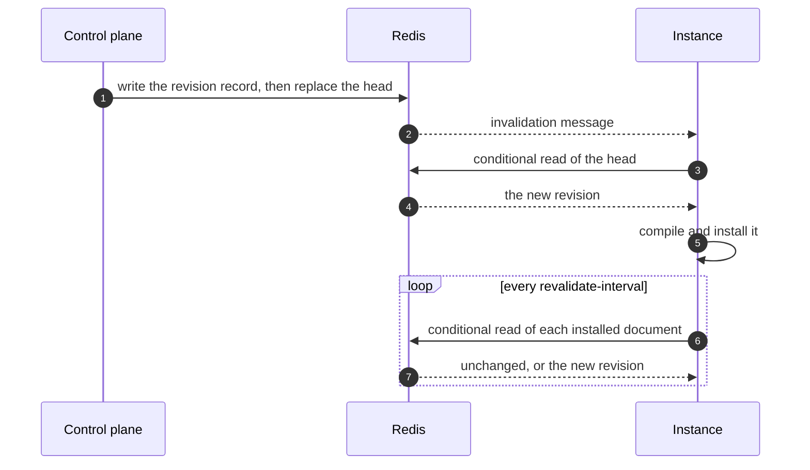

# Storage and Caching

For operators running CoSec in production. This page explains where the documents CoSec decides with are stored,
every Redis key CoSec uses, how each instance reads and caches the documents, what happens when Redis is unavailable,
and how documents are published, versioned and rolled back. Every property named here is listed in
[Configuration](./configuration.md#snapshot); what a document contains is in
[the policy language](../policies/language.md).

## Choosing a store

Every decision reads three kinds of documents: the platform document, which every request needs, and the app and
tenant documents of the request's scope. The pipeline reads them from a `SnapshotDocumentStore`.

| Store | Module | Use it when |
|---|---|---|
| Redis, through [CoCache](https://cocache.ahoo.me) | `cosec-cocache` | Production. Several instances read the same documents, and the control plane publishes changes at runtime. The rest of this page is about this store. |
| `InMemorySnapshotDocumentStore` | `cosec-spi` | Tests and local development. The starter creates an empty one without `cosec-cocache`; the application puts documents into it with `put`. |
| Your own `SnapshotDocumentStore` bean, without `cosec-cocache` | your code | The documents live in another system. Every method must return without blocking ([Extending](../architecture/extending.md)). |

Until a platform document is stored, every request answers `503` `unavailable`, and each instance reports itself not
ready ([The first documents](#the-first-documents)).

## Redis

With `cosec-cocache`, Redis holds the documents and everything the control plane keeps about them, and also revoked
tokens, shadow-window reports and rate-limit counters. Each instance keeps an in-process copy through CoCache.

### Redis is the store of record

The documents and the control plane's records have no other copy: no database behind them, no loader that could fill
a cache miss. What Redis holds is what every instance decides with. Three rules follow, and CoSec applies them after
any CoCache customizer or `cocache.*` property, so no configuration can weaken them
([Precedence](./configuration.md#precedence)):

- **Nothing expires.** Documents and control-plane records are written without a TTL. An expiry would silently delete
  a document, and a deleted DENY widens access.
- **A failed read is a failure.** A read of Redis that fails never becomes "no document"
  ([When Redis is unavailable](#when-redis-is-unavailable)).
- **A value CoSec cannot decode fails the read and stays in Redis.** It is never reclaimed (deleted), because a
  reclaim would delete the only copy. A value written with plain Redis commands is such a value: write documents only
  through the control plane or `cosec-migrate` ([Publishing documents](#publishing-documents)).

### Redis keys

`<s>` is [`cosec.authorization.snapshot.key-prefix`](./configuration.md#snapshot) (`cosec` by default) with a trailing
`:` removed. `<doc>` names one document: `platform`, `app:<appId>` or `tenant:<tenantId>`. App and tenant ids never
contain `:`, so a key names one document only.

| Key | Written by | Contents |
|---|---|---|
| `<s>:snapshot:<doc>` | the control plane, `cosec-migrate` | the head: the revision of the document every instance enforces |
| `<s>:control:revision:<doc>:<digest>` | the control plane, `cosec-migrate` | one revision record, the full document, addressed by its digest |
| `<s>:control:revisions:<doc>` | the control plane, `cosec-migrate` | the revision index of a document |
| `<s>:control:refs:<doc>:<policyId>` | the control plane, `cosec-migrate` | the documents that refer to a policy of `<doc>`; for a platform policy id, also the tenant documents that define a policy of that id themselves, so the platform cannot add one |
| `<s>:control:lease:<name>` | the control plane | a lease (`reclaim:<doc>`, `shadow-windows`); it expires with each write, and its holder deletes it when done |
| `<s>:control:list:documents`, `<s>:control:list:open-changes` | the control plane | the documents that have revisions, and the change requests that may still be open, so the maintenance passes, and the grant analysis for the app documents, can visit each |
| `<s>:control:change:<changeId>` | the control plane | a change request |
| `<s>:control:stage:<doc>` | the control plane | the staging slot of a document: which change holds it |
| `<s>:candidate:<doc>` | the control plane | the staged candidate of a document while its shadow window is open |
| `<s>:shadow:report:<window>:<instance>` | data-plane instance `<instance>` only | that instance's cumulative report of one shadow window; each write replaces the previous one; expires 8 days after its last write |
| `<s>:shadow:reporters:<window>` | every data-plane instance | the ids of the instances that reported on `<window>`; same expiry |
| `<s>:shadow:status:instances` | every data-plane instance | each instance's installed revisions and their lag; expires 2 minutes after its last write, and entries older than a minute are ignored |
| `<c>:token:revoked:<tokenId>` | `TokenStore.revoke` (logout) | `true` for a revoked token id; expires one second after the refresh token lifetime |
| `<c>:token:subject:revoked:<n>:<tenantId>:<principalId>` | `TokenStore.revokeSubject` | `issuedBefore` in epoch milliseconds; `<n>` is the length of `<tenantId>`; expires one second after the refresh token lifetime past `issuedBefore` |
| `<m>:membership:<n>:<tenantId>:<principalId>` | `CoCacheMembershipProvider`, when the application registers one | a principal's memberships; expires (one minute by default) |
| `<k>:<sha256>` | `RedisApiKeyStore` | one API key as JSON (`"format":2`), by the SHA-256 of the key; a key in the format before 8.0 is refused until `cosec-migrate api-keys` converts it |
| `cosec:rate-limiter:<ruleId>:<bucket>:<window>` | the Redis rate limiter | a counter of one window of one rule and bucket; expires after two windows |

- `<c>` is [`cosec.authorization.cache.key-prefix`](./configuration.md#cache), `<k>` is
  [`cosec.api-key.key-prefix`](./configuration.md#api-keys) (`cosec:api-key`), and `<m>` is the prefix the
  application gives the membership cache (`cosec` by default), each with a trailing `:` removed. They do **not**
  follow `<s>`. The rate limiter's prefix `cosec:rate-limiter` is fixed. When several deployments share one Redis, give
  each its own prefixes, and its own rate-limit rule ids.
- Every key except the rate-limit counters and the API keys is a CoCache value. Each CoCache namespace has its own
  invalidation channel, `cocache:inv:<namespace>` (for example `cocache:inv:cosec:snapshot`), so deployments with
  different prefixes stay apart on one Redis.

### Redis requirements

- **`maxmemory-policy noeviction` on every node.** The documents have no TTL and no other copy. Under an `allkeys-*`
  policy Redis can evict a document: an instance that had it installed fails closed, but an instance that loads it
  afterwards reads an evicted app or tenant document as absent, so its DENY statements silently stop applying. Use
  `noeviction` and size Redis for the data.
- **The startup check.** With the Redis backend, each instance reads `maxmemory-policy` at startup with
  `CONFIG GET`. A node that is not `noeviction`, a `CONFIG GET` that fails or is denied, or a CoCache backend the
  check cannot see into (a wrapper, a custom backend) fails startup by default. A managed Redis that hides
  `CONFIG GET` while you have set `noeviction` yourself needs
  [`cosec.authorization.snapshot.eviction-check=warn`](./configuration.md#snapshot): the instance starts and logs a
  `WARN` that begins with `!!!` ([Troubleshooting](./troubleshooting.md#startup-fails-on-the-eviction-check)).
- **Redis client.** CoCache builds its own Lettuce client from `spring.data.redis.*`; the versions, topologies and
  ACL commands it needs are in [CoCache's documentation](https://cocache.ahoo.me/operations/#acl). The data plane
  also needs `CONFIG GET` for the startup check.

### Who may write which keys

Only the control plane (and `cosec-migrate`) writes documents and control-plane records. Data-plane instances read
the documents and the candidates, and write only shadow reports and statuses. A Redis ACL can hold each side to that:

- Data-plane credentials: read-only on `<s>:snapshot:*` and `<s>:candidate:*`, write on `<s>:shadow:*`, and no access
  to `<s>:control:*`.
- Control-plane credentials: every key under `<s>:`.
- To keep one instance from writing another instance's report, give each instance its own user, limited to its own
  report keys (`<s>:shadow:report:*:<instance>`), and set its
  [`cosec.authorization.shadow.instance-id`](./configuration.md#shadow-windows). Every instance still writes
  `<s>:shadow:reporters:*` and `<s>:shadow:status:*`, which CoCache writes through Lua scripts, so an ACL cannot make
  them add-only.

A window's numbers are the sum of one report per instance, each that instance's latest. The control plane keeps a
window open (the step answers `503`) rather than count anything doubtful: a report under one instance's key that names
another instance or window, a negative count, or a listed instance without a report. One instance's
`CANDIDATE_ERROR` blocks the window whatever the others report. An instance can always misreport its own traffic; the
ACL only keeps it to its own keys. An instance with write access to `<s>:shadow:reporters:*` can remove another
instance's id: once the control plane has seen that instance report, the window stays open until its report is back,
but an id removed before then goes unnoticed until that instance writes again.

An example for instance `pod-a` with the default prefix (Redis 7 ACL syntax; `%R~` is read-only). The first line sets
the keys and takes every command away; the second grants the commands and channels it needs:

```text
ACL SETUSER cosec-pod-a on >change-me resetkeys resetchannels -@all %R~cosec:snapshot:* %R~cosec:candidate:* ~cosec:shadow:report:*:pod-a ~cosec:shadow:reporters:* ~cosec:shadow:status:*
ACL SETUSER cosec-pod-a <the commands and channels CoCache lists> +config|get
```

Add the keys the instance's other features use (revocations, API keys, rate limits; see [Redis keys](#redis-keys)).
Check the user with `ACL DRYRUN` before production: CoCache writes through Lua scripts, which Redis checks key by key.

## How instances read documents

Each instance holds the compiled documents in memory and decides from them without touching Redis. The platform
document is loaded at startup and never dropped; app and tenant documents are loaded when a request first needs them,
and the least recently used are dropped beyond
[`max-apps` and `max-tenants`](./configuration.md#snapshot). Prewarmed apps and tenants load at startup, after the
platform document.



- **A change reaches every instance at once** through CoCache's invalidation message (steps 2 to 5). The instance
  reads Redis itself, bypassing its local copy, compiles the new revision and installs it. A request in flight keeps
  the revision it started with: one evaluation never mixes revisions of a document.
- **Lost messages are caught by revalidation** (steps 6 and 7): every
  [`revalidate-interval`](./configuration.md#snapshot) (10 seconds) each installed document is confirmed with a
  conditional read that transfers nothing when it is unchanged.
- **Lag** is the time since Redis last confirmed a document. While Redis answers it stays below the revalidate
  interval. Past `lag-warn` (60 seconds) the instance logs
  `Snapshot document [<doc>] revision <n> has not been confirmed for <lag>.` at `WARN`, past `lag-escalate`
  (5 minutes) `... is stale: not confirmed for <lag>.` at `ERROR`, at most once a minute per document.
- **Tenants that fail closed on lag.** For the tenants listed in
  [`fail-closed.tenants`](./configuration.md#snapshot), a request is unresolved when the oldest document it reads
  (the platform, the tenant's and the app's) has not been confirmed for longer than `fail-closed.max-lag`
  (30 minutes): it answers `503` unless a DENY matches. Other tenants are decided on the installed revisions however
  old they are, and are never checked.
- **Local copies** serve only cold loads. The first time an instance needs a document, it may take CoCache's local
  copy, at most [`local-max-age`](./configuration.md#snapshot) (30 seconds) old; it counts that copy as that old and
  confirms it with Redis at once. A local "no such document" is never trusted: only Redis can answer that a document
  does not exist.
- **A cold load waits** at most [`cold-load-timeout`](./configuration.md#snapshot) (2 seconds); after that the
  document counts as failed for that request.
- **Revisions only move as Redis says.** After a Redis failover, Redis may answer an older revision than the one
  installed, because replication is asynchronous. The instance installs what Redis holds, since every other instance
  reads the same, and logs `Snapshot document [<doc>] regressed from revision <a> to <b>; ...` at `ERROR`. Publish the
  lost change again.

## When Redis is unavailable

| What | Behavior |
|---|---|
| A document already installed | Kept. Decisions go on with the installed revision; its lag grows and is logged ([How instances read documents](#how-instances-read-documents)). |
| A document not installed yet | The cold load fails or times out: the document is unresolved for that request, which is **`503`**, unless a DENY matches first. Nothing is installed; the next request tries again. |
| A document that cannot be decoded or compiled | Installed as failed: every request that needs it is **`503`**, unless a DENY matches first, until a readable revision is published. |
| A document that disappeared from Redis after it was seen | Failed until a document returns (`Snapshot document [<doc>] disappeared from the store; failing closed.` at `ERROR`). Requests that need it are **`503`**, unless a DENY matches first. |
| A tenant listed in `fail-closed.tenants`, once its documents lag past `fail-closed.max-lag` | **`503`**, unless a DENY matches first ([How instances read documents](#how-instances-read-documents)). |
| No platform document published | Every request is **`503`** ([The first documents](#the-first-documents)). |
| Revoked tokens and principals | The check answers "not revoked" and the token is **accepted**, so an outage does not reject every authenticated request. Tokens are still signature-verified and expire on their own. |
| Memberships from a `MembershipProvider` on Redis | **`503`**. Memberships carried in the token are not affected. |
| API keys in Redis (`cosec.api-key.store=redis`) | **`503`**. |
| Rate-limit counters | A rule with `strictFailure: true` answers **`503`**; any other rule is skipped and the request goes on ([Rate limiting](../policies/rate-limiting.md)). |
| The control plane | A store read that fails is a failure, never "absent": the control API answers `503` and publishes nothing. |
| Shadow reports | The instance logs the failed write and writes again on its next cycle; the window stays open meanwhile. |

The revocation check and rate-limit rules without `strictFailure` are the documented exceptions to failing closed
([Security model](../guide/security-model.md)). How a `503` reads in the response and the audit is in
[Troubleshooting](./troubleshooting.md#unavailable).

## Publishing documents

Data-plane instances never write documents. Two writers do, both through the control plane's store, so every
document's revision chain starts with their first write:

- the **control plane** (`cosec-control` with `cosec-cocache`), at runtime, through change requests;
- **`cosec-migrate`**, for the first documents of a deployment and for the move from 7.x.

Both write on the Redis and under the `cosec.authorization.snapshot.key-prefix` the instances read. A publish writes
the revision record first, then replaces the head with a compare-and-set on the base revision's digest, so a reader
sees the old head or the new one, never a mix, and two publishers never overwrite each other: the second one is told
the base moved.

### The first documents

On an empty Redis every request answers `503`, the control plane's own checks included, because they also need a
platform document, and every instance reports itself not ready
([Readiness](./deployment.md#readiness)). An absent platform document is never read as an empty one, which would
silently drop every platform DENY. The control plane cannot create it, since every control-plane request is first
authorized by it, and `cosec-migrate bootstrap` writes only the platform tenant's document (`tenant:(platform)`). The
first platform document always comes from `cosec-migrate publish`:

1. **Publish the documents.**
   `cosec-migrate publish --to-redis redis://host:6379 [--key-prefix cosec] --in <dir>` publishes the documents of a
   directory as `cosec-migrate convert` writes it: `platform.json` (required), `apps/<appId>.json`,
   `tenants/<tenantId>.json`, and `report.json`, which records the SHA-256 of each file. It compiles every document
   first, checks each app and tenant document's references against the platform document, and publishes the platform
   document first. It never overwrites: if a document exists, it stops (`--resume` skips documents already published
   identically). A break-glass binding that expires later than `--break-glass-max-duration` (default `PT4H`) is
   refused.
2. **Name the first administrator.**
   `cosec-migrate bootstrap --to-redis redis://host:6379 [--key-prefix cosec] --platform-admin <principalId>` binds
   that principal of the platform tenant to the built-in `cosec:platform-admin` policy in the platform tenant's own
   document (`tenant:(platform)`), as a revision of kind `BOOTSTRAP`. It refuses when that document already binds
   someone to `cosec:platform-admin`; `--force` is for the recovery where every administrator is lost.

`cosec-migrate` connects to one Redis server (`--to-redis`), and exits with `0` when done, `1` when the data was
rejected or publishing failed, `2` on a usage error. Converting 7.x data into documents is in
[Upgrading](./upgrading.md).

`cosec-migrate bootstrap` lets the administrator act on the control plane, but the HTTP request to the control API
must first be permitted by the documents like any other request ([Testing changes](../policies/testing.md)).

### Publishing through the control plane

At runtime every change goes through the control API under
[`cosec.control.http.base-path`](./configuration.md#control-plane): a change is proposed against a base revision,
checked, optionally shadowed and approved, then published. A change whose base has moved by the time it publishes
is `CONFLICTED` and must be rebased; nothing is overwritten. The workflow, its checks and its approvals are in
[Testing changes](../policies/testing.md). The control plane announces each published revision to the instances of its
own host at once, and to every other instance through CoCache's invalidation message.

The grant analysis of a tenant change reads every app document, whether or not the change names the app: it lists
them from `<s>:control:list:documents`, which names every document the control plane or `cosec-migrate` ever
published. A document written to Redis any other way is not seen by the analysis, nor by the back-reference index or
the maintenance passes; write documents only through these two. Each analysis reads the list and every app head, so its
cost grows with the number of documents.

### What a publish compares

A publish compare-and-sets one key: the head of the document it changes. Its checks also read other heads, the platform
document's, the app documents' and, for some checks, tenant documents', and recorded them on the change. Those are
separate keys, in different Redis Cluster slots, so no single write can cover them, and one of them can move between
the publish's last check and its write. This window is short (the checks run again right before the write) and it is
safe to leave: restricting a grantor never withdraws a grant the grantor already made, so a restriction published
meanwhile and the grant come out as the serial order "grant, then restriction". The one outcome no serial order gives
is two changes that each remove a right the other's grant relies on, landing within the same window.

After the write, the control plane reads every recorded head again. When one moved, or cannot be read, it runs the
grant analysis again on the current heads and records a change event: `HEADS_MOVED` when the analysis finds nothing
the publish did not have approved, `REVIEW_NEEDED` when it finds more, or cannot run. The event names the heads that
moved and carries what the analysis found ([Observability](./observability.md#control-plane-change-log)). Nothing is
rolled back. To review a `REVIEW_NEEDED`, read its escalations as an approver would: if the grant should not stand,
propose a change that removes it, or roll the document back.

### Revisions, history and rollback

Every publish makes a new revision of one document: the base's number plus one, with who published it, who approved
it, the shadow window and the change it came from. The control API reads them (`<doc>` is `platform`, `app:<appId>` or
`tenant:<tenantId>`):

| Request | Answer |
|---|---|
| `GET /documents/<doc>` | the head |
| `GET /documents/<doc>/revisions?before=&limit=` | the history, newest first (20 by default, at most 200) |
| `GET /documents/<doc>/revisions/<n>` | revision `<n>`; `410` when it is not kept |
| `GET /documents/<doc>/diff?from=&to=` | what changed between two revisions |
| `GET /documents/<doc>/revisions/<n>/propagation` | how many of the instances that reported a status in the last minute have installed revision `<n>` or later (needs instances with [shadow windows](./configuration.md#shadow-windows) on) |
| `POST /documents/<doc>:rollback` with `{"revision": <n>, "note": "..."}` | a change (`201`) that makes the document what it was at revision `<n>` |

A rollback is a change like any other: it is checked, shadowed and approved as its content requires, and publishing
it makes a new revision, so the history only grows and records who rolled back. A rollback that would bring a
break-glass binding back never checks clean.

Every control-plane instance runs two maintenance passes while it runs, each first after one interval:

- **Reclaiming revisions**, every [`cosec.control.revisions.reclaim-interval`](./configuration.md#control-plane)
  (1 hour). For each document it removes the revision records beyond the `max-count` (50) most recent that are also
  older than `min-age` (7 days), and the records of publishes that never became the head once older than `orphan-age`
  (1 hour). It never removes the head, nor a revision an open change rests on; when an open change cannot be read, it
  reclaims nothing that pass. A lease per document (`reclaim:<doc>`) lets one instance at a time do each document.
- **Closing shadow windows**, every [`cosec.control.shadow.check-interval`](./configuration.md#control-plane)
  (1 minute), under the `shadow-windows` lease, so a window closes at most one interval late.

Both passes read every open change, so a change nobody finishes expires
[`cosec.control.changes.expire-after`](./configuration.md#control-plane) (7 days) after it was proposed, and leaves
the list of open changes.

A failed pass is logged, and the next one runs. A revision that has been reclaimed answers `410`.

**Next:** see what CoSec decided, in [Observability](./observability.md).
