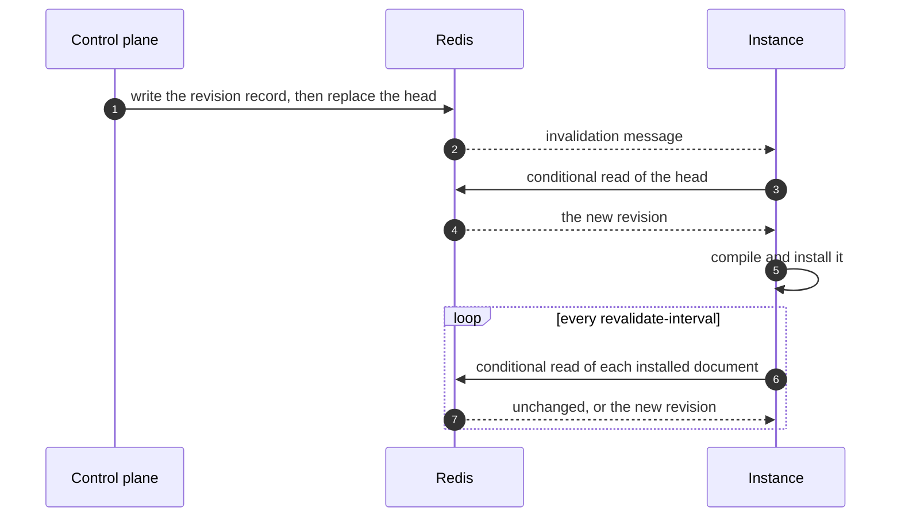

# Storage and Caching

For operators running CoSec in production. This page explains where the documents CoSec decides with are stored,
every Redis key CoSec uses, how each instance reads and caches the documents, what happens when Redis is unavailable,
and how documents are published, versioned and rolled back. Every property named here is listed in
[Configuration](./configuration.md#snapshot); what a document contains is in
[the policy language](../policies/language.md).

## Choosing a store

Every decision reads three kinds of documents: the platform document, which every request needs, and the app and
tenant documents of the request's scope. The pipeline reads them from a `SnapshotDocumentStore`.

| Store | Module | Use it when |
|---|---|---|
| Redis, through [CoCache](https://cocache.ahoo.me) | `cosec-cocache` | Production. Several instances read the same documents, and the control plane publishes changes at runtime. The rest of this page is about this store. |
| `InMemorySnapshotDocumentStore` | `cosec-spi` | Tests and local development. The starter creates an empty one without `cosec-cocache`; the application puts documents into it with `put`. |
| Your own `SnapshotDocumentStore` bean, without `cosec-cocache` | your code | The documents live in another system. Every method must return without blocking ([Extending](../architecture/extending.md)). |

Until a platform document is stored, every request answers `503` `unavailable`, and each instance reports itself not
ready ([The first documents](#the-first-documents)).

## Redis

With `cosec-cocache`, Redis holds the documents and everything the control plane keeps about them, and also revoked
tokens, shadow-window reports and rate-limit counters. Each instance keeps an in-process copy through CoCache.

### Redis is the store of record

The documents and the control plane's records have no other copy: no database behind them, no loader that could fill
a cache miss. What Redis holds is what every instance decides with, so they are CoCache `Store`s. Three rules follow,
and CoSec locks and constrains them over any CoCache customizer or `cocache.*` property, so no configuration can weaken
them ([Precedence](./configuration.md#precedence)):

- **Nothing expires.** Documents and control-plane records are written without a TTL. An expiry would silently delete
  a document, and a deleted DENY widens access.
- **A failed read is a failure.** A read of Redis that fails never becomes "no document"
  ([When Redis is unavailable](#when-redis-is-unavailable)).
- **A value CoSec cannot decode fails the read and stays in Redis.** It is never reclaimed (deleted), because a
  reclaim would delete the only copy. A value written with plain Redis commands is such a value: write documents only
  through the control plane or `cosec-migrate` ([Publishing documents](#publishing-documents)).

**What a CoCache customizer can still change.** CoSec locks what decides what a cache holds: its key prefix, namespace,
key encoding, codec, data source, key filter and per-entry lifetime ([Precedence](./configuration.md#precedence)).
Unreadable revocations fail the read, and memberships always expire, without jitter, and fail closed on a failed read.
The shadow caches keep their declared lifetimes, and the revocation tables read for the store's whole command timeout
(`cocache.redis.command-timeout`): a read that times out reads "not revoked", so no `read-timeout` may shorten it.
The rest of the cache policy stays the application's, through customizers and `cocache.*` properties
([Precedence](./configuration.md#precedence) lists every field CoSec locks): on every cache the local cache's size and
`expireAfterAccess`, and but for the snapshot store `local-max-age`; on every cache but the revocation tables
`read-timeout`, after which a store of record's read fails closed; on the two revocation tables `absent-ttl` and
`unknown-read`; on memberships `ttl` (never forever), `absent-ttl`, `lease-*`, `load-*` and `invalidate-failure`. None
of these replaces what a cache holds, but some lengthen how long an instance acts on what it read. A longer `local-max-age` or `absent-ttl` on the revocation tables keeps a revoked token accepted that much longer
when the revocation's invalidation message is lost (`cosec.authentication.revocation.cache.local-max-age`, 30 seconds, is the
default bound), and a longer membership `ttl` keeps a removed role applied that long.

### Redis keys

`<s>` is [`cosec.key-prefix`](./configuration.md#key-prefix) (`cosec` by default) with a trailing `:` removed: every
key a deployment writes lives under it (`SNP-9`). `<doc>` names one document: `platform`, `app:<appId>` or `tenant:<tenantId>`. App and tenant ids never
contain `:`, so a key names one document only.

| Key | Written by | Contents |
|---|---|---|
| `<s>:snapshot:<doc>` | the control plane, `cosec-migrate` | the head: the revision of the document every instance enforces |
| `<s>:control:revision:<doc>:<digest>` | the control plane, `cosec-migrate` | one revision record, the full document, addressed by its digest (`SHA-256:` and 64 hex digits, as CoCache computes it) |
| `<s>:control:revisions:<doc>` | the control plane, `cosec-migrate` | the revision index of a document, and the records reclamation took out of it and has not yet seen deleted |
| `<s>:control:refs:<doc>:<policyId>` | the control plane, `cosec-migrate` | the documents that refer to a policy of `<doc>`, each with the revision of it that last indexed the reference: a revision removes only what it or an earlier one indexed (`CTL-25`); for a platform policy id, also the tenant documents that define a policy of that id themselves, so the platform cannot add one; [`cosec-migrate repair-references`](./upgrading.md#repair-the-back-reference-index) adds what the heads refer to and it misses, and removes what a publish indexed before a head write it lost |
| `<s>:control:lease:<name>` | the control plane | a lease (`reclaim:<doc>`, `shadow-windows`); it expires with each write, and its holder deletes it when done, only while it still holds it (`CTL-26`); a holder that takes its own lease again holds it for the full duration from then on |
| `<s>:control:list:documents`, `<s>:control:list:open-changes` | the control plane, `cosec-migrate` | the documents that have revisions, and the change requests that may still be open, so the maintenance passes and `repair-references` can visit each |
| `<s>:control:apps:all` | the control plane, `cosec-migrate` | the app list: the app documents there are, and whether the list is complete, which the grant analysis reads on every tenant change ([below](#publishing-through-the-control-plane)) |
| `<s>:control:change:<changeId>` | the control plane | a change request |
| `<s>:control:stage:<doc>` | the control plane | the staging slot of a document: which change holds it |
| `<s>:candidate:<doc>` | the control plane | the staged candidate of a document while its shadow window is open; the change it belongs to removes it, only while it is still its own (`CTL-26`) |
| `<s>:shadow:report:<window>:<instance>` | data-plane instance `<instance>` only | that instance's cumulative report of one shadow window; each write replaces the previous one; the instance stops writing it once the window's candidate is withdrawn; expires 8 days after its last write |
| `<s>:shadow:reporters:<window>` | every data-plane instance | the ids of the instances that reported on `<window>`; same expiry |
| `<s>:shadow:status:<instance>` | data-plane instance `<instance>` only | that instance's installed revisions and their lag; a heartbeat writes this one value, whatever the size of the cluster; expires 2 minutes after its last write, and a status older than a minute is ignored |
| `<s>:shadow:instances:all` | every data-plane instance | the instances that have a status, each with when it listed itself; an instance lists itself when it starts and again every hour, and whoever writes the list drops entries older than 3 hours; expires as the reports |
| `<s>:token:revoked:<tokenId>` | `TokenStore.revoke` (logout) | `true` for a revoked token id; expires one second after the refresh token lifetime |
| `<s>:token:subject:revoked:<n>:<tenantId>:<principalId>` | `TokenStore.revokeSubject` | `issuedBefore` in epoch milliseconds; `<n>` is the length of `<tenantId>`; expires one second after the refresh token lifetime past `issuedBefore` |
| `<s>:membership:<n>:<tenantId>:<principalId>` | `CoCacheMembershipProvider`, when the application registers one | a principal's memberships; expires (one minute by default) |
| `<s>:api-key:<sha256>` | `RedisApiKeyStore` | one API key as JSON (`"format":2`), by the SHA-256 of the key; a key in the format before 8.0 is refused until `cosec-migrate api-keys` converts it |
| `<s>:rate-limiter:{<ruleId>:<bucket>}:<window>` | the Redis rate limiter | a counter of one window of one rule and bucket; expires after two windows. `{...}` is a hash tag: a bucket's two windows share a Redis Cluster slot, so the script that reads both runs on a cluster |
| `<s>:oauth:state:<state>` | social login | the OAuth `state` of a login in progress; expires after 3 minutes |

- When several deployments share one Redis, give each its own `cosec.key-prefix`: with different prefixes they share no
  key, so an API key one issues is never accepted by the other, and their rate limit counters stay apart.
- Every key except the rate-limit counters, the API keys and the OAuth states is a CoCache 8 value. CoCache splits each
  key path at its last `:` before the entry: `<s>:control:revision` is the key prefix `<s>:control:` and the namespace
  `revision`. Each one has its own invalidation channel, `{key prefix}inv:{namespace}`: `<s>:inv:snapshot`,
  `<s>:inv:candidate`, `<s>:control:inv:revision`, `<s>:shadow:inv:report`, `<s>:token:inv:revoked`,
  `<s>:token:subject:inv:revoked`, `<s>:inv:membership`. A channel sits under the same prefix as its keys, so deployments
  with different prefixes stay apart on one Redis, and an ACL rule on `<s>:control:*` covers both the control plane's
  keys and its channels.

### Redis requirements

- **`maxmemory-policy noeviction` on every node.** The documents have no TTL and no other copy. Under an `allkeys-*`
  policy Redis can evict a document: an instance that had it installed fails closed, but an instance that loads it
  afterwards reads an evicted app or tenant document as absent, so its DENY statements silently stop applying. Use
  `noeviction` and size Redis for the data.
- **The startup checks.** With the Redis backend, each instance reads every node's `maxmemory-policy` at startup from
  `INFO memory`, which managed Redis services usually allow where they block `CONFIG`. Two checks read it:
  - CoSec's own (`SNP-3`), of the Redis behind the CoCache runtime the snapshot store is created on: a node that is
    not `noeviction`, an `INFO` that fails or is denied, or a CoCache backend the check cannot see into (a wrapper, a
    custom backend) fails startup by default. A Redis that denies `INFO` while you have set `noeviction` yourself needs
    [`cosec.authorization.snapshot.eviction-check=warn`](./configuration.md#snapshot): the instance starts and logs a
    `WARN` that begins with `!!!` ([Troubleshooting](./troubleshooting.md#startup-fails-on-the-eviction-check)).
  - CoCache's, for its `Store`s, which CoSec's documents and records are: an `allkeys-*` policy always fails startup,
    and so does an `INFO` it cannot read, whatever `eviction-check` says. With a Redis that denies `INFO`, also set
    [`cocache.redis.assume-maxmemory-policy`](./configuration.md#cocache-properties-that-affect-cosec) to the policy
    you have set (`noeviction`). The revocation tables' entries each carry a lifetime of their own, which `volatile-*`
    may evict before it ends, so that a revoked token is accepted again. CoCache counts such a lifetime only once the
    instance has written or read one, so at startup it accepts `volatile-*`: CoSec's check is the one that refuses it.
- **Checked again while it runs.** CoSec's check reads every node's `maxmemory-policy` again every
  `revalidate-interval`, on a thread of its own, so a later `CONFIG SET maxmemory-policy`, a failover to a node set up
  otherwise or a restart is seen. (CoCache's also checks a `Store` created after startup, and, with
  `cocache.redis.store-eviction-check-interval`, reads the policy again too, but only logs and reports `storeEviction`
  in its health details.) While a node may evict, the `cosecSnapshotEviction` health indicator is `DOWN` with an
  `eviction` detail that says why, and the instance logs an `ERROR` when that starts, with either `eviction-check`
  ([Troubleshooting](./troubleshooting.md#cosecsnapshoteviction-is-down)). A policy that cannot be read is `DOWN` too
  under `fail`; under `warn`, which accepted that at startup, it is `UP` with `eviction: unknown`. Requests are not
  refused for it: an installed document stays, and one that is lost fails closed on every instance that has it. Keep
  the indicator out of the readiness group: it is an alert.
- **Reads from the primary.** Redis is the store of record, and a replica lags it: a read that alternates between the
  two can take a revoked API key, or a document just published over, for the current one. CoCache's own client, which
  reads the documents, the control-plane records and the revocations, connects to the node or the cluster's primaries
  that `spring.data.redis.*` names and sets no `ReadFrom`. The Lettuce client behind the Redis templates CoSec injects (the
  only or the `@Primary` `StringRedisTemplate` and `ReactiveStringRedisTemplate`: API keys, the rate limiter, OAuth
  states) must read from the primary too: a `LettuceConnectionFactory` that reads
  from replicas, by `spring.data.redis.lettuce.read-from` or a `LettuceClientConfigurationBuilderCustomizer` with a
  `ReadFrom` other than the upstream, fails startup
  ([Troubleshooting](./troubleshooting.md#startup-fails-because-redis-is-read-from-replicas)). CoSec cannot read the
  client configuration of any other connection factory (Jedis, or one of your own): configure it to read from the
  primary.
- **Redis client.** CoCache builds its own Lettuce client from `spring.data.redis.*`; the versions, topologies and
  ACL commands it needs are in [CoCache's documentation](https://cocache.ahoo.me/operations/#acl). The startup checks
  and the health indicator need `INFO` (`+info`), which CoCache's list includes. Channels follow the key prefixes: allow
  `&<s>:*`, or each `&{key prefix}inv:*` above. With
  `cocache.redis.channel-mode: pubsub`, also allow CoCache's probe, `~cocache:!probe:*` and `&cocache:!probe:*`, which
  does not follow the prefix. Each cache publishes an empty frame to its channel when it is created, so a missing
  channel permission fails startup, naming the pattern to allow.

### Who may write which keys

Only the control plane (and `cosec-migrate`) writes documents and control-plane records. Data-plane instances read
the documents and the candidates, and write only shadow reports and statuses. A Redis ACL can hold each side to that:

- Data-plane credentials: read-only on `<s>:snapshot:*` and `<s>:candidate:*`, write on `<s>:shadow:*`, and no access
  to `<s>:control:*`.
- Control-plane credentials: every key under `<s>:`.
- To keep one instance from writing another instance's report, give each instance its own user, limited to its own
  report keys (`<s>:shadow:report:*:<instance>`), and set its
  [`cosec.authorization.shadow.instance-id`](./configuration.md#shadow-windows), and to its own status key
  (`<s>:shadow:status:<instance>`). Every instance still writes `<s>:shadow:reporters:*` and `<s>:shadow:instances:*`,
  which CoCache writes through Lua scripts, so an ACL cannot make them add-only.

A window's numbers are the sum of one report per instance, each that instance's latest. The control plane keeps a
window open (the step answers `503`) rather than count anything doubtful: a report under one instance's key that names
another instance or window, a negative count, or a listed instance without a report. One instance's
`CANDIDATE_ERROR` blocks the window whatever the others report. An instance can always misreport its own traffic; the
ACL only keeps it to its own keys. An instance with write access to `<s>:shadow:reporters:*` can remove another
instance's id: once the control plane has seen that instance report, the window stays open until its report is back,
but an id removed before then goes unnoticed until that instance writes again.

An example for instance `pod-a` with the default prefix (Redis 7 ACL syntax; `%R~` is read-only). The first line sets
the keys and takes every command away; the second grants the commands and channels it needs:

```text
ACL SETUSER cosec-pod-a on >change-me resetkeys resetchannels -@all %R~cosec:snapshot:* %R~cosec:candidate:* ~cosec:shadow:report:*:pod-a ~cosec:shadow:reporters:* ~cosec:shadow:status:pod-a ~cosec:shadow:instances:*
ACL SETUSER cosec-pod-a <the commands and channels CoCache lists> +info
```

Add the keys the instance's other features use (revocations, API keys, rate limits; see [Redis keys](#redis-keys)).
Check the user with `ACL DRYRUN` before production: CoCache writes through Lua scripts, which Redis checks key by key.

## How instances read documents

Each instance holds the compiled documents in memory and decides from them without touching Redis. The platform
document is loaded at startup and never dropped; app and tenant documents are loaded when a request first needs them,
and the least recently used are dropped beyond
[`max-apps` and `max-tenants`](./configuration.md#snapshot). Prewarmed apps and tenants load at startup, after the
platform document.



- **A change reaches every instance at once** through CoCache's invalidation message (steps 2 to 5). The instance
  reads Redis itself, bypassing its local copy, compiles the new revision and installs it. A request in flight keeps
  the revision it started with: one evaluation never mixes revisions of a document.
- **Lost messages are caught by revalidation** (steps 6 and 7): a pass starts every
  [`revalidate-interval`](./configuration.md#snapshot) (10 seconds) and confirms each installed document with a
  conditional read of Redis, never a local copy, that transfers nothing when it is unchanged. The passes are the only
  bound on a change whose invalidation message was lost: the first pass to reach the document after the change
  installs it. So they cannot be turned off, and the interval is at most 5 minutes (`SNP-6`). A pass reads four
  documents at a time, and one pass runs at a time: when Redis is so slow that a pass outlasts the interval, the next
  starts as soon as it ends, rather than add four more reads each interval. A pass that has confirmed no document for
  30 seconds and has no read in flight is held up only by compilations: the next tick abandons it and starts a new
  pass. A pass that is slow but still confirming documents, or has a read in flight, is never abandoned. A pass does
  not wait for a document whose compilation has been running for more than those 30 seconds, whoever started it: the
  compilation confirms the document when it ends, and the pass goes on to the documents behind it.
- **Ids without a document** are remembered apart from the documents, at most 256 per family: a client that declares
  random app ids makes the instance read Redis for each, but never pushes an installed document out (`SNP-7`).
- **Lag** is the time since Redis last confirmed a document. While Redis answers, every pass confirms every
  document, so lag stays below the revalidate interval plus the length of a pass, or below the length of two passes
  once a pass outlasts the interval. Past `lag-warn` (60 seconds) the instance logs
  `Snapshot document [<doc>] revision <n> has not been confirmed for <lag>.` at `WARN`, past `lag-escalate`
  (5 minutes) `... is stale: not confirmed for <lag>.` at `ERROR`, at most once a minute per document.
- **Tenants that fail closed on lag.** For the tenants listed in
  [`fail-closed.tenants`](./configuration.md#snapshot), a request is unresolved when the oldest document it reads
  (the platform, the tenant's and the app's) has not been confirmed for longer than `fail-closed.max-lag`
  (30 minutes): it answers `503` unless a DENY matches. Other tenants are decided on the installed revisions however
  old they are, and are never checked.
- **Local copies** serve only cold loads. The first time an instance needs a document, it may take CoCache's local
  copy, at most [`local-max-age`](./configuration.md#snapshot) (30 seconds) old; it counts that copy as that old and
  confirms it with Redis at once. A local "no such document" is never trusted: only Redis can answer that a document
  does not exist.
- **A cold load waits** at most [`cold-load-timeout`](./configuration.md#snapshot) (2 seconds); after that the
  document counts as failed for that request.
- **Revisions only move as Redis says.** After a Redis failover, Redis may answer an older revision than the one
  installed, because replication is asynchronous. The instance installs what Redis holds, since every other instance
  reads the same, and logs `Snapshot document [<doc>] regressed from revision <a> to <b>; ...` at `ERROR`. Publish the
  lost change again.

### What revalidation costs Redis

A conditional read compares the digest CoCache 8 keeps in the stored value's header and transfers nothing when the
document is unchanged, so its cost does not depend on the document's size: about 7 to 13 µs of Redis time per document,
from 1 KiB to 4 MiB ([measurement](https://github.com/Ahoo-Wang/CoSec/blob/main/docs/perf/conditional-read/README.md)).
The load on a node is about instances × documents each holds × that cost ÷ `revalidate-interval`: 100 instances
revalidating 10 documents every 10 seconds take about 0.1 % of it.

- Raise [`revalidate-interval`](./configuration.md#snapshot), at most 5 minutes and below `lag-warn` (raise that too),
  only when the number of documents makes even that cost matter: an instance that missed an invalidation message catches
  up as much later.
- Keep the platform document small anyway. Every instance holds it, and a changed document is read whole; tenant-specific
  policies belong in tenant documents, which only the instances serving the tenant hold.

## When Redis is unavailable

| What | Behavior |
|---|---|
| A document already installed | Kept. Decisions go on with the installed revision; its lag grows and is logged ([How instances read documents](#how-instances-read-documents)). |
| A document not installed yet | The cold load fails or times out: the document is unresolved for that request, which is **`503`**, unless a DENY matches first. Nothing is installed; the next request tries again. |
| A document that cannot be decoded or compiled | Installed as failed: every request that needs it is **`503`**, unless a DENY matches first, until a readable revision is published. |
| A document that disappeared from Redis after it was seen | Failed until a document returns (`Snapshot document [<doc>] disappeared from the store; failing closed.` at `ERROR`). Requests that need it are **`503`**, unless a DENY matches first. |
| A tenant listed in `fail-closed.tenants`, once its documents lag past `fail-closed.max-lag` | **`503`**, unless a DENY matches first ([How instances read documents](#how-instances-read-documents)). |
| No platform document published | Every request is **`503`** ([The first documents](#the-first-documents)). |
| Revoked tokens and principals | The check answers "not revoked" and the token is **accepted**, so an outage does not reject every authenticated request. Tokens are still signature-verified and expire on their own. A failed read is not cached: each check asks Redis again, and a revocation applies as soon as Redis answers. |
| Memberships from a `MembershipProvider` on Redis | **`503`**. Memberships carried in the token are not affected. |
| API keys in Redis (`cosec.api-key.store=redis`) | **`503`**. |
| Rate-limit counters | A rule with `strictFailure: true` answers **`503`**; any other rule is skipped and the request goes on ([Rate limiting](../policies/rate-limiting.md)). |
| The control plane | A store read that fails is a failure, never "absent": the control API answers `503` and publishes nothing. |
| Shadow reports | The instance logs the failed write and writes again on its next cycle; the window stays open meanwhile. |

**After a reconnect.** While its connection is down, Lettuce buffers the commands it is given, and when it reconnects
it writes them all under a lock that every command write takes. A request that sends a command then, on an event loop
too, waits until that buffer is flushed, and the buffer is unbounded by default. To bound the wait, set
`requestQueueSize`, or reject commands while disconnected, on the application's Lettuce client with a
`LettuceClientConfigurationBuilderCustomizer`. CoSec does not change that client: the application shares it.

**Loads in flight are bounded by time, not by number.** A document being loaded counts toward neither `max-apps`,
`max-tenants` nor the ids without a document until its load ends: it fails after the store read timeout (30 seconds)
while Redis hangs, though the request waiting for it answers `503` after `cold-load-timeout`. So a client that declares
new app ids at a high rate keeps up to that rate × 30 seconds of loads, and their pending Lettuce commands, in memory
during such an outage; `requestQueueSize` bounds the commands. None of them ever pushes out an installed document.

**Apps without a document share 256 places.** The ids an instance remembers as having no document, at most 256 per
family (`SNP-7`), are shared by every tenant. Credentials issued for many apps that have no app document push out the real apps
that have no app document, so a request in one of them reads Redis again, without compiling anything, until it is
remembered again. That fails closed, but for a tenant in `fail-closed.tenants` such an app's entry loaded from the
local copy counts as `local-max-age` old: with `fail-closed.max-lag` below `local-max-age`, its requests answer `503`
until Redis confirms it, at once. Tenant ids come from credentials, so the tenant family cannot be flooded this way.

The revocation check and rate-limit rules without `strictFailure` are the documented exceptions to failing closed
([Security model](../guide/security-model.md)). How a `503` reads in the response and the audit is in
[Troubleshooting](./troubleshooting.md#unavailable).

## Publishing documents

Data-plane instances never write documents. Two writers do, both through the control plane's store, so every
document's revision chain starts with their first write:

- the **control plane** (`cosec-control` with `cosec-cocache`), at runtime, through change requests;
- **`cosec-migrate`**, for the first documents of a deployment and for the move from 7.x.

Both write on the Redis and under the `cosec.key-prefix` the instances read. A publish writes
the revision record first, then replaces the head with a compare-and-set on the base revision's digest, so a reader
sees the old head or the new one, never a mix, and two publishers never overwrite each other: the second one is told
the base moved.

### The first documents

On an empty Redis every request answers `503`, the control plane's own checks included, because they also need a
platform document, and every instance reports itself not ready
([Readiness](./deployment.md#readiness)). An absent platform document is never read as an empty one, which would
silently drop every platform DENY. The control plane cannot create it, since every control-plane request is first
authorized by it, and `cosec-migrate bootstrap` writes only the platform tenant's document (`tenant:(platform)`). The
first platform document always comes from `cosec-migrate publish`:

1. **Publish the documents.**
   `cosec-migrate publish --to-redis redis://host:6379 [--key-prefix cosec] --in <dir>` publishes the documents of a
   directory as `cosec-migrate convert` writes it: `platform.json` (required), `apps/<appId>.json`,
   `tenants/<tenantId>.json`, and `report.json`, which records the SHA-256 of each file. It compiles every document
   first, checks each app and tenant document's references against the platform document, and publishes the platform
   document first. It never overwrites: if a document exists, it stops (`--resume` skips documents already published
   identically). Documents that hold a break-glass binding are refused, and nothing is written: request break-glass
   through the control plane after the switch.
2. **Name the first administrator.**
   `cosec-migrate bootstrap --to-redis redis://host:6379 [--key-prefix cosec] --platform-admin <principalId>` binds
   that principal of the platform tenant to the built-in `cosec:platform-admin` policy in the platform tenant's own
   document (`tenant:(platform)`), as a revision of kind `BOOTSTRAP`. It refuses when that document already binds
   someone to `cosec:platform-admin`; `--force` is for the recovery where every administrator is lost.

`cosec-migrate` connects to one Redis server (`--to-redis`), and exits with `0` when done, `1` when the data was
rejected or publishing failed, `2` on a usage error. Converting 7.x data into documents is in
[Upgrading](./upgrading.md).

`cosec-migrate bootstrap` lets the administrator act on the control plane, but the HTTP request to the control API
must first be permitted by the documents like any other request ([Testing changes](../policies/testing.md)).

### Publishing through the control plane

At runtime every change goes through the control API under
[`cosec.control.http.base-path`](./configuration.md#control-plane): a change is proposed against a base revision,
checked, optionally shadowed and approved, then published. A change whose base has moved by the time it publishes
is `CONFLICTED` and must be rebased; nothing is overwritten. The workflow, its checks and its approvals are in
[Testing changes](../policies/testing.md). The control plane announces each published revision to the instances of its
own host at once, and to every other instance through CoCache's invalidation message.

The grant analysis of a tenant change reads every app document, whether or not the change names the app: it reads
the app list, `<s>:control:apps:all`, and the head of every app it names. The list is small (the app ids and a
`complete` flag) and is kept by whatever publishes a document, the control plane or `cosec-migrate`:

- an app document lists itself before its head is written, so an app never has a head the list does not name; a
  list that is not there is started, not complete;
- once the platform document's first revision is written, it marks the list complete, but only when the list names
  every app document `<s>:control:list:documents` names: on a new store no app document exists before it, while a
  platform head that was lost and is published again may find app documents a rebuilt list does not name. A first
  revision that conflicts marks nothing;
- [`cosec-migrate repair-references`](./upgrading.md#repair-the-back-reference-index) lists every app document
  `<s>:control:list:documents` names and marks the list complete. A store upgraded from 8.0.0-alpha.2 needs it once;
- each control-plane instance at startup, and every reclamation pass before anything else, marks a complete list
  incomplete again when an app document `<s>:control:list:documents` lists, and that has a head, is missing from it,
  and logs a WARN: an instance or a `cosec-migrate` that does not keep the list published it, during a rolling
  upgrade or after a downgrade. A listed app without a head is one whose first publish stopped before its head write,
  and does not count; one whose head cannot be read does. The platform's first revision judges the same way. Until a
  reconciliation has succeeded on an instance, its grant analysis runs one before it trusts the list; one that fails
  leaves the list untrusted until the next.

The analysis trusts only a complete list. When the list is not there, not complete, cannot be read, or holds an
entry that names no app document (not a valid app id, or `*`), or when an app the change names has a head the list
does not name, the grantor's rights are unknown in every app: a grant over every app (a binding with app `*`, or an
attachment, even one a condition narrows to apps the change does not name) and a grant in an app it could not read
go to approval (`UNREADABLE`), and the control plane logs a WARN that names `repair-references`, at most once a minute
per instance. A list that was lost, through a `FLUSHDB` or an eviction, starts again incomplete when the next app
document is published, so the analysis falls back to approval until `repair-references` runs again.

Two cases depend on Redis keeping what it acknowledged, and nothing above catches them: a failover under asynchronous
replication that rolls the list back to a state that still says complete but misses an app published since, and a
`<s>:control:list:documents` that had already lost entries when `repair-references` read it. Entries lost from that
list are never listed again, and the platform's first revision and the reconciliation judge by the same list, so
neither catches an app document whose entry is gone. Both are the storage durability the control plane relies on
throughout ([Redis requirements](#redis-requirements); RC1-47 in the
[RC security review](https://github.com/Ahoo-Wang/CoSec/blob/main/docs/security/8.0-rc-review.md)).

A document written to Redis any other way is in neither list, so it is not seen by the analysis, the back-reference
index or the maintenance passes; write documents only through these two. `<s>:control:list:documents` grows with the
number of documents (about 5 MB for 100,000 tenants); the analysis does not read it.

### What a publish compares

A publish compare-and-sets one key: the head of the document it changes. Its checks also read other heads, the platform
document's, the app documents' and, for some checks, tenant documents', and recorded them on the change. Those are
separate keys, in different Redis Cluster slots, so no single write can cover them, and one of them can move between
the publish's last check and its write. This window is short (the checks run again right before the write) and it is
safe to leave: restricting a grantor never withdraws a grant the grantor already made, so a restriction published
meanwhile and the grant come out as the serial order "grant, then restriction". The one outcome no serial order gives
is two changes that each remove a right the other's grant relies on, landing within the same window.

After the write, the control plane compares the digest of every recorded head, and of the app list, with the one it
was checked with; only digests, no document is decoded. This runs to the end even when the client that published
disconnects, within a bounded time; a comparison that does not finish in time is recorded as `REVIEW_NEEDED` with the
escalation reason `DETECTION_TIMED_OUT`, so it is told apart from a head that moved. When a
head or the app list moved, or cannot be read, it runs the grant analysis again on the current heads and records a
change event: `HEADS_MOVED` when the analysis finds nothing
the publish did not have approved, `REVIEW_NEEDED` when it finds more, or cannot run. The event names the heads that
moved and carries what the analysis found ([Observability](./observability.md#control-plane-change-log)). Nothing is
rolled back. To review a `REVIEW_NEEDED`, read its escalations as an approver would: if the grant should not stand,
propose a change that removes it, or roll the document back.

### Revisions, history and rollback

Every publish makes a new revision of one document: the base's number plus one, with who published it, who approved
it, the shadow window and the change it came from. The control API reads them (`<doc>` is `platform`, `app:<appId>` or
`tenant:<tenantId>`):

| Request | Answer |
|---|---|
| `GET /documents/<doc>` | the head |
| `GET /documents/<doc>/revisions?before=&limit=` | the history, newest first (20 by default, at most 200) |
| `GET /documents/<doc>/revisions/<n>` | revision `<n>`; `410` when it is not kept |
| `GET /documents/<doc>/diff?from=&to=` | what changed between two revisions |
| `GET /documents/<doc>/revisions/<n>/propagation` | how many of the instances that reported a status in the last minute have installed revision `<n>` or later (needs instances with [shadow windows](./configuration.md#shadow-windows) on) |
| `POST /documents/<doc>:rollback` with `{"revision": <n>, "note": "..."}`, and `confirmations` when it brings back a `nomatch` DENY | a change (`201`) that makes the document what it was at revision `<n>` |

A rollback is a change like any other: it is checked, shadowed and approved as its content requires, and publishing
it makes a new revision, so the history only grows and records who rolled back. A rollback that would bring a
break-glass binding back never checks clean.

Every control-plane instance runs two maintenance passes while it runs, each first after one interval:

- **Reclaiming revisions**, every [`cosec.control.revisions.reclaim-interval`](./configuration.md#control-plane)
  (1 hour). For each document it removes the revision records beyond the `max-count` (50) most recent that are also
  older than `min-age` (7 days), and the records of publishes that never became the head once older than `orphan-age`
  (1 hour). It never removes the head, nor a revision an open change rests on; when an open change cannot be read, it
  reclaims nothing that pass. A lease per document (`reclaim:<doc>`) lets one instance at a time do each document.
  The revision index no longer lists a record before it is deleted, and keeps it among those left to delete until
  the deletion succeeds: a deletion that fails is tried again by the next pass. A history repair running at the same
  time leaves out what falls below the index's floor, so what was reclaimed does not come back.
- **Closing shadow windows**, every [`cosec.control.shadow.check-interval`](./configuration.md#control-plane)
  (1 minute), under the `shadow-windows` lease, so a window closes at most one interval late.

Both passes read every open change, so a change nobody finishes expires
[`cosec.control.changes.expire-after`](./configuration.md#control-plane) (7 days) after it was proposed, and leaves
the list of open changes.

A failed pass is logged, and the next one runs. A revision that has been reclaimed answers `410`.

**Next:** see what CoSec decided, in [Observability](./observability.md).
