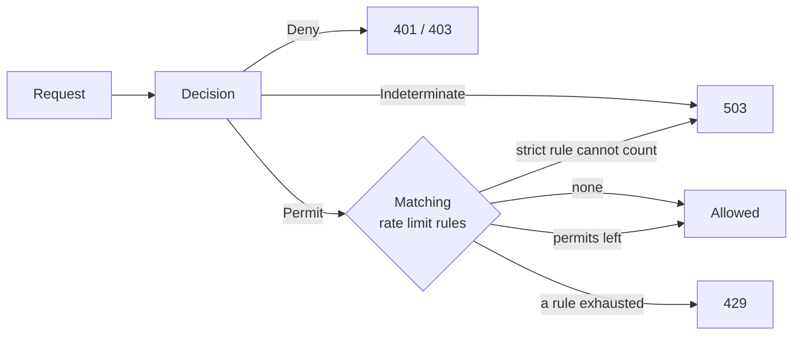

# Rate Limiting

For policy authors and operators protecting APIs from overuse. Rate limit rules live in the policy documents and run
only after a request is permitted; this page covers writing rules, choosing a counter backend, and what clients see
when a limit is hit.

A policy decides whether a request is allowed; a rate limit rule decides how often permitted requests may pass. The
rules are *obligations* of a permit: a request that is denied or cannot be decided spends nothing, so it never uses up
the quota of legitimate callers. [Checks in code](../integration/checks.md), `simulate`, `explain` and shadow
evaluations spend nothing either.



## Rules

Every document can hold rules in `rateLimits` ([fields](./language.md#rate-limit-rules)):

```json
{
  "schema": 2,
  "revision": 7,
  "publishedAt": "2026-11-01T08:00:00Z",
  "policies": [],
  "bindings": [],
  "rateLimits": [
    {
      "id": "login-per-ip",
      "action": "http:POST",
      "resource": "http:path:/auth/login",
      "key": "environment.ip",
      "permitsPerSecond": 0.1,
      "windowSeconds": 60,
      "strictFailure": true
    },
    {
      "id": "export-free-tier",
      "action": "http:GET",
      "resource": "http:path:/export/**",
      "condition": { "in": ["free", "scope.roles"] },
      "key": "subject.id",
      "permitsPerSecond": 0.2,
      "windowSeconds": 60
    }
  ]
}
```

A rule matches a permitted request the way a DENY statement would: one of its action patterns, one of its resource
patterns, and its condition. A window allows `permitsPerSecond × windowSeconds` requests, and at least one.

Which rules a request is held to:

- the platform document's rules, for every permitted request;
- the app document's rules, when the request read that document: it has an app and the principal holds a role in the
  request's space ([Role permissions](./role-permissions.md#app-documents));
- the tenant document's rules, for requests of that tenant.

They run in that order, and in document order within a document. Each matching rule spends one permit. The first rule
whose bucket is exhausted answers `429`; the rules after it spend nothing, and the rules before it keep what they
spent. Rules add up: a tenant or app rule never replaces or relaxes a platform rule, even one with the same id, so a
request passes only while every rule it matches has permits left.

## Keys

`key` names the attribute whose value picks the bucket: a String or Ip attribute of the
[catalog](./language.md#attributes), such as `environment.ip`, `subject.id`, `scope.tenant`,
`subject.attributes.plan` or `resource.var.orderId`. A `resource.var.<name>` key must be captured by every resource
pattern of the rule.

| `key` | Buckets |
|---|---|
| absent | One bucket shared by every request the rule matches. |
| present | One bucket per value. Requests where the value is absent share one bucket of their own. |

Rules of different documents never share buckets: a platform rule counts under its own id, an app rule under
`app:<appId>/<id>` and a tenant rule under `tenant:<tenantId>/<id>`
([`CompiledRateLimit.counterId`](https://github.com/Ahoo-Wang/CoSec/blob/main/engine/src/main/kotlin/me/ahoo/cosec/engine/flat/RateLimits.kt)).
A rule id cannot contain `:` or `/`, so no rule can name another document's counter: a tenant cannot spend, or reset,
the platform's quotas.

A key that reads `subject.id` gives anonymous callers one shared bucket; key them by `environment.ip` in a separate
rule. A key or condition that reads an [external attribute](./language.md#external-attributes-and-onmissing) which
cannot be fetched leaves the rule without a bucket: with `onMissing: "nomatch"` (platform rules only) it is skipped,
otherwise `strictFailure` decides as for a [failing limiter](#failure-behavior).

## Counting and backends

Both limiters count with the same sliding window: the estimate is the previous window's count, weighted by how much
of it still overlaps, plus the current window's count. A request is allowed while the estimate is below the limit;
refused requests are not counted.

| Limiter | Used when | Scope |
|---|---|---|
| `ReactiveRedisRateLimiter` | `cosec-cocache` is on the classpath and a `ReactiveStringRedisTemplate` bean exists | Cluster-wide, checked and counted atomically by a Lua script, without blocking the caller's thread. Counters live under `cosec:rate-limiter:<rule>:<bucket>:<window>` and expire after two windows. |
| `LocalRateLimiter` | otherwise | Per JVM: with N instances the effective limit is N times higher. Keeps at most 100,000 buckets and drops buckets idle for an hour; a dropped bucket starts again from zero. |

Your own `RateLimiter` bean replaces both ([Extending](../architecture/extending.md)). Each call has
`cosec.authorization.rate-limit.timeout` (default `500ms`, [Configuration](../operations/configuration.md)); a call
that takes longer counts as a failure.

## Responses and headers

A request stopped by a rule is answered `429 Too Many Requests` with the `too-many-requests` problem
([status codes](../integration/web.md)). A permitted request that spent at least one permit carries the headers of the
rule with the fewest permits left; a `429` carries those of the exhausted rule:

| Header | Value |
|---|---|
| `RateLimit-Limit` | Permits per window of that rule, rounded up. |
| `RateLimit-Remaining` | Permits left in its current window. |
| `RateLimit-Reset` | Seconds until its current window ends, at least `1`. |
| `Retry-After` | Only on `429`: the same as `RateLimit-Reset`. |

A request that matched no rule, or whose rules were all skipped, has none of these headers.

## Failure behavior

A rule cannot be counted when the limiter fails (Redis unreachable, a script error), times out, is not configured, or
the rule's bucket cannot be read. Its `strictFailure` decides:

| `strictFailure` | The request |
|---|---|
| `false` (default) | The rule is skipped; the next rule runs. Logged at `WARN`. |
| `true` | Refused with `503 Service Unavailable` (`unavailable` problem, no `Retry-After`). Logged at `ERROR`. |

A bucket that cannot be read for any reason other than a missing external attribute refuses the request even without
`strictFailure`. Failure logs are throttled to one per ten seconds. Skipping a lenient rule is one of the documented
exceptions to [fail closed](../guide/security-model.md); set `strictFailure` on rules that protect against abuse, such
as login attempts, and leave it off on rules that only smooth load.

## Publishing rules

Rules are part of their documents, so they are checked and compiled with them: an invalid id, a duplicate id in one
document, `permitsPerSecond` not above `0`, `windowSeconds` below `1`, a `key` that is not a String or Ip attribute,
or a variable a pattern does not capture fails the whole document ([Testing policies](./testing.md#validating-policies)).

Change rules through the control plane like any other entry ([Changes](./testing.md#changes)):

- `putRateLimit` (`rateLimit`, optional `ifMatch`) adds a rule, or replaces the one with its id where it stands;
  `removeRateLimit` (`id`, optional `ifMatch`) removes one;
- `POST /documents/{key}:apply` proposes them from a whole document: `MERGE` puts new and changed rules, `REPLACE` also
  removes the rules the document leaves out. Order is part of the rules (the first exhausted rule answers), so a
  rule out of place is removed and put again; a rollback restores the rules of its revision the same way.

Each operation needs `cosec:write` on the entry `doc/<document>/rateLimit/<id>`, such as
`doc/tenant/acme/rateLimit/export-per-user`. A tenant's rule changes, tightening or loosening, need no second person:
its rules count in its own buckets, and every platform and app rule still applies to its requests. A rule change to the
platform or app document, removals included, needs [approval](./testing.md#approval) as any other change there does.

A shadow window compares decisions, and a rule never changes a decision, so a change that touches only rate limit rules
shows no difference in its window: the window tells you nothing about the quota.

**Next:** catch mistakes before they reach production, in [Testing policies](./testing.md).
