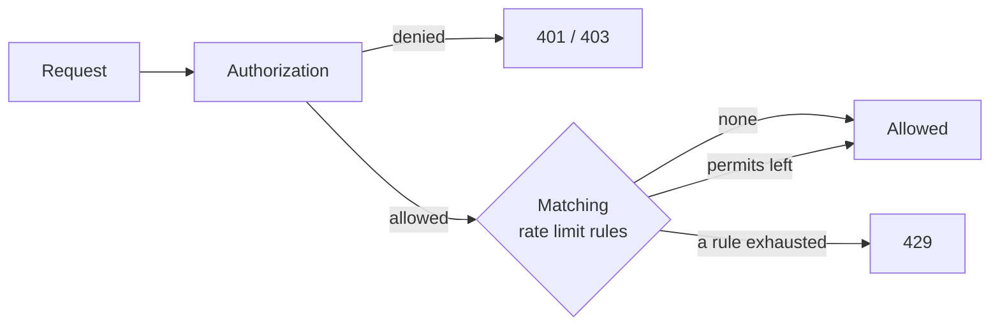

# Rate Limiting

For policy authors and operators protecting APIs from overuse. Rate limiting runs after authorization and spends
permits only for allowed requests; this page covers writing rules, choosing a counter backend, and what clients see
when a limit is hit.

A policy decides whether a request is allowed; a rate limit rule decides how often allowed requests may pass. A
denied request is already rejected and never uses up the quota of legitimate callers, and
[checks in code](../integration/checks.md) never spend permits.



## Rules

Rules are JSON files, by default every `classpath:cosec-rate-limit/*-rate-limit.json`
([`cosec.limiter.*`](../operations/configuration.md#rate-limiting)). A file holds one rule or an array of rules.

```json
[
  {
    "id": "login-by-ip",
    "action": { "path": { "pattern": "/auth/login", "method": "POST" } },
    "key": "request.remoteIp",
    "permitsPerSecond": 0.1,
    "windowSeconds": 60,
    "strictFailure": true
  },
  {
    "id": "export-free-tier",
    "action": "/export/**",
    "condition": { "inRole": { "value": "free" } },
    "key": "context.principal.id",
    "permitsPerSecond": 0.2,
    "windowSeconds": 60
  }
]
```

| Field | Required | Default | Meaning |
|---|---|---|---|
| `id` | yes | | Names the quota: letters, digits, `_`, `.` and `-`. Counters belong to the id, never to the settings, so two rules never share a quota by accident. Unique across all rules. |
| `action` | yes | | Which requests the rule applies to, written as a statement's [action](./language.md#actions). |
| `condition` | no | always | Narrows the rule, written as a statement's [condition](./language.md#conditions). |
| `key` | no | one shared bucket | What the quota is counted by ([Keys](#keys)). |
| `permitsPerSecond` | yes | | The rate, greater than `0`. |
| `windowSeconds` | no | `1` | Window length, an integer of at least `1`. A window allows `permitsPerSecond × windowSeconds` requests, and at least one. |
| `strictFailure` | no | `false` | What a backend failure means ([Failure behavior](#failure-behavior)). |

Use a longer window for low rates: `0.1` per second over `60` seconds is 6 requests a minute, while over the
default one-second window the limit (`0.1`) is below one request and the counting gets coarse.

For an allowed request, every matching rule spends one permit, in file order. The first exhausted rule rejects the
request with `429`; the rules after it spend nothing, the rules before it have already spent theirs.

[`schema/rate-limit-rule.schema.json`](https://github.com/Ahoo-Wang/CoSec/blob/main/schema/rate-limit-rule.schema.json)
describes the file for editors ([JSON Schema](./language.md#json-schema)).

## Keys

`key` is a [part](./language.md#parts) that splits the quota into one bucket per value:

| `key` | One bucket per |
|---|---|
| none | rule: all matching requests share one bucket |
| `request.remoteIp` | client IP |
| `context.principal.id` | principal (anonymous callers share one) |
| `context.tenantId` | tenant |
| `request.header.X-Api-Client` | header value |
| `request.path.var.<name>` | value of a variable the rule's own `path` action captures |

Requests whose part is empty share one bucket, so leaving out a header does not get around the limit. The key is
checked when the rule loads: a blank key or a part outside the [list](./language.md#parts) fails.

A rule reads `request.path.var.<name>`, in its key or its condition, only from the variables its own `path` action
captured, never from a policy or another rule that matched the same request. A rule whose action is not a `path`
action and that reads path variables fails to load with `PathVariableScopeException`
([Path variables](./language.md#path-variables)):

```json
{
  "id": "orders-per-order",
  "action": { "path": { "pattern": "/orders/{orderId}/**", "method": "POST" } },
  "key": "request.path.var.orderId",
  "permitsPerSecond": 1,
  "windowSeconds": 10
}
```

## Counting and backends

Both backends count with the same sliding window: the estimate is the previous window's count, weighted by how much
of it still overlaps, plus the current window's count. A request is allowed while the estimate is below the limit;
rejected requests are not counted.

| Backend | Used when | Scope |
|---|---|---|
| `RedisRateLimiter` | `cosec-cocache` is on the classpath and a `StringRedisTemplate` bean exists | Cluster-wide, checked and counted atomically by a Lua script, off the event loop. Counters live under `<key-prefix>:<id>:<bucket>:<window>` (`cosec.limiter.key-prefix`, default `cosec:rate-limiter`) and expire after two windows. |
| `LocalRateLimiter` | otherwise | Per JVM: with N instances the effective limit is N times higher. Keeps at most 100,000 buckets and drops buckets idle for an hour; a dropped bucket starts again from zero. |

Your own `RateLimiter` bean replaces both ([Extending](../architecture/extending.md)).

## Responses and headers

A request that exceeds a rule is answered with `429 Too Many Requests` ([status codes](../integration/web.md#responses-and-status-codes)).
When at least one rule matched, the response carries these headers, whether the request was allowed or rejected:

| Header | Value |
|---|---|
| `RateLimit-Limit` | Permits per window of the rule with the fewest permits left (the rejecting rule on `429`), rounded up. |
| `RateLimit-Remaining` | Permits left in its current window. |
| `RateLimit-Reset` | Seconds until its current window ends, at least `1`. |
| `Retry-After` | Only on `429`: the same as `RateLimit-Reset`. |

Rejections are audited and traced with the decision `TOO_MANY_REQUESTS`, together with the policy or permission that
allowed the request ([Observability](../operations/observability.md)).

## Failure behavior

When the backend fails (Redis unreachable, a script error), `strictFailure` decides:

| `strictFailure` | The request |
|---|---|
| `false` (default) | The rule is skipped; the request continues to the next rule. Logged at `WARN`. |
| `true` | Rejected with `429` and `Retry-After`. Logged at `ERROR`. |

Failure logs are throttled to one per ten seconds. Skipping a lenient rule is one of the documented exceptions to
[fail closed](../guide/security-model.md#fail-closed); set `strictFailure` on rules that protect against abuse, such
as login attempts, and leave it off on rules that only smooth load.

## Loading rules

Rule files load as strictly as [policy files](./language.md#loading-policy-files), because a rule that is
silently dropped removes a protection without anyone noticing. The application does not start when:

- a file cannot be read or a rule cannot be built (invalid JSON, a missing field, an invalid id, `permitsPerSecond`
  not above `0`, `windowSeconds` below `1`, an unsupported `key`, path variables read out of scope);
- a rule id is declared twice, in one file or in two;
- a configured location does not exist or matches no file. Only the default location
  `classpath:cosec-rate-limit/*-rate-limit.json` may match nothing, so applications without rules need no setting.

A file matched by two locations is loaded once. To load rules from somewhere else, such as a database, declare a
`RateLimitRuleProvider` bean. It is called on every allowed request, so it must answer from memory;
`RateLimitRuleProvider.of(rules)` rejects duplicate ids.
