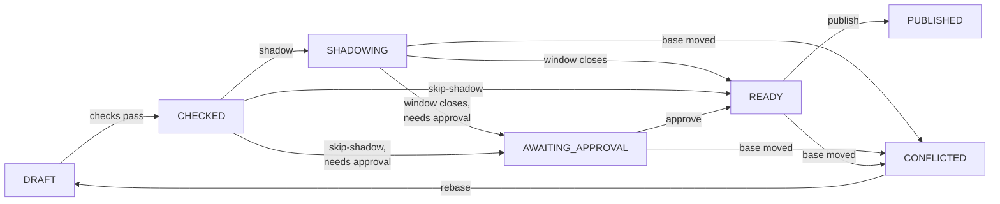

# Testing Policies

For policy authors and reviewers who change documents in production. Every document change goes through the control
plane, which checks and compiles it, can try it on live traffic in a shadow window, asks for a second person's
approval when it cannot prove a change safe, and only then publishes it. This page walks through that workflow and the
tools around it. The fields themselves are in the [policy language](./language.md).

## The control plane

The control plane comes with the starter's `controlSupport` feature (it needs `cacheSupport`, since documents live in
Redis). It serves an HTTP API under `cosec.control.http.base-path` (default `/cosec/control/v1`); its settings are
`cosec.control.*` ([Configuration](../operations/configuration.md)), and how documents are stored and first
published is in [Storage](../operations/storage.md).

A control request is an ordinary request first: the host pipeline authenticates it and must permit it, so the
documents must allow the operators' requests to the API path. Each step is then authorized again as that principal,
in the app `cosec.control.app-id` (default `cosec-control`), with a `cosec:<verb>` action on the document
(`doc/platform`, `doc/app/<appId>`, `doc/tenant/<tenantId>`) or entry it touches. Before any policy, a hard rule
applies: a tenant's principals act only on their own tenant document; the platform and app documents belong to
principals of the `(platform)` tenant.

| Step | Needs |
|---|---|
| Read a document, its history, a diff | `cosec:read` |
| Propose, `apply`, rebase | `cosec:write` on each entry it puts or removes, `cosec:grant` on the scope of each binding it puts; `apply` and rollback also `cosec:read` |
| Start a shadow window, publish | `cosec:publish` |
| Skip a shadow window | `cosec:skip-shadow` |
| Approve, reject | `cosec:approve` |
| `simulate`, `explain`, `analyze` | `cosec:simulate`, `cosec:explain`, `cosec:analyze` on the tenant document asked about |

Three built-in policies can be bound to operators: `cosec:platform-admin` (every action on every document),
`cosec:tenant-admin` (`read`, `write`, `grant`, `publish`, `simulate`, `explain`, `analyze`, `shadow-read` on its own
tenant's document) and `cosec:tenant-viewer` (the same without `write`, `grant` and `publish`).

| Method and path | Does |
|---|---|
| `GET /documents/{key}` | The current revision. `{key}` is `platform`, `app:<appId>` or `tenant:<tenantId>`. |
| `GET /documents/{key}/revisions?before=&limit=` | Revision history, newest first (`limit` 1 to 200, default 20). |
| `GET /documents/{key}/revisions/{revision}` | One kept revision; `410` when it is no longer kept. |
| `GET /documents/{key}/diff?from=&to=` | Policies and bindings added, removed and changed between two revisions. |
| `GET /documents/{key}/revisions/{revision}/propagation` | How many recently reporting instances have installed that revision. |
| `POST /documents/{key}:apply`, `POST /documents/{key}:rollback` | Propose a change from a whole document, or back to an old revision. |
| `POST /changes`, `GET /changes/{id}` | Propose a change; read one. |
| `POST /changes/{id}:rebase`, `:shadow`, `:skip-shadow`, `:approve`, `:reject`, `:abandon`, `:publish` | Move a change on. |
| `POST /simulate`, `POST /explain`, `POST /analyze` | Decide or analyze without changing anything. |

Errors are `application/problem+json`. A `400`, `409`, `410`, `412`, `422` or `428` explains your own request in
`detail`; a `401`, `403`, `404`, `500` or `503` carries no detail, so a refusal never tells whether a document or change
exists.

## Validating policies

Every proposal is checked against the current revision of its document before anything is stored as checked. What the
checks find is listed in the change's `findings`, each with a `check`, the JSON `path` in the candidate, a `message`,
the HTTP `status` it stands for and a `severity`:

| Check | Status | Finds |
|---|---|---|
| `V1` | 400 | The candidate does not read back as a document. |
| `V2` | 400, 422 | The document is over 8 MB; an id uses a reserved prefix (`cosec:`, `g:`, `r:`); a tenant policy reuses a platform policy's id. |
| `COMPILE` | 422 | A policy, condition, pattern, binding or rule does not compile, with the platform's limits and declared attributes. |
| `REFERENCES` | 422 | A binding names a policy that resolves nowhere; a platform change removes a policy another document refers to; a tenant's `boundary` is not a platform boundary. |
| `OPERATION` | 422 | An operation removes what is not there, or sets a section the document does not have. |
| `IF_MATCH` | 412 | An entry is no longer what the operation's `ifMatch` says. |
| `V3` (warning) | | The platform's `limits` or `attributes` change: other documents are compiled again on every instance, and one that no longer compiles fails closed. |

A change with any error stays `DRAFT` and cannot be staged or published; fix it by proposing a new change. A clean
change is `CHECKED`. Nothing a change does reaches enforcement before it is published, and publishing compiles the
candidate again against the documents current at that moment.

## Simulating a request

`simulate` decides a described request on the current documents, the way enforcement would, and optionally on a
change's candidate too:

```json
{
  "request": {
    "tenant": "acme",
    "principal": "bob",
    "roles": ["clerk@team-a"],
    "app": "order",
    "space": "team-a",
    "action": "order:ship",
    "resource": "order/42",
    "time": "2026-11-01T09:30:00Z"
  },
  "candidate": "<change id>"
}
```

| Field | Meaning |
|---|---|
| `tenant` | Required. |
| `principal` | The principal id; leave it out for an anonymous request. |
| `roles`, `policies` | The memberships, as token claims write them: `role` or `role@space`, and attached policy ids. |
| `app`, `space` | The declared scope; the space is checked against the roles as on the data plane. |
| `action` | Required, `service:verb` (`http:GET` for an unmapped HTTP request). |
| `resource` | Required: `type/id`, or a path starting with `/` for an `http` resource. |
| `remoteIp`, `time` | The client address, and an ISO instant (default: now). |

The answer has `enforced`, `candidate` when one was asked for, and `differs`. Each decision is `Permit`, `Deny`,
`Indeterminate` (with its `cause`) or `Rejected` (the scope was refused), with the statement that decided (`by`) and the
full trace of candidates. Statements from documents you may not read are left out and counted as `redacted`.

A simulation has no token attributes and fetches no external attributes: a statement that reads `ext.*` finds it
missing and follows its `onMissing`, so it is usually Indeterminate here.

## Debugging a decision with explain

`explain` takes the same `request` and, optionally, `at`: the document revisions a decision used, as its audit event
records them (`{"platform": 12, "app": 3, "tenant": 4}`). It evaluates on those revisions, as long as they are still
kept, and returns the decision with its trace, so you can see why a past request was decided as it was. Its fields and
how to find the request are in [Checks in code](../integration/checks.md).

## Changes

A change is a set of entry operations on one document, made on the revision you have seen (`base`):

```json
{
  "document": "tenant:acme",
  "base": 4,
  "note": "Let auditors read orders",
  "operations": [
    {
      "op": "putBinding",
      "binding": {
        "id": "auditor-reads-orders",
        "subject": { "role": "auditor" },
        "app": "order",
        "space": "",
        "policy": "perm:order/read"
      }
    }
  ]
}
```

| Operation | Fields | Does |
|---|---|---|
| `putPolicy` | `policy`, optional `ifMatch` | Adds the policy, or replaces the one with its id. |
| `removePolicy` | `id`, optional `ifMatch` | Removes a policy. |
| `putBinding` | `binding`, optional `ifMatch` | Adds the binding, or replaces the one with its id. |
| `removeBinding` | `id`, optional `ifMatch` | Removes a binding. |
| `putCatalog` | `catalog` | Sets an app document's catalog; without `catalog`, removes it. |
| `setLimits` | `limits` with all six limits | Sets the platform's limits; without `limits`, back to the defaults. |
| `setAttributes` | `attributes` | Sets the platform's declared attributes; without `attributes`, removes them. |

`ifMatch` is the SHA-256 of the entry as the document writes it: the operation applies only if the entry is still
that. Instead of writing operations, `POST /documents/{key}:apply` takes a whole document (`{"document", "mode",
"note"}`) and proposes the operations that turn the current revision into it: `MERGE` only adds and changes, `REPLACE`
also removes what the document leaves out. Use `apply` to set a tenant's `boundary` or the platform's default. Rate
limit rules cannot be changed through the control plane yet ([Rate limiting](./rate-limiting.md#publishing-rules)).

A base that is no longer the current revision is a `409`. A DENY with `onMissing: "nomatch"` needs a confirmation in
`confirmations` (`{"policy", "statement", "digest", "kind": "deny-nomatch"}`); without one the change cannot publish.



A document has at most one staged change (`SHADOWING`, `AWAITING_APPROVAL` or `READY`); staging another is a `409`
until that one is published, abandoned, rejected or expired. A change that is not finished expires
`cosec.control.changes.expire-after` (default 7 days) after it was proposed. Its author can `:rebase` a `CONFLICTED`,
`DRAFT` or `CHECKED` change onto the current revision, which runs every check again and drops earlier approvals and
shadow evidence. The author, or anyone with `cosec:publish`, can `:abandon` it.

## Trying changes in shadow mode

`POST /changes/{id}:shadow` stages a `CHECKED` change and opens a shadow window. The data plane instances evaluate a
sample of live requests a second time with the candidate in place of the current document, and report how each came
out; the candidate never affects a real decision. A candidate is compared only on requests that read its document
(a tenant's on that tenant's requests, an app's on requests that read that app document, the platform's on all), and
only by an instance that has installed the candidate's base revision.

| Outcome | Means |
|---|---|
| `SAME` | The same decision, by the same statement. |
| `BY_CHANGED` | The same decision, by another statement. |
| `WIDENED` | The candidate permits where enforcement did not. |
| `NARROWED` | Enforcement permitted; the candidate does not. |
| `BECAME_INDETERMINATE` | The candidate is Indeterminate where enforcement was not, for a reason other than a missing attribute. |
| `CANDIDATE_INDETERMINATE` | The candidate reads an external attribute the request did not fetch (a shadow evaluation fetches none). |
| `CANDIDATE_ERROR` | An instance cannot compile or evaluate the candidate. |
| `BASE_MISMATCH` | The instance has another revision of the document installed: not compared, not a sample. |

The window closes:

- at once, *blocked*, when any instance reports `CANDIDATE_ERROR`: the change never publishes; abandon it;
- once `cosec.control.shadow.min-duration` (15 minutes) has passed and the instances have reported
  `cosec.control.shadow.min-samples` (1,000) samples other than `BASE_MISMATCH`;
- at `cosec.control.shadow.max-duration` (24 hours) with fewer, as *insufficient*.

When it closes, the change becomes `READY`, or `AWAITING_APPROVAL` when it needs [approval](#approval). If the
document's revision moved meanwhile, it becomes `CONFLICTED`. The data plane takes part with `cacheSupport` and
`cosec.authorization.shadow.*` (on by default, sampling 10 % of requests).

::: warning
The starter does not close shadow windows on its own yet: closing is `Changes.shadowed(changeId)`, and nothing in
the starter calls it. Until it does, a staged change stays `SHADOWING` until it expires, unless the host calls
`shadowed` on the `cosecChanges` bean periodically, or the change skips its window.
:::

`POST /changes/{id}:skip-shadow` with a `reason` stages a `CHECKED` change without a window; it needs
`cosec:skip-shadow`, and the revision records that the window was skipped. A change that only creates or revokes
break-glass bindings has no window.

## Approval

Nobody can grant beyond their own rights. When a change is checked, the control plane analyzes what it grants as its
author, and anything it cannot prove contained in the author's own permissions becomes an *escalation*:

| Reason | Means |
|---|---|
| `NOT_COVERED` | No single ALLOW of the author is proven to contain what the change grants. |
| `DENY_OVERLAP` | A DENY that binds the author may overlap it. |
| `CROSS_TENANT` | The author is not in the document's tenant. |
| `NOT_ANALYZED` | A platform or app document change, or a tenant boundary change, by someone who is not the trust root. |
| `BREAK_GLASS` | A new or changed break-glass binding: always needs a second person. |

Removing entries and narrowing ALLOWs grant nothing. A holder of `cosec:approve` on the document is the trust root:
its own changes are not analyzed, unless `cosec.control.approval.four-eyes` is on, in which case they are analyzed like
anyone's.

A change with escalations waits in `AWAITING_APPROVAL` once its window closed or was skipped. Another person holding
`cosec:approve` approves it with `POST /changes/{id}:approve` and the `candidate` digest they reviewed (from
`GET /changes/{id}`); a different digest is a `409`, and the author cannot approve their own change. `:reject` with a
`reason` ends it. An approval is valid for `cosec.control.approval.expire-after` (72 hours) and only for that
candidate.

## Publishing and rolling back

`POST /changes/{id}:publish` publishes a `READY` change. When its window saw `WIDENED`, `NARROWED` or
`BECAME_INDETERMINATE` requests, or closed as insufficient, the publisher must acknowledge exactly those numbers, or
the answer is `428`:

```json
{ "ack": { "window": "<window id>", "counts": { "SAME": 4180, "NARROWED": 3 } } }
```

The window id and counts are in the change's `shadow`; zero counts may be left out. Publishing then checks
everything again as the publisher, on the current documents: their rights to every entry, the grant analysis, and the
approval, which must cover the escalations found now, be unexpired, be for this candidate, come from neither the author
nor the publisher, and come from someone who still holds `cosec:approve`. If the approval no longer holds, the change
goes back to `AWAITING_APPROVAL` and nothing is published. If the document moved, the change is `CONFLICTED`; if the
candidate no longer compiles against the current documents, it is `DRAFT` with the findings.

To undo a revision, `POST /documents/{key}:rollback` with `{"revision": 11, "note": "..."}` proposes a `ROLLBACK`
change that makes the document what it was at that revision. It goes through the same checks, window, approval and
publish as any change. Which revisions are kept, and how long, is in [Storage](../operations/storage.md).

## Access reviews

`POST /analyze` lists who could be permitted or denied an action on a resource in a tenant:

```json
{ "query": { "tenant": "acme", "app": "order", "space": "team-a", "action": "order:read", "resource": "order/42" } }
```

The answer lists `allows` and `denies`: every binding (in the platform, tenant and, when `app` is given, app document)
whose scope fits the query and whose policy has a statement matching the action and resource, with its document,
subject, app, space, policy and statement index. `conditional` marks a statement or policy with a condition, which is
not evaluated. `app` and `space` left out match bindings of any app or space. Documents you may not read are counted in
`hidden`, and bindings to policies in them in `opaque`. Attachments are not listed: they depend on each principal's
memberships.

## Policies in CI

Validate document files with the [JSON Schemas](./language.md#json-schema), then compile them with the reader and
compiler the control plane and every instance use, from `cosec-core`:

```kotlin
import me.ahoo.cosec.model.decision.DocumentKind
import me.ahoo.cosec.snapshot.document.PolicyDocumentCodec
import me.ahoo.cosec.snapshot.document.PolicyDocumentCompiler
import java.io.File

val platform = PolicyDocumentCodec.decode(DocumentKind.PLATFORM, "", File("platform.json").readBytes())
val acme = PolicyDocumentCodec.decode(DocumentKind.TENANT, "acme", File("tenant-acme.json").readBytes())
// The platform's limits and declared attributes, as the control plane checks a candidate.
val compiler = PolicyDocumentCompiler.forPlatform(platform)
compiler.compile(platform)
compiler.compile(acme)
compiler.checkReferences(acme, platform)
```

`decode` throws `SnapshotFormatException` and `compile` throws `DocumentCompileException`, with every error and its
JSON path. CoSec 8.0 has no policy test kit for asserting decisions yet; to check decisions before publishing, use
[`simulate`](#simulating-a-request) and a [shadow window](#trying-changes-in-shadow-mode).

**Next:** publish tested policies to the store, in [Storage](../operations/storage.md).
