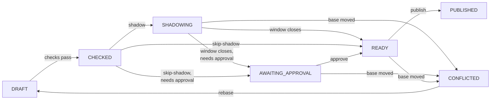

# Testing Policies

For policy authors and reviewers who change documents in production. Every document change goes through the control
plane, which checks and compiles it, can try it on live traffic in a shadow window, asks for a second person's
approval when it cannot prove a change safe, and only then publishes it. This page walks through that workflow and the
tools around it. The fields themselves are in the [policy language](./language.md).

## The control plane

The control plane comes with the `cosec-control` module (it needs `cosec-cocache`, since documents live in
Redis). It serves an HTTP API under `{cosec.control.http.base-path}/v1` (default `/cosec/control/v1`); its settings are
`cosec.control.*` ([Configuration](../operations/configuration.md)), and how documents are stored and first
published is in [Storage](../operations/storage.md).

A control request is an ordinary request first: the host pipeline authenticates it and must permit it, so the
documents must allow the operators' requests to the API path. Each step is then authorized again as that principal,
in the app `cosec.control.app-id` (default `cosec-control`), with a `cosec:<verb>` action on the document
(`doc/platform`, `doc/app/<appId>`, `doc/tenant/<tenantId>`) or entry it touches. An entry's id is one segment of its
resource, so a change cannot put an id with a `/`; the one exception is a permission policy's `perm:<app>/<id>`, which a
rule reaches with `**`. Before any policy, a hard rule
applies: a tenant's principals act only on their own tenant document; the platform and app documents belong to
principals of the `(platform)` tenant.

| Step | Needs |
|---|---|
| Read a document, its history, a diff | `cosec:read` |
| Propose, `apply`, rebase | `cosec:write` on each entry it puts or removes, `cosec:grant` on the scope of each binding it puts and of each role that comes to derive a binding; `apply` and rollback also `cosec:read` |
| Start a shadow window, publish | `cosec:publish`; for a break-glass request or revoke, `cosec:breakglass` instead |
| Skip a shadow window | `cosec:skip-shadow` |
| Approve, reject | `cosec:approve` |
| `simulate`, `explain`, `analyze` | `cosec:simulate`, `cosec:explain` on the tenant document that decides the request (`(0)`'s for one without a principal); `cosec:analyze` on the tenant document asked about |

`cosec:grant` is checked on the scope of each binding, `scope/<tenant>/<app>/<space>`: `*` for a binding of any
app or any space, and `(default)` for the default space, so a policy that limits grants in the default space names
`scope/acme/order/(default)`. Space ids beginning with `(` are CoSec's, so `(default)` is never a space of yours.

Three built-in policies can be bound to operators: `cosec:platform-admin` (every action on every document),
`cosec:tenant-admin` (`read`, `write`, `grant`, `publish`, `simulate`, `explain`, `analyze`, `shadow-read` and
`skip-shadow` on its own tenant's document) and `cosec:tenant-viewer` (the same without `write`, `grant`, `publish` and
`skip-shadow`).

| Method and path | Does |
|---|---|
| `GET /documents/{key}` | The current revision. `{key}` is `platform`, `app:<appId>` or `tenant:<tenantId>`. |
| `GET /documents/{key}/revisions?before=&limit=` | Revision history, newest first (`limit` 1 to 200, default 20). |
| `GET /documents/{key}/revisions/{revision}` | One kept revision; `410` when it is no longer kept. |
| `GET /documents/{key}/diff?from=&to=` | Policies and bindings added, removed and changed between two revisions, of the [expanded](./role-permissions.md#roles) documents, the `roles` as written, and `sections`: whether anything else differs (the catalog, limits, attributes, boundary or rate limits), compared by their content. |
| `GET /documents/{key}/revisions/{revision}/propagation` | How many recently reporting instances have installed that revision. |
| `POST /documents/{key}:apply`, `POST /documents/{key}:rollback` | Propose a change from a whole document, or back to an old revision. |
| `POST /changes`, `GET /changes/{id}` | Propose a change; read one. |
| `POST /changes/{id}:rebase`, `:shadow`, `:skip-shadow`, `:approve`, `:reject`, `:abandon`, `:publish` | Move a change on. |
| `POST /break-glass`, `POST /break-glass/{change}:approve`, `DELETE /break-glass/{bindingId}?reason=` | Request break-glass, approve a request, revoke a binding ([Security model](../guide/security-model.md#break-glass)). A revoke answers `200` only once the binding no longer grants, `404` when the platform document has no binding of that id, and `409` otherwise, an ordinary binding of that id included ([Taking a busy slot](#taking-a-busy-slot)). |
| `POST /simulate`, `POST /explain`, `POST /analyze` | Decide or analyze without changing anything. |

Errors are `application/problem+json`. A `400`, `409`, `410`, `412`, `422` or `428` explains your own request in
`detail`; a `401`, `403`, `404`, `500` or `503` carries no detail, so a refusal never tells whether a document or change
exists. A `400`'s `detail` is one of the control plane's own checks, or names the field that does not parse (`[mode] is
not one of MERGE, REPLACE.`), never an exception's message. A request whose path, query or body holds a string with an
unpaired UTF-16 surrogate (a JSON escape such as `"\uD800"`), anywhere, is a `400` before its route reads it (`IDN-10`):
a Redis key would write it as `?`, naming another id. A stored document or record that does not decode, such as
one a newer version wrote during a rolling upgrade, is a `500`. A request no principal stands behind, an anonymous permit
of the pipeline included, is a `401` before any of its body is read. Only a route's exact path is served: one with a
trailing `/` is a `404`, and the pipeline refuses one with an empty segment with `400` before it gets there. A change whose record does not decode, one of an app that cannot be an app id included, is a `503` without detail to
every caller (`SCP-10`). The control
host logs why at `INFO`, with the problem's `requestId`
([Troubleshooting](../operations/troubleshooting.md#control-plane-errors)).

## Validating policies

Every proposal is checked against the current revision of its document before anything is stored as checked. What the
checks find is listed in the change's `findings`, each with a `check`, the JSON `path` in the candidate, a `message`,
the HTTP `status` it stands for and a `severity`:

| Check | Status | Finds |
|---|---|---|
| `V1` | 400 | The candidate does not read back as a document. |
| `V2` | 400, 422, 503 | The document is over 8 MB; an id uses a reserved prefix (`cosec:`, `g:`, `r:`); an id a change puts holds a `/` (`422`; a permission policy's `perm:<app>/<id>` may, and an entry that already holds one can stay or be removed); a tenant policy reuses a platform policy's id without being an exact copy of it (an exact copy is the first step of the [partition flow](../operations/upgrading.md#partition-plan)); a platform policy takes an id a tenant document already defines or binds, or changes while a tenant document holds a copy of it, which the finding names (`503` when such a tenant's document cannot be read); a binding is in an app that cannot be an app id (blank, `*`, `:`, a control character or an unpaired surrogate, over 128 characters), anywhere in the candidate (`400` at `$.bindings[i].app`: a document that still holds one must remove it, and a change that only removes it is valid). |
| `COMPILE` | 422 | A policy, condition, pattern, binding or rule does not compile, with the platform's limits, the platform's declared attributes and those of the control host's attribute providers. |
| `REFERENCES` | 422 | A binding names a policy that resolves nowhere, or a platform boundary, which is not bound; a platform change removes a policy another document refers to, or turns one into a boundary or a boundary into a policy (`CTL-30`; a tenant that defines a policy of that id itself does not count); a tenant's `boundary` is not a platform boundary. |
| `OPERATION` | 422 | An operation removes what is not there, or sets a section the document does not have. |
| `IF_MATCH` | 412 | An entry is no longer what the operation's `ifMatch` says. |
| `V3` (warning) | | The platform's `limits` or `attributes` change: other documents are compiled again on every instance, and one that no longer compiles fails closed. |

A change with any error stays `DRAFT` and cannot be staged or published; fix it by proposing a new change. A clean
change is `CHECKED`. Nothing a change does reaches enforcement before it is published, and publishing compiles the
candidate again against the documents current at that moment.

## Simulating a request

`simulate` decides a described request on the current documents, the way enforcement would, and optionally on a
change's candidate too:

```json
{
  "request": {
    "tenant": "acme",
    "principal": "bob",
    "roles": ["clerk@team-a"],
    "app": "order",
    "space": "team-a",
    "action": "order:ship",
    "resource": "order/42",
    "time": "2026-11-01T09:30:00Z"
  },
  "candidate": "<change id>"
}
```

| Field | Meaning |
|---|---|
| `tenant` | Required: the principal's tenant, the one the request is decided in. For an anonymous request, `(0)`. |
| `principal` | The principal id; leave it out for an anonymous request, which enforcement decides on tenant `(0)`. |
| `roles`, `policies` | The memberships, as token claims write them: `role` or `role@space`, and attached policy ids. |
| `app`, `space` | The declared scope; the space is checked against the roles as on the data plane. |
| `action` | Required, `service:verb` (`http:GET` for an unmapped HTTP request). |
| `resource` | Required: `type/id`, or a path starting with `/` for an `http` resource. An `http` path is normalized as a request's path is: one enforcement refuses (a dot segment, a malformed escape, over 2,048 characters or 256 per `/` segment) is `400`, and path parameters (`;v=2`) are removed. A typed id is held to the same lengths. |
| `remoteIp`, `time` | The client address, and an ISO instant (default: now). |
| `principalBindings`, `breakGlass` | What the credential may use, both `true` by default (CoSec's own token). For an API key, set `breakGlass` to `false`; for a key with a role cap, set `principalBindings` to `false` too: then the attachments and principal bindings grant nothing, and their DENYs still apply. Only a boolean is accepted. |

The answer has `enforced`, `candidate` when one was asked for, and `differs`. Each decision is `Permit`, `Deny`,
`Indeterminate` (with its `cause`) or `Rejected` (the scope was refused), with the statement that decided (`by`) and the
full trace of candidates. Statements from documents you may not read are left out and counted as `redacted`.
`differs` compares what the two decisions say, a failure by its kind and message, so the same compile failure on both
sides does not differ.

A simulation reads the documents enforcement reads: the platform's, the tenant's, and the app's when the request has
roles in its app or the tenant document binds one of that app's permission policies to `Anyone` or to a principal
([Policy language](./language.md)). For a change of the tenant document, the candidate decides that: a change that
adds such a binding reads the app document, one that removes the last of them no longer does. A tenant document that
does not compile reads as unresolved, so its bindings make the request read no app document, as on the data plane;
a `candidate` of a document the request did not read is `400`.

A simulation is authorized and decided on the tenant the request's scope resolves to, whose document decides it: the
principal's, or `(0)` for an anonymous request, as on the data plane. An anonymous request that names any other
`tenant` is `400`, after `cosec:simulate` on `(0)` is checked; so an administrator of `acme` cannot use an anonymous
request to read decisions on `(0)`'s document.

A request that sends a header the documents it reads read (in a condition, a boundary or a rate limit key) twice with
different values is `400`, as enforcement refuses it before deciding (`PIP-12`); identical repeats are one value. The
answer does not name the header. A `resource` enforcement would refuse is `400` too, and `analyze` takes its resource the
same way.

A simulation has no token attributes and fetches no external attributes: a statement that reads `ext.*` finds it
missing and follows its `onMissing`, so it is usually Indeterminate here.

The control plane decodes and compiles each stored document once for its content: a repeated `simulate`, `explain` or
`analyze` on the same heads compiles nothing again, and a head that moves is compiled when it is next read. A
`candidate` is compiled once per call, and so is a retained revision `explain` decides at. What is kept is bounded by
an estimate of its heap, 64 MB: a document weighs its stored size times 4 decoded, and times 8 more for each compiled
form (one per platform document it compiled with, at most two), so a tenant document of 1 MB stored weighs 12 MB. A
document that would weigh more than half of that, over about 2.7 MB stored, is never kept: it is decoded and compiled
on each call that reads it, as a candidate is, so it never pushes the other documents out. Limit the control API per
tenant to bound what such a document costs. To bound what one caller's calls cost, limit the control API per tenant
([Rate limiting](./rate-limiting.md#the-control-api)).

## Debugging a decision with explain

`explain` takes the same `request`, authorized and checked as `simulate`'s, and, optionally, `at`: the document revisions a decision used, as its audit event
records them (`{"platform": 12, "app": 3, "tenant": 4}`). It evaluates on those revisions, as long as they are still
kept, and returns the decision with its trace, so you can see why a past request was decided as it was. Whether the app
document was read is decided as enforcement decided it, with the tenant document at its recorded revision, and the
revisions it answers with are those it read: no `app` when it read no app document. Its fields and how to find the
request are in [Checks in code](../integration/checks.md).

## Changes

A change is a set of entry operations on one document, made on the revision you have seen (`base`):

```json
{
  "document": "tenant:acme",
  "base": 4,
  "note": "Let auditors read orders",
  "operations": [
    {
      "op": "putBinding",
      "binding": {
        "id": "auditor-reads-orders",
        "subject": { "role": "auditor" },
        "app": "order",
        "space": "",
        "policy": "perm:order/read"
      }
    }
  ]
}
```

| Operation | Fields | Does |
|---|---|---|
| `putPolicy` | `policy`, optional `ifMatch` | Adds the policy, or replaces the one with its id. |
| `removePolicy` | `id`, optional `ifMatch` | Removes a policy. |
| `putBinding` | `binding`, optional `ifMatch` | Adds the binding, or replaces the one with its id. |
| `removeBinding` | `id`, optional `ifMatch` | Removes a binding. |
| `putRateLimit` | `rateLimit`, optional `ifMatch` | Adds the rate limit rule, or replaces the one with its id where it stands. |
| `removeRateLimit` | `id`, optional `ifMatch` | Removes a rate limit rule. |
| `putRole` | `role`, optional `ifMatch` | Adds the role, or replaces the one with its id as a whole. App and tenant documents. |
| `removeRole` | `id`, optional `ifMatch` | Removes a role. |
| `putCatalog` | `catalog` | Sets an app document's catalog; without `catalog`, removes it. |
| `setLimits` | `limits` with all six limits, each a positive integer as in a document | Sets the platform's limits; without `limits`, back to the defaults. A value of another type is a `400`. |
| `setAttributes` | `attributes`, an array as in a document | Sets the platform's declared attributes; without `attributes`, removes them. Anything but an array of attributes is a `400`. |

`ifMatch` is the SHA-256 of the entry as the document writes it: the operation applies only if the entry is still
that. Instead of writing operations, `POST /documents/{key}:apply` takes a whole document (`{"document", "mode",
"note"}`) and proposes the operations that turn the current revision into it: `MERGE` only adds and changes, `REPLACE`
also removes what the document leaves out. Use `apply` to set a tenant's `boundary` or the platform's default. A
tenant's boundary is the platform's: a tenant principal's `REPLACE` or rollback that would remove or change the
boundary the platform set is a `403`. How
rate limit rule changes are authorized and approved is in [Rate limiting](./rate-limiting.md#publishing-rules).

A base that is no longer the current revision is a `409`. A DENY with `onMissing: "nomatch"` needs a confirmation in
`confirmations` (`{"policy", "statement", "digest", "kind": "deny-nomatch"}`); without one the change cannot publish.



A document has at most one staged change (`SHADOWING`, `AWAITING_APPROVAL` or `READY`); staging another is a `409`
until that one is published, abandoned, rejected or expired. A change is staged before it takes the slot, so a call
still writing its candidate holds the slot too; one that cannot write it, or is cancelled, gives the slot back and the
change is `CHECKED` again. A change that is not finished expires
`cosec.control.changes.expire-after` (default 7 days) after it was proposed: it is `EXPIRED` from the first time it is
read after that, and the control plane's maintenance pass reads every open change each
`cosec.control.shadow.check-interval` (default 1 minute). Its author can `:rebase` a `CONFLICTED`,
`DRAFT` or `CHECKED` change onto the current revision, which runs every check again and drops earlier approvals and
shadow evidence. The author, or anyone with `cosec:publish`, can `:abandon` it; a change that sets a tenant's boundary
only a platform principal rejects or abandons, and a revoke of a break-glass binding that still grants only its author
abandons (`BRK-10`). Every abandon is recorded as an `ABANDONED` change event whose note names the change's author;
abandoning a break-glass change needs a REQUIRED change listener, which records it first (`503` without one).

## Trying changes in shadow mode

`POST /changes/{id}:shadow` stages a `CHECKED` change and opens a shadow window. The data plane instances evaluate a
sample of live requests a second time with the candidate in place of the current document, and report how each came
out; the candidate never affects a real decision. A candidate is compared only on requests that read its document
(a tenant's on that tenant's requests, an app's on requests that read that app document, the platform's on all), and
only by an instance that has installed the candidate's base revision. A tenant candidate is compared on the documents a
request would read once it is published: one that binds an app's permission policy to `Anyone` or a principal brings in
that app's installed document where the request read none, and one that removes the last such binding leaves it out.

| Outcome | Means |
|---|---|
| `SAME` | The same decision, by the same statement. |
| `BY_CHANGED` | The same decision, by another statement. |
| `OBLIGATIONS_CHANGED` | The same permit, by the same statement, with other rate limit rules applying. |
| `BECAME_DENIED` | Enforcement could not decide; the candidate denies. |
| `WIDENED` | The candidate permits where enforcement did not. |
| `NARROWED` | Enforcement permitted; the candidate does not. |
| `BECAME_INDETERMINATE` | The candidate is Indeterminate where enforcement was not, for a reason other than a missing attribute. |
| `CANDIDATE_INDETERMINATE` | The candidate reads an external attribute the request did not fetch (a shadow evaluation fetches none). |
| `CANDIDATE_ERROR` | An instance cannot compile or evaluate the candidate, or cannot read an app document the candidate makes the request read. |
| `BASE_MISMATCH` | The instance has another revision of the document installed: not compared, not a sample. |

The window closes:

- at once, *blocked*, when any instance reports `CANDIDATE_ERROR`: the change never publishes; abandon it;
- once `cosec.control.shadow.min-duration` (15 minutes) has passed and the instances have reported
  `cosec.control.shadow.min-samples` (1,000) samples other than `BASE_MISMATCH`;
- at `cosec.control.shadow.max-duration` (24 hours) with fewer, as *insufficient*.

The control plane looks at every open window each `cosec.control.shadow.check-interval` (default 1 minute), on one
control-plane instance at a time. When a window closes, the change becomes `READY`, or `AWAITING_APPROVAL` when it needs
[approval](#approval). If the document's revision moved meanwhile, it becomes `CONFLICTED`. The data plane takes part
with `cosec-cocache` and `cosec.authorization.shadow.*` (on by default, sampling 10 % of requests).

Attribute providers, and the types they declare, must be the same on every data-plane instance and on the control host.
The control plane checks a candidate against its own providers; an instance without one of them cannot compile a
candidate that reads its attributes, reports `CANDIDATE_ERROR`, and the window closes blocked, so the change is never
published. A change that skips its window skips this check too: an instance that cannot compile the published document
fails closed on it.

A window compares decisions, so a change that touches only [rate limit rules](./rate-limiting.md#publishing-rules)
shows no difference there.

An instance writes its report of a window every `cosec.authorization.shadow.report-interval` (10 seconds) while the
window's candidate is staged. Once the candidate is withdrawn (the window closed, or the change was abandoned,
rejected, published or preempted), it writes the report once more and forgets the window; the report expires 8 days
after that last write. A change withdraws only its own candidate: when another change has taken the slot and staged
its own meanwhile, that one stays (`CTL-26`).

`POST /changes/{id}:skip-shadow` with a `reason` stages a `CHECKED` change without a window; it needs
`cosec:skip-shadow`, and the revision records that the window was skipped. `cosec:tenant-admin` holds it on its own
tenant's document only (`CTL-27`). Skipping a window changes nothing about approval: what the analysis cannot prove the
operator holds still waits for it. A change that only creates or revokes break-glass bindings has no window.

### Taking a busy slot

One change at a time holds a document's staging slot while it is shadowing, awaiting approval or ready; another
change of that document waits (`409`). An emergency must not: two kinds of change take the slot.

- **Revoking break-glass**, always, for a binding that has not expired. Only another such revoke takes the slot
  from a revoke of a binding that still grants, and only its author abandons one (`BRK-10`), so the principal it
  revokes cannot hold it off with changes of its own. A revoke of an expired binding is no emergency, since that binding
  grants nothing: it waits for the slot and holds it like any change, so a revoke of a live binding or a change that
  only narrows takes it, and any other change still waits. A revoke whose publish stopped (its REQUIRED listener's
  store was down) stays `READY` in the slot: revoke the binding again, which publishes it and names you and your reason
  in its `REVOKED` event, or a revoker who may not read it revokes with a change of its own, which takes its slot;
  `POST /changes/{id}:publish` clears it too. Two revokes at once can preempt each other: a revoke that ends
  `CONFLICTED`, preempted or meeting a moved head, or that the head moved under before it was proposed or staged,
  revokes again on the new head while its binding still grants, at most three more times.
  `DELETE /break-glass/{bindingId}` answers `200` only once the binding no longer grants, whoever removed it; `404`
  when the platform document has no binding of that id (a typo, or one already removed); `409` when the binding of that
  id is not a break-glass binding, live or expired (remove an ordinary binding with a change); and `409` otherwise, its
  `detail` naming the state of your change. Nothing is proposed for a `404`, nor for an ordinary binding. A revoke that
  did not take effect never looks like one that did; the reverse can happen once, when another call removes the same
  binding as yours is proposed: yours answers `409`, and a retry answers `404` (`BRK-11`). Revoking publishes only through a REQUIRED change listener that records it;
  while that listener's store is down, revoke the principal's tokens instead (`TokenRevoker.revokeSubject`), which
  needs no listener.
- **A change that only narrows**, staged or skipped by a holder of `cosec:skip-shadow` on the document. Every
  operation must be one of: removing a binding of a policy of ALLOWs only; making an attachable policy of ALLOWs only
  not attachable, its statements as they were; a new policy of DENYs only, or a new binding of one. Removing a DENY,
  making a DENY not attachable, replacing any entry there is, or an operation on a policy id both the tenant and the
  platform define widens, or may, and waits like any change.

Blocking a principal, a device or an address is not a document change: the blacklist is read at request time
([Security model](../guide/security-model.md#blacklist)), so it waits for no slot.

The change that held the slot is made `CONFLICTED` before the slot moves, from whichever state it is in by then
(approved or past its window meanwhile), its candidate withdrawn, and it is recorded as `FAILED` with the note
`preempted by <change>`; rebase it to try again. A holder that cannot be marked, because the store fails, keeps the
slot, and the change that would take it is refused (`503`); a preemption that gives up records the holder's failure as
`conflicted by <change>, which did not take the slot`. A `READY` holder whose revision the chain already shows, a
publish that wrote and lost its answer, is settled `PUBLISHED` by whichever change comes for its slot, recorded as its
publisher, and the slot is then free: an ordinary stage takes it too.

A publish goes on only while its change holds the slot: checked before the `PUBLISHING` record, and again right before
the head write, which records a failure with `another change took the staging slot before the head write` when it is
gone, or `the document moved before the head write` when the head moved after that check: the change that took the
slot published first, or a bootstrap, a migration or an older instance wrote the head. Between that last read and the
write lies one store round trip, plus any pause of the publishing instance between them (a GC, say), in which a
preempted change still publishes; the change that took its slot then conflicts on the moved base, and its failure
names the revision that came first and who published it. A head write that meets its own change's revision, written
meanwhile by another publish of the same change, records no failure: it answers with the change as it stands, and the
publish that wrote the revision settles it.

## Approval

Nobody can grant beyond their own rights. When a change is checked, the control plane analyzes what it grants as its
author, and anything it cannot prove contained in the author's own permissions becomes an *escalation*:

| Reason | Means |
|---|---|
| `NOT_COVERED` | No single ALLOW of the author is proven to contain what the change grants. |
| `DENY_OVERLAP` | A DENY that binds the author may overlap it. |
| `CROSS_TENANT` | The author is not in the document's tenant. |
| `UNRESOLVED` | A new or changed binding names a policy no document defines, so what it grants cannot be told. |
| `ANONYMOUS` | A grant to `Anyone` in the default tenant `(0)`, where unauthenticated callers are: it reaches them too. |
| `UNREADABLE` | An app document the grant reaches could not be read, so what the author holds there is not known; or the app list cannot be trusted and the grant reaches every app ([Storage](../operations/storage.md#publishing-through-the-control-plane)). |
| `NOT_ANALYZED` | By someone who is not the trust root: a platform or app document change that puts anything, or that removes a DENY (`CTL-31`, one per policy or binding, below), or a tenant boundary change. |
| `TENANT_BINDING` | With `NOT_ANALYZED` on an app document: a tenant binding of a permission policy whose ALLOWs the change adds or widens, one per binding, naming only the binding and its tenant document, so the approver sees whom the change reaches. Informational: the approval is for `NOT_ANALYZED`, and a change in these entries alone never sends an approved change back to `AWAITING_APPROVAL`. |
| `BREAK_GLASS` | A new or changed break-glass binding: always needs a second person. |

The author's rights are those of the credential the request came with. With a role cap (an API key with `roles`), the
ALLOWs bound to the author by name or attached do not count, only the capped roles and `Anyone` bindings, as on the
data plane; the DENYs bound to the author or attached still limit what it may grant.
Break-glass bindings never count toward what anyone may grant.

The analysis reads the author's rights as enforcement does:

- **Token attributes of any type.** A condition on `subject.attributes.*` sees a boolean or a number as its text
  (`true`, `3`), on the data plane and in the analysis alike. An author whose token says `"suspended": true` does
  not hold an ALLOW conditioned on `not(eq(subject.attributes.suspended, "true"))`, so cannot grant it without the
  condition.
- **Bindings that expire.** What the author holds through a binding with `expiresAt` they hold only until then, so it
  contains a grant only when that grant's own binding expires no later. A grant without `expiresAt`, a later one, or
  making a policy attachable is an escalation; the closest ALLOW is reported with the shortfall `EXPIRY`.
- **Ids both the tenant and the platform define.** Enforcement refuses such a binding or attachment as ambiguous when
  the two policies differ in content. The analysis does not compare content and takes every such id as ambiguous,
  which only takes rights away: the author holds nothing through it, and where it binds the author it counts like a
  DENY of everything.
- **Every app document.** An app document binds roles, so it can deny the author something in its app whether or not
  the change names that app. The analysis reads every app document the app list names; one that cannot be read makes
  every grant that reaches its app `UNREADABLE`. Until the app list is complete (after an upgrade, until
  [`cosec-migrate repair-references`](../operations/upgrading.md#repair-the-back-reference-index) has run), every grant
  over every app, a binding with app `*` or an attachment, is `UNREADABLE`, also one whose condition narrows it to apps
  the change does not name: the analysis takes the app from the binding's scope, not from the condition.

Removing entries and narrowing ALLOWs grant nothing, with one exception: removing one of the tenant's own policies
whose id the platform also defines re-points the tenant's bindings of that id, and its attachments when the
platform's policy is attachable, to the platform's policy. That is analyzed as granting the platform's policy to
them.

A tenant removes its own DENYs alone: the platform's and the apps' DENYs and its boundary still hold over it. Nothing
holds over the platform's and the apps' documents, so a change of one that removes a DENY needs a second person
(`CTL-31`), one `NOT_ANALYZED` escalation for each `policy <id> of <document>` that holds a DENY and each
`binding <id> of <document>` whose policy holds one or cannot be found. The documents are read
[expanded](./role-permissions.md#roles): removing a role, or a `putRole` that drops a permission, counts for each
binding the role no longer derives. Revoking a break-glass binding is not such a removal: it ends an emergency, one
person alone ([break-glass](../guide/security-model.md#break-glass)).

A platform principal holding `cosec:approve` on the document is the trust root:
its own changes are not analyzed, unless `cosec.control.approval.four-eyes` is on, in which case they are analyzed like
anyone's and what needs approval needs another platform principal's. A tenant principal the platform gave
`cosec:approve` on its tenant's document approves others' changes, and its own are analyzed. A tenant's boundary is the
platform's: only a platform principal sets it (`403` otherwise), and only a platform principal approves, rejects or
abandons a change that sets one.

An API key is never the trust root, and never approves, whatever its principal holds. CoSec tells its own API keys by
where they were verified, and any credential named `api-key`, a gateway's forwarded identity's among them, counts as
one. A credential your own authenticator accepts is a person's to CoSec: give an authenticator of workloads neither
`cosec:approve` nor `cosec:platform-admin`.

What the analysis does not see:

- **Protected entries.** A tenant's document cannot mark its entries `protected` yet, so a tenant administrator can
  remove a DENY the platform placed in the tenant's document and then grant what it denied. Put restrictions on tenant
  administrators in the platform's or an app's document.
- **Personal restrictions.** A DENY bound to `Anyone` with a `subject.id` condition limits what that principal may do,
  not what it may grant: the analysis reads `Anyone` DENYs as limiting every grantee alike. Bind the DENY to the
  principal instead.
- **The trust root.** Its changes are not analyzed at all unless four-eyes is on; neither break-glass's two people
  nor its time bound bind it then ([Security model](../guide/security-model.md#break-glass)).

A change with escalations waits in `AWAITING_APPROVAL` once its window closed or was skipped. Another person holding
`cosec:approve` approves it with `POST /changes/{id}:approve` and the `candidate` digest they reviewed (from
`GET /changes/{id}`); a different digest is a `409`, and the author cannot approve their own change. An approval is a
person's: a principal that authenticated with an API key cannot approve (`403`), nor can one whose credential names no
id (`403`), since publishing would not count its approval. The approval records the approver's
credential (its id, a token's `jti`, and when it was issued, its `iat`); when that token, or every token of the
approver issued by then, is revoked before the change publishes, the approval no longer counts. An approval that
records no credential id does not count either: one made before the upgrade to this version, one an older instance
accepted, or one given with a credential that has no id; approve it again. A credential that does not say when it was
issued, from an authenticator of yours that sets no `issuedAt`, loses its approvals to any revocation of its
principal's tokens. Once the approver's access token has expired, `TokenRevoker.revoke` no longer takes it, so only
`revokeSubject` takes its approvals back. Revocations are read as the pipeline reads them, so a degraded read counts as
"not revoked" here too, for as long as an approval counts
([Authentication](../integration/authentication.md#logout-and-revocation)); any other failure to read them is a `503`,
and the change keeps its approval for when the store answers. They are kept for
`cosec.jwt.token-validity.refresh`, which must be no shorter than `cosec.control.approval.expire-after`, or the starter
does not start. An approver whose memberships come from the membership provider is decided twice at publish: on the
roles it held when it approved and still holds, and on everything the provider answers now; both must permit, so a DENY
bound to a role it gained since takes the approval back. `:reject` with a `reason` ends it. An approval is valid for
`cosec.control.approval.expire-after` (72 hours) and only for that candidate. `GET /changes/{id}` shows who approved
it, when and for what, not the approver's credential, memberships, attributes or what its credential could reach;
only the change's record in the store keeps them, and no change event carries them. A break-glass approval is recorded by a
REQUIRED change listener before it is stored: when storing it fails after that, the record shows an approval the change
does not have, and the approver approves again.

## Publishing and rolling back

`POST /changes/{id}:publish` publishes a `READY` change. When its window saw `WIDENED`, `NARROWED`,
`BECAME_INDETERMINATE`, `BECAME_DENIED` or `OBLIGATIONS_CHANGED` requests, or closed as insufficient, the publisher must acknowledge exactly those numbers, or
the answer is `428`:

```json
{ "ack": { "window": "<window id>", "counts": { "SAME": 4180, "NARROWED": 3 } } }
```

The window id and counts are in the change's `shadow`; zero counts may be left out. Publishing then checks
everything again as the publisher, on the current documents: their rights to every entry, the grant analysis, and the
approval, which must cover the escalations found now, be unexpired, be for this candidate, come from neither the author
nor the publisher, and come from someone who still holds `cosec:approve`. The approver is checked with the credential
they approved with: an approval given with a capped key does not count the ALLOWs of the approver's own bindings at publish time, and
one given without CoSec's own token does not count their break-glass bindings. If the approval no longer holds, the change
goes back to `AWAITING_APPROVAL` and nothing is published. If the document moved, or another change has taken the
document's staging slot meanwhile, the change is `CONFLICTED`; if the candidate no longer compiles against the current
documents, it is `DRAFT` with the findings. A publish whose revision was written but whose answer was lost is
`PUBLISHED` when it is retried: the control plane finds the change's own revision on the chain, under later ones too,
finishes what followed the write, and records the events as the publisher the revision names. A publish that wrote
the head and could not finish after it (a store failing or timing out) answers `503`: the revision is in effect, and
publishing the change again settles it without adding a revision.

Only the document's own head is compared when it is written. Another document the checks read, a platform change
landing at the same moment for example, can move between the publish's last check and its write; the control plane
then analyzes the change again and records `HEADS_MOVED`, or `REVIEW_NEEDED` when the analysis now finds an escalation
nobody approved. The change stays published: [What a publish compares](../operations/storage.md#what-a-publish-compares)
says why that is safe, and how to review such an event.

To undo a revision, `POST /documents/{key}:rollback` with `{"revision": 11, "note": "..."}` proposes a `ROLLBACK`
change that makes the document what it was at that revision. It goes through the same checks, window, approval and
publish as any change, so one that brings back a DENY with `onMissing: "nomatch"` needs its `confirmations`, as a
proposal does: the old revision's confirmation was given for another change. Which revisions are kept, and how long, is in [Storage](../operations/storage.md).

## Access reviews

`POST /analyze` lists who could be permitted or denied an action on a resource in a tenant:

```json
{ "query": { "tenant": "acme", "app": "order", "space": "team-a", "action": "order:read", "resource": "order/42" } }
```

The answer lists `allows` and `denies`: every binding (in the platform, tenant and, when `app` is given, app document)
that can apply in the tenant asked about, whose scope fits the query and whose policy has a statement matching the
action and resource, with its document,
subject, app, space, policy and statement index. `conditional` marks a statement or policy with a condition, which is
not evaluated. `app` and `space` left out match bindings of any app or space. Documents you may not read are counted in
`hidden`, and bindings to policies in them in `opaque`. A tenant binding scoped to the app asked about finds that
app's permission policies, as enforcement does, when you may read the app's document. Attachments are not listed: they depend on each principal's
memberships. A binding applies in the tenant as the engine looks it up: a principal binding only to a principal of
that tenant, a role binding that names a tenant only in that tenant, a role binding without one and `Anyone` in every
tenant. So a platform binding of `principal:globex/bob` is not listed for `acme`.

## Policies in CI

Validate document files with the [JSON Schemas](./language.md#json-schema), then compile them with the reader and
compiler the control plane and every instance use, from `cosec-runtime`:

```kotlin
import me.ahoo.cosec.model.decision.DocumentKind
import me.ahoo.cosec.runtime.document.PolicyDocumentCodec
import me.ahoo.cosec.runtime.document.PolicyDocumentCompiler
import java.io.File

val platform = PolicyDocumentCodec.decode(DocumentKind.PLATFORM, "", File("platform.json").readBytes())
val acme = PolicyDocumentCodec.decode(DocumentKind.TENANT, "acme", File("tenant-acme.json").readBytes())
// The platform's limits and declared attributes, as the control plane checks a candidate.
val compiler = PolicyDocumentCompiler.forPlatform(platform)
compiler.validate(platform)
compiler.validate(acme)
compiler.checkReferences(acme, platform)
```

`decode` throws `SnapshotFormatException` and `validate` throws `DocumentCompileException`, with every error and its
JSON path.

### Testing decisions

`cosec-testkit` asserts what your documents decide, in unit tests, with the engine every instance runs:

```kotlin
dependencies {
    testImplementation("me.ahoo.cosec:cosec-testkit")
}
```

Keep the documents as `cosec-migrate convert` writes them, and one scenario per JSON file:

```text
src/test/resources/policies/
  documents/
    platform.json
    apps/order.json
    tenants/acme.json             ids URL-encoded: tenants/acme%2Dwest.json for acme-west
  scenarios/
    a-reader-reads-an-order.json
    nobody-deletes-an-order.json
```

```kotlin
import me.ahoo.cosec.testkit.PolicyTestKit
import org.junit.jupiter.api.DynamicTest
import org.junit.jupiter.api.TestFactory
import java.nio.file.Path

class PolicyTest {
    private val kit = PolicyTestKit.load(Path.of("src/test/resources/policies/documents"))

    @TestFactory
    fun policies(): List<DynamicTest> = kit.tests(Path.of("src/test/resources/policies/scenarios"))
}
```

With `tenants/acme.json` binding the role `reader` to an ALLOW on `order:read`, and every principal to a DENY named
`orders are never deleted` on `order:delete`, these two scenarios pass:

```json
{
  "description": "A reader of acme reads an order",
  "credential": { "tenant": "acme", "id": "alice", "roles": ["reader"] },
  "request": { "action": "order:read", "resource": { "type": "order", "id": "1" } },
  "expect": { "decision": "Permit" }
}
```

```json
{
  "description": "The deny wins over the reader's role",
  "credential": { "tenant": "acme", "id": "alice", "roles": ["reader"] },
  "request": { "action": "order:delete", "resource": { "type": "order", "id": "1" } },
  "expect": {
    "decision": "Deny",
    "by": {
      "policy": "no-delete",
      "statement": 0,
      "name": "orders are never deleted",
      "via": { "binding": "g:no-delete", "document": "tenant" }
    }
  }
}
```

`load` fails when a document does not compile; a missing `platform.json` is an empty platform document. `tests` makes one
test per `.json` file under the directory, named by its path, and fails when there is none. `check(file)` checks one
scenario and `evaluate(json)` returns the decision without checking; `PolicyTestKit.of(platform, apps, tenants)` takes
documents as JSON text.

| Scenario field | Meaning |
|---|---|
| `description` | Free text. |
| `credential` | The principal: `tenant` (default `acme`), `id` (default `alice`), `roles` (`role` or `role@space`), `policies` (attachments), `attributes`; `"anonymous": true` for an anonymous caller. |
| `membershipProvider` | Memberships a `MembershipProvider` returns, merged with the credential's as the pipeline merges them: `roles` by space (`{"": ["reader"]}`) and `attachments`; or `{"fails": "message"}`. |
| `request` | `action` (default `order:read`), `resource` (`type`, `id`, `attributes`; default `order/1`), `space`, `hostApp`, `time` (ISO instant), `ip`, `device`, `blocked`, `headers`, `attributes` (`request.attributes.*`). |
| `expect` | `decision`: `Permit`, `Deny`, `Indeterminate` or `Rejected`, with `by` (the deciding statement; `null` for the implicit deny), `cause` or `reason`. |

`http.origin.host` and `http.referer.host` read the `headers` as the instance reads them: the host of the `Origin` or
`Referer` URL, folded to ASCII lower case, so `https://EXAMPLE.com` is `example.com`. `cosec-testkit` brings what its API
names (the engine, JUnit's `DynamicTest` and Jackson's `JsonNode` in `evaluate(JsonNode)`): the dependency above is all
an application declares.

Only the fields `expect` names are compared: `{"decision": "Permit"}` passes whichever statement permits, and `by`
pins one, compared whole. A misspelt field is an error, not ignored.

The kit evaluates the decision only. Documents compile as an instance compiles them: against the platform document's
`limits` and the `ext.*` attributes it declares. An attribute that only a host's `AttributeProvider` declares does
not compile in the kit, and no provider runs, so a statement that reads `ext.*` finds it unavailable and follows its
`onMissing`. Rate limit rules do not run, and a request names its action and resource: no route map is applied.
Decisions that depend on external values can be tried with [`simulate`](#simulating-a-request), which compiles
against the control host's providers.

### Testing your code against a real pipeline

Where `PolicyTestKit` asserts what your documents decide, `PipelineFixture` runs the rest of the request around that
decision: a real `Pipeline` over the compiler, snapshot source and engine every instance runs, from your documents. Use
it when the code under test reads the permitted request's `SecurityContext`, or a handler's outcome depends on the
status and problem CoSec answers. It is `@ExperimentalCoSecApi`, like the rest of the test kit.

```kotlin
@file:OptIn(ExperimentalCoSecApi::class)

import kotlinx.coroutines.runBlocking
import me.ahoo.cosec.annotations.ExperimentalCoSecApi
import me.ahoo.cosec.runtime.AuthorizationChecker
import me.ahoo.cosec.testkit.PipelineFixture
import org.junit.jupiter.api.Test
import java.nio.file.Path

class OrderPermissionsTest {
    private val reader = PipelineFixture.Principal("alice", tenant = "acme", roles = setOf("reader"))

    @Test
    fun `a reader may read`() = runBlocking {
        PipelineFixture.load(Path.of("src/test/resources/policies/documents")).use { fixture ->
            val request = fixture.request("GET", "/orders/1", reader)
            check(fixture.evaluate(request).status == 200)
            // What a handler reads for the permitted request; further checks go through the same pipeline.
            val context = fixture.securityContext(request)
            check(AuthorizationChecker(fixture.pipeline).check(context, "http:DELETE", "/orders/1").not())
        }
    }
}
```

`PipelineFixture.of(platform, apps, tenants)` takes documents as JSON text. A document that does not compile fails when
the fixture is built. `Principal` says who a request is, as a token would: `tenant`, `roles` (`role` or `role@space`),
`policies`, `app` and `attributes`; without one, a request is anonymous. It replaces the credential check only: the
status codes, `SecurityContext` and decisions are the pipeline's. Close the fixture, usually one per test class.

**Next:** publish tested policies to the store, in [Storage](../operations/storage.md).
