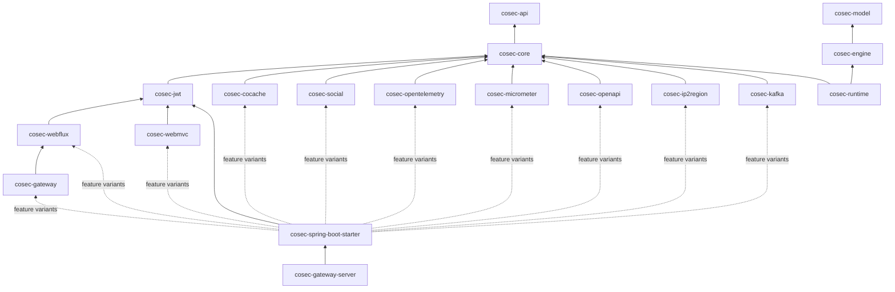
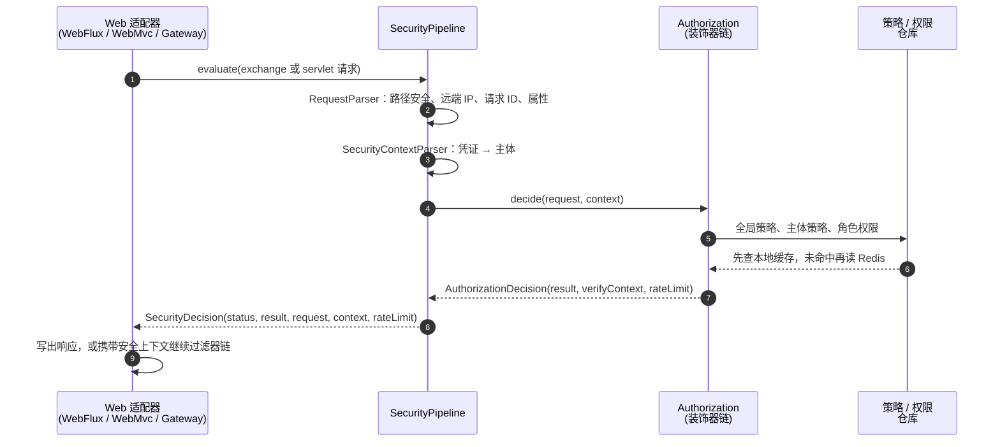
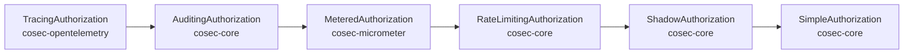

# 架构概览 {#architecture-overview}

面向修改 CoSec 的贡献者，以及想了解其内部机制的集成者。本页说明模块分层、请求如何经过安全管道、授权装饰器如何组合，以及每次修改都必须保持的不变量。一个决策*意味着*什么（求值顺序、拒绝优先、失败即拒绝）见[安全模型](../guide/security-model.md)；本页说明代码如何兑现这些承诺。

## 设计目标 {#design-goals}

- **一个决策，多种传输层。** WebFlux、WebMvc 和 Spring Cloud Gateway 对同一请求必须给出相同的应答，所以每个决策只在与传输层无关的代码里做一次。
- **拒绝优先，出错即拒绝。** 新增策略永远不会越过已匹配的拒绝而扩大访问范围；故障也永远不会让请求放行。
- **在事件循环上足够快。** 每个请求都要授权，而且常常在 Netty 线程上。数据在本地缓存中时，热路径不做 I/O，也不切换线程。
- **策略即数据。** 策略和权限都是 JSON 文档。新的匹配器类型通过工厂接入，引擎本身无需改动。
- **用多少，引多少。** 应用只引入它需要的集成。

## 模块分层 {#module-layering}



箭头指向模块所依赖的模块。图背后的规则：

- **`cosec-api`** 只放公共契约（`CoSecPrincipal`、`Policy`、`Statement`、`ActionMatcher`、`ConditionMatcher`、`Authorization`、`Request`、`SecurityContext`、`AuditEventSink`），只依赖 Reactor。下游代码基于它编译，所以修改它就是破坏性变更。
- **`cosec-core`** 放所有算法（策略引擎及其匹配器、`SimpleAuthorization`、`SecurityPipeline`、审计/限流/影子模式的授权装饰器、令牌抽象、本地加载、JSON 序列化），以及供其他模块和应用实现的 SPI（见[扩展 CoSec](./extending.md)）。
- **`cosec-model` 和 `cosec-engine`**（目录为 `model/` 和 `engine/`）将容纳 8.0 新增的纯函数决策引擎（[RFC 0002](https://github.com/Ahoo-Wang/CoSec/blob/main/docs/rfc/0002-pure-engine.md)）。它们只依赖 Kotlin 标准库：`EnginePurityTest`（ArchUnit）在代码引用 Reactor、Spring、日志、I/O、线程或时钟时失败，`check` 中的 `verifyPureClasspath` 任务在出现任何其他依赖时失败。目前还没有模块使用它们。
- **`cosec-runtime`**（目录为 `runtime/`）将容纳 8.0 新增的协程请求 Pipeline（[RFC 0006](https://github.com/Ahoo-Wang/CoSec/blob/main/docs/rfc/0006-coroutine-pipeline.md)），依赖 `cosec-engine` 和 `cosec-core`。协程只出现在这个模块和 Web 适配器里，Reactor 只出现在适配器的桥接处：`RuntimeBoundaryTest`（ArchUnit）在 `runtime/`、`engine/` 或 `model/` 的代码引用 `reactor.*`、数据面 SPI 的签名含有 Reactor 类型，或 `runtime/` 调用会吞掉取消的 `runCatching` 时失败。`cosec-core` 仍把 Reactor 带上类路径，所以这个测试检查的是代码引用，而不是依赖。目前模块还是空的。
- **其余每个库模块只适配一种技术**：JWT、基于 CoCache 的 Redis、OAuth、OpenTelemetry、Micrometer、OpenAPI、ip2region、Kafka，或一种 Web 技术栈。适配模块里不做任何决策。
- **`cosec-spring-boot-starter`** 负责装配。每个集成都是 [`cosec-spring-boot-starter/build.gradle.kts`](https://github.com/Ahoo-Wang/CoSec/blob/main/cosec-spring-boot-starter/build.gradle.kts) 中声明的一个 Gradle feature variant：适配模块只是该 variant 的依赖，其自动配置由 `@ConditionalOnClass` 保护，所以只有应用请求了该能力才会生效。新增集成意味着新增一个模块和一个 variant，而不是给 starter 增加硬依赖。能力及其对应的模块列在[简介](../guide/introduction.md#modules)中。
- **`cosec-gateway-server`** 是基于 starter 的开箱即用应用，永不发布。

## 请求路径 {#request-path}



贡献者需要了解的要点：

- [`SecurityPipeline`](https://github.com/Ahoo-Wang/CoSec/blob/main/cosec-core/src/main/kotlin/me/ahoo/cosec/pipeline/SecurityPipeline.kt) 承担所有与传输层无关的步骤，**包括全部状态码和错误映射**。适配器（WebFlux 和 Gateway 用 [`ReactiveSecurityFilter`](https://github.com/Ahoo-Wang/CoSec/blob/main/cosec-webflux/src/main/kotlin/me/ahoo/cosec/webflux/ReactiveSecurityFilter.kt)，WebMvc 用 [`AbstractAuthorizationInterceptor`](https://github.com/Ahoo-Wang/CoSec/blob/main/cosec-webmvc/src/main/kotlin/me/ahoo/cosec/servlet/AbstractAuthorizationInterceptor.kt)）只负责把 `SecurityDecision` 转成响应。让适配器自行判断的修改会破坏一致性，应当放进管道。
- 每种结果都会变成 `SecurityDecision`，包括 `Authorization` 同步抛出的异常。没有任何错误会逃出管道。
- `SecurityContextParser.parse` 是同步的。它在调用方线程上运行；只有解析可能阻塞时（开启了令牌吊销，或 API key存储需要 I/O），starter 才把它移到 `boundedElastic`。`TokenVerificationException` 会让调用方变为匿名，并在拒绝结果中报告；其他异常一律按错误处理。
- 适配器写出的状态码和响应头，以及应用代码如何读取安全上下文，面向用户的说明见 [Web 集成](../integration/web.md#responses-and-status-codes)。

## 授权链 {#authorization-chain}

`Authorization` bean 是 starter 在 `SimpleAuthorization` 外层构建的一条装饰器链：



| 装饰器 | 作用 |
|---|---|
| `TracingAuthorization` | 为每次决策开启一个 span。 |
| `AuditingAuthorization` | 向 `AuditEventSink` 发布 `AuditEvent`。 |
| `MeteredAuthorization` | 记录决策指标。它是一个 `CoSecAuthorizationCustomizer`，与应用使用的是同一个钩子。 |
| `RateLimitingAuthorization` | 只对已允许的请求，为每条匹配的规则消耗一个许可；规则耗尽时把决策改为 `TOO_MANY_REQUESTS`。 |
| `ShadowAuthorization` | 用候选策略重新评估抽样请求并报告差异，实际执行的决策不变。 |
| `SimpleAuthorization` | 决策本身。求值顺序见[安全模型](../guide/security-model.md#evaluation-order)。 |

哪些装饰器会出现、由哪些属性开启，见[决策链](../operations/observability.md#the-decision-chain)。

为什么是这个顺序：

- 限流位于审计和追踪**之内**，所以 `429` 和其他决策一样会被审计和追踪。
- 影子模式**直接**包裹 `SimpleAuthorization`，位于限流之内，因为它比较的是纯决策：影子评估绝不能消耗许可。
- 定制器（`CoSecAuthorizationCustomizer`，按 `@Order` 顺序应用）包裹限流的结果，位于审计和追踪之内。

每个装饰器都实现 [`DecisionAuthorization`](https://github.com/Ahoo-Wang/CoSec/blob/main/cosec-core/src/main/kotlin/me/ahoo/cosec/authorization/AuthorizationDecision.kt) 并转发 `decide(...)`。结果是一个 `AuthorizationDecision`，以值的形式携带匹配到的 `VerifyContext`（哪条策略、哪条语句作出了决定），审计、追踪和解释无需重新求值就能看到匹配结果。只实现 `authorize(...)` 的装饰器会丢掉这个上下文。

应用用来[在代码中检查权限](../integration/checks.md)的 `AuthorizationChecker` 使用链外的一个普通 `SimpleAuthorization`：检查既不审计，也不限流。

## 不变量 {#invariants}

每条不变量都有存在的理由，大多数有测试守护。不要为了让修改通过而削弱守护。[`AGENTS.md`](https://github.com/Ahoo-Wang/CoSec/blob/main/AGENTS.md) 为编码代理保存了同一份清单。

| 不变量 | 原因 | 守护 |
|---|---|---|
| **拒绝优先。** 无论在同一层内还是跨层，`ALLOW` 都不会胜过已匹配的 `DENY`。 | 否则新增一条策略就可能扩大访问范围。 | `SimpleAuthorizationTest` |
| **失败即拒绝。** 出错就拒绝，有文档说明的例外见[安全模型](../guide/security-model.md#fail-closed)。 | 故障不能让请求放行。 | `SecurityPipelineTest`、`RateLimitingAuthorizationTest`、`RedisRateLimitingOffEventLoopTest` |
| **唯一决策路径。** 状态码和错误映射只存在于 `SecurityPipeline`。 | 三个适配器必须给出相同的应答。 | `WebAdapterParityTest` |
| **不阻塞事件循环。** 阻塞调用在 `boundedElastic` 上运行。本地未命中的缓存读取以非阻塞方式读 Redis，然后在 `boundedElastic` 上继续。会阻塞的自定义条件匹配器实现 `BlockingAware`；只有包含它的层才切换线程。 | 阻塞一个 Netty 线程会卡住其上的所有请求。 | `RedisRateLimitingOffEventLoopTest`、`LocalCacheFastPathTest`、`SecurityContextParseSchedulersTest`；`BlockingAwareTest` 覆盖标志的传播 |
| **授权是纯决策。** 内置匹配器不做 I/O、不保存状态。限流是单独的装饰器，只为已允许的请求消耗许可。 | 让求值快速、可预测、可解释；被拒绝的请求不会耗尽配额。 | 评审、`RateLimitingAuthorizationTest` |
| **策略和权限缓存永不过期，读取失败时抛出异常**（`ttl = null`、`ReadFailureMode.THROW`），并在所有 CoCache 定制器或属性之后生效。 | Redis 是权威存储；过期或吞掉错误都会悄悄丢失策略。 | `CacheTtlPolicyTest`、`StrictCacheFailureTest` |
| **解释器叙述的是真实算法。** `AuthorizationExplainer` 描述的顺序和组合方式与 `SimpleAuthorization` 一致。 | 与决策不符的解释会误导排查访问问题的人。 | `ExplainerConsistencyTest` |
| **热路径修改要附 JMH 前后对比。** | 每个请求都要授权。 | `SimpleAuthorizationBenchmark`（评审） |

其中两条在新增代码时需要特别留意：

- `BlockingAwareTest` 检查 `requiresBlocking` 标志的计算与传播（经由 `bool`、策略和应用权限）。没有测试断言 `SimpleAuthorization` 随后确实在 `boundedElastic` 上评估该层；对这次线程切换的修改只能靠评审发现。
- 纯粹性由评审守护。一个做 I/O 或保存状态的内置匹配器照样能编译、照样能通过测试。

## 数据与缓存 {#data-and-caching}

仓库是 `cosec-core` 中的接口（`PolicyRepository`、`AppRolePermissionRepository`）。`cosec-cocache` 中的 Redis 实现基于 [CoCache 6](https://cocache.ahoo.me)。设计上的决定：

- **Redis 是权威存储，本地缓存只是它的视图。** [`CoSecCacheSpecs`](https://github.com/Ahoo-Wang/CoSec/blob/main/cosec-cocache/src/main/kotlin/me/ahoo/cosec/cache/CoSecCacheSpecs.kt) 声明所有缓存。策略和权限缓存永不过期，Redis 读取失败时抛出异常。starter 在所有 CoCache 定制器或属性之后应用这一点，配置无法放宽它。
- **本地命中不切换线程。** 仓库通过 CoCache 的异步视图读取。本地命中是一个已完成的 future，仓库在调用方线程上直接应答；未命中时以非阻塞方式读 Redis，请求在 `boundedElastic` 上继续。
- **缺失的数据会失败，而不是被跳过。** 仓库没有返回的主体策略会让授权以 `MissingPolicyException` 失败（管道应答 `500`）。全局策略索引同样如此：有索引而无内容的 id 会失败，因为缺失的可能正是一条全局 `DENY`。角色授权引用了其应用没有定义的权限 id 时同样会失败，抛出 `MissingPermissionException`。
- **并发发布不会扩大访问范围。** 全局策略索引是一个 CoCache `SetCache`，通过原子的 `add` / `remove` 更新，并且先写内容、后写索引项。读取方只应用内容类型为 `global` 的已索引策略（`GlobalPolicyConsistencyTest`、`GlobalPolicyIndexConcurrencyIntegrationTest`）。
- **本地文件严格加载。** 策略、限流规则、影子候选和测试输入都由 `JsonResources` 解析：配置的位置匹配不到文件、文件无法读取、同一 id 声明两次，都会导致加载失败。只有内置的默认位置允许匹配不到任何文件。

如何选择存储、运行 Redis、故障期间的行为、发布和回滚变更属于运维知识，见[存储](../operations/storage.md)。

## 启动时的 schema 检查 {#startup-schema-check}

CoSec 7.0 以 CoCache 6 的布局存储 Redis 数据。未迁移的 6.x 数据并不总在 7.0 查找的位置：以 `:` 结尾的键前缀、更改过的前缀或回滚过的迁移，都会让它留在别处。7.0 会把所有策略、全局 `DENY` 和吊销记录都读成*不存在*，这会导致放行，而且不会出现任何读取错误来暴露问题。

所以在创建任何 CoSec 缓存之前，starter 会用 [`CoSecSchemaMarker`](https://github.com/Ahoo-Wang/CoSec/blob/main/cosec-cocache/src/main/kotlin/me/ahoo/cosec/cache/CoSecSchemaMarker.kt) 检查标记键 `<p>:meta:schema`：只要 Redis 中有 CoSec 数据却没有 7.0 的标记，就以 `CoSecSchemaException` 终止启动。迁移最后才写入标记，
所以迁移只做了一半时仍会终止启动。每种状态及其结果见[Schema 标记](../operations/storage.md#schema-marker)，如何执行迁移见
[迁移数据](../operations/upgrading.md#migrating-the-data)。该检查由 `CoSecSchemaMarkerTest` 和 `CoSecCacheSchemaAutoConfigurationTest` 守护。

## 性能 {#performance}

`SimpleAuthorizationBenchmark`（`cosec-core/src/jmh`）使用内存仓库测量热路径：3 条全局策略（共 25 条语句）、2 条主体策略（共 20 条语句），以及一个含 51 条权限的应用权限。吞吐是单线程每秒的决策数，时间是它的倒数，分配是每次决策分配的字节数（`gc.alloc.rate.norm`）。

| 场景 | 吞吐 | 时间 | 分配 |
|---|---|---|---|
| 被全局允许策略匹配（`global`） | 474,816 ± 7,769 ops/s | 2.1 µs | 5,997 B |
| 被角色权限匹配（`role`） | 438,331 ± 5,376 ops/s | 2.3 µs | 6,488 B |
| 无匹配（`none`） | 508,364 ± 4,057 ops/s | 2.0 µs | 1,640 B |

`RateLimitingAuthorizationBenchmark` 测量限流在一个始终允许的授权（16 ns，`plain`）之上增加的开销：没有规则时约 20 ns（`noRules`），没有规则匹配时约 45 ns（`unmatched`），一条在内存中计数的按 IP 规则匹配时约 240 ns（`local`）。用 Redis 计数的规则会增加一次 Redis 往返。影子模式会让每个被抽样的请求多做一次 `SimpleAuthorization` 求值。

热路径的性能主要取决于两个设计：每个请求只解析一次路径，并在所有路径匹配器之间共享；拒绝优先的求值直接遍历源列表，不为每个元素创建包装对象。任何涉及授权、匹配器或仓库的修改都应附上前后对比。

### 7.0 修复的代价 {#what-the-7-0-fixes-cost}

在 `SimpleAuthorizationBenchmark` 中，7.0 比 6.1.0 慢 6% 到 9%；被全局允许策略匹配的一次决策从约 1.9 µs 涨到 2.1 µs。每次决策的分配增加了 34 到 56 字节。限流的变化在噪声范围内。

| 基准 | 场景 | 6.1.0（ops/s） | 7.0（ops/s） | 变化 | B/op 6.1.0 → 7.0 |
|---|---|---|---|---|---|
| `SimpleAuthorizationBenchmark` | `global` | 522,486 ± 6,807 | 474,816 ± 7,769 | −9.1% | 5,963 → 5,997 |
| `SimpleAuthorizationBenchmark` | `none` | 541,901 ± 8,984 | 508,364 ± 4,057 | −6.2% | 1,584 → 1,640 |
| `SimpleAuthorizationBenchmark` | `role` | 466,934 ± 3,601 | 438,331 ± 5,376 | −6.1% | 6,432 → 6,488 |
| `RateLimitingAuthorizationBenchmark` | `local` | 3,857,082 ± 34,161 | 3,928,012 ± 15,368 | +1.8% | 1,168 → 1,208 |
| `RateLimitingAuthorizationBenchmark` | `noRules` | 28,791,080 ± 224,392 | 27,880,383 ± 127,124 | −3.2% | 352 → 352 |
| `RateLimitingAuthorizationBenchmark` | `plain` | 62,553,549 ± 618,196 | 61,807,452 ± 727,007 | −1.2% | 152 → 152 |
| `RateLimitingAuthorizationBenchmark` | `unmatched` | 16,863,776 ± 459,156 | 16,466,577 ± 99,516 | −2.4% | 376 → 376 |

这些代价来自决策路径上的五项安全修复，叠加起来造成了 6% 到 9% 的退化（[每一项改了什么](../operations/upgrading.md#authorization-and-loading-changes)）：

- **先查黑名单**，再判断根主体，所以被列入黑名单的根主体会被拒绝。
- **缺失的主体策略会失败**：仓库返回的策略要与主体列出的每个 id 逐一核对，缺失的拒绝策略不会被跳过。
- **角色授权限定在空间内**：读取授权之前，先按请求的空间筛选主体的角色。
- **清空路径变量**：在每条策略的条件之前、每条语句之前都清空路径变量，条件只能看到自己所在语句捕获的变量。
- **缺失的角色权限会失败**：角色被授予的每个权限 id 都要在应用的权限目录中核对。

7.0 接受了这一代价。8.0 计划中的纯函数决策引擎（[RFC 0002](https://github.com/Ahoo-Wang/CoSec/blob/main/docs/rfc/0002-pure-engine.md)）的目标是：在 `SimpleAuthorizationBenchmark` 的每个场景中，吞吐不低于现有 `SimpleAuthorization` 的 95%，分配不多于它。两个版本精简后的 JMH 结果放在 [`docs/perf/7.0-vs-6.1.0`](https://github.com/Ahoo-Wang/CoSec/tree/main/docs/perf/7.0-vs-6.1.0)，供以后的修改对照。

### 测量方法 {#measuring}

以上数字测于 2026 年 10 月，机器是一台 Apple M4（10 核，macOS 27），JDK 17.0.20.1：3 个 fork，5 次预热迭代和 10 次测量迭代，每次 2 秒，单线程，`-prof gc`，使用 WARN 级别的 `config/logback-jmh.xml`。两个版本在同一台机器上先后连续运行，平均负载 2.3 到 3.3（有一个 Docker 虚拟机在运行）。6.1.0 是 `v6.1.0` 标签，7.0 是 `main` 的 `580809a2`。

构建基准 jar，并用同样的参数运行：

```bash
./gradlew :cosec-core:jmhJar
java -jar cosec-core/build/libs/cosec-core-*-jmh.jar 'SimpleAuthorizationBenchmark|RateLimitingAuthorizationBenchmark' \
  -f 3 -wi 5 -i 10 -w 2s -r 2s -prof gc -rf json -rff jmh.json \
  -jvmArgsAppend "-Dlogback.configurationFile=$PWD/config/logback-jmh.xml"
```

**自己运行 jar 时，必须加上 `-jvmArgsAppend -Dlogback.configurationFile=…`。** jar 里带有 Logback 但没有配置文件，不加这个参数，每个 fork 出来的 JVM 都会按 DEBUG 级别输出日志，包括每次决策的 `log.debug`，结果测到的既有授权也有日志。`./gradlew :cosec-core:jmh` 已经传了这个文件，但只跑一个 fork、一次预热迭代和一次测量迭代（根目录 `build.gradle.kts` 中的默认值）：足以确认基准能跑，不足以比较版本。

以下 Gradle 属性可以覆盖这些默认值：`-PjmhWarmupIterations`、`-PjmhIterations`、`-PjmhFork`、`-PjmhProfilers`（逗号分隔，例如 `gc`），以及 `-PjmhJavaVersion`，即基准 JVM 运行所用的 JDK 工具链（代码仍按 17 编译）。RFC 0002 用下面的命令比较引擎与现在的 `SimpleAuthorization`，其中增加了 `global-deny` 场景（被全局策略拒绝，其他层仍有数据）；基线在 [`docs/perf/rfc-0002-baseline`](https://github.com/Ahoo-Wang/CoSec/tree/main/docs/perf/rfc-0002-baseline)：

```bash
./gradlew :cosec-core:jmh -PjmhIncludes=SimpleAuthorizationBenchmark -PjmhJavaVersion=25 \
  -PjmhWarmupIterations=5 -PjmhIterations=10 -PjmhFork=3 -PjmhProfilers=gc
```

这些数字的可信程度：

- **在繁忙机器上测得的数字不可靠。** 其他进程（构建、IDE、Docker、其他基准测试）会抢占 CPU，改变 JIT 和 GC 的时序。请在同一台机器上先后紧接着比较修改前后，比误差列更小的差异视为噪声。7.0 的这次对比是在有负载时测的，空闲机器上的绝对数字可能更高；这次对比说明的是相对变化。
- 比较吞吐时两侧用同一个 JDK：换 JDK 对 JIT 决策的影响比大多数代码修改都大。

## 架构的演进方向 {#where-the-architecture-is-going}

[RFC 0001：目标架构](https://github.com/Ahoo-Wang/CoSec/blob/main/docs/rfc/0001-target-architecture.md)描述了计划中的重新设计：纯模型与同步引擎、基于快照的分发、以监听器取代装饰器，以及从本页所述结构迁移过去的路线。

**下一步：** 添加自己的条件、仓库和钩子，见[扩展 CoSec](./extending.md)。
