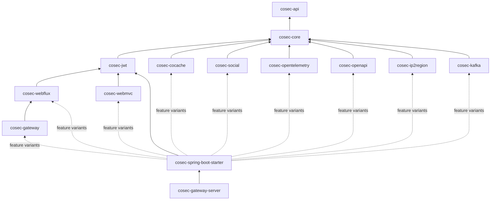
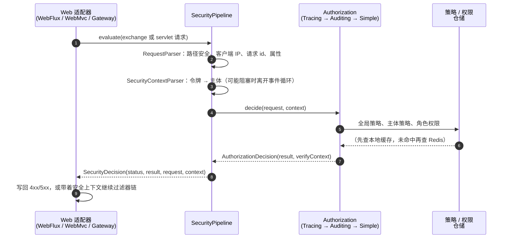

# 架构概览 {#architecture-overview}

本页面向修改或扩展 CoSec 的开发者，介绍整体结构、请求路径、决策算法，以及每次改动都必须保持的不变量。文件链接指向 `main` 分支。

## 模块 {#modules}

- **`cosec-api`** 存放公共契约：`CoSecPrincipal`、`Policy`、`Statement`、`ActionMatcher`、`ConditionMatcher`、
  `Authorization`、`Request`、`SecurityContext`。它只依赖 Reactor。
- **`cosec-core`** 存放所有算法：策略引擎和匹配器、`SimpleAuthorization`、`SecurityPipeline`、令牌抽象、本地策略加载、审计，以及 JSON 序列化。
- 每个集成模块只适配一种技术。starter 通过 Gradle feature variant 组织它们，应用只会引入自己声明的部分。

## 请求路径 {#request-path}

- [`SecurityPipeline`](https://github.com/Ahoo-Wang/CoSec/blob/main/cosec-core/src/main/kotlin/me/ahoo/cosec/pipeline/SecurityPipeline.kt)
  负责所有与传输层无关的步骤，包括**全部状态码与错误映射**。适配器
  （[`ReactiveSecurityFilter`](https://github.com/Ahoo-Wang/CoSec/blob/main/cosec-webflux/src/main/kotlin/me/ahoo/cosec/webflux/ReactiveSecurityFilter.kt)、
  [`AbstractAuthorizationInterceptor`](https://github.com/Ahoo-Wang/CoSec/blob/main/cosec-webmvc/src/main/kotlin/me/ahoo/cosec/servlet/AbstractAuthorizationInterceptor.kt)）
  只把 `SecurityDecision` 翻译成响应。`WebAdapterParityTest` 断言各适配器的响应完全一致。
- 授权装饰器实现
  [`DecisionAuthorization`](https://github.com/Ahoo-Wang/CoSec/blob/main/cosec-core/src/main/kotlin/me/ahoo/cosec/authorization/AuthorizationDecision.kt)，
  命中的 `VerifyContext` 作为值传递给链路追踪和审计。

## 决策算法 {#decision-algorithm}

[`SimpleAuthorization`](https://github.com/Ahoo-Wang/CoSec/blob/main/cosec-core/src/main/kotlin/me/ahoo/cosec/authorization/SimpleAuthorization.kt)：

1. root 主体（由 `RootPrincipalMatcher` 判定）直接放行。
2. 黑名单中的请求（`BlacklistChecker`）直接拒绝。
3. 依次求值三层：全局策略、主体的策略，以及请求所在应用和空间的角色权限。每一层内都先检查所有 `deny`，再检查 `allow`。
   各层之间同样拒绝优先：任一层出现 `EXPLICIT_DENY` 就结束求值；只有每一层都有机会拒绝之后，才会返回 `ALLOW`。
4. 否则结果为 `IMPLICIT_DENY`。

策略自身的条件在它的语句之前、每个请求只求值一次。语句的动作和条件都匹配时才算命中。

## 不变量 {#invariants}

每次改动都必须保持以下不变量。

| 不变量 | 含义 |
|---|---|
| **拒绝优先** | 任何策略或层的组合，都不能让 `ALLOW` 压过已命中的 `DENY`。 |
| **出错即拒绝** | 错误一律拒绝（`500`，正则超时为 `403`）。仅有的例外是有文档说明的降级模式：非严格的 Redis 限流器，以及吊销检查。策略和权限缓存使用严格的 Redis 失败模式。 |
| **不阻塞事件循环** | 阻塞操作（从 Redis 读取仓储、令牌吊销）在 `boundedElastic` 上执行；能从本地缓存返回的读取留在调用方线程。会阻塞的条件匹配器（例如 Redis 限流器）实现 `BlockingAware`：只有当某一层的策略或应用权限包含这类匹配器时，`SimpleAuthorization` 才会把该层放到 `boundedElastic` 上评估，其他策略不产生线程切换。 |
| **只有一条决策路径** | 状态码和错误映射只存在于 `SecurityPipeline`，适配器从不自行决策。 |
| **匹配器不做 I/O** | 匹配器只读取请求和安全上下文。路径匹配器会把路径变量记录到上下文中，限流器按设计持有状态。Redis 限流器是唯一会做 I/O 的匹配器。 |
| **策略即数据** | 策略和权限都是 JSON。匹配器通过按类型注册的工厂创建（`ServiceLoader` 或 Spring bean）。 |

## 数据与缓存 {#data-and-caching}

仓储（`PolicyRepository`、`AppRolePermissionRepository`）是 `cosec-core` 中的接口。`cosec-cocache` 中的 Redis 实现基于
[CoCache](https://github.com/Ahoo-Wang/CoCache)：

- Redis 是唯一的数据存储，因此每个缓存都固定为 `ttl = FOREVER`，由 `CacheTtlPolicyTest` 守护。
- 读取先查客户端缓存
  （[`LocalCacheLookup`](https://github.com/Ahoo-Wang/CoSec/blob/main/cosec-cocache/src/main/kotlin/me/ahoo/cosec/cache/LocalCacheLookup.kt)，
  与 CoCache 自身的本地命中语义一致），只要有一项未命中，就整体回退到 Redis。
- 全局策略索引通过 `SetElementsCache.addElements` / `removeElements` 更新，也就是原子的 Redis 集合操作；
  `GlobalPolicyIndexConcurrencyIntegrationTest` 用两个实例并发写入来验证这一点。

## 性能 {#performance}

`SimpleAuthorizationBenchmark`（`cosec-core/src/jmh`）使用内存仓储测量热路径，JDK 17 上的结果：

| 场景 | 耗时 | 分配 |
|---|---|---|
| 被全局 allow 命中 | 1.9 µs | 6.1 KB |
| 被角色权限命中 | 2.2 µs | 6.6 KB |
| 无命中 | 1.8 µs | 1.8 KB |

起决定作用的有两点：每个请求只解析一次路径并在所有路径匹配器间共享；拒绝优先的求值直接遍历原始列表，不为每一项创建包装对象。
任何性能改动都应附上 JMH 对比。
