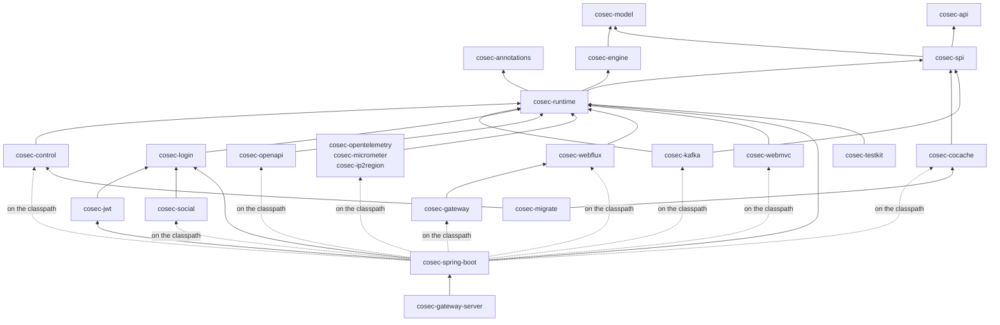
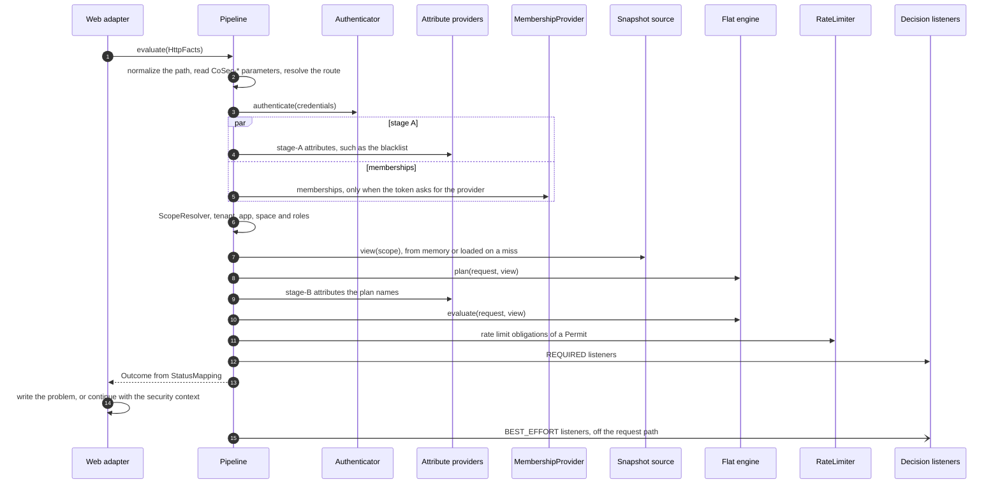
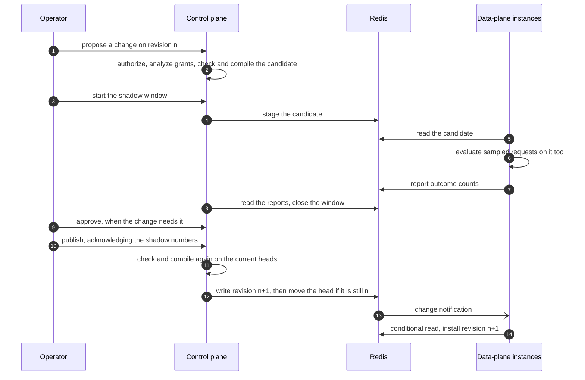

# 架构概览 {#architecture-overview}

面向修改 CoSec 的贡献者，以及想了解其内部机制的集成者。本页说明模块之间如何依赖、请求如何经过协程 Pipeline、引擎如何找到并求值策略、策略快照如何到达每个实例、控制面如何发布它们，以及每次修改都必须保持的不变量。一个决策*意味着*什么（拒绝优先、默认拒绝、失败即拒绝、break-glass）见[安全模型](../guide/security-model.md)；本页说明代码如何兑现这些承诺。

## 设计目标 {#design-goals}

- **一个决策，多种传输层。** WebFlux、WebMvc 和 Spring Cloud Gateway 对同一请求必须给出相同的应答，所以每个决策、每个状态码都只在与传输层无关的代码里产生一次。
- **纯粹的决策。** 引擎是一个作用于请求和不可变快照的同步函数：没有 I/O、不读时钟、不用线程。所有需要 I/O 的事情（凭证、成员关系、属性、限流、审计）都在它周围的 Pipeline 中完成。
- **拒绝优先，出错即拒绝。** 新增策略永远不会越过已匹配的拒绝而扩大访问范围；读不到的数据永远不会带来放行。
- **在事件循环上足够快。** 数据已在内存中的请求，在接收它的线程上完成，不调度、不设定时器。必须等待 I/O 的请求会挂起，但永远不阻塞线程。
- **唯一的写入方。** 策略文档只能通过控制面修改（或通过写入同一存储的 `cosec-migrate`），以修订的形式发布，上线前经过检查、编译，并可经过影子窗口。
- **用多少，引多少。** 应用只引入它需要的集成。

## 模块分层 {#module-layering}

模块按分组目录存放：`api/`（annotations、api）、`core/`（model、engine、spi、runtime、control）、`backends/`（cocache、kafka）、`edge/`（webflux、webmvc、gateway、openapi）、`extensions/`（jwt、social、login、ip2region、micrometer、opentelemetry）、`host/`（spring-boot）、`migration/`、`test/`、`bom/` 和 `platform/`（gateway-server）。Gradle 项目以其目录命名（`:engine`、`:spring-boot`），制品保留 `cosec-` 前缀。



箭头指向模块所依赖的模块；虚线指向应用添加后由 starter 装配的模块。图背后的规则：

- **`cosec-model` 和 `cosec-engine`**（目录 `core/model/` 与 `core/engine/`）是纯粹的内核：模型中有各类 id、绑定、成员关系、条件 AST、作用域和决策；引擎中有动作与资源模式、策略编译器和扁平引擎。它们只依赖 Kotlin 标准库。`EnginePurityTest`（ArchUnit）在出现对 Reactor、Spring、日志、I/O、线程或时钟的任何引用时失败；`DependencyRulesTest` 在解析出任何其他依赖时失败。`ScopeConstructionTest` 检查只有 `ScopeResolver` 能构造已解析的 `Scope`。
- **`cosec-api`**（目录 `api/api/`）容纳应用编译时依赖的契约：`CoSecPrincipal`、`Tenant`、令牌、`SecurityContext`、`AuditEvent`，以及它们的简单实现（`SimplePrincipal`、`SimpleTenant`）。它只依赖 Kotlin 标准库。修改它就是破坏性变更。
- **`cosec-annotations`**（目录 `api/annotations/`）容纳稳定性标记（[稳定性等级](./extending.md#stability-levels)）。`@InternalCoSecApi` 是一个错误级别的 opt-in 标记：带有它的声明之所以公开，只是为了让 CoSec 自己的模块能访问，不作兼容性承诺。应用不 opt in；opt-in 出现在 CoSec 自己的 Kotlin 源码之外时，`SourceRulesTest` 失败。`@ExperimentalCoSecApi`（警告级别的 opt-in）标记次版本仍可能改变的公共 API，`@CoSecSpi` 标记应用要实现的接口。
- **`cosec-spi`**（目录 `core/spi/`）在 `me.ahoo.cosec.spi.*` 下容纳请求或存储会调用的端口，以及它们的值类型和内存实现：快照存储（`SnapshotDocumentStore`）、成员关系、令牌校验与吊销（`TokenVerifier`、`RevocationReader`、`TokenStore`、`TokenRevoker`）、API key、限流器、属性提供者、认证器、转发的身份和审计 sink。它只依赖 `cosec-model`、`cosec-api`、`cosec-annotations` 和 kotlinx-coroutines，第三方只需依赖它就能实现一个端口。签名需要某一层类型的端口留在那一层：`DecisionListener`、`RequestGate` 和影子窗口端口在 `cosec-runtime`；`ControlStore` 和 `ChangeListener` 在 `cosec-control`（[扩展 CoSec](./extending.md)）。
- **`cosec-runtime`**（目录 `core/runtime/`）是数据面：协程 `Pipeline`、`StatusMapping`、`AuthorizationChecker`，快照文档及其编解码器、编译器和格式描述符（由它们生成 `schema/*.schema.json`），`SnapshotSource`，路由映射，令牌校验，内置认证器，以及写日志的审计 sink。它唯一的 Jackson mapper `CoSecJson` 是内部 API（`@InternalCoSecApi`），`api/` 与 `core/` 的公共签名中不出现 Jackson 类型（`JacksonSignatureTest`）。协程只留在本模块和适配器中，Reactor 只出现在适配器的桥接处：当 `runtime/`、`engine/` 或 `model/` 中的代码引用 `reactor.*`，当数据面 SPI 的签名带有 Reactor 类型，当 `runtime/` 引用 Spring、Servlet API 或协程桥接（`kotlinx.coroutines.reactor`、`runBlocking`）、`GlobalScope` 或 `Dispatchers.IO`，或调用会吞掉取消的 `runCatching` 时，`RuntimeBoundaryTest`（ArchUnit）失败。
- **`cosec-control`**（目录 `core/control/`）是控制面：修订、变更请求、影子窗口、审批、break-glass、模拟与分析。它是一个由宿主装配的库。`ControlBoundaryTest`（ArchUnit）导入本模块自己编译出的类，当其中任何一个位于 `me.ahoo.cosec.control` 之外、引用 Spring、`reactor.*`、协程或 Reactive Streams 桥接、Redis 客户端，或调用 `runBlocking`、`Dispatchers.IO`、`GlobalScope` 时失败。
- **其余每个库模块只适配一种技术**：一种 Web 栈（`cosec-webflux`、`cosec-webmvc`、`cosec-gateway`），通过 CoCache 使用 Redis（`cosec-cocache`：快照存储、控制面存储、吊销、限流器、影子报告），Kafka（`cosec-kafka`），登录与签发令牌（`cosec-login`，保留 7.x 基于 Reactor 的登录契约），JWT（`cosec-jwt`），OAuth（`cosec-social`），OpenAPI，或决策的观察者（`cosec-opentelemetry`、`cosec-micrometer`、`cosec-ip2region`）。适配器从不做决策，只做翻译。
- **`cosec-spring-boot`**（目录 `host/spring-boot/`）负责装配。它引入 `cosec-runtime`、`cosec-login` 和 `cosec-jwt`；其他每个模块在 [`host/spring-boot/build.gradle.kts`](https://github.com/Ahoo-Wang/CoSec/blob/main/host/spring-boot/build.gradle.kts) 中都是 `compileOnly`，其自动配置由 `@ConditionalOnClass` 保护，所以只有应用添加了该模块才会生效。已开启的功能所需的模块会在启动时检查（STA-1，[`CoSecModuleCheckAutoConfiguration`](https://github.com/Ahoo-Wang/CoSec/blob/main/host/spring-boot/src/main/kotlin/me/ahoo/cosec/spring/boot/starter/CoSecModuleCheckAutoConfiguration.kt)）：否则漏加的适配器会让 Web 宿主没有过滤器，所以启动失败并给出制品名。各模块及其所需依赖列在[简介](../guide/introduction.md#modules)中。
- **`cosec-testkit`**（目录 `test/testkit/`）用 JUnit 5 针对应用自己的文档运行场景。它依赖 `cosec-runtime` 和 `junit-jupiter-api`（都属于它的 API）。它持有场景格式的引擎层，`conformance` 也运行这一层，所以一致性套件和应用的测试以同一种方式求值场景。
- **`cosec-migrate`** 把 7.x 的数据转换为 8.0 文档并发布；应用不依赖它。**`cosec-gateway-server`** 是由 starter 构建的、开箱即用的网关，从不发布。**`conformance`**、**`architecture`** 和 **`e2e`** 是仅用于测试的模块，同样从不发布。

`architecture`（目录 `test/architecture/`）持有扫描多个模块的结构规则（RFC 0011 §5）：

- `DependencyRulesTest` 读取每个项目声明的和解析出的 main 依赖（由根构建的 `architectureFacts` 任务写出），当声明的依赖指向外层（经评审的例外，例如 `cosec-kafka` 为实现 `DecisionListener` 依赖 `cosec-runtime`，连同理由列在 `DependencyRules` 中），当 `cosec-annotations`、`cosec-api`、`cosec-model` 或 `cosec-engine` 解析出 Kotlin 标准库以外的依赖（`cosec-spi` 另加协程），或当 `cosec-runtime`、`cosec-control` 解析出 Reactor、Spring、Servlet API 或 Redis 客户端时失败。
- `SourceRulesTest` 扫描编译出的类：Reactor 只出现在 edge、extensions 和 host（以及 `cosec-cocache`，挂起端口要等待它的响应式 Redis 客户端）；`api/` 与 `core/` 中没有 Spring、Servlet API 或 Redis 客户端；backends 与 extensions 只使用自己那部分 Spring 技术；backends 只通过列出的端口和 `CoSecJson` 进入 `cosec-runtime` 与 `cosec-control`；一个包只属于一个模块；只有 CoSec 自己的源码 opt in 内部 API。
- `JacksonSignatureTest`（`api/` 与 `core/` 的公共签名中没有 Jackson 类型；`cosec-cocache` 在内部以响应式方式读取 Redis，但其公共签名中没有 Reactor 类型），上面的纯净性与边界测试，单一决策路径与令牌规则，项目清单（`ProjectListTest`）和版本目录。
- `SpiMarkerTest`：`cosec-spi` 中应用能够实现的每个公共接口，以及[扩展 CoSec](./extending.md#extension-points) 列出的每个扩展点，都带有 `@CoSecSpi`，且这个标记不出现在其他地方。

公共 API 本身由构建守住，而不是靠评审（RFC 0011 D4）：除命令行工具 `cosec-migrate` 外，每个发布的库模块把自己的 ABI 存在模块目录下的转储 `api/<project>.api` 里，它的 `check` 运行 Kotlin Gradle 插件的 `checkKotlinAbi`，公共签名变了而转储没变时失败。`@InternalCoSecApi` 声明不进转储。从 8.0 GA 起，删除或修改转储中的一行即破坏性变更。

## 请求路径 {#request-path}

[`Pipeline.kt`](https://github.com/Ahoo-Wang/CoSec/blob/main/core/runtime/src/main/kotlin/me/ahoo/cosec/runtime/Pipeline.kt) 中的 `Pipeline.evaluate` 是一个从请求事实到 `Outcome` 的挂起函数。适配器（`PipelineWebFilter`、`PipelineServletFilter`、`PipelineGatewayFilter`）只负责把请求读成 `HttpFacts`、调用它，并写出它返回的结果。它们依赖 `RequestGate`，`Pipeline` 实现了这个接口。另一个 `RequestGate` 是 `IdentityGate`，CoSec 网关后面的服务改用它（`cosec.pipeline.mode=gateway`）：它从网关转发的 `CoSec-Identity` 头读取调用方，没有认证器、快照、引擎或监听器，同样通过 `StatusMapping` 构造结果，所以两种 gate 在每个适配器上的应答一致。为什么这需要网络边界，见[信任边界](../guide/security-model.md#trust-boundaries)。



- **读取。** 适配器一次性读出方法、原始路径、查询串、请求头、Cookie、客户端地址（按配置的 `X-Forwarded-For` 深度）和 host，然后启动 Pipeline（第 1 步）。在 WebFlux 和 Gateway 上，请求在事件循环上启动、不做调度；真正挂起之后在 `Dispatchers.Default` 上继续，绝不在客户端库的 I/O 线程上继续。在 WebMvc 上，桥接是 Servlet 线程上的 `runBlocking`。
- **路由。** 无法规范化的路径或有歧义的 `CoSec-*` 参数得到 `400`（第 2 步）。[路由映射](./extending.md#route-maps)把匹配到的请求变成作用于类型化资源的 `service:verb` 动作；其他请求则是作用于 `http:path:<path>` 的 `http:<METHOD>`。
- **认证。** `Authenticator` 把令牌或 API key 变成主体（第 3 步）。被拒绝的凭证按匿名主体求值；认证器失败或超时得到 `503`。
- **成员关系与 A 阶段。** A 阶段属性（决定要加载什么的属性，例如黑名单）与成员关系一起获取（第 4、5 步）。成员关系来自令牌的声明；对 API key，以及带有 provider 标记的令牌，来自 `MembershipProvider`，并按 key 的上限收窄。提供者不认识或认为已停用的主体，其凭证被拒绝，请求按匿名决策。成员关系来源失败、超时或返回错误类型的成员关系时得到 `503`，绝不当作“没有角色”。
- **作用域。** `ScopeResolver` 把声明的应用和空间变成经过检查的作用域（第 6 步）：租户是主体的租户（匿名时为默认租户）；绑定了应用（`cosec.authorization.scope.app-id`）的服务使用该应用，并拒绝声明了其他应用的请求；默认空间以外的空间要求主体在其中有角色。作用域被拒绝即为拒绝（见[信任边界](../guide/security-model.md#trust-boundaries)）。
- **快照视图。** 快照源从内存中给出视图（平台文档、应用文档、租户文档），缺什么就加载什么（第 7 步）。被黑名单拦截的请求只加载平台文档。
- **B 阶段。** 有属性提供者声明 B 阶段属性时，引擎的 `plan` 列出本请求可能读取的外部属性，只获取这些属性，每个提供者并行、各有超时（第 8、9 步）。一个提供者失败，只会让它自己的属性不可用。
- **决策。** 引擎给出 `Permit`（附带义务）、`Deny` 或 `Indeterminate`（第 10 步）。
- **义务。** Permit 的限流义务按顺序执行（第 11 步）。第一个耗尽的规则得到 `429`；无法计数的规则在严格模式下得到 `503`，否则跳过。
- **REQUIRED 监听器。** 它们在结果返回之前看到结果（第 12 步）；失败只会把 Permit 变成 `503`。经由 break-glass 绑定得到的 Permit 至少需要一个 REQUIRED 监听器，否则得到 `503`。
- **状态映射。** `StatusMapping` 是唯一构造 `Outcome` 的地方：状态码、响应头和 `application/problem+json` 响应体（第 13 步）。在网关上，结果还指明要转发的头：已认证主体的 Permit 上是已验证的 `CoSec-Identity`，否则没有，因此适配器会删除客户端发来的那个。适配器写出它，或者让被放行的请求带着安全上下文继续（第 14 步）。各结果对应的状态码和 `CoSec-*` 参数见 [Web 集成](../integration/web.md)。
- **BEST_EFFORT 监听器。** 审计日志、指标、追踪、影子监听器以及（默认情况下的）Kafka 通过各自的有界队列收到最终事件，不在请求路径上（第 15 步）。

每次 SPI 调用都经过同一个包装：施加该调用的超时（`cosec.pipeline.*` 与 `cosec.authorization.*`，见[配置](../operations/configuration.md)；快照加载则由 `cold-load-timeout` 限定），把任何失败变成一个值，只让外部取消穿过。整个求值也有截止时间，超过即为 `503`。定时器是惰性设定的：从不挂起的请求不设定任何定时器。没有建模的异常得到 `500`。客户端离开会取消协程，不写出任何内容。

`AuthorizationChecker` 复用这条路径的后半段（视图、属性、引擎），以被放行请求的主体身份[在代码中检查其他动作](../integration/checks.md)。检查不执行义务、不通知监听器，所以既不限流也不审计；只有 break-glass 才能给出的 Permit，在检查中不算 Permit。

## 扁平引擎 {#the-flat-engine}

引擎（[`FlatEngine.kt`](https://github.com/Ahoo-Wang/CoSec/blob/main/core/engine/src/main/kotlin/me/ahoo/cosec/engine/flat/FlatEngine.kt)）针对一个 `SnapshotView` 求值一个请求：编译后的平台文档，加上租户的文档，以及作用域在某个应用中有角色时该应用的文档。它不读时钟（请求自带时间），也不做 I/O（外部属性随请求一起到达）。视图必须属于请求的租户和应用，引擎拒绝其他视图。

### 候选顺序 {#candidate-order}

引擎首先列举适用于请求的策略，即*候选*（[`CandidateOrder.kt`](https://github.com/Ahoo-Wang/CoSec/blob/main/core/engine/src/main/kotlin/me/ahoo/cosec/engine/flat/CandidateOrder.kt)）：

| # | 候选 |
|---|---|
| 0 | 内置的黑名单规则 `cosec:blacklist`，拒绝被拦截的请求。 |
| 1 | 平台文档中绑定到任何人的绑定，按策略 id 排序。 |
| 2 | 租户文档中绑定到任何人的绑定，按策略 id 排序。 |
| 3 | 对已认证主体：按声明顺序的附加策略，然后是它在平台文档和租户文档中的主体绑定，按绑定 id 排序。 |
| 4 | 应用文档中的角色绑定，然后是租户文档中的角色绑定：按作用域中角色的声明顺序，同一角色内按文档顺序。 |
| 5 | 对已认证主体：它的 break-glass 绑定，排在最后。 |

绑定只在它的应用和空间中、且在过期之前才是候选。附加策略或绑定指向快照中不存在的策略，或指向租户与平台都定义了但内容不同的策略时，会被记为缺失或有歧义，而不会悄悄消失。

### 求值 {#evaluation}

决策只取决于候选的集合，与它们的顺序无关；顺序只决定多个语句都匹配时报告哪一个。概括来说：

1. 先检查所有候选的 DENY 语句。第一个匹配就是决策。
2. 没有匹配的 DENY 时，任何可能藏着一个 DENY 的情况（失败的 DENY、缺失或有歧义的策略、读不到的文档或属性）都让决策成为 `Indeterminate`。
3. 之后才检查 ALLOW 语句；第一个匹配得到 `Permit`。什么都没匹配是不指向任何语句的 `Deny`（隐式拒绝）。
4. 受平台边界约束的租户，其 Permit 只有在某个边界语句也匹配时才保持为 Permit。

包括 break-glass 和边界在内的精确规则见[安全模型](../guide/security-model.md)。语句较多的策略按动作、资源和条件键建立索引，所以一个候选只需检查可能匹配的语句。不追踪的求值什么都不记录，几乎不分配内存；追踪求值器（用于 `cosec.pipeline.trace-level` 下的决策事件和 `explain`）是一个单独的类，热路径里没有追踪代码。

## 策略快照 {#policy-snapshots}

策略以**快照文档**的形式到达引擎，每个键一个文档：平台文档、每个应用一个文档、每个租户一个文档。它们以 JSON（schema 2）存储，每个修订编译一次，以不可变的编译结果保存在内存中。视图只是对其中三个文档的引用，所以一次求值总是看到每个文档的同一个修订（`SNP-1`，由 `SnapshotConsistencyPropertyTest` 守护）。

[`SnapshotSource`](https://github.com/Ahoo-Wang/CoSec/blob/main/core/runtime/src/main/kotlin/me/ahoo/cosec/runtime/snapshot/SnapshotSource.kt) 持有它们：

- **热路径。** `peek` 是内存中的同步查找，没有 future、没有 I/O，可以在事件循环上调用。只有未命中才会走 `load`。
- **单飞。** 同一个键的并发加载共享一次读取和一次编译。编译在一个小的有界线程池上运行（`compile-threads`）；队列满时加载按失败即拒绝处理。同一个键按加载开始的顺序安装（`SNP-2`，`SnapshotInstallOrderPropertyTest`）。
- **有界内存。** 平台文档在启动时加载，从不淘汰。应用文档和租户文档按需加载，超过 `max-apps`、`max-tenants` 后按最近最少使用淘汰；可以预热指定的文档。
- **重新验证。** 每个已安装的文档每隔 `revalidate-interval`（默认 10 秒）对权威存储做一次条件读取，摘要未变时不传输内容。存储发来的变更通知会让重新加载更早发生。冷键先读一次（可能来自本地副本），随即用条件读取确认。
- **失败即拒绝。** 已安装文档期间读取失败时保留已安装的修订，并报告延迟。存在但无法解码或编译的文档被安装为*失败*。冷读取失败或未在 `cold-load-timeout` 内完成时，按失败应答。一个曾经有文档的键读到“不存在”是失败，而不是“没有策略”。失败的文档作为*未解析*排除在视图之外，除非有 DENY 匹配，否则决策为 `Indeterminate`。使用 starter 时，缺失的平台文档也视为未解析，所以在发布平台文档之前，所有请求都按失败即拒绝处理。

存储是一个 SPI，`SnapshotDocumentStore`。使用 `cosec-cocache` 时它是 [`RedisSnapshotDocumentStore`](https://github.com/Ahoo-Wang/CoSec/blob/main/backends/cocache/src/main/kotlin/me/ahoo/cosec/cache/snapshot/RedisSnapshotDocumentStore.kt)：Redis 是权威存储，CoCache 保留最多 `local-max-age` 的本地副本，条件读取绕过所有本地副本，CoCache 的失效频道传递变更通知。没有它时，starter 使用内存存储。Redis 键、`noeviction` 要求和 Redis 不可用时的行为见[存储](../operations/storage.md)；`cosec.authorization.snapshot.*` 属性见[配置](../operations/configuration.md)。

## 控制面 {#control-plane}

控制面（`cosec-control`）是唯一写入策略文档的组件，数据面实例只读取它们。它运行在一个宿主应用中，与其他请求一样经过同一条 Pipeline，在 `cosec.control.http.base-path` 下提供 API。



它为什么安全：

- **修订。** 每次发布先写入一条不可变的修订记录，然后用一次条件写入移动文档的 head，只有 head 仍是该变更的基线时才会成功。两个并发发布不可能都成功，读取方看到的要么是旧 head，要么是新 head，绝不会是混合。历史、diff 和回滚都读取修订链。
- **变更。** 变更请求是一个基线修订加上条目级操作，用数据面的编译器检查并编译。head 移动后变更变为 `CONFLICTED`，直到 rebase。每个文档只有一个暂存槽位。
- **授权。** 每个控制面操作都以操作者身份重新授权，动作为作用于文档资源的 `cosec:*`，所用的快照在每次检查前都会从存储确认是最新的。授权分析无法证明受限的授予属于越权，需要另一个人审批。
- **影子窗口。** 实例对请求采样（`cosec.authorization.shadow.sample-rate`），同时在暂存的候选上求值，并报告结果的差异（`SAME`、`WIDENED`、`NARROWED` 等）。无法编译或求值候选的实例会阻塞窗口，被阻塞的变更永远不会发布。文档按平台的属性声明和主机的 `AttributeProvider` 编译，所以控制面主机和每个实例必须注册相同的提供者：只有控制面主机能编译的候选会阻塞它的窗口。只要有任何变化或证据不足，发布时操作者就必须确认这些数字。
- **break-glass** 绑定只能通过控制面创建，需要第二位审批人、过期时间和一个 REQUIRED 变更监听器。
- **维护。** 每个控制面实例定期回收旧的修订记录并关闭影子窗口（`ControlMaintenanceScheduler`）。`ControlStore` 列出这些任务要访问的内容（`documents()`、`openChanges()`），租约（`acquireLease`、`releaseLease`）让同一时间只有一个实例做每项工作（[修订、历史与回滚](../operations/storage.md#revisions-history-and-rollback)）。

如何使用变更、模拟、影子窗口和审批见[测试策略](../policies/testing.md)；`cosec.control.*` 属性见[配置](../operations/configuration.md)。

## 不变量 {#invariants}

每条不变量都有存在的理由，也都有测试守护。永远不要为了让修改通过而削弱守护。它们背后的规范性规则在 [`test/conformance/src/test/resources/rules/`](https://github.com/Ahoo-Wang/CoSec/tree/main/test/conformance/src/test/resources/rules) 中，每条都有场景或守护测试；`:conformance:mutationCheck` 故意破坏这些规则（[`test/conformance/mutants/`](https://github.com/Ahoo-Wang/CoSec/tree/main/test/conformance/mutants)），以证明有测试会失败。[`AGENTS.md`](https://github.com/Ahoo-Wang/CoSec/blob/main/AGENTS.md) 为编码 agent 维护了同一份清单。

| 不变量 | 原因 | 守护 |
|---|---|---|
| **拒绝优先。** 无论来自哪个文档、哪个绑定、什么顺序，ALLOW 都不能胜过已匹配的 DENY。 | 否则新增一条策略就可能扩大访问范围。 | `FlatEnginePropertyTest`（`P1' adding a matching deny always denies`、`the decision is that of the pseudocode`）、`ALG-1` 场景 |
| **失败即拒绝。** 缺失或读不到的数据永远不会放行；错误得到 `503` 或 `500`，绝不是 `200`。有文档说明的例外见[安全模型](../guide/security-model.md)。 | 故障不能让请求放行。 | `FlatEnginePropertyTest`（`P9 missing and unavailable data never permit`）、`PipelineTest`（`indeterminateDecisionIs503`、`unmodelledExceptionIs500`、`failingLateOrWrongMembershipsAre503`、`snapshotSourceFailureIs503`） |
| **唯一的决策路径。** 状态码和 problem 响应体只在 `StatusMapping` 中产生；适配器看不到决策。 | 三种适配器必须给出相同的应答。 | `OneDecisionPathTest`、`WebAdapterParityTest` |
| **不阻塞事件循环。** SPI 以挂起代替阻塞；存储读取和摘要计算不在调用方线程上进行。 | 阻塞一个 Netty 线程会卡住其上的所有请求。 | `SnapshotStoreBlockHoundTest`、`RedisSnapshotDocumentStoreTest`（`computesTheDigestOfALocalCopyOffTheCallersThread`）、`PipelineBlockHoundTest`、`SuspendingRedisRateLimitingTest`、`RuntimeBoundaryTest` |
| **授权是纯粹的决策。** 引擎不做 I/O、不保留状态；限流是 Permit 的义务，所以被拒绝的请求永远不会消耗许可。 | 让求值快速、可预测、可解释；被拒绝的请求不会耗尽配额。 | `EnginePurityTest`、`RateLimitObligationTest`（engine 与 runtime） |
| **快照缓存永不过期，读取失败时抛出异常**，无论 CoCache 的定制器或属性怎么设置。 | Redis 是权威存储；过期或吞掉的错误会悄悄丢掉策略。 | `CacheTtlPolicyTest`、`StrictCacheFailureTest` |
| **一次求值中每个文档只有一个修订**，并按加载顺序安装。 | 决策绝不能混用同一文档的两个修订。 | `SnapshotConsistencyPropertyTest`、`SnapshotInstallOrderPropertyTest` |
| **热路径修改必须附带 JMH 前后对比。** | 每个请求都要授权。 | `FlatAuthorizationBenchmark`、`PipelineBenchmark`（评审） |
| **公共签名只在有意时改变。** 每个发布模块的 ABI 都在它的转储里；不在转储里的改动让构建失败。 | 应用针对 CoSec 编译并实现它的 SPI；没人察觉的签名改动会破坏它们。 | `checkKotlinAbi`（`check` 的一部分）、`SpiMarkerTest` |

## 性能 {#performance}

两个基准测试衡量热路径：

- **`FlatAuthorizationBenchmark`**（`core/engine/src/jmh`）只测引擎：三条全局策略、两条附加的主体策略，以及一个有 50 个权限并授予角色的应用；场景有 `global`（全局 ALLOW 匹配）、`role`（应用列表末尾附近的权限）、`none`（什么都不匹配）和 `role-heavy`，每个场景分别在没有平台边界、边界含 1 条或 8 条语句的情况下运行。
- **`PipelineBenchmark`**（`test/e2e/src/jmh`）端到端地测量 `Pipeline.evaluate`：同样的数据发布到 Redis、经 CoCache 读取，快照已预热；场景有 `global`、`role`、`none`、`anonymous`、`blacklist`、`blocked` 和 `listener`。

8.0 在每个可比的场景中都必须不慢于 7.x。这道门槛是手动触发的 CI 工作流 [`jmh-v7-v8.yml`](https://github.com/Ahoo-Wang/CoSec/blob/main/.github/workflows/jmh-v7-v8.yml)：它在同一台 runner 上交替运行 7.x 的 `SimpleAuthorizationBenchmark`、`SecurityPipelineBenchmark` 与 8.0 的 `FlatAuthorizationBenchmark`（无边界）、`PipelineBenchmark`，任何场景的 8.0/7.x 速度比中位数低于 100 % 即失败。让 8.0 路径合入的那次运行（[40640046212](https://github.com/Ahoo-Wang/CoSec/actions/runs/40640046212)）所有场景都通过：引擎为 7.x 的 364 % 到 601 %，Pipeline 为 126 % 到 219 %。

在 Apple M4 上单线程运行 `global`、`role`、`none` 和 `anonymous` 场景时，一个已预热的请求走完整条 Pipeline 不到 2 µs，分配 3 到 5 kB。各轮次、测量条件和每个场景的数字见 [`docs/perf/e2e-slice`](https://github.com/Ahoo-Wang/CoSec/tree/main/docs/perf/e2e-slice)；其他参考结果（引擎基线、平台边界、控制面、网关的 AOT 缓存）见 [`docs/perf/`](https://github.com/Ahoo-Wang/CoSec/tree/main/docs/perf)。

### 测量方法 {#measuring}

通过 Gradle 运行基准测试：

```bash
./gradlew :engine:jmh -PjmhIncludes=FlatAuthorizationBenchmark
./gradlew :e2e:jmh -PjmhIncludes=PipelineBenchmark      # 需要 localhost:6379 上的 Redis
```

这些运行只用一个 fork、一次预热迭代和一次测量迭代（根 `build.gradle.kts` 中的默认值）：足以确认基准测试能运行，不足以比较版本。可以用 Gradle 属性覆盖默认值：`-PjmhWarmupIterations`、`-PjmhIterations`、`-PjmhFork`、`-PjmhProfilers`（逗号分隔，例如 `gc`）和 `-PjmhJavaVersion`（基准 JVM 运行所用的 JDK 工具链；代码仍按 17 编译）。

要比较版本，构建 jar 并用正式的参数运行：

```bash
./gradlew :e2e:jmhJar
java -jar test/e2e/build/libs/e2e-*-jmh.jar 'PipelineBenchmark.evaluate' \
  -f 3 -wi 5 -i 10 -w 2s -r 2s -prof gc -rf json -rff jmh.json \
  -jvmArgsAppend "-Dlogback.configurationFile=$PWD/config/logback-jmh.xml"
```

**自己运行 jar 时，一定要传 `-jvmArgsAppend -Dlogback.configurationFile=…`。** jar 中包含 Logback 但没有配置，不传的话每个 fork 出来的 JVM 都以 DEBUG 级别输出日志，测出来的结果一半是日志开销。Gradle 的 `jmh` 任务已经传了这个文件。

对于日常修改，`jmh-ab.yml` 在同一台 CI runner 上比较两个 ref，结果是 head/base 的比值（见 [`scripts/jmh-ab/README.md`](https://github.com/Ahoo-Wang/CoSec/blob/main/scripts/jmh-ab/README.md)）；`jmh-v7-v8.yml` 则把 8.0 与某个 7.x 标签比较。

这些数字有多可信：

- **在繁忙机器上测得的数字不可靠。** 其他进程（构建、IDE、Docker、其他基准测试）会抢占 CPU，改变 JIT 和 GC 的时机。前后对比要在同一台机器上紧接着进行，小于误差列的差异视为噪声。在共享的 CI runner 上，只有同一个作业内的比值才有意义。
- 两边要使用同一个 JDK：换 JDK 对 JIT 决策的影响比大多数代码修改都大。

**下一步：** 在[扩展 CoSec](./extending.md)中添加自己的认证器、属性提供者、监听器和存储。
