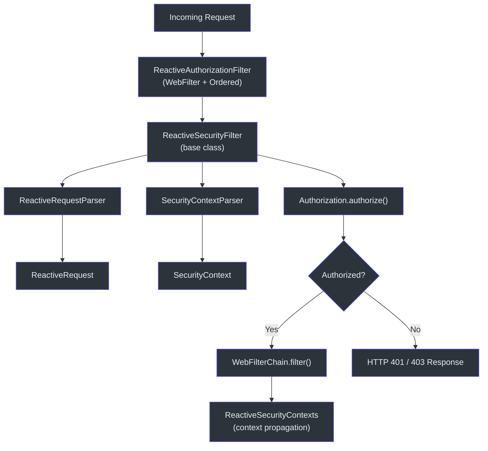
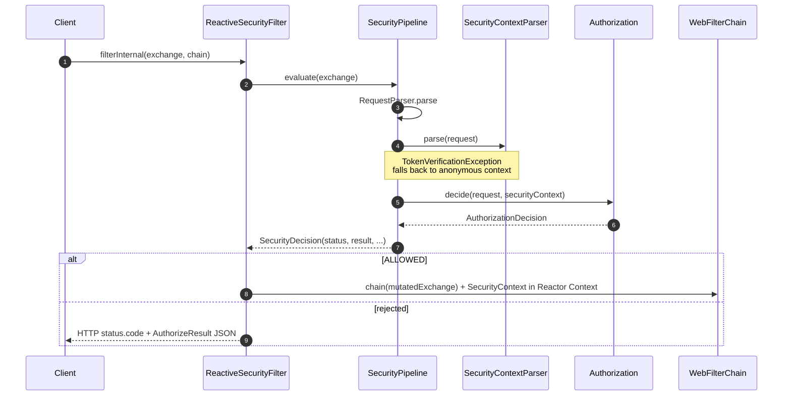
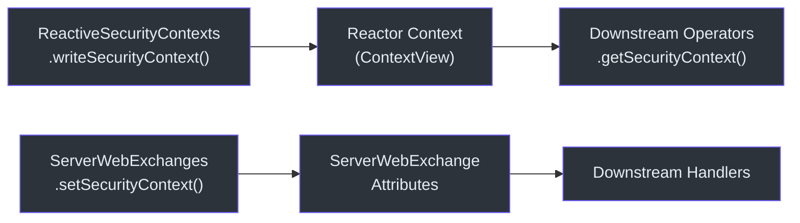
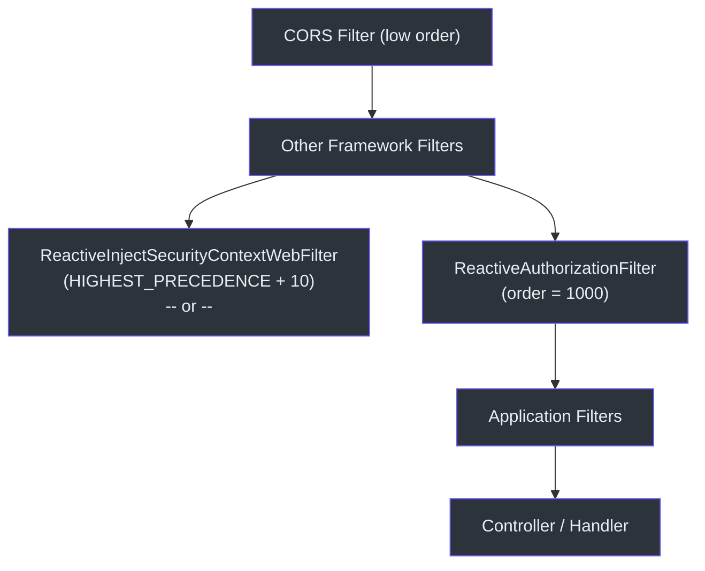

# Spring WebFlux 集成

CoSec 通过基于 Project Reactor 构建的过滤器和上下文传播工具集，为 Spring WebFlux 提供一流的响应式集成。每个请求都经过非阻塞的授权管线，端到端地保持响应式契约。

## 架构概览



## 核心组件

### ReactiveAuthorizationFilter

WebFlux 安全的入口点。它同时实现了 `WebFilter` 和 `Ordered`，排序值为 `1000`，位于框架过滤器（CORS 等）之后、大多数应用逻辑之前。

```kotlin
class ReactiveAuthorizationFilter(
    pipeline: SecurityPipeline<ServerWebExchange>
) : ReactiveSecurityFilter(pipeline),
    WebFilter,
    Ordered {
    constructor(
        securityContextParser: SecurityContextParser,
        requestParser: RequestParser<ServerWebExchange>,
        authorization: Authorization,
        securityContextParseScheduler: Scheduler = Schedulers.immediate()
    )
}
```

- **排序值**: `REACTIVE_AUTHORIZATION_FILTER_ORDER = 1000` -- 在 CORS 和其他基础设施过滤器之后运行。
- 将实际工作委托给 [ReactiveSecurityFilter](#reactivesecurityfilter)，由其运行共享的 `SecurityPipeline`。
- 成功后，调用 `chain.filter(exchange)` 使下游处理器接收到已设置主体信息的增强 exchange。

### ReactiveSecurityFilter

WebFlux 过滤器与 Spring Cloud Gateway 过滤器共享的基类。它自身不包含授权逻辑：每个 exchange 都交给与传输无关的 [`SecurityPipeline`](https://github.com/Ahoo-Wang/CoSec/blob/main/cosec-core/src/main/kotlin/me/ahoo/cosec/pipeline/SecurityPipeline.kt)（与 Servlet 集成共用）处理，再把得到的 `SecurityDecision` 转换为响应。



`SecurityPipeline` 把所有结果（包括错误）都映射为 `SecurityDecision`，因此 WebFlux 与 WebMvc 的响应完全一致（由 `WebAdapterParityTest` 保证）：

| 场景 | `SecurityStatus` | HTTP | 响应体 |
|---|---|---|---|
| 请求路径非法（`InvalidRequestPathException`） | `BAD_REQUEST` | 400 | 无 |
| 授权通过 | `ALLOWED` | -- | 请求继续 |
| 拒绝，匿名主体 | `UNAUTHORIZED` | 401 | 授权结果（Token 校验失败原因如 `Token Expired` 优先） |
| 拒绝，已认证主体 | `FORBIDDEN` | 403 | 授权结果 |
| `TooManyRequestsException` | `TOO_MANY_REQUESTS` | 429 | `Too Many Requests` |
| `RegexTimeoutException`（ReDoS 防护） | `FORBIDDEN` | 403 | `Implicit Deny`（失败即拒绝，而非 5xx） |
| 其他任何错误，包括安全上下文解析失败 | `ERROR` | 500 | `Implicit Deny` |
| 授权未产生结果 | 按 `IMPLICIT_DENY` 处理 | 401 / 403 | `Implicit Deny` |

安全上下文解析运行在 `securityContextParseScheduler` 上（默认 `Schedulers.immediate()`）。当 `cosec.jwt.token-revocation.enabled=true` 时，starter 会切换为 `Schedulers.boundedElastic()`，因为吊销检查可能阻塞在 Redis 上。

### ReactiveRequestParser

将 `ServerWebExchange` 转换为 `ReactiveRequest`，提取路径、方法、远程 IP、来源、引用页和请求 ID。同时应用所有已注册的 `RequestAttributesAppender` 实例（如 IP 地理定位）。

### ReactiveRequest

一个不可变的数据类，包装了 `ServerWebExchange` 并实现了 CoSec 的 `Request` 接口。它提供了对底层 exchange 中 headers、查询参数和 cookies 的惰性访问。

### ReactiveSecurityContexts

用于通过 Reactor 的 `Context` 传播 `SecurityContext` 的工具对象：



并行使用两个传播通道：

| 通道 | 机制 | 使用场景 |
|---------|-----------|----------|
| Reactor `Context` | `contextWrite { it.setSecurityContext(ctx) }` | 同一响应式链中的响应式操作符 |
| `ServerWebExchange` 属性 | `exchange.setSecurityContext(ctx)` | 在下游处理器中直接访问 |

### ReactiveInjectSecurityContextWebFilter

专为 API 网关背后的下游服务设计。它不执行授权，而是从请求头中注入安全上下文（由上游网关设置），无需令牌验证。这避免了微服务间调用中重复的 JWT 验证。

## 过滤器链顺序



根据服务是前端服务还是下游微服务，在 `ReactiveAuthorizationFilter` 和 `ReactiveInjectSecurityContextWebFilter` 之间进行选择。

## 参考资料

- [cosec-webflux/src/main/kotlin/me/ahoo/cosec/webflux/ReactiveAuthorizationFilter.kt:36](https://github.com/Ahoo-Wang/CoSec/blob/main/cosec-webflux/src/main/kotlin/me/ahoo/cosec/webflux/ReactiveAuthorizationFilter.kt#L36) -- 过滤器入口
- [cosec-webflux/src/main/kotlin/me/ahoo/cosec/webflux/ReactiveSecurityFilter.kt:59](https://github.com/Ahoo-Wang/CoSec/blob/main/cosec-webflux/src/main/kotlin/me/ahoo/cosec/webflux/ReactiveSecurityFilter.kt#L59) -- 将 `SecurityDecision` 转换为 WebFlux 响应的基类
- [cosec-webflux/src/main/kotlin/me/ahoo/cosec/webflux/ReactiveRequestParser.kt:28](https://github.com/Ahoo-Wang/CoSec/blob/main/cosec-webflux/src/main/kotlin/me/ahoo/cosec/webflux/ReactiveRequestParser.kt#L28) -- 请求解析
- [cosec-webflux/src/main/kotlin/me/ahoo/cosec/webflux/ReactiveRequest.kt:22](https://github.com/Ahoo-Wang/CoSec/blob/main/cosec-webflux/src/main/kotlin/me/ahoo/cosec/webflux/ReactiveRequest.kt#L22) -- 请求数据类
- [cosec-webflux/src/main/kotlin/me/ahoo/cosec/webflux/ReactiveSecurityContexts.kt:21](https://github.com/Ahoo-Wang/CoSec/blob/main/cosec-webflux/src/main/kotlin/me/ahoo/cosec/webflux/ReactiveSecurityContexts.kt#L21) -- 上下文传播

## 相关页面

- [Spring WebMVC 集成](./spring-webmvc.md)
- [Spring Cloud Gateway 集成](./spring-cloud-gateway.md)
- [自动配置](../extending/auto-configuration.md)
- [测试](../operations/testing.md)
