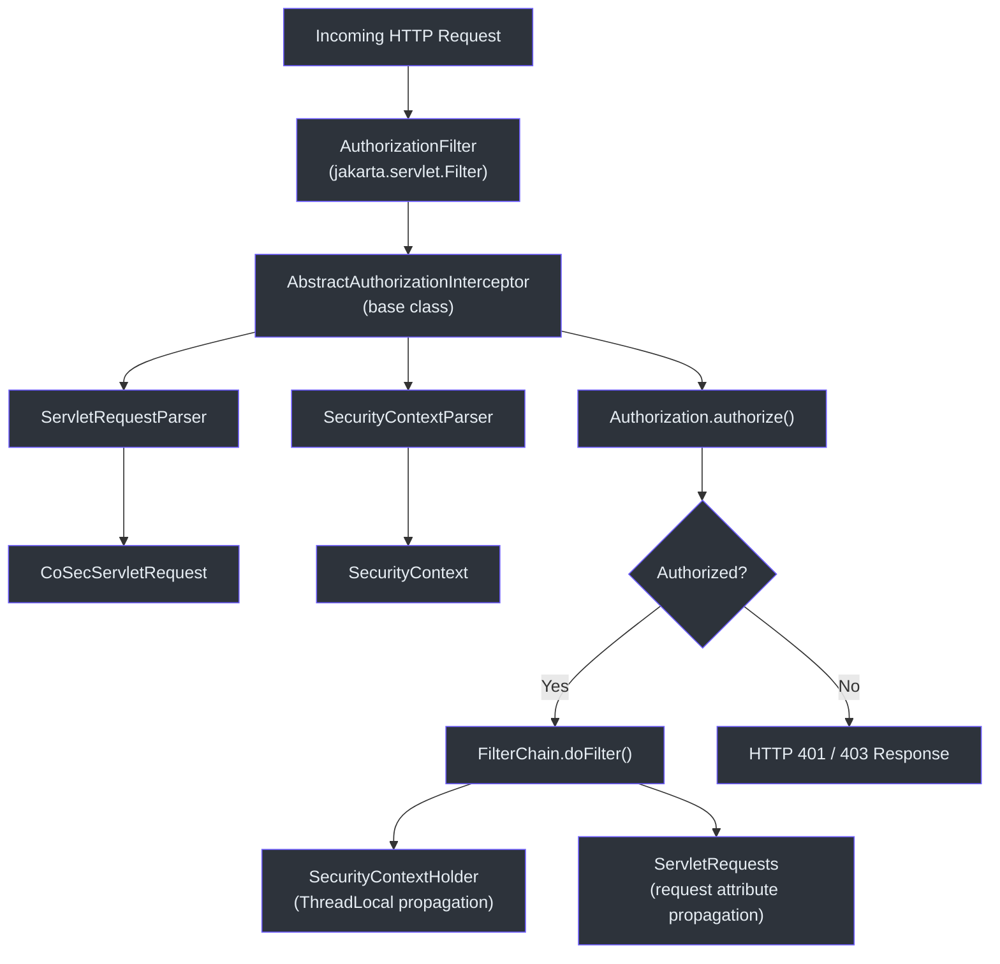
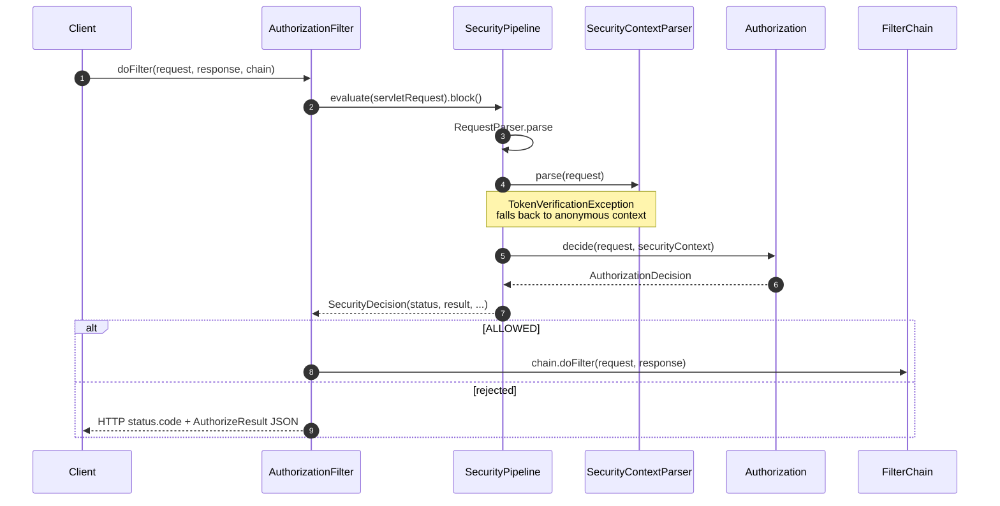
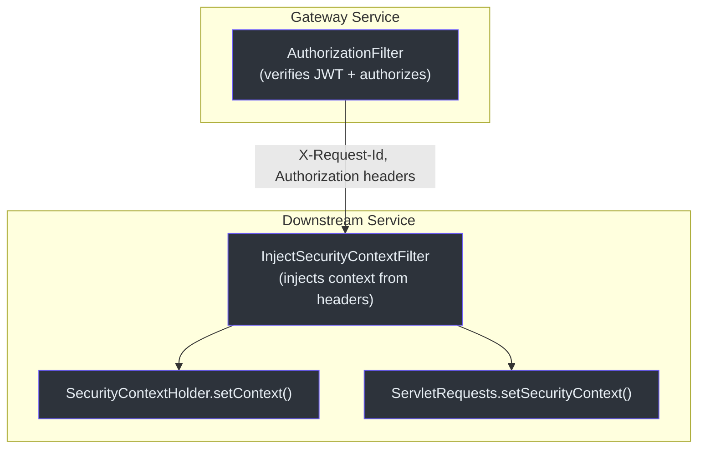

# Spring WebMVC 集成

CoSec 通过 `jakarta.servlet.Filter` 实现为传统 Spring MVC 应用提供基于 Servlet 的集成路径。Servlet 集成与响应式 WebFlux 集成共用与传输无关的 `SecurityPipeline`，并使用线程本地上下文传播代替 Reactor Context。

## 架构概览

## 核心组件

### AuthorizationFilter

Servlet 过滤器入口。它实现 `jakarta.servlet.Filter` 并继承 `AbstractAuthorizationInterceptor`，后者把每个请求交给共享的、与传输无关的 [`SecurityPipeline`](https://github.com/Ahoo-Wang/CoSec/blob/main/cosec-core/src/main/kotlin/me/ahoo/cosec/pipeline/SecurityPipeline.kt) 处理。

`AuthorizationFilter.doFilter` 调用 `authorize()`，仅在其返回 `true` 时执行 `chain.doFilter`，并始终在 `finally` 中清理 `SecurityContextHolder`。

### AbstractAuthorizationInterceptor

将 `SecurityDecision` 转换为 Servlet 响应。它自身不包含授权逻辑——状态码和错误映射都来自 `SecurityPipeline`，因此 WebMvc 与 WebFlux 的响应完全一致（由 `WebAdapterParityTest` 保证）：

| 场景 | `SecurityStatus` | HTTP | 响应体 |
|---|---|---|---|
| 请求路径非法（`InvalidRequestPathException`） | `BAD_REQUEST` | 400 | 无 |
| 授权通过 | `ALLOWED` | -- | 请求继续 |
| 拒绝，匿名主体 | `UNAUTHORIZED` | 401 | 授权结果（Token 校验失败原因如 `Token Expired` 优先） |
| 拒绝，已认证主体 | `FORBIDDEN` | 403 | 授权结果 |
| `TooManyRequestsException` | `TOO_MANY_REQUESTS` | 429 | `Too Many Requests` |
| `RegexTimeoutException`（ReDoS 防护） | `FORBIDDEN` | 403 | `Implicit Deny`（失败即拒绝，而非 5xx） |
| 其他任何错误，包括安全上下文解析失败 | `ERROR` | 500 | `Implicit Deny` |
| 授权未产生结果 | 按 `IMPLICIT_DENY` 处理 | 401 / 403 | `Implicit Deny` |

请求解析成功时，`authorize()` 会把安全上下文绑定到 `SecurityContextHolder` 与请求属性，并设置 `CoSec-Request-Id` 响应头。

### ServletRequestParser

将 `jakarta.servlet.http.HttpServletRequest` 转换为 `CoSecServletRequest`，提取路径（通过 `servletPath`）、方法、远程 IP、来源、引用页和请求 ID。同时应用已注册的 `RequestAttributesAppender` 实例。

### CoSecServletRequest

包装 `HttpServletRequest` 的不可变数据类。实现了 CoSec 的 `Request` 接口和 `Delegated<HttpServletRequest>`，提供对底层 Servlet 请求中 headers、查询参数和 cookies 的访问。

### InjectSecurityContextFilter

`ReactiveInjectSecurityContextWebFilter` 的 Servlet 对应版本。专为已执行授权的 API 网关背后的下游服务设计。它使用 `SecurityContextParser.ensureParse()` 从请求头中提取安全上下文，无需令牌验证。

### SecurityContextHolder

当前安全上下文的线程本地持有者。使用 `InheritableThreadLocal` 使子线程继承父线程的上下文。提供静态方法 `setContext()`、`context`、`requiredContext` 和 `remove()`。

## 上下文传播

与使用 Reactor `Context` 的响应式集成不同，Servlet 集成使用两个并行通道：

| 通道 | 机制 | 作用域 |
|---------|-----------|-------|
| `SecurityContextHolder` | `InheritableThreadLocal` | 当前线程和子线程 |
| `HttpServletRequest` 属性 | `request.setAttribute()` | 当前请求生命周期 |

两者都在 `AbstractAuthorizationInterceptor.authorize()` 中设置，因此下游代码可以通过任一机制访问安全上下文。

## 参考资料

- [cosec-webmvc/src/main/kotlin/me/ahoo/cosec/servlet/AuthorizationFilter.kt:45](https://github.com/Ahoo-Wang/CoSec/blob/main/cosec-webmvc/src/main/kotlin/me/ahoo/cosec/servlet/AuthorizationFilter.kt#L45) -- Servlet 过滤器入口
- [cosec-webmvc/src/main/kotlin/me/ahoo/cosec/servlet/AbstractAuthorizationInterceptor.kt:51](https://github.com/Ahoo-Wang/CoSec/blob/main/cosec-webmvc/src/main/kotlin/me/ahoo/cosec/servlet/AbstractAuthorizationInterceptor.kt#L51) -- 包含授权逻辑的基类拦截器
- [cosec-webmvc/src/main/kotlin/me/ahoo/cosec/servlet/ServletRequestParser.kt:32](https://github.com/Ahoo-Wang/CoSec/blob/main/cosec-webmvc/src/main/kotlin/me/ahoo/cosec/servlet/ServletRequestParser.kt#L32) -- 请求解析
- [cosec-webmvc/src/main/kotlin/me/ahoo/cosec/servlet/CoSecServletRequest.kt:22](https://github.com/Ahoo-Wang/CoSec/blob/main/cosec-webmvc/src/main/kotlin/me/ahoo/cosec/servlet/CoSecServletRequest.kt#L22) -- 请求数据类
- [cosec-webmvc/src/main/kotlin/me/ahoo/cosec/servlet/InjectSecurityContextFilter.kt:43](https://github.com/Ahoo-Wang/CoSec/blob/main/cosec-webmvc/src/main/kotlin/me/ahoo/cosec/servlet/InjectSecurityContextFilter.kt#L43) -- 下游上下文注入
- [cosec-core/src/main/kotlin/me/ahoo/cosec/context/SecurityContextHolder.kt:26](https://github.com/Ahoo-Wang/CoSec/blob/main/cosec-core/src/main/kotlin/me/ahoo/cosec/context/SecurityContextHolder.kt#L26) -- 线程本地上下文持有者

## 相关页面

- [Spring WebFlux 集成](./spring-webflux.md)
- [Spring Cloud Gateway 集成](./spring-cloud-gateway.md)
- [自动配置](../extending/auto-configuration.md)
- [测试](../operations/testing.md)
