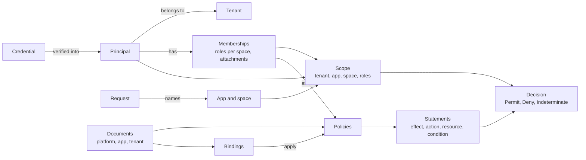

# 核心概念 {#concepts}

面向阅读本文档其余部分的所有人。本页定义其他页面使用的术语，并说明它们之间的关系，让各篇指南和参考可以直接链接到这里，而不必重复定义。

## 全景 {#the-big-picture}

CoSec 对每个请求回答一个问题：这个**主体**能否在这个**作用域**中，对这个**资源**执行这个**动作**？答案来自通过**绑定**和**附加策略**适用于该请求的**策略**，这些策略读取自**控制面**发布的策略**文档**的**快照**。

主体及其成员关系来自经过校验的凭证（或你的成员关系提供者）。请求一侧（方法、路径、请求头、声明的应用和空间）来自客户端，经过检查之后才被信任。

## 主体与租户 {#principal-and-tenant}

### 主体 {#principal}

发起请求的人或程序：一个 id、一个租户，以及自由格式的属性。主体来自经过校验的凭证（JWT 访问令牌或 API key），所以客户端无法篡改。没有有效凭证的请求属于**匿名**主体，id 为 `(0)`，位于默认租户中，没有角色，也没有附加策略。策略同样可以放行匿名主体，公开接口就是这样实现的。

### 租户 {#tenant}

主体所属的客户边界，取自凭证中的租户：

| 租户 id | 含义 |
|---|---|
| `(0)` | 默认租户：匿名主体，以及没有指明租户的凭证。 |
| `(platform)` | 平台租户：系统的运营方。它的主体管理控制面，只有它们可以被授予 break-glass，平台边界也不约束它。 |
| 其他任意值 | 用户租户。 |

主体只会对照它自己租户的文档求值；主体 id 只在租户内唯一。租户之间隔离到什么程度，见[安全模型](./security-model.md)。

## 请求 {#request}

HTTP 请求中与传输层无关的事实：方法、路径、查询串、请求头、客户端 IP、设备 id，以及客户端在 `CoSec-*` 参数中声明的应用和空间（见 [Web 集成](../integration/web.md)）。这些全部由客户端决定。

### 应用 {#app}

请求所属的应用。每个应用有自己的文档：权限目录、权限策略，以及授予这些权限的角色绑定。服务可以绑定到一个应用，此时请求声明的应用必须与之一致。

### 空间 {#space}

应用内部的分区，例如一个团队或一个项目，主体可以在其中持有不同的角色。没有声明空间的请求位于**默认空间**。声明为 `clerk` 的角色在默认空间生效；`clerk@team-a` 只在 `team-a` 中生效。只有主体在某个非默认空间中有角色时，请求才能声明该空间。

### 作用域 {#scope}

一个请求经过检查的上下文：它的租户（总是主体的租户）、应用、空间，以及主体在该空间中的角色。`ScopeResolver` 根据主体和请求声明的应用、空间构建它，或者拒绝请求；其他任何代码都无法构造作用域。这些检查的界线在哪里，见[信任边界](./security-model.md#trust-boundaries)。

### 动作与资源 {#action-and-resource}

请求做什么、对什么做。没有路由映射时，HTTP 请求的动作是 `http:<METHOD>`（例如 `http:GET`），资源是 `http:path:<path>`。[路由映射](../architecture/extending.md#route-maps)可以为服务的路由赋予自己的动作和类型化资源，例如作用于 `order/42` 的 `order:read`。

## 文档与策略 {#documents-and-policies}

### 文档 {#document}

一个有版本的 JSON 文件，容纳策略和绑定。文档有三种：

| 种类 | 每个……一个 | 容纳 |
|---|---|---|
| 平台文档 | 部署 | 所有租户共享的策略、绑定到任何人或某个主体的绑定、平台边界，以及所有文档编译时依据的条件限制和属性目录。 |
| 应用文档 | 应用 | 应用的权限目录、权限策略（`perm:<app>/<permission>`），以及授予这些权限的角色绑定。 |
| 租户文档 | 租户 | 租户自己的策略，它绑定到任何人、某个主体和某个角色的绑定，以及约束该租户的平台边界（如果不是默认边界）。 |

每种文档还都可以带有限流规则。应用文档和租户文档可以引用平台策略，反过来不行。所有字段见[策略语言](../policies/language.md)。

### 策略 {#policy}

一组有名字的语句，可以带一个每条语句都必须同时满足的条件。**可附加**的策略可以直接附加到主体上。策略只有在被绑定或附加策略应用之后才会生效。

### 语句 {#statement}

策略中的一条规则：

- **效果**：`allow` 或 `deny`；
- 一个或多个**动作**，例如 `http:GET`、`order:read`、`order:*` 或 `*`；
- **资源**，例如 `http:path:/orders/{id}` 或 `order/**`（不写表示任意资源）；
- 可选的**条件**。

动作、资源和条件都匹配时，语句才匹配。资源模式捕获的变量只对该语句的条件可见。

### 条件 {#condition}

对请求属性的测试：主体（`subject.id`、`subject.authenticated`）、作用域（`scope.space`、`scope.roles`）、动作与资源、环境（`environment.ip`、`environment.time`），以及由属性提供者获取的外部属性（`ext.<provider>.<name>`）。`eq`、`in`、`prefix`、`cidr`、`time`、`exists` 等运算符可以用 `and`、`or`、`not` 组合。完整列表见[策略语言](../policies/language.md)。

## 绑定与成员关系 {#bindings-and-memberships}

### 绑定 {#binding}

“这个主体受这条策略约束，在这个应用和空间中。”绑定指明一个对象（任何人、某个租户的某个主体，或某个角色）、一个应用和一个空间（各自为精确值或表示任意的 `*`）、一条策略，以及可选的过期时间。绑定本身没有效果，由策略的语句决定。过期的绑定不适用。

### 附加策略 {#attachment}

主体直接列出的策略，来自令牌的 `policies` 声明或成员关系提供者。只有平台或主体所属租户中可附加的策略才能被附加。

### 成员关系 {#membership}

主体所属的东西：它在各空间中的角色，以及它的附加策略。成员关系来自令牌的声明；令牌带有 provider 标记时，来自 `MembershipProvider`。成员关系从不出现在文档中。读不到成员关系时，请求按失败即拒绝处理，绝不会被当作没有角色。

### 目录 {#catalog}

应用的权限目录：一组组带有 id、名称和描述的权限，供用户界面、生成器和校验使用。它不参与求值，参与求值的是权限策略和角色绑定。如何编写目录并把权限授予角色，见[角色权限](../policies/role-permissions.md)。

## 决策 {#decisions}

引擎对它求值的每个请求给出三种决策之一：

| 决策 | 何时 |
|---|---|
| `Permit` | 有 ALLOW 语句匹配，没有 DENY 匹配，没有遗留任何可能藏着 DENY 却未能检查的内容，并且租户的平台边界（如果有）也允许该请求。它可能带有义务。 |
| `Deny` | 有 DENY 语句匹配、作用域被拒绝，或者什么都没匹配（隐式拒绝）。 |
| `Indeterminate` | 没有 DENY 匹配，但有可能藏着 DENY 的内容无法检查：读不到的文档、策略、成员关系或属性，或者失败的 DENY。调用方按拒绝处理。 |

背后的规则见[安全模型](./security-model.md)。每种决策如何变成 HTTP 响应（被拒绝时匿名调用方得到 `401`、已登录调用方得到 `403`，Indeterminate 得到 `503`，等等），见 [Web 集成](../integration/web.md)。

### 义务 {#obligation}

被放行的请求继续之前，Pipeline 必须完成的事情。目前唯一的义务是**限流**：从规则的桶中消耗一个许可。被拒绝的请求从不消耗许可。规则耗尽时，Permit 变成 `429`；见[限流](../policies/rate-limiting.md)。

## 快照与控制面 {#snapshots-and-the-control-plane}

### 快照 {#snapshot}

实例保存在内存中的、编译好的不可变文档。一次求值读取平台文档、其租户文档以及（需要时）其应用文档各自的一个修订。Redis 是权威存储；实例会重新验证自己的副本。见[存储](../operations/storage.md)。

### 修订 {#revision}

文档的一个已发布版本，从 1 开始编号，每次发布加一。每个修订都记录了它的父修订，所以历史、diff 和回滚都读取这条链。**head** 是实例正在使用的修订。

### 控制面 {#control-plane}

文档唯一的写入方（以及通过同一存储写入的 `cosec-migrate`）。它以操作者身份授权每个操作，在发布之前检查并编译每个变更，并且只从变更所基于的修订移动 head。与它对应的数据面，即请求 Pipeline，只读取文档。

### 变更与影子窗口 {#change-and-shadow-window}

**变更**（变更请求）是基于某个修订、对一个文档的一组编辑：先提出、检查，可选地经过影子窗口和审批，然后发布。**影子窗口**暂存变更的候选，让运行中的实例对一部分真实请求同时在候选上求值，并在任何内容生效之前报告结果会在哪里不同。如何使用见[测试策略](../policies/testing.md)。

### Break-glass {#break-glass}

把平台主体绑定到某条平台策略（默认是内置的、放行一切的 `cosec:root`）的紧急绑定，带有过期时间。它只能通过控制面创建，需要第二个人审批，它放行的每个请求都必须写入一个 REQUIRED 审计监听器。它的策略和其他策略一样求值，所以匹配的 DENY 仍然优先；只有在没有其他东西放行该请求时，它才会被报告为放行的原因。

**下一步：** 每次决策都遵守的保证，见[安全模型](./security-model.md)；要编写规则，见[策略语言](../policies/language.md)。
