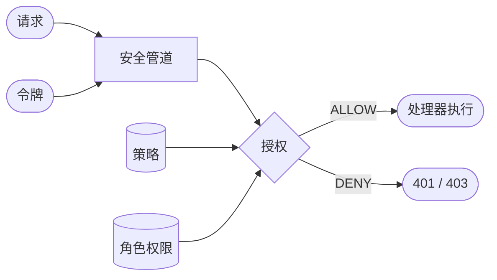

# 核心概念 {#concepts}

面向所有要阅读本文档其余部分的读者。本页定义其他页面使用的术语并说明它们之间的关系，指南和参考页面链接到这里，而不必各自重新定义。

## 全景 {#the-big-picture}

<!-- Planned (explanation). One diagram of how a request, a principal and the stored rules meet in a decision. The diagram below is a placeholder kept to exercise Mermaid rendering; replace or refine it. -->

## 主体与租户 {#principal-and-tenant}

<!-- Planned (explanation). Principal fields (id, roles, policies, attributes), anonymous `(0)`, default/platform/user tenants. -->

## 请求 {#request}

<!-- Planned (explanation). Transport-neutral request: path, method, IP, headers, app id, space id, device id. Header names are owned by integration/web. -->

## 策略与语句 {#policies-and-statements}

<!-- Planned (explanation). Policy types, statement = effect + action + condition. Field-level detail is owned by policies/language. -->

## 应用权限与角色 {#app-permissions-and-roles}

<!-- Planned (explanation). Permission catalogs per app, roles granting them per space. Detail is owned by policies/role-permissions. -->

## 决策 {#decisions}

<!-- Planned (explanation). ALLOW, EXPLICIT_DENY, IMPLICIT_DENY, TOO_MANY_REQUESTS. Order and guarantees are owned by security-model; status codes by integration/web. -->
