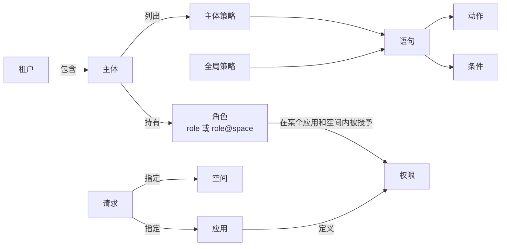

# 核心概念 {#concepts}

面向所有要阅读本文档其余部分的读者。本页定义其他页面使用的术语并说明它们之间的关系，指南和参考页面链接到这里，而不必各自重新定义。

## 全景 {#the-big-picture}

CoSec 对每个请求回答一个问题：这个**主体**能否发出这个**请求**？答案来自适用于该请求的**策略**，以及授予主体**角色**的**权限**。

主体一侧（租户、主体、角色、关联策略）来自经过校验的凭证。请求一侧（路径、方法、请求头、应用、空间）来自客户端。

## 主体与租户 {#principal-and-tenant}

### 主体 {#principal}

发出请求的是谁：一个 id、一组角色、一组关联的策略 id，以及自由格式的属性。主体来自经过校验的凭证（JWT 访问令牌或 API
Key），客户端无法篡改。没有凭证的请求使用**匿名**主体，id 为 `(0)`。策略同样可以放行匿名主体，公开接口就是这样实现的。

### 租户 {#tenant}

主体所属的客户边界，取自凭证中的 `tenantId` 声明：

| 租户 id | 含义 |
|---|---|
| `(0)` | 默认租户，凭证未指定租户时使用。 |
| `(platform)` | 平台租户：系统的运营方。只有它的主体能成为 [root](./security-model.md#root-principal)。 |
| 其他任意值 | 用户租户。 |

CoSec 本身不隔离租户，见[租户隔离](./security-model.md#tenant-isolation)。

## 请求 {#request}

规则匹配所针对的、与传输层无关的 HTTP 请求视图：路径、方法、查询参数、请求头、Cookie、客户端 IP、Origin 和 Referer，以及客户端在 CoSec 请求头中指定的应用、空间和设备（见[应用与空间](../integration/web.md#app-and-space)）。这些全部由客户端决定。

### 应用 {#app}

请求所属的应用。每个应用定义自己的权限目录，角色授权只在所指定的应用中查找。

### 空间 {#space}

应用内的一个分区，例如团队或项目，主体在不同空间可以持有不同角色。未指定空间的请求位于**默认空间**。写成 `clerk` 的角色在默认空间生效；`clerk@team-a` 只在 `team-a` 中生效。

**设备** id 标识客户端设备。条件可以读取它，审计事件也会记录它。

由于应用和空间由客户端设置，它们可信到什么程度，详见[信任边界](./security-model.md#trust-boundaries)。

## 策略与语句 {#policies-and-statements}

### 策略 {#policy}

一组具名的语句，以 JSON 文档存储。它的类型决定何时被评估：

| 类型 | 对谁评估 |
|---|---|
| `global` | 所有请求。 |
| `system`、`custom` | 仅限凭证中列出该策略 id 的主体。`system` 策略由平台管理，`custom` 策略由租户管理；授权时二者没有区别。 |

策略可以带一个条件；条件不成立时，整条策略被跳过。

### 语句 {#statement}

策略中的一条规则：

- **效果**：`allow`（默认）或 `deny`；
- **动作**：语句覆盖哪些请求，通常是路径模式，可附带方法；
- **条件**（可选）：还必须成立的前提。

动作和条件都匹配时，语句命中。命中的 `deny` 产生 `EXPLICIT_DENY`，命中的 `allow` 产生 `ALLOW`。

### 条件 {#condition}

针对请求和主体的判断。例如：调用方已登录（`authenticated`）、持有某个角色（`inRole`）、属于某个租户（`inTenant`）、某个请求值等于、以某值开头或匹配某模式（`eq`、`in`、`startsWith`、`regular`），或当前时间处于某个时段（`time`）。`bool` 用来组合条件。完整列表见[条件](../policies/language.md#conditions)。

## 应用权限与角色 {#app-permissions-and-roles}

按角色授予访问权限的方式，适用于按岗位职能而非具体主体划分的规则：

1. **应用权限**是一个应用的**权限**目录。每个权限是一条带 id 的语句，例如 `order.read`，权限按分组展示。
2. **角色授权**在某个应用、某个空间内，给一个角色授予一组权限 id。id `*` 表示授予该应用的全部权限。
3. 请求会与这些权限比对：在请求的应用中，授予主体那些在请求空间内生效的角色的权限。

由管理员按角色分配的访问，用角色权限；对所有人生效、或关联到具体主体的规则，用策略。如何编写权限目录和授权，见[角色权限](../policies/role-permissions.md)。

## 决策 {#decisions}

每个请求最终得到以下结果之一：

| 结果 | 何时出现 |
|---|---|
| `ALLOW` | 有语句或权限放行了请求且没有任何拒绝，或主体是 root。请求到达你的处理器。 |
| `EXPLICIT_DENY` | 命中了 `deny` 语句或权限，或请求被黑名单拦截。 |
| `IMPLICIT_DENY` | 什么都没命中。这是默认结果。 |
| `TOO_MANY_REQUESTS` | 请求已被放行，但某条[限流](../policies/rate-limiting.md)规则的许可已用完。 |
| 错误 | CoSec 无法做出决策：策略读取失败、条件出错等。此时拒绝。 |

这些结果按什么顺序得出，见[求值顺序](./security-model.md#evaluation-order)。每种结果如何变成 HTTP 响应（匿名调用方 `401`、已登录调用方 `403` 等），见[响应与状态码](../integration/web.md#responses-and-status-codes)。
