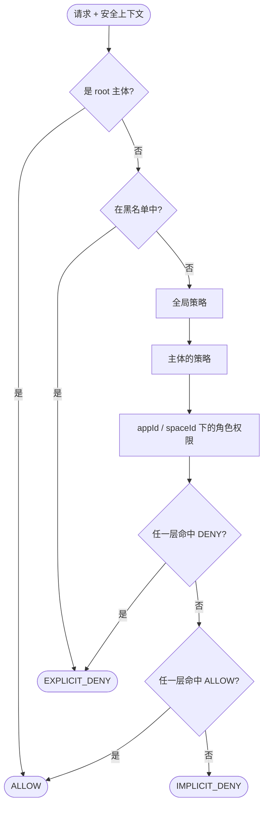

# 简介 {#introduction}

CoSec 是面向 Spring Boot 应用和网关的响应式、多租户安全框架。它为每个请求回答同一个问题：
**这个主体能否在当前上下文中执行这个操作？** 答案来自 IAM 风格的策略（参考
[AWS IAM](https://docs.aws.amazon.com/IAM/latest/UserGuide/introduction.html)）和基于角色的应用权限，
求值时“拒绝优先”。

## 核心概念 {#core-concepts}

| 概念 | 含义 |
|---|---|
| **主体（Principal）** | 调用方：一个 id、它的角色、附加给它的策略，以及任意属性。匿名调用方也是主体（id 为 `(0)`）。由 JWT 携带。 |
| **租户（Tenant）** | 主体所处的租户。`(0)` 是默认租户，`(platform)` 是平台租户，其他 id 都是用户租户。 |
| **请求（Request）** | 与传输层无关的 HTTP 请求视图：路径、方法、客户端 IP、Origin、Referer、请求头、应用 id（`CoSec-App-Id`）、空间 id（`CoSec-Space-Id`）和设备 id（`CoSec-Device-Id`）。 |
| **策略（Policy）** | 一组带名称的**语句**，并有一个类型：`GLOBAL` 作用于所有请求；`SYSTEM`（平台管理）和 `CUSTOM`（用户自定义）只作用于在 `policies` 中列出它们的主体。可选的策略级条件决定整条策略是否生效。 |
| **语句（Statement）** | 一条规则：**效果**（`ALLOW` 或 `DENY`）、**动作**（覆盖哪些请求，通常是路径模式）和可选的**条件**（何时生效）。 |
| **应用权限（App permission）** | 每个应用（`appId`）一份权限目录，按分组组织以便在界面上展示。**角色**按空间、通过权限 id 获得授权。 |

策略和权限都是 JSON 文档，语法见[策略](./policies.md)。

## 如何做出决策 {#how-a-decision-is-made}

- **拒绝处处优先。** 任何一层命中的 `DENY` 都会压过其他层命中的 `ALLOW`，全局 `ALLOW` 无法覆盖主体或角色层的 `DENY`。
- **默认拒绝。** 没有任何规则命中时，请求被拒绝（`IMPLICIT_DENY`）。
- **出错即拒绝。** 策略存储不可达、条件出错或正则超出时间预算，都不会放行请求。

Web 集成把决策转换为响应：匿名调用方返回 `401`，已认证调用方返回 `403`，触发限流返回 `429`。
详见 [Web 集成](./web-integration.md)。

## 模块 {#modules}

| 模块 | 用途 |
|---|---|
| `cosec-api` | 只有接口：主体、策略、授权、请求、租户。 |
| `cosec-core` | 策略引擎、匹配器、授权、安全处理流程、本地策略加载、审计。 |
| `cosec-jwt` | JWT 签发与校验。 |
| `cosec-webflux` / `cosec-webmvc` / `cosec-gateway` | Spring WebFlux、Spring MVC 和 Spring Cloud Gateway 的适配器。 |
| `cosec-cocache` | 基于 Redis 存储策略、权限和已吊销令牌，并带本地缓存（[CoCache](https://github.com/Ahoo-Wang/CoCache)）；Redis 限流器。 |
| `cosec-social` | 通过 [JustAuth](https://github.com/justauth/JustAuth) 实现 OAuth 社交登录。 |
| `cosec-opentelemetry` · `cosec-openapi` · `cosec-ip2region` · `cosec-kafka` | 链路追踪、基于 OpenAPI 生成策略、IP 地理位置、审计事件发送到 Kafka。 |
| `cosec-spring-boot-starter` | 上述所有模块的自动配置，按功能启用。 |
| `cosec-gateway-server` | 基于上述模块、开箱即用的网关（不作为库发布）。 |

下一步：[快速开始](./quick-start.md)。
