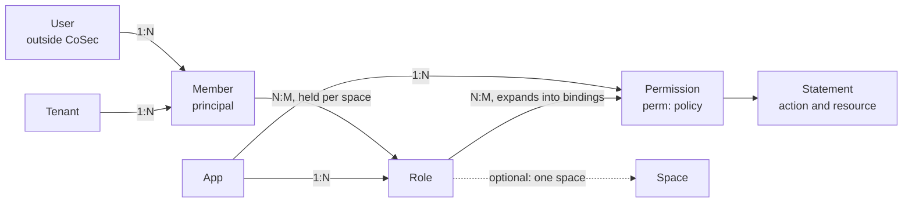
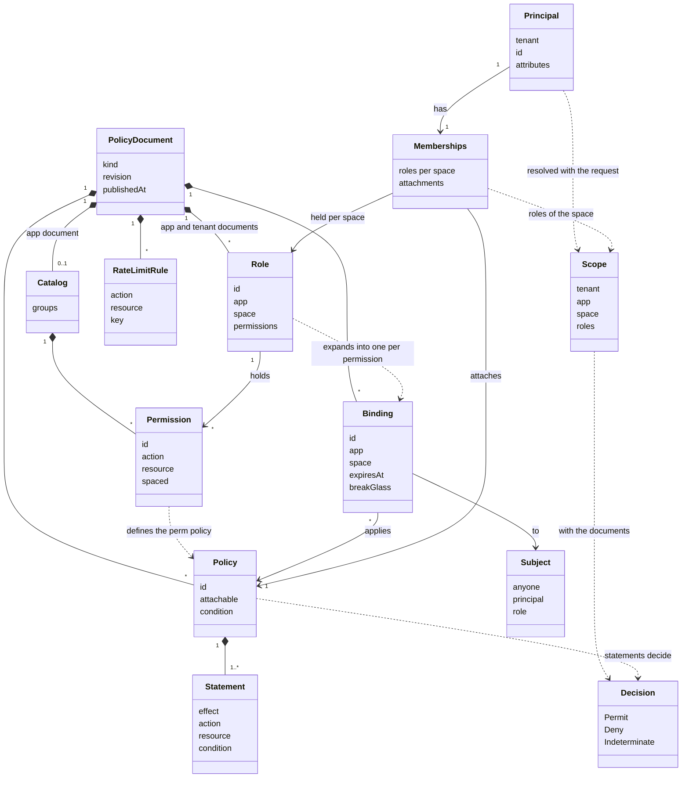

# 模型 {#model}

面向想在写文档之前先看清全貌的架构师和策略作者。本页展示 CoSec 授权模型的各个实体、它们的关系、每个实体存放在哪份文档里，以及 CoSec 把哪些事留给你自己的系统。术语的定义见[核心概念](./concepts.md)，字段见[策略语言](../policies/language.md)，可运行的完整示例从[简单模式](../scenarios/simple-mode.md)开始。

## 实体 {#the-entities}

| 概念 | 在 CoSec 里是什么 | 存放位置 |
|---|---|---|
| 用户（User） | 不在 CoSec 里，是身份系统里的人。 | 你的系统 |
| 成员（Member） | **主体**：租户加 id，id 只在租户内唯一。 | 令牌声明，或你的 `MembershipProvider` |
| 组织（Organization） | 不在 CoSec 里。部门在你的 `MembershipProvider` 里展开成角色；关于它的单值事实可以是主体属性，由条件读取。 | 你的系统 |
| 租户 | 一个 id，对应一份租户文档。 | 租户文档 |
| 应用 | 一个 id，对应一份应用文档。由平台拥有，所有租户共用。 | 应用文档 |
| 空间 | 可选的、不透明的字符串。CoSec 不保存空间的注册表，也不记录空间归谁。 | 成员关系（`role@space`）、绑定或角色的 `space`、请求的 `CoSec-Space-Id` |
| 角色 | 一个 id。角色在文档里有条目：名称，以及它持有的权限；成员通过成员关系持有它。 | 应用文档（系统角色）、租户文档（自定义角色） |
| 权限 | 写了 `action` 的目录条目，同时也是策略 `perm:<app>/<id>`。 | 应用文档 |
| 策略 | 语句的命名列表：效果、动作、资源、条件。 | 任意文档 |
| 绑定 | “这个主体，在这个应用和空间里，适用这条策略。” | 任意文档 |
| 边界 | 平台为租户设定的、可被许可内容的上限。 | 平台文档，由租户文档指定 |

## 它们如何关联 {#how-they-relate}

角色属于一个应用，也可以绑定到一个空间。应用与空间只在这里相遇，所以“一个应用多个空间”和“一个空间跨多个应用”不需要任何额外规则，见[应用与空间](#apps-and-spaces)。

## 类图 {#class-diagram}

图中有两处是派生出来的，不是存储的。读取文档时，角色的绑定由它的条目写出（`RoleExpansion`），所以编译、授出分析、差异和 `explain` 看到的是同一组绑定；存储的文档里角色仍然只是一个条目。权限的策略同样由目录条目写出。规则见[角色权限](../policies/role-permissions.md#roles)。

控制面在文档周围还有自己的记录：基于某个修订的**变更**、它的**影子窗口**和**审批**，最终得到一个新修订（[测试策略](../policies/testing.md#changes)）。

## 每份文档放什么 {#what-each-document-holds}

| 内容 | 平台 | 应用 | 租户 |
|---|---|---|---|
| 策略和绑定 | 是 | 是 | 是 |
| 绑定给任何人（`"*"`） | 是 | | 是 |
| 绑定给主体 | 是 | | 是 |
| 绑定给角色 | | 是 | 是 |
| 权限目录和 `perm:` 策略 | | 是 | |
| 角色 | | 系统角色 | 自定义角色，各属于一个应用 |
| break-glass 绑定 | 是 | | |
| 限制、属性、边界 | 是 | | |
| 租户的边界 | | | 是 |
| 限流规则 | 是 | 是 | 是 |

表格背后的规则，简述如下：

- 平台文档里不能写角色绑定：平台文档由所有租户共用，写在那里的角色对每个租户意味着同一件事。请在应用文档或租户文档里绑定角色。
- 应用文档只定义 `perm:<app>/…` 策略，这些策略永远不可附加，并且只绑定角色。
- `cosec:platform-admin` 只在平台文档和 `(platform)` 租户的文档里绑定。
- break-glass 只在平台文档里，绑定 `(platform)` 租户的主体，并且会过期。

每一条都在文档编译时检查；确切规则见[策略语言](../policies/language.md#bindings)。

## 应用与空间 {#apps-and-spaces}

空间是可选的。不使用空间的应用不需要写任何与空间有关的内容：目录里没有 `spaced`，角色上没有 `space`，令牌里的角色不带 `@`，请求里没有 `CoSec-Space-Id`。默认空间 `""` 就是“没有空间”。

应用使用空间时，由角色决定它在哪里生效：

| 你想要 | 写法 | 效果 |
|---|---|---|
| 没有空间 | 什么都不写 | 一切都发生在默认空间 |
| 一个应用，多个空间 | 一个 `app: wms`、`space: wh-01` 的角色，或成员以 `role@wh-01` 持有的系统角色 | 角色只在成员持有它的空间里授权 |
| 一个空间被多个应用共用 | 每个应用自己的角色，在同一个空间 id 里持有 | 同一个空间，每个应用的权限由它自己的角色授予 |
| 系统角色 | 应用文档里的角色 | 在成员持有它的任何空间里生效，对每个租户都生效 |

只有在请求所在空间持有的角色才算数，而令牌只为一个应用签发，所以空间 id 不会把授权从一个应用带到另一个应用。场景见[不使用空间的应用](../scenarios/app.md)和[使用空间的应用](../scenarios/spaces.md)。

## 留在 CoSec 之外的 {#what-stays-outside-cosec}

| 不在 CoSec 里 | 属于哪里 |
|---|---|
| 用户、密码、资料、组织和部门 | 你的身份系统。CoSec 只看到主体和它的成员关系。 |
| 租户有没有某个应用、试用或到期 | 你的业务系统。签发令牌时检查；需要立即生效时吊销令牌或读取 `ext.*` 属性。边界是静态上限，不是订阅状态。 |
| 成员管理、成员数、邀请 | 你的产品。 |
| 空间归谁、空间注册表、空间层级 | 你的产品。CoSec 只在令牌列出某个空间时才接受它。 |
| 角色继承、用户组、基于关系的访问控制 | 不建模。在你的 `MembershipProvider` 里展开，或者每种组合写一个角色。 |
| 行级过滤 | 你的查询。CoSec 对动作和资源 id 做决策，见[对象级规则](../integration/checks.md#object-level-rules)。 |

## 一个请求如何经过模型 {#one-request-through-the-model}

1. 凭证给出**主体**及其**成员关系**：各空间里的角色，以及附加策略。
2. `ScopeResolver` 把它们和请求所属的应用、空间合成**作用域**：租户、应用、空间，以及在该空间持有的角色。其他应用的令牌、主体没有角色的空间，都在这里被拒绝。
3. 请求的**动作**和**资源**来自[路由映射](../integration/web.md#route-maps)，没有映射时来自 HTTP 方法和路径。
4. 引擎读取平台文档、租户文档，请求有应用时再读应用文档，按[固定顺序](./security-model.md#evaluation-order)收集通过**绑定**和附加策略适用的**策略**。
5. 匹配的 DENY 决定结果；否则匹配的 ALLOW 许可，并受租户的**边界**约束；否则拒绝。结果就是**决策**。

**下一步：**每个决策都遵守的保证，见[安全模型](./security-model.md)；要写规则，见[策略语言](../policies/language.md)。
