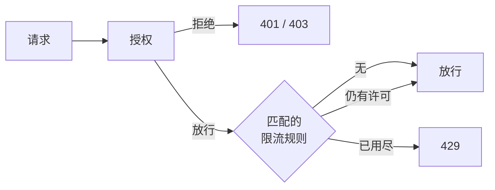

# 限流 {#rate-limiting}

限流约束请求通过的频率，它独立于策略：策略决定请求是否被允许，限流规则决定被允许的请求可以多频繁地通过。
只有授权放行的请求才消耗许可。被拒绝的请求已经被挡住，不应占用正常调用方的配额。



## 规则 {#rules}

规则是 JSON 文件，默认加载所有 `classpath:cosec-rate-limit/*-rate-limit.json`（见
[`cosec.limiter.locations`](./configuration.md#rate-limiting)）。一个文件包含一条规则或一个规则数组。

```json
[
  {
    "id": "login-by-ip",
    "action": { "path": { "pattern": "/auth/login", "method": "POST" } },
    "key": "request.remoteIp",
    "permitsPerSecond": 0.1,
    "windowSeconds": 60,
    "strictFailure": true
  },
  {
    "id": "export-free-tier",
    "action": "/export/**",
    "condition": { "inRole": { "value": "free" } },
    "key": "context.principal.id",
    "permitsPerSecond": 0.2,
    "windowSeconds": 60
  }
]
```

| 字段 | 必填 | 说明 |
|---|---|---|
| `id` | 是 | 配额的名字，只能包含字母、数字、`_`、`.` 和 `-`。计数器归属于 id，因此两条规则不会意外共享配额。id 必须唯一。 |
| `action` | 是 | 规则作用于哪些请求，写法与语句的[动作](./policies.md#actions)相同。 |
| `condition` | 否 | 进一步收窄规则，写法与语句的[条件](./policies.md#conditions)相同。默认总是匹配。 |
| `key` | 否 | 一个请求或上下文[部件](./policies.md#value-conditions)，按其取值把配额拆成多个桶，例如按 IP 或按用户。不设置时，所有匹配的请求共享一个桶。部件取值为空的请求共享同一个桶，因此省略某个请求头无法绕过限流。`request.path.var.<name>` 读取的是本规则自身 `path` 动作捕获的变量，不受同一请求匹配的其他规则影响。不受支持的部件会在规则加载时直接失败。 |
| `permitsPerSecond` | 是 | 允许的速率。一个窗口允许 `permitsPerSecond × windowSeconds` 个请求，且至少一个。 |
| `windowSeconds` | 否 | 窗口长度，默认 `1`。低速率请用更长的窗口：每秒 `0.1`、窗口 `60` 秒即每分钟 6 个请求。 |
| `strictFailure` | 否 | 后端故障时的处理：`false`（默认）跳过该规则，`true` 以 `429` 拒绝请求。 |

只有 `action` 是 `path` 动作的规则，才能在 `condition` 或 `key` 中读取 `request.path.var.<name>`，读到的是该动作捕获的变量，
而不是策略或其他规则捕获的变量。动作不是 `path` 的规则读取路径变量时，会加载失败并抛出 `PathVariableScopeException`
（见[路径变量](./policies.md#actions)）。

每条匹配的规则按顺序各消耗一个许可。第一条用尽的规则拒绝请求，其后的规则不再消耗。无法读取的规则文件会阻止应用启动，
因为被悄悄丢弃的限流会在无人察觉的情况下撤掉一道防护。

要从其他地方（例如数据库）加载规则，请声明自己的 `RateLimitRuleProvider` bean。每个被放行的请求都会调用它，因此它必须从内存中返回。

## 计数 {#counting}

两种后端使用同一种滑动窗口：估算值等于上一个窗口的计数乘以仍与当前时间重叠的比例，再加上当前窗口的计数。被拒绝的请求不计数。

| 后端 | 生效条件 | 范围 |
|---|---|---|
| `RedisRateLimiter` | 引入 `cache-support` 且存在 `StringRedisTemplate` bean | 全集群。计数器位于 `<key-prefix>:<id>:<bucket>:<window>`，两个窗口后过期。 |
| `LocalRateLimiter` | 其他情况 | 每个实例。有 N 个实例时，实际限额是 N 倍。最多保留 100,000 个桶，空闲一小时的桶会被回收；被回收的桶从零开始重新计数。 |

要使用其他存储，请声明自己的 `RateLimiter` bean（见[扩展](../architecture/extending.md#rate-limiter-backends)）。

## 响应 {#responses}

超出规则的请求以 `429 Too Many Requests` 应答，响应体为 `{"authorized":false,"reason":"Too Many Requests"}`。
只要有规则匹配，无论请求被放行还是被拒绝，响应都带有以下响应头：

| 响应头 | 取值 |
|---|---|
| `RateLimit-Limit` | 最紧的匹配规则每个窗口的许可数。 |
| `RateLimit-Remaining` | 当前窗口剩余的许可数。 |
| `RateLimit-Reset` | 距当前窗口结束的秒数。 |
| `Retry-After` | 仅在 `429` 时出现：距当前窗口结束的秒数。 |

被拒绝的请求会以决策 `TOO_MANY_REQUESTS` 记入审计，同时记录放行该请求的策略或权限。

## 从限流条件迁移 {#migrating-from-rate-limit-conditions}

在 6.0 及之前，限流是策略中的条件（`rateLimiter`、`groupedRateLimiter`、`redisRateLimiter`、
`redisGroupedRateLimiter`）。它们已在 6.1.0 中移除。仍在使用它们的策略将无法解析：本地策略文件会被跳过并记录 `ERROR` 日志，
存储在 Redis 中的策略读取失败，请求被拒绝。升级前请把它们逐一改写为规则：

| 原写法 | 新写法 |
|---|---|
| 语句的 `action` | 规则的 `action` |
| 语句的其他条件 | 规则的 `condition` |
| `part` | `key` |
| `permitsPerSecond`、`windowSeconds`、`strictFailure` | 同名字段 |
| `rateLimiter` / `groupedRateLimiter` | 没有 Redis 时，规则由 `LocalRateLimiter` 计数 |
| `expireAfterAccessSecond` | 不再需要：空闲的桶一小时后回收 |

有三处行为变化：

- **被拒绝的请求不再消耗许可。** 以前，策略条件中的限流也会统计随后被其他层拒绝的请求。
- **配额归属于规则 id。** 以前，配置完全相同的 Redis 限流器共享同一份配额。
- **计数器重新开始。** Redis 键从 `<key-prefix>:<配置哈希>:…` 改为 `<key-prefix>:<id>:…`，旧计数器被弃用并自行过期。
